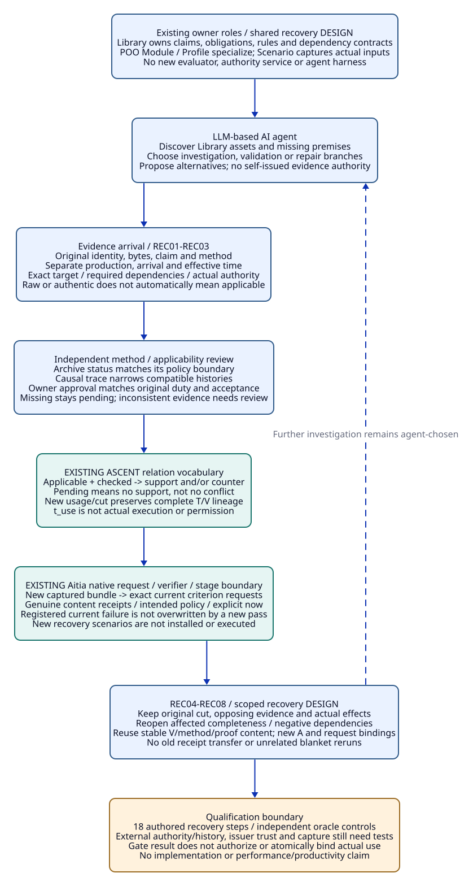

# SPDX-FileCopyrightText: 2026 tao3k team and Contributors
#
# SPDX-License-Identifier: LGPL-2.1-only

#+TITLE: 10.20 Evidence Arrival and Scoped Review Recovery
#+LANGUAGE: en
#+PROPERTY: JD_ID 10.20
#+OPTIONS: toc:3 num:t
#+STARTUP: overview
#+TODO: DESIGN | REVIEWED QUALIFIED
#+FILETAGS: :library:poo:ascent:aitia:recovery:evidence:
#+PROPERTY: header-args :eval never :tangle no :exports code

[[file:../../00-09-project/00-documentation/00.01-index.org][Index]] | [[file:10.19-standard-identities-and-aitia-review-traceability.org][Detailed Aitia review packets]] | [[file:10.17-domain-libraries-and-atomic-specialization.org][Domain Library hierarchy]]

The [[file:10.21-engineering-design-audit-and-delivery-plan.org][engineering audit]] selects the next concrete owner slice and qualification
gates. The recovery semantics here remain design contracts, not installed
archive/status/authority capabilities.

* DESIGN Recover an evidence-backed judgment, not a green label
:PROPERTIES:
:CUSTOM_ID: evidence-recovery-purpose
:STATUS: shared-design-contract-not-installed
:END:

The detailed packets in 10.19 expose a common problem: evidence can arrive after
a review has become pending, after an action has occurred, or after a later cut
has selected different policy, scope or source. Recovery must improve the current
judgment without changing the original observation or inventing authority.
This document consolidates that shared design instead of adding another layer
of case-specific runtime machinery. The existing packets remain independent gold.

A domain Library owns reusable obligations, methods, dependency contracts and
review questions. POO specializes them for the selected project/Profile. The
LLM-based AI agent chooses useful investigation, validation and repair branches.
ASCENT derives scoped evidence relationships from actual supplied facts. Existing
Aitia owners bind independently reviewed paragraph evidence and evaluate selected
stage admission. The actual
effect owner remains responsible for action authority and check/use consistency.

The Library should help the agent find the missing evidence and reuse what is
already sufficient. It should not force every project through the same execution
script. The constraints below concern identity, applicability, conflicts and
accountability; the agent can propose any reasoning path satisfying those bounds.

* DESIGN One input closure through existing owners
:PROPERTIES:
:CUSTOM_ID: recovery-input-and-owners
:END:

#+NAME: recovery-owner-contract
| Owner | Existing capability / design responsibility | Boundary |
|-------+---------------------------------------------+----------|
| Domain Library / POO Module | Own canonical engineering claims, factor-to-obligation rules and dependency contracts | Standards review does not replace Rust mechanisms or parent models |
| Selected Profile | Supply workload/runtime/policy premises while preserving applicable parent obligations | A narrower Profile cannot silently withdraw original work |
| Scenario | Capture target work product, governing policy, independently resolved history and evidence intake | Complete history, uniqueness and actual-use enforcement remain integration requirements |
| LLM-based AI agent | Discover Catalog entries, propose hypotheses, choose methods, explain results and suggest repair | Its explanation or desired outcome does not issue checked evidence |
| Domain method / independent reviewer | Validate actual result, method coverage and authority relevant to the claim | Authentic bytes alone do not establish applicability or completeness |
| Existing ASCENT Evidence DSL | Derive support/counter/pending and usage references over checked applicable witnesses | Relation membership is not authority, paragraph verification or effect permission |
| Existing Aitia / Core verifier | Bind actual artifact content to exact requests, genuine receipts and stage evaluation | Native gate trusts supplied policy and requests; no automatic external history/status lookup |
| Existing effect owner | Record actual operation/input/order and enforce its actual authority/use boundary | A stage result does not atomically consume a receipt or authorize release |

#+NAME: recovery-input-closure
| Captured input | Required content |
|----------------+------------------|
| Target | Canonical claim/obligation, subject/revision/scope, selected method and exact missing premise |
| Prior cut K0 | Actual source/configuration, Profile/policy, original evidence, known intake and saved query/gate; snapshot label alone is insufficient |
| Arrival E | Original identity, producer/authority, bytes, covered event/status interval, declared claim/method and arrival observation |
| Expected current cut K1 | Independently governed target policy/history/intake, not a sender-selected favorable subset |
| Impact and reuse | Changed dependency keys, required completeness/negative dependencies, stable V/method content and new usage bindings |
| Disposition | What became known, what remains missing, all opposing evidence, action owners and actual authority/effective boundary |
| Output | Exact K1 query/paragraph/stage result with complete references; no result hashes itself into its inputs |

These are sections of the existing review artifacts, not a new Scheme record DSL.
An arrival can be relevant to a past event while arriving now. Its arrival time
does not become the time it was produced, the interval it covers, or the effective
time of an approval. A later trace can establish facts about old use; a later
approval does not retroactively authorize that use merely because it arrived.

* DESIGN Eight bounded recovery rules
:PROPERTIES:
:CUSTOM_ID: bounded-recovery-rules
:END:

The REC identifiers below are local design rules within 10.20, not external SWE
requirements or another implemented rule engine. They constrain supplied evidence
and existing owner decisions. They are not a mandatory agent execution schedule.

#+NAME: finite-recovery-rules
| Rule | Inputs and required conclusion | Refusal / remaining work |
|------+--------------------------------+--------------------------|
| REC01 Origin and identity | Preserve E's actual source, bytes, claim, producer/authority and event/arrival distinction | No relabeling old results as fresh executions, new approvals or new issuers |
| REC02 Target and premises | Match claim/method and exact declared dependency footprint to K1; verify one unambiguous value per required key | Wrong target, missing key, unsupported extra input or inconsistent binding cannot provide the selected support |
| REC03 Time and authority | Independently establish covered interval, actual policy and any required status/approval for this use | A late or authentic witness may still be inapplicable; unavailable status is not denial or permission |
| REC04 Preserve alternatives | Retain all applicable positive and opposing evidence, original hypotheses and unresolved questions | A new pass does not erase counter; absence of pending is not a conflict-resolution proof |
| REC05 Reopen affected closure | Recompute affected obligations and completeness/action coverage over the explicit new intake | New member/counter can invalidate a prior no-open-issue judgment even when source bytes are unchanged |
| REC06 Reuse stable content | Reuse V/method/proof content only under independently checked stable dependencies; create new applicability bindings | No blanket reruns, no row-equality stability certificate, no old receipt authority transfer |
| REC07 Re-review through Aitia | Bind the actual new bundle and exact current native requests, verify relevant content, evaluate intended policy at explicit now | Preserve current native failures; if one was registered, a later pass cannot override it. A genuine later review must reconcile its disposition |
| REC08 Preserve history and actual effects | Retain K0 result, actual effects and event ordering; K1 is a new current view | No old-query mutation, retroactive non-execution or inference of atomic check/use from repeated checks |

Completeness and negative dependencies are explicit: the set of known issues or
relevant results through a cut is an input to the completion review. An additional
member can reopen that review without invalidating an unchanged theorem about a
different obligation. Conversely, a valid new witness cannot close an unrelated
missing approval or proof requirement. Keep those judgments separate. Formal
proof transport retains typed obligation/stability and patch touched/frame
premises; an unchanged-file observation is not itself that transport proof.

* DESIGN Map the contract to actual ASCENT and Aitia semantics
:PROPERTIES:
:CUSTOM_ID: recovery-native-correspondence
:END:

Source inspection of [[file:../../../modules/resource-evidence/func.ss][the existing resource evidence program]] gives a concrete
local relation vocabulary. It currently serves resource obligations; this
inspection does not install archive, historical-order or handoff obligations into
that Module. A future Library entry must supply its own reviewed rules and
specific methods through the existing design, not copy the evaluator.

#+NAME: recovery-ascent-correspondence
| Existing relation | Meaning available from current source | Recovery design use and limit |
|-------------------+---------------------------------------+-------------------------------|
| application / catalog_rule / factor | Derive selected obligation and method | Select relevant Library obligations; factor coverage must remain explicit |
| catalog_dependency / scope / witness_input | Compare required keys and exact digests; expose missing/mismatched/extra inputs | Carry K1's exact premises; unique per-usage key values and digest authority remain host/integration obligations |
| witness / checked | Actual outcome plus supplied validation and method-review references | Arrival alone creates no trusted checked row; issuer/method review must be established independently |
| applicable | Candidate without the program's declared input blockers | Applicability is relative to the supplied footprint; undeclared authority/history conditions are not magically checked |
| support / counter | Applicable checked pass/fail relations | Keep both polarities; do not coerce them into a single last-result status |
| pending | Required obligation with no support | Counter alone can coexist with pending; pass plus fail can remove pending without resolving contradiction |
| t_use | Checked applicable witness linked to usage/snapshot and obligation | Exists for either polarity; it is not an action authorization or proof of actual execution |

In these relation signatures, =checked(w,v,m)= names a validation and method-review
reference. The last string in =support(u,o,w,v,m)= is that review reference, not
an independently issued applicability authority. T/V/A in this documentation
remains the reasoning/result/applicability reference discipline; coincidental
variable names in Scheme rules do not create those roles automatically.

The current program accepts host-supplied source rows, including =checked=, and
its application snapshot is a string. Digest equality and a label therefore do
not authenticate history, freeze a live session, or issue authority. A saved
historical result needs the actual captured input/query closure. Updating a live
session with =gerbil-ascent-session-replace-sources!= must not be presented as
replaying the original immutable K0. This remains an integration boundary.

The existing [[file:../../../../poo-flow/packages/lambda-aitia/modules/sdlc/standards/nasa-lifecycle.ss][Aitia lifecycle]] and [[file:../../../../poo-flow/core/contribution/verification.ss][Core verification]] path remains native Scheme:

#+NAME: recovery-native-requests
#+begin_src scheme
;; Non-executed API path; all arguments are existing supplied native values.
(nasa-context-request candidate-project software-class context)
(nasa-verifiable-evidence candidate-criterion-record actual-bundle-sha256)
(nasa-evidence-request artifact-bound-criterion-record)
(poo-flow-verify trusted-adapter exact-request now until)
(nasa-stage-gate intended-policy candidate-project software-class context
  complete-evidence-list trusted-adapter genuine-receipts now)
#+end_src

Changing the captured full review bundle requires a new review identity under
10.19's chosen full-bundle contract. Since all eight paragraph requests in those
packets bind that bundle, all require matching current receipts. This does not
require eight independent repetitions of an unchanged Rust test or Lean proof.
Reuse its verified content/footprint and review each criterion's actual binding.
No new production integration or dependency declaration is installed here.

* DESIGN Three recovery trajectories with independent gold
:PROPERTIES:
:CUSTOM_ID: recovery-trajectories
:END:

These are bounded cross-checks of the shared rules against the existing cases,
not additional variants in the 24-case Benchmark. Each trace starts with its
10.19 inputs and assumes all other requirements remain independently satisfied
unless stated. Gold is authored; no new native execution is claimed.

** Archive status arrives after an unavailable-source review
:PROPERTIES:
:CUSTOM_ID: recovery-archive-status
:END:

Input: [[file:10.19-standard-identities-and-aitia-review-traceability.org::#aa05-unavailable-authority-packet][AA05]] NB5 is pending p3/p4 under AH-current. Arrival ES has actual
archive-authority identity/domain, status boundary and allowed interval; alternative
ES-old has a different boundary. Original F5/F3 and their actual action closures
stay unchanged. New NB6 contains ES plus independent applicability review, with a
fresh full review revision B6 and all eight current criterion bindings.

#+NAME: archive-recovery-gold
| Step | Input/event | Expected judgment |
|------+-------------+-------------------|
| A0 | Restore NB5's saved pending query | Preserve its original U={SWE-088/p3,SWE-088/p4}; no automatic current approval |
| A1 | ES arrives but no method/authority review completed | Candidate only; p3/p4 remain unverified for the new intended review |
| A2 | Independent oracle matches ES to AH-current's actual required scope/interval | That missing status premise closes; authentic F5/F3 and V05 remain reusable content |
| A3 | NB6 independently reconciles complete history/actions and gets fresh context plus all eight content receipts | Focused B6 stage may admit if no current B6 fail; NB5 remains its saved pending result |
| A4 | ES-old or a genuinely contradictory status decision arrives instead | Scope mismatch gives no support; an independently checked contradiction preserves counter/action work. No pending item is converted to a fabricated fail |
| A5 | A later cut changes status policy or known intake after B6 review | Recheck affected applicability/completion; old B6 result remains historical, not perpetual authority |

Oracle: independently compare authority/domain, required boundary and actual
policy interval, then the original failure/action inventory. Aitia presence and
ASCENT support are compared outputs, not the status oracle.

** Historical order is resolved by a late trace
:PROPERTIES:
:CUSTOM_ID: recovery-historical-order
:END:

Input: [[file:10.19-standard-identities-and-aitia-review-traceability.org::#pr07-unknown-order-packet][PR07]] NP07 retains C0 before both R and U, with R/U unresolved and
actual U known. Arrival EO is authenticated causal evidence about those exact
events/inputs. It does not grant action authority or prove expanded intake was
reviewed. New NP08 uses review revision D4 and includes the complete opposing trace.

#+NAME: order-recovery-gold
| Step | Input/event | Expected judgment |
|------+-------------+-------------------|
| O0 | Saved NP07 has both compatible histories | No receipt-valid-at-U pass or violation counter from the order gap alone |
| O1 | EO is only arrival order or incomparable local clocks | No history eliminated; keep the dependent completion pending |
| O2 | Independent trace review establishes C0 < U < R with receipt interval and identity valid | Receipt/order condition may gain checked support in its new usage; current receipt revocation still governs future reliance |
| O3 | Reconcile NP08's other requirements | Expanded intake, action authority, impact and cleanup remain independently required; O2 alone does not imply native stage-admitted |
| O4 | Alternative actual trace establishes C0 < R < U | Independently validated violation can produce counter and action work; a native current criterion fail, if registered, blocks that review |
| O5 | Independently supported traces conflict about the same events | Preserve both complete closures and reopen method review; no latest-arrival winner or silent removal of the inconvenient trace |

Oracle: enumerate histories satisfying independently established causal constraints
and actual request/effect identities, then evaluate the receipt-use predicate.
If no compatible history remains, flag inconsistent evidence for review; do not
use an empty history set to prove both safety and violation vacuously.

** Required owner approval arrives without completing the proof
:PROPERTIES:
:CUSTOM_ID: recovery-owner-approval
:END:

Input: [[file:10.19-standard-identities-and-aitia-review-traceability.org::#oh07-no-fallback-approval-packet][OH07]] NO07 lacks O-old approval under HP-original; O-new has actual
matching acceptance, while I08-proof remains open. Arrival EA is O-old's genuine
approval for the exact obligation/scope and an explicit effective boundary. New
NO08 uses limited review revision L4 and preserves W0 and the retained-work matrix.

#+NAME: owner-recovery-gold
| Step | Input/event | Expected judgment |
|------+-------------+-------------------|
| H0 | Original approval unavailable, no authorized fallback | Preserve actual assignment/acceptance and missing approval; original proof is open |
| H1 | EA has the wrong duty, scope or authority, or is only a proposed approval | It cannot close the required predicate; preserve its actual scope and pending handoff |
| H2 | Independent authority oracle validates EA and matching acceptance under HP-original | Handoff may be established at its actual effective boundary; no backdated authorization or completed theorem inferred |
| H3 | NO08 truthfully captures approved transfer, complete retained work and independent limited review | Fresh L4 requests may admit that limited work; original W0 proof/cost obligations and blocked result remain explicit |
| H4 | A real proof is later supplied | Independently review theorem, assumptions and source mapping; full-scope completion needs its own genuine review/disposition, not L4 receipts |
| H5 | Required governance or acceptance remains missing after EA | Only established predicates close. Do not manufacture fallback authority, discard valid proof content or rewrite saved NO07 |

Oracle: a finite original-duty/approval/acceptance/effective-boundary matrix,
checked independently of native factories and the LLM-based AI agent. A new
owner or review revision does not change the canonical original obligation.

* DESIGN Qualification and review-cost boundary
:PROPERTIES:
:CUSTOM_ID: recovery-qualification-boundary
:END:

#+NAME: recovery-design-controls
| Control | Required observation | Qualification status |
|---------+----------------------+----------------------|
| Wrong target or missing dependency | No selected support; matching actual fragments retained | Design gold only |
| Late evidence for the correct historical interval | New reviewed usage can establish that historical fact; original cut unchanged | Actual capture/replay tests needed |
| Pass and fail both checked | Both preserved; completion requires conflict/method disposition | Local resource relation semantics inspected; recovery scenarios not executed |
| New counter or inventory member | Reopen affected completeness and negative dependencies | Actual dependency and complete-intake tests needed |
| Old receipt or copied receipt presentation | Cannot supply new request/issuer authority | Prior Aitia unit receipts are bounded; new recovery tests not run |
| Saved admission/gate used after revocation or expiry | Re-evaluate exact current inputs/time at the actual owner boundary | Atomic actual use remains unqualified |
| Changed scope/policy/revision | Reconcile original obligations, history and actual authority | No automatic native policy-history or global uniqueness guarantee |
| Review burden | Reuse stable method content; avoid unrelated reruns and repeated prose | No productivity/performance improvement claimed |

At design level, this specifies shared recovery semantics for the three cases
and exposes the remaining implementation obligations: authenticated external inventory/status,
real method review and witness issuance, immutable capture/replay, actual owner
concurrency and use authority. It does not close them by diagram or gold alone.
A later implementation slice should select one domain recovery with independent
positive/negative controls and actual source-bound results, not implement a new
universal agent harness or turn every pending item into a rerun.

#+CAPTION: Evidence arrival creates a new scoped review through existing Library, POO, ASCENT and Aitia owners, preserving original results, conflicts and actual effect boundaries.

