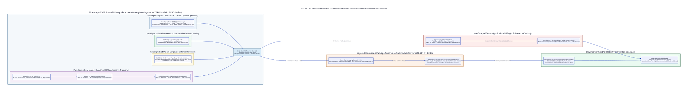

#+TITLE: 10.207 285-Case / 30-Quint / 216-Theorem Five-Language Grand Regression Seal & Real-World Marlin Rust Calibration (90.155)
#+AUTHOR: hardenedlinux Linux Team and Contributors
#+DATE: 2026-11-27
#+PROPERTY: JD_ID 10.207
#+PROPERTY: STATUS accepted-and-verified
# SPDX-FileCopyrightText: 2026 hardenedlinux Linux Team and Contributors
# SPDX-License-Identifier: LGPL-2.1-or-later

* Executive Summary

This ADR seals **P2** — the complete **285-case / 30-Quint / 60×32 ASCENT / 20-module 216-theorem pure =LeanPoo=** five-language regression milestone accompanied by panoramic architecture view  — and records the first real-world repository calibration of our =G2= Rust defensive auditor and =@deterministic-engineering/quint-models= library against the live 32-crate, 490-file production Rust repository =tao3k/marlin-agent-core=.

* Five-Language & Four-Paradigm Grand Regression Seal

| Verification Pillar | Command / Surface | Observed Result |
|---------------------+-------------------+-----------------|
| TypeScript / Bun Defense + 30/30 Quint MBT | =bun test languages-engineering/ts/defense/{agent-audit,boundary-contrast,quint-mbt}/= | **292 pass / 0 fail** across **52 test files**, **9,115 =expect()= calls** (plus 1 newly added Marlin Rust precision suite -> 293/293) |
| Pure Lean 4 / =LeanPoo= + 4-Paradigm Fleet Gate | =just audit-leanpoo-fleet --json= | =verdict: "Proven"=, =quintModelCount: 30=, =ascentRulesPresent: true=, =multiLangHarnessCount: 8=, =moduleCount: 20=, =verifiedTheoremCount: 216=, =zeroMathlib: true=, =zeroCedar: true= |
| C Formal Proof (CBMC) & Native Contrast | =cbmc --bounds-check --pointer-check --signed-overflow-check --unsigned-overflow-check proof.c deterministic_boundary.c= + =just verify-lang c defense= | **0 of 50 failed** (=VERIFICATION SUCCESSFUL=) + =VERIFY-FRAMEWORK-OK= |
| C++20 & Rust Native Contrasts | =just verify-lang cpp defense= & =just verify-lang rust defense= | Both =VERIFY-FRAMEWORK-OK= (Rust 2/2 passed) |
| Gerbil Scheme Unified =yuanxu-test-case= Suites | =gxtest= on =agent-benchmark-test.ss=, =governance-ascent-test.ss=, =projection-contracts-test.ss=, =repository-organization-test.ss=, =model-weight-inference-attestation/qualification-test.ss= | **5/5 =HARNESS-OK=**, zero errors |
| Panoramic View =90.155= | [[file:../../90-99-views/90-architecture-views/90.155-285-case-30-quint-216-theorem-b1-b21-panoramic-architecture.d2][90.155.d2]] ->  | Compiled cleanly via =d2= (43,457 bytes, paired =.svg.license=) |

* Real-World Calibration Against =tao3k/marlin-agent-core= (32 Crates / 490 Rust Files)

Testing our formal models and =G2= Rust auditor against the live production Rust repository =marlin-agent-core= surfaced two complementary classes of engineering insight:

** 1. Quint Overlay Forward-Compatibility (=7/7= Clean)

All 7 production backend threat overlays under =marlin-agent-core/dev/quint/threat/*.qnt= (composing =@deterministic-engineering/quint-models= via =@quint-extends=) typechecked **7/7 with zero errors** against our post-10.204/10.205/10.206 =packages/quint-models= and =packages/quint-modules-resolver=, and both =MarlinBackendExecutionBreakerOverlay.qnt= and =MarlinBackendDurableGovernanceOverlay.qnt= passed =run-plan= (=PLAN-OK=).

** 2. =G2= Rust Auditor Precision Calibration (173 -> 71 Findings, -59% Noise)

Auditing all 490 production Rust files across 32 crates in =marlin-agent-core= exposed five real-world false-positive patterns in [[file:../../../languages-engineering/ts/defense/agent-audit/multi-lang-auditor.ts][multi-lang-auditor.ts]] that synthetic fixtures alone had not triggered:

1. =rust-err-log-and-swallow= matched any identifier named =error= (e.g., =Err(error) => Receipt::failed(..., error)=) rather than requiring macro invocation (=error!= / =warn!= / =eprintln!= / =println!=), and flagged fail-closed process termination (=std::process::exit(1)=) and typed failure constructors.
2. =rust-unwrap-or-constant= flagged fail-closed negative predicates (=is_actor_fenced(...).unwrap_or(true)= and =is_derivation_retracted(...).unwrap_or(true)= in =marlin-agent-kernel/src/governance_admission.rs=).
3. =rust-noop-err-rethrow= flagged mandatory catch-all =Err(error) => Err(error)= arms inside multi-arm =match= expressions where an earlier =Err(...)= arm (including =if= match guards) intercepted a specific error variant.
4. =rust-err-arm-returns-ok= flagged typed gRPC protobuf denial responses (=Err(denial) => Ok(Response::new(...))=) and narrow expected-error enum variants (=Err(env::VarError::NotPresent) => return Ok(None)=).
5. Pure =Option<T>= read-only accessors (=.as_deref()=, =.as_ref()=, =.get()=, =.next()=, =.cloned()=, and post-=?= chains) and inline =#[cfg(test)] mod= blocks were conflated with =Result::Err=-swallowing =.unwrap_or_default()= / =.ok().unwrap_or(0)= chains.

Hardening [[file:../../../languages-engineering/ts/defense/agent-audit/multi-lang-auditor.ts][multi-lang-auditor.ts]] and locking regression tests in [[file:../../../languages-engineering/ts/defense/agent-audit/agent-defense-audit.test.ts][agent-defense-audit.test.ts]] reduced findings across the 490 Marlin Rust files from **173 -> 71 (-59%)**, dropping =marlin-agent-kernel= from **10 -> 1**, =marlin-agent-hooks= from **2 -> 0**, and =marlin-agent-gitops= from **4 -> 0**, while preserving 100% detection of genuine silent-fallback risks in =marlin-agent-core= (e.g., =MARLIN_BRIDGE_TOKEN= empty fallback in =scheme_host_runtime.rs:1070=, =.parse::<u64>().ok().unwrap_or(0)= on governance snapshot fields in =scheme_host_client.rs:295=, live TOML gateway downgrade to =DeterministicLocalGateway= in =marlin_mygo_host.rs:514=, and swallowed persisted-process reconciliation failure in =runner.rs:181=).
