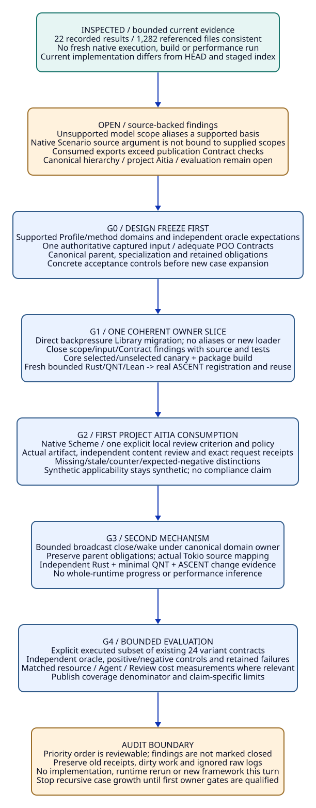

# SPDX-FileCopyrightText: 2026 tao3k team and Contributors
#
# SPDX-License-Identifier: LGPL-2.1-or-later

#+TITLE: 10.21 Engineering Design Audit and Next Delivery Plan
#+LANGUAGE: en
#+PROPERTY: JD_ID 10.21
#+OPTIONS: toc:3 num:t
#+STARTUP: overview
#+TODO: OPEN REVIEW | DECIDED QUALIFIED
#+FILETAGS: :audit:engineering:library:qualification:roadmap:
#+PROPERTY: header-args :eval never :tangle no :exports code

[[file:../../00-09-project/00-documentation/00.01-index.org][Index]] | [[file:10.17-domain-libraries-and-atomic-specialization.org][Library ownership]] | [[file:10.20-evidence-arrival-and-scoped-review-recovery.org][Recovery contract]]

* REVIEW Audit conclusion and evidence boundary
:PROPERTIES:
:CUSTOM_ID: engineering-audit-conclusion
:AUDITED_ON: 2026-10-19
:STATUS: source-and-receipt-inspected-no-runtime-rerun
:END:

The next engineering work should qualify one coherent domain-owned Library slice
before expanding the recovery case tree. The project already has a real bounded
resource-lifecycle investigation, native ASCENT registration and independent
oracles. Its generic Library hierarchy, native Aitia consumption and shared
recovery contract are still ahead of the executable organization. More narrative
cases cannot substitute for resolving that correspondence.

The recommended first slice combines supported-method scope, one authoritative
Scenario input, adequate publication Contracts and the direct backpressure-owner
migration already designed in 10.17. Qualify it through existing Core before
adding a second mechanism or claiming a project SDLC closure. This is a delivery
design, not authorization supplied by a stage result or a new implementation.

The [[file:../../../.data/project-design-audit-20261019/report.json][local audit receipt]] records the live checkout identity, source hashes,
package link targets and file-consistency checks. The checkout is on main with
substantial staged and unstaged work; HEAD alone does not identify the inspected
implementation. No source changes, dependency changes, full build, Scheme/QNT/
Lean/Rust execution, remote CI or performance measurement were performed here.

#+NAME: current-evidence-inventory
| Surface | Current evidence inspected | Supported conclusion / limit |
|---------+----------------------------+------------------------------|
| Resource investigation | Existing resource-real-20261019-04 report, 22 results, three native runs, six native cases, nine queries and seven exchange references | Actual historical bounded investigation exists; its nativePerformanceMeasured field is false |
| Recorded file closure | 21,810 referenced path/digest entries, 1,282 unique files across recorded inputs/artifacts/logs | No content mismatch found at this audit; consistency is not remote producer authentication or a fresh execution |
| Aitia native owners | Existing review/lifecycle unit-test receipt; no drift in its 11 after-test captured source/test files | Bounded native owner tests previously passed; project recovery packets and production authority remain unqualified |
| Live Scheme publications | rust-resources/resource-evidence, independent Profiles and two Scenarios selected in init.ss | One shared resource entry is executable; domain hierarchy and generic-parent publication are not yet installed |
| Formal artifacts | BackpressureOwners.qnt and BackpressureBudget.lean, method/oracle source | Finite ownership safety and conditional arithmetic; not complete Rust refinement, weak-memory, progress or throughput evidence |
| Design corpus | 10.17 hierarchy, 10.18 review contracts, 10.19 detailed inputs and 10.20 recovery rules | Source-grounded design/gold, not executable acceptance of the shared recovery system |

The Aitia source capture occurred after its tests and cannot establish before/
after stability across those runs. Current byte equality does not upgrade that
receipt. The resource report and raw logs remain local artifacts; old receipts
and failed/timeout records must not be rewritten during subsequent migration.

* OPEN Findings ordered by engineering impact
:PROPERTIES:
:CUSTOM_ID: engineering-audit-findings
:END:

** P1 / AU01: unsupported Profile scope can share a model basis
:PROPERTIES:
:CUSTOM_ID: audit-method-scope-alias
:OWNER: rust-resources method selection and Profile contract
:END:

[[file:../../../library/concurrency/resource-control/backpressure-memory/rust/methods.ss][model-initializer / model-basis/input]] admits queue=2 before selecting the
initializer by capacity. Thus both capacity=1,queue=1 and capacity=1,queue=2 select
initResource, whose actual [[file:../../../library/concurrency/resource-control/backpressure-memory/model.qnt][QNT queueLimit is 1]], and have the same model basis.
The generic Profile predicate accepts positive queue values. BP-O02's declared
footprint is only model, so matching that basis does not itself reject the second
Profile on reuse.

The independent [[file:../../../library/concurrency/resource-control/backpressure-memory/rust/oracle.ss][ownership oracle]] explicitly rejects the fresh (1,2) domain.
Therefore this audit does not claim a successful false fresh result or refute the
existing (1,1) receipt. The source-proven inconsistency is between early scope/
identity selection, the independent supported domain and reuse eligibility.
Equivalent reachable behavior would need an explicit reviewed abstraction; a
basis collision is not that justification.

Required closure: publish the actual method-supported domain, reject unsupported
selection before execution AND reuse, and test the (1,2) boundary independently.
Do not fix this merely by changing a hash or making the oracle call the selector.
If broader scope is intended, qualify that model mapping and its oracle first.

** P1 / AU02: the native Scenario accepts a source argument it does not bind
:PROPERTIES:
:CUSTOM_ID: audit-scenario-input-binding
:OWNER: resource-lifecycle Scenario and domain method scopes
:END:

[[file:../../../scenarios/resource-lifecycle/func.ss][open-review]] accepts profile, usage, snapshot, source and scopes, but does
not read source or establish correspondence between it and supplied scopes.
Native methods have a stronger captured footprint; the Scenario interface does
not declare which input is authoritative if they disagree. A snapshot string and
raw scope rows are insufficient to represent verified source correspondence.

Required closure: define one authoritative captured input through existing POO
values and method-owned scopes. Remove an unused public argument or validate its
actual semantic correspondence; do not compare incompatible digest meanings or
add a compatibility wrapper. Negative controls must supply a new declared source
with old scopes and reject that selected-use claim. This is an input-contract gap,
not a demonstrated remote-authentication exploit.

** P2 / AU03: dependency publication Contracts omit consumed exports
:PROPERTIES:
:CUSTOM_ID: audit-publication-contracts
:OWNER: rust-resources and resource-evidence Contracts
:END:

[[file:../../../library/concurrency/resource-control/backpressure-memory/rust/types.ss][RustResourcesScopeContract]] checks entry/profile-contract but not methods,
which both Scenarios consume. [[file:../../../modules/resource-evidence/types.ss][ResourceEvidenceScopeContract]] checks make-evidence
but not open-review, which those consumers call. The current publications supply
these values; no current publication failure is claimed. The predicate boundary
can nevertheless accept a shape that does not provide the consumed capability.

Required closure: give each consumed capability an adequate existing POO Contract
and reject incompatible publications at the owning boundary. Keep public APIs
POO-native and tests under t/*-test.ss; avoid a second schema/record language.

** P1 / AU04: generic Library ownership and demand boundaries remain design-only
:PROPERTIES:
:CUSTOM_ID: audit-domain-ownership
:OWNER: canonical backpressure entry and Core selection
:END:

There is no active library/ hierarchy. The shared definition remains in
modules/rust-resources, with model/proof in top-level tool directories. The
[[file:10.17-domain-libraries-and-atomic-specialization.org::#library-specialization-and-proof-transport][generic parent and Rust specialization]] are not installed publications. Current
init selects the resource and gateway Scenarios; existing publication tests do
not demonstrate selection isolation over the proposed canonical hierarchy.

Required closure: directly migrate one entry with model, proof, rules and method
inputs to the 10.17 owner, update all producers/tests/active links together and
retain historical receipts. Verify generic obligations survive specialization.
Use Core explicit roots and a negative canary in an unselected entry to establish
no accidental loading/effects. No new loader, copied parent or forwarding Module.

** P1 / AU05: upstream Aitia tests are not a project-native SDLC bridge
:PROPERTIES:
:CUSTOM_ID: audit-project-aitia-bridge
:OWNER: project review Scenario and Aitia native verifier boundary
:END:

The active [[file:../../../init.ss][init]], [[file:../../../gerbil.pkg][package declaration]] and local Scenarios contain no installed
Aitia composition. A linked POO Flow checkout and passing upstream tests do not
supply actual project criterion evidence, content verification or stage outputs.
10.19/10.20 correctly retain that boundary, but it remains a delivery blocker for
claims that this project's Library evidence already closes SDLC review.

Required closure: select one explicit local review policy and one narrowly scoped
requirement through native Scheme, bind a real resource result and independent
review, then exercise stale input, missing content and actual opposing evidence.
A proposed pilot is SWE-061/p1 with explicit project coding/review criteria; its
actual governing scope/class/context and content authority must be declared, not
inferred from the repository or fabricated by a boolean callback. If no actual
NASA classification is established, use explicitly synthetic integration inputs
and retain real applicability as unqualified; a technical pilot is not a project
NASA classification.

The native suite's intentional M06 negative control demonstrates an ownership
violation in that alternative. It is not automatically a failure of a review
claim that the test suite correctly detects that alternative. The bridge must
state whether it assesses method adequacy, a candidate design invariant or
completion: one counter must not be blindly copied into every SWE criterion.

** P1 / AU06: native evidence is bounded; cross-method and evaluation closure is open
:PROPERTIES:
:CUSTOM_ID: audit-verification-and-evaluation
:OWNER: mechanism source mapping, formal methods and evaluation
:END:

The native cases cover controlled current-thread Tokio and one Rayon worker.
The QNT model is a finite five-job ownership abstraction; the Lean artifact proves
conditional accounting. These are useful controls, not scheduler fairness,
weak-memory safety, source refinement, full broadcast correctness or performance.
Broadcast is specified in [[file:10.16-tokio-broadcast-close-and-wake-library.org][10.16]] but has no active executable entry. The 24
Benchmark variants are contracts, not 24 measured outcomes. Agent review-cost
benefit also remains unmeasured.

Required closure: preserve exact claim/method/source correspondence and independent
oracles, qualify broadcast only after the first owner slice, then select a bounded
subset of the existing Benchmark for actual execution. Keep correctness, formal
coverage, native behavior and matched performance/Review cost as separate results.

** P2 / AU07: reproducibility and publication need a coherent captured baseline
:PROPERTIES:
:CUSTOM_ID: audit-reproduction-baseline
:OWNER: package/build/test and artifact delivery
:END:

The live checkout differs from both HEAD and the index, including old staged paths
already deleted from the live tree. Raw receipts are correctly ignored under
.data, but maintained documents and integration tests depend on local artifacts
and absolute recorded paths. No root Justfile or checked-in workflow was found in
this inspection. This does not invalidate existing local evidence; it means a
clean-checkout reproduction and unified bounded test invocation are not qualified.

Required closure: capture the exact live source/diff and dependency identities,
then use owner-bounded staging when publication is actually requested. Define
materialization and artifact retention for a clean environment, preserving raw
logs outside source control. Reuse Core test/build machinery with explicit heap/
time bounds and real success markers. Do not uninstall linked packages, delete
dependencies, forge manifests, or commit every raw log to solve reproducibility.

* REVIEW Next delivery slice and gate order
:PROPERTIES:
:CUSTOM_ID: engineering-next-slice
:STATUS: audit-recommendation-not-implemented
:END:

#+NAME: engineering-gated-roadmap
| Gate | Concrete owned work | Acceptance evidence | Work held until this closes |
|------+---------------------+---------------------+-----------------------------|
| G0 Scope and identity | Freeze supported method/Profile domains, authoritative Scenario input and publication Contracts; map parent/child obligations | Independent finite supported/rejected Profile table, source/scope mismatch controls and exact canonical owner map | New mechanisms and general recovery adapters |
| G1 One coherent domain-owned resource slice | Fix AU01-AU03 while directly migrating the backpressure owner and active paths per 10.17; preserve one definition and semantic identity | Native package build, focused t/*-test.ss, selected/unselected Core canary, fresh six-case Rust + QNT/Lean registration/reuse/refusal receipt | Claim of hierarchy-wide atomic loading or generic framework completion |
| G2 First real Aitia consumption | Native Scheme composition for one declared local criterion/policy; genuine artifact-bound content review from the G1 result | Full input/request/receipt/gate closure plus missing, stale, counter and expected-negative-control distinctions | Production authority, compliance or general archive/governance integration |
| G3 Second mechanism | Implement the bounded broadcast close/wake entry with preserved parent obligations and actual source mapping | Minimal QNT and independent Rust controls, checked callback/lock boundaries, real ASCENT result lineage and change reuse | Full Tokio progress/performance or whole-program verification claims |
| G4 Bounded evaluation | Instantiate an explicitly declared subset of existing 24 variants; add matched Agent/library and performance controls only for their actual questions | Actual per-variant inputs, independent oracle, retained failure/timeout/stale results, total work/cost and environment; report executed coverage denominator | Capability scores, speedups or Review-cost improvement claims |

G0 is the immediate design task; G1 is the first implementation candidate after
its contracts are reviewable. G1 is one integrated owner change, not a sequence
of copied directories or disconnected dependency fixes. G2 can reuse real G1
artifacts without repeating every expensive method. G3/G4 do not require a new
framework, and neither should delay the precise G0 contract decisions.

#+NAME: g0-design-deliverables
| Decision | Proposed bounded resolution | Must remain explicit |
|----------+-----------------------------+----------------------|
| Supported QNT normal domain | (capacity,queue) = (1,1), (2,2), (4,2), matching current oracle | Early-release mode has its own supported domain; arbitrary positive Profile numbers are not automatically model-supported |
| Native mechanism scope | Existing six-case current-thread/rayon1/unwind subject and actual captured source/configuration | Other runtime/scheduler/workload choices need their own validation |
| Source authority in Scenario | Method-owned captured input and its typed scope bindings, with one canonical selection | A source string and raw independently supplied rows cannot both silently define correspondence |
| Parent model versus taxonomy | Reuse actual ownership/retention obligations only where semantics coincide | A category name does not inherit a theorem; broadcast is a distinct communication mechanism |
| First Aitia review claim | Explicit selected local policy, proposed SWE-061/p1 pilot, exact distinction between negative control and candidate defect | Scope/class/context, independent content method and actual local authority remain inputs, not inferred NASA certification |

* OPEN Qualification matrix and stop conditions
:PROPERTIES:
:CUSTOM_ID: engineering-qualification-gates
:END:

#+NAME: engineering-next-acceptance-controls
| Control | Required result | Evidence boundary |
|---------+-----------------+-------------------|
| Profile (1,2) and another unsupported model mode | Rejected before method execution and before model-basis reuse, unless independently qualified broader mapping is explicitly selected | Source guard plus actual Scheme/refusal test; not just a new hash |
| Supported three normal QNT Profiles | Exact selected limits/init/step/property and independent expected oracle | Actual QNT result for selected scope; finite model only |
| Declared new source with old supplied scopes | Refuse ambiguous correspondence | Scenario/producer boundary test with real captured inputs |
| Missing methods or open-review publication | Reject at the appropriate Contract boundary | Focused native Module test |
| Unselected invalid/effectful child | Remains unloaded/unexecuted; selected invalid child fails normally | Existing Core selection/source rules, without broad exclusion hacks |
| Source-only migration | All active references updated; fresh current capture; historical receipt retained | No relabeling old absolute paths/hashes as a new run |
| Current pass plus opposing evidence | Preserve both; completion evaluates actual coverage and policy | Native ASCENT result and explicit Aitia review, not a support count alone |
| Expected negative test outcome | Independent method-adequacy review recognizes the intended counter; no fabricated safety approval | Test-result interpretation differs from the candidate invariant |
| Clean reproduction | Materialize declared inputs and run bounded owner checks with natural successful termination | Exit code plus actual harness markers; no unchanged timeout promoted to pass |

Stop expanding fine-grained recovery narratives until these first owner gates
have a concrete acceptance plan and qualified evidence. Retain 10.19 as the case
dossier and 10.20 as the shared contract. New cases should address a newly
identified semantic distinction or an observed failure, rather than create an
unbounded tree of differently named missing-evidence states.

This audit closes the current inventory and proposed priority order only. It
does not close the findings, mark G0/G1 complete, or authorize a later effect.
No implementation, full-suite acceptance or performance claim is delivered.

#+CAPTION: Qualify supported scopes and one canonical resource owner before native Aitia consumption, a second mechanism and measured evaluation; preserve the distinction between existing receipts and new acceptance.

