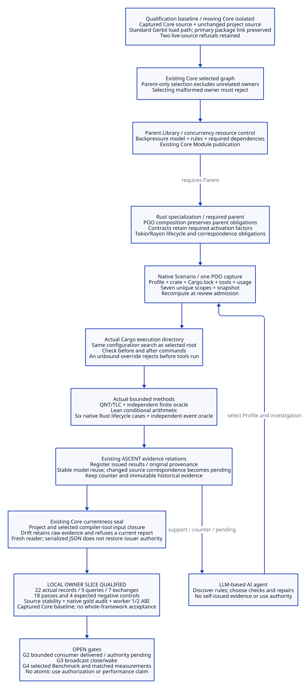

#+TITLE: 10.22 Domain Library Delivery and Native Admission
#+LANGUAGE: en
#+PROPERTY: JD_ID 10.22
#+OPTIONS: toc:3 num:t
#+STARTUP: overview
#+TODO: OPEN VERIFY | QUALIFIED
#+FILETAGS: :delivery:library:poo:ascent:qualification:
#+PROPERTY: header-args :eval never :tangle no :exports code

[[file:../../00-09-project/00-documentation/00.01-index.org][Index]] | [[file:10.21-engineering-design-audit-and-delivery-plan.org][Audit and delivery gates]]

* QUALIFIED One existing Core graph, one resource Library owner
:PROPERTIES:
:CUSTOM_ID: domain-library-delivery
:STATUS: local-owner-slice-qualified-on-frozen-core-source
:END:

The first delivery implements G0/G1 from 10.21. Directory classification alone
cannot discharge a parent obligation. The generic backpressure Module publishes
a POO model; the Rust Module explicitly requires that publication, extends its
value and preserves its rule and dependency rows. The two Scenarios consume the
same Rust publication. Gateway remains an application, not the Library root.

The first build rejected a cross-directory parent-object import. The repair uses
Core's existing required-Module graph. It adds no forwarding Module, compatibility
alias, alternate loader or evaluator. The original =rust-resources= publication
identity remains stable while its physical owner changes directly.

#+NAME: delivered-owner-map
| Engineering responsibility | Physical owner / native role | Actual boundary |
|----------------------------+------------------------------+-----------------|
| Concurrency / resource control / backpressure and memory | =library/concurrency/resource-control/backpressure-memory/abstract/= | Parent model, three obligation rules, four required dependency edges and scope Contract |
| Rust async/CPU handoff specialization | =backpressure-memory/rust/= | Required parent publication, lifecycle mapping, additional obligations, method support Contracts and issued results |
| Abstract finite safety and arithmetic | =backpressure-memory/model.qnt= and =budget.lean= | Conditional abstract checks, not a complete Rust refinement |
| Native mechanism experiment | =backpressure-memory/rust/native/= | Locked bounded Tokio/Rayon crate, six resource-lifecycle cases |
| Evidence inference | =modules/resource-evidence/= | Existing ASCENT source relations, support/counter/pending and original witness records |
| Input selection | Independent Profiles and =scenarios/resource-lifecycle/= | One captured input checked immediately before review opens |

The parent is intentionally a small state signature and obligation template.
Its POO rule/dependency inheritance is executable; the state mapping is authored,
not a machine-checked parent/child refinement. The moved QNT and Lean artifacts
remain the existing bounded ownership model and conditional budget proof, rather
than a new compiler from POO state signatures to formal transition systems. The
selection canary proves admission isolation, not semantic proof transport.

The retained =BP-O02= model obligation and
=BP-O03= arithmetic obligation do not become discharged merely because a child
inherits them. Rust source correspondence, cancellation, cleanup and native
ownership still require their own witnesses. Parent reuse is semantic reuse of
obligations and rules; it is not automatic evidence inheritance.

* QUALIFIED Supported methods and captured-input Contract
:PROPERTIES:
:CUSTOM_ID: native-admission-contract
:END:

#+NAME: supported-method-domain
| Method | Supported input | Rejection boundary |
|--------+-----------------+--------------------|
| Normal QNT ownership | =(capacity,queue)= in =(1,1), (2,2), (4,2)= | Any other pair fails before model basis generation |
| Early-release QNT counter | =(1,1), (2,2)= | =(4,2)= and every other pair are unsupported |
| Native six-case experiment | Capacity, queue, Tokio workers, Rayon workers and CPU budget all one; zero cache; positive payload at most 4096 | Other topology, runtime, inventory, workload or caching requires a different qualified experiment |
| Lean budget | Selected explicit arithmetic parameters | A proof applies only to the recorded parameter basis |

A resource Profile must retain =bounded-retention= and have unique factors. The
native six-case Profile must also retain Tokio, Rayon and every selected lifecycle
case factor. Removing activation facts cannot silently remove inherited duties.
Additional factors can introduce pending obligations; they supply no witnesses.
Native runtime, inventory, captured-lock marker and workload declarations must
also match this experiment. A one-worker multi-thread declaration is not the
current-thread runtime; relabeling production traffic cannot turn the six-case
experiment into production workload evidence.

The independent finite oracle retains its own input checks. The model selector
is not used to manufacture its expected answer.

The native Scenario exposes =capture= and =open-review=. Capture produces one POO
value containing root, selected entry, Profile, crate, Cargo executable, Rustc
executable, mode, usage, snapshot and seven scope rows. Scope rows must have one
usage, unique keys and complete model/arithmetic/cache/source/runtime/workload/
inventory coverage. The snapshot binds all Profile fields, entry revision, rules,
dependencies and scope digests. =open-review= accepts this single value, verifies
the selected entry and recomputes the capture. It rejects changed bytes, changed
Profile parameters or factors, duplicate/missing scopes and split-input calls.

#+BEGIN_IMPORTANT
A local currentness check is not an atomic check-to-use authorization protocol.
Files can change after admission. Native execution also compares Cargo configuration
searches at the selected root and actual output directory before and after the
commands. An extra output-ancestor configuration is rejected before tools run;
it cannot silently change build flags behind a root-based runtime fingerprint.
The native crate declares its own Cargo workspace, and actual Cargo metadata must
identify the captured input as that workspace root. Parent workspace profiles
are outside this experiment's qualified input; they cannot be silently inherited. Each actual method captures and verifies its
own inputs and issued results. Historical evidence stays immutable; a new source
snapshot does not erase old records or make their native correspondence current.
#+END_IMPORTANT

A snapshot digest establishes consistency within the local capture boundary.
It does not authenticate a remote producer, approve a scope change or prove that
an earlier operation occurred with those inputs. The finite method domain is an
explicit qualification limit, not a claim that the domain Library is inherently
limited to those parameter values.

* QUALIFIED Acceptance controls and retained receipts
:PROPERTIES:
:CUSTOM_ID: owner-acceptance-controls
:END:

The root =Justfile= uses existing Gerbil package operations and native =gxtest=.
Each Scheme process has a pre-import heap fence and finite timeout. The test
command rejects ERROR CASE/CHECK/MODULE/HARNESS and resource-overflow markers;
MODULE-OK by itself cannot establish a pass. Tests execute serially and retain
raw logs under ignored =.data/test-logs/=. The gateway file exceeded the whole-file
120-second budget; its seven existing exported suites are now selected individually
with native =gxtest -r= and their exported suite identities. The launcher also
requires CASE-OK and SUITE-OK, so an empty filter match cannot pass. The timeout remains a failed aggregate invocation, while
each selected suite has its own unchanged budget.

#+NAME: owner-acceptance-checks
| Control | Independent expected outcome | Evidence owner |
|---------+------------------------------+----------------|
| Parent specialization | Parent rule/dependency rows remain present; removing BP-O02 rejects | =t/library-owner-test.ss= |
| Unsupported model selection | =(1,2)= cannot receive the supported =(1,1)= basis | Profile and method rejection tests |
| Publication boundaries | Missing methods or open-review rejects | Scope Contract tests |
| Effective Cargo configuration | Output-ancestor override rejects before nonexistent tools could run | Native boundary control in =t/library-owner-test.ss= |
| Core selected/unselected control | Parent-only scope and build projection succeed with malformed unselected owner; selecting malformed owner rejects | =t/library-selection-test.ss= |
| Capture freshness | Current capture opens; changed source/Profile or malformed scope rejects; recapture gets a different snapshot | =t/native-context-test.ss= |
| Actual investigation | Fresh Rust/QNT/Lean results register in existing ASCENT, preserve counter and reuse only stable dependencies | Fresh report and =t/resource-lifecycle-test.ss= |

The native selected/unselected control exposed a linked Core packaging omission:
=core-spec.ss= did not list =module-system/source/module-prelude=, although installed
Core modules declare that prelude. The linked Core source now includes that native
build root. A bounded full Core rebuild timed out after making compilation
progress; it is retained as incomplete. A targeted native =gxc= compilation of the
missing prelude exited zero. This repair does not qualify the entire Core package.

The installed ASCENT manifest initially lagged its linked source by 13 commits.
Native =gerbil pkg build= rebuilt the actual current package. Its first full link
failed because Homebrew OpenSSL was outside the GCC library search path; the
second run supplied the real OpenSSL include/library paths and completed with
exit zero. Existing linked =gerbil.pkg= edits were preserved. No manifests were
handwritten and no dependency was removed. Metadata and ABI checks must be rerun
after the corresponding root package rebuild.

#+NAME: owner-reproduction-commands
#+begin_src sh
just build
just test
# Requires installed Rust/Quint/Lean tools and cached Cargo dependencies.
# Set RESOURCE_CARGO, RESOURCE_RUSTC, RESOURCE_QUINT or RESOURCE_LEAN to override.
just investigate-resource .data/resource-owner-fresh
#+end_src

The investigation output directory must not already exist. Native commands keep
their own 45-second budgets; the multi-step investigation has a 600-second outer
budget. The final native =gxtest= audits actual records, independent gold,
provenance hashes and scoped reuse. No timing from this command is a performance
measurement or an automatic Benchmark result.

The [[file:../../../.data/resource-owner-20261019-03/refused-run.json][first full investigation journal]] retains 22 actual method records and nine
query files, but its final Core currentness check rejected a changed compiler-tool
source. Its =qualified=false= status is intentional; no current top-level report
was created. Project input bytes remained stable. This does not erase the Rust
observations or make the mathematical content false. The current issuer boundary
does not restore authority from serialized JSON, so the fresh reader requires a
new issued investigation. Verified persisted admission and its Review cost remain
an explicit G2/G4 limitation, not a reason to delete history or weaken currentness.

Initial failed build logs and the pre-migration source archive remain under
=.data/=. Historical reports retain their original paths and hashes. Maintained
Org links now point to current owners; moving files does not rewrite old
execution history or qualify a fresh run.

* QUALIFIED Frozen source baseline for the moving Core dependency
:PROPERTIES:
:CUSTOM_ID: frozen-core-qualification-baseline
:END:

A [[file:../../../.data/resource-owner-20261019-04/refused-run.json][second live-Core investigation]] also retained 22 actual method records but
failed its final compiler-tool source check, this time for =poo-clos/objects.ss=.
Concurrent changes are preserved. Repeating a long run against a moving checkout
cannot establish one stable input snapshot.

The [[file:../../../.data/qualification-20261019/core-source-snapshot.json][qualification source manifest]] records an exact copied Core input tree and
its origin. This is an ignored qualification artifact, not a second maintained
framework or Module implementation. The registered Core package link still points
to the user's original checkout. Standard =GERBIL_LOADPATH= selects the captured
Core source; a source mapping selects the unchanged project =init.ss=. Other
native dependency artifacts remain in the existing Gerbil environment. No custom
resolver, evaluator, forwarding Module or fabricated package manifest is added.

The [[file:../../../.data/test-logs/g1-frozen-resolution-02.log][native expander resolution receipt]] confirms that =source/reader.ss= and
=poo-clos/objects.ss= resolve inside the captured tree, while the project entry
resolves to its original source. The [[file:../../../.data/test-logs/g1-frozen-core-canary.log][Core selection canary]] and
[[file:../../../.data/test-logs/g1-frozen-project-admission.log][project scope/build-current admission]] passed with this source baseline.

#+NAME: frozen-qualification-native-environment
#+begin_src sh
# Qualification inputs only; the primary Core link is unchanged.
export GERBIL_PATH="$PWD/.gerbil"
export GERBIL_LOADPATH="$PWD/.data/qualification-20261019:$PWD/.gerbil/lib:$PWD"
# Invoke gxi/gxtest directly so package-env setup cannot reorder the source path.
# Use the same examples/resource-lifecycle-evidence.ss and actual tool arguments.
#+end_src

Qualification of that captured source does not claim that the simultaneously
edited Core checkout has completed a full package build or its own test suite.
The two live-source refusals remain failed aggregate runs. Mathematical content
and native observations are retained; admission to another usage still requires
an applicable verifier/issuer boundary and new bindings.

* QUALIFIED Local owner-slice acceptance
:PROPERTIES:
:CUSTOM_ID: owner-local-acceptance
:ACCEPTED_ON: 2026-10-19
:BASELINE: captured-Core-source-with-unchanged-project-source
:END:

The [[file:../../../.data/qualification-20261019/acceptance.json][local acceptance receipt]] binds the source manifest, report and raw logs.
The [[file:../../../.data/resource-owner-20261019-05-frozen/report.json][fresh investigation report]] completed with natural exit zero, followed by
native =gxtest= auditing actual records, independent gold, references and changed
inputs. The [[file:../../../.data/test-logs/g1-frozen-boundary-and-abi.log][frozen-source boundary and ABI controls]] also completed with exit zero,
including the independent ASCENT worker-one/worker-two checks. All 52 project
input files and 5,408 captured Core-tree files remained byte-identical. That tree
count includes supporting inputs; it is not a count of imported runtime modules.

#+NAME: owner-actual-result-inventory
| Method | Actual observations / checks | Pass | Expected fail / counter |
|--------+------------------------------+------+-------------------------|
| Rust native | Three runs of the six-case suite | 15 | 3 caller-owned-permit controls |
| QNT/TLC | Normal ownership and early-release alternative | 1 | 1 deliberate model counterexample |
| Lean | Payload 64 and payload 128 arithmetic | 2 | 0 |

The 22 result records, nine queries and seven exchanges match their expected
outcomes. A passing investigation means that the oracles and reuse/rejection
expectations matched; it does not assert that every alternative design is safe.

#+NAME: owner-actual-query-gold
| Query | Support | Counter | Retained witnesses | Interpretation |
|-------+---------+---------+--------------------+----------------|
| Discovery | 0 | 0 | 0 | Rules expose outstanding work |
| Formal results | 2 | 0 | 2 | QNT and arithmetic only |
| Native baseline | 7 | 1 | 8 | Five positive native cases and one negative control |
| Changed source, old records | 2 | 0 | 8 | Stable formal content reusable; native correspondence inapplicable |
| Changed source, native rechecked | 7 | 1 | 14 | New witnesses supplement immutable history |
| Larger payload, before checks | 1 | 0 | 14 | Only the unchanged model remains applicable |
| Larger payload, checked | 7 | 1 | 21 | New arithmetic and native evidence required |
| Rejected tampering | 7 | 1 | 21 | Rejections preserve the current query and history |
| Early-release model alternative | 6 | 2 | 22 | Current counter evidence remains visible |

#+NAME: owner-audit-disposition
| Finding | Disposition in this delivery | Remaining boundary |
|---------+------------------------------+--------------------|
| AU01 | Supported-method admission rejects the aliased pair | New parameter domains require their own qualified initializer/model |
| AU02 | Native Scenario uses one recomputed capture | No atomic check-to-use authorization claim |
| AU03 | Consumed method/open-review exports checked | Contracts do not prove arbitrary producer semantics |
| AU04 | Parent/Rust Module composition, direct asset ownership and atomic selection exercised | State mapping and formal parent/child refinement remain authored |
| AU05 | Bounded consumer delivered | See 10.23 for native SWE-061/p1 consumption; institutional and complete-history authority remain open |
| AU06 | Bounded real investigation requalified | No executed 24-variant Benchmark, throughput or Review-cost result |
| AU07 | Native root/ASCENT builds, launcher and captured qualification receipts available | Moving Core full package, clean environment and remote CI remain unqualified |

* OPEN Remaining delivery boundaries
:PROPERTIES:
:CUSTOM_ID: owner-delivery-remaining
:END:

[[file:10.23-native-aitia-backpressure-content-review.org][10.23]] delivers bounded G2 consumption through native Aitia, with actual
backpressure artifacts, explicit local coding policy and genuine receipts.
Institutional classification and complete-history/disposition authority remain
open; upstream unit tests alone never qualify that bridge. G3 still requires the second,
broadcast close/wake mechanism under its own domain owner. G4 still requires an
executed subset of the existing 24 variants and matched measurements for any
performance or Review-cost claim. The six resource cases do not constitute that
Benchmark denominator.

The LLM-based AI agent chooses investigation and repair branches. Library rules
make missing obligations discoverable; actual method results supply witnesses;
ASCENT computes applicable support/counter/pending; Aitia consumes independently
verified project review inputs. No step grants the agent self-issued authority.

#+CAPTION: Existing Module ownership, native admission and qualification boundaries.

