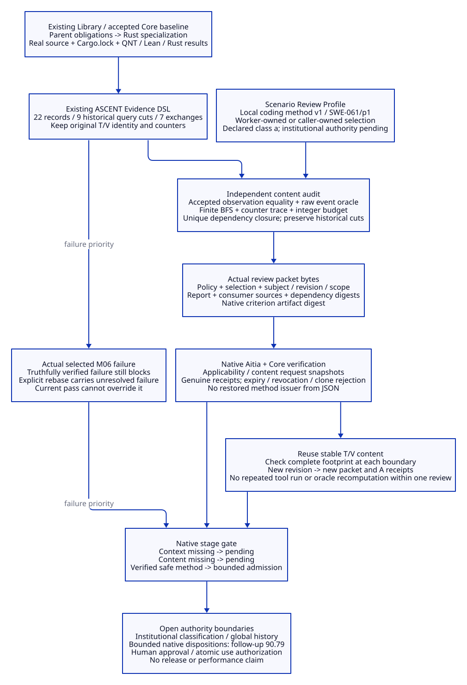
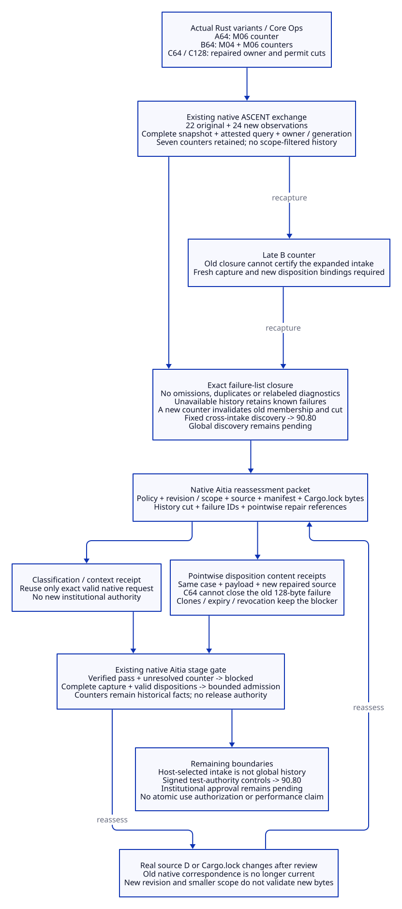
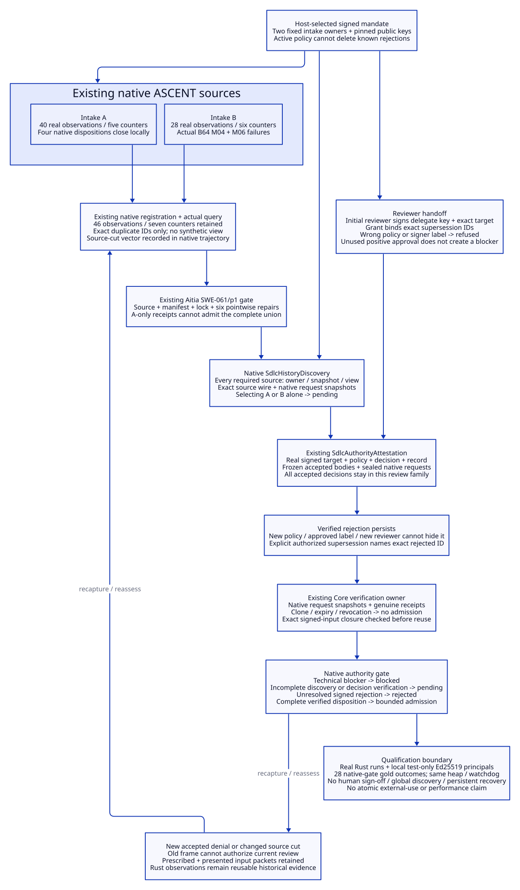
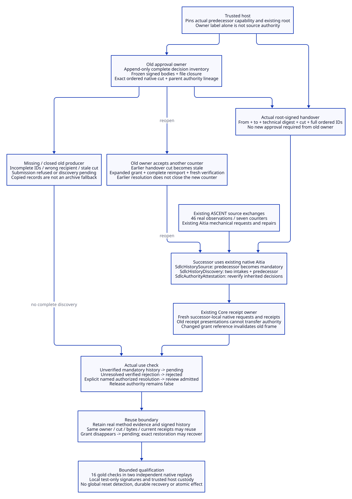
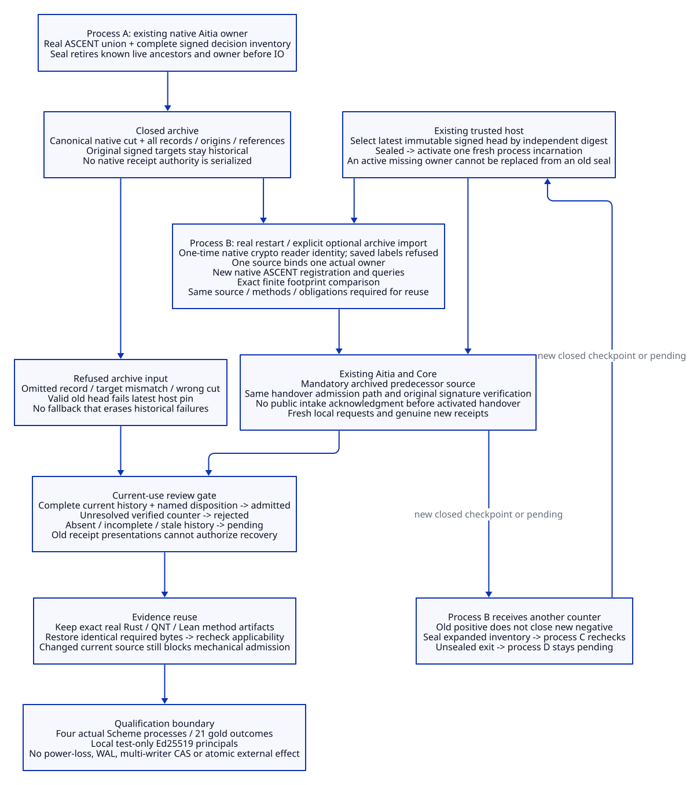
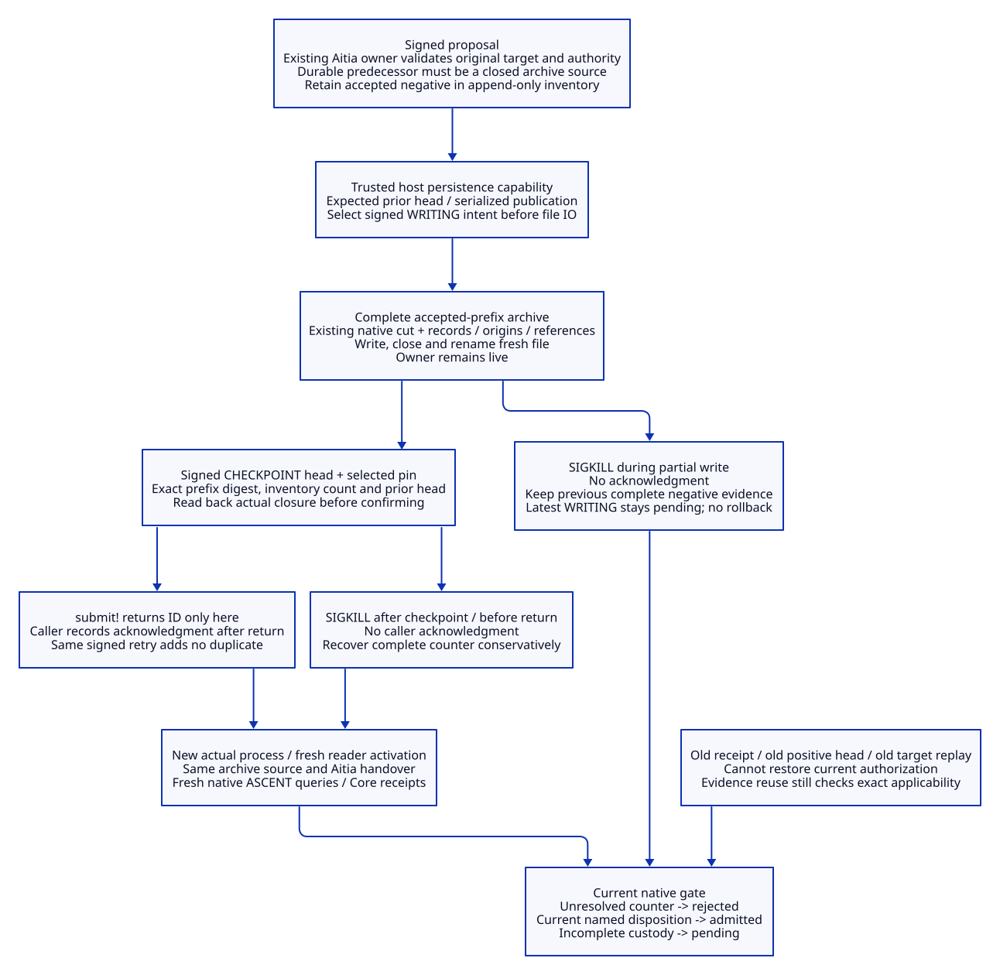
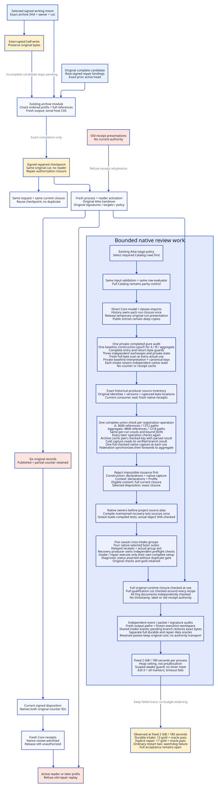

# SPDX-FileCopyrightText: 2026 hardenedlinux Linux Team and Contributors
#
# SPDX-License-Identifier: LGPL-2.1-or-later

#+TITLE: 10.23 Native Aitia Backpressure Content Review
#+LANGUAGE: en
#+PROPERTY: JD_ID 10.23
#+OPTIONS: toc:3 num:t
#+STARTUP: overview
#+TODO: OPEN VERIFY | QUALIFIED
#+FILETAGS: :aitia:sdlc:backpressure:evidence:review:
#+PROPERTY: header-args :eval never :tangle no :exports code

[[file:../../00-09-project/00-documentation/00.01-index.org][Index]] | [[file:10.22-domain-library-delivery-and-native-admission.org][Accepted Library owner slice]] | [[file:10.19-standard-identities-and-aitia-review-traceability.org][Standard identity and review contracts]]

* QUALIFIED Existing owners and a bounded native consumer
:PROPERTIES:
:CUSTOM_ID: native-aitia-backpressure-review
:REQUIREMENT: SWE-061
:CRITERION: SWE-061/p1
:POLICY: backpressure-coding-method/v1
:END:

The resource Library continues to own models, obligations, method results and
ASCENT evidence registration. Aitia owns NASA applicability, criterion requests,
verification receipts and stage decisions. The existing resource-lifecycle
Scenario now has an explicit SDLC consumer in
[[file:../../../scenarios/resource-lifecycle/review/interface.ss][review/interface.ss]]. Its native Gerbil subpackage declares POO Flow, Core and
POO dependencies without changing the accepted Library's captured package roots.
It defines no second Module loader, result issuer, evaluator or lifecycle engine.

The consumer imports the linked Aitia sources directly. Six SDLC owner files
(types, objects, NASA review, policy, structured review and lifecycle) now import
=:core/= rather than the obsolete =:poo-flow/core/= namespace. The repair is in
the linked source, with no forwarding modules or maintained framework copy.
Standard Gerbil source resolution selects the accepted frozen Core baseline;
the primary Core package link still identifies the live checkout. This qualifies
source execution of this consumer, not a new whole-package native build.

#+NAME: native-review-owner-map
| Responsibility | Existing owner | Consumer contribution |
|----------------+----------------+-----------------------|
| Generic and Rust obligations | Backpressure Library Module composition | Preserve the accepted domain publication |
| Actual results and trajectories | Existing Rust methods and ASCENT Evidence DSL | Consume 22 records, nine query cuts and seven exchanges |
| Classification and criterion | Native Aitia NASA catalog and review | Select SWE-061/p1 without copying catalog text or identity |
| Verification authority | Core verification adapter used by Aitia | Host-configured content operation; genuine process-local receipts |
| Local coding method | Scenario Review Profile and this policy | Explicit bounded selection and independent content audit |
| Stage decision | Native =nasa-stage-gate= | Context, content, failures, expiry and revocation remain separate |

* QUALIFIED Local policy and applicability
:PROPERTIES:
:CUSTOM_ID: local-coding-method-policy
:END:

SWE-061/p1 concerns selecting, defining and adhering to coding methods, standards
and criteria. The following project rules are a local, bounded coding-method
selection; they are not additional verbatim NASA requirements. This entry does
not claim complete coding-style review, performance qualification, algorithmic
complexity coverage, formal Rust refinement or NASA compliance.

#+NAME: bp061-coding-method
| Rule | Definition and source boundary | Required independent evidence |
|------+--------------------------------+-------------------------------|
| BP061-01 | For the selected worker-owned method, =OwnedWork= retains the permit with the payload; field disposal releases payload storage before the permit | M01 normal return and result disposal, actual Rust event cuts |
| BP061-02 | Cancelling a waiting admission must not acquire or leak a reservation | M02 pending/cancelled ordering, zero waiter acquisitions and final allowance |
| BP061-03 | Async caller abort and receiver abandonment do not release a running worker's reservation | M03/M04 partial orders, retained live owner and unavailable allowance |
| BP061-04 | A full cleanup queue leaves an explicit retained owner, followed by disposal | M05 full-queue return, retained payload and final release |
| BP061-05 | The caller-owned M06 alternative and early-release QNT transition remain counterexamples | Three actual M06 failures and one independently checked two-state counter; never turn them into safe-method support |
| BP061-06 | The abstract ownership model and selected arithmetic remain conditional checks | Independent five-job BFS, actual QNT/TLC output, Lean tool exits, captured theorem artifacts and integer oracle |

The Profile declares class =a= to exercise the native applicability matrix for
this local review. It is not an institutional classification attestation. A
separate native assessment with class =e= returns =not-invoked= for SWE-061; the
consumer does not accept an arbitrary class change as a way to bypass its policy.
Unknown classification authority remains an external, pending obligation for
any real institutional admission. A local =stage-admitted= result always has
=release-authorized? = #f=.

* QUALIFIED Actual packet and reference closure
:PROPERTIES:
:CUSTOM_ID: backpressure-review-packet
:END:

The host selects the existing acceptance receipt from 10.22. The adapter checks
its accepted report digest and Core snapshot manifest; it reads the real result
files, locked inputs, command logs, raw observations, QNT trace, Lean artifacts,
ASCENT exchanges and query snapshots. Every record must equal the observation
embedded in the accepted report. The stored oracle is checked against a fresh,
independent computation, including recursive equality of event projections.
A producer's outcome label or a report-wide exit-zero claim cannot replace this.

#+NAME: review-packet-contract
| Field / reference | Binding | Rejection or pending boundary |
|-------------------+---------+-------------------------------|
| =criterion= and =policy= | Native SWE-061/p1 identity; local policy version | Unsupported policy identity or target rejects |
| =subject/revision/scope= | Exact native Aitia project and selected method | New revision requires an explicit prior review; scope must name M01-M05 or M06 correctly |
| =classification= | Local declared-class-a boundary | No institutional authority can be inferred |
| =report/reportSha256= | Accepted 22-record investigation | Changed digest, record body or incomplete inventory rejects |
| =consumerSources/Sha256= | Linked Aitia, governance, consumer, policy and test source capture | Changed manifest or captured source rejects; no silent reissue |
| =dependencies= | Unique path/digest closure, rejecting conflicting digests | Missing, changed or conflicting input rejects |
| Criterion =artifact-digest= | SHA-256 of the actual saved review packet bytes | A report digest alone does not bind selection, revision, policy and consumer sources |
| Original T/V references | Original exchanges, record references, tool artifacts and independent oracle inputs | Historical evidence remains historical; saved JSON cannot recreate the Rust method issuer |
| New A reference | Native request snapshot, adapter, exact receipt identity and validity interval | Old revision, clone, expiry, revocation or altered request has no admission |

The constructor performs the independent audit once. Its private copy of the
resulting dependency closure supports subsequent byte checks before verification
and before/after stage assessment. It reuses the audited conclusion only while
those bytes, Profile and consumer sources remain current. This removes repeated
oracle recomputation, not dependency checks. No tools are rerun by this review.
A new revision reuses unchanged T/V content but receives a new packet and new
Aitia context/content receipts. The serialized receipt presentation is not
restorable receipt authority.

The packet binds the full report, including its historical source-change and
payload-change query cuts. It does not treat every historical witness as current
support for one final source snapshot. In particular, model/arithmetic reuse and
stale native correspondence remain separate, exactly as established in 10.22.

* QUALIFIED Stepwise gold and failure priority
:PROPERTIES:
:CUSTOM_ID: native-review-stepwise-gold
:END:

#+NAME: native-review-gold
| Step | Concrete input / action | Native gold | Reference use |
|------+-------------------------+-------------+---------------|
| 01 | Real worker-owned packet, no receipts | =context-verification-required= | Actual content alone does not classify a project |
| 02 | Genuine context receipt only | =content-verification-required= | Context cannot certify a paragraph's content |
| 03 | Independent content audit and genuine content receipt | =stage-admitted=, no release authority | Packet digest and exact native request |
| 04 | Same immutable basis at a later valid instant | =stage-admitted= | Same process-local receipts; no new Rust/QNT/Lean runs |
| 05 | New revision with old context/content receipts | =context-verification-required= | Old A binding is not transported |
| 06 | Fresh context, old content receipt | =content-verification-required= | Same T/V bytes do not imply a new A binding |
| 07 | Fresh content receipt for the new packet | =stage-admitted= | Re-audited unchanged artifacts; new request and receipt |
| 08 | Select actual caller-owned M06 failure; verify its content truthfully | =requirements-blocked= | Successful verification of a failure does not turn it into a pass |
| 09 | Rebase to worker-owned scope with an unresolved prior failure | =requirements-blocked= | Current pass and carried failure coexist; failure wins |

Additional native tests reject receipt clones, wrong artifact/identity requests,
expired or revoked receipts, mutated Profile bindings, corrupt raw event gold,
and changed accepted-report digests. Class-e assessment exercises the genuinely
not-invoked branch separately. A real M06 counter is used for blocking; a
synthetic failing fixture does not stand in for native evidence.

The first consumer's explicit rebase preserves supplied failures, but supplied
previous-review objects cannot establish history completeness. The follow-up
below replaces that assumption for a bounded, host-selected native exchange.
The original nine-step receipt remains historical evidence; its source manifest
is not rewritten after this consumer evolves.

* QUALIFIED Execution and audit boundary
:PROPERTIES:
:CUSTOM_ID: native-review-execution
:END:

The maintained [[file:../../../t/backpressure-review-test.ss][Scheme tests]] run with =just test-backpressure-review=. The recipe fences
memory before imports, uses the accepted source resolution, retains raw logs
and requires case/suite/module/harness markers plus final =OK=. The
[[file:../../../examples/backpressure-aitia-review.ss][actual review driver]] saves four byte-bound packets and nine stage transitions under
an explicitly fresh local output directory. The captured owner acceptance and
its earlier failed runs are not rewritten. The only new evidence is the Aitia
content review and its admission controls.

#+BEGIN_SRC sh
# With the source manifest captured and supplied by the host:
just test-backpressure-review
# Use the same heap-fenced source-resolution environment as that recipe:
gxi -:max-heap=2G,debug=q examples/backpressure-aitia-review.ss \
  .data/qualification-20261019/acceptance.json \
  .data/aitia-backpressure-20261019/consumer-sources.json \
  .data/aitia-backpressure-20261019/actual-review
#+END_SRC

Source digests provide integrity relative to a host-selected baseline. They do
not authenticate the host, establish source authority or atomically authorize
an actual use. Before/after byte checks assume stable local input reads; an
adversarial ABA filesystem or a revocation after the last check requires the
existing use-boundary protocol, not more copies of this audit. No local timing
or reduced Review-cost claim is made without matched measurements.

G2 has a bounded real native consumer. The follow-up qualifies mechanical
counter disposition within an explicitly captured intake. Broader NASA
classification, global history discovery and human disposition authority remain
open. G3 broadcast and G4 Benchmark execution retain their independent gates.

#+CAPTION: Existing evidence owners, independent content admission and failure-preserving reuse.

* QUALIFIED Real source changes and complete exchange intake
:PROPERTIES:
:CUSTOM_ID: source-change-history-reassessment
:POLICY: backpressure-coding-method/v1
:COMPLETENESS_DOMAIN: host-selected-native-ASCENT-exchange
:END:

The follow-up uses the same Scenario, Core Ops, native ASCENT clue exchange,
Aitia criterion requests and Core receipt issuer. It introduces no history
ledger, alternate stage machine or receipt-restoration protocol. The
[[file:../../../scenarios/resource-lifecycle/review/reassessment.ss][Scenario reassessment operation]] consumes a host-owned exchange, not an Agent-provided
previous-review list. The [[file:../../../library/concurrency/resource-control/backpressure-memory/rust/reassessment-oracle.ss][Library reassessment oracle]] independently derives safety
from actual owner/permit event cuts; the Rust producer supplies no verdict.
Its result is bounded to this ownership mechanism, not complete Rust refinement.

The [[file:../../../examples/backpressure-reassessment-evidence.ss][native experiment]] preserves the maintained accepted crate and compiles actual source
variants in separate captured input directories. Each run uses Core Ops with a
bounded deadline, Cargo offline/locked resolution and captured source, lock,
compiler, dependency, binary, command-log and observation bytes. Old accepted
source roots, receipts and failed attempts are retained. These variants are
experimental subjects, not maintained copies of another framework. The active
review subject is a workspace source bundle, not an isolated Rust text file;
its manifest and lock must match the real repair experiment.

#+NAME: source-reassessment-subjects
| Subject | Actual source change | Independent outcome |
|---------+----------------------+---------------------|
| A-original64 | Original caller-owned M06 permit alternative | M06 counter, other cuts safe |
| B-regression64 | Move M04's permit into its abortable async caller as well | New M04 counter and a new source-bound M06 counter |
| C-repair64 | Retain both permits in the worker-owned payload; async caller owns no permit | All six bounded cuts safe at 64 bytes |
| C-repair128 | Same repaired source bytes, separate actual execution and captured binary | All six bounded cuts safe at 128 bytes |
| D-unchecked | Modify the actual active source file after review; leave the changed bytes in place | Old content/closure receipts cannot validate the new bytes; fresh correspondence pending |

The source and workspace-file digests are input bindings, not evidence that a mutation repairs a
bug. Actual event orders, retained owners, reservation counts and final disposal
must establish the bounded repair. Unchanged QNT/Lean evidence retains its
original conditional scope; it is not a new proof of these source variants.

** Failure-list completeness and a finite capture

The native exchange initially contains all 22 original observations. A contributes
six records, each C run contributes six and B contributes six when its real
result is registered late. The final intake has 46 observations and seven
counter records: six native mechanism failures and the original QNT diagnostic.
The fixed baseline policy retains that abstract early-release diagnostic as a
negative control. An Agent cannot turn a native failure into a diagnostic by
changing a label, scope or revision.

The capture includes the native owner/context, generation, complete snapshot,
query view identity and all attested counter IDs for one invariant claim. No
scope-filtered query is used to construct the history list. Snapshot counter IDs
must equal the native query's attested counter IDs; unavailable attestation
prevents a current capture. A declared list must be an exact duplicate-free set.
Omission, duplication, unknown IDs and a pre-arrival list cannot establish
completeness. The retained diagnostic remains visible even after native blockers
are discharged.

This is completeness within the host-selected exchange and captured generation.
It does not prove that an outside archive, undiscovered project or unregistered
run contains no additional failure. The host must designate the intake owner;
an LLM-based AI agent cannot nominate a different empty exchange as the current
one. Native exchange identity and byte integrity do not authenticate an
institutional source authority. Those broader obligations remain pending.

** Pointwise disposition through native Aitia

A disposition is a POO value with a captured failure ID and repair evidence ID.
Its native Aitia content request binds the complete packet, intake cut, project
revision/scope, original record digest, repair record digest and the selected
source bundle (=src/main.rs=, =Cargo.toml= and =Cargo.lock= byte digests). The configured
independent event oracle is the declared automated disposition authority for
this local mechanical policy. No human or institutional approval is fabricated.

#+NAME: mechanical-disposition-obligations
| Check | Required fact | Refusal / retained obligation |
|-------+---------------+--------------------------------|
| Original identity | Exact counter ID in the captured complete failure list | Unknown, omitted or duplicate IDs cannot close a blocker |
| Case coverage | Same original M04/M06 mechanism case | M04 success cannot dispose of M06 failure |
| Workload coverage | Same payload size and bounded runtime premises | A 64-byte repair leaves the old 128-byte failure open |
| Changed implementation | Repair source bundle equals the selected current bundle and differs from the failed bundle | Reusing a pass from the failing bundle cannot close its opposing counter |
| Actual support | Captured real run and independent event-cut pass | Source diff, producer label or exit zero alone is insufficient |
| Authority and binding | Genuine native Aitia disposition receipt for this packet and cut | Missing, cloned, expired, revoked or old-revision receipt retains the blocker |
| New counter | Fresh complete capture includes the new record | Old closure membership and old disposition receipts are not current |
| Scope narrowing | Original obligations remain in the invariant intake | Narrowing to M04 does not erase historical M06 obligations |

Disposition removes only the corresponding blocking projection supplied to the
native stage gate. It never deletes the original counter or rewrites history.
The main content receipt and each disposition receipt have separate requests.
A valid pass and an unresolved failure can coexist; the native gate still blocks.
A current failure cannot be disposed of using an earlier pass from that same
source bundle. A dependency repair with unchanged Rust text still needs a new
matching bundle and actual native evidence. Legitimate repair requires new evidence and a newly bound request.

** Stepwise gold and reusable applicability

#+NAME: reassessment-gold
| Step | Actual action | Native decision / boundary | Open native failures |
|------+---------------+----------------------------+----------------------|
| 01 | A and C64 registered; no disposition | requirements-blocked | 4 |
| 02 | Omit one historical ID | requirements-blocked plus incomplete history; context remains valid | 4 |
| 03 | New revision narrowed to M04 | requirements-blocked; M06 retained | 4 |
| 04 | Verify available C64 dispositions | requirements-blocked; original 128-byte case remains | 1 |
| 05 | Add C128 after the old review capture | requirements-blocked; old content/dispositions stale, context reusable | 4 |
| 06 | Fresh complete capture and pointwise C64/C128 receipts | stage-admitted; no release authority | 0 |
| 07 | Register real B counter results late | requirements-blocked; old closure stale, expanded failures preserved | 6 |
| 08 | Submit the pre-arrival five-ID list | requirements-blocked plus incomplete history; seven IDs required | 6 |
| 09 | Fresh capture, only the old four dispositions | requirements-blocked; B's two new failures remain | 2 |
| 10 | Bind all six native dispositions to expanded capture | stage-admitted; all seven historical counters retained | 0 |
| 11 | Clone one disposition receipt | requirements-blocked | 1 |
| 12 | Expire one disposition receipt while other receipts remain valid | requirements-blocked | 1 |
| 13 | Revoke a disposition receipt | requirements-blocked | 1 |
| 14 | Change revision and reuse old receipts | context-verification-required | 6 |
| 15 | Change actual active source bytes after checks | requirements-blocked; old content/dispositions invalid, context reusable | 6 |
| 16 | Give unchecked source D a new revision | new native correspondence still required; requirements-blocked | 6 |
| 17 | Change the actual selected Cargo.lock bytes after content verification | requirements-blocked; old dependency context is not current | 6 |
| 18 | Make the real B historical run record unavailable, then restore its exact bytes | requirements-blocked while unavailable; fresh content checking is possible after restoration | 6 |

Applicability receipts bind native classification/context facts. An unchanged,
still-valid context request within the same native adapter can remain reusable
when only evidence intake or source correspondence changes. Content/disposition
receipts additionally require the captured history and source to be current.
Cross-revision or cross-adapter receipt reuse still fails. This preserves the
native responsibility split instead of forcing repeated classification to hide
an unresolved content/history obligation.

The [[file:../../../t/backpressure-reassessment-test.ss][Scheme test]] uses actual captured Rust runs and writes every review packet,
observed native decision and final exchange snapshot. It also exercises duplicate
history, policy relabeling, mutations of public evidence presentations, explicit
wrong-case/wrong-payload dispositions, unknown IDs, a genuinely unavailable
historical record and unsupported content. The availability control renames only
the new experimental B record and restores it with =dynamic-wind=; accepted
baseline records are untouched. Restoring exact bytes permits a fresh content
check under the same owner, not receipt deserialization or archive authority. Tests run through
=just test-backpressure-reassessment= with a pre-import heap fence and explicit
case/suite/module/harness/final markers. Logical receipt-validity instants test
expiry; they do not authorize a real effect or establish wall-clock ordering.

The host performs a complete input-closure check at stage admission. Registration
checks a deduplicated batch rather than repeating the same dependency check for
every case. Pointwise receipt verification checks its failure/repair dependency closure
and current capture; the native stage remains the use-time consumer. These checks do not
form an atomic filesystem/authorization transaction. An adversarial ABA change,
revocation after the final check or a counter arriving after the chosen cut still
requires the existing use-boundary protocol. No performance or Review-cost
improvement is asserted without matched measurements.

#+CAPTION: Source-bound reassessment, complete native intake and failure-preserving disposition.

* Cross-intake discovery and disposition authority
:PROPERTIES:
:CUSTOM_ID: cross-intake-discovery-authority
:STATUS: Executable bounded qualification
:REVIEW_FAMILY: rust.backpressure-lifecycle / cross-intake/r1
:END:

** Existing owners and the trust entry point

The technical Library remains the resource-control/backpressure-memory Library.
Its Rust observations, QNT counter and Lean results retain their original IDs and
meaning. This addition consumes those observations in the existing resource
lifecycle Review Scenario. It does not create a second Library, evaluator or
receipt issuer. Aitia's linked [[file:../../../.gerbil/pkg/github.com/tao3k/poo-flow/packages/lambda-aitia/modules/sdlc/review-authority.ss][modules/sdlc/review-authority.ss]] adds native
history-discovery requests and disposition-approval requests. Both use the
existing Core verification adapter, identity-bound receipts, expiry and revocation.
The approval value is the existing =SdlcAuthorityAttestation= model. Its native
constructor accepts the standard and requirement; this Scenario supplies
=SWE-061= rather than hard-coding a NASA clause into the generic native owner. The new
=SdlcHistorySource= and =SdlcHistoryDiscovery= models inherit the existing native
identity and project-binding classes.

The host binds two existing ASCENT exchanges before an LLM-based AI agent chooses
what to inspect. A signed directory fixes their required intake names, supported
approval policies and initial reviewer. The directory digest and public keys are
pinned when this review family opens. A different directory or key is a different
trust configuration; an agent-supplied replacement is not an authorized migration.
The local qualification generates test-only Ed25519 identities and performs real
OpenSSL signatures through Core Ops. These are executable signature/authority
controls, not a claim of human sign-off or institutional NASA approval.

| Existing owner | Responsibility | New consumer binding |
|----------------+----------------+----------------------|
| Library / Rust source and lock | Native events and independent ownership-cut oracle | Original record ID, record bytes, case, payload, source bundle and dependencies |
| POO Review Profile | Subject, revision, bounded scope and coding-method policy | Existing profile; no arbitrary replacement profile accepted |
| ASCENT source exchanges | Attested complete snapshots and query views | Each required intake's actual owner, view and snapshot digest |
| ASCENT aggregate exchange | Deduplicated observation registration and actual query | Same evidence ID requires the same record digest; no fabricated merged query |
| Aitia native discovery model | Required/observed intake equality and project binding | Directory, policy, content digest and complete source references |
| Aitia authority attestation | Explicit approved/rejected decision and signer | Actual signed target and record digest; no approval inferred from a pass |
| Core verification | Issue, expire and revoke genuine receipts | Request snapshot and adapter owner remain authoritative |

** A finite packet and its reference closure

The [[file:../../../scenarios/resource-lifecycle/review/cross-intake.ss][Scenario consumer]] registers a union through the existing native
=add-run!= path, which rechecks the independent Rust oracle. It does not concatenate
supports into a hand-written ASCENT view. Duplicate observations retain one
canonical ID only when their record digests agree. Conflicting bytes reject.
If a previously registered member disappears, capture fails rather than deleting
history. The aggregate's native trajectory records changes of the source-view
vector, including a changed cut with unchanged evidence membership.
Every source read executes the existing native ASCENT query and checks its
attestation. An unchanged attested source-view vector permits reusing the
aggregate's existing registration; a changed view rebuilds that registration.
There is no second query evaluator or consumer-owned query-result cache. The
returned native snapshot/view packet is defensively copied. The test records
actual native query counts and aggregate registration rebuild/reuse counts,
without claiming a timing or throughput improvement.

| Packet field | Input / closure | Rejection or pending boundary |
|--------------+-----------------+-------------------------------|
| Required source directory | Root-signed bytes, pinned directory digest and public keys | Missing signature or changed bytes prevents discovery admission |
| Source observations | Every required intake's native snapshot and query view | Selecting only A or only B is incomplete; selection cannot redefine the mandate |
| Observation union | Actual source record IDs and digests, original dependency closures | Same ID with conflicting bytes or disappearing history rejects capture |
| Mechanical content | Native criterion-content request, exact packet digest, same subject/revision/scope, full failure set and all six native dispositions | Rewriting only the packet scope rejects before authority opens; local-A receipts or an omitted B failure cannot admit the aggregate |
| Review target | Digest of directory, complete mechanical packet, policy and project subject/revision/scope | Another target cannot use this approval or delegation |
| Decision record | Actual signed JSON, signer, policy, target, approved/rejected and supersedes IDs | Signature verification precedes acceptance; invalid submissions do not become trusted denials |
| Supersession | Exact previously accepted rejected-record IDs, signed by an authorized reviewer | A generic approved label does not close a known rejection; unknown/future IDs reject |
| Reviewer handoff | Initial reviewer's signed grant, delegate key digest, exact target and supersedes IDs | Another signer label, another key or a wrong-policy grant supplies no authority |
| Native requests | Discovery model plus all accepted authority decisions in this review family | Dropping an accepted denial is not an available selected-intake operation |
| Receipts | Genuine current Core receipts for discovery, every negative decision and the approvals needed for authorization | A missing negative decision or required approval cannot authorize admission; an unused positive receipt is optional |

Accepted decision bodies are frozen privately after actual signature verification.
Later frames project that accepted body into the native authority attestation;
they never reload a changed path and treat its new label as the old decision.
Native factory results own their text values and copied list boundaries. Editing
a public proposal cannot mutate the private project, directory digest or accepted
decision identity used by later frames. An additional live control corrupts those
three public fields, observes native binding refusal, and verifies that a fresh
frame still reports the original authenticated rejection.
Each frame derives both its requests and captured decision IDs from one
producer-owned decision-list value. A later append cannot appear in the captured
inventory without its native request. Tests serialize owner operations; concurrent
SMP publication and atomic external use remain outside this qualification.
Every prescribed native request is sealed before exposure using Aitia's own
snapshot function. Mutating a structurally valid discovery model before receipt
issuance does not weaken the host's intended request. The authority consumer
also retains the source captures associated with the mechanical packet: new
frames cannot bind a new source cut to an old technical result.

The target deliberately includes the complete mechanical packet. Changing the
native history cut, source bundle, revision or scope needs a new bound review;
reusing the same source observations is distinct from reusing an approval.
Policy changes within this family retain old rejected decisions, while only
approvals for the active policy may authorize the current gate. Supersession is
acyclic: a submitted approval may name only already accepted rejected records;
rejections cannot be superseded by changing their label or by naming a future ID.

** Actual case and independent gold

The [[file:../../../t/backpressure-cross-intake-test.ss][Scheme test]] uses the four already captured, real Rust executions.
It does not rerun Rust and does not manufacture an execution receipt. Intake A
contains the original 22 observations, A64, C64 and C128: 40 observations and
five counters. Intake B contains the original 22 and B64: 28 observations and
six counters. Deduplication produces 46 observations and seven retained counters:
six native failures and the deliberately retained QNT diagnostic. A's local
four-disposition review passes, but its receipts cannot authorize the full union;
B contributes the actual M04 regression and an additional source-bound M06 failure.

Each gold step retains a prescribed input packet and an observed presentation
packet. The prescribed packet includes the original mechanical wire packet,
exact source-artifact wire strings and digests, directory/key references,
accepted decisions at capture, and Aitia's own native request snapshots. The
presentation packet records the actual requests, current accepted inventory,
current intake reads and observed authority-file digests or unavailability.
CI07/CI24 therefore expose the changed decision inventory, CI23 exposes changed
bytes with an unchanged frozen negative body, and CI27 exposes the difference
between the prescribed and weakened request. Source-artifact digests resolve to
saved exact wire strings, without relying on hash-table JSON key order.
Receipt fields in these packets are explicitly presentation-only: native Core
object ownership is exercised by the live test and cannot be recovered from JSON.

Every expected status below is authored in the test independently of the native
gate. Real signatures are checked by OpenSSL; real failure/repair applicability
is checked by the existing independent ownership-cut oracle. The test compares
the native gate with these fixed gold outcomes and retains its actual input
packet, source captures, signed records, public keys and step results under a
fresh ignored output directory. This is a finite control matrix, not exhaustive
verification of the protocol or an independent human approval of a disposition.

#+NAME: cross-intake-authority-gold
| Step | Concrete change / query | Expected native result | Reference / reuse boundary |
|------+-------------------------+------------------------+----------------------------|
| CI01 | Complete mechanical repair; no discovery receipt | history-discovery-required | Technical success supplies no discovery authority |
| CI02 | Declare only intake A | history-discovery-required | Directory still requires A and B |
| CI03 | Declare only intake B | history-discovery-required | Switching the selected intake does not remove A |
| CI04 | Genuine complete discovery; no approval | approval-verification-required | All seven counter IDs remain historical facts |
| CI05 | B signs without a delegation | approval-verification-required | Submission rejected; no trusted authority record added |
| CI06 | B's key claims A's signer label | approval-verification-required | Actual signature, not label, determines authority |
| CI07 | A signs rejection after an earlier frame was checked | history-discovery-required | New accepted decision invalidates the old frame's authority receipts |
| CI08 | Fresh frame verifies the actual rejected record | approval-rejected | Current technical pass cannot override a verified rejection |
| CI09 | Change active policy from v1 to v2 | approval-rejected | Rejected v1 record remains in the v2 review |
| CI10 | A approves v2 without naming the rejected record | approval-rejected | Generic approval does not dispose a known blocker |
| CI11 | A signs v2 approval naming the exact rejection ID | review-admitted | All technical and authority receipts required; no release authority |
| CI12 | Same frame, source cuts, keys, decisions and valid receipts | review-admitted | Exact current reuse is permitted |
| CI13 | Copy receipt presentation objects | history-discovery-required | Copies do not inherit Core issuance authority |
| CI14 | Reuse after expiry | history-discovery-required | Logical validity interval is half-open |
| CI15 | Revoke the superseding approval receipt | approval-rejected | Genuine rejection is still present; unverified disposition cannot close it |
| CI16 | Return to v1 with only v2 superseding approvals | approval-rejected | Positive approval is not portable between policies |
| CI17 | Redundant B positive decision is unavailable while A's complete approval is valid | review-admitted | Unused positive evidence does not create a new mandatory check |
| CI18 | Revoke A's superseding receipt; B has A's exact-target, exact-supersession grant | review-admitted | B is now the only valid superseding approval; wrong-policy grant is separately refused |
| CI19 | Required directory signature unavailable after checks | history-discovery-required | Existing technical dispositions are retained; authority cannot be presumed |
| CI20 | Identical directory signature restored; same current state | review-admitted | Owner-local receipts may resume within validity; no deserialized receipt |
| CI21 | B's required delegation signature becomes unavailable | approval-rejected | Without a current superseding approval, the verified rejection remains active |
| CI22 | Restore identical delegation signature | review-admitted | Same owner, exact bytes and valid receipts permit reuse |
| CI23 | Rewrite the old rejected JSON as a genuinely signed approved JSON at the same path | approval-verification-required | Private accepted body stays rejected; changed record bytes cannot relabel it |
| CI24 | New actual signed rejection after an admitted frame | history-discovery-required | Decision-set change prevents reuse of the old admitted frame |
| CI25 | Fresh frame verifies the additional rejection | approval-rejected | Earlier supersession does not cover the new record |
| CI26 | B advances its actual native trajectory with unchanged members | requirements-blocked | Source-cut change invalidates the complete mechanical capture too |
| CI27 | Edit the native discovery model to require and observe only one source | history-discovery-required | The host's sealed prescribed request refuses issuance even though the weakened model is structurally valid |
| CI28 | Create a new frame after the source cut changes, retaining the old technical packet | requirements-blocked | A new frame cannot promote old technical evidence into the new cut |

Three independent replays cover all 28 gold steps: discovery checks CI01-CI10
and CI27, authority checks CI11-CI19, and reuse checks CI20-CI26 and CI28.
Each replay performs the real state-changing event sequence with its own native
owners and test keys. It checks only its assigned gold gates; receipts and
approvals are never transferred between replays. The same native gate is called
for every assigned gold step, with an actual refreshed
technical closure at each call. All are marked =current-use-check= in the result
packet. Native ASCENT snapshot/query reuse is a separate operation and cannot
stand in for the Aitia gate. Mechanical receipts remain valid through logical
instant 200; authority receipts expire at 100, so CI14 isolates authority expiry.
No time-of-check result authorizes an external effect.

** Rule order and cost boundaries

The receipt snapshot includes the exact decision, signature and delegation file
references. After actual signature verification at submission, a later receipt can
reuse that result only while those sealed bytes and the pinned authority root are
current. The test makes an actually required delegation unavailable after checks,
then restores the identical bytes. It separately makes a redundant positive
decision unavailable while another complete approval remains valid. This separates
necessary authorization checks from repeated defensive checks.

The native gate first retains technical blockers, then requires complete verified
discovery. A verified unsuperseded rejection takes precedence over positive
approvals. Every accepted negative decision needs a current genuine receipt. A missing
negative decision remains pending; omitting its receipt cannot erase the blocker.
Positive approvals that do not participate in current authorization are optional: an
unavailable redundant approval must not force a repeated Review when another
complete valid approval already supplies the required authority. An authenticated
current-policy approval can close only the explicit rejected-record IDs it names.
All accepted decisions remain visible in the family and are bound in a fresh frame;
new accepted decisions invalidate earlier frames. Untrusted signature failures
are refused at submission and cannot create a denial-of-service authority record.

Discovery and authority failures do not delete reusable Rust observations, QNT
results, Lean proofs or pointwise repair records. They affect the current use of
those records. Source-byte or dependency changes still follow the earlier typed
dependency rules. Changing just the displayed intake does not change the required
source set. A fresh frame needs fresh native receipts; this test does not claim
that re-signing every source artifact is necessary.

This separates review work into one complete technical packet and a bounded
set of authority decisions. It avoids rerunning Rust merely because a signer or
approval policy changes. It still costs complete discovery, signature checks and
native receipt issuance; no measured Review-cost reduction is claimed. An
implementation may batch identical file checks only while preserving the full
closure and the current-use check.

** Hidden assumptions made explicit

| Assumption | Current control | Open boundary |
|------------+-----------------+---------------|
| Same record means the same observation | Private validated descriptors fix claim, role, case, payload and diagnostic status; same ID requires identical bytes | This union is not an unrestricted merger of independent hypotheses or arbitrary Catalog claims |
| Directory authority is trustworthy | Host pins required owners and public keys before agent selection | An LLM-based AI agent cannot appoint a replacement root; organizational root custody remains external |
| A changed signer is authorized | Actual signature plus exact-target, exact-supersession delegation | No institutional delegation, key isolation or durable revocation service is claimed |
| Complete failure history is available | Mandatory source cuts plus exact union and all retained counter IDs | Unknown external intakes remain undiscovered; absence is not a proof of no other failures |
| Approval history survives a reset | Accepted decisions remain private and append-only during the current owner lifetime | Restart or replacement-owner recovery needs authenticated inventory handover; it is not qualified here |
| An old denial is closed | Current mechanical repair plus current authorized approval naming the exact rejected record | Generic approval, policy relabeling and reviewer substitution cannot close it |
| A positive record is always required | Only current authorization and negative-inventory requirements create blockers | Redundant positive receipts are optional; checking them repeatedly would add unjustified burden |
| Equal artifacts justify reuse | Exact byte closure and same native request/owner/cut govern local reuse | Semantic equivalence, archive authority and cross-process receipt recovery need additional evidence |
| Final checks authorize an effect | This gate reports bounded review admission and never release authority | Changes after the final check still need the existing actual-use protocol |

** Reproduction and retained receipts

The [[file:../../../Justfile][heap-fenced native recipe]] consumes the accepted resource slice and the four
existing real Rust run records. The host supplies the captured consumer source
manifest. It opens a fresh local output directory for every run and requires
case, suite, module, harness and final success markers with no error markers.
Each of the three serial replay processes retains the 1 GiB heap limit and
180-second budget. Earlier whole-sequence timeouts remain non-admitted artifacts.

#+BEGIN_SRC sh :eval never
BACKPRESSURE_REVIEW_SOURCES="$PWD/.data/aitia-cross-intake-20261019/sources-final.json" \
BACKPRESSURE_OPENSSL=/run/current-system/sw/bin/openssl \
  just test-backpressure-cross-intake
#+END_SRC

The structured result is retained locally in
=.data/aitia-cross-intake-20261019/receipt.json=. It identifies the fresh source
manifest, exact real run records, signed test inputs, complete native source
captures, all 28 gold outcomes and query/registration work counts. Private test
keys and raw logs remain in ignored local artifacts. A saved result is historical
evidence; it is not a serialized Core receipt or permission for a later effect.

** Remaining admission boundary

#+BEGIN_QUOTE
Qualified completeness is relative to the host's fixed two-intake mandate and
one subject/revision/scope review family. It is not discovery of every historical
review, institution-wide authority, persistent decision recovery, key isolation,
wall-clock ordering or atomic authorization of an external effect.
#+END_QUOTE

The designated host must govern directory/key changes and review-family
migration. A new process, arbitrary replacement owner, different revision or
smaller scope cannot claim approval-history continuity without an authenticated
handover of the old decision inventory; that broader migration remains pending.
The process-local continuation below qualifies a host-pinned replacement path;
persistent or arbitrary replacement remains pending. The native mechanical layer
already retains known source failures across revision
and scope changes. Approval authority is stricter: this slice does not authorize
starting a new authority owner as a shortcut around a known rejection. Global
discovery and cross-process custody require additional real evidence before
that transition may be admitted. Revocation or new evidence after the final
check still belongs to the existing actual-use boundary; these checks do not
establish an atomic filesystem or authorization transaction.

#+CAPTION: Fixed discovery mandate, native Aitia authority, retained negative decisions and bounded reuse.

* Cross-owner history discovery and approval handover
:PROPERTIES:
:CUSTOM_ID: cross-owner-history-handover
:STATUS: focused-native-qualification
:OWNER: resource-lifecycle-review
:END:

This continuation closes the process-local replacement-owner boundary of the
preceding slice. It uses the same real backpressure source runs, complete native
ASCENT union, Aitia classification/content/disposition requests and Core receipt
owner. No Rust observation, QNT result or Lean proof is replaced by a handover
assertion. The previous section's receipt remains historical evidence for its
original source closure; this extension has a fresh closure and output namespace.

** Ownership and the host entry point

The trusted host opens a successor with the actual predecessor capability:

#+BEGIN_SRC scheme :eval never
(open-cross-intake-approval federation mechanical tools directory directory-signature
  root-public alice-public bob-public predecessor: previous-authority)
#+END_SRC

This is the existing review constructor with a required predecessor in the
replacement-owner path. The host pins that capability before the LLM-based AI
agent selects rules, proposes dispositions or requests verification. The native
ASCENT intake owners remain unchanged; the approval owner is a distinct,
process-local capability. Its generated label identifies a signed handover
recipient and does not authenticate a producer by itself. An arbitrary object
with the same label is not a substitute for the host-selected predecessor.

The directory root signs the exact predecessor cut and successor identity. The
old approval owner need not issue a new approval or sign the transfer. However,
its complete producer-owned history must still be available. If that producer
has closed, copied records and an earlier signed grant do not establish current
completeness: discovery remains pending. There is no implicit archive fallback.
The root's authority to choose a replacement is host policy, not a conclusion
inferred from unavailable ownership.

#+BEGIN_QUOTE
The admission boundary assumes a trusted host. A caller that can omit the
predecessor, choose a different root or invoke an unrelated genesis constructor
can start an unrelated review family. This slice does not provide a global
registry that detects such a host reset. The qualified replacement path always
pins the actual predecessor; agent-controlled labels cannot remove it.
#+END_QUOTE

** Native model mapping and input closure

#+NAME: cross-owner-native-mapping
| Existing owner or model | Handover contribution | Authority boundary |
|-------------------------+-----------------------+--------------------|
| ASCENT exchanges and union | Real observation membership, source cuts and seven counter IDs | Replacement of approval ownership does not change the evidence hypothesis or authenticate new observations |
| Existing private approval owner | Append-only accepted decisions; frozen signed bodies and complete file references | Captures return owned copies; incomplete successors cannot export complete history |
| SdlcHistorySource | Additional mandatory predecessor source with owner label, exact cut, grant digest and availability | Missing or changed predecessor makes discovery unavailable |
| SdlcHistoryDiscovery | Two intake sources plus the predecessor source | A successor cannot reduce the required set by editing a proposed model |
| SdlcAuthorityAttestation | Each inherited rejection or approval, revalidated from its signed bytes | Import does not turn rejected into approved or close an unnamed counter |
| SdlcVerificationRequest and Core | Fresh discovery and approval requests for the successor | Old-owner receipts, cloned receipts and JSON presentations cannot issue successor authority |

The =aitia.owner-handover/v1= grant contains exactly =schema=, =from=, =to=,
=technicalDigest=, =cut= and ordered =records=. The root signs the actual JSON
bytes. =records= is the predecessor's entire accepted decision inventory,
including approvals and rejected decisions already named by a disposition. It
is not a list chosen by the successor, nor just a list of currently open failures.

The predecessor cut hashes a Scheme =write= projection of a fixed ordered tuple:
version, private owner label, technical digest, predecessor cut with active
handover references, and all accepted records. The predecessor never includes
the successor cut, so the cut definition has no back edge. Each
record binds its identity, signer, policy, decision, exact supersession IDs,
target and ordered path/digest references. Unordered JSON object serialization
is not used as a canonical semantic identity. The captured native wire is
retained beside the grant for independent digest and membership inspection.
The admission functions own copies of submitted path strings: mutating the
caller's strings after signature verification cannot redirect accepted history
or handover references. Every signed decision and the first complete grant in
the replay exercise this mutation boundary.

The complete reference closure includes:

1. The original acceptance, real run records, source, Cargo manifest/lock and
   independent method/oracle dependencies in the mechanical packet.
2. Both native ASCENT source wires and view identities, the complete union and
   the native mechanical requests with all pointwise failure dispositions.
3. The pinned directory, root/reviewer keys, directory signature and verifier
   binary. Handover does not replace the existing reviewer/delegation policy.
4. Every predecessor decision document, signature and any applicable delegation,
   their original frozen identities, and the complete predecessor cut.
5. The root-signed grant and its signature, actual successor identity, prescribed
   discovery/approval request snapshots and genuine successor-local receipts.

Before committing a successful handover, the consumer verifies the exact cut,
ordered inventory, target, recipient, real signature and file closure, imports
all accepted records through the existing signature admission function, then
checks the predecessor cut and grant bytes again. A partial import may retain
validated negative records, but grants no complete discovery. No failure record
is deleted as rollback or as a consequence of refusing a handover.

** Actual event replay and independent gold

The test reuses the actual A64/B64 failures and C64/C128 repairs. Its union has
46 observations and seven counters. Mechanical admission already requires six
native dispositions; the QNT diagnostic remains a diagnostic. The handover
controls then add actual signed authority decisions. Test principals and keys
are local qualification inputs, not human or institutional approvals.

#+NAME: cross-owner-handover-gold
| Case | Concrete input/event | Expected native review result | Independent reason |
|------+----------------------+-------------------------------+--------------------|
| OH01 | Old owner accepts an actual Alice-signed rejection | approval-rejected | Verified negative exists; no named disposition |
| OH02 | Successor opens with pinned predecessor and no grant | history-discovery-required | Mandatory predecessor source is unavailable |
| OH03 | Root signs a grant omitting the rejection from records | history-discovery-required | Submission is handover-refused; signed inventory differs from producer cut |
| OH04 | Complete grant imported; only old-owner receipts presented | history-discovery-required | Issuance belongs to a different Core adapter |
| OH05 | Successor verifies complete discovery and inherited rejection | approval-rejected | Reverification preserves the negative decision |
| OH06 | Successor selects approval/v2 | approval-rejected | Policy change does not supersede an old rejection |
| OH07 | Another successor presents the first successor's grant | history-discovery-required | Submission is handover-refused; recipient differs |
| OH08 | New owner adds a genuine generic approval | approval-rejected | No exact rejection ID in supersedes |
| OH09 | New owner adds a genuine approval naming the old rejection | review-admitted | Complete history, repair evidence and explicit authorized disposition |
| OH10 | Same owner, cut and bytes reuse current genuine receipts | review-admitted | Full current-use check still succeeds |
| OH11 | Actual accepted handover document is temporarily unavailable | history-discovery-required | Grant closure no longer available; old evidence is retained |
| OH12 | Restore the exact document bytes | review-admitted | Same request, owner, cut and live receipts remain applicable |
| OH13 | Old owner accepts a new signed counter after the grant | history-discovery-required | Old cut is stale; replaying the earlier grant is refused |
| OH14 | Root signs the expanded cut; successor reimports and verifies | approval-rejected | New rejection was not named by the earlier resolution |
| OH15 | Old producer closes after checks succeeded | history-discovery-required | Current completeness cannot be established at use |
| OH16 | A fresh successor reopens against that closed producer | history-discovery-required | Earlier copied records/grants cannot replace unavailable discovery |

Every checked step invokes the actual native gate, retains the prescribed input
and presented native request snapshots plus actual handover-file availability,
records the full seven-counter mechanical
history and asserts =release-authorized? #f=. Two independently initialized,
serial event replays partition the gold checks at OH09. Both execute the real
state-changing events; neither transfers receipt authority from the other.
The heap limit is 1 GiB and the watchdog is 180 seconds per replay.

The independent packet audit reads data without invoking the native admission
gate: fixed Org gold, ordered Scheme wires, SHA-256 reference closure and actual
OpenSSL public-key verification. It checks the omitted inventory, different
recipient, expanded cut, named versus unnamed rejection and native model
bindings. It cannot reconstruct an opaque Core receipt from its presentation;
owner-local receipt validity is exercised directly by OH04 and OH10-OH16.

** Reuse, failure precedence and bounded checks

An exact handover reuses real Rust/QNT/Lean method evidence and signed decision
bytes while issuing fresh successor-local requests and receipts. It does not
rerun Rust because the review owner changed. A fresh predecessor cut invalidates
discovery applicability, not the immutable observations or historical decisions.
An additional same-member control replaces the active grant reference while
keeping its parent cut and inventory unchanged. The old frame becomes pending,
and the successor capture changes even though its record IDs do not. Thus a
further successor cannot inherit an unchanged view after its parent's authority
lineage changed. Restoring the exact original grant, as in OH12, is distinct from
rebinding the owner to another grant reference. The old positive remains present after OH14; it simply does not name the new
counter. New policy, recipient, technical digest, revision or scope does not
rewrite old targets. A different bound packet needs fresh applicability and
cannot import approvals merely because record names resemble the old ones.

Revalidation is deliberately bounded to existing requirements. An unavailable
mandatory handover is pending; an authenticated unresolved rejection is refused;
a malformed or incomplete transfer submission is rejected while the review
remains pending. A redundant positive approval does not become mandatory. The
existing delegated reviewer route remains unchanged and is covered by the
cross-intake regression. Owner succession and reviewer delegation are separate
relationships; neither grants the other implicitly.

#+NAME: cross-owner-hidden-assumptions
| Assumption | Control or remaining obligation |
|------------+---------------------------------|
| Copying a complete-looking inventory establishes completeness | Compare exact live producer cut and full ordered IDs before and after import |
| A partial successor can become a clean new origin | handover-capture returns false until its mandatory predecessor chain is current |
| A generated owner label authenticates history | Trusted host pins the actual capability; root signature binds its presentation identity |
| Replacement requires the old owner's new approval | Separate root-authorized transfer from current availability of the old history producer |
| Unavailable producer means no failures | Pending; no archive fallback is assumed |
| Closed counter records can disappear | Full accepted inventory includes prior rejection and disposition records |
| New counter cancels all useful evidence | Old observations and signed records remain; only applicability and uncovered blockers change |
| A failed import must remove imported records | Validated negatives remain; no admission until complete handover succeeds |
| Current-use check is atomic with a later external effect | No atomic use, interprocess transport, key isolation or durable recovery is qualified |
| A host reset is detected globally | Open; the trusted host must preserve the replacement mandate across process boundaries |

** Reproduction and paired architecture

#+BEGIN_SRC sh :eval never
BACKPRESSURE_REVIEW_SOURCES="$PWD/.data/aitia-owner-handover-20261019/sources-final.json" \
BACKPRESSURE_OPENSSL=/run/current-system/sw/bin/openssl \
  just test-backpressure-owner-handover
#+END_SRC

The maintained test is [[file:../../../t/backpressure-owner-handover-test.ss][the native Scheme handover suite]]. Fresh local
packets, independent audit and qualification metadata are retained under
=.data/aitia-owner-handover-20261019/=. Earlier accepted records are untouched.
The extension uses existing Aitia model constructors without adding a parallel
history ledger, verifier, rule engine or serialized receipt authority.

#+CAPTION: Mandatory predecessor discovery, exact handover and failure-preserving reuse through existing native Aitia models.

* Persistent recovery after actual process restart
:PROPERTIES:
:CUSTOM_ID: persistent-owner-recovery
:STATUS: focused-native-qualification
:OWNER: resource-lifecycle-review
:END:

This slice extends the same Aitia owner and mandatory predecessor source across
process exit. It does not deserialize a verification adapter, recreate an old
Core issuer, or relabel a native ASCENT owner. Every new process registers and
queries the real observations again, constructs current mechanical requests and
obtains fresh Core receipts. The archive transports accepted history and its
original signatures; the host-selected recovery head governs its applicability.
The earlier process-local receipt remains historical for its captured sources.

** Saved facts and current authority

#+NAME: persistent-recovery-native-mapping
| Existing mechanism | Persistent input | New-process action |
|--------------------+------------------+--------------------|
| Existing private review owner | Complete accepted decisions, original target contexts and references | Seal once; further submissions cannot become part of that sealed owner |
| Existing ASCENT exchanges | Real result records and their validated dependencies | Re-register observations and execute actual queries under new native cuts |
| SdlcHistorySource and SdlcHistoryDiscovery | Host-selected archive, closed cut and signed current head | Require the archived predecessor alongside both current intake sources |
| SdlcAuthorityAttestation | Original signed decisions, including disposed and unresolved negatives | Verify original targets/signatures, preserve identities and bind current requests |
| Existing handover grant | Exact recovery view, successor incarnation, new technical digest and full ordered inventory | Reuse the same accept-handover! path; no separate approval evaluator |
| Existing Core verification | Receipt presentations saved for historical inspection | Reject reconstructed POO presentations; issue genuine current-process receipts |

The same source defines =review-recovery-activation?=: the host validates the
actually selected signed head and exact checkpoint before activation. An active
head cannot pass this guard. Signing an intentionally incomplete head in DR09 is
an adversarial input control, not the normal activation path.

Recovery callers explicitly import the optional archive entry alongside the
existing review interface. Ordinary review consumers do not eagerly load the
archive provider, crypto reader identity code or recovery constructors. This is
an import boundary within the same scenario Module, not a parallel framework.

#+BEGIN_SRC scheme :eval never
(import :deterministic-engineering/scenarios/resource-lifecycle/review/interface
        :deterministic-engineering/scenarios/resource-lifecycle/review/archive)
#+END_SRC

The consumer projection in [[file:../../../scenarios/resource-lifecycle/review/archive.ss][archive.ss]] supplies the existing predecessor
interface. It is not a new history ledger, rule language or receipt issuer.
The [[file:../../../scenarios/resource-lifecycle/review/cross-intake.ss][existing review owner]] owns sealing and still performs signature admission;
Aitia's native authority gate decides pending, rejection and bounded admission.

** A closed archive and an independently selected head

The =aitia.review-archive/v1= value retains =owner=, =cut=, =native=, =records=,
=submissions=, =origins=, =technicalPacket=, =rootReferences=, =producerPid= and
=sealed=. It is written to a fresh pending path and renamed only after writing.
For a live predecessor, sealing requires explicit host retirement of the known
live owner chain. The current complete cut is checked before retirement; ancestor
and owner admission become terminal before archive IO. Late signature admission
rechecks that the owner remains available before accepting a decision. Archived
predecessors already represent closed producers. A failed or missing retirement
cannot be replaced by a declaration that the copy is complete.
The owner becomes terminal before IO; a failed write does not acknowledge a
recoverable seal. This is a process-restart boundary, not a power-loss or fsync
qualification. The original decision documents, signatures and grants remain
immutable referenced files rather than serialized receipt authority.

Each origin is an ordered tuple: directory digest, original technical digest,
subject, revision and scope. There is exactly one origin per accepted record in
the producer order. Its policy-specific target must reproduce the signed target.
An inherited record is not rewritten to claim that its original signature was
issued for the new native exchange. The root-selected archive digest protects
origin metadata as well as the complete native cut and record/reference bytes.

The =aitia.recovery-head/v1= value binds =state=, =owner=, =cut=, =archive=,
=archiveSha256= and =reader=. The host supplies the current head's immutable path,
expected digest and signature through a capability independent of the archive.
The runtime pins the root key and verifier binary. A valid old signature alone
cannot make an older checkpoint current.

#+NAME: persistent-recovery-head-rules
| Selected head | Required interpretation | Permitted transition |
|---------------+-------------------------+----------------------|
| sealed | Complete closed checkpoint exists; no new reader owns it yet | Host validates the selected signed seal before activating one fresh incarnation |
| active for this reader | This incarnation may import the selected closed archive | Current native verification and ordinary review; later seal publishes a new closed checkpoint |
| active for another reader | That owner's post-checkpoint intake may be incomplete | Pending; unavailable old process does not authorize activation from the older archive |
| Missing, changed or older head | Latest custody cannot be established | Pending or refused input; never implicit fallback to an older signed head |

The recovery module issues a fresh 256-bit random identity for each recovery
reader through the existing Gerbil crypto library. A private process-local
freshness set consumes that identity once at source construction; the source
then permits exactly one actual owner binding. This is transient constructor
bookkeeping, not a second history ledger or receipt issuer. Owned text copies,
foreign saved identities, consumed identities and repeated owner construction
cannot recreate the capability. DR05 also refuses both reusing the same source
for a second owner and constructing a second source with the consumed identity. The current signed head must name that actual fresh value. A recovered owner
cannot acknowledge new public submissions before its activated handover is
complete; it rechecks current custody after signature verification as well.
DR03 submits a real signed counter before activation and confirms refusal with
an empty accepted inventory. This prevents an acknowledged new failure from
being lost behind the previous sealed checkpoint. The test
also records a fresh output namespace and actual PID; PID is provenance, not an
authorization credential. A restarted gensym sequence is not durable identity. The signed head, actual successor binding and native receipt owner
remain separate requirements.

#+BEGIN_QUOTE
The host's current-head selection is a trust input. The test coordinator passes
its selection digest into the next process through the host environment and
checks it before recovery. This does not prove an attacker-writable selection
file trustworthy. Production custody, rollback-resistant selection, serialized
head publication and key protection must be supplied by the existing trusted
host. No global consensus or new durable journal is introduced here.
#+END_QUOTE

** Exact reuse basis and reference closure

New native owner/prefix/view identities are expected after restart. The permitted
transport compares a finite backpressure footprint, not serialized packet bytes
or an arbitrary notion of semantic equivalence. Fixed fields are schema, policy,
subject, revision, scope, source path/digest/bundle and consumer-source digest.
Failure IDs, disposition pairs and complete clue tuples must have equal unique
membership. Clue tuples include identity, claim, role, polarity, source,
source identity, content digest, factors and links. Row order is not proof of a
semantic difference; omitted, added or changed rows are a difference.

The finite footprint is derived once from each immutable private packet and
exposed as owned wire copies. Import compares its actual sets; the wire is not a
canonical semantic digest. Repeated current-use checks do not reparse the whole
packet. This reuses pure derivation, not native query results, method admission,
file-currentness checks or Core receipt authority. Signature operations reuse one immutable native ProcessScript declaration and
pass each real command through the existing Ops arguments API. Every command
still executes with the original ten-second timeout and binary-currentness
checks; actual output, status, duration and last-GC counters are local diagnostic
artifacts. Last-GC counters are not exclusive ownership or a performance claim.
Metadata-only method-support and blocker queries use the existing history
=reference= projection with owned case/outcome/bundle/diagnostic fields. They do
not copy each record's complete dependency list. Full dependency-currentness
checks and native ASCENT captures still execute. Setup-only review objects are
released after their assertions; live histories and current credentials remain.
The cross-intake regression also releases completed frame/request controls after
their last assertion, while retaining each actual packet and observed outcome.
The original 1 GiB heap and
180-second watchdog remain unchanged; earlier overflow/stale attempts remain
non-admitted local artifacts.

Native views, current consumer-manifest path and process identities are not
transported. The host-authorized handover binds the new technical digest. The
current gate rechecks source/Cargo inputs, method evidence, all known failures
and dispositions independently. Changed code, policy, scope or evidence cannot
use this footprint transport merely by preserving a display label.

The closure contains the signed current head, pinned root/checker, exact archive
bytes, canonical native history wire, full ordered records/origins/submissions,
all signed decision references, original root references and inherited handover
references. The recovery view additionally binds the selected head and reader.
The checkpoint cut does not include the recovery view that refers to it, so this
identity definition has no back edge. Signature verification may be reused only
while the entire admitted byte closure remains current; missing required bytes
remain pending and inconsistent bytes are refused.

** Four real processes and stepwise gold

The [[file:../../../t/backpressure-owner-recovery-test.ss][maintained native Scheme suite]] uses the four actual A/B/C Rust runs,
46 native union observations, seven retained counters, six native dispositions
and the existing QNT diagnostic. The test recipe starts four separate Scheme
processes serially and requires natural success markers from each. The producer first exercises actual live A-to-B handover and retires both
owners when sealing. Each process exits before the next starts. All phases use the same frozen consumer
source closure, 1 GiB heap and 180-second watchdog. A fresh trajectory event
forces different native prefixes, so reuse cannot depend on accidentally equal
restarted native labels.

#+NAME: persistent-owner-recovery-gold
| Case | Actual input or event | Expected native result | Independent oracle reason |
|------+-----------------------+------------------------+---------------------------|
| DR01 | Producer accepts a signed rejection and exact signed disposition | review-admitted | Original negative is named by a verified authorized resolution |
| DR02 | Producer seals full history and tries its old frame | history-discovery-required | Sealing is terminal; old current authority cannot remain active |
| DR03 | First new process has a selected seal but no activation | history-discovery-required | A saved checkpoint is not an active reader authorization |
| DR04 | Complete archive imported; old genuine receipt presentations reconstructed | history-discovery-required | No current Core issuer admitted these reconstructed objects |
| DR05 | New native discovery and approval receipts verify the same footprint | review-admitted | Historical signatures are reusable; current issuer/request evidence is fresh |
| DR06 | First recovered owner accepts a new signed counter | approval-rejected | Old resolution names no new counter; complete expanded history is sealed next |
| DR07 | Second restart selects the expanded seal before activation | history-discovery-required | Different process requires its own activated incarnation |
| DR08 | Selected archive file is actually unavailable | history-discovery-required | Known latest cut cannot be reconstructed from absent bytes |
| DR09 | Root signs a head for an archive omitting a record while retaining the full cut | history-discovery-required | Archive input is refused: record/origin/submission inventory does not match the closed cut |
| DR10 | Second restart presents first restart's saved receipts | history-discovery-required | Receipt metadata cannot restore another process's private issuance state |
| DR11 | Expanded archive is fully reverified | approval-rejected | New counter survives owner replacement and another restart |
| DR12 | Current owner signs a disposition naming the inherited counter | review-admitted | Current target, complete history and explicit authorized supersession |
| DR13 | Same owner and exact current closure reuse genuine local receipts | review-admitted | Current-use check still succeeds without rerunning Rust |
| DR14 | An inherited signed record file is temporarily unavailable | history-discovery-required | Required historical reference closure is incomplete |
| DR15 | Restore the exact signed record bytes | review-admitted | Preserved identities and still-valid current receipts remain applicable |
| DR16 | The actual B-regression run record becomes unavailable | requirements-blocked | Current mechanical evidence is missing, regardless of historical approval |
| DR17 | Restore the exact method record | review-admitted | Current method and authority closure are valid again |
| DR18 | Owner accepts another counter and exits without sealing | approval-rejected | The active head must not imply a complete post-counter checkpoint |
| DR19 | Third restart finds the former reader unavailable with an active head | history-discovery-required | No complete seal for the former owner's latest intake; activation is refused |
| DR20 | Replay a valid older signed head at the current selected path | history-discovery-required | Input is refused against the independently pinned latest digest |
| DR21 | Restore the actual active head but keep the former process absent | history-discovery-required | Restoration is not a seal; old archive/receipts cannot manufacture current authority |

The data-only oracle checks the fixed Org gold, distinct process PIDs and
incarnations, packet/reference hashes, canonical native cut, complete origin and
record membership, original signed targets, actual head selection and signatures.
It compares the old/new mechanical footprints independently of the native gate.
Presented native requests and observed file availability remain reviewable at
each boundary. It never reconstructs opaque Core receipt authority from JSON. DR04 and DR10
also call Core validity directly for every reconstructed receipt/request pair;
all are refused before relying on the stage outcome. DR19 explicitly refuses
reconstruction of an archive provider using the old process's incarnation.

** Open durability and ordering boundaries

A sealed checkpoint permits reuse with the former owner unavailable. An active
owner that disappears without sealing remains pending, even when a useful older
archive exists. This prevents an unarchived counter from becoming absence of
failure. It does not recover that counter's lost body; WAL recovery, power-loss
consistency, multi-writer CAS, remote storage custody and arbitrary unknown
historical owners remain separate obligations.

Archive integrity alone is not currentness. A signed complete old inventory is
still the wrong checkpoint after a newer head is selected. A local timestamp,
matching owner label or copied receipt cannot replace the host's latest pin.
The gate grants bounded review admission and always keeps release authority
false; no atomic external-use guarantee or institutional approval is claimed.

#+BEGIN_SRC sh :eval never
BACKPRESSURE_REVIEW_SOURCES="$PWD/.data/aitia-owner-recovery-20261019/sources-final.json" \
BACKPRESSURE_OPENSSL=/run/current-system/sw/bin/openssl \
  just test-backpressure-owner-recovery
#+END_SRC

Fresh local packets, independent audit and qualification metadata are retained in
=.data/aitia-owner-recovery-20261019/=. Earlier accepted receipts and run records
remain unchanged historical artifacts.

#+CAPTION: Closed archives transport history; current selected heads, new native queries and fresh Core receipts govern recovery.

* VERIFY Persistent acknowledgment before owner sealing
:PROPERTIES:
:CUSTOM_ID: durable-counter-intake
:REQUIREMENT: SWE-061/p1
:BASELINE: Existing Aitia authority, ASCENT history and Core receipt owners
:END:

The earlier DR19 boundary remains correct for volatile intake: a missing active
owner with no complete closed checkpoint is pending. This continuation adds an
explicit host persistence capability to that same review owner. It publishes a
complete accepted prefix after a valid signed proposal enters the private
inventory and before =submit!= returns its identity. It does not require sealing
the live owner. Durable confirmation and a native verification receipt are
separate objects with separate purposes.

** Acceptance stages and exact confirmation point

#+NAME: durable-counter-acceptance-stages
| Stage | State / retained data | Caller confirmation | Recovery consequence |
|-------+-----------------------+---------------------+----------------------|
| Validate | Original root, target, signer, policy and supersession are checked | None for invalid input | Existing history stays authoritative |
| Retain | Verified decision enters the existing append-only inventory | Not yet durable | Failure must not be relabeled as absent |
| Publish intent | Trusted host selects a signed writing head under its prior pin | None | Interruption remains pending; older positive head cannot hide the intent |
| Write prefix | Write and close the entire ordered inventory, origins, references and native cut; rename fresh path | None | Partial pending bytes do not form a checkpoint |
| Publish checkpoint | Sign complete prefix digest, cut, count and prior head; update independently retained selection | Not yet returned | A crash here may retain an unacknowledged counter conservatively |
| Read back | Native owner checks exact bytes, root signature, selected pin, inventory, original files and current custody | Return the decision identity | The confirmed counter is recoverable before owner sealing |
| Native review | Existing ASCENT discovery, Aitia requests and fresh Core issuance | Bounded review verdict only | A valid unresolved counter rejects; old receipts remain data |

The persistence capability provides =selected= and =commit!= through native POO
slots. A durable owner may start without a predecessor or import the existing
closed archive source. Construction with a mutable live predecessor is refused:
its future accepted counters cannot be frozen by a successor's checkpoint.
Seal and recover through the existing native handover before enabling this
Profile. The producer control constructs a real live owner and verifies refusal;
no repeated guard is added to every evidence rule. It is supplied by the trusted host, not read from the archive or proposed
by an LLM-based AI agent. =commit!= receives owned wire bytes and the expected
previous head digest. The host must serialize prior-pin checking, intent
publication, prefix writing and current selection. The native owner independently
verifies the returned publication before acknowledging. A failure or ambiguous
return makes that owner terminal; it retains its accepted inventory and grants
no continued authority from an old frame.

Without this capability, the existing =submit!= result means volatile acceptance
only. Such a Profile cannot claim restart-safe acknowledgment. No default
receipt, timeout extension, fixture, second ledger or new review engine is used
to manufacture persistence. This is a full-prefix checkpoint strategy in the
existing archive path, not a general-purpose WAL.

** Prefix contract and current custody

=aitia.review-archive/v2= retains the original archive fields with =sealed=false=,
=closure=accepted-prefix=, =acceptedCount= and =previousHead=. The native history
cut still binds the complete ordered decision tuples, original policy-specific
targets, origins, references and inherited handover. A prefix closes the accepted
inventory at a publication boundary; it does not claim the producing owner has
become terminal. The head binds its digest and selected sequence predecessor.
No receipt issuance state is serialized.

A =checkpoint= head can be activated for one new reader after the host fences the
old owner. The old durable owner checks its selected head on every use and cannot
accept more submissions once custody moves. A =writing= head cannot activate a
reader. Its missing or malformed final bytes cannot authorize fallback to an
older =checkpoint= or =sealed= head. The previous complete prefixes remain
immutable evidence, including unresolved negatives, while latest custody is
pending. There is no timestamp-based or label-based currentness shortcut.

After a successful successor checkpoint publication, its complete imported
inventory becomes part of its own root-selected prefix. The private admitted
predecessor capture may be retained for the same native discovery. Original
signed decision files, origin targets, inherited grant, current own head,
checkpoint signature, complete archive and root/tool identities still require their actual reference closure. It does
not continue treating a former reader's active head as current custody.

** Actual interruption cases and independent gold

The existing =t/backpressure-owner-recovery-test.ss= runs an additional four-phase
profile over the same actual two-intake ASCENT union, 46 observations, seven
mechanical counters and real Rust/source/Cargo evidence. Three processes end by
SIGKILL at explicit recorded boundaries. The launcher requires status 137 plus
the matching interruption marker and saved input packets, and rejects any native
ERROR or heap overflow. The final pending-recovery process must naturally finish
with every normal harness marker. Expected interruption is not represented as a
successful naturally exiting test process.

#+NAME: durable-counter-intake-gold
| Case | Input and event | Gold native result | Independent reason |
|------+-----------------+--------------------+--------------------|
| DP01 | Confirm a new signed counter, then inspect the live native review | approval-rejected | Earlier disposition does not name the new counter |
| DP02 | Retry the identical signed counter in its original owner | approval-rejected | Same ID appears once; no extra prefix/head publication |
| DP03 | New process presents old saved positive receipts | history-discovery-required | No current Core issuer authorized those objects |
| DP04 | Activate and import the confirmed prefix after SIGKILL | approval-rejected | Original old rejection/resolution and new counter remain complete |
| DP05 | Current successor signs and persists the named disposition | review-admitted | Complete inherited history and current authorized resolution |
| DP06 | Reuse genuine current receipts over the same closure | review-admitted | Byte-identical method and current local authority remain applicable |
| DP07 | Crash after new checkpoint publication but before submission return | approval-rejected | Root-selected complete prefix retains the unacknowledged counter conservatively |
| DP08 | Replay the former owner's signed proposal against the current target | approval-rejected | Retargeting is refused; inherited counter remains unchanged |
| DP09 | Crash during the next prefix write, leaving actual truncated pending bytes | history-discovery-required | Latest writing intent is unresolved; no complete acknowledgment exists |
| DP10 | Copy an older signed positive head into the selected current head path | history-discovery-required | Digest/contract mismatch refuses input; no rollback |
| DP11 | Restore the writing head with the producer absent | history-discovery-required | Last complete prefix still contains the unresolved counter; latest intent is not closed |
| DP12 | Temporarily remove the current acknowledged prefix file | history-discovery-required | Current custody requires the actual committed archive closure |
| DP13 | Restore precisely the same current prefix bytes | review-admitted | Genuine same-owner receipts remain applicable after closure is rechecked |

Each normal step retains actual native request snapshots, current signed records,
source views, observed archive/head bytes, PID, input/proof hashes and the fixed
gold. Each crash saves its actual boundary, selection and proposed wire before
SIGKILL. A separate data-only oracle reconstructs history tuples, original targets,
record/origin/submission membership and unresolved negatives; it verifies actual
Ed25519 signatures and original method hashes without calling the native gate.
Acknowledgment witnesses are written only after =submit!= actually returns.
Their absence is checked across the crash-before-return and partial-write paths.
The terminal pending process still builds and validates the complete real union,
its current method closure and genuine mechanical credentials. A-only admission
and omitted-subset setup controls remain exercised in the other three phases;
they are not repeated in terminal pending recovery. Its already computed setup
stage result is asserted directly, with no intervening input mutation. Every
actual recovery gate still executes fresh current-use validation. The 180-second
watchdog and 1 GiB heap remain unchanged. Earlier watchdog attempts are retained
as non-admitted artifacts, not reclassified as successful interruptions.

** Remaining obligations

This qualifies ordinary process interruption on the local filesystem. It does
not establish stable-storage fsync, power-loss ordering, malicious host custody,
concurrent-writer CAS, automatic repair of an interrupted prefix, institutional
signing authority or atomic external resource use. A pending write requires
explicit host repair and revalidation; it cannot be silently discarded. An
application needing confirmed intake without repeated full-prefix writes must
supply a separately qualified durable storage method under the same host
capability, not weaken the acknowledgment contract.

#+BEGIN_SRC sh
BACKPRESSURE_REVIEW_SOURCES="$PWD/.data/aitia-durable-intake-20261019/sources-final.json" \
BACKPRESSURE_OPENSSL=/run/current-system/sw/bin/openssl \
  just test-backpressure-durable-intake
#+END_SRC

#+CAPTION: Durable confirmation follows complete selected prefix publication; interrupted intent stays pending.

The optional [[file:10.24-sysml-interoperability-and-authority-boundaries.org][SysML interoperability profile]] can express selected requirements and
concrete constraint checks about this flow. It cannot replace the real process
traces, source-bound verification or native authority issuance above.

* Explicit completion of an interrupted writing prefix
:PROPERTIES:
:CUSTOM_ID: explicit-prefix-repair
:OWNER: Native Aitia review owner and trusted serial storage host
:STATUS: Executable acceptance contract
:END:

** Repair repairs history storage; Aitia decides review authority

A writing intent can survive while its archive contains only a prefix of JSON
bytes. No parser, LLM-based AI agent or archive importer may infer the missing
records from a positive older checkpoint. The existing optional archive module
now supplies =review-repair-prefix!=. It completes the exact content already
committed by the root-signed writing intent. It does not issue a receipt, approve
a decision, retarget a signed proposal, or change an original record's origin.
Fresh activation and =open-cross-intake-approval= still perform the existing
native handover, original signature, policy, target and supersession checks.
There is no second review engine or repair-specific approval model.

An LLM-based AI agent may recover the original complete candidate from retained
input, explain its provenance and request repair. Possessing that candidate is
insufficient: the root authorizes its exact input/output bindings and the host
independently selects the current head. Signing authority and the serial host
capability remain outside the agent's input documents.

** Finite input and reference contract

#+NAME: explicit-prefix-repair-input
| Field | Required binding | Missing / mismatch |
|-------+------------------+--------------------|
| schema, action | =aitia.prefix-repair/v1=, =complete-exact-prefix= | Refuse other operations |
| writing | Exact path, SHA-256 and signature path of selected root-signed writing head | Pending missing bytes; refuse wrong signature, state or selection |
| prior | Exact path, SHA-256 and signature path of preceding active head | Its reader must equal writing owner; candidate.previousHead must equal this SHA |
| candidate | Complete original archive bytes at a named path | SHA must equal writing.archiveSha256; never accept a guessed reconstruction |
| outputArchive | Fresh complete archive path | Preserve the interrupted archive and its partial file; refuse existing output |
| outputHead | Fresh signed checkpoint head path | Host publishes only against the expected selected writing SHA |
| authorization signature | Actual root signature over the complete authorization file | Refuse alternate reviewer keys |
| trusted host | Existing selected reference and serial conditional publication | Serialized host ownership is required; a JSON declaration is not this capability |

The archive's canonical native wire and cut are checked before publication.
Prior =records=, =submissions= and =origins= must each be an exact ordered prefix
of the candidate. Root references and subject/revision/scope must agree. New
reader trajectories may have different technical packet bytes; this does not
allow changing original origins or passing a new project as a repair. Every
record, inherited handover reference and root reference must still match its
actual file digest. This is a bounded, explicit predecessor check, not a claim
that every unknown external intake has been discovered.

#+NAME: explicit-prefix-repair-rules
| Rule | Antecedent | Result and preserved obligation |
|------+------------+---------------------------------|
| RP01 | Required authorization, signature, candidate or history reference unavailable | =repair-pending=; no earlier positive fallback |
| RP02 | Signature, digest, owner, cut, previous-head, inventory or selection mismatch | =repair-refused=; preserve the selected intent |
| RP03 | Complete exact candidate, authorized current writing head and intact prior prefix | Write fresh pending file, verify bytes, rename; publish a signed reader-free checkpoint |
| RP04 | Same authorization, exact completed checkpoint still selected and full closure current | =repair-reused=; no extra publication and no duplicate record |
| RP05 | Activation or later prefix already selected | Refuse old repair; never reset a reader or overwrite newer custody |
| RP06 | Repaired checkpoint exists but no fresh activation/handover | Native =history-discovery-required= |
| RP07 | Fresh native handover retains unresolved published and partial-write counters | Native =approval-rejected= |
| RP08 | Current signed disposition explicitly supersedes both retained counters | Fresh native receipts may admit review; release remains unauthorized |

The completed head records =repairAuthorization= and =repairReferences=. Its
closure includes authorization/signature, root key, writing head/signature,
prior head/signature/archive, complete candidate, record and inherited
references. Fresh activation preserves these dependencies. The archive source
checks them on capture. Handover carries the source storage references into its
existing lineage, so subsequent own-prefix publication retains that closure;
removing a required repair reference makes discovery
pending. An actual digest change refuses that archive. Successful signature
reuse is bounded by unchanged full input bytes, not by the human repair label.
The cut remains the original canonical native history digest; the authorization
hash and selected head digest are separate identities, avoiding a self-hash cycle.

** Real process trajectory and independent gold

The recipe =just test-backpressure-prefix-repair= uses five independent Gerbil
processes with the same 1 GiB heap and 180 second watchdog per process. The first
three are killed at the existing actual confirmation, publication-before-return
and half-write boundaries. The fourth runs explicit repair and the fifth
activates/replays the repaired archive through native Aitia/Core. Complete
candidate input is the actual proposed wire retained before the third process
was killed; its digest must match the previously signed writing head. The half
written file remains evidence and is not replaced. Producer/import roles retain
the A-only and omitted-history preflight controls. Restart roles independently
re-admit the full real union without repeating those already exercised setup
graphs; no native source, receipt or authority check is skipped. The process
heap/watchdog limits remain unchanged. A failed full-preflight recovery attempt
and isolated diagnostics are retained as non-admitted artifacts.

#+NAME: explicit-prefix-repair-gold
| Case | Concrete event | Expected result |
|------+----------------+-----------------|
| PR01 | Root-authorized repair with complete candidate unavailable | repair-pending |
| PR02 | Same proposal signed by reviewer B instead of root | repair-refused |
| PR03 | Candidate has only half the original bytes | repair-refused |
| PR04 | Root-signed request names old active head as writing head | repair-refused |
| PR05 | Root-signed request substitutes old positive checkpoint for prior active head | repair-refused |
| PR06 | Exact original six-record candidate and current authorized intent | repair-completed |
| PR07 | Resubmit identical request while repaired checkpoint remains selected | repair-reused |
| PR08 | Query repaired checkpoint without fresh reader activation | history-discovery-required |
| PR09 | Present the pre-crash positive receipts after actual fresh import | history-discovery-required |
| PR10 | Fresh native verification over imported six records, including both unacknowledged counters | approval-rejected |
| PR11 | Retry old repair after fresh reader activation | repair-refused |
| PR12 | New signed disposition names both outstanding original counter IDs | review-admitted |
| PR13 | Retry old repair after the seventh record is durably published | repair-refused |
| PR14 | Repeat current signed submission and reuse exact current native receipts | review-admitted |
| PR15 | Remove the original repair authorization after seventh-prefix publication | history-discovery-required |
| PR16 | Restore the exact authorization bytes under the original reference | review-admitted |
| PR17 | Retry after activation while the old complete candidate is unavailable | repair-refused |

PR07 preserves the selected head digest and six unique record IDs. PR14 keeps
seven unique IDs and the same selected head digest. PR09 independently checks
each restored receipt presentation against every current native request; none
is valid. PR10 requires both original counter IDs, not merely a nonzero rejected
count. PR12 retains all seven records, including resolved negatives; resolution
never deletes their historical occurrence.

A data-only audit separately checks raw process exits, expected SIGKILL markers,
record bytes/digests, Ed25519 signatures, ordered prefix inclusion, native cut,
operation gold and native gate gold. It does not call the repair function to
compute expectations. Native authority assertions remain actual Core checks;
the independent audit does not authenticate a receipt from serialized fields.
Run artifacts and the final qualification receipt belong under
=.data/aitia-prefix-repair-20261020/=. Historical accepted receipts are immutable.

** Remaining boundaries and maintenance cost

This slice qualifies serial process interruption and explicit exact completion.
It does not establish fsync/power-loss durability, a multiwriter CAS, automatic
repair, global history completeness or atomic resource use after approval. The
trusted host must retain the original root and independent latest-selection
boundary. Missing complete candidate bytes remain pending; a human or agent may
not declare an omitted counter nonexistent. A failed publication can leave a
fresh unselected file: retry refuses conflicting outputs and requires explicit
host investigation rather than deleting evidence automatically.

A known later selected head refuses old repair before missing-candidate handling;
lack of old input must not downgrade a known replay refusal into pending.

Only exact checkpoint repair is idempotent here. A changed authorization, reader,
policy or revision requires the ordinary current native path; it cannot reuse a
repair as authorization. Repeated cryptographic checking is limited to actual
repair and current reference checks. Rust tests, QNT results and Lean proofs
remain reusable only within their own captured source/model/dependency scopes;
repairing archive storage is not a new performance or formal-verification run.

#+CAPTION: Explicit repair preserves the signed prefix and rejoins native Aitia authority.

* Bounded native review work and evidence ownership
:PROPERTIES:
:CUSTOM_ID: bounded-native-review-work
:END:

** Work follows the selected policy

The native Aitia stage policy selects its requirement list before assessment.
=nasa-assess-project= and =nasa-assess-institution= accept an explicit
=requirements:= selection; their default remains the full Catalog. Both routes
use the existing row evaluator and validate the complete supplied evidence list.
Duplicate and unknown selected requirements are refused. A selected assessment
is neither a new standard nor a replacement for a complete project assessment.
The stage still checks native context issuance, content issuance, current
failures, structured obligations, expiration, revocation and request identity.

The complete assessment is an independent control for the selected SWE-061 row:
applicable class A and non-invoked class E must agree on status, evidence IDs and
excluded evidence. The existing caller-owned failure, source mutation, cloned
receipt, old revision and native applicability controls remain executable.

The native SDLC modules import =core/poo-clos/model= and
=core/poo-clos/classes= directly for the functions they use. The complete
=core/poo-clos/interface=, including unrelated dispatch and MOP facilities, is
not a prerequisite of these model values. The class constructors, model checks
and prototypes still belong to Core. This is a dependency correction inside
Aitia, with no local surrogate model or compatibility layer.

** Private ownership and current bytes

A captured Rust run contributes six case entries. Its exact dependency list is
owned once inside the existing history, rather than copied independently into
each private case. The intern key is a digest of the complete dependency wire;
a matching key must also have equal dependency data. Private data never escape:
public entry reads still return deep copies. Sharing is local to one history;
it grants no receipt, signature, disposition or cross-revision authority.

The actual four source-changing Rust runs each name 1,202 dependency items,
including repeated paths. Their closures contain roughly 78 MB of file bytes
before path deduplication. The observation closure has 6,694 unique dependencies,
roughly 209 MB, before its acceptance, record and review references. These are reference inventories, not live-heap measurements.
The live owners to distinguish are the baseline audit, the private history
entries, captured review requests and receipts, and completed test previews.

Every use boundary still reads actual bytes. Neither path identity, file size,
modification time nor an unchanged result label establishes freshness. Missing
or changed files retain their existing refusal/pending behavior. Independent
content oracles continue to inspect genuine Rust events, QNT counterexamples
and Lean accounting results; no synthetic replacement run is introduced.

** Groups select execution

The cross-intake groups select five causal units: =preflight=, =discovery=,
=rejection=, =authority= and =reuse=. Preflight alone executes the A-only and
incomplete-history controls and confirms that the complete union is current
and complete while old receipts require fresh context issuance. Every group
registers the complete real union before its native authority work. Receipt
arguments are delayed until selection, and each group exits after its last
required transition. Later setup, signing and verification do not run merely
to suppress their output. All 28 CI gold steps and the original 32 checks
remain covered, with additional loader and non-vacuous refusal controls.

Discovery exercises CI01-CI06 and CI27; rejection creates a genuine initial
frame before accepting the signed rejection and exercises CI07-CI10. Authority
exercises CI11-CI19. Reuse exercises CI20-CI26 and CI28. The split does not
transport credentials or passing frames between processes. A diagnostic timed
combined preflight at about 64 seconds before mechanical credential issuance;
the combined process still exceeded its watchdog. The actual single content
audit exposed 6,741 files (including 47 administrative references), a full byte
scan took about 2.08 seconds, and live heap plateaued near 424 MiB. These are
recorded diagnostic observations on a shared host, not a speedup claim.

Authority and reuse construct genuine prior rejections, signed dispositions and
delegations. They do not import a precomputed passing frame. New process roots,
keys, signatures, native requests and receipts prevent fixture-only admission.

** Acceptance cut and limitations

The limit remains 1 GiB and 180 seconds per native process, including imports.
No assertion is removed and no timed-out process counts as completed. A normal
process needs exit zero and all CASE, SUITE, MODULE and HARNESS markers plus the
terminal OK, with no ERROR. A controlled interruption needs its exact saved
boundary and observed exit 137; a watchdog kill is a failure.

The frozen source manifest includes the linked native Aitia changes and local
Scheme tests, Org and D2 bytes. Independent packet audits bind to the output
paths from the current logs, check original run/dependency bytes and verify
actual signatures. Historic failed receipts remain historic. The qualification
receipt alone records whether the complete current cut passed; a diagnostic
pass is not full acceptance. These checks do not establish power-loss durability,
concurrent multiwriter publication, NASA institutional authority or release
permission.

** Native owner artifacts are part of the cut

The review owner modules are compiled with standard =gxc=, not replaced by a
local verifier. The isolated output is selected through
=BACKPRESSURE_REVIEW_LIB=. The frozen Core source baseline remains unchanged;
this qualification does not claim a moving Core full build. Each compiler
process retains the 1 GiB heap and 180 second watchdog. Compiler exits, exact
source hashes, raw logs and all generated artifact hashes are retained.

The test source manifest additionally captures the selected native build
artifacts. Both source and executable bytes must remain current. A native build
is preparation, never an assertion pass: the five causal cross-intake groups,
four basic content cases, eighteen reassessment steps and actual recovery
processes must still finish with their own independent audits. Source-mode
basic content and reassessment passes, and source-mode cross-intake watchdog
failures, remain separate evidence. No speedup or total RSS guarantee follows
from a managed-heap limit or from these runs on a shared host.

The selected owner library precedes the frozen Core root: that root also has a
project-source alias, which otherwise shadows the compiled owner interfaces.
There are no Core artifacts in the selected owner library. Native-load checks
observe the actual loaded owner path, require that exact path in the captured
file list, and compare its bytes. A similarly named higher-numbered artifact
or a source fallback cannot satisfy this binding. Loader observations do not
replace actual content, failure, signature or receipt checks.

** Controlled watchdog execution on the development host

On Darwin the native test recipes use a process-scoped =caffeinate= guard when
available. The 180 second =timeout= still starts before =gxtest= imports and
execution, and the heap fence remains =max-heap=1G=. The assertion is released
when the command exits; it is not a periodic heartbeat, retry, or timer reset.
Other hosts retain the same watchdog without the Darwin utility.

A diagnostic discovery run with actual per-operation timing completed in about
102 seconds. The unchanged maintained discovery test then completed in about
116 seconds with the same awake supervision and without diagnostic timing or
GC reporting. These observations do not establish a performance speedup or a
unique cause for earlier host variability. The complete current qualification
must still run every group and real recovery process. Separate supervisor
controls retain exit 7, propagate SIGKILL, and retain timeout exit 124; none of
those controls count as functional recovery evidence.

** Reuse a completed derivation and one registration check

The existing content-audit owner retains at most one private completed pure
baseline audit. Its key binds the selected acceptance path and actual bytes;
the fresh result must bind that same acceptance digest. Every reuse streams the
entire captured dependency closure again. A hit avoids repeating JSON
interpretation and independent deterministic oracle derivation for unchanged
inputs. It never skips a byte check, reuses a receipt, or caches a history query.
The worker/caller method outcome is selected separately from the checked data.
Public audit presentations own their strings and lists; editing an outcome or
dependency path cannot poison the producer-private record.

The original baseline registration uses that completed audit's checked closure.
A new run checks its dependency set once and carries the resulting private map
to registration in the same call. Registration verifies that every declared
entry dependency is covered with the same expected digest and checks each
result-file identity once. There is no caller-supplied checked flag or public
way to submit this private map. Conflicting or uncovered bindings are refused.

Report, review and observation JSON are parsed from the exact bytes whose digest
was checked. Source, Cargo.toml and Cargo.lock identities come from the checked
set, and the parsed run's own digest is rechecked before clue publication. These
bindings prevent a changed metadata read from being mistaken for the earlier
check. Duplicate interpretation and duplicate scans within registration are
removed; every actual-use gate retains its full current dependency and native
query checks. Late counter discovery remains append-only and forces the same
reassessment as before.

The real-data regression changes an actual native observation file after a
completed audit, requires reuse to refuse it, restores the exact captured bytes,
and checks reuse again. It also edits a public audit's outcome and dependency
list and requires the next producer-derived caller outcome to remain a failure.
Those controls complement the existing new-counter, source/Cargo.lock change,
receipt cloning, expiration, revocation, owner handover and restart controls.
They do not establish an atomic snapshot of a concurrently writable filesystem.

** Check the dependency layer that the request actually uses

Classification/context issuance checks the current consumer declaration and
Profile binding. It does not depend on the Rust content closure. Criterion
content issuance and every actual-use gate continue to check that complete
closure. A real raw-file change can therefore leave classification issuable
while content verification is refused; it never makes the stage admissible.
An unknown request identity is refused without a redundant content scan.

The mutation control persists its exact original raw bytes and SHA in the fresh
qualification namespace before changing the actual file. The normal unwind
restores those bytes; a watchdog interruption leaves an independently checked
recovery copy rather than only a process-local buffer. Public POO presentations
use explicit captured binding names; the cyclic-slot rejection from an earlier
attempt is retained as a failure, not accepted evidence.

** Native selection of independent basic scenarios

The four basic scenarios export separate native test suites: applicability,
reuse, counter and corruption. The existing gxtest =-r= selector chooses the
export before its test body executes. Each process must report exactly one
CASE-OK; the qualification requires all four suites. Every original assertion
and the complete before/after sequence within each scenario remain intact.
This does not split a dependent history trajectory or replay a passing fixture.
The reassessment's eighteen dependent steps remain in one native process.

** Refuse impossible issuance before unrelated verification work

An incomplete historical failure inventory cannot receive a content or
disposition receipt. Construction checks current declarations and obtains
an actual native capture for every candidate. This is descriptive binding, not
content verification or current-use authority. Eligible issuance and every
actual-use gate retain their currentness and full dependency checks. During
issuance, completeness, exact request identity and the captured coverage
predicate precede currentness work; only an eligible request proceeds to the
existing currentness and dependency checks. This changes no positive admission
condition and makes no claim that a refused request's content is verified.

** One checked native read at use, fresh content checks at issuance

Reassessment construction binds a descriptive capture. An eligible content
request independently checks the full current dependency closure before receipt
issuance; a prior completed audit is not current issuance. The real regression
appends a byte to an actual source-changing run's raw observations after
construction. Context remains issuable, content is refused, and actual use is
blocked. The original bytes are saved outside process memory and restored exactly
before the eighteen dependent gold steps proceed.

The history's existing owner now offers one checked capture operation: current
source and full file checks followed by a fresh ASCENT query. Normal actual use
consumes that single capture for both the currentness comparison and opposing
evidence inventory. It no longer queries twice or checks the same host manifest
three times within one gate. A failed closure still attempts discovery so newly
visible counters are retained; it cannot establish currentness. No query result,
receipt or freshness verdict is cached between operations. A bound check still
compares the live source bundle, Profile and native view. This remains a serial
use boundary, not an atomic filesystem snapshot or an external-effect fence.

The existing cross-intake history forwards checked capture through its own
synchronization operation to the aggregate history. A missing forwarding method
is a failed currentness check, never a fallback to an unchecked capture. The
preflight requires a complete and current union before testing old-receipt
isolation; this prevents a missing method from manufacturing a refusal pass.

** Reuse baseline interpretation without reusing intake state

The history owner retains one private pure baseline entry derivation and its
canonical dependency keys. Before each reuse, the content auditor still checks
every actual dependency byte. The report path, report digest and entire dependency
list must match the completed derivation. A changed or unavailable dependency
refuses reuse before registration. No file timestamp or caller-issued validity
flag participates. Each history owns its entry copies, its exchange and its fresh
native source attestations. Public entry mutation in intake A must leave intake B
unchanged. Strings sent into the exchange also have separate ownership from the
private baseline template. Neither discovery cuts nor receipts are cached.

Dependency keys are derived once from exact dependency data. Registration still
checks coverage against the operation's private checked map; interning still
checks structural equality on a matching key. All six entries from one new run
can reuse that run's key without serializing the same list six times.

The cross-intake setup already obtains a real mechanical diagnostic gate. Its
status assertion consumes that same result, rather than immediately repeating
the identical gate call. Every assertion remains, and later use gates still
perform fresh complete checks. Timed diagnostics and watchdog failures remain
non-admitted; only the fresh complete process qualification can pass.

** Qualification cut and runtime source roles

The existing source manifest contract serves two checks at different boundaries.
The runtime source manifest retains the complete previously accepted consumer
closure: linked implementation sources, tests, selectors, native images, formal
inputs and the Scenario's selected documentation. The newly referenced research
entry is included. No pre-existing runtime dependency is removed. Native issuance
and use still check every byte in that manifest, together with the full original
Rust/QNT/Lean content closure.

The full qualification manifest additionally freezes every maintained Org
document, and captures the runtime manifest itself by digest. The supervisor
checks that entire cut before and after every recipe and at final acceptance.
Independent Org/link/D2 checks cover the complete documentation collection. A
concurrent edit still invalidates the qualification. The runtime manifest does
not name itself; its digest is bound by the containing qualification cut and by
each native request's consumer-source seal. There is no hash cycle.

This separates check placement, not evidence retention. A failed attempt that
added the entire documentation collection to every native operation is retained
as a watchdog failure. The broader cut remains mandatory; unrelated documents
do not introduce new per-operation policy obligations merely through collection.
No receipt, native query verdict or currentness result is reused across cuts.

** Execute the frozen project cut

Long process regressions execute from a source workspace under the qualification
directory, using the same frozen-source loading pattern already used for Core.
This preserves concurrent edits in the shared checkout. A path mapping binds
every selected original project file to its captured execution copy and exact
digest. The complete workspace inventory is checked before and after each
recipe; the runtime and full qualification manifests keep their respective roles.

The loader's project-source alias points into this execution workspace. Native
review images remain the genuine captured compiler outputs, selected before
source aliases, and their source hashes must match the corresponding frozen
source bytes. Linked framework sources retain their original guarded identities.
The original Rust/QNT/Lean records and input bytes are referenced as evidence,
not replaced by fixtures. Every test process generates fresh output and private
receipts. Independent auditors read the frozen Org gold and the new process
outputs. This qualifies that exact execution cut; later edits in the shared
checkout require their own applicability and source review.

** Historical producer source custody and current consumer checks
:PROPERTIES:
:CUSTOM_ID: producer-source-custody
:STATUS: implementation-requires-fresh-qualification
:END:

A producer-library extension changed three live source files referenced by the
accepted report. The existing byte guard correctly refused reuse. Exact original
bytes were recovered and matched to the unchanged report's recorded SHA values;
the live integration work is preserved. Recovery does not validate the new
producer implementation. The execution snapshot selects the accepted producer
versions and the current review implementation explicitly.

The existing review reader accepts an optional, process-bound producer custody
manifest. Its digest must be declared in the current consumer source manifest.
The acceptance and report digests must match. Its reference inventory must equal
the report's complete producer-source inventory: every original identity and
version is retained, with one actual source-copy location under the execution
root. Each byte digest is checked. Duplicate origins, omissions, extra live-source
origins, wrong versions and other locations are refused. The execution root must
be the process's actual working directory. The public data validator issues no
receipt and cannot install a reader binding.

The reader binds that custody selection once per process. Every evidence-file
check still reads actual bytes, resolving only an exact declared historical
reference. The custody file and consumer manifest remain in the full audited
closure. Changing either invalidates cached derivation and use; changing the
process selection requires a new process. Live Rust source, Cargo.lock, raw
observations, record files and actual approval inputs are not silently relocated.
Fresh consumer requests and native receipts bind the new consumer-source seal.
The original report, records, counters and expected outcomes are unchanged.

#+NAME: producer-custody-gold
| Case | Real input or change | Expected result |
|------+----------------------+-----------------|
| SC01 | Complete exact producer byte custody and fresh native receipts | stage-admitted |
| SC02 | Duplicate original producer reference | refused |
| SC03 | Replace an original identity with an unrelated live Rust source | refused |
| SC04 | Use a source location outside the selected execution copy | refused |
| SC05 | Change an original source version | refused |
| SC06 | Temporarily remove the actual archived producer method source | Classification remains issuable; content is blocked |
| SC07 | Restore the exact original bytes | Recheck content and issue a fresh native receipt |
| SC08 | Modify an actual live source outside producer custody | Digest changes; its location remains unchanged |

Independent audit checks the original report, complete origin/version inventory,
actual archived bytes, declaration binding and attack inputs. The qualified
result applies to the frozen execution cut. A later producer version needs its
own source review or freshly established applicability; an old receipt grants
no current authority merely because the archive is intact.

** Recovery test ownership and bounded execution
:PROPERTIES:
:CUSTOM_ID: recovery-test-work-ownership
:STATUS: focused-diagnostic-passed-full-acceptance-pending
:END:

A test phase selects execution before constructing optional preflight reviews.
The owner-recovery =producer= phase owns the A-only admission, omitted-history
refusal and old-local-receipt refusal assertions. Durable intake and explicit
repair phases reconstruct their own complete histories, query ASCENT, issue
fresh native receipts and exercise their own persistence boundary. They do not
repeat the independent preflight branch. No serialized setup graph or receipt
substitutes for native registration in a later process.

The mechanical diagnostic is evaluated once and its status is asserted directly.
Writing the diagnostic report does not require a second identical gate call.
Actual-use gates remain fresh checks; the diagnostic cannot authorize later use.
All assertion forms and original event gold remain in the maintained test.

The earlier qualification-21 prefix producer exceeded the unchanged 180-second
watchdog without an expected interruption marker; that run remains failed.
A separate timing-only diagnostic reached both DP01 and DP02 and the recorded
=confirmed-counter-before-owner-seal= SIGKILL boundary in approximately 168 seconds.
That diagnostic establishes the exercised boundary, not complete qualification
or a stable performance claim. The regrouped test requires its own validation;
full acceptance still requires every normal exit, every controlled interruption,
independent oracle, source closure and documentation check under each recorded execution cut. Historical coverage never transports current receipt authority.

The regrouped timing-only producer subsequently reached the same two gold
outcomes and recorded SIGKILL boundary in approximately 122 seconds under the
unchanged limits. A separate data-only oracle verified three unique accepted
records, one unresolved new counter, identical retry IDs, exact packet/proof
hashes and four Ed25519 signatures. This is one focused diagnostic pair on a
shared host; it is not a stable speedup measurement or full-suite acceptance.
The original 61 equality assertions, five exception assertions and 41 event
checks remain present. The qualification-21 failure remains unchanged.

** Fixed two-GiB execution budget and compiled native tests
:PROPERTIES:
:CUSTOM_ID: fixed-native-recovery-budget
:STATUS: acceptance-in-progress
:END:

The active recovery acceptance budget is fixed at 2 GiB of Gerbil heap and
180 seconds per compiler or test process. The earlier 1 GiB attempts remain
historical failures or historical passes as recorded; no receipt is relabeled.
The 2 GiB limit is a fixed ceiling, not a preallocation or a throughput claim.
Performance work must remove duplicate validation and unnecessary retention while
preserving all source guards, assertions and independent oracle checks. Historical
sections below and above retain their original budgets as execution records.
The watchdog starts before imports. A watchdog kill without the exact saved
interruption boundary remains a failure even when earlier event gold passed.

The maintained recovery and handover suites remain in =t/*-test.ss=. Compiling
these exact sources once with the existing Gerbil compiler avoids expanding the
large suites in every new process. The existing =gxtest= harness executes their
compiled interfaces. The native test module checks its actual loaded object
path and captured SHA before constructing any history. All scenario assertions,
real process boundaries, signatures and independent data oracles remain active.
Compilation inputs and outputs are recorded separately from test executions.

Prefix repair and durable-intake acceptance may share their first three actual
processes, since those processes exercise exactly the same prefix history. Run
the pending-write branch before repair, verify the selected-head and partial-file
bytes are unchanged afterwards, and audit durable intake before proceeding.
Then execute both repair processes and their independent oracle. Shared events
are counted once as physical processes; each oracle still checks its complete
scenario. A pending-branch mutation invalidates this reuse and stops execution.

Already passed custody, cross-intake, reassessment and basic suites retain their
original immutable execution cuts. Recheck their complete source captures,
original logs and independent oracles. Record the exact changed-test and document
scope separately; this is regression coverage across cuts, not a new assertion
that historical receipts authorize current use. Remaining processes issue fresh
native authority against their own selected manifest.

** Native archive first-read dependency and cache relation
:PROPERTIES:
:CUSTOM_ID: native-archive-cache-relation
:STATUS: native-regression-required
:END:

The original native recovery failed before reading head fields with a pair error
on the initial false cache value. Reading the same real archive through the
native contract reader succeeded; the independent data oracle also checked all
records, origins, target digests, signatures and reference bytes. Interpreted
capture succeeded while the native capture failed. This localizes the defect to
the native capture's cold path; it does not justify relaxing archive admission.

Keep one producer-private cache relation =(checked-key . parsed-archive)=. On a
miss, verify the selected head signature, parse the archive, then publish that
pair. Bind this invocation's local archive directly to the selected branch's
result. Do not rely on later reads of a separately false-initialized mutable
result after a side effect. A hit still checks the complete reference closure
and the selected head, signature and archive bytes at use. No cache entry is an
Aitia receipt, and failed signature checks cannot publish a cache relation.

#+NAME: native-archive-cache-gold
| Case | Actual input or change | Expected source state |
|------+------------------------+-----------------------|
| AC01 | Original signed checkpoint without current activation | history-discovery-required |
| AC02 | Fresh reader and genuinely root-signed active head | archive-available |
| AC03 | Repeat capture with the exact same key and full byte closure | archive-available; signature relation reused |
| AC04 | Mutate the returned record presentation only | archive-available; private records unchanged |
| AC05 | Temporarily remove an actual accepted record | history-discovery-required |
| AC06 | Restore the exact accepted-record bytes | archive-available; full references rechecked |
| AC07 | Replace the actual head-signature bytes | archive-refused |
| AC08 | Restore the exact verified signature bytes | archive-available; no old receipt authority |

The test uses the real accepted prefix and its configured signing key. A new
active-head file is independent of the failed process's selected head. Every
record and counter remains intact after the negative controls. The independent
oracle checks the original archive, observed missing/changed references, native
source wires, exact restored bytes and real signature verification results.

** Operation-local registration batching
:PROPERTIES:
:CUSTOM_ID: native-registration-batching
:STATUS: native-regression-required
:END:

The existing history owner exposes =add-runs!= alongside the single-run operation.
One batch reads each run's bound metadata, constructs the union of all declared
path/version pairs, and streams every unique dependency path. Conflicting
versions are refused. Each run still uses the same independent native-result
oracle and source/Cargo binding checks. Duplicate identities and changed record
bytes are rejected before any rows are provisioned. ASCENT owns attestation and
generation-bound publication; no alternate registration engine is introduced.

The checked map is private to this invocation. It is not supplied by callers,
retained as a currentness verdict, or transported to another operation. The next
batch or single-run call checks its dependencies again. Real use still obtains
the complete current native capture. Consumer-source checks bracket publication.
The single-run operation returns its original six entries; a batch returns one
entry group per input path. Setup releases the temporary original-run group after
selecting its repair groups, avoiding an unnecessary public metadata holder.

Cross-intake synchronization collects missing run paths in first-discovery order
and registers them together. It still checks identity conflicts, complete source
inventory, disappearance and exact native query relations. An unasserted standalone
=current!= scan in recovery setup is removed: content issuance and the subsequent
stage gate each already perform the full actual-use closure check. All original
assertions remain present, including preflight controls in their designated role.

#+NAME: native-registration-work
| Operation | Declared dependency references | Unique checked paths | Boundary |
|-----------+--------------------------------+----------------------+----------|
| Intake A: A-original64, C-repair64, C-repair128 | 3606 | 1212 | One registration invocation |
| Aggregate: A-original64, C-repair64, C-repair128, B-regression64 | 4808 | 1218 | One registration invocation |
| A later B-only registration | 1202 | 1200 | A new invocation; no prior currentness reuse |

These are completed dependency-path validations for successful registrations,
not total system calls or total verification work. B contains two duplicate path/version references in its own manifest; these are checked once per operation. Bound JSON reads, record
rechecks, host guards, baseline audits and actual-use checks remain separate.
The independent oracle computes the same work sets directly from captured real
run manifests; this establishes work reduction, not a portable timing speedup.

#+NAME: native-registration-gold
| Case | Real input or change | Expected result |
|------+----------------------+-----------------|
| BR01 | Duplicate path in one batch | Refused; original 22-clue snapshot unchanged |
| BR02 | Actual required observation temporarily missing | Refused; no partial publication |
| BR03 | Complete restored A/C64/C128 batch | Three six-entry groups; 40 clues |
| BR04 | Mutate a returned entry presentation | Private entry and native relations unchanged |
| BR05 | Register B in a subsequent single-run call | Recheck its complete dependencies; 46 clues and seven counters |
| BR06 | Attempt to register already present identities | Refused; complete snapshot and blockers unchanged |

Registration changes require fresh cross-intake and reassessment regressions.
Custody and basic review evidence retain their original immutable execution cut.
The archive-cache regression remains evidence for the unchanged archive function;
no historical receipt becomes a current authorization through this retention.

** One baseline input epoch with independent history owners
:PROPERTIES:
:CUSTOM_ID: native-history-construction-epoch
:STATUS: native-regression-required
:END:

Constructing intake A, intake B and their aggregate separately repeated the same
accepted-baseline byte audit three times. The existing history module now offers
=open-backpressure-histories=: audit the baseline, construct independent owners
from its private immutable presentation, then recheck its complete dependency
closure before returning the group. The single-history constructor keeps its
original audit and delegates to the same private constructor. Callers cannot
supply a checked map or an unchecked baseline presentation.

=open-cross-intake-group= composes these existing owners. It copies the intake
names, keeps bindings private, and returns the actual intake histories and their
existing federation. Each history owns its exchange, trajectory, captured-entry
map, dependency pool, registration counters and native queries. Public entry
presentations remain deep copies. Sharing baseline input does not share a
hypothesis context, a receipt, a query result or a currentness verdict.

Construction is one bounded input operation with complete entry and return
checks. Later registration and every actual use retain their full checks.
Existing cross-intake controls exercise public-entry isolation, complete union,
old receipt refusal and changed-source blocking against these grouped owners.
The group adds no new evidence format or rule engine.

** Two-GiB recovery observation and remaining acceptance boundary
:PROPERTIES:
:CUSTOM_ID: two-gib-recovery-observation
:STATUS: restart-two-timeout-open
:END:

The fixed budget is =max-heap=2G= and 180 seconds per process. It is a
Gerbil heap ceiling, not a total resident-memory guarantee or preallocation.
The qualification preserves all assertions and complete byte guards. These
observations do not establish a stable performance improvement.

#+NAME: two-gib-recovery-observations
| Boundary | Observed result | Acceptance scope |
|----------+-----------------+------------------|
| Three interrupted intake processes | Expected SIGKILL at 117.235, 128.129 and 111.441 seconds | Exact saved interruption boundaries, no watchdog acceptance |
| Pending replay | Normal exit at 100.660 seconds; independent oracle passes 13 gold steps | Selected head and incomplete-file bytes remain unchanged |
| Explicit repair and replay | Normal exits at 113.537 and 127.948 seconds; independent oracle passes 17 gold steps | Original counters, repair authorization, retry identity and old-receipt rejection |
| Ordinary producer | Normal exit at 127.161 seconds | Producer branch assertions pass |
| First ordinary restart | Normal exit at 179.777 seconds | Correctness pass with little timing margin |
| Second ordinary restart | Watchdog failure at 185.059 seconds, including termination grace | DR07 through DR14 observed; later gold and suite acceptance remain open |

The second ordinary restart spent 47.269 seconds constructing the history
group, 9.700 seconds constructing the mechanical review, and 26.430 seconds
issuing mechanical credentials. Those measurements identify expensive regions;
they do not distinguish repeated IO, retained memory, GC, or host contention.
No memory-holder or host-cause conclusion is admitted without further evidence.
The runner stops on this failure. Do not replay the unchanged failed route or
relabel its partial gold as complete recovery acceptance.

The earlier durable-intake and repair oracles remain valid for their exact
captured cut. Preserve their outputs and the failed ordinary-recovery trace.
Previously accepted custody, basic review, archive-cache and batch-registration
controls retain their original cuts and independently rechecked results; they
supply no current receipt authority. Fresh cross-intake, reassessment, remaining
restart and handover acceptance are still required.
