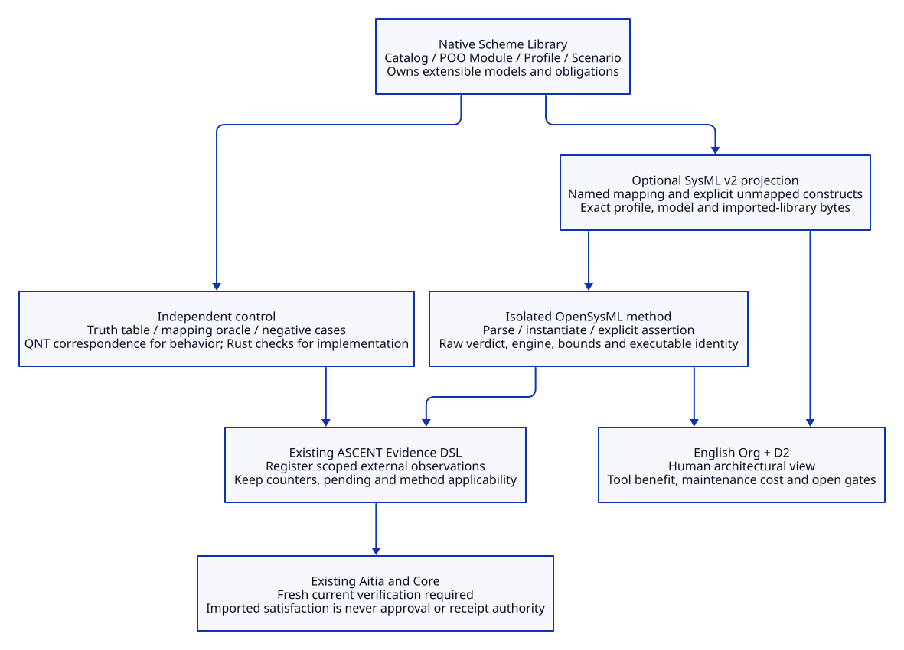

# SPDX-FileCopyrightText: 2026 tao3k team and Contributors
#
# SPDX-License-Identifier: LGPL-2.1-or-later

#+TITLE: 10.24 SysML Interoperability and Authority Boundaries
#+LANGUAGE: en
#+PROPERTY: JD_ID 10.24
#+OPTIONS: toc:3 num:t
#+STARTUP: overview
#+TODO: PROPOSED VERIFY | QUALIFIED
#+FILETAGS: :library:sysml:interoperability:aitia:evidence:
#+PROPERTY: header-args :eval never :tangle no :exports code

[[file:../../00-09-project/00-documentation/00.01-index.org][Index]] | [[file:10.23-native-aitia-backpressure-content-review.org][Native review and persistent intake]]

The accepted [[file:10.25-rust-sysml-quint-lean-evidence-integration.org][integration design]] connects Rust, SysML, Quint, Lean and D2
through shared native subjects and scoped evidence, with the existing six-case
backpressure experiment as its first delivery slice.

* PROPOSED Adopt a bounded interoperability profile
:PROPERTIES:
:CUSTOM_ID: sysml-interoperability
:DECISION: Optional SysML v2 projection and external-tool evidence
:AUTHORITY: Existing Scheme Library, ASCENT, QNT/Lean and Aitia owners
:END:

SysML v2 is useful when an engineering Library must exchange requirements,
structure, interfaces, constraints and verification intent with systems-engineering
tools or reviewers. Introduce it as an optional projection and evaluation method
at that boundary. Keep the Scheme Library as the authoring and composition owner.
No Go server, model repository or second approval engine is required by this
upgrade. Rust-only development need not load a SysML tool or its standard library.

The OMG SysML 2.0 page supplies the language specification, abstract-syntax JSON
schema and domain libraries, including quantities/units and requirement derivation.
Those resources give the exchange vocabulary a normative reference. They do not
prove that our POO extension or evidence semantics equal SysML specialization.

** Evidence inspected

#+NAME: sysml-evaluation-sources
| Source | Observation | Interpretation |
|--------+-------------+----------------|
| [[https://www.omg.org/spec/SysML/2.0][OMG SysML 2.0]] | Published language and machine-readable artifacts | Basis for selected interchange constructs |
| [[https://github.com/Open-MBEE/OpenSysML][OpenSysML repository]] | Go implementation with modeling, execution and integration tools | Candidate external method; not a new project core |
| OpenSysML development source | Inspected at c7e7371a23f53cb4bf0f0b5e1c7cafc069e4d867 | Research identity, separate from tested binary |
| OpenSysML v0.10.1 CLI | Reports build commit 1c45b6e1749fc8adc9b82d4af22fbe180b56a0e2 | Actual isolated executable used in this experiment |
| [[https://github.com/Open-MBEE/OpenSysML/blob/develop/docs/project/spec-compliance.md][Upstream compliance map]] | Declares coverage and execution limitations | Check method applicability rather than assuming certification |
| [[https://github.com/Open-MBEE/OpenSysML/blob/develop/docs/project/pilot-differential.md][Upstream pilot differential]] | Separates comparison against a reference implementation | Potential differential control; not independent adjudication of every runtime feature |

The CLI tarball was downloaded only into ignored local research storage and its
SHA-256 was checked against the release checksum list. That is integrity against
the same publisher's list, not independent supply-chain attestation. No package
manifest or global installation changed. Development-source claims are not
silently attributed to the older release binary. Neither upstream performance
numbers nor broad conformance claims are reproduced as our own results.

* Ownership and semantic mapping
:PROPERTIES:
:CUSTOM_ID: sysml-owner-mapping
:END:

#+NAME: sysml-native-owner-mapping
| Existing owner | Optional SysML projection | Semantic condition and loss |
|----------------+---------------------------+-----------------------------|
| Domain Library / Catalog | Package and named definitions | Catalog discovery and atomic Scheme loading stay native |
| POO Module | Selected part/interface definitions and dependencies | A structural view; not translation of executable slots or module activation |
| Profile | Concrete usages, selected attributes and constraints | Carry the exact native profile identity and applicability fingerprint |
| Scenario | Verification/analysis intent or explicit action inputs | An execution trace is not all interleavings; preserve exploration bounds |
| Verification obligation | Requirement/constraint plus method linkage | Derived native obligation ID remains the identity; imported labels are proposals |
| ASCENT claim / witness | Metadata and referenced external result | Preserve claim identity, subject, revision, scope, method and reference closure |
| QNT | External temporal/model-checking evidence | SysML run does not establish QNT's state-transition semantics |
| Lean | External typed proof artifact and assumptions | No automatic proof transport through diagram or text conversion |
| Aitia review / Core receipt | Historical metadata and evidence links | Deserialization never restores current private issuer authority |
| D2 / Org | Human-oriented diagrams, contracts and decision record | D2 stays the maintained architectural view; Org links semantic anchors |

POO composition and SysML specialization are not interchangeable. Before exporting
one inherited obligation, identify its substituted types, refined assumptions,
unchanged dependencies and new proof obligations. Unsupported relations are
reported as unmapped, never dropped or replaced with a green satisfaction marker.
A lossy projection cannot be used as a complete history inventory.

** Bounded data contract

Use the existing Library evidence envelope and external-method registration path.
A SysML result must bind native Library/Profile/Scenario identities, native
obligation IDs, export-mapping version, model bytes, selected library bytes,
transitive imported models, exact executable identity, options, exit status,
stdout/stderr and raw structured verdict. Record engine, schedule, bounds and
whether any budget was reached. Keep the upstream verdict separate from the
native review result. Unknown, uncovered, failed and timed-out outputs stay
explicit evidence states.

An importer proposes ASCENT relations under a named evidence source. It cannot
supply a native receipt issuer, approve a disposition, erase a counter, change a
scope or mutate a required-source inventory. A changed mapping invalidates the
translation evidence even when the generated model happens to be byte-identical.
A changed model invalidates execution evidence; unchanged Rust or Lean artifacts
remain candidates for reuse only after their actual applicability checks.

* VERIFY Executed acceptance-prefix experiment
:PROPERTIES:
:CUSTOM_ID: sysml-prefix-experiment
:STATUS: Isolated CLI experiment; production bridge not implemented
:END:

This experiment models only two Boolean predicates. It tests whether the tool
helps expose a design assertion and preserves a failure in a negative control.
It does not translate the complete Aitia model or establish crash consistency.

#+NAME: sysml-prefix-contract
#+BEGIN_SRC sysml
package DurableReview {
    private import ScalarValues::*;
    part def Acceptance {
        attribute acknowledged : Boolean;
        attribute completePrefix : Boolean;
        attribute selectedHead : Boolean;
        attribute freshReceipt : Boolean;
        attribute unresolvedCounter : Boolean;
        assert constraint ackRequiresPrefix { not acknowledged or (completePrefix and selectedHead) }
        attribute currentUse : Boolean = freshReceipt and completePrefix and selectedHead and not unresolvedCounter;
    }
    part confirmed : Acceptance {
        :>> acknowledged = true;
        :>> completePrefix = true;
        :>> selectedHead = true;
        :>> freshReceipt = false;
        :>> unresolvedCounter = true;
    }
    part incomplete : Acceptance {
        :>> acknowledged = true;
        :>> completePrefix = false;
        :>> selectedHead = true;
        :>> freshReceipt = false;
        :>> unresolvedCounter = true;
    }
}
#+END_SRC

#+NAME: sysml-prefix-observed-results
| Input / operation | Independent expected predicate | Observed result | Meaning |
|-------------------+--------------------------------+-----------------+---------|
| Structural strict validation | Both definitions are syntactically admissible | holds, exit 0 | No instance execution established |
| Object validation before instantiation | No instance available | unresolved, exit 2 | Missing execution input is not a pass |
| Instantiation with ordinary constraints, before adding an assertion | No asserted proposition | unresolved, exit 2, no assertion to validate | Constraint declaration alone is insufficient |
| confirmed instance with explicit assertion | true: not true or (true and true) | holds, exit 0 | One concrete acknowledgment assertion holds |
| incomplete instance with explicit assertion | false: not true or (false and true) | fails, exit 1 | The negative control exposes premature acknowledgment |
| confirmed.currentUse | false: no fresh receipt, and unresolved counter | expression false; command exit 0 | Expression evaluation success is not an authorization verdict |

The independent oracle is a truth table over the stated Boolean inputs, evaluated
outside the SysML runtime. No verdict is inferred from a successful command exit
alone. The earlier unresolved runs remain research artifacts, not discarded
failures. The final model equals the named Org block above byte-for-byte.

#+BEGIN_SRC sh
sysml -strict -json -instantiate DurableReview::confirmed \
  -validate=DurableReview::confirmed prefix-contract.sysml
sysml -strict -json -instantiate DurableReview::incomplete \
  -validate=DurableReview::incomplete prefix-contract.sysml
#+END_SRC

** Next admission gates and maintenance cost

#+NAME: sysml-upgrade-gates
| Gate | Current boundary | Required before broader use |
|------+------------------+-----------------------------|
| SI01 Structural vocabulary | Small explicit model executes | Round-trip selected native identities, reject unknown constructs |
| SI02 Translation correctness | No production exporter/importer | Independent mapping oracle; include omitted obligation and changed-scope controls |
| SI03 Evidence registration | Existing owners identified | Actual external result registration and ASCENT queries under current byte closure |
| SI04 Behavioral semantics | One concrete Boolean instance | QNT correspondence and counterexamples for concurrency and interruption ordering |
| SI05 Runtime equivalence | Not claimed | Rust/Tokio implementation checks independent of the SysML runtime |
| SI06 Authority isolation | Required by native contracts | Imported satisfaction and saved receipt must fail current Aitia/Core issuance checks |
| SI07 Atomic loading | CLI remains optional | Prove ordinary Scheme Library users do not start Go services or load SysML packages |
| SI08 Cost and benefit | One local qualitative experiment | Measure reviewer error detection, mapping upkeep and total verification time |

The expected benefit is shared requirement vocabulary, units/interface review and
interchange with external engineering teams. The costs are mapping maintenance,
model drift, tool/library versioning, duplicate authoring and additional review
of projection gaps. Start with one-way, explicitly incomplete projections. Broader
adoption needs a concrete collaboration requirement or demonstrated review gain;
it is not a prerequisite for the Rust Library's current verification path.

#+CAPTION: Optional SysML evidence joins the existing Library and native assurance owners.

