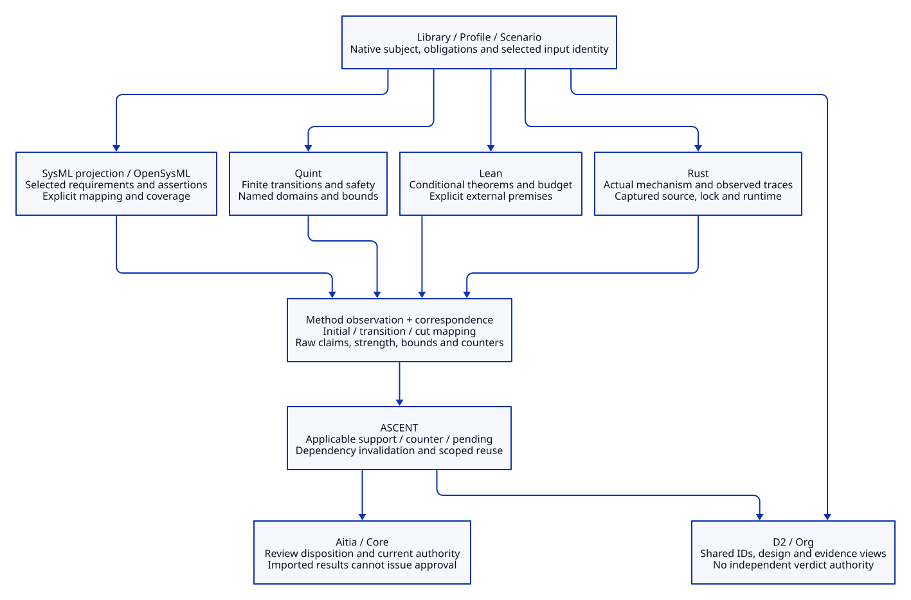

# SPDX-FileCopyrightText: 2026 tao3k team and Contributors
#
# SPDX-License-Identifier: LGPL-2.1-only

#+TITLE: 10.25 Rust, SysML, Quint and Lean Evidence Integration
#+LANGUAGE: en
#+PROPERTY: JD_ID 10.25
#+OPTIONS: toc:3 num:t
#+STARTUP: overview
#+TODO: ACCEPTED IMPLEMENT VERIFY | QUALIFIED
#+FILETAGS: :design:rust:sysml:quint:lean:evidence:
#+PROPERTY: header-args :eval never :tangle no :exports code

[[file:../../00-09-project/00-documentation/00.01-index.org][Index]] | [[file:10.24-sysml-interoperability-and-authority-boundaries.org][Interoperability boundary]] | [[file:../../40-49-research/40-reference-studies/40.03-opensysml-implementation-responsibilities.org][Pinned REDK research]]

The [[file:10.26-backpressure-public-contracts.org][Library, Profile and Scenario public-contract design]] specifies the
three consumer boundaries using native POO/Core facilities. It records current
repetition and the complete capture design without changing this implementation.

* ACCEPTED One engineering subject, several methods
:PROPERTIES:
:CUSTOM_ID: integrated-evidence-design
:DECISION_DATE: 2026-10-20
:STATUS: Accepted architecture; implementation qualification is separate
:END:

The Scheme Library, selected Profile and Scenario own the engineering subject,
parameters, obligations and dependencies. D2, SysML, Quint, Lean and Rust are
coordinated views, methods and implementation subjects of that same selection.
They are not a serial source-to-source compiler pipeline. Stable native IDs and
explicit correspondence contracts connect them.

#+NAME: integrated-responsibilities
| Component | Responsibility | Evidence boundary |
|-----------+----------------+-------------------|
| Library / Profile / Scenario | Compose the subject and derive obligations | Selection and inheritance do not discharge obligations |
| D2 / Org | Explain structure, state mappings and scoped evidence | A diagram or rendered status cannot issue authority |
| SysML / OpenSysML | Project selected requirements, structure, interfaces, quantities and executable assertions | Projection omissions and runtime coverage remain explicit |
| Quint | Check selected state transitions, concurrency and invariants | Finite safety does not establish unbounded liveness |
| Lean | Check conditional theorems and arithmetic; later, formal correspondence | Every premise and trusted translation remains visible |
| Rust | Implement the mechanism and emit observations under a selected workload | Tests and traces cover their executions, not every execution |
| ASCENT | Infer support, counter, pending, mismatch and reusable applicability | An applicable method result is not execution permission |
| Aitia / Core | Review disposition and current activation under existing contracts | Imported verdicts cannot mint private native authority |

* ACCEPTED External execution first, Rust client when needed
:PROPERTIES:
:CUSTOM_ID: integrated-method-execution
:END:

The first integration uses Core Ops to invoke an explicitly selected OpenSysML
CLI, following the existing Quint, Lean and Cargo method pattern. Capture the
executable, input closure, invocation, deadline, exit status, logs and raw verdict.
The method observer validates the output and issues a result through the existing
registration boundary. A successful process exit is insufficient on its own.

The upstream Rust client is a blocking client for a Go service, not a Rust
implementation of SysML semantics. Introduce it only for an actual interactive or
persistent-worker need. Pin the service executable, compare capabilities and keep
blocking work on a bounded worker with explicit process/deadline ownership.
Ordinary Rust product builds need not depend on a SysML client or start a service.

* IMPLEMENT Backpressure six-case slice
:PROPERTIES:
:CUSTOM_ID: integrated-backpressure-slice
:STATUS: Delivery target; receipts determine achieved scope
:END:

Use the existing RL-M01 through RL-M06 subjects and the current-thread Tokio,
one-thread Rayon, one-permit, one-payload experiment. The target requirement is:
while a job retains its resource, cancellation of its caller must not return its
capacity permit prematurely. Keep RL-M06 as a deliberate counterexample.

#+NAME: integrated-case-obligations
| Native case | Subject | SysML question | Correspondence question |
|-------------+---------+----------------+-------------------------|
| RL-M01 | Normal result handoff | Ownership assertion at observed cuts | Running, returned and released observations match permitted transitions |
| RL-M02 | Admission waiter cancellation | Held resource remains reserved | Waiter events do not manufacture admission of a second job |
| RL-M03 | Abandoned receiver | Failed delivery retains ownership until disposal | Delivery failure enters cleanup; release follows cleanup |
| RL-M04 | Caller abort with job-owned permit | Caller abort preserves reservation | Cancellation alone cannot remove a live owner's permit |
| RL-M05 | Full cleanup queue | Fallback disposal retains ownership until release | Full queue cannot silently drop a resource obligation |
| RL-M06 | Caller-owned permit | Premature release fails the assertion | Preserve the invalid reservation transition and counter |

Add method facets with explicit links to these existing native case IDs, rather
than relabeling SysML observations as native execution evidence. A projection
facet and a correspondence facet have different dependencies and conclusions.
Selecting the slice must preserve the parent and existing Rust obligations.

** Mapping contract

Define a versioned mapping from observed native cuts/events to the existing
Quint state vocabulary: queued, running, returned, cleanup and done, plus the
admitted reservation set. Admission and release have distinct meanings from
payload allocation/disposal. Check initial-state compatibility, legal transitions
or declared abstract intermediate steps, observation completeness and reservation
consistency. A synthesized intermediate state is a mapping witness, not an
observed native event.

The existing trace provides synchronized cuts and selected event order, not every
instruction or an independently observed global schedule. Do not infer missing
concurrent order from JSON serialization alone. Unmapped events, incomplete
traces and ambiguous observations must refuse or remain unresolved. A finite
trace correspondence result is not a proof over every Rust execution.

The first mapper treats the interval after allocation and before CPU start as
abstract queued ownership, without claiming an observed native queue operation.
For M02, disposal before CPU start uses an explicit queued-to-cleanup extension
to the base Quint model. The original transition system and its historical
receipts remain unchanged. The generated replay model guards every consumed
state and its terminal state against the complete expected sequence. A violation
of its deliberately named =unfinished= invariant establishes existence of that
complete abstract path; it is not a violation of the resource safety invariant.
The TLC backend used here does not export an ITF path witness, so the retained
artifacts are the native trace, mapped states, generated model and raw result;
no independently replayed TLC witness is claimed.

Keep three propositions separate: the abstract model satisfies an invariant;
these observed Rust executions correspond to that abstraction; all Rust executions
refine the abstraction. The first slice addresses the first two within their
declared domains. The third requires additional source/refinement evidence.

** Budget and liveness

The existing Lean theorem concerns selected abstract accounting parameters.
Binding those parameters to actual Rust allocations, peak retention and ownership
is another obligation. Never infer a physical memory bound from an arithmetic
proof without these premises. Eventual cleanup needs fairness/progress assumptions
and separate evidence; completed finite traces establish no universal liveness.

* ACCEPTED Result identity and invalidation
:PROPERTIES:
:CUSTOM_ID: integrated-result-contract
:END:

#+NAME: integrated-result-envelope
| Field group | Required content |
|-------------+------------------|
| Subject | Native entry revision, obligation/facet ID, parent case ID, Profile, Scenario and snapshot |
| Inputs | Model and imported-library bytes, Rust sources, Cargo.lock, effective build configuration and workload |
| Mapping | Projection and state-mapping versions, mapping implementation bytes, declared losses and unsupported constructs |
| Method | Exact executable/toolchain identity, engine, inputs, assumptions, scheduling policy and capabilities |
| Limits | State/input domains, steps, depth, time, termination and every reached bound |
| Output | Raw claim and strength, logs, counterexample/trace, oracle checks and content-addressed artifacts |
| Admission | Issuer, current dependency checks, ASCENT registration references and separate review disposition |

The current issued method-result object remains the registration entry. A saved
JSON result is review material and cannot reconstruct issuance authority. Source
or mapping changes invalidate only evidence depending on them; old failures stay
historical. Reuse unchanged Lean or Quint results only after their own complete
applicability checks. Unknown, not covered, timeout, failed and pending remain
distinct from support; an unsupported operation produces no positive witness.

* VERIFY Delivery gates and controls
:PROPERTIES:
:CUSTOM_ID: integrated-delivery-gates
:END:

#+NAME: integrated-slice-gates
| Gate | Required evidence |
|------+-------------------|
| IE01 Identity | All six native case IDs survive projection, correspondence and query output; selected inputs are current |
| IE02 SysML | Positive assertions and the RL-M06 negative assertion execute under a captured CLI/library identity |
| IE03 Correspondence | Native observations map to the named Quint abstraction; malformed, omitted, reordered and duplicate observations are rejected |
| IE04 Independence | Expected positive/negative controls are checked outside the SysML evaluator and producer verdicts |
| IE05 Registration | Issued facet results enter existing ASCENT support/counter/pending queries with distinct footprints |
| IE06 Reuse | Changed native bytes invalidate native correspondence; changed mapping invalidates projection/correspondence; unchanged independent proof remains only an applicability candidate |
| IE07 Views | D2 labels reference the same obligations and report actual evidence scope; rendering never supplies a verdict |
| IE08 Boundaries | Preserve the negative case; do not claim complete Rust refinement, physical memory qualification, universal liveness or native approval |

The organization of repositories and long-term packages is a subsequent
decision. This design fixes semantic responsibilities and an incremental delivery
slice without prescribing that organizational structure.

* QUALIFIED First executed local slice
:PROPERTIES:
:CUSTOM_ID: integrated-local-slice
:QUALIFIED_ON: 2026-10-20
:SCOPE: One controlled six-case workload on the existing frozen Core baseline
:END:

The [[file:../../../examples/resource-integration-evidence.ss][integration entrypoint]] extends the existing Rust publication with explicitly
linked =SI-M01..SI-M06= assertion facets and =TM-M01..TM-M06= correspondence
facets. The [[file:../../../library/concurrency/resource-control/backpressure-memory/rust/correspondence.ss][mapping functions]] and the existing [[file:../../../library/concurrency/resource-control/backpressure-memory/rust/methods.ss][method observer]] retain the private
issued-result boundary. The original Rust executable and base Quint/Lean files
were not changed. No runtime package dependency was added.

The [[file:../../../.data/resource-integration-20261020-05/report.json][executed report]] contains 20 actual method results: six native observations,
one base Quint invariant result, one Lean budget result, six SysML cut-assertion
results and six Quint path-existence results. The selected OpenSysML executable
is v0.10.1, commit =1c45b6e1749fc8adc9b82d4af22fbe180b56a0e2=, rather than the
newer source checkout inspected in 40.03. SysML uses a clean environment with
the explicitly selected binary and its bundled libraries.

#+NAME: integrated-local-receipt
| Operation | Observed result | Meaning |
|-----------+-----------------+---------|
| Base Quint / Lean | Completed invariant check and selected arithmetic theorem | Existing abstract premises only |
| RL-M01 through RL-M05 | Native, SysML and trace facets support their scoped propositions | Concrete observations and compatible finite abstract paths |
| RL-M06 | Native, SysML and trace facets all retain a counter | Premature permit release is not hidden by aggregation |
| Current ASCENT query | 17 support, 3 counter, 9 pending, 20 witnesses | The integration is not an all-obligations pass |
| Changed mapping selection | 7 support, 1 counter, 19 pending, 20 witnesses | Mapping-dependent facets lose applicability; native/formal history remains |
| Malformed observation controls | Eight mutations rejected in the dedicated test suite | Missing/duplicate/unknown/reversed events, missing cases, wrong capacity, zero payload and corrupted permit cut |
| D2 output | Generated directly from query IDs and dispositions | Human view of the actual local query, not approval |

The [[file:../../../t/resource-integration-test.ss][integration regression suite]] independently checks artifact digests and references,
case links, method inventory, query counts, retained history and malformed inputs.
The [[file:../../../.data/resource-integration-20261020-05/evidence.d2][query-derived D2 source]] and [[file:../../../.data/resource-integration-20261020-05/evidence.svg][rendered evidence view]] retain the same case and facet IDs.

The mutable Core checkout initially refused expansion because =replay-slot-reads!=
was unbound in =read-projection.ss=. Execution therefore selected the previously
recorded frozen Core source using the standard =GERBIL_LOADPATH= mechanism.
All 5,408 files matched its source manifest before execution. This qualifies the
local slice on that baseline, not the moving Core checkout. Earlier syntax,
sandbox-port and unsupported TLC action-composition failures remain diagnostic
history; the successful run uses state guards and retains its own fresh outputs.

#+NAME: integrated-reproduction-command
#+BEGIN_SRC sh
# Select the recorded baseline explicitly; the primary dependency link stays intact.
export RESOURCE_INTEGRATION_LOADPATH="$PWD/.data/qualification-20261019:$PWD/.gerbil/lib:$PWD"
just investigate-resource-integration .data/resource-integration-fresh \
  .data/aitia-durable-intake-20261019/opensysml-cli/sysml-darwin-arm64
export GERBIL_PATH="$PWD/.gerbil"
export GERBIL_LOADPATH="$RESOURCE_INTEGRATION_LOADPATH"
RESOURCE_INTEGRATION_REPORT="$PWD/.data/resource-integration-fresh/report.json" \
  timeout --signal=TERM --kill-after=5s 120s \
  gxtest -:max-heap=1G,debug=q -v 5 t/resource-integration-test.ss
#+END_SRC

Use a fresh output directory. The recipe retains a 600-second aggregate watchdog
and 45-second individual method limits. Quint's TLC backend needs to bind its
local Apalache compilation-service port. The mapping-change control changes the
selected scope digest; it does not mutate or rewrite historical source artifacts.
Actual source-change controls from 10.22 remain separate evidence.

The [[file:../../../.data/integration-audit-20261020/acceptance.json][scoped acceptance audit]] records successful and unfinished checks separately.
The new three-case integration suite and the existing four-case Library-owner
suite completed. The existing =t/native-context-test.ss= did not complete within
its unchanged 120-second watchdog and was terminated (exit 137). Its diagnostic
copy also timed out (exit 124) before the first marker after Scenario scope selection. This is an
unresolved standalone regression boundary, not a failed assertion or a passing
test. The integration run above completed its own captured-context currentness
checks; that does not replace the unfinished mutation/forgery regression.

Outstanding scope includes the standalone context regression, nine pending obligations, complete Rust refinement,
independent replay of a TLC path witness, physical peak-memory qualification,
universal liveness, current native Aitia activation, moving-Core qualification,
clean-host reproduction and remote CI. Node/Java dispatch and the transitive
Quint installation remain part of the trusted local tool environment rather than
an independently attested toolchain closure.

#+CAPTION: Shared subjects and scoped methods converge at the existing evidence owners.

