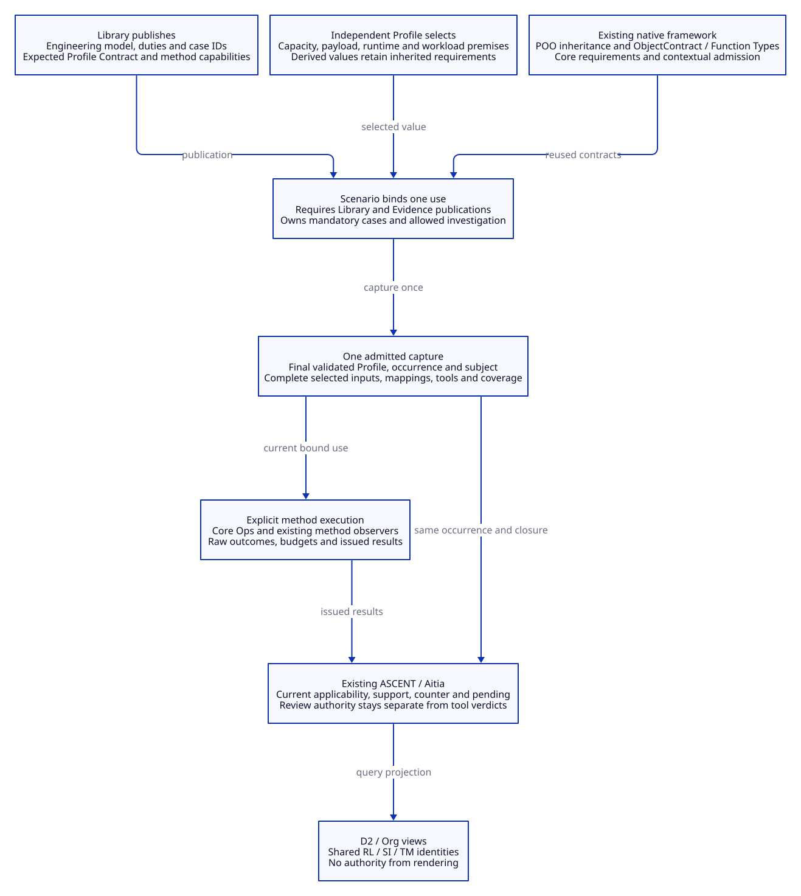

# SPDX-FileCopyrightText: 2026 tao3k team and Contributors
#
# SPDX-License-Identifier: LGPL-2.1-only

#+TITLE: 10.26 Backpressure Public Contracts: Library, Profile and Scenario
#+LANGUAGE: en
#+PROPERTY: JD_ID 10.26
#+OPTIONS: toc:3 num:t
#+STARTUP: overview
#+TODO: DESIGN SPECIFIED | IMPLEMENTED
#+FILETAGS: :design:contracts:library:profile:scenario:backpressure:
#+PROPERTY: header-args :eval never :tangle no :exports code

[[file:../../00-09-project/00-documentation/00.01-index.org][Index]] | [[file:10.25-rust-sysml-quint-lean-evidence-integration.org][Executed integration and limits]] | [[file:10.17-domain-libraries-and-atomic-specialization.org][Domain ownership]] | [[file:10.27-library-delivery-repo-workflow-and-backpressure-audit.org][Delivery workflow, audit and four-step acceptance]]

* DESIGN Read the public contract before the representation
:PROPERTIES:
:CUSTOM_ID: backpressure-public-contracts
:STATUS: Design specification; no runtime or directory migration
:END:

The Library publishes reusable knowledge and supported verification capabilities.
The Profile supplies independent values for a selected use. The Scenario binds
them to one occurrence, captures its inputs and coordinates evidence use.
Contracts explain these responsibilities before any Scheme representation.
The [[file:10.27-library-delivery-repo-workflow-and-backpressure-audit.org::#library-delivery-purpose][Library delivery purpose]] places them in the Agent-to-project-to-Aitia
workflow. Its [[file:10.27-library-delivery-repo-workflow-and-backpressure-audit.org::#backpressure-contract-audit][implementation audit]] maps each finding to these boundaries;
the [[file:10.27-library-delivery-repo-workflow-and-backpressure-audit.org::#backpressure-minimal-refactor][four-step plan]] specifies what stays, what changes and acceptance gates.
The tables below specify logical responsibilities, not a new declaration syntax,
serialized schema or final list of implementation slot names.

For project architecture, Org products and decision records, [[file:10.31-architecture-document-and-decision-contracts.org][10.31]] applies
these same public boundaries to DE-CASE-01, with explicit content duties and
capture-to-evidence/review associations.
[[file:10.38-profile-selection-scenario-capture-and-evidence-use.org][10.38]] defines the complete Profile selection/Scenario capture continuation of
[[file:10.37-library-declarations-and-contract-design.org][10.37]], including native role/parent/policy binding and the same captured
association at ASCENT and Aitia boundaries.
[[file:10.39-method-execution-evidence-issuance-and-ascent-projection.org][10.39]] completes the method execution/issuance and scoped projection design,
including exact input roles, claim limits and identified query-view handoff.

#+NAME: three-public-contracts
| Public boundary | Consumer receives | Consumer may select | Boundary owner checks |
|-----------------+-------------------+---------------------+-----------------------|
| Library | Entry, expected Profile Contract and supported methods | A published generic or Rust-specialized entry | Preserved obligations, dependency closure, method coverage and mappings |
| Profile | Independent reusable parameter value | Supported parameters, assumptions and engineering objectives | Field Types, cross-field relations and applicable specialization premises |
| Scenario | Bound use and capture/open-review operations | Profile occurrence, actual implementation and allowed investigation request | Coherent capture, required duties, currentness and permitted method use |

For the running example, the subject is retained-resource ownership across
Tokio/Rayon handoff. Its controlled six-case experiment has one permit, one
payload, a current-thread Tokio runtime and one Rayon worker. A local experiment
can be accepted while Library obligations and production approval remain open.

* SPECIFIED Native Library version ownership and stable namespaces
:PROPERTIES:
:CUSTOM_ID: contract-version-source
:END:

The Library's native Contract declaration is the only authority for this public
declaration family's version. Org and D2 explain the owner/read path and display
native observations; they never supply a fallback value or maintain a registry.
The current requested generation remains V1. No successful native read is claimed:
the new declaration and role associations are not implemented in this checkout.

Two earlier proposals are withdrawn: an Org version property as the source, and
a flat BackpressureModel.contract-version field as the authority. The comprehensive
[[file:10.37-library-declarations-and-contract-design.org][10.37 native declaration design]] replaces the latter: an engineering model must
not also own the compatibility protocol shared by model and policy declarations.
Refactoring is allowed; the design is not constrained to the smallest source diff.

** Existing native mechanisms and their limits

| Concern | Inspected native owner | What already works / what it does not mean |
|---------+------------------------+-------------------------------------------|
| Generic definition | [[file:../../../library/concurrency/resource-control/backpressure-memory/abstract/objects.ss][BackpressureModel]] | Native POO object owns engineering identity/revision/rules/dependencies; no new Contract family or role association exists yet |
| Config and public scope | [[file:../../../library/concurrency/resource-control/backpressure-memory/abstract/config.ss][Config.entry]] and [[file:../../../library/concurrency/resource-control/backpressure-memory/abstract/interface.ss][BackpressureLibrary]] | Native object references flow through core.exports; no metadata file is required |
| Required parent and specialization | [[file:../../../library/concurrency/resource-control/backpressure-memory/rust/interface.ss][RustResources]] and [[file:../../../library/concurrency/resource-control/backpressure-memory/rust/objects.ss][specialize-backpressure]] | Parent.entry is read through the required scope and extended using native .+; inheritance is not a semantic refinement proof |
| Declaration/linking | [[file:../../../.gerbil/pkg/github.com/tao3k/poo-flow-core/module-system/source/declaration.ss][Core lowering]] and [[file:../../../.gerbil/pkg/github.com/tao3k/poo-flow-core/module-system/source/link.ss][Core linking]] | core.exports lowers to native linking; required/produced scopes are admitted under expected Contracts; no version resolver is needed |
| Native field/role validation | [[file:../../../.gerbil/pkg/github.com/tao3k/gerbil-poo/object-contract.ss][ObjectContract]] and [[file:../../../.gerbil/pkg/github.com/tao3k/poo-flow-core/types.ss][Core value-contract/admission]] | Reuse native field Types, relations, refinement and admission evidence; the new domain declarations/checks remain future work |
| Current project predicates | [[file:../../../library/concurrency/resource-control/backpressure-memory/abstract/types.ss][BackpressureScopeContract]] and [[file:../../../library/concurrency/resource-control/backpressure-memory/rust/types.ss][RustResourcesScopeContract]] | Check the current source shape; they do not already validate the target descriptor/family association |
| Framework publication/currentness | [[file:../../../.gerbil/pkg/github.com/tao3k/poo-flow-core/module-system/source/publication.ss][ModulePublicationContract]] and [[file:../../../.gerbil/pkg/github.com/tao3k/gerbil-poo/object.ss][POO object-revision]] | Publication shape and native invalidation have their own owners; neither is the domain contract generation |
| Package/dependency identity | Generated [[file:../../../manifest.ss][manifest.ss]] | Native package-manager output; not a domain contract version and not hand-edited |

Existing semantic tokens =ownership-budget/v1=, =backpressure/v3= and
=backpressure-integration/v1= retain their engineering meanings and historical
evidence. They are not parsed or renamed as declaration-family versions.

** Target native owner, references and read path

The proposed single source is
=BackpressureDeclarationContract.contract-version= in =abstract/types.ss=.
This is a native POO/Core Contract descriptor. The generic, Rust, integration and
review-policy role Contracts each reference it through =declaration-contract=.
Each semantic definition references its expected role through =contract=.
No independent writable version field is placed on those four definitions.

The four roles keep separate expected Contract identities and semantic
identities/revisions, as specified in the [[file:10.37-library-declarations-and-contract-design.org::#declaration-identity-matrix][identity matrix]]. The shared declaration
generation identifies the consumption protocol, not interchangeability or a
universal release version for unrelated Libraries. Policy composes with applicable
models; it does not inherit their engineering state or duties as a model subtype.

| Boundary | Responsibility | Captured or displayed result |
|----------+----------------+------------------------------|
| Library | Declare the shared native Contract once; publish definitions, expected role Contracts and descriptor associations through current core.exports | Native family/role/definition references and source-qualified metadata |
| Profile | Select supported values/roles/policy; do not supply or override Library metadata | Independent choice and project parameters, not a second version authority |
| Scenario | Obtain admitted scope, read the selected role Contract -> declaration-contract -> contract-version, validate the actual selected definition/parameters | Bind the returned native value and owner/source/role/revision/parent or applicability closure to one occurrence |
| ASCENT / Aitia adapters | Consume the same admitted association with actual scoped evidence and project/policy bindings | Matching labels alone establish neither applicability, currentness, truth nor review authority |
| Org / D2 | Reference native owners and display observed/captured metadata with provenance | Explicit pending/unavailable state until the native declaration/read/capture is qualified |

A direct source import may inspect a declaration; it does not replace admission
of the effective selected scope. Consumers do not scan Scheme text or Org
properties. Missing metadata, unsupported roles, foreign parents or substituted
descriptors prevent a qualified binding. There is no default literal, automatic
increment, latest-version lookup, compatibility facade or global registry.

The [[file:10.36-version-revision-and-namespace-audit.org::#version-audit-findings][10.36 source audit]] retains the actual-source findings. Its Declare target is
expanded by the [[file:10.37-library-declarations-and-contract-design.org::#declaration-contract-architecture][Contract architecture]], [[file:10.37-library-declarations-and-contract-design.org::#declaration-publication-design][publication/dependency plan]] and
[[file:10.37-library-declarations-and-contract-design.org::#declaration-refactoring-acceptance][refactoring acceptance gates]] in 10.37. Structural acceptance, semantic
refinement, executable evidence and Aitia review remain distinct gates.

Namespaces, Module names, imports and semantic identities remain stable and
contain no new version suffixes. Content/source changes require affected fresh
capture/evidence even when the generation is unchanged. No new declaration,
reader, Contract check, object, directory or runtime path is implemented here.

#+CAPTION: Shared native Contract owner, engineering refinement, policy composition and qualified publication.
[[file:../../90-99-views/90-architecture-views/90.99-library-contracts.svg]]

[[file:../../90-99-views/90-architecture-views/90.99-library-contracts.d2][Editable D2 source]].

* SPECIFIED Library: publish engineering meaning and supported methods
:PROPERTIES:
:CUSTOM_ID: backpressure-library-contract
:END:

The generic backpressure publication owns the resource predicates and inherited
obligations. The Rust specialization explicitly requires it and adds the selected
runtime/ownership premises. The integration facets extend that knowledge under
the same publication discipline. A model generator consumes those definitions;
it does not decide which duties the Library has.

#+NAME: library-publication-contract
| Published responsibility | Six-case content | Consumer guarantee and limit |
|--------------------------+------------------+------------------------------|
| Identity and semantic revision | Generic backpressure entry, Rust specialization and explicit parent reference | Names resolve to an identified publication; names alone do not authenticate bytes |
| Engineering model | Waiting, queued, running, returned, cleanup and released roles; ownership/reservation relation | State meanings and assumptions are reviewable independently of tools |
| Obligations and dependencies | Existing BP/TR/CA/RL duties and explicitly linked SI/TM facets | Specialization preserves applicable inherited duties and rejects conflicting identities |
| Case definitions | RL-M01 through RL-M06, purpose and independent expected distinction | Case meaning does not depend on a producer's verdict |
| Expected Profile Contract | General parameter Contract and the narrower native six-case requirements | The consumer can validate a selected value without copying its defaults |
| Method capabilities | Native observation, Quint invariant, Lean budget, SysML cut assertion and Quint path correspondence | Supported questions, domains, inputs, refusal behavior and maximum evidence strength are explicit |
| Correspondence definitions | Native cut/state mapping, SysML element association and queued-cancellation extension | Mapping revision and losses are evidence dependencies |

The minimal public scope continues the existing entry / profile-contract /
methods pattern. Auxiliary native/context Contracts may be shared where another
boundary genuinely consumes them; do not export private file hashing, JSON output
or every executor helper as a consumer API. A common Type declaration is reused
by the relevant boundaries rather than repeated in each table or wrapper.

The M02 queued-to-cleanup extension is a semantic definition requiring explicit
ownership and review. It must not be introduced as an invisible convenience of
the Quint serializer. Likewise, SI/TM obligation definitions belong to the
published specialization, even when their generation helpers happen to be in
the same implementation file today.

** Six canonical cases and their method facets

#+NAME: public-six-case-inventory
| Native obligation | Engineering question | SysML / trace facets | Independent expected distinction |
|-------------------+----------------------+----------------------+----------------------------------|
| RL-M01 | Normal result handoff retains reservation until disposal | SI-M01 / TM-M01 | Ownership cuts hold; full mapped path exists |
| RL-M02 | Cancelling a waiting admission does not acquire a second permit | SI-M02 / TM-M02 | Existing owner stays reserved; declared queued-cancellation extension covers disposal |
| RL-M03 | Abandoned receiver retains responsibility through failed delivery | SI-M03 / TM-M03 | Failed delivery enters cleanup before release |
| RL-M04 | Caller abort leaves the job-owned permit with live work | SI-M04 / TM-M04 | Caller cancellation alone does not release the job's reservation |
| RL-M05 | A full cleanup queue preserves responsibility through fallback disposal | SI-M05 / TM-M05 | Retained work is disposed before final release |
| RL-M06 | Caller-owned permit exposes premature release | SI-M06 / TM-M06 | Native unsafe cut, failing SysML assertion and absent complete legal mapped path remain counters |

SI/TM are linked propositions with their own applicability, not duplicate native
passes. The complete Library contains other obligations beyond these cases.
Requesting this slice does not erase those duties or turn nine pending obligations
from the recorded run into discharged obligations.

* SPECIFIED Profile: select values without republishing the Library
:PROPERTIES:
:CUSTOM_ID: backpressure-profile-contract
:END:

A Profile is an ordinary reusable POO value authored independently of Module
functionality. The Library publishes its expected Contract; the Profile supplies
the candidate. A trusted interface can associate a published Profile export with
that Contract once. Naming conventions or a candidate-supplied contract slot are
not that association, and no per-Profile publication wrapper is required.

#+NAME: profile-choice-contract
| Selection | Current baseline | Allowed choice and check |
|-----------+------------------+--------------------------|
| Profile identity | resource-64 | A named reusable value; a new Scenario occurrence still gets a distinct use identity |
| Capacity / queue | 1 / 1 | Fixed for this six-case specialization; broader generic Profiles require separate method coverage |
| Item / fixed / cache / budget | 64 / 0 / 0 / 256 accounting units | Nonnegative/positive Types and declared relations; the selected Lean proposition may still fail |
| Runtime premises | Tokio current-thread, Rayon one worker, panic unwind | Fixed experiment premises; another runtime needs a supported specialization |
| Workload and ownership inventory | Controlled six-case workload; unique owned payload/permit | Must agree with actual captured implementation and invocation |
| Objectives / applicable factors | Bounded retention and selected runtime facts | Derive duties under Library/Scenario policy; cannot delete mandatory six-case obligations |

LargerPayloadProfile already derives from LifecycleProfile and changes item to
128 plus its corresponding workload declaration. Inheritance should carry the
unchanged responsibilities and defaults. Cross-field obligations check that the
final receiver's workload agrees with its item value; validation must not read a
previously captured parent's effective value by mistake.

The current native method accepts positive payload sizes up to 4096, while other
methods have their own domains. A representable Profile, a structurally conforming
Profile, a covered method request and a qualified execution are separate states.
The integrated 20-result receipt in 10.25 covers resource-64 only. Neither the
existence of resource-128 nor a broad method domain supplies a fresh integrated
receipt. A capacity-2 Profile may suit a generic Quint check while remaining
unsupported for this one-permit native Scenario.

The Scenario owns its mandatory six-case inventory. The current Profile's factor
list is not permission to remove M06, skip a case or weaken inherited duties.
Optional investigation requests may add supported work; required evidence can
only change through an explicitly revised, reviewed policy.

Tool paths, output paths, resolved binary identities, deadlines and result IDs
belong to the occurrence's execution context. They are not reusable Profile
defaults. Historical fields such as lock =captured-by-native-method= express an
intention; capture must resolve and bind the actual Cargo.lock bytes.

* SPECIFIED Scenario: capture once and use the captured occurrence
:PROPERTIES:
:CUSTOM_ID: backpressure-scenario-contract
:END:

The Scenario requires the Library and Evidence publications through existing Core
requirements. It exposes the existing capture/open-review intent and an explicit
investigation action. These are operations with native invocation Contracts;
this document does not prescribe a new wrapper language or final action name.

#+NAME: scenario-operation-contract
| Operation | Inputs | Output and postcondition | Refusal / incomplete boundary |
|-----------+--------+--------------------------+-------------------------------|
| Bind selected use | Expected Library/Profile Contracts, selected publications/Profile, occurrence and question | One identified use with preserved mandatory duties | Unknown publication, wrong Contract association or conflicting duties |
| capture | Bound use, actual implementation, tool selections and execution policy | One validated POO capture containing selected identities, final admitted Profile, required input closure and resolved method coverage | Malformed value refuses; missing/unsupported mandatory capability remains explicit and cannot yield a runnable plan |
| open-review | That capture alone | Existing Evidence session bound to the captured entry, occurrence and snapshot after currentness checks | Different entry, changed inputs, split fields or an old capture cannot silently reopen current use |
| Investigate | Captured use and its admitted method request | Issued method results with raw artifacts, scoped claims and coverage/budget outcomes | Unavailable/unknown/timeout/refused methods produce no positive witness |
| Register and query | Issued results and the current captured use | Existing ASCENT applicability, support, counter, pending and history | Saved JSON cannot reconstruct an issuer; result applicability is rechecked |
| Project views | Current query plus stable semantic IDs | D2/Org explanation, linked to the exact captured query | Rendering and labels confer no review or execution authority |

The public operation takes the captured value, not a parallel set of mutable
entry/profile/scope arguments. Internally, a fixed adapter may project the rows
that existing ASCENT APIs require; it must derive those rows from this same
validated capture instead of accepting independently supplied replacements.

** What capture binds

#+NAME: scenario-capture-contract
| Captured responsibility | Bound content |
|-------------------------+---------------|
| Selected subject | Library identity/revision, required parent, occurrence ID and required obligation/case inventory |
| Profile | Final validated value and the expected Contract identity/revision; nested normalized/wrapped values are retained |
| Native implementation | Actual source/manifest/lock/configuration, selected Rust toolchain, runtime and workload premises |
| Models and mappings | Selected Quint/Lean/SysML inputs, imported libraries, projection and state-mapping versions and byte closure |
| Method request | Questions, method coverage, mandatory/optional distinction, tool identities, assumptions, schedule and budgets |
| Dependency footprint | Input roles and content identities sufficient for later applicability checks; no missing role is replaced by a name |

Capture is coherent input binding, not a proof that mutable files cannot change.
Use an owned copy where the method requires stable bytes and recheck applicable
inputs at method execution, result registration and current review/use boundaries.
A changed input refuses current use or requires recapture; it does not mutate an
old capture. A digest detects consistency under the stated local trust model and
does not authenticate a remote producer or make check-to-use atomic.

The Capture Contract should share the same field Types used by Profile and Library
validation and add occurrence-specific relations. It is an operation boundary
within the Scenario contract, not a fourth configuration language or a second
catalog of all parameters. Independently inherited method facets contribute
their required input roles; avoid a second hard-coded slot list for each tool.

** Concrete use and change trajectories

#+NAME: scenario-six-case-trajectory
| Step | Actor and concrete action | Observable contract result |
|------+---------------------------+----------------------------|
| 1 | Select Rust backpressure entry and resource-64 | Resolve expected Contracts and retain parent plus SI/TM obligations |
| 2 | Select the six-case Scenario and actual crate/tools | Scenario supplies mandatory cases and allowed method questions |
| 3 | Validate and capture | One use binds source/config/model/mapping/tool bytes and final Profile |
| 4 | Run native, base Quint/Lean and selected SI/TM methods | Current full slice expects 20 method results; no universal fixed all-tools pipeline is implied |
| 5 | Register and query through existing Evidence owner | Preserve M06 counters; support/pending are evaluated against current dependencies |
| 6 | Render the query and seek any required review | Evidence view remains separate from Aitia disposition and native activation |
| Change A | Select resource-128 | New occurrence/capture; arithmetic, workload and native/projection evidence are reconsidered under actual dependencies |
| Change B | Change only the mapping | SI/TM applicability changes; unaffected evidence is only reusable after its own currentness checks |
| Change C | Remove a mandatory case or claim an unavailable tool passed | Refusal/incomplete report with the original duty retained |

Expected negative controls and production admission have different outcomes. A
test investigation succeeds when it exposes M06 as intended; it cannot use that
expected counter to approve the unsafe implementation. Likewise, a scoped local
method result does not close other pending Library duties.

* SPECIFIED Use the framework's existing responsibility boundaries
:PROPERTIES:
:CUSTOM_ID: backpressure-native-contract-basis
:END:

#+NAME: native-contract-reuse
| Existing facility | Use in these contracts | Repeated machinery it replaces |
|-------------------+------------------------+--------------------------------|
| POO prototypes and ordinary derivation | Independent Profiles, specialized entries and extensible public values | Copied parent parameter bodies and parallel metadata objects |
| gerbil-poo ObjectContract. | One responsibility map from fields to existing Types or nested value Contracts | Repeated slot-presence, scalar-type and nested-shape predicates |
| ObjectContract obligations and refine | Named pure cross-field checks; preserving additions to inherited checks | Rechecking every inherited field in each specialization |
| Existing Function Types and invocation Contracts | Validate operation inputs and returned values through native invocation semantics | A procedure? check followed by a second handwritten call wrapper |
| Core Module requires and scope-contract | Bind the actual required publication and its public Contract | A second dependency resolver or export/getter catalog |
| Core PooFlowContract. value-contract and contextual responsibilities | Reuse ordinary structural validation, then check occurrence-specific responsibilities | A second field schema inside the contextual Contract |
| Existing Core Ops, ASCENT and Aitia boundaries | Execute methods, issue/register observations and review current use | Another executor, fact store or approval engine |

Structural conformance, contextual admission, publication authenticity and
permission to execute are different checks. A candidate cannot appoint its own
expected Contract. The consumer obtains that descriptor from the selected trusted
publication/requirement association. These three public boundaries do not imply
exactly three new classes or three new global registries.

Use the value returned by native validation/admission. Function validation may
install a checked wrapper in a persistent derived object; continuing to use the
original candidate discards that work. Core's current admission producer consumes
its value-contract's validated candidate before classification. Deriving a value
from a data prototype also does not mean inheriting from its Contract descriptor.

ObjectContract rejects undeclared extra fields by default. An extensible Profile
needs a derived Contract that declares its additional responsibilities, or an
explicit delegated constraint owning the extension policy. Arbitrary fields must
not become an escape from required checks. Prototype ancestry is required only
when the implementation family matters; structurally valid independent parameter
values need not inherit a particular default Profile.

** Source basis and qualification

The linked sources were read on 2026-10-20. They are dirty development workspaces;
the source identities below identify inspected files, not qualified executables.
No upstream build, import or contract test was run for this design. The older
frozen-Core execution in 10.25 does not establish these newer facilities there.

#+NAME: public-contract-source-basis
| Source | Inspected SHA-256 | Relevant behavior |
|--------+------------------+-------------------|
| [[file:../../../.gerbil/pkg/github.com/tao3k/gerbil-poo/object-contract.ss][gerbil-poo object-contract.ss]] | c0881304131e45c846e947d7a3a812b06a082f1836490b4e1d09751d74491a1a | ObjectContract., diagnose, refine and native Type delegation |
| [[file:../../../.gerbil/pkg/github.com/tao3k/gerbil-poo/doc/object-contracts.md][Structural contract guide]] | 0d452d2b258557322fcacf32fb0d30f624f145786e2171d285c41a16500409bd | Validation returns, field policy, inheritance and invocation integration |
| [[file:../../../.gerbil/pkg/github.com/tao3k/poo-flow-core/types.ss][Core types.ss]] | c72b57f1c87fb974916077e3260512e313dc49888d0ef0d96724f1ad05f40a8c | value-contract followed by contextual classification/admission |

Core's historical design 157 describes an earlier shared-schema layout. Its old
filename is not a reason to recreate that layer here: the inspected implementation
delegates ordinary value responsibilities to gerbil-poo. Current local predicate
Contracts remain implementation history until an explicit future change qualifies
the native structural replacement.

* DESIGN Current repetition and the proposed correction
:PROPERTIES:
:CUSTOM_ID: backpressure-contract-design-debt
:END:

#+NAME: current-contract-design-debt
| Current source | Responsibility issue | Contract design response |
|----------------+----------------------+--------------------------|
| [[file:../../../library/concurrency/resource-control/backpressure-memory/rust/types.ss][Rust types.ss]] and [[file:../../../library/concurrency/resource-control/backpressure-memory/abstract/types.ss][parent types.ss]] | Repeated slots?, scalar tests, inherited row checks and slot inventories | Ordinary field Types/nested ObjectContracts once; named pure relational and preservation obligations |
| [[file:../../../library/concurrency/resource-control/backpressure-memory/rust/func.ss][ResourceMethods]] | Execution, context checks, evidence operations and file/JSON helpers share a broad export | Publish semantic capabilities and typed operations; keep fixed helpers private to their owners |
| [[file:../../../library/concurrency/resource-control/backpressure-memory/rust/correspondence.ss][correspondence.ss]] | Obligation extension and serializers share ownership | Published Library specialization owns duties/mapping semantics; generators implement those definitions |
| [[file:../../../examples/resource-integration-evidence.ss][integration example]] | Extends entry, assembles extra scopes and opens Evidence directly | Scenario owns one complete capture/use path; example supplies selection and launches it |
| [[file:../../../scenarios/resource-lifecycle/func.ss][Scenario publication]] | Captures the older seven-scope native context while integration adds scopes elsewhere | Compose the selected method footprint into the same occurrence capture; preserve existing Core selection |

This is a substantive boundary correction, not just a request for shorter Scheme.
Reuse receiver-aware inheritance and native value/invocation Contracts; use sparse
generic dispatch only where an actual specialization axis exists. Pure mapping,
digest and rendering algorithms remain named functions. Public extensible values
remain POO-native. JSON and relation rows are downstream projections, and private
issued-result structures retain their existing authority boundary.

No runtime change, directory move or replacement API is implemented by this
document. In particular, native structural validation, the full Scenario capture
and the trusted publication-to-Contract association need their own future
implementation/qualification; exporting adjacent names alone does not supply the
association. The unfinished cold Scenario context regression from 10.25 remains
open. Visual simplicity does not qualify loading cost or native currentness.

#+CAPTION: Three public boundaries reuse the native framework and share one captured use.

