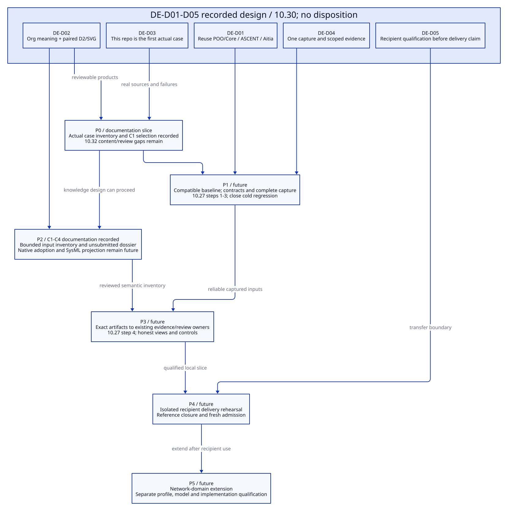

#+TITLE: 10.27 Library Delivery, Agent Repository Workflow and Backpressure Audit
#+LANGUAGE: en
#+PROPERTY: JD_ID 10.27
#+OPTIONS: toc:3 num:t
#+STARTUP: overview
#+TODO: DESIGN SPECIFIED VERIFY | QUALIFIED
#+FILETAGS: :design:library:agent:repository:aitia:audit:
#+PROPERTY: header-args :eval never :tangle no :exports code

[[file:../../00-09-project/00-documentation/00.01-index.org][Index]] | [[file:10.26-backpressure-public-contracts.org][Three public contracts]] | [[file:10.25-rust-sysml-quint-lean-evidence-integration.org][Executed slice and limits]] | [[file:10.24-sysml-interoperability-and-authority-boundaries.org][SysML boundary]] | [[file:10.22-domain-library-delivery-and-native-admission.org][Existing delivery boundary]]

* DESIGN Why this repository is a Library
:PROPERTIES:
:CUSTOM_ID: library-delivery-purpose
:STATUS: Design only; no implementation, directory migration or downstream delivery
:END:

This repository supplies reusable engineering knowledge to consuming projects
through Lambda Aitia. Its purpose includes architecture, documentation,
development obligations and reviewable evidence, beyond running formal tools.
Backpressure is the first complete mechanism slice, not the organizing limit of
the Library. A consuming repository selects and specializes knowledge rather
than copying this experiment's orchestration and fixed verdict counts.

Scheme is the Agent's authoring, composition and operation entry through native
POO/Core. Library entries publish engineering meaning and verification methods;
Profiles supply independent values; Scenarios bind their actual project use.
ASCENT derives consequences of explicit rules and admitted evidence. The Agent
proposes architecture, assumptions and repairs; its prose is not an admitted
fact or proof. Aitia owns project SDLC policy, review disposition and the
existing authority boundaries.

#+NAME: delivered-library-responsibilities
| Delivered asset | Library responsibility | Consuming repository / Aitia responsibility |
|-----------------+------------------------+--------------------------------------------|
| Domain entries and contracts | Reusable definitions, assumptions, obligations, specialization relations and method capabilities | Select entries and satisfy their premises against actual project content |
| Architecture and documentation guidance | Linked semantic subjects, explanation requirements, SysML mappings and Org/D2 view conventions | Author the project's topology, interfaces, decisions, rationale and maintained views |
| Models and independent checks | Reusable QNT abstractions, conditional Lean propositions, mapping definitions and counterexample controls | Bind project parameters and implementation; establish correspondence and actual coverage |
| Evidence interface | Input roles, scoped claims, result references, applicability and refusal conditions | Capture actual dependencies, run methods and preserve current and historical evidence |
| Review association | Map engineering duties to existing Aitia review requirements | Apply selected project policy and decide exact current content through existing owners |

Delivery must identify the Library revision, selected exports and expected
Contracts, parent dependencies, models/mappings and supported methods. These are
logical delivery requirements, not a new manifest format or publication registry.
Use the existing Core publication and Aitia intake path. Tool executables belong
to the selected execution capture. Historical evidence can accompany knowledge
as examples or reuse candidates; neither its applicability nor private issuer
authority transfers automatically to another repository.

* SPECIFIED Agent workflow for establishing a repository
:PROPERTIES:
:CUSTOM_ID: agent-repository-workflow
:END:

The [[file:10.28-network-service-agent-design-walkthrough.org][network-service walkthrough]] instantiates this sequence with explicit
inputs, outputs, document products, counterexample/repair branches and a proposed
Aitia design-review dossier. It does not execute or implement the workflow.

The subject here is a project repository, not a component named Ripple. The
workflow starts with repository identity and engineering intent. Tool execution
follows an identified question and selected policy. Each revision can return to
architecture when evidence exposes a mistaken assumption.

#+NAME: agent-repository-trajectory
| Stage | Agent action through Scheme / native owners | Persistent project content | Gate / unresolved state |
|-------+--------------------------------------------+----------------------------+-------------------------|
| 1. Establish context | Identify actual repository/revision, scope, stakeholders, requirements, existing code and Aitia policy | Project use identity, requirements, assumptions and unknowns | Unknown topology or policy is recorded; no inferred completeness |
| 2. Compose knowledge | Select Library entries and expected Contracts, independent Profiles and a Scenario | Selected definitions, occurrence-specific values and mandatory duties | Native structural/contextual validation; method coverage remains a separate question |
| 3. Establish architecture | Define components, boundaries, interfaces, ownership, quantities, failure assumptions and requirement allocation | Native semantic IDs, selected SysML model, Org decisions and D2 explanatory views | Architecture review and projection completeness for the declared scope; unsupported mappings remain explicit |
| 4. Derive investigations | Submit explicit project facts to existing ASCENT rules; inspect duties, gaps and candidate dependencies | Obligation-to-subject-to-method links, required checks and optional investigations | Mandatory policy cannot be waived by an Agent or omitted factor |
| 5. Capture one use | Resolve actual implementation, model/mapping closure, tools, parameters and execution budgets | One validated capture consumed by review and investigation | Missing mandatory capability refuses runnable use or leaves an explicit incomplete investigation |
| 6. Investigate and implement | Run selected QNT/Lean/SysML/native methods via existing Core Ops; revise code and model when needed | Raw artifacts, scoped issued results, counterexamples and code/model correspondence | Timeout, unknown, unsupported and counter stay distinct; model success does not qualify arbitrary implementation |
| 7. Infer and explain | Register issued results; query existing ASCENT; render actual query and linked rationale | Current support/counter/pending, dependency explanations, architecture/document updates | Missing or stale evidence does not become support through rendering |
| 8. Review and deliver | Present exact content, unresolved duties and current evidence to existing Aitia owners | SDLC review/disposition and any separately authorized activation | No tool verdict, imported JSON or Library selection mints approval |
| 9. Maintain | On code, architecture, premise or tool changes, recapture affected use and reconsider applicability | Revised model/docs, preserved history and selected rechecks | Reuse follows actual dependencies; old acceptance is not silently relabeled current |

The semantic ID connects a requirement, architecture element, obligation, model,
implementation subject and evidence reference. Org records intent, alternatives,
assumptions and decisions; D2 explains selected structure and queried status;
SysML supplies a structured systems-model view and supported checks. They share
identified subjects without becoming interchangeable copies. One-way generated
views must declare their owner. Imported model edits are proposals reconciled
through Scheme; no automatic bidirectional synchronization is assumed.

ASCENT's determinism is conditional on explicit captured facts and rules. It
does not invent a missing network architecture, prove arbitrary LLM statements
or discover undeclared dependencies. The Agent investigates uncovered relations,
proposes additions and supplies checkable evidence through the relevant owner.

** A network repository: architecture first, then question-specific methods
:PROPERTIES:
:CUSTOM_ID: network-repository-example
:END:

For a new network system, first establish requirements and architecture through
Scheme and the selected SysML/OpenSysML modeling capability: participants,
connections, interface/message definitions, trust and deployment boundaries,
resource ownership, failure assumptions and allocated requirements. Review this
model before using a detailed protocol check as evidence about the whole system.
Sketching a model and qualifying an external engine are separate activities.

This is the default architecture-first Scenario proposed for this network use.
If its policy requires a SysML model/check, unavailable or unsupported tooling
must remain a gap. It does not make an OpenSysML process mandatory for every
Library entry or replace the native Scheme authoring owner. This refines the
optional interoperability boundary in 10.24 for a specifically selected use.

#+NAME: method-selection-by-engineering-question
| Project question | Architecture/model responsibility | Selected investigation | Required qualification boundary |
|------------------+-----------------------------------+------------------------+---------------------------------|
| Network topology and interfaces | Identify peers, channels, messages, boundary contracts and requirement allocation in SysML plus native subjects | Supported OpenSysML structural/assertion checks; native interface/integration tests | Successful parsing is not system correctness; identify unsupported constructs and actual deployed bindings |
| Distributed protocol | Declare loss, duplication, reordering, partitions, retry, recovery and persistence assumptions as applicable | QNT state-transition exploration of selected safety/progress questions; native fault tests | Record state bounds, schedule/fairness and failure model; finite success is not unbounded liveness |
| Multithreaded ownership and synchronization | Identify owners, handoff, cancellation, lock/queue roles and atomicity assumptions | QNT interleavings/invariants and actual runtime stress/observation; Lean where an unbounded theorem is required | Establish abstraction-to-code correspondence and runtime premises; do not infer every memory-model behavior from an abstract transition model |
| GC or concurrent reclamation | Identify heap/reference roles, roots, reachability, collector/mutator phases and reclamation obligations | QNT for a bounded phase/barrier/reclamation abstraction when state interaction matters; Lean for selected general laws; native memory/resource tests | Declare finite heap abstraction, omitted behavior and implementation correspondence; a bounded model alone does not qualify a collector |
| Capacity or memory budget | Allocate queues, holders, units and workload premises across components | Lean conditional arithmetic, QNT ownership where transitions matter, measured native resource behavior | Distinguish accounting units, measured peaks and a proved bound under explicit premises |
| Security or latency objective | Record threat assumptions or workload/SLO allocation and relevant boundaries | Select dedicated analysis/tests/measurements and any applicable formal model | SysML/QNT availability does not supply every missing security or performance method |

Thus distributed systems, GC and multithreading should trigger an explicit
state/concurrency-modeling question. Use the relevant QNT Library capability
when covered; make it mandatory when selected project policy requires it. Do not
require all tools for every component, or treat their absence as permission to
skip a mandatory duty. An uncovered method domain remains uncovered until a
reviewed specialization or another accepted method addresses it.

* SPECIFIED Audit against the three public contracts
:PROPERTIES:
:CUSTOM_ID: backpressure-contract-audit
:SOURCE_BASIS: Read-only local implementation audit, 2026-10-20
:END:

The rows below audit the current six-case implementation, not a proposed
directory tree. Contract links identify the public responsibility being repaired.
Source links identify inspected definitions; they are not execution receipts.

#+NAME: backpressure-implementation-audit
| ID / public contract | Current source and finding | Preserve | Replace or reassign |
|----------------------+----------------------------+----------+---------------------|
| A01 / [[file:10.26-backpressure-public-contracts.org::#backpressure-library-contract][Library]], [[file:10.26-backpressure-public-contracts.org::#backpressure-profile-contract][Profile]] | [[file:../../../library/concurrency/resource-control/backpressure-memory/rust/types.ss][Rust types]] manually repeats slot/scalar/list/nested shape predicates | Domain relations, explicit supported domains and refusal behavior | Shared native ObjectContract responsibilities and existing Types; pure obligations for relations |
| A02 / Library | [[file:../../../library/concurrency/resource-control/backpressure-memory/abstract/types.ss][Parent types]] compares whole rule/dependency literals; Rust types separately checks preservation | Required parent meaning, unique obligation identities and dependency preservation | Replace literal snapshot typing with explicit semantic preservation checks; inheritance alone is insufficient |
| A03 / Profile | General profile predicate invokes Quint's finite normal-mode domain; native predicate mixes premises and mandatory case factors | Capacity/runtime/workload relations and actual native/method limits | Separate structural conformance, specialization premises, method coverage and Scenario mandatory inventory |
| A04 / Library | [[file:../../../library/concurrency/resource-control/backpressure-memory/rust/correspondence.ss][Correspondence]] creates integration identity, SI/TM rules/dependencies and queued-cancellation action | Case associations, mapping revisions, pure projection algorithms and declared losses | Publish semantic definitions through existing Library specialization; serializers consume them |
| A05 / Library and [[file:10.26-backpressure-public-contracts.org::#backpressure-scenario-contract][Scenario]] | Rust/[[file:../../../scenarios/resource-lifecycle/types.ss][Scenario types]] recognize methods with procedure? and contract slots with object? | Existing native selection and trusted requirement binding | Native invocation Types for inputs/results; expected Contract from trusted publication association |
| A06 / Profile and Scenario | [[file:../../../scenarios/resource-lifecycle/func.ss][Scenario operations]] and [[file:../../../library/concurrency/resource-control/backpressure-memory/rust/methods.ss][native context helpers]] discard validation returns | Entry binding and currentness checks | Consume the validated/normalized value at every affected boundary |
| A07 / Scenario | Native context requires exactly seven scope roles; integration binds mapping and two tools later | Precise role inventory, content identities and per-use freshness | Compose selected method roles into one coherent capture; no arbitrary extra-scope allowance |
| A08 / Scenario | [[file:../../../examples/resource-integration-evidence.ss][Integration example]] expands entry, joins scopes/snapshot and directly opens Evidence | Native build/source admission, actual invocation and evidence registration | Scenario owns capture/open-review/investigation coordination; example selects and launches |
| A09 / Library API | [[file:../../../library/concurrency/resource-control/backpressure-memory/rust/func.ss][ResourceMethods]] exports JSON/digest helpers beside domain methods | Named pure helpers and existing Core ProcessScript adapter | Narrow consumer surface in place; no new executor, loader or generic registry |
| A10 / Library and Evidence | [[file:../../../modules/resource-evidence/func.ss][Evidence rules]] embeds Tokio/Rayon to async-cpu-handoff domain derivation | Existing ASCENT applicability/query/session engine | Library owns that domain implication; project facts reach the existing engine through a narrow adapter, without a new rule language |
| A11 / Scenario and views | Integration example mixes fixed 17/3/20 checks, changed-mapping control, normal execution and D2 labels | Independent negative controls and historical witnesses | Acceptance harness owns fixed gold; view derives counts/status from actual query |

** Six cases: preserve semantic distinctions

#+NAME: six-case-audit-controls
| Case | Keep independent oracle obligation | Ownership correction / acceptance control |
|------+------------------------------------+-------------------------------------------|
| M01 | Returned live payload retains reservation until disposal | Library states the rule; native oracle, SysML cut and QNT path retain their distinct claims |
| M02 | Cancelled waiter acquired no second permit; original holder stays reserved | Publish/version queued-cancellation extension; do not hide cancelQueued in serializer semantics |
| M03 | Failed delivery retains ownership until disposal | Retain receiver-drop and delivery-failure order checks |
| M04 | Caller cancellation leaves job-owned permit with live work | Mandatory Scenario inventory cannot be weakened by Profile factor omission |
| M05 | Full cleanup queue retains responsibility through fallback disposal | Keep explicit full-queue path; ordinary cleanup success cannot substitute |
| M06 | Caller-owned permit exposes premature release | RL-M06, SI-M06 and TM-M06 remain counters; expected test counter is not implementation approval |

Publish canonical case identities, associations and mandatory policy once where
owned. Do not share a generator's verdict derivation with the independent oracle
to reduce repetition. Independent checks must still detect faulty mappings,
missing cuts and changed expectations.

** Keep these existing mechanisms

Keep Core requires/scope-contract and explicit selection; independent POO Profile
inheritance; existing Core Ops; existing ASCENT and clue-exchange registration;
private resource-result issuance; independent oracles; raw artifacts and history;
and freshness checks at execution, registration and current-use boundaries.
The current registration helper already deduplicates file checks within that
boundary. A previous successful read does not replace a later currentness check.
JSON/ASCENT rows remain projections; private issued results need not become
public extensible POO objects. Pure mapping/rendering algorithms remain named
functions. No decorative generic/CLOS layer is proposed.

* SPECIFIED Four-step minimum refactor and acceptance
:PROPERTIES:
:CUSTOM_ID: backpressure-minimal-refactor
:IMPLEMENTATION: Deferred by user instruction
:END:

The [[file:10.29-workflow-capabilities-and-minimum-completion.org::#minimum-completion-order][project completion order]] places these four steps after the current
repository case inventory and before qualified recipient delivery. Its paired
 connects the refactor to architecture/document knowledge and
existing evidence/review owners. These are dependencies, not completed gates.

The steps are ordered changes within existing ownership and files. They do not
authorize a directory migration, upstream framework upgrade or downstream
deployment. Before execution, identify a compatible POO/Core source and compiled
baseline and investigate the existing native-context regression. Source-visible
capabilities and earlier frozen-Core slice receipts are different evidence.

** Step 1: replace repeated structure checks with native contracts
:PROPERTIES:
:CUSTOM_ID: refactor-step-1
:AUDIT_IDS: A01 A02 A03 A05 A06
:END:

Use ObjectContract field responsibilities, existing primitive/container/Function
Types and nested Contracts. Add pure obligations/refine for domain relations and
preserved parent duties. Core value-contract consumes ordinary value validation;
contextual responsibilities add occurrence duties. Preserve Profile inheritance,
native limitations and trusted expected-Contract association. Consume validation
returns, including wrapped methods. Do not retain a parallel handwritten schema.

Acceptance conditions:
- The 64 and inherited 128 Profiles validate under their declared premises;
  inherited workload relations observe the final receiver.
- Missing/malformed fields and nested values refuse with useful field paths;
  duplicate obligations and missing inherited dependencies refuse.
- Wrong operation inputs and outputs refuse through native invocation checks;
  consumers use the actual normalized candidate and checked method wrappers.
- Extra-field policy is explicit: ObjectContract's default rejection must not
  silently change intentional extensibility in the old permissive predicates.
- A structurally valid but method-uncovered Profile remains distinguishable from
  malformed data; this does not expand supported runtime/model domains.

** Step 2: publish Library semantics and narrow its public methods
:PROPERTIES:
:CUSTOM_ID: refactor-step-2
:AUDIT_IDS: A02 A04 A09 A10
:END:

Publish the integration entry, case links, SI/TM obligations, dependencies,
mapping semantics and M02 extension through existing Library specialization.
Keep pure serializers/oracles private where appropriate. Expose supported domain
methods and consumed Contracts rather than hashing/JSON utilities. Reassign the
Tokio/Rayon implication to Library-owned semantics, feeding the existing Evidence
engine without adding a generic rule-distribution framework.

Acceptance conditions:
- Native publication/selection yields the integration definition without the
  example constructing its own entry; applicable parent duties are preserved.
- Each of six cases has explicit RL/SI/TM associations, input roles and scoped
  claims; mapping revision and M02 extension are inspectable dependencies.
- Conflicting IDs, missing links and incompatible definitions refuse; M06 is
  still mandatory and its three counters remain independently checked.
- Mapping mutations are detected by independent checks, not accepted through a
  shared verdict helper. Serializers cannot silently add new semantic actions.
- Removing internal helpers from consumer API introduces no alternate loader,
  executor, publication registry or copied ASCENT engine.

** Step 3: make Scenario own complete capture and coordinated use
:PROPERTIES:
:CUSTOM_ID: refactor-step-3
:AUDIT_IDS: A03 A05 A06 A07 A08
:END:

Bind final admitted Profile, selected Library, mandatory cases, actual
implementation, model/mapping closure, tools and execution policy in one capture.
Compose required roles from selected methods. Scenario operations consume that
capture. Preserve existing Evidence signatures internally where useful by
projecting from the same admitted value; do not accept independently substituted
entry/profile/snapshot/scope fields. Keep private issuer and freshness boundaries.

Acceptance conditions:
- The complete slice is captured and opened through the public Scenario path;
  the example cannot bypass it to assemble an extended use.
- Foreign entry, mismatched Profile/workload, duplicate/conflicting roles,
  omitted mandatory case and unsupported mandatory method refuse or remain
  explicitly incomplete. An arbitrary extra scope does not establish coverage.
- Changing source, lock/configuration, selected runtime/tool, model or mapping
  is detected at applicable execution/registration/use boundaries.
- A mapping-only change invalidates affected SI/TM applicability; unchanged
  results are reused only after their own dependency checks; history survives.
- Independent captures cannot mix native results from different observations;
  saved JSON cannot manufacture issued results or native activation authority.
- The cold Scenario/native-context regression completes under an agreed bounded
  watchdog; do not increase the timeout merely to declare acceptance.

** Step 4: thin the example and separate acceptance from presentation
:PROPERTIES:
:CUSTOM_ID: refactor-step-4
:AUDIT_IDS: A08 A11
:END:

The example selects repository use, Profile, implementation and tools, then calls
Scenario operations. Keep fixed receipt-count expectations and changed-mapping
controls in the acceptance harness. Render D2/Org from actual query state and
stable semantic IDs. Preserve native build/source admission and raw evidence.

Acceptance conditions:
- The controlled resource-64 baseline still records 20 witnesses, 17 support,
  3 counter and 9 pending; this is fixture gold, not a universal API contract.
- Mapping-change control retains 20 historical witnesses and produces 7 support,
  1 counter and 19 pending under the same controlled assumptions.
- A changed query changes rendered counts/status; pending, unavailable and
  counter states cannot be overwritten by hard-coded success labels.
- Resource-128 is a separate captured use and receives fresh required evidence;
  its successful validation is not reported as an executed integrated receipt.
- Missing tool, timeout, malformed result, stale artifact and expected M06
  counter have explicit distinct outcomes; no stage issues Aitia approval.
- Focused contract, Library-owner, integration and cold Scenario regressions
  pass on the identified baseline; any remaining failures retain their receipts.

* VERIFY Evidence boundary and document maintenance
:PROPERTIES:
:CUSTOM_ID: audit-evidence-boundary
:END:

This document specifies audit findings and future acceptance. It does not claim
the refactor, network workflow or Library delivery is implemented. The existing
[[file:../../../.data/integration-audit-20261020/acceptance.json][local acceptance record]] reports a completed bounded method slice and an
unfinished native-context regression. It also records nine pending obligations,
frozen-Core limits, finite path existence without exported ITF witness and no
universal Rust refinement, peak-memory proof, native Aitia authority or remote CI.

The three contracts in 10.26 remain the public design. This document supplies
their implementation audit, delivery context and acceptance sequence. Future
implementation must update actual receipts rather than rewriting historical
failures or marking design sections qualified because the prose is complete.
