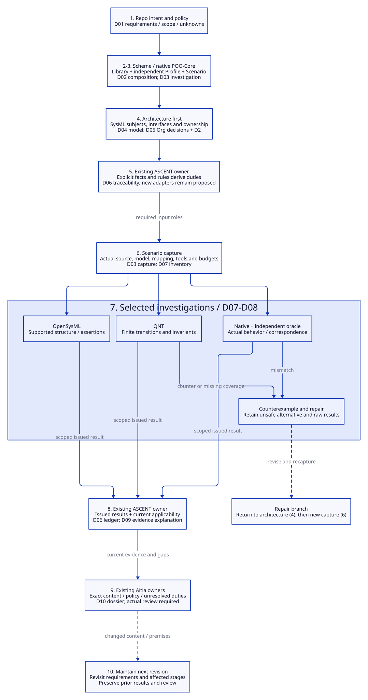

# SPDX-FileCopyrightText: 2026 tao3k team and Contributors
#
# SPDX-License-Identifier: LGPL-2.1-or-later

#+TITLE: 10.28 Network Service Repository: Agent Design Walkthrough
#+LANGUAGE: en
#+PROPERTY: JD_ID 10.28
#+OPTIONS: toc:3 num:t
#+STARTUP: overview
#+TODO: DESIGN SPECIFIED VERIFY | QUALIFIED
#+FILETAGS: :design:network:agent:scheme:sysml:quint:ascent:aitia:
#+PROPERTY: header-args :eval never :tangle no :exports code

[[file:../../00-09-project/00-documentation/00.01-index.org][Index]] | [[file:10.27-library-delivery-repo-workflow-and-backpressure-audit.org][Delivery workflow and audit]] | [[file:10.26-backpressure-public-contracts.org][Public contracts]] | [[file:../../20-29-cases/20-gateway/20.01-gateway-sdlc.org][Broader gateway design]]

* DESIGN Concrete subject and current status
:PROPERTIES:
:CUSTOM_ID: network-walkthrough-subject
:STATUS: Authored design exercise; no repository created, model executed or review issued
:END:

Assume an Agent is asked to establish a repository named bounded-transform-service:
an HTTP service accepts a bounded byte payload, submits CPU work, and returns a
transformed result. A disconnected client must not release capacity while its
job still retains resources. The service may reject overload and must define
shutdown and cleanup behavior. These are illustrative project requirements,
not an existing target checkout or an implemented Library publication.

The initial scope is one service instance with an asynchronous network runtime
and an owned CPU worker pool. Ingress size is limited to 4096 bytes; the design
selects two worker reservations and two waiting jobs. These are example limits,
not measured sizing. Result buffers, connection/parser buffers and allocator
overhead require separate accounting. No total-memory or latency bound follows
from the payload and queue limits alone.

The Agent works through Scheme and existing POO/Core boundaries. It establishes
architecture before detailed behavior, then captures inputs for selected methods,
registers evidence through existing owners and submits the exact project content
to Aitia. The following is a prospective runbook. All verdicts below are explicit
design gold or branches, never fabricated execution receipts.

* SPECIFIED Step-by-step inputs, outputs and document products
:PROPERTIES:
:CUSTOM_ID: network-walkthrough-stages
:END:

The [[file:10.29-workflow-capabilities-and-minimum-completion.org][capability audit]] separates existing mechanisms from missing knowledge
and adapters. The [[file:10.30-current-repository-engineering-case.org][actual repository case]] applies these document responsibilities
to this Library's real sources and evidence.

#+CAPTION: Proposed network workflow with document products and repair feedback.

[[file:../../90-99-views/90-architecture-views/90.88-network-agent-workflow.d2][Editable D2 source]]. The graph is a design projection, not an execution receipt.

Document IDs D01-D10 below name logical products within the consuming project.
They are not a required directory layout or files created by this exercise.
Existing project documents may host these sections. Their semantic IDs remain
stable even when document locations change.

#+NAME: network-stage-contracts
| Step / owner | Concrete input | Action and output | Document product / exit condition |
|--------------+----------------+-------------------+-----------------------------------|
| 1. Agent / project context | User intent, actual repo/revision when available, existing code/docs, stakeholders and Aitia policy | Establish service boundary, requirements, assumptions, exclusions and unresolved policy | D01 Project brief and scope; unknowns have owners rather than invented answers |
| 2. Scheme / Library selection | D01; available native publications and their expected Contracts | Select reusable backpressure/Rust knowledge; identify missing HTTP/architecture and lifecycle coverage | D02 Composition record; available capabilities and proposed additions are distinguished |
| 3. Scheme / Profile and Scenario | Selected Library, example limits, runtime/workload premises and required checks | Validate candidate values; bind a project use; require architecture, ownership, interface and cleanup investigations | D02 Profile/policy sections and D03 Scenario investigation plan; unsupported coverage is explicit |
| 4. Agent / SysML architecture | Selected use, D01 requirements, actual interfaces when known | Define service components, ports/messages, ownership boundaries, requirement allocation and selected constraints; request supported OpenSysML checks later | D04 Architecture model and model report, D05 Org architecture decisions with D2 view; mapping and coverage gaps remain visible |
| 5. ASCENT / obligation derivation | Explicit selected policy, Library rules, project facts and model associations | Derive required duties and inspect uncovered factors/dependencies using existing engine; proposed new relations await implementation | D06 Obligation and traceability ledger; every duty has a subject, method, dependency roles and owner |
| 6. Scenario / capture | Validated use, models/mappings, actual source/configuration, tools and method budgets | Produce one coherent captured occurrence for review/investigation; freeze input identities and recheck currentness at use | D03 capture record and D07 evidence inventory; missing mandatory inputs prevent a complete runnable investigation |
| 7. Core Ops / selected methods | Captured inputs, finite QNT abstraction, SysML check request and independent oracles | Run model/structural checks and later native tests; validate raw outputs and issue scoped results through existing result owners | D07 raw-artifact references and method reports, D08 counterexample/repair record; no result is issued in this exercise |
| 8. ASCENT / evidence reasoning | Issued results, current capture, rules and mappings | Derive current support/counter/pending and applicability; query why a duty lacks support | D06 current ledger and D09 evidence explanation/view; stale or missing facts cannot become positive support |
| 9. Agent / Aitia review | Exact design revision, selected applicability policy, D01-D09, unresolved duties and evidence references | Submit through existing review/intake owners; separate design review from implementation/release readiness | D10 review dossier and actual disposition when issued; no disposition is presumed here |
| 10. Agent / maintenance | Changed model/code/Profile/tool/policy and preserved prior review | Recapture affected use, recheck evidence, update explanations and request a new review where needed | Revised D01-D10 with history; old review is retained under its original content identity |

** Steps 1-3: make the three selections concrete
:PROPERTIES:
:CUSTOM_ID: network-native-selections
:END:

The Agent first records requirements NET-R01 through NET-R05: reject oversized
input before unbounded retention; bound admitted jobs; retain ownership across
caller cancellation; define overload/response behavior; and drain or explicitly
refuse new work during shutdown. Authentication, deployment exposure, TLS
termination and actual SLOs are unresolved inputs requiring project decisions.
They remain obligations or scope questions, not silently satisfied exclusions.

#+NAME: network-selection-availability
| Selection | Concrete choice / role | Current availability and limit |
|-----------+------------------------+--------------------------------|
| Library | Generic backpressure entry and Rust specialization | Existing [[file:../../../library/concurrency/resource-control/backpressure-memory/rust/interface.ss][RustResources]] requires its parent through Core; it does not publish a complete HTTP service architecture |
| Profile | Independent project value: capacity 2, waiting queue 2, payload limit 4096, selected worker/runtime premises | Proposed project value; it must not be passed off as a supported native six-case Profile |
| Existing microfixture Profile | LifecycleProfile: capacity 1, queue 1, payload 64, one Rayon worker | Existing [[file:../../../profiles/resource-lifecycle.ss][Profile]] covers the controlled six-case experiment; its results do not qualify the proposed service limits |
| Scenario | Project use requiring architecture, interface, ownership, cleanup and native correspondence evidence | Proposed project Scenario; [[file:../../../scenarios/resource-lifecycle/interface.ss][ResourceLifecycle]] supplies a narrower existing use boundary with audited gaps in 10.27 |
| Aitia policy | Project-selected applicability, design-review requirements and later implementation gates | Reuse existing owners; do not copy a fixture's NASA classification or assume standards applicability |

Library supplies meaning and supported questions. Profile supplies independent
values. Scenario supplies the occurrence and mandatory investigation policy.
Adding a field or a plausible Scheme name does not create a missing publication
or expand a method domain. The network Scenario/full capture needs future
implementation under the existing framework, after this design is reviewed.

** Step 4: establish the SysML architecture
:PROPERTIES:
:CUSTOM_ID: network-sysml-architecture
:END:

D04 identifies HTTP ingress, bounded admission, job owner, CPU executor, response
delivery and cleanup coordinator. An accepted request passes from ingress to
admission and then to its job owner; execution and response/cleanup are explicit
branches. Reject-before-admission, client disconnect, failed delivery and shutdown
are modeled outcomes. Ingress retention before queue admission needs its own
limit; a bounded work queue alone does not constrain every accepted connection.

#+NAME: network-subject-links
| Requirement | Architecture subject | Behavior / verification subject | Evidence duty |
|-------------+----------------------+---------------------------------+---------------|
| NET-R01 | Ingress and bounded payload interface | Parse/limit/reject, including pre-admission buffers | NET-O01: supported interface checks and actual limit tests |
| NET-R02 | Admission and JobOwner | Acquire/queue/start/release; separate queue and worker reservations | NET-O02: bounded state invariant and actual ownership mapping |
| NET-R03 | JobOwner, Executor and response branch | Client disconnect while CPU work remains live | NET-O03: no premature release; preserve explicit unsafe alternative |
| NET-R04 | Ingress/response interface | Accepted, overloaded, disconnected and failed-delivery outcomes | NET-O04: interface contract and implementation tests |
| NET-R05 | CleanupCoordinator | Stop admission, finish/dispose retained work, terminate | NET-O05: shutdown safety and separately qualified progress |

These NET IDs are illustrative project identities, not exports already present
in the Library. D05 records why the job owns the permit, why cancellation differs
from disposal, alternatives rejected and what the model omits. OpenSysML is the
selected model/check capability; Scheme remains the composition owner. Model
bytes, supported constructs, imported libraries and mapping revision must be
captured before an actual check can issue evidence. Parsing alone discharges
none of the implementation duties above.

** Steps 5-6: derive duties, then capture actual inputs
:PROPERTIES:
:CUSTOM_ID: network-obligations-and-capture
:END:

ASCENT first consumes declared facts and existing supported rules to derive
duties, before there are positive method results. Architecture associations do
not automatically become executable relations. New NET associations need a
reviewed adapter/rule contribution; until then D06 is an authored proposed ledger.
The existing engine is reused, without a second store or policy language.

Required roles include Library/expected-Contract identities, final Profile,
project subject/revision, SysML/QNT inputs and imports, mapping definitions,
actual source/manifest/lock/runtime configuration, selected executables and
budgets. At design stage the implementation and tool identities may be absent:
record them as unresolved. Do not fabricate a final capture or hash placeholders.
Material model changes after capture require a new captured use for new checks.

** Step 7: specify QNT verification and the repair loop
:PROPERTIES:
:CUSTOM_ID: network-quint-investigation
:END:

The proposed QNT investigation abstracts two job identities, one worker slot,
one queue slot and bounded payload ownership. It distinguishes queued, running,
returned, cleanup and disposed roles, caller cancellation, and worker/queue
reservation ownership. Body parsing and socket/runtime details are omitted and
require separate evidence. This micro-model's parameters differ from the target
Profile: its result cannot establish the target's complete bound.

The requested safety checks are unique ownership; worker reservations never
exceed the model capacity; queued jobs never exceed queue capacity; live jobs
retain their required reservation; release removes an existing owner exactly
once; and shutdown starts no new admitted work after its declared cutoff.
Progress is a separate question with explicit worker/cleanup termination and
scheduling assumptions, bounds and supported checking method. Do not infer it
from a finite safety pass. A future Lean budget argument also needs separate
accounting premises for all retained resources.

The expected negative-control trace is: job J1 acquires a worker reservation and
starts; its caller disconnects; an unsafe alternative releases that reservation;
J1 remains live. The ownership invariant must reject this state. This authored
trace explains the test obligation; it is not a generated QNT counterexample.

The proposed repair keeps the reservation with JobOwner until disposal or a
verified ownership transfer, then repeats the applicable investigation under a
new model revision. Native evidence must later show actual acquisition,
cancellation, handoff and disposal events and their declared mapping to QNT.
The six backpressure cases supply reusable controls, especially M06; they do not
prove the HTTP service preserves the same semantics. D08 retains the failed
alternative, raw counterexample if produced, repair rationale and remaining gaps.

** Steps 8-9: infer evidence status and request the right review
:PROPERTIES:
:CUSTOM_ID: network-evidence-and-review
:END:

#+NAME: network-prospective-evidence-branches
| Input situation | Required evidence interpretation | Agent / review consequence |
|-----------------+----------------------------------+----------------------------|
| This design exercise only | All requested tool/native outcomes are unexecuted; required positive evidence remains missing | Review the architecture/runbook, not verified implementation readiness |
| Hypothetical SysML check succeeds | Only supported structural/assertion claims gain a candidate result | Ownership and native correspondence duties remain open |
| Hypothetical QNT negative control fails as intended | Preserve a counter for the unsafe alternative; record acceptance of the test control separately | Never approve the unsafe implementation because its test behaved as expected |
| Hypothetical repaired finite model passes | Support only the checked abstraction and assumptions | Target parameters, implementation correspondence, interface/security/load evidence still need qualification |
| QNT times out or a mandatory method is unavailable | No positive witness; retain failure/budget and uncovered status | Repair investigation or use an accepted alternative; do not delete the duty |
| Mapping or relevant source changes | Reconsider affected applicability and retain all historical results | Recapture and rerun selected checks before current review |

D09 answers: why does NET-O03 exist, which requirement and architecture subject
does it concern, what method checked it, with which inputs and assumptions, and
why is its evidence currently applicable or missing? D2/Org render that query
and its references; they do not invent a green status. No future relation name
or count in this walkthrough is claimed to be an implemented ASCENT API.

D10 presents exact repo/content identity, review scope, selected policy and its
applicability basis, architecture/decision inventory, obligation-to-artifact
links, current evidence, counters and unknowns. Use existing Aitia review and
intake owners described in [[file:10.19-standard-identities-and-aitia-review-traceability.org][10.19]] and [[file:10.23-native-aitia-backpressure-content-review.org][10.23]]. An architecture design review
may conclude that implementation can proceed subject to listed obligations;
implementation acceptance/release needs its own required evidence and actual
disposition. This exercise selects no NASA class, issues no review and activates
nothing. An Agent cannot replace the owner by writing an approval string.

** Step 10: extend the repository deliberately

With two replicas, local capacity two does not become a coordinated global
limit. The Agent must define routing, duplicate submissions, retry eligibility,
remote cancellation, failure and any global ownership protocol before selecting
a distributed QNT extension. New assumptions and required duties enter D01-D06.
Unchanged evidence remains only a candidate for reuse under actual dependencies.

GC is not a required feature of this initial service. If shared reclamation or a
collector is introduced, add its reachability/ownership and mutator/collector
model, select covered QNT/Lean/native methods and update architecture and review
scope. Multithreading already requires ownership and cancellation analysis here;
its mere presence does not qualify arbitrary runtime or memory-model behavior.

* VERIFY Completion checklist for this design walkthrough
:PROPERTIES:
:CUSTOM_ID: network-walkthrough-acceptance
:END:

- The same subject IDs connect requirements, Scheme selections, architecture,
  behavior models, code subjects, evidence and Aitia review content.
- Each stage identifies input, output, document product and a refusal/missing
  evidence path; D01-D10 are document responsibilities rather than new schemas.
- Existing publications and fixtures are distinguished from proposed network
  capabilities; project values and microfixture values are not conflated.
- QNT negative-control expectations, future raw results and current facts stay
  separate. Independent oracles and M06 counter semantics remain preserved.
- Current design completion does not imply model execution, implementation
  correspondence, remote delivery, approval or release.

Implementation sequencing remains governed by the [[file:10.27-library-delivery-repo-workflow-and-backpressure-audit.org::#backpressure-minimal-refactor][four-step minimum refactor]].
This document creates no target repository, Scheme DSL, SysML/QNT source,
directory structure or tool integration.
