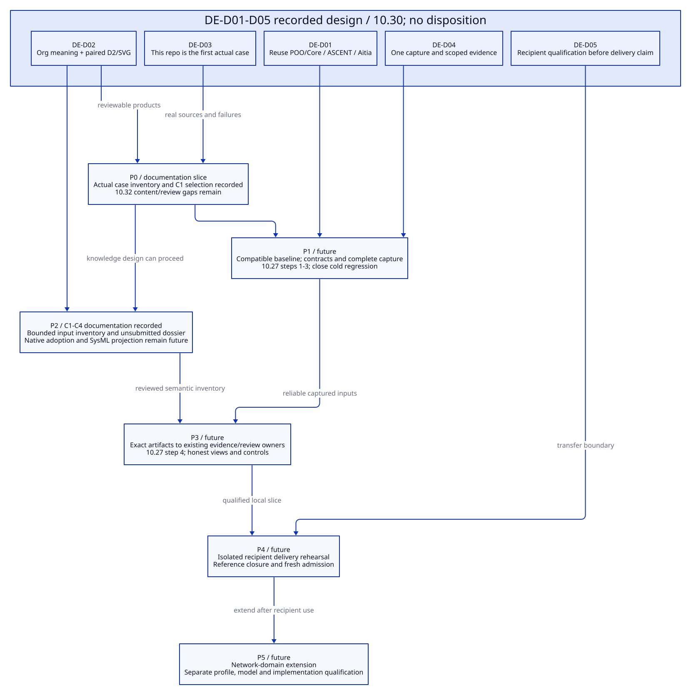

#+TITLE: 10.29 Workflow Capabilities and Minimum Completion
#+LANGUAGE: en
#+PROPERTY: JD_ID 10.29
#+OPTIONS: toc:3 num:t
#+STARTUP: overview
#+TODO: INSPECTED DESIGN VERIFY | QUALIFIED
#+FILETAGS: :architecture:capabilities:library:core:aitia:
#+PROPERTY: header-args :eval never :tangle no :exports code

[[file:../../00-09-project/00-documentation/00.01-index.org][Index]] | [[file:10.28-network-service-agent-design-walkthrough.org][Network walkthrough]] | [[file:10.30-current-repository-engineering-case.org][Actual repository case]] | [[file:10.27-library-delivery-repo-workflow-and-backpressure-audit.org][Contract audit and refactor]]

* INSPECTED Separate mechanism, knowledge and qualified use
:PROPERTIES:
:CUSTOM_ID: workflow-capability-audit
:AUDITED_ON: 2026-10-20
:STATUS: Local source and historical receipt inspection; no runtime requalification
:END:

The network walkthrough needs project knowledge and narrow connections between
existing owners. It does not justify another configuration language, loader,
executor, inference engine or review system. Native POO/Core facilities are
source-visible; local Library mechanisms have bounded historical executions;
network architecture and full project-wide document review remain prospective.
These are different evidence levels.

At inspection this repository's HEAD was
=8044732d505f84e373119a70f947df00e1767300=; linked Core was
=52130d2d338b09622a3f55e37987ddc0375b6187= and gerbil-poo was
=fdeadfa40ca5cee5fe20308985aef1577f2eb49b=. The repositories contain local
changes, so those commits do not identify all inspected bytes. No clean-checkout,
native-build or downstream-install qualification follows from these identities.

#+NAME: inspected-source-identities
| Source | SHA-256 of inspected bytes |
|--------+---------------------------|
| [[file:../../../init.ss][Local explicit selection]] | 6e2f06520a44147192cc922ee121df0975711db9073110e21d6e55b5fa15c9c1 |
| [[file:../../../.gerbil/pkg/github.com/tao3k/gerbil-poo/object-contract.ss][Native ObjectContract]] | c0881304131e45c846e947d7a3a812b06a082f1836490b4e1d09751d74491a1a |
| [[file:../../../.gerbil/pkg/github.com/tao3k/poo-flow-core/types.ss][Core contract admission]] | c72b57f1c87fb974916077e3260512e313dc49888d0ef0d96724f1ad05f40a8c |
| [[file:../../../modules/resource-evidence/func.ss][Local ASCENT rules]] | be07ef6aba411c3fc6cac9cbbe12ae9587b09f6a875c89537a92627f9b817d0a |
| [[file:../../../scenarios/resource-lifecycle/func.ss][Local Scenario]] | cf5b8b38895a1cf41f084774d3c0276a4848767e5c6141f30e082c494898597c |
| [[file:../../../scenarios/resource-lifecycle/review/func.ss][Local Aitia consumer]] | 6ea08043edea5d21e68a064aecada4ca0cc248ffd56125aa16ba947d0eb55b4e |
| [[file:../../../../poo-flow/packages/lambda-aitia/modules/sdlc/standards/nasa-lifecycle.ss][Existing Aitia lifecycle owner]] | e64fc6812d7f0d4a8b4d81f70bd424d62c52493cca6facfbdf49e8c1be01afa0 |

* INSPECTED Capability map against the network workflow
:PROPERTIES:
:CUSTOM_ID: network-capability-map
:END:

#+NAME: workflow-owner-capabilities
| Workflow | Existing mechanism / source basis | Local support and boundary | Minimum missing contribution / owner |
|----------+-----------------------------------+----------------------------+--------------------------------------|
| Repo context and requirements | Core explicit selection/build guards; Aitia project/context verification requests | Actual init selects Library and Scenarios; network brief is authored in 10.28 | Project facts, scope, requirement identities and applicability decisions; consuming project |
| Library/Profile/Scenario selection | POO inheritance; Core requires/scope-contract; ObjectContract/Function Types and value-contract | Generic/Rust parent publication and independent Profiles exist; local predicates still underuse native contracts | Adopt native contracts and preserve normalized values; Library/Scenario integration, not framework replacement |
| Architecture model | POO composition for native subjects; existing external SysML method path | Six-case cut assertions exist; they are not a complete component/interface model or general SysML exporter | Project architecture vocabulary, allocation/mapping and declared projection coverage; Library knowledge plus project model |
| Org and decision organization | Org anchors/tables, paired D2/SVG convention and existing document indices | Maintained design corpus exists; no evidence of a universal executable architecture/document completeness checker | Small project artifact/decision inventory and review obligations; Library contract and project content |
| QNT verification | Core process execution; local Quint adapter and independent oracle | Ownership safety and bounded mapped paths have historical receipts; no general network/GC/protocol model is published | Domain-specific abstractions, bounds, assumptions, independent controls and code correspondence; domain Library/project |
| Lean and native evidence | Existing conditional budget and Rust method observers | Conditional arithmetic and actual controlled workload evidence, not total service memory or arbitrary runtime correctness | Additional propositions/accounting and implementation observations when required; domain/project |
| Complete capture | Existing contextual admission and local native-context/currentness | Seven-role native capture plus separately added integration scopes; full network capture is not installed | Compose selected method role closure once and route operations through it; Scenario adapter |
| ASCENT reasoning | Existing Evidence declaration/session; current local support/counter/pending and mismatch rules | Actual resource evidence registration exists; no automatic ingestion of arbitrary Org/SysML meanings | Explicit domain/project relations and trusted evidence projections; reuse existing engine |
| Aitia review | Existing criterion/content review, verification adapters, lifecycle stage gates and dossier owners | Local backpressure content/reassessment/intake consumer exists; historical qualification is scope-bound | Project-local policy/applicability and exact architecture/document inventory adapter; no new approval engine |
| Delivery and ongoing use | Existing Core publication and Aitia intake/handover patterns | Bounded producer/consumer experiments are documented; portable project-wide delivery remains unqualified | Exact export/input association, accessible content/reference closure and recipient qualification; Library delivery integration |

Framework mechanisms do not author the network topology, specify failure models,
prove a mapping or judge free-form design prose. Those are engineering content
and trusted observer responsibilities. Conversely, a missing network entry is
not evidence that Core lacks a module system. Aitia's existing NASA-specific
owners do not make every project NASA-applicable or supply an automatic policy
for arbitrary Org documents.

The historical [[file:../../../.data/integration-audit-20261020/acceptance.json][acceptance record]] contains 20 witnesses, 17 support, 3 counter and
9 pending. Its referenced report digest was checked again at this inspection;
the methods/tests were not rerun. The unfinished native-context regression and
frozen-Core execution boundary remain. Existing pending and counter categories
must be retained; pending is not synonymous with absence of counterevidence.

* DESIGN Minimum completion order
:PROPERTIES:
:CUSTOM_ID: minimum-completion-order
:END:

The [[file:10.31-architecture-document-and-decision-contracts.org][architecture/document/decision content contracts]] now specify the
minimal P2 knowledge responsibilities and P3 evidence/review associations.
This advances the design record; native adoption, SysML projection and executable
project observer qualification remain future gates.
The [[file:10.32-case-content-contract-audit.org::#content-audit-completion-order][C1-C5 content-audit sequence]] specifies the smallest remaining content
additions within these gates; it does not promote P0/P2 documentation to native
runtime or review acceptance.

#+NAME: completion-order
| Order | Deliverable and owner | Reuse / do not recreate | Acceptance before proceeding |
|-------+-----------------------+------------------------+------------------------------|
| P0: actual case record | Current repo brief, architecture, decision map, artifacts, requirement links and gaps; project | Existing Org/D2 and source/receipt references | Stable IDs and honest state for every product; links/views checked; design work can proceed while runtime regression stays open |
| P1: reliable native use | Compatible baseline, normalized contract values and complete captured use; Library/Scenario | Existing POO/Core; 10.27 steps 1-3 | Required contract and cold Scenario checks close under bounded watchdog; no expanded method claim or timeout inflation |
| P2: smallest knowledge slice | Architecture/decision/artifact responsibilities for this Library repo, plus one SysML projection of its selected structure; Library/project | Existing semantic IDs and external-method observer pattern | Every selected requirement maps to architecture/decision/evidence; projection losses and missing checks explicit; no automatic general exporter claimed |
| P3: evidence-to-review connection | Bind project artifact inventory and current evidence to existing ASCENT/Aitia owners; narrow adapter | Existing evidence queries, issuer and review verification boundaries; 10.27 step 4 for views/acceptance separation | Changed doc/model/source invalidates affected use; counters/history remain; actual stage result concerns exact content and policy only |
| P4: delivery rehearsal | Consume this selected Library slice in an isolated recipient context | Existing Core selection and Aitia intake | Recipient resolves actual dependencies/references and performs its own required admission; producer approval/JSON cannot mint recipient authority |
| P5: network extension | Fill HTTP/interface/lifecycle knowledge and supported network models, then instantiate 10.28 | Qualified Library slice and independent case controls | Network Profile/abstraction/implementation correspondence is separately qualified; distributed/GC extensions only when project needs them |

P0 is exercised as documentation in 10.30 now. P1-P5 are future work, not actions
performed by this document. P2 content can be refined while P1 is investigated,
but executable qualification must not inherit an unresolved baseline failure.
This ordering extends, rather than replaces, the four-step backpressure refactor:
P1 covers steps 1-3; P2 supplies missing project knowledge; P3 incorporates step 4
and the existing review owner; P4 tests delivery before broadening consumers.

* DESIGN Decision map and views
:PROPERTIES:
:CUSTOM_ID: completion-decision-map
:END:

The decision graph records rationale and consequences; it is not an ASCENT
execution graph. DE-D01 keeps native framework ownership; DE-D02 gives documents
explicit product responsibilities; DE-D03 makes this repo the first real case;
DE-D04 preserves one captured use and scoped evidence; DE-D05 requires recipient
qualification before claiming delivery. Their detailed records live in 10.30.

#+CAPTION: Completion dependencies and rationale; no node asserts an executed pass.

[[file:../../90-99-views/90-architecture-views/90.90-library-completion-decisions.d2][Editable D2 source]]. No implementation or directory migration is authorized
or performed by this capability audit.
