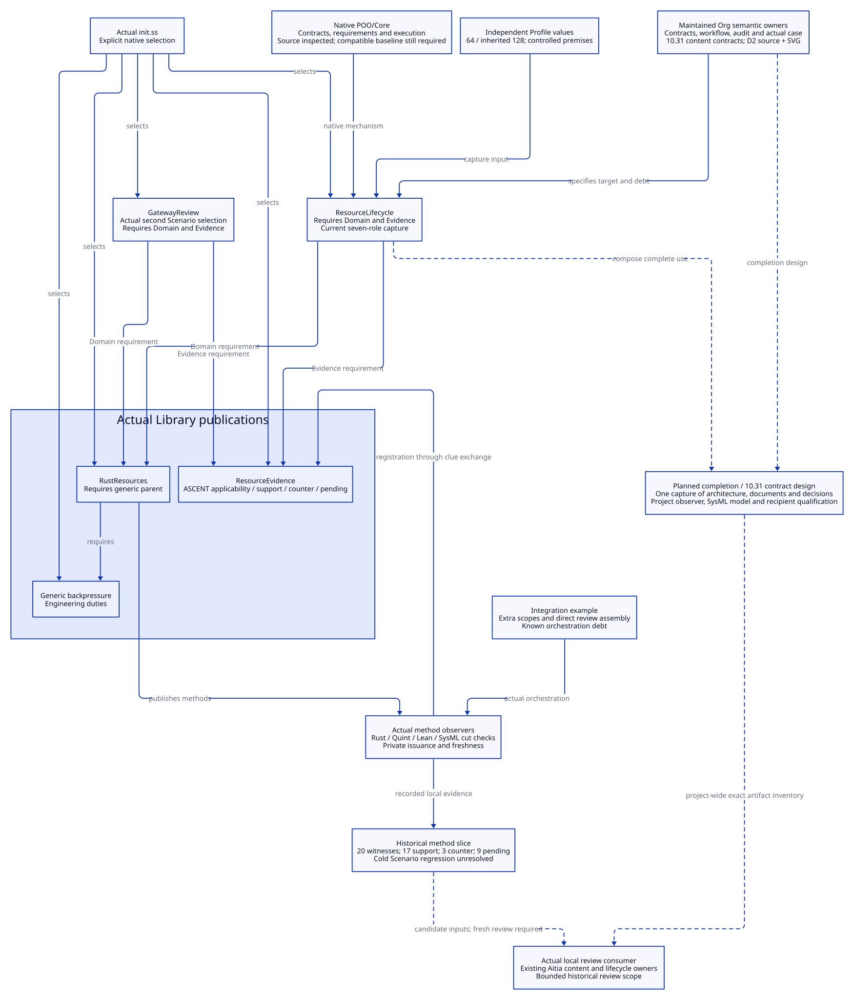
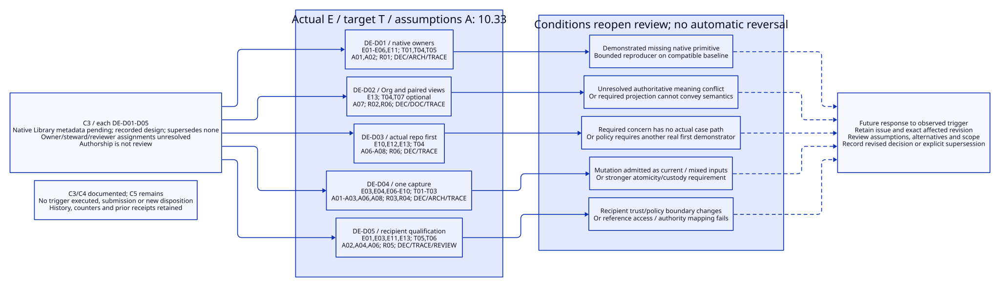
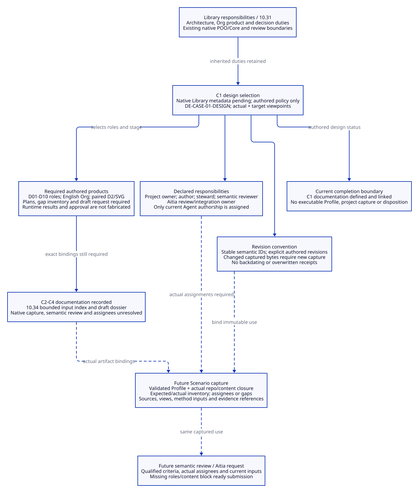

# SPDX-FileCopyrightText: 2026 tao3k team and Contributors
#
# SPDX-License-Identifier: LGPL-2.1-only

#+TITLE: 10.30 Deterministic Engineering as an Actual Repository Case
#+LANGUAGE: en
#+PROPERTY: JD_ID 10.30
#+OPTIONS: toc:3 num:t
#+STARTUP: overview
#+TODO: RECORDED DESIGN VERIFY | QUALIFIED
#+FILETAGS: :case:repository:architecture:decisions:evidence:
#+PROPERTY: header-args :eval never :tangle no :exports code

[[file:../../00-09-project/00-documentation/00.01-index.org][Index]] | [[file:10.29-workflow-capabilities-and-minimum-completion.org][Capability audit and completion order]] | [[file:10.28-network-service-agent-design-walkthrough.org][Network consumer design]]

* RECORDED Actual case boundary
:PROPERTIES:
:CUSTOM_ID: actual-repository-case
:CASE_ID: DE-CASE-01
:STATUS: Real project content and historical evidence; executable project closure remains open
:END:

The subject is this deterministic-engineering checkout, a reusable engineering
Library intended for Aitia-managed projects. The work product is its own Library
design, publication boundaries, document organization and delivery argument.
It is not the hypothetical HTTP service in 10.28. The Agent is already doing
real project work by identifying requirements, inspecting sources, maintaining
architecture/decisions and retaining failures. This record does not pretend that
these authored statements have been registered as native POO/ASCENT objects.

The source baseline and byte identities are in [[file:10.29-workflow-capabilities-and-minimum-completion.org::#workflow-capability-audit][10.29]]. No implementation,
directory reorganization, fresh formal execution, Aitia disposition or recipient
delivery is performed for this documentation slice.

* RECORDED Requirements and concrete traceability
:PROPERTIES:
:CUSTOM_ID: actual-case-requirements
:END:

#+NAME: actual-case-obligation-ledger
| Requirement | Actual subject / decision | Artifact or evidence | Current state / next owner |
|-------------+---------------------------+----------------------+----------------------------|
| DE-R01: reuse native framework | Module requirements, independent Profiles and Contracts / DE-D01 | init.ss; 10.26 contract basis; 10.27 audit | Source-supported mechanisms; local contract adoption incomplete; Library/Scenario |
| DE-R02: make architecture and rationale reviewable | Authoritative Org plus identified architecture and decision views / DE-D02 | 10.24-10.30; paired 90.84-90.90 views | Maintained documentation; executable semantic completeness checking not claimed; project |
| DE-R03: bind each use coherently | Library/Profile/Scenario occurrence and method role closure / DE-D04 | Scenario func.ss; 10.27 A06-A08 and steps 1-3 | Known split capture and validation-return debt; Scenario |
| DE-R04: preserve evidence meaning | Rust/QNT/Lean/SysML/ASCENT mapping, counter and currentness boundaries / DE-D04 | 10.25; local acceptance/report references | Bounded historical slice; 9 pending and native-context regression remain; method/Scenario owners |
| DE-R05: deliver reusable knowledge to Aitia projects | Explicit recipient selection, content closure and review scope / DE-D05 | 10.19, 10.23 and 10.29 P3-P4 | Bounded historical intake exists; whole-Library recipient qualification open; delivery/review owners |
| DE-R06: use this project as first case | Actual architecture/artifact/decision inventory / DE-D03 | This document and capability audit | Documentation case established; automatic case execution not installed; project |

Document requirement IDs are project meanings, not external standard criteria or
implemented relation names. A requirement has documented support only to the
extent stated in its row; this table is not a private receipt or a review verdict.

* RECORDED Architecture model and document ownership
:PROPERTIES:
:CUSTOM_ID: actual-case-architecture
:END:

The [[file:10.33-case-actual-and-target-architecture.org][C2 detailed model inventory]] is authoritative for DE-AM01/DE-AM02
element/interface identities, source allocation, assumptions, boundaries and
target-owner/requirement/duty links. This section retains the case overview.
The inventory is source-inspected documentation, not runtime qualification.

The [[file:10.31-architecture-document-and-decision-contracts.org][minimal content contracts]] specify which architecture, document and
decision responsibilities the Library publishes, the Profile selects and the
Scenario captures. They bind this case's existing content as DE-AM01 actual and
DE-AM02 target, link DE-R/DE-D identities to proposed DE-O duties, and define the
future evidence/review adapter boundary without installing it.

The [[file:10.32-case-content-contract-audit.org][item-by-item content audit]] distinguishes present responsibilities,
missing content and unverified semantics. It corrects the GatewayReview omission
in 90.89 against actual source selection while retaining the remaining model,
document inventory, decision and review gaps.

The actual native topology is: init.ss explicitly selects generic backpressure,
Rust specialization and resource-evidence Modules, plus gateway-review and
resource-lifecycle Scenarios. Profiles remain independent values. RustResources
requires its generic parent; ResourceLifecycle requires Domain and Evidence.
Method observers use Core execution and private issued results; ASCENT reasons
over projected evidence; local review consumers call existing Aitia owners.
The integration example still assembles extra context outside Scenario: the
target one-capture path is therefore a design correction, not current topology.

Org retains prose meaning, assumptions, decision rationale and status. The first
[[file:10.78-agent-sysml-project-formation.org::#agent-project-formation][Agent-driven SysML formation model]] now organizes stable case structure and
artifact relationships; D2/SVG present selected views. This is a bounded authored
organization model, not a complete source-to-SysML projection or installed LLM/ASCENT
workflow. The six-case SysML assertions remain a distinct method-level subject.

#+NAME: actual-document-products
| 10.28 product | Actual location in this project | Present content / explicit gap |
|---------------+---------------------------------+--------------------------------|
| D01 brief/scope | README Purpose; this case boundary and DE-R01-R06 | Actual Library mission and current case; project-wide review policy still needs qualification |
| D02 composition | init.ss, independent profiles, 10.26 | Existing publications and public contracts; native contract replacement pending |
| D03 Scenario plan/capture | scenarios/resource-lifecycle; 10.27 | Native capture exists; complete integration capture and cold regression unresolved |
| D04 architecture model | This architecture section; 90.89; 10.24 mappings | Actual native topology documented; repository-wide SysML model/check pending |
| D05 decisions and views | Decision records below; 90.88-90.92; 90.01 view index | Recorded choices/views; role/revision and specific trigger gaps audited in 10.32; no semantic approval |
| D06 obligation ledger | DE-R table; 10.27 audit and 10.29 completion table | Authored project ledger plus existing resource ASCENT queries; no automatic ingestion of this Org table |
| D07 evidence inventory | 10.25 and local acceptance/report | Actual historical method artifacts; local .data paths are not portable delivery closure |
| D08 repair/negative record | 10.25 limits; 10.27 six-case controls | M06 counters and failed regression retained; planned fixes not relabeled completed |
| D09 evidence explanation | 10.25 bounded counts; 90.86; current case diagram | Diagram/view maintained; generic project-document evidence observer absent |
| D10 review dossier | 10.19/10.23 existing bounded review records | Earlier backpressure reviews only; no fresh whole-project or current-document Aitia review |

Keep these as responsibilities in existing documents, not ten duplicated files
or a new universal schema. A generated view changes with its semantic owner;
external evidence references retain content identity and historical context.

The [[file:10.34-case-design-review-dossier-draft.org::#case-product-input-bindings][C4 binding table]] now supplies exact sections and input demands for D01-D10.
Its [[file:10.34-case-design-review-dossier-draft.org::#case-reference-closure][bounded reference policy]], [[file:10.34-case-design-review-dossier-draft.org::#case-evidence-inventory][evidence classification]] and
[[file:10.34-case-design-review-dossier-draft.org::#case-candidate-input-catalog][input byte catalog]] distinguish current candidates, historical records and
missing evidence. The draft remains unsubmitted and is not a native capture.

#+CAPTION: Actual native owners, documented views and explicitly unfinished boundaries.

[[file:../../90-99-views/90-architecture-views/90.89-current-repository-case.d2][Editable source]]. Dashed relationships denote planned connections, not
current runtime calls. Diagram colors carry no pass/fail authority.

* RECORDED Decision records
:PROPERTIES:
:CUSTOM_ID: actual-case-decisions
:END:

#+NAME: actual-case-decision-records
| ID / design decision | Reason / rejected alternative | Consequence and reconsideration trigger |
|----------------------+-------------------------------+----------------------------------------|
| DE-D01: retain POO/Core and Aitia owners | Existing composition/execution/admission/review mechanisms; reject parallel schemas/loaders/approval engine | Fill domain content and narrow adapters; reconsider only on a demonstrated missing primitive |
| DE-D02: maintain Org semantic products and paired D2/SVG | Architecture and rationale need navigable identities; reject diagrams detached from source meaning | Update owner, graph and render together; add a project observer only after explicit review criteria exist |
| DE-D03: use this repo before expanding the hypothetical service | Actual artifacts and failures are available; reject declaring another narrative a qualified project | Close this slice's gaps before claiming transferable process coverage; network design remains a separate consumer |
| DE-D04: preserve one capture and scoped evidence | Split mutable selections and stale evidence undermine applicability; reject treating a green model as implementation approval | Apply four-step refactor and retain M06/currentness controls; revise mappings when premises change |
| DE-D05: qualify recipient use before delivery claims | Producer evidence is context-bound; reject copying receipts as recipient authority | Require actual reference closure and recipient admission; broaden delivery only after P4 |

These record design choices from the current work, not Aitia-approved decisions.
The [[file:10.29-workflow-capabilities-and-minimum-completion.org::#completion-decision-map][decision map]] connects their consequences to the completion sequence.

** C3: responsibility, revision and replacement baseline
:PROPERTIES:
:CUSTOM_ID: case-decision-baseline
:RECORDED_ON: 2026-10-20
:STATUS: First explicit authored decision baseline; no review disposition
:END:

The choices and concise rationale in the table above remain authoritative. This
section completes their missing responsibilities; it does not replace the five
choices or claim they were approved. The following common metadata applies
explicitly to each of DE-D01, DE-D02, DE-D03, DE-D04 and DE-D05.

#+NAME: case-decision-common-metadata
| Responsibility | Binding for each of the five records |
|----------------+--------------------------------------|
| Contract version and state | Native Library metadata required; read path specified in 10.26, slot still absent; recorded design, unreviewed |
| Content history | Earlier choice/rationale retained above with its observed source identities; no backdated approval |
| Supersedes / superseded by | None / none at this baseline; no DE-D record replaces another |
| Accountable role | C1 Project owner; assignee unresolved; owns policy and authorized review/submission decisions |
| Maintaining role | C1 Content steward; assignee unresolved; owns assumptions, architecture links, rationale and revision maintenance |
| Author | Current Agent completes this documentation baseline; authorship is not independent semantic review |
| Semantic reviewer | C1 Semantic reviewer; assignee unresolved; must independently assess the selected content and criteria |
| Aitia role and disposition | C1 Aitia review/integration owner project binding unresolved; no current disposition or approval reference |

These are explicit per-record bindings by common declaration, not five copied
policy objects. Appointing an assignee must be recorded before ready submission.
Content changes record their reason, prior content and actual source/byte identities.
They do not start independent per-decision version streams. A genuinely different
decision may explicitly supersede an affected record; replacement must be
acyclic and history remains available. Reopening neither supersedes nor approves it.

The [[file:10.26-backpressure-public-contracts.org::#contract-version-source][native Library ownership/read design]] governs contract metadata referenced by
all five decisions, the selection and models. The native slot and captured
association are still absent; these documents do not supply a version. No version is inferred from document edits. Changed
bytes still require fresh capture/currentness checks even when that version is
unchanged; an old byte-bound receipt cannot be reused merely by its label.

** C3: assumptions and architecture/requirement allocation
:PROPERTIES:
:CUSTOM_ID: case-decision-allocation
:END:

The identifiers and source bindings are defined by [[file:10.33-case-actual-and-target-architecture.org::#case-actual-elements][10.33 actual elements]],
[[file:10.33-case-actual-and-target-architecture.org::#case-actual-interfaces][interfaces]], [[file:10.33-case-actual-and-target-architecture.org::#case-architecture-boundaries][assumptions/boundaries]] and [[file:10.33-case-actual-and-target-architecture.org::#case-target-architecture][target allocations]].
E/T/I/X/A/R suffixes below mean those DE identities; duties mean DE-O identifiers
from 10.31. Actual subjects are source-visible and targets remain unimplemented.
This allocation relies on the recorded C2 inspection, not fresh execution.

#+NAME: case-decision-architecture-allocation
| Decision / concern | Actual elements and interfaces | Target elements | Assumptions and their role | Requirement / verification duty |
|-----------------------+--------------------------------+-----------------+----------------------------+---------------------------------|
| DE-D01: where framework responsibility belongs | E01-E06,E11; I01-I05,I10; X01-X04 | T01 native Contracts, T04 existing inference owner, T05 existing review owner | A01/A02: native value/composition/admission mechanisms can cover selected needs on a compatible baseline; missing domain content alone is not a missing primitive | R01 / DEC,ARCH,TRACE |
| DE-D02: authoritative explanation and projection | E13; I11 | T04 explicit content observers, T07 optional SysML projection | A07: stable subjects and declared projection direction let Org and views explain the same meaning; syntax/render checks are narrower than semantic review | R02,R06 / DEC,DOC,TRACE |
| DE-D03: which project supplies the first actual case | E10,E12,E13; I09,I11 | T04 project-content facts and checks, exercised against this repo first | A06/A07/A08: actual sources/artifacts are accessible, scope is honest and historical bounded evidence is not general process qualification | R06 / DEC,TRACE |
| DE-D04: coherent use and evidence applicability | E03,E04,E06-E10; I04,I07-I09,I12 | T01 normalized values, T02 published mappings/duties, T03 full capture | A01/A02/A03/A06/A08: final values and declared dependencies can be bound and rechecked; local currentness and finite model claims retain their stated limits | R03,R04 / DEC,ARCH,TRACE |
| DE-D05: what crosses a delivery/review boundary | E01,E03,E11,E13; I10,I12; X04,X06 | T05 exact case review, T06 qualified recipient use | A02/A04/A06: recipient context, policy, reference access and issuer authority require their own valid binding | R05 / DEC,TRACE,REVIEW |

Every requirement DE-R01-R06 has at least one explicit decision association;
that is coverage of the decision map, not satisfaction of the requirement. Each
DEC duty still needs scoped rationale review. ARCH/DOC/TRACE/REVIEW identify
additional checks on the affected subjects; they do not create a new approval
engine. Optional T07 remains optional under the C1 design-review selection.

** C3: concrete reconsideration triggers and response
:PROPERTIES:
:CUSTOM_ID: case-decision-reconsideration
:END:

#+NAME: case-decision-reconsideration-table
| Record | Observable condition that reopens the decision | Minimum response / evidence needed |
|--------+-----------------------------------------------+------------------------------------|
| DE-D01 | A bounded reproducer on an identified compatible baseline shows a required operation cannot be expressed/admitted by the existing native primitive or its intended extension point | Separate framework deficiency from local adapter/content debt; record affected I/T subjects and alternatives for targeted review; no automatic parallel framework |
| DE-D02 | A selected required subject has conflicting authoritative meanings under the same identity/revision that the declared ownership/projection rules cannot resolve, or a required reviewer/recipient cannot obtain its semantics through the supported document/model projection | Record the conflicting owner/subject or unsupported mapping and an actual example; reconsider ownership/projection organization; revise C1 if canonical format/view policy changes |
| DE-D03 | The completed bounded inventory shows a required case concern has no actual subject/evidence path in this repo, or project policy requires a first demonstrator outside its declared closure | Identify the uncovered requirement and candidate real project; review narrowing/splitting/adding a case; keep this repo's history; narrative expansion alone is not qualification |
| DE-D04 | A controlled mutation of a required input remains admitted as current under the candidate full-capture design, the same capture permits incompatible selected inputs, or a new requirement needs stronger atomicity/custody than the declared local trust model | Preserve counterexample and exact footprint; reopen capture/mapping assumptions and refine the target/criteria; recapture affected use; do not weaken currentness to obtain a pass |
| DE-D05 | A new recipient/review policy changes the trust or issuer boundary, required source/reference access cannot be established, or an existing producer-to-recipient mapping would transfer authority without valid recipient admission | Record recipient policy, inaccessible references or authority mismatch; review custody/mapping and required verification; withhold the affected delivery claim pending real recipient checks |

Each condition is a review trigger, not an automatic choice reversal or Aitia
disposition. Known current split capture is planned repair debt under DE-D04;
it is not evidence that the target one-capture principle has failed. A positive
test is not enough to close any new counterexample outside its actual scope.

Completing P4 permits considering a broader delivery claim under DE-D05; it is
not itself a trigger to change the producer/recipient authority rule. Likewise,
finishing local gaps permits case expansion under DE-D03, and adding an observer
under DE-D02 requires criteria: neither is a substitute for the concrete
reconsideration conditions above. Existing alternatives and rationale remain
concise; reopened review may require additional evaluated alternatives.

The Content steward records a proposed issue when a trigger is observed; the
Project owner routes its scope/policy implications; the independent reviewer
assesses the exact affected revision; existing Aitia owners supply any required
disposition. Those assignees remain unresolved. The prior authored content is
retained; affected applicability/disposition stays unresolved until reviewed,
rather than silently changing status to approved.

** C3 documentation completion
:PROPERTIES:
:CUSTOM_ID: case-c3-completion
:END:

Each of DE-D01-D05 now has explicit native-metadata requirement/state/role/replacement bindings,
assumptions, actual/target element and interface links, requirements/duties and
observable reconsideration conditions. This closes C3's missing documentation
responsibilities. It does not appoint assignees, execute trigger controls,
perform independent semantic review, complete C4 capture/dossier or issue C5
native acceptance. Original audit findings and failures are preserved.

#+CAPTION: Decision records link assumptions and architecture to explicit reconsideration; no edge is a supersession or approval.

[[file:../../90-99-views/90-architecture-views/90.96-case-decision-bindings.d2][Editable D2 source]]. The existing 90.90 view remains the completion-order map.

* DESIGN C1: this design-review selection
:PROPERTIES:
:CUSTOM_ID: case-design-review-selection
:SELECTION_ID: DE-CASE-01-DESIGN
:RECORDED_ON: 2026-10-20
:STATUS: Declared documentation selection; not an executable Profile or admitted review request
:END:

This section is the authoritative C1 selection for the current design work.
It applies the Library responsibilities in 10.31 to DE-CASE-01; it does not
duplicate their definitions. The semantic selection identity is
=DE-CASE-01-DESIGN=; native Library contract metadata is required as described in
10.26, but no qualified read is available yet. It describes the future independent
Profile value and Scenario binding without defining Scheme syntax or exports.
The decision to prepare this design comes from the current user request; this
does not appoint reviewers or issue an Aitia disposition.

** Review scope and intended question
:PROPERTIES:
:CUSTOM_ID: case-design-review-scope
:END:

The review question is whether this Library's documented architecture, products,
decisions and proposed content/evidence boundaries are sufficiently explicit to
continue the bounded completion work. The subject is DE-R01-R06, DE-AM01 actual
native architecture, DE-AM02 target one-capture architecture, DE-D01-D05 and the
D01-D10 products allocated below. English Org is the semantic owner; paired
D2/SVG supplies the selected architecture, decision, contract and audit views.

The actual viewpoint covers explicit selection, Library/Scenario dependencies,
method/evidence boundaries and the local review-consumer boundary. The target
viewpoint covers the changes in 10.26/10.27 and their proposed owners. External
POO/Core, ASCENT and Aitia are dependencies to identify, not whole upstream
systems being certified. C2 must finish the bounded element/interface inventory.

This stage requests architecture/content design review. It does not request
implementation acceptance, the closure of every backpressure duty, performance
qualification, recipient delivery, production activation or release. Historical
method evidence and failures are inputs about their original scopes. The cold
Scenario regression and existing pending/counter evidence remain open.

Repository-wide SysML projection is optional investigation at this stage and a
declared future goal. New QNT/Lean/native runs are not entry conditions for
reviewing this design text; their existing obligations are retained for the
stages that require them. Selecting a later projection or executable stage
requires a revised selection and its mandatory evidence. No missing capability
is thereby recorded as passed or waived. External standard applicability is
unselected; no NASA class is inferred from the older fixture.

** Profile choices and Scenario capture
:PROPERTIES:
:CUSTOM_ID: case-profile-capture-boundary
:END:

#+NAME: case-profile-capture-selection
| Concern | Profile declares / selects | Scenario binds for the actual occurrence |
|---------+----------------------------+-------------------------------------------|
| Stage and policy | Design-review purpose, this selection/revision and inherited mandatory responsibilities | Selected trusted Library/Contract identities, final validated Profile and applicable policy content |
| Subject and viewpoints | DE-CASE-01 scope; actual and target viewpoints; selected concern/requirement set | Actual repo identity, dirty source/content closure, DE-AM/DE-R/DE-D values and relations |
| Products and views | Required D01-D10 roles below, English Org and paired views for selected models/maps | Actual file/anchor bindings, bytes, semantic owners, D2 sources/SVGs and their declared generation basis |
| Roles and review criteria | Responsibility definitions, separation of authoring from independent semantic review, known-gap reporting rules | Actual assignees or explicit unresolved assignments, producer/reviewer identity and permitted review operation |
| Methods and evidence | Required structural/reference checks and semantic review; optional investigations under stage policy | Actual method requests, tool/configuration identities when used, input footprints, raw/issued results or recorded absence |
| Revision and history | The authored revision, change and supersession conventions below | Immutable occurrence/content identity, observed currentness, prior references and exact inventory used by checks/review |

The Profile does not copy document bodies, model nodes or the decisions' text,
and does not contain mutable tool/output paths as reusable defaults. The Scenario
cannot redefine the required inventory from the candidate's available files.
Capture binds existing final validated values and actual contents; it does not
manufacture an executable Profile or a completed observer where none exists.
This section supplies policy/content only; no new project capture is issued.

** Required products for this stage
:PROPERTIES:
:CUSTOM_ID: case-required-design-products
:END:

All ten roles must be accounted for, and the following authored content is
required in the design-review candidate. A missing item is a gap, not fulfillment.
The same section can fulfill multiple roles. Runtime captures, executed new
methods, query receipts and final disposition are future outputs, not documents
to fabricate to satisfy this design-stage inventory.

#+NAME: case-required-design-products-table
| Role | Required authored content / current owning location | Present boundary or remaining work | Steward / duty |
|------+-----------------------------------------------------+------------------------------------+----------------|
| D01 | Brief, DE-R scope, exclusions and this review question; README Purpose and this section | C1 scope recorded here; semantic review not yet performed | Content steward / DOC, REVIEW |
| D02 | Native publication/Contract selection, Profile choices and dependencies; init.ss, 10.26 and this selection | Content selection documented; executable Profile/admission still absent | Content steward / DOC, TRACE |
| D03 | Scenario input/expected-role plan and missing-input behavior; 10.31 and C4 bindings in 10.34 | Authored selected input index prepared; native immutable capture remains C5 | Content steward / TRACE, REVIEW |
| D04 | Bounded actual/target models, interfaces, allocations, assumptions and omissions; architecture section and 10.33 | C2 inventory documented; independent semantic review and exact capture remain open | Content steward / ARCH, TRACE |
| D05 | DE-D01-D05 rationale, alternatives, consequences, triggers and selected paired views; decision section | C3 native-metadata requirement, allocation and triggers documented; semantic review and assignees remain open | Content steward / DEC, DOC |
| D06 | Requirement/subject/decision/duty/method/input allocation; DE-R ledger and 10.31-10.34 | C2-C4 allocations and per-duty input demand documented; native evidence projection absent | Content steward / TRACE |
| D07 | Evidence inventory distinguishing historical, candidate, missing and unverified content evidence; 10.25 and 10.34 | Bounded local catalog and static historical integrity check; runtime/recipient closure remains open | Content steward / TRACE, REVIEW |
| D08 | Known failures, unsafe alternative, proposed negative controls and repair status; 10.25/10.27/10.31 | Existing record retained; planned content controls remain unexecuted | Content steward / ARCH, DEC, TRACE |
| D09 | Review questions, status provenance and explanation/view references; 10.31/10.32 and paired maps | Authored explanation required; no live project-content query/result is claimed | Content steward / DOC, TRACE |
| D10 | 10.34 draft with intended scope, policy, expected/actual inventory, role assignments, evidence and unresolved items | Draft prepared, not submitted; missing assignees/capture/results/disposition remain | Project owner with content steward / REVIEW |

For this stage, syntax/reference/render consistency and independent semantic
review are separate required checks. Lint does not discharge ARCH/DEC. A draft
may document missing content or assignees; it is not a ready request or accepted
design. C1's completion does not declare D03-D10 content gaps closed.

** Responsibility roles and current assignment
:PROPERTIES:
:CUSTOM_ID: case-review-responsibilities
:END:

#+NAME: case-review-responsibilities-table
| Role | Responsibility and boundary | Current assignment / gate |
|------+-----------------------------+---------------------------|
| Project owner | Own this scope/policy selection, appoint stewards/reviewer, resolve permitted gaps and authorize the actual submission | Unassigned; current user direction authorizes drafting, not an inferred standing appointment |
| Author | Inspect content, propose changes, maintain Org and paired views, report gaps and checks | Current Agent for this documentation work; no independent-review or approval authority inferred |
| Content steward | Maintain authoritative architecture/products/decisions, revisions, allocation and candidate inventory | Unassigned; one steward may cover all three content types; this role supplies the default responsibility in the product table |
| Semantic reviewer | Review bounded source/model correspondence and rationale against explicit criteria; record disagreements and limits | Unassigned; the producer cannot count its own authoring/checks as this independent review |
| Aitia review/integration owner | Bind actual project policy, verify context/content/inventory and obtain stage disposition through existing owners | Project binding unresolved; existing API availability is not an appointment or receipt |

These definitions complete the C1 responsibility model while preserving actual
assignment gaps. Project owner and steward may be the same assignee if the
project so appoints; independent semantic review remains distinct from producing
the reviewed content. Existing Aitia verifier/issuer requirements also remain.
No per-model or per-decision owner/revision is backfilled by this default table;
10.33 now records the model contract-metadata requirement and unresolved steward role explicitly;
C3 now binds the five decisions explicitly in the decision section. Unresolved required assignees and
criteria block a ready semantic-review submission, not further design drafting.

** Revision and recapture conventions
:PROPERTIES:
:CUSTOM_ID: case-review-revisions
:END:

#+NAME: case-revision-conventions
| Change or identity | Convention for this case |
|--------------------+--------------------------|
| Scope, stage, required roles, responsibility rules or mandatory methods | Record the change and source/byte identity for review; retain required duties. Do not increment a local version; any contract-version change requires explicit authorization at the native Library owner |
| Model/decision substantive content | Preserve semantic DE-AM/DE-D identity, record change reason and prior content, and bind actual source/byte identities. Reference the owning native Library contract; do not invent a model/decision counter |
| Supersession | State no predecessor or identify the actual superseded record; preserve prior content and evidence; reject cyclic replacement; do not backdate an assignment or acceptance |
| File/anchor relocation or formatting-only edit | Preserve semantic identity when meaning is unchanged; update locator/content binding and create a new capture when captured bytes change, even if the semantic revision is unchanged |
| Source/model/mapping/view or policy dependency changes | Reconsider only affected checks under their declared footprints, recapture before new current use and preserve old outcomes; do not overwrite a historical receipt |
| Candidate baseline | Bind actual repo/ref, dirty files and selected content bytes, not HEAD alone; C4 identifies the exact candidate inventory; no frozen baseline is claimed by this authored section |
| Final review/receipt | Refer to immutable reviewed inputs and actual disposition; the newly emitted receipt is an output, not a self-referential input hash in its own content inventory |

This selection references the native Library ownership design in 10.26. The
proposed declaration and qualified read remain pending; Org supplies no value.
It neither changes package versions nor constitutes signed policy adoption. Final
capture/submission must preserve exact reviewed bytes and inaccessible-reference
gaps; no digest or private receipt is fabricated in this design work.

** C1 completion boundary
:PROPERTIES:
:CUSTOM_ID: case-c1-completion
:END:

C1 is complete as a documentation selection when scope/stage, required authored
products, explicit unresolved role assignments, revision rules and the
Profile/Scenario split are all recorded and linked. This section supplies those
items. C2 is now documented in [[file:10.33-case-actual-and-target-architecture.org][the actual/target architecture inventory]];
the C3 decision baseline and [[file:10.34-case-design-review-dossier-draft.org][C4 input index/dossier draft]] are also documented.
Semantic review criteria, actual assignments, native
capture, project observers and Aitia disposition remain unqualified future work.

#+CAPTION: C1 declares policy and responsibilities; later capture binds actual content and assignees.

[[file:../../90-99-views/90-architecture-views/90.93-case-design-review-selection.d2][Editable D2 source]]. No implementation or directory migration is performed.

* VERIFY Acceptance of this documentation slice
:PROPERTIES:
:CUSTOM_ID: actual-case-acceptance
:END:

For P0, require identified actual sources and historical receipts, mapped DE-R
requirements, explicit gaps for every D01-D10 responsibility, cross-linked
decisions, paired D2/SVG, valid Org structure and resolvable links. These checks
establish document consistency only. P1-P5 require the distinct future runtime,
model, evidence, review and recipient checks in 10.29. No historical failure is
rewritten to make this project appear complete.
