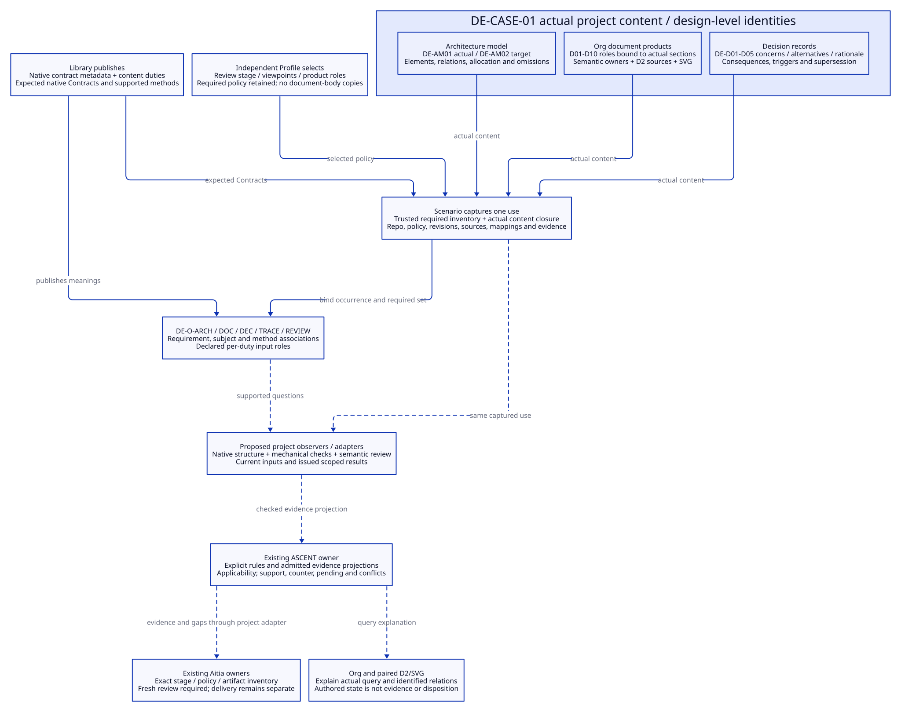

#+TITLE: 10.31 Architecture, Document Product and Decision Contracts
#+LANGUAGE: en
#+PROPERTY: JD_ID 10.31
#+OPTIONS: toc:3 num:t
#+STARTUP: overview
#+TODO: DESIGN SPECIFIED VERIFY | QUALIFIED
#+FILETAGS: :contracts:architecture:org:decisions:case:aitia:
#+PROPERTY: header-args :eval never :tangle no :exports code

[[file:../../00-09-project/00-documentation/00.01-index.org][Index]] | [[file:10.26-backpressure-public-contracts.org][Three public boundaries]] | [[file:10.30-current-repository-engineering-case.org][DE-CASE-01]] | [[file:10.29-workflow-capabilities-and-minimum-completion.org][Capabilities and completion order]]

* DESIGN Minimal engineering content within existing boundaries
:PROPERTIES:
:CUSTOM_ID: engineering-content-contracts
:STATUS: Design only; no new DSL, executable Contract or review adapter installed
:END:

DE-CASE-01 needs three content contracts: an architecture model, a document
product, and a decision record. They share native identities and relations.
Library, Profile and Scenario remain the three public boundaries in 10.26;
these content contracts do not create another publication framework. The tables
specify responsibilities, not final Scheme slot names or a serialized schema.

The [[file:10.32-case-content-contract-audit.org][DE-CASE-01 content audit]] applies these responsibilities to the actual
models, D01-D10 products and DE-D01-D05 records, with explicit gaps and a minimal
content completion order. Existing text is not presumed contract-complete.

#+NAME: content-responsibility-boundaries
| Content | Library publishes | Profile selects | Scenario captures |
|---------+-------------------+-----------------+-------------------|
| Architecture model | Expected content Contract, allowed relation meanings, required coverage duties and supported projection/check methods | Review stage, required viewpoints, detail/coverage scope and optional supported investigations under mandatory policy | Actual project model, subject IDs, actual/target classification, source/model/mapping closure and selected method requests |
| Org document product | Required role meanings, minimal responsibility checks, traceability and paired-view rules | Required roles for the selected stage, language/view conventions and allowed section-level organization | Actual files/anchors fulfilling each role, their bytes and referenced closure, semantic owners and view sources/renders |
| Decision record | Required rationale/alternative/consequence/trigger responsibilities and decision-related duties | Which concerns require decisions, stage and review policy | Actual decisions, affected subjects/requirements, content revisions, supersession and review references |

The project authors its actual architecture and decisions through the Scheme
composition boundary and maintained documents. The Profile is an independent POO
value selecting policy and supported choices; it does not duplicate architecture
nodes, document bodies or decision text. Library does not publish every project's
topology as a default. Scenario binds actual content to one project occurrence.

Native ObjectContract/Types express structure; pure obligations express content
relations; Core contextual admission binds the selected use. Existing Function
Types constrain operations and their returned values. Use normalized values.
Native field validation does not establish that architecture prose is true.

* SPECIFIED Common identity and state responsibilities
:PROPERTIES:
:CUSTOM_ID: content-identity-and-state
:END:

Each content value identifies its stable semantic subject, authored revision,
responsible project role, applicable scope, authoritative content reference and
typed relations to other identified subjects. The final capture binds actual
bytes and dependencies. Document numbers, filenames and titles are locations or
labels, not semantic identity or proof of current content. One Org section may
fulfill several roles without duplicating its body.

Public contract version belongs to the owning native Library declaration, using
the [[file:10.26-backpressure-public-contracts.org::#contract-version-source][existing publication and selected-scope read path]]. It is not an authored
Org revision or a separate model/decision counter. The proposed Library metadata
and captured association remain pending. These content Contracts will validate
the applicable owner/version association; Org/D2 only reference and display it.

Keep authored state separate from evidence and disposition: recorded/proposed/
superseded describes the content; support/counter/pending comes from scoped
evidence; an Aitia disposition requires the existing owner. A prose statement
that a decision is accepted cannot supply its review reference or authority.
An unresolved responsible role stays unresolved; do not invent a reviewer.

* SPECIFIED Three minimal content contracts
:PROPERTIES:
:CUSTOM_ID: three-content-contracts
:END:

#+NAME: minimal-content-contracts
| Content | Minimum additional responsibilities | Relations and refusal / gap conditions |
|---------+-------------------------------------+---------------------------------------|
| Architecture model | Viewpoint; actual or target scope; identified elements and boundaries; interfaces/dependencies with stated meanings; requirement allocation; assumptions and declared omissions | Each edge endpoint resolves in the selected closure or is an explicit external boundary; conflicting IDs and mixed actual/target assertions refuse; missing allocations/unsupported projection remain coverage gaps |
| Org document product | Product role; file/anchor locator; authoritative subject/model/decision; input references and claimed coverage; authored or generated status; paired-view association when selected | Required roles resolve to captured content; missing anchors or duplicate conflicting authority refuse; a render must identify its semantic owner/source and generation basis; link/lint success alone does not prove semantic completeness |
| Decision record | Question/concern; considered alternatives, including retaining the current design where meaningful; chosen direction and rationale; assumptions, consequences and reconsideration trigger | Relate affected requirements/elements and any replaced decision; absent rationale or dangling subjects fail the declared responsibility; supersession is explicit and acyclic; prior decisions/evidence remain historical |

Architecture dependency cycles are not universally prohibited: validity depends
on the relation meaning. Decision supersession cannot be cyclic. A target model
can refine an actual model without claiming the target is implemented. Keep
authored architecture, SysML projection, D2 source and SVG distinct and identify
the direction of projection. Imported edits remain proposals to reconcile.

For generated views, capture the semantic source, projection/render recipe and
relevant tool identity with output bytes when generation is checked. An existing
manual D2 view is checked against its declared Org owner; byte equality cannot
establish that relationship. External references must be resolvable under the
selected closure policy; local .data paths alone do not establish delivery.

* SPECIFIED Concrete binding for DE-CASE-01
:PROPERTIES:
:CUSTOM_ID: case-content-binding
:END:

The following bindings reuse actual content. New DE-AM and DE-O names here are
design-level semantic identifiers, not new exports or registered ASCENT facts.
Existing DE-R01-R06, DE-D01-D05 and D01-D10 retain their meanings from 10.30.

#+NAME: concrete-case-content
| Content | Actual authoritative location / intended subject | Current boundary |
|---------+--------------------------------------------------+------------------|
| DE-AM01 actual architecture | [[file:10.30-current-repository-engineering-case.org::#actual-case-architecture][10.30 actual architecture]], init.ss and inspected Module/Scenario definitions | Explicit selection and current split integration capture; 90.89 projects that account |
| DE-AM02 target architecture | [[file:10.26-backpressure-public-contracts.org::#backpressure-scenario-contract][10.26 Scenario contract]] and 10.27 refactor | One complete capture and operation path; not asserted as existing runtime behavior |
| D04 architecture product | DE-AM01/DE-AM02 sections and declared projections | Current Org/D2 architecture exists; complete repository SysML projection remains missing |
| D05 decision/view product | [[file:10.30-current-repository-engineering-case.org::#actual-case-decisions][DE-D01-D05]]; 90.89 architecture and 90.90 decision map | Recorded design choices and consequences; no fresh Aitia approval |
| D06 traceability product | [[file:10.30-current-repository-engineering-case.org::#actual-case-requirements][DE-R01-R06 ledger]] and duties below | Authored project coverage; executable adapter not installed |
| D07/D08 evidence and repair products | 10.25 and referenced historical receipt; 10.27 controls | Existing method evidence, preserved M06 counters and unfinished regression; no new content-method receipts |
| D01-D03/D09-D10 remaining products | Existing [[file:10.30-current-repository-engineering-case.org::#actual-case-architecture][D01-D10 inventory]] | Each role has a location or explicit gap; a listed gap is not fulfillment of a mandatory role |

The proposed Profile selects an architecture/design-review use of this Library
repo, English Org, current and target viewpoints, paired D2/SVG for the selected
views, D01-D10 role accounting, and decisions for DE-R01-R06 concerns. Minimum
required content includes scope, composition, architecture, rationale, obligation
links and an honest evidence/repair inventory. Current and missing review/capture
products remain explicit. This is a proposed selection, not an executable Profile.
The [[file:10.30-current-repository-engineering-case.org::#case-design-review-selection][C1 selection in 10.30]] now makes that policy concrete, with required
stage products, responsibilities/unassigned roles and revision conventions.
Actual capture, role appointment and review qualification remain separate.

For this use, a complete SysML projection is an optional investigation and an
explicit pending delivery goal; it is not required to establish that the current
Org/D2 account exists. A later SysML-projection review makes its declared checks
mandatory. Profile selection cannot remove inherited mandatory duties, mark an
unimplemented target as actual or turn an unavailable mandatory method into a
waiver. Backpressure QNT obligations retain their own scope and evidence.

Scenario capture binds the case/repo occurrence, selected Library/Contracts and
Profile/policy, model/decision revisions, expected artifact-role inventory,
actual file/anchor bytes, semantic relations, projections/mappings and applicable
source/evidence references. Selected execution adds actual tools and budgets.
The required inventory comes from the selected trusted policy and Library, not
from whatever files a candidate happens to list. Review and method operations
consume the same captured use; no independently substituted inventory is accepted.

Missing mandatory content permits recording an incomplete draft, not declaring
a complete captured investigation. A request to review known gaps must preserve
that incompleteness and follow the existing stage policy. Every material content
change creates a new capture for affected checks/review; old content is retained.

* SPECIFIED Verification obligations and evidence route
:PROPERTIES:
:CUSTOM_ID: content-obligations-and-evidence
:END:

#+NAME: content-obligation-catalog
| Duty / requirement | Captured subject and dependencies | Method and maximum justified result |
|--------------------+-----------------------------------+-------------------------------------|
| DE-O-ARCH / DE-R01,R03 | DE-AM01/02, selected source baseline, mappings and allocation relations | Source/model correspondence inspection plus independent architecture review; supported projection checks only cover their declared constructs |
| DE-O-DOC / DE-R02,R06 | Required role policy, Org sections, paired D2/SVG and referenced closure | Structural/link/render checks plus content review; mechanical success covers syntax/reference integrity, not truth or rationale quality |
| DE-O-DEC / DE-R02,R06 | DE-D01-D05, concerns, alternatives, consequences, triggers and supersession | Responsibility/relation checks plus scoped rationale review; never infer approval from authored decision state |
| DE-O-TRACE / DE-R02,R04 | Requirement-to-model-to-decision-to-method associations and evidence inputs | Coverage and applicability checks; no missing requirement is discharged by an unlinked green method |
| DE-O-REVIEW / DE-R05 | Exact artifact inventory, project/stage/policy identity and evidence/reference closure | Existing Aitia context/content/inventory verification and stage disposition through a project adapter; no global delivery or release claim |

Library publishes these duty meanings, applicability rules, required input roles
and supported methods. Profile selects supported policy choices. Scenario derives
the occurrence-specific mandatory set and binds dependencies. Optional request
selection can add work; it cannot silently shrink the policy-derived set.

The evidence route is: selected content and policy -> explicit domain facts and
duties -> current capture -> trusted observer/check -> issued scoped result ->
existing registration/ASCENT applicability query -> exact Aitia review request.
The observer validates source content and raw results; arbitrary Org assertions
are not admitted evidence. Qualitative architecture/rationale checks need an
identified competent reviewer and method criteria; file presence is insufficient.
Those project observers/adapters remain future work.

Existing ASCENT owners already consume application/catalog/factor/scope and
witness/checked/input relations. A narrow future adapter projects these new
domain meanings into reviewed rules and required dependency roles. The design
does not claim a generic Org parser or those rules are installed. Keep each
method's declared footprint precise; do not make every duty depend on every
artifact. Currentness checks at registration/use still apply.

ASCENT may report both support and counter for a duty. Its current pending rule
means no support, not no counter or no investigation. The review packet must
carry conflicts, gaps and history; a positive row does not erase a counter or
authorize use. These content checks do not rerun or requalify the older six-case
results merely because the explanatory documents changed.

Aitia receives the captured project/content identity, stage, selected policy and
applicability basis, expected/actual role inventory, scoped evidence, counters,
missing items and accessible references. Reuse existing verification and review
owners through the project adapter. No NASA classification is inferred here;
policy applicability needs its own authority. Fresh disposition concerns that
content/stage only. Delivery/activation remains a separate required boundary.

* VERIFY Acceptance and negative controls for future adoption
:PROPERTIES:
:CUSTOM_ID: content-contract-acceptance
:END:

#+NAME: content-negative-controls
| Controlled change | Required observation |
|-------------------+----------------------|
| Copy target one-capture edge into DE-AM01 as an actual runtime relation | Correspondence check rejects or reports counter; a clean D2 render cannot mask it |
| Delete required D04/D05 section or required role from candidate inventory | Policy-derived role still exists; unresolved content remains missing and cannot yield complete capture |
| Move a section without changing semantic identity | Rebind its locator in a new capture; preserve relations/history; old snapshot remains immutable |
| Add chosen direction without rationale/alternatives, or create cyclic supersession | Declared decision responsibilities fail; approval text supplies no witness |
| Change decision/model/Org owner without updating its paired view | Affected correspondence/view evidence becomes stale or counter; unrelated method evidence is reconsidered only under its own footprint |
| Replay an old positive result, forge review text or supply only lint output for DE-O-ARCH | Existing issuer/currentness/content boundaries refuse promotion to architecture support or review authority |

Future acceptance requires native value/invocation Contracts with normalized
returns, exact policy-derived inventory, explicit relation diagnostics, preserved
actual/target and evidence states, independent semantic review criteria, and
existing ASCENT/Aitia integration qualified on the selected baseline. Current
Org/D2 validation checks only the documentation of this design. The cold Scenario
regression and project-wide review/delivery gates in 10.29 remain open.

#+CAPTION: Content contracts share native publication, selection and capture; semantic observers remain proposed.

[[file:../../90-99-views/90-architecture-views/90.91-engineering-content-contracts.d2][Editable D2 source]]. No runtime or directory migration is performed.

* SPECIFIED Agent formation and structural model counterpart
:PROPERTIES:
:CUSTOM_ID: content-agent-formation
:END:

[[file:10.78-agent-sysml-project-formation.org::#agent-project-formation][10.78 Agent-driven formation]] defines the workflow.
The reusable content-role contract now has a concrete SysML organization instance, while Library runtime declarations remain the sole Contract/version source. Profile selection, actual Scenario capture and real evidence/review owners retain their boundaries.
