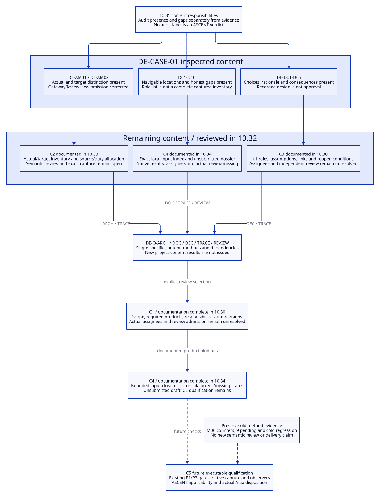

# SPDX-FileCopyrightText: 2026 tao3k team and Contributors
#
# SPDX-License-Identifier: LGPL-2.1-or-later

#+TITLE: 10.32 DE-CASE-01 Content Contract Audit
#+LANGUAGE: en
#+PROPERTY: JD_ID 10.32
#+OPTIONS: toc:3 num:t
#+STARTUP: overview
#+TODO: INSPECTED DESIGN VERIFY | QUALIFIED
#+FILETAGS: :audit:case:architecture:org:decisions:
#+PROPERTY: header-args :eval never :tangle no :exports code

[[file:../../00-09-project/00-documentation/00.01-index.org][Index]] | [[file:10.31-architecture-document-and-decision-contracts.org][Audit criteria]] | [[file:10.30-current-repository-engineering-case.org][Actual case]] | [[file:10.29-workflow-capabilities-and-minimum-completion.org][Capability and runtime gates]]

* INSPECTED Scope and interpretation
:PROPERTIES:
:CUSTOM_ID: case-content-audit
:AUDITED_ON: 2026-10-20
:STATUS: Authored content audit; no issued DE-O results or Aitia disposition
:END:

This audit applies 10.31 to the existing DE-AM01/02 architecture, D01-D10 product
inventory and DE-D01-D05 decisions. It inspects their actual Org/D2 content,
selected source definitions and historical evidence references. It does not
install content Contracts, run project observers or treat this audit as a native
ASCENT witness. Source inspection and document checks have their stated limits.

The checkout HEAD remains =8044732d505f84e373119a70f947df00e1767300= with local
changes. Inspected init.ss has SHA-256
=6e2f06520a44147192cc922ee121df0975711db9073110e21d6e55b5fa15c9c1=;
gateway-review/interface.ss has
=9a9540ea7b33f66e4c7ca5888841dbaeafcbb5240c8f2676c1bf1855bf9a041b=;
resource-lifecycle/interface.ss has
=1274b3d64678f112edea0308eef1e4ce43651e8f585407af476128a9f32f258a=.
These identify selected inspected bytes, not a complete project capture.

Use four independent descriptions: *present* means the stated content
responsibility is met in the inspected text; *partial* means some required
content is absent or ambiguous; *missing* means the identified project product
does not yet exist; *unverified* means relevant semantic/runtime/review evidence
is absent. Present content can still be unverified. None is an ASCENT verdict.

* INSPECTED Common responsibilities
:PROPERTIES:
:CUSTOM_ID: common-content-audit
:END:

#+NAME: common-responsibility-audit
| 10.31 responsibility | Existing content | Finding / missing content | Duty |
|----------------------+------------------+---------------------------+------|
| Stable subject and scope | DE-CASE-01, DE-AM01/02, DE-R/DE-D and D01-D10 roles | Present at case/model/decision level; element/interface identities are not yet enumerated in one model inventory | ARCH, TRACE |
| Authored revision and responsible role | Document status, date and project-level owner descriptions | Partial: no explicit revision/role binding for each model/decision; a Git HEAD or document number does not supply it | ARCH, DEC, REVIEW |
| Authoritative reference and relations | Org anchors, source links, view owners and requirement/decision tables | Partial: navigation exists; complete instance-level allocation and input closure remain missing | DOC, TRACE |
| Actual/target, authored/evidence/review states | 10.30 actual topology, 10.31 DE-AM classification and explicit no-approval statements | Present distinction; project-wide semantic review unverified | ARCH, REVIEW |
| Exact content and dependency capture | Selected source digests and historical method capture | Missing for the current project content set; older native seven-role context is not this capture | TRACE, REVIEW |

Duty abbreviations in all tables mean DE-O-ARCH, DE-O-DOC, DE-O-DEC,
DE-O-TRACE and DE-O-REVIEW as published in 10.31. All five lack newly issued
project-content method results. Do not infer discharge from this audit's tables.

* INSPECTED Architecture models, item by item
:PROPERTIES:
:CUSTOM_ID: architecture-content-audit
:END:

#+NAME: architecture-content-audit-table
| Item | Present / satisfied content | Partial or missing content | Duty / smallest addition |
|------+-----------------------------+----------------------------+--------------------------|
| DE-AM01 viewpoint and actual scope | 10.30 describes actual explicit native selection and split integration orchestration | Selected architecture closure and exclusions are not stated as a complete element inventory | ARCH: enumerate this selected view's elements and explicit external boundaries |
| DE-AM01 elements and endpoints | init.ss and Module/Scenario sources identify generic/Rust/Evidence and both Scenarios | Prior 90.89 omitted GatewayReview although 10.30 mentioned it; corrected in this documentation change; full endpoint/source inventory still partial | ARCH: source-link every selected node/edge; do not claim whole-repo completeness |
| DE-AM01 interfaces/dependencies | Core requires relations and execution/evidence/review boundaries are explained | Invocation/data ownership contracts and external POO/Core/ASCENT/Aitia boundary assumptions are scattered | ARCH: one bounded interface/edge inventory with role meanings and owner links |
| DE-AM02 target scope | 10.26/10.27 specify complete capture, native validation and Scenario coordination as future | Target additions are not allocated element-by-element to actual owners and acceptance duties | ARCH, TRACE: map each target change to actual owner, requirement, assumption and check |
| Requirement allocation | DE-R01-R06 point to subjects/decisions in 10.30; 10.31 names five duty families | Coarse coverage; no complete per-element/per-decision allocation and evidence footprint | TRACE: add instance-level links without repeating requirement bodies |
| Assumptions and omissions | Frozen-Core limits, missing SysML projection, current split capture and unqualified delivery are explicit | Per-model assumptions and declared out-of-scope interfaces need consolidation | ARCH: attach existing limits to each selected viewpoint |
| Views/projections | Org owners, D2 source and SVG pairs exist | Source/render settings are recorded; exact generator/input capture and semantic correspondence review are unverified | DOC, ARCH: bind selected view inputs and review correspondence |
| Repository SysML model | Six-case cut assertions are separately documented | Complete repository architecture projection is missing; optional in the proposed current design-review selection, mandatory only for a selected projection review | ARCH: retain explicit gap; do not block simple Org presence checks or claim SysML coverage |

The corrected GatewayReview node and its two requires edges are supported by
[[file:../../../init.ss][init.ss]] and [[file:../../../scenarios/gateway-review/interface.ss][its actual interface]]. The correction closes that
specific view omission. It does not close model ownership, full allocation,
capture or independent semantic review. Diagram layout is not runtime evidence.

* INSPECTED Org products D01-D10, item by item
:PROPERTIES:
:CUSTOM_ID: org-product-content-audit
:END:

#+NAME: org-product-content-audit-table
| Product | Content already present | Content gap / evidence gap | Duty / next addition |
|---------+-------------------------+----------------------------+----------------------|
| D01 brief/scope | README purpose and 10.30 case/requirements identify this Library as the actual subject | Partial: project design-review policy, accountable roles and applicability selection are proposed rather than bound | DOC, REVIEW: explicit case selection and unresolved-role record |
| D02 composition | init.ss, independent Profiles and 10.26 explain native selection/public boundaries | Partial: no selected project content Profile/expected-Contract association; executable adoption also absent | DOC, TRACE: bounded publication/selection record; keep mechanism qualification separate |
| D03 Scenario plan/capture | 10.27 plan, existing native Scenario and 10.31 content-capture responsibilities | Current project content capture is missing; native seven-scope capture cannot substitute | TRACE, REVIEW: expected/actual role inventory and dependency plan before future capture |
| D04 architecture | DE-AM01/02 and 90.89 give actual/target accounts | Partial as detailed above; full SysML projection and independent semantic review absent | ARCH: fill model inventory/allocation first |
| D05 decisions/views | Five decision rows, 90.90 map and paired-view conventions exist | Partial: common decision metadata and several reconsideration triggers incomplete; no semantic approval | DEC, DOC: targeted decision completion, not another prose copy |
| D06 traceability | DE-R ledger, 10.31 duty catalog and existing bounded resource queries | Partial: instance-to-duty-to-method/dependency links; no installed project-fact adapter | TRACE: authored allocation first; future native projection remains a separate gate |
| D07 evidence inventory | 10.25 and historical acceptance/report identify actual method evidence | Missing current content-method result inventory and complete portable reference closure; no new DE-O results | TRACE, REVIEW: distinguish historical examples, current candidates and missing witnesses |
| D08 repairs/negative controls | M06, unfinished regression and 10.31 content negative-control expectations are retained | Resource failure record present; content controls are specified but unexecuted | ARCH, DEC, TRACE: associate each planned control with its duty and inputs; retain failures |
| D09 explanation | Bounded counts, scoped limits and architecture/decision views exist | No current project-content ASCENT query or explanation receipt; diagrams are authored projections | DOC, TRACE: specify the exact questions/relations; do not fabricate query output |
| D10 dossier | 10.19/10.23 describe and record bounded backpressure review mechanisms | Current whole-content candidate dossier, selected policy/role inventory and fresh disposition are missing | REVIEW: assemble a draft with gaps, then use actual owner under qualified conditions |

The 10.30 inventory satisfies navigation and honest gap disclosure. It does not
satisfy every referenced product's content or capture responsibilities. This
audit remains section-based: ten roles do not require ten new files.

* INSPECTED Decision records, item by item
:PROPERTIES:
:CUSTOM_ID: decision-content-audit
:END:

#+NAME: decision-content-audit-table
| Decision | Satisfied content in 10.30 | Remaining content | Duty |
|----------+---------------------------+-------------------+------|
| DE-D01 native owners | Choice, existing-capability rationale, rejected parallel framework, consequence and a concrete missing-primitive reconsideration condition | Common metadata below; bind assumptions and affected model elements explicitly | DEC, ARCH, TRACE |
| DE-D02 Org plus paired views | Choice, reviewability rationale, rejected detached diagram and maintenance consequence | A condition for adding a checker is not a clear condition to reconsider the document/view organization; state that trigger and assumptions | DEC, DOC |
| DE-D03 this repo first | Choice, actual-evidence rationale, rejected narrative-only qualification and staged expansion consequence | Closing gaps before expansion is a gate, not a reconsideration trigger for case selection; record such a trigger | DEC, TRACE |
| DE-D04 one capture | Choice, split-selection/currentness problem, rejected green-model approval and refactor consequence | Premise changes already trigger mapping review; clarify the decision's own affected elements/assumptions and common metadata | DEC, ARCH, TRACE |
| DE-D05 recipient qualification | Choice, producer-context rationale, rejected receipt copying and recipient admission consequence | P4 success is an expansion gate; add conditions that reopen delivery assumptions and affected boundaries | DEC, REVIEW |

For every decision, requirement links exist indirectly through the DE-R table.
Missing common content is an explicit responsible role and authored revision,
assumption association, selected model-element links, and a statement of no
supersession or the actual predecessor. No supersession cycle is asserted by
this audit; the current records simply do not provide an explicit chain to
check. All five are recorded design choices, not Aitia dispositions. Do not
invent owners, backdated revisions, alternatives or approval references.

The concise existing alternative/rationale text is a usable minimum. The gap
does not require a separate alternatives report for each decision or decorative
new generic structures. Fill only missing responsibilities in the current owner.

* DESIGN Minimum completion sequence and acceptance
:PROPERTIES:
:CUSTOM_ID: content-audit-completion-order
:END:

C1 follow-up: [[file:10.30-current-repository-engineering-case.org::#case-design-review-selection][10.30 now records the design selection with a native Library version ownership design]], including scope,
stage-required authored products, responsibility definitions/unassigned roles,
revision conventions and Profile/Scenario boundaries. C1 is documented; the
original audit findings above remain its pre-completion basis. Exact bindings,
per-record content and native/review qualification remain C2-C5. No assignee or
review authority is inferred from this documentation completion.

C2 follow-up: [[file:10.33-case-actual-and-target-architecture.org][10.33 records DE-AM01/02 with the native Library metadata requirement]], with 13 actual elements,
12 interfaces, six external boundaries, eight assumptions and seven target
allocations. Each links source/existing owner, requirements and duties. C2 is
documented within the selected view, not independently semantically reviewed;
C3-C5 and the original runtime/delivery gates remain open. The audit tables above
retain their original findings rather than being rewritten as executed passes.

C3 follow-up: [[file:10.30-current-repository-engineering-case.org::#case-decision-baseline][10.30 now declares the five decision baselines with the native Library metadata requirement]], with
explicit unresolved roles, no supersession, 10.33 assumption/element/interface
allocations, DE-R/duty links and concrete reconsideration conditions. The
[[file:10.30-current-repository-engineering-case.org::#case-c3-completion][C3 documentation boundary]] leaves C4 inventory/dossier, C5 qualification,
actual appointments and independent semantic review open. Original audit rows
above remain historical findings, not failed controls rewritten as passes.

C4 follow-up: [[file:10.34-case-design-review-dossier-draft.org][10.34 binds D01-D10 to exact sections and declared inputs]],
with candidate byte catalog, historical/current/missing evidence classes and an
unsubmitted dossier draft. Its historical static integrity check does not rerun
methods or recover issuance. Local document/source-inspection closure is bounded;
native transitive closure, recipient access, assignees, DE-O results and actual
review remain open under C5 and the existing gates. The dossier is an output,
excluded from its own input hash inventory.

#+NAME: content-audit-completion-order-table
| Order / owner | Minimum content change | Acceptance and duty | Relation to existing gates |
|---------------+------------------------+---------------------+----------------------------|
| C1 / project policy | Bind the intended design-review scope, required roles, viewpoints, responsible roles/unresolved assignments and revision convention | Trusted expected inventory is explicit; actual/target and optional SysML policy cannot be silently changed; DOC, REVIEW | Content work within P0/P2; no executable Profile or approval implied |
| C2 / architecture owner | Complete selected actual/target element, interface, assumption and requirement/duty allocation; preserve source/view correction | Every selected endpoint and target change resolves to a source or declared external/proposed subject; ARCH, TRACE | Supplies precise P2 knowledge and future capture roles |
| C3 / decision owner | Fill only common metadata, assumption/element links, supersession and the identified trigger gaps in DE-D01-D05 | Each choice can be traced and reconsidered without inferring approval or losing prior content; DEC | Can proceed alongside C2 after C1 |
| C4 / document/evidence owner | Bind D01-D10 to exact sections/inputs and expected closure; distinguish historical/current/missing evidence; draft D10 with gaps | No role deletion hides missing content; each duty has a method and input footprint; DOC, TRACE, REVIEW | Defines the future Scenario inventory; portable delivery still P4 |
| C5 / existing framework and review owners | Qualify native capture, independent content observers, negative controls and scoped ASCENT/Aitia adapters | Actual current results and owner disposition are required; preserve conflicts, failed regression and historical receipts | Future implementation: existing P1 and P3 gates apply before executable closure; not performed now |

C1-C4 are the next documentation/knowledge work. C5 is an explicit future
qualification boundary, not authorization to implement. This content sequence
does not replace the 10.27 four-step refactor or reorder the P1-P5 runtime and
delivery prerequisites. Content design may proceed while the cold Scenario
regression remains open; executable acceptance may not bypass it.

The historical report digest was checked against its recorded acceptance entry
at this audit. Its 20 witnesses, 17 support, 3 counter and 9 pending describe
the old bounded method slice. No methods or regressions were rerun and none of
those counts supplies a new content-contract result. Independent semantic review,
whole-case Aitia review and portable delivery remain unverified.

#+CAPTION: Content presence, concrete gaps and future verification are separate audit dimensions.

[[file:../../90-99-views/90-architecture-views/90.92-case-content-audit.d2][Editable D2 source]]. This document does not implement or move project code.
