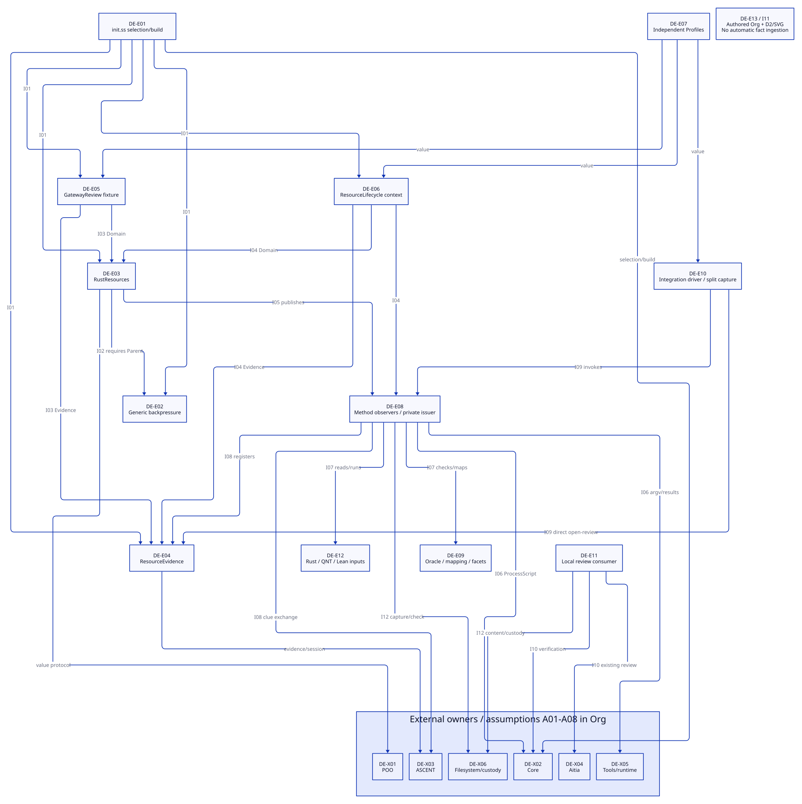
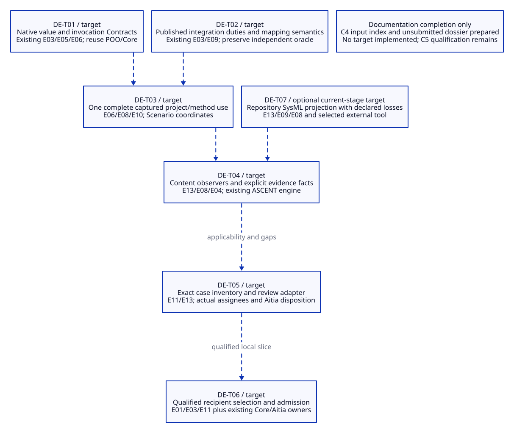

#+TITLE: 10.33 DE-CASE-01 Actual and Target Architecture
#+LANGUAGE: en
#+PROPERTY: JD_ID 10.33
#+OPTIONS: toc:3 num:t
#+STARTUP: overview
#+TODO: RECORDED DESIGN VERIFY | QUALIFIED
#+FILETAGS: :architecture:case:interfaces:traceability:
#+PROPERTY: header-args :eval never :tangle no :exports code

[[file:../../00-09-project/00-documentation/00.01-index.org][Index]] | [[file:10.30-current-repository-engineering-case.org::#case-design-review-selection][C1 selection]] | [[file:10.32-case-content-contract-audit.org][C2 audit criteria]] | [[file:10.31-architecture-document-and-decision-contracts.org][Content contracts]]

* RECORDED Model identity and bounded closure
:PROPERTIES:
:CUSTOM_ID: case-architecture-models
:RECORDED_ON: 2026-10-20
:STATUS: C2 documentation; source inspection, not runtime qualification
:END:

This is the detailed architecture owner for the selected viewpoints summarized
in 10.30. It records actual source relationships separately from proposed
changes. Element/interface/assumption IDs below are documentation identities,
not new Module exports, APIs or registered ASCENT relations.

#+NAME: case-model-identities
| Model | Native contract metadata / scope | Responsible role / evidence state |
|-------+-----------------------------------------+-----------------------------------|
| DE-AM01 | Native Library metadata pending; ownership/read design in 10.26; actual selected Library/resource slice; DE-E01-E13, DE-I01-I12 and external boundaries below | C1 Content steward, assignee unresolved; source-visible structure only |
| DE-AM02 | Native Library metadata pending; ownership/read design in 10.26; target changes DE-T01-T07 allocated to the same owners | C1 Content steward, assignee unresolved; design specification, not implemented behavior |

Both models reference the [[file:10.26-backpressure-public-contracts.org::#contract-version-source][native Library ownership/read design]]; the native
slot and captured read are pending. No model-specific version is declared here. Content/source identities and capture history remain
separate from that version. C3 [[file:10.30-current-repository-engineering-case.org::#case-decision-allocation][binds decisions to these element IDs]];
[[file:10.34-case-design-review-dossier-draft.org][C4 indexes selected product/input bytes]] for an unsubmitted draft. That local
index does not constitute an admitted immutable native capture.

The closure covers explicit local selection, the resource Library, both selected
Scenarios, independent fixture/native Profiles, method observers, selected
implementation/formal assets, integration orchestration, local review consumers
and maintained case views. Package/runtime internals, every review-recovery
variant, the hypothetical network service and all upstream architectures are
outside this structural view. External interfaces remain explicit below.

In the tables, R01 means DE-R01, ARCH means DE-O-ARCH, and similarly for the other
requirement/duty suffixes from 10.30/10.31. An allocation identifies what must be
checked; it does not discharge that duty. All elements inherit the model's
responsible role unless an existing framework owner is identified at a boundary.

* RECORDED Actual elements and source allocation
:PROPERTIES:
:CUSTOM_ID: case-actual-elements
:END:

#+NAME: actual-architecture-elements
| ID / actual responsibility | Source / authoritative content | Requirement / duty |
|----------------------------+--------------------------------+--------------------|
| DE-E01 selection/build entry | [[file:../../../init.ss][init.ss]] selects three Modules and two Scenarios; callers explicitly request build/currentness | R01,R03 / ARCH,TRACE |
| DE-E02 generic backpressure publication | [[file:../../../library/concurrency/resource-control/backpressure-memory/abstract/interface.ss][abstract/interface.ss]] exports Config entry under BackpressureScopeContract | R01,R04 / ARCH,TRACE |
| DE-E03 Rust specialization/public methods | [[file:../../../library/concurrency/resource-control/backpressure-memory/rust/interface.ss][rust/interface.ss]], [[file:../../../library/concurrency/resource-control/backpressure-memory/rust/objects.ss][objects.ss]], [[file:../../../library/concurrency/resource-control/backpressure-memory/rust/types.ss][types.ss]], [[file:../../../library/concurrency/resource-control/backpressure-memory/rust/func.ss][func.ss]] require parent, specialize duties and expose Contracts/methods | R01,R03,R04 / ARCH,TRACE |
| DE-E04 resource evidence publication | [[file:../../../modules/resource-evidence/interface.ss][Evidence interface]] and [[file:../../../modules/resource-evidence/func.ss][rules/session adapter]] expose open-review and finite applicability/query rules | R01,R04 / ARCH,TRACE |
| DE-E05 gateway fixture Scenario | [[file:../../../scenarios/gateway-review/interface.ss][GatewayReview requirements]] and [[file:../../../scenarios/gateway-review/func.ss][operations]] provide fixture cases and scope rows; no cryptographic host capture claimed | R01,R03 / ARCH,TRACE |
| DE-E06 native lifecycle Scenario | [[file:../../../scenarios/resource-lifecycle/interface.ss][ResourceLifecycle requirements]] and [[file:../../../scenarios/resource-lifecycle/func.ss][operations]] delegate capture/currentness and open review | R01,R03 / ARCH,TRACE |
| DE-E07 independent Profile values | [[file:../../../profiles/gateway.ss][Gateway Profiles]] contain fixture premises; [[file:../../../profiles/resource-lifecycle.ss][Lifecycle Profiles]] contain controlled native premises; imported independently | R01,R03 / ARCH,TRACE |
| DE-E08 method observers/private result boundary | [[file:../../../library/concurrency/resource-control/backpressure-memory/rust/methods.ss][methods.ss]] executes, validates, issues, checks currentness and registers results | R03,R04 / ARCH,TRACE |
| DE-E09 independent oracles and mapping | [[file:../../../library/concurrency/resource-control/backpressure-memory/rust/oracle.ss][oracle.ss]] checks observations; [[file:../../../library/concurrency/resource-control/backpressure-memory/rust/correspondence.ss][correspondence.ss]] maps cuts and generates facets; currently also extends entry semantics | R04 / ARCH,TRACE |
| DE-E10 integration driver | [[file:../../../examples/resource-integration-evidence.ss][integration example]] selects, extends entry, joins scopes/snapshot, invokes methods, registers and renders results | R03,R04,R06 / ARCH,DOC,TRACE |
| DE-E11 local Aitia consumer | [[file:../../../scenarios/resource-lifecycle/review/interface.ss][review exports]], [[file:../../../scenarios/resource-lifecycle/review/func.ss][content verification]], [[file:../../../examples/backpressure-aitia-review.ss][review driver]]; separate native subpackage, not an init-selected Module | R05 / ARCH,REVIEW |
| DE-E12 implementation/formal inputs | [[file:../../../library/concurrency/resource-control/backpressure-memory/rust/native/src/main.rs][Rust mechanism]], [[file:../../../library/concurrency/resource-control/backpressure-memory/model.qnt][QNT model]], [[file:../../../library/concurrency/resource-control/backpressure-memory/budget.lean][Lean budget]] and method-generated SysML/QNT facets | R04 / ARCH,TRACE |
| DE-E13 authored architecture/products/views | 10.26-10.33, existing 10.19-10.25 evidence/review explanations and their selected paired views | R02,R06 / ARCH,DOC,TRACE |

DE-E08 and DE-E09 are different responsibilities: centralizing identities does
not justify replacing independent oracle logic with the mapper's own verdict.
DE-E13 is maintained documentation, not an automatically loaded runtime module.
The separate review package's [[file:../../../scenarios/resource-lifecycle/review/gerbil.pkg][dependency declaration]] and root [[file:../../../gerbil.pkg][package metadata]]
also keep domain publication dependencies distinct from Aitia consumer needs.

* RECORDED Interfaces, dependencies and ownership
:PROPERTIES:
:CUSTOM_ID: case-actual-interfaces
:END:

#+NAME: actual-architecture-interfaces
| ID / endpoints | Actual data or dependency contract / source | Boundary and requirement / duty |
|----------------+--------------------------------------------+---------------------------------|
| DE-I01 E01 -> E02-E06 | Explicit native selection in init.ss; DE-X02 supplies selection/build machinery | Selection is not method execution or approval; R01,R03 / ARCH |
| DE-I02 E03 -> E02 | Core Parent requirement/BackpressureScopeContract; specialize-backpressure derives entry and preserves rows | Structural inheritance alone does not prove semantic refinement; R01,R04 / ARCH,TRACE |
| DE-I03 E05 -> E03,E04; E07 -> E05 | Gateway open-review takes profile/usage/snapshot/source and optional scope rows, then opens selected Evidence session | scope-key is finite fixture serialization, not actual toolchain/source identity; R03,R04 / ARCH,TRACE |
| DE-I04 E06 -> E08,E04; E07 -> E06 | capture takes root/Profile/crate/Cargo/rustc/usage/mode; open-review checks context entry/currentness then projects entry/Profile/usage/snapshot/scopes | Current seven-role context, ignored validation return and narrow methods recognized in audit remain debt; R03 / ARCH,TRACE |
| DE-I05 E03 -> E08 | ResourceMethods publishes native/formal/integration/capture/register helpers and result projections | Domain and utility surface are currently mixed; no second executor; R01,R03 / ARCH |
| DE-I06 E08 -> X02,X05,X06 | command derives Core ProcessScript command with argv/directory/log/deadline; observers interpret raw output and issue private results | Process exit alone is insufficient; timeout/currentness and oracle checks retain meaning; R04 / ARCH,TRACE |
| DE-I07 E08 -> E09,E12 | Native observations and formal inputs feed independent checks and explicit cut/state mapping | Synthesized intermediate states are not observed events; M02 extension and finite bounds explicit; R04 / ARCH,TRACE |
| DE-I08 E08 -> E04,X03 | register takes existing session/issued results/trajectory/rules path; uses clue-exchange and checks expected content before/through registration | JSON cannot reconstruct issuer; ASCENT applicability does not issue activation; R04 / ARCH,TRACE |
| DE-I09 E10 -> E03,E08,E04; E07 -> E10 | Example builds current selection, derives integration entry, captures seven roles, appends three extra roles, recomputes snapshot and directly opens Evidence | This currently bypasses Scenario open-review for the complete integration path; R03,R04,R06 / ARCH,TRACE |
| DE-I10 E11 -> X04,X02; evidence files -> E11 | Local review consumer validates source/content and uses existing Aitia context/content/stage and Core verification owners | Bounded backpressure review is not whole-case review; not automatically connected to DE-E04 query output; R05 / ARCH,REVIEW |
| DE-I11 E13 -> authored D2 -> SVG | Org semantic owner, editable graph and render convention; source links describe actual nodes and target changes | Documentation projection, not runtime call or proof; R02,R06 / DOC,ARCH |
| DE-I12 E08,E10,E11 -> X06 | Actual source/config/tool/artifact paths and content digests; evidence saved locally and read under declared custody/currentness | File checks are local consistency, not atomic check-to-use or portable delivery; R03,R05 / TRACE,REVIEW |

E/X shorthand refers to DE-E/DE-X identities. Interface source owners are the
linked definitions in the element table: I01=E01, I02=E03, I03=E05, I04=E06/E08,
I05-I08/I12=E08, I09=E10, I10=E11, I11=E13. The actual diagrams are projections
of this allocation; a missing drawn edge does not create an undocumented API.

* RECORDED External boundaries and assumptions
:PROPERTIES:
:CUSTOM_ID: case-architecture-boundaries
:END:

#+NAME: external-architecture-boundaries
| Boundary | Existing owner / inspected connection | Assumption, omission and allocation |
|----------+---------------------------------------+-------------------------------------|
| DE-X01 POO | :clan/poo objects and native Types/validation; [[file:../../../.gerbil/pkg/github.com/tao3k/gerbil-poo/object-contract.ss][ObjectContract]] | A01: prototype derivation, validation returns and semantic review differ; no new schema owner; R01 / ARCH |
| DE-X02 Core | [[file:../../../.gerbil/pkg/github.com/tao3k/poo-flow-core/module-system/selection/init-syntax.ss][explicit selection]], [[file:../../../.gerbil/pkg/github.com/tao3k/poo-flow-core/types.ss][admission]], ProcessScript and verification imported by actual callers | A02: source-visible capability requires a compatible compiled baseline; cold Scenario regression unresolved; R01,R03 / ARCH,TRACE |
| DE-X03 gerbil-ascent | Session, Evidence declaration, trajectory and clue-exchange imports in E04/E08/E10 | A03: rules are finite explicit facts; checked/issued inputs need a trusted observer; support and counter can coexist; R04 / TRACE |
| DE-X04 Aitia | Review/lifecycle APIs imported by E11; existing [[file:10.19-standard-identities-and-aitia-review-traceability.org][owner map]] | A04: project policy, assignees and current review context must be established; no inferred NASA class or receipt authority; R05 / REVIEW |
| DE-X05 tool/runtime execution | Selected Cargo/rustc, Quint/TLC/Java, Lean and OpenSysML; E08 observers and E12 inputs | A05: tool closure/platform and finite/runtime premises matter; local transitive installation trust is recorded, not universally authenticated; R04 / ARCH,TRACE |
| DE-X06 filesystem/content custody | Local source/configuration, .data artifacts, references and recipient access | A06: mutable files require appropriate currentness checks/owned copies; historical local paths are not portable closure; R03,R05 / TRACE,REVIEW |

The DE-A01-A06 assumptions above use the displayed A suffixes. DE-A07 is the
model/view boundary: actual source inspection is not native execution; Org/D2
consistency is not semantic approval, and a selected SysML projection can be
lossy or unsupported. It applies to E09/E12/E13, I07/I11, R02/R04/R06 and
ARCH/DOC/TRACE. DE-A08 is the controlled-method boundary: the historical slice
uses one job/permit, current-thread Tokio and one Rayon worker; finite safety,
conditional arithmetic and path existence do not establish general Rust
refinement, liveness or peak memory. It applies to E07-E12, I06-I10, R04 and
ARCH/TRACE. All A01-A08 are declared assumptions/limits to review, not new axioms
proved by this document.

* DESIGN Target changes allocated to actual owners
:PROPERTIES:
:CUSTOM_ID: case-target-architecture
:END:

#+NAME: target-architecture-allocation
| ID / target, not implemented | Existing owner and source seam | Requirements, duties, assumptions and acceptance |
|------------------------------+--------------------------------+------------------------------------------------|
| DE-T01 native value/invocation contracts | E03/E05/E06; local types and operations; reuse X01/X02 | R01,R03 / ARCH,TRACE; A01/A02; use normalized returns, preserve supported domains and required parent meaning |
| DE-T02 published integration semantics | E03/E09; specialize-backpressure and resource-slice-entry seams | R01,R04 / ARCH,TRACE; A07/A08; publish SI/TM links, mapping/M02 semantics and duties under Library; retain independent oracle |
| DE-T03 one complete project/selected-method use | E06/E08/E10; native-context/integration-scopes and example direct session opening | R03,R06 / ARCH,TRACE; A02/A06; capture final Profile, roles, content/mappings/tools once; Scenario coordinates; existing Evidence adapter may project internally |
| DE-T04 architecture/product/decision observers and facts | E13/E08/E04; 10.31 duties and existing result/register/query seams | R02,R04,R06 / ARCH,DOC,TRACE; A03/A07; explicit content criteria, independent semantic review and precise footprints; no generic prose-to-truth ingestion |
| DE-T05 exact case review/dossier adapter | E11 plus E13 inventory; existing content/stage verification seam at I10 | R05 / REVIEW; A04/A06; bind C1 policy and actual inventory/assignees/evidence; obtain real owner disposition |
| DE-T06 qualified recipient use | E01/E03/E11 plus X02/X04/X06 publication/intake boundaries | R05 / TRACE,REVIEW; A02/A04/A06; accessible dependency/reference closure and fresh recipient admission; not receipt copying |
| DE-T07 selected repository SysML projection | E13/E09/E08 and X05; declared architecture-to-SysML mapping, currently absent | R02,R04 / ARCH,DOC,TRACE; A05/A07; preserve native IDs, declare losses and supported checks; optional under C1, not a mandatory current-stage pass |

Target source seams identify where work would belong, not code already present
or an instruction to implement it now. T01-T06 refine existing owners and use
existing Core/ASCENT/Aitia primitives. T07 is an additional method projection,
not a replacement authoring or approval system. Actual structural edges in
DE-AM01 do not silently change when a DE-T target is documented.

* VERIFY C2 traceability and completion boundary
:PROPERTIES:
:CUSTOM_ID: case-c2-completion
:END:

#+NAME: architecture-requirement-coverage
| Requirement | Actual subjects/interfaces | Target allocation / required check |
|-------------+----------------------------+------------------------------------|
| DE-R01 native reuse | E01-E07; I01-I05; X01/X02 | T01/T02; ARCH/TRACE check native ownership and parent preservation |
| DE-R02 architecture/rationale | E13; I11; A07 | T04/T07; ARCH/DOC/TRACE check model allocation and selected view correspondence; C3 links documented, rationale review pending |
| DE-R03 coherent use | E01/E05-E08/E10; I03/I04/I09/I12 | T01/T03; ARCH/TRACE check required-role closure and currentness; actual split remains |
| DE-R04 evidence meaning | E02-E04/E08-E12; I06-I10; A03/A05/A07/A08 | T02/T04/T07; ARCH/TRACE preserve independent controls and scoped claims |
| DE-R05 delivery/review | E11/E13; I10/I12; X04/X06 | T05/T06; TRACE/REVIEW require exact policy/content and recipient boundary |
| DE-R06 real case | E10/E13; I09/I11; A07 | T03/T04; ARCH/DOC/TRACE use actual sources and honest authored/query states |

C2 is documented when selected endpoints, source/target classification,
interfaces, external dependencies, assumptions and requirement/duty allocation
are explicit. This inventory provides that bounded record. It does not supply
C4 exact capture/dossier, independent architecture review,
executed negative controls or C5 native acceptance. Project content and assigned
reviewer remain governed by C1; the Content steward assignee is unresolved.
The later [[file:10.30-current-repository-engineering-case.org::#case-decision-baseline][C3 decision baseline]] records native Library metadata requirement and mappings; that
documentation does not change the architectural meanings or qualify these models.

Inspection used current source under HEAD
=8044732d505f84e373119a70f947df00e1767300= plus local changes. The inspected
init.ss digest remains =6e2f06520a44147192cc922ee121df0975711db9073110e21d6e55b5fa15c9c1=;
E08 methods digest is =58f5fb8690a8c3f35431c2c35fcc95e5bac0fca1d9cd3a732302b9b71205eca2=;
E10 example digest is =44c3c200da5caff7aa26c8d58bb25c6b10d51db2849277ac38c3d5d1304c4acc=.
These identify selected reads only, not an immutable capture of every source
or every transitive runtime. The historical 10.29/10.32 inspections and method
receipts retain their original scope. No methods or native tests were run here.

#+CAPTION: DE-AM01 actual selected structural/dataflow relationships; documentation inputs and external owners remain distinct.

[[file:../../90-99-views/90-architecture-views/90.94-case-actual-architecture.d2][Actual editable D2 source]]. The overview in 90.89 remains a smaller projection.

#+CAPTION: DE-AM02 target allocations; dashed paths are proposed, not current runtime behavior.

[[file:../../90-99-views/90-architecture-views/90.95-case-target-architecture.d2][Target editable D2 source]]. No implementation or directory migration is performed.

* SPECIFIED Authored SysML organization and model scope
:PROPERTIES:
:CUSTOM_ID: case-sysml-organization-counterpart
:END:

[[file:10.78-agent-sysml-project-formation.org::#agent-project-formation][10.78 Agent-driven formation]] defines the workflow.
DE-E/I/T/X/R/D/A and product/duty identities now have an authored SysML counterpart. Existing source-inspected inventory and prose rationale remain here; current structure uses that model for organization. This does not qualify refreshed source semantics, complete typed ports or an implemented workflow.
