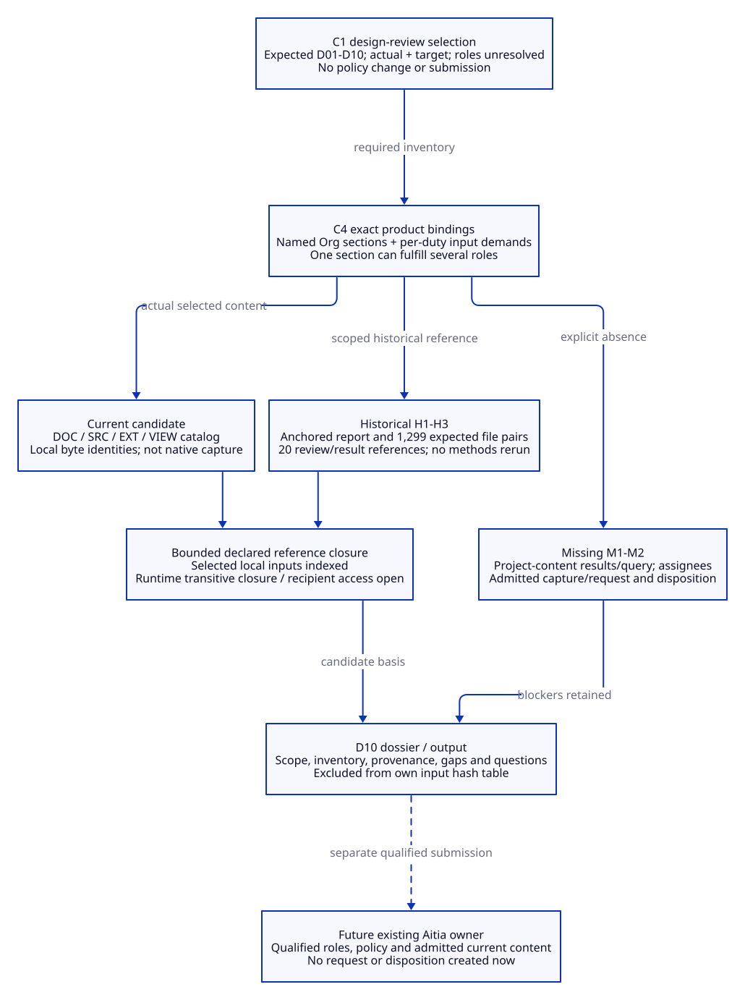
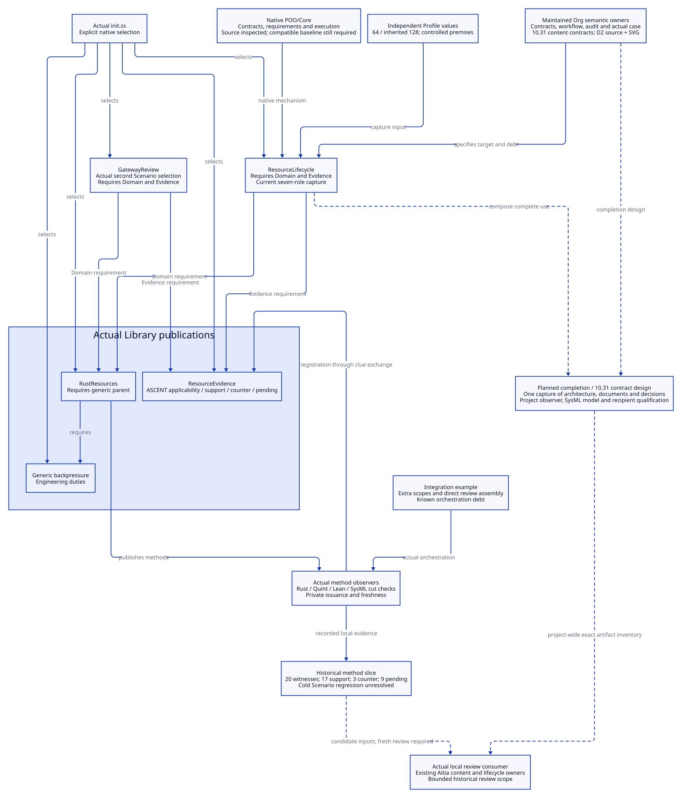
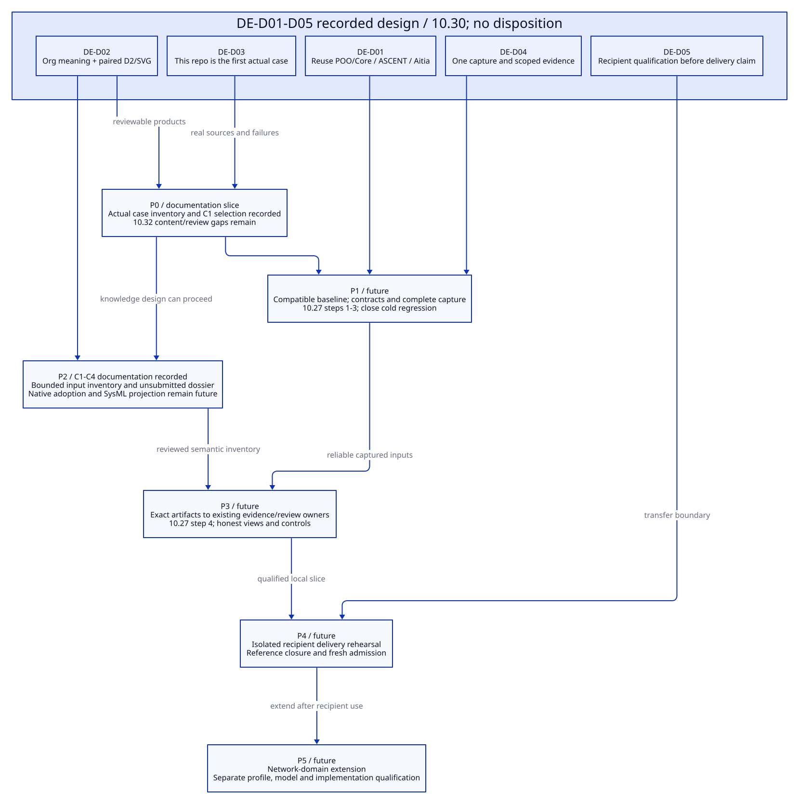
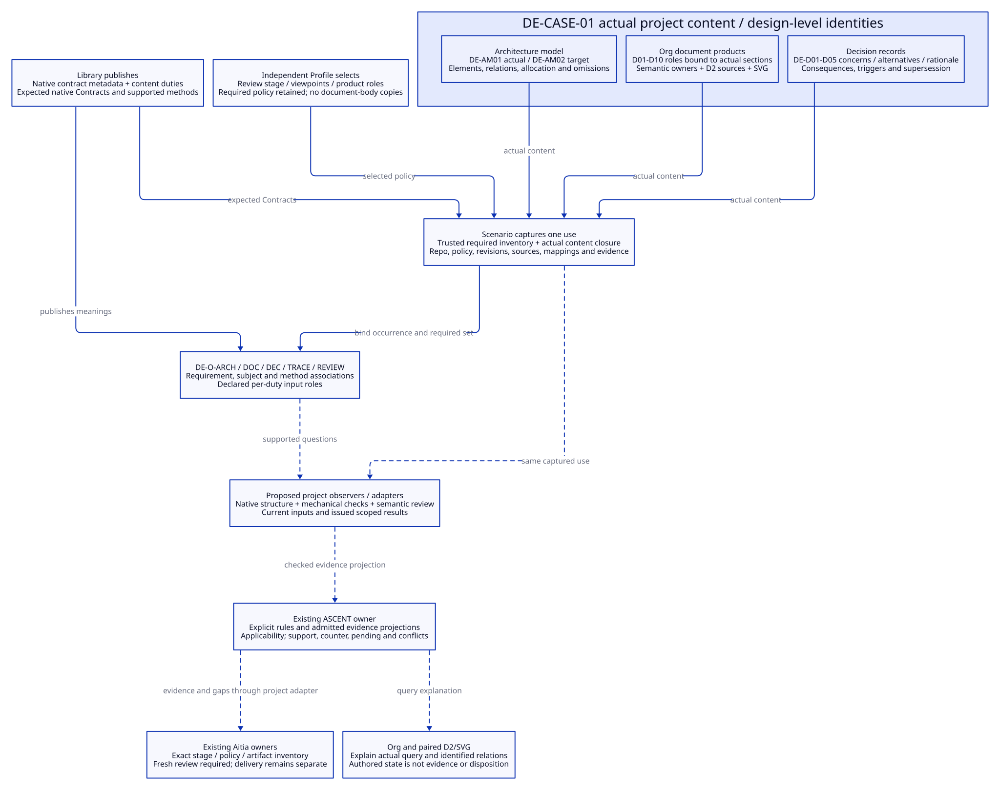
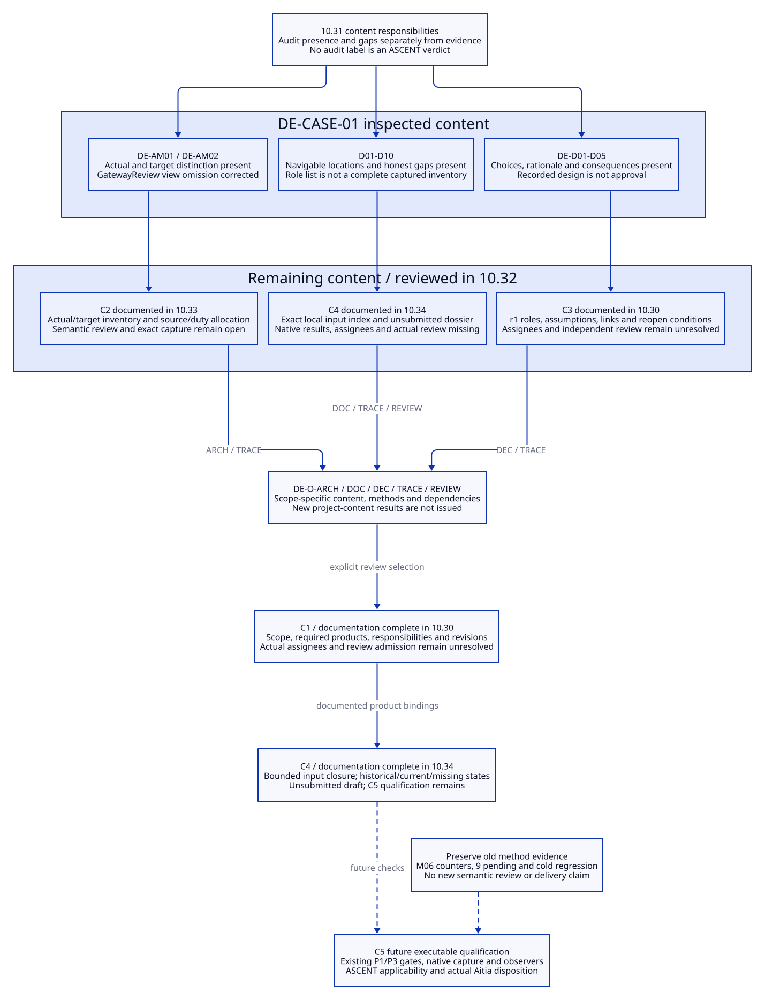
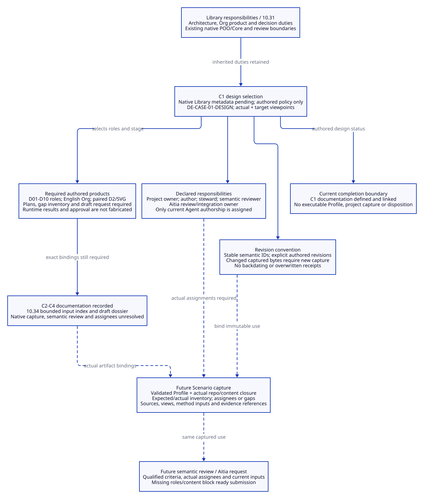
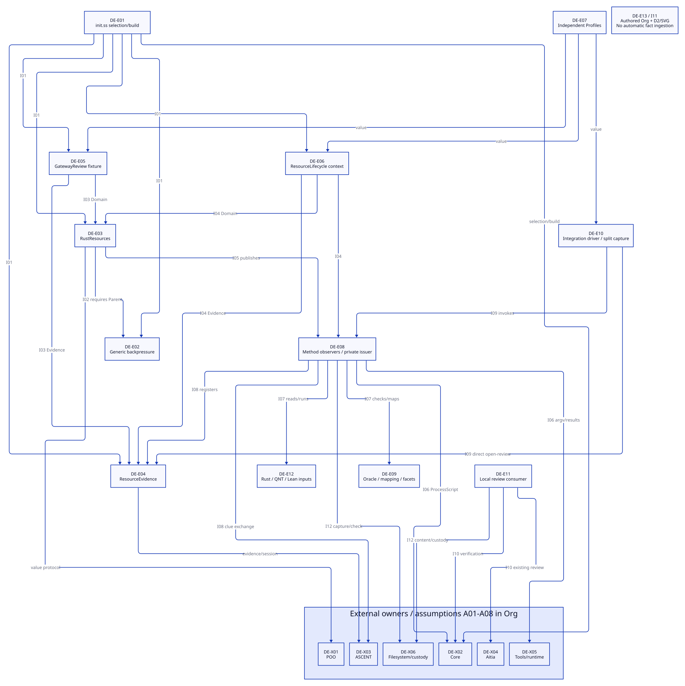
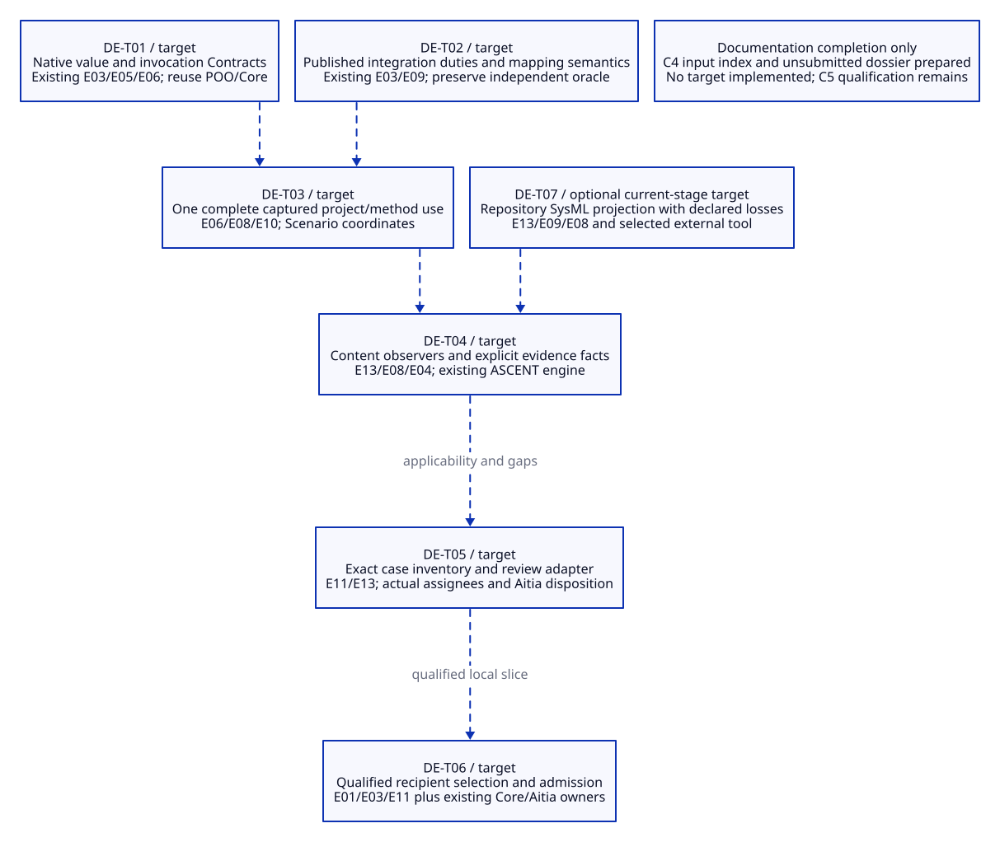
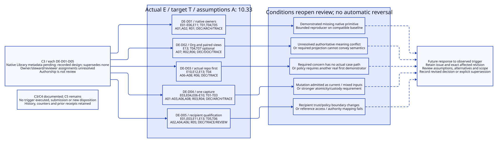

# SPDX-FileCopyrightText: 2026 tao3k team and Contributors
#
# SPDX-License-Identifier: LGPL-2.1-or-later

#+TITLE: 10.34 DE-CASE-01 Design Review Dossier Draft
#+LANGUAGE: en
#+PROPERTY: JD_ID 10.34
#+OPTIONS: toc:3 num:t
#+STARTUP: overview
#+TODO: DRAFT INSPECTED VERIFY | SUBMITTED
#+FILETAGS: :dossier:draft:case:inventory:evidence:
#+PROPERTY: header-args :eval never :tangle no :exports code

[[file:../../00-09-project/00-documentation/00.01-index.org][Index]] | [[file:10.30-current-repository-engineering-case.org::#case-design-review-selection][C1 selection]] | [[file:10.32-case-content-contract-audit.org::#content-audit-completion-order][C4 criteria]] | [[file:10.33-case-actual-and-target-architecture.org][C2 models]]

* DRAFT Identity, scope and submission state
:PROPERTIES:
:CUSTOM_ID: case-dossier-draft
:DOSSIER_ID: DE-CASE-01-DOSSIER
:RECORDED_ON: 2026-10-20
:STATUS: Draft prepared locally; not submitted; no native capture or disposition
:END:

This is the D10 authored draft and C4 binding index, not a serialized Aitia
request or an issued receipt. It asks whether the Library's bounded architecture,
document organization, decisions and proposed evidence/review boundaries are
sufficiently explicit for the next work. It does not request release, runtime
acceptance, recipient delivery or closure of every inherited backpressure duty.

#+NAME: dossier-request-basis
| Request responsibility | Exact draft binding |
|------------------------+---------------------|
| Case and policy | DE-CASE-01; DE-CASE-01-DESIGN (native contract metadata pending) at 10.30 case-design-review-selection, including scope/products/roles/revision subsections |
| Models and decisions | DE-AM01/02 with the native Library metadata requirement in 10.33; DE-D01-D05 (native contract metadata pending) in 10.30 case-decision-baseline/allocation/reconsideration |
| Requirements / duties | DE-R01-R06 in 10.30 actual-case-requirements; DE-O-ARCH/DOC/DEC/TRACE/REVIEW in 10.31 content-obligations-and-evidence |
| Candidate repository | Local deterministic-engineering checkout under HEAD 8044732d505f84e373119a70f947df00e1767300 plus local changes; selected bytes indexed below, not HEAD alone |
| Responsible roles | C1 Project owner, Content steward, Semantic reviewer and Aitia review/integration binding remain unresolved; current Agent authored this draft |
| Applicability | Current design-review selection only; no external standard/class or production activation applicability is assigned |
| Submitter / recipient / request / disposition | Not assigned / not selected / not created / absent; no submission performed |

* INSPECTED D01-D10 bindings and required inputs
:PROPERTIES:
:CUSTOM_ID: case-product-input-bindings
:END:

Each row binds the stage-required authored product to actual sections. The
appendix pins the bytes of the selected existing input files. This section
defines demand edges; it does not recursively promote every hyperlink into a
required input. Several roles can use the same section and file identity.

#+NAME: case-product-input-binding-table
| Role | Authoritative sections / current candidate | Required input and reference closure | Evidence state / remaining gap |
|------+-------------------------------------------+--------------------------------------+--------------------------------|
| D01 | [[file:../../../README.org::#purpose][README Purpose]]; [[file:10.30-current-repository-engineering-case.org::#actual-repository-case][case boundary]], [[file:10.30-current-repository-engineering-case.org::#actual-case-requirements][DE-R ledger]], [[file:10.30-current-repository-engineering-case.org::#case-design-review-scope][C1 scope]] | Selected policy/subject definitions in 10.30/10.31; DOC catalog entries, not every README navigation target | Current authored candidate; independent scope/applicability review missing |
| D02 | [[file:10.26-backpressure-public-contracts.org::#backpressure-public-contracts][10.26 public boundaries]]; [[file:10.30-current-repository-engineering-case.org::#case-profile-capture-boundary][Profile/capture selection]]; [[file:10.33-case-actual-and-target-architecture.org::#case-actual-elements][actual elements]] | init.ss, declared Module/Scenario interfaces, independent Profiles and package metadata in SRC; selected native boundary files in EXT | Current source/document candidate; executable project Profile/admission absent |
| D03 | [[file:10.31-architecture-document-and-decision-contracts.org::#case-content-binding][content capture responsibilities]]; [[file:10.30-current-repository-engineering-case.org::#case-required-design-products][required roles]]; this binding table and closure rules | C1 policy, selected model/decision references, DOC/SRC/VIEW and exact missing-input declarations | Current authored input plan/index; no immutable native project capture |
| D04 | [[file:10.33-case-actual-and-target-architecture.org::#case-architecture-models][model identities]], [[file:10.33-case-actual-and-target-architecture.org::#case-actual-elements][elements]], [[file:10.33-case-actual-and-target-architecture.org::#case-actual-interfaces][interfaces]], [[file:10.33-case-actual-and-target-architecture.org::#case-architecture-boundaries][boundaries]], [[file:10.33-case-actual-and-target-architecture.org::#case-target-architecture][targets]] | Corresponding C2 source seams in SRC/EXT; actual/target D2/SVG 90.94/90.95 and selected overview 90.89 in VIEW | Current architecture candidate; independent semantic review missing; complete SysML projection absent/optional at this stage |
| D05 | [[file:10.30-current-repository-engineering-case.org::#actual-case-decisions][choices]], [[file:10.30-current-repository-engineering-case.org::#case-decision-baseline][metadata]], [[file:10.30-current-repository-engineering-case.org::#case-decision-allocation][allocation]], [[file:10.30-current-repository-engineering-case.org::#case-decision-reconsideration][reconsideration]] | C1 role/revision policy; C2 E/I/T/A definitions and source seams; views 90.90/90.96 | Current decision candidate; assignees and independent rationale review missing |
| D06 | [[file:10.30-current-repository-engineering-case.org::#actual-case-requirements][DE-R ledger]]; [[file:10.31-architecture-document-and-decision-contracts.org::#content-obligations-and-evidence][duty catalog]]; [[file:10.33-case-actual-and-target-architecture.org::#case-c2-completion][architecture allocation]]; C3 allocation; duty plan below | Requirement/model/decision identities, policy, exact per-check input demand and evidence-state inventory | Authored traceability; no installed project-fact adapter or issued DE-O results |
| D07 | [[file:10.25-rust-sysml-quint-lean-evidence-integration.org::#integrated-local-slice][historical slice]]; evidence classification and HIST catalog below | Historical acceptance/report and report-declared input/artifact/record/log digests; no promotion into current-content witnesses | Historical integrity checked; current content-method evidence missing |
| D08 | [[file:10.25-rust-sysml-quint-lean-evidence-integration.org::#integrated-local-slice][recorded failures/limits]]; [[file:10.27-library-delivery-repo-workflow-and-backpressure-audit.org::#backpressure-minimal-refactor][refactor plan]]; [[file:10.31-architecture-document-and-decision-contracts.org::#content-contract-acceptance][content negative controls]]; C3 triggers | HIST original/diagnostic regression logs; native/model independent oracle sources; prospective control definitions | Historical M06 counters/failure retained; content controls and decision triggers not executed |
| D09 | [[file:10.32-case-content-contract-audit.org::#case-content-audit][audit]]; explanation questions below; 90.89-90.96 selected input views | Authored source/status provenance plus HIST bounded query counts; future actual project query must bind its own rule/input/result identity | Current authored explanation; no project-content ASCENT query receipt |
| D10 | This draft's request basis, product/input bindings, closure rules, evidence inventory, duty plan and readiness gates | Finalized selected DOC/SRC/EXT/VIEW/HIST inputs; role/policy bindings and unresolved-reference inventory | Draft output only; not a native request, signature, receipt or disposition |

File-level hashes bind complete bytes even when a role selects only a section.
A later file/anchor change requires reconsidering the selected binding.

* INSPECTED Reference closure policy and accessibility
:PROPERTIES:
:CUSTOM_ID: case-reference-closure
:END:

#+NAME: case-reference-classes
| Class | Declared closure and use | Access / limits |
|-------+--------------------------+-----------------|
| DOC | README, selected 10.25-10.33 semantic owners and reference indices, individually hashed in appendix | Local current candidate bytes; extra navigation links are context unless selected by a row or duty |
| SRC | Explicit local C2 source seams plus local .ss companions in the selected publication/Scenario/review directories, Profiles, package metadata and Rust/QNT/Lean inputs | Static source-inspection input set; no compile/import or tool runtime qualification |
| EXT | Direct native POO/Core/ASCENT/Aitia boundary files selected for architectural correspondence, indexed individually | Local package/sibling-checkout access only; upstream transitive executable closure and recipient access not established |
| VIEW | Selected paired D2 sources/SVGs and view-index convention; generation settings remain declared in source headers | Current explanation/render candidate; no semantic or approval authority from a render |
| HIST | Anchored local acceptance/report plus referenced method records/reviews, declared inputs/artifacts/logs and regression/source-check/view files | Historical evidence closure checked as declared below; local trust/custody only, not recipient portability |
| Context-only | Network walkthrough 10.28, old standards/recovery narratives, unrelated document navigation and external URLs not selected as a required claim source here | Not proof inputs or evidence of external applicability; selecting one later extends inventory and requires its own bytes/access checks |
| Missing / deferred | Native current-content capture, independent architecture/rationale review, project DE-O results/query, role appointments and actual Aitia request/disposition | Listed gaps; no placeholder hash, fabricated witness or automatic waiver |

The authoritative graph is the role/duty demand declared in this dossier plus
the concrete catalog entries. It is closed for the enumerated local document
and static source-inspection inputs, with external execution/delivery boundaries
explicitly open. It is not the transitive import closure of a runnable project.
Historical report arrays delegate their declared leaf path/digest inventory;
the report digest anchors those arrays, not arbitrary referenced prose.

This dossier and its paired 90.97 view are assembled outputs, not their own
inputs. They are excluded from the input hash table to avoid self-reference. Links back
to it in input documents are navigation, not recursive hash dependencies. A
later submission must bind the finalized dossier bytes as request input using
the actual existing owner; none is bound or submitted here. The appendix is a
local point-in-time index, not an immutable native capture. Changes require a
new candidate index/capture and affected rechecks before current use.

* INSPECTED Evidence classification and integrity observations
:PROPERTIES:
:CUSTOM_ID: case-evidence-inventory
:END:

#+NAME: case-evidence-state-table
| Evidence category | Identified content | Supported conclusion / explicit exclusion |
|-------------------+--------------------+-------------------------------------------|
| Historical H1 | .data/integration-audit-20261020/acceptance.json and its report reference; indexed as HIST | Recorded bounded slice: 20 witnesses, 17 support, 3 counter, 9 pending; not new DE-O content evidence |
| Historical H2 | 20 report result records/reviews, reported inputs/artifacts/command logs, acceptance regression/source-check/view references | Static recheck found 1,299 distinct expected path/digest pairs matching, no missing/changed/conflicting pairs; 20 review result references match record IDs |
| Historical H3 | Unfinished native-context original/diagnostic logs and preserved M06 results | Original exits 137/124 and allRegressionsPassed=false remain; no failure rewritten or method rerun |
| Current candidate C1 | Current authored DOC/SRC/EXT/VIEW input set in appendix, this draft and its demand map | Concrete content for review preparation; no trusted observer result or semantic acceptance |
| Current candidate C2 | Org/link/paired-render checks performed for this documentation change | Mechanical consistency only; not independent architecture/rationale review or proof of current runtime |
| Missing M1 | Issued DE-O-ARCH/DOC/DEC/TRACE/REVIEW project-content results, independent reviewer and project query receipt | All absent as native project-content evidence; authored matrices do not fill these slots |
| Missing M2 | Actual role appointments, admitted current-content capture/request, stage disposition and recipient-access proof | Submission/review/delivery readiness unestablished; none performed by this draft |

The H1 report SHA-256 is
=b28426cd282c4d04776307593ecc0d401d3e3cad279944ab1e2e06b273ad911e=.
H2 checks cover only the declared expected pairs and review-to-result
references. Review files are locally indexed below, but their current bytes and
matching result references do not reconstruct private issuance or authenticate
an external reviewer. Publisher-local hash agreement is not independent trust.
No tool versions, models, tests or native regression were executed anew.

The old nine pending and three counter rows belong to that resource slice.
They are not counts for the new project-content duty set. Current candidate
documents also must not be described as issued counter/support rows.

* DRAFT Per-duty review questions, inputs and missing outputs
:PROPERTIES:
:CUSTOM_ID: case-draft-review-questions
:END:

#+NAME: case-draft-duty-inputs
| Duty | Exact bounded input demand | Question / missing output |
|------+----------------------------+---------------------------|
| DE-O-ARCH | C1 scope; 10.33 models/elements/interfaces/boundaries/targets; their specific SRC/EXT seams; 90.89/90.94/90.95 | Do actual edges match sources, and are targets/assumptions/omissions explicit? Independent correspondence/architecture result missing |
| DE-O-DOC | C1 required-role and view policy; this D01-D10 binding; selected DOC/VIEW/locator inventory | Are required roles and references present and paired views faithful? Mechanical checks are candidates; semantic product review missing |
| DE-O-DEC | Five decision records/common native-metadata requirement/allocation/triggers; C1 role/revision policy; referenced C2 E/I/T/A definitions; 90.90/90.96 | Are alternatives/rationale and reopen conditions adequate for their concerns? Independent rationale review and assignees missing |
| DE-O-TRACE | DE-R ledger, C2/C3 allocations, 10.31 duty meanings, this per-duty input/evidence inventory | Can each declared claim be followed to its current scoped method/input? Native adapter, issued results and project query missing |
| DE-O-REVIEW | C1 policy/roles, expected/actual product inventory, finalized dossier bytes when prepared, prior evidence/limits and actual project context | Is the exact requested stage/context/content verifiable under selected policy? Native request/verification/disposition missing |

Each method must narrow its footprint to its declared subjects/roles and record
all actual dependencies; the overall catalog is not a demand that every method
depends on every input. Failure, missing input and support/counter conflict must
remain visible. An actual future ASCENT query should explain why each duty was
derived, which subject it concerns, which result applies, and why an expected
result is missing or stale. The authored tables here are not that query.

* DRAFT Readiness and disposition
:PROPERTIES:
:CUSTOM_ID: case-dossier-readiness
:END:

The local authored dossier/index can be inspected now. C4 documentation is
complete when all ten roles have exact locators, declared input demands,
current/historical/missing classifications and a bounded catalog with explicit
open boundaries. This does not mean that every requested future check passed.

Before actual review submission, appoint required roles and confirm policy/
applicability, define/qualify semantic observer criteria, bind an admitted
current candidate through the selected baseline, resolve required references
and use the existing Aitia owner for the actual request. Retain C5 and P1/P3
runtime gates, cold Scenario regression and P4 recipient qualification. C4 does
not authorize those actions now. No request, email, external message or stage
transition is sent; disposition remains absent.

#+CAPTION: C4 binds products to candidate inputs and historical evidence without promoting either to approval.

[[file:../../90-99-views/90-architecture-views/90.97-case-dossier-input-closure.d2][Editable D2 source]]. This document and its catalogs are documentation artifacts,
not an implementation or replacement verification system.

* INSPECTED Candidate input catalog
:PROPERTIES:
:CUSTOM_ID: case-candidate-input-catalog
:STATUS: Locally observed file bytes; dossier itself excluded as output
:END:

The table below is finalized after the selected input documents/views are
updated. It records full-file byte identities, including selected historical
record/review files, without asserting a native capture or portable package.
# C4-CATALOG-BEGIN

#+NAME: case-candidate-file-byte-catalog
| ID | Selected file / class | SHA-256 |
|----+-----------------------+---------|
| DOC01 | [[file:../../../README.org][README.org]] | a320b6802ef54184210db714042101b66a0d08533ad7832a2ea44d0bc4b40271 |
| DOC02 | [[file:../../00-09-project/00-documentation/00.01-index.org][docs/00-09-project/00-documentation/00.01-index.org]] | 19add551b00c7d8ee3e38bd2c1b661f08b008609f49b9c8dba5fd04957e7120c |
| DOC03 | [[file:10.25-rust-sysml-quint-lean-evidence-integration.org][docs/10-19-design/10-architecture/10.25-rust-sysml-quint-lean-evidence-integration.org]] | 5d1d0f7f2c8f0e9dd228f86b6734fa2464b343da3972268b8401949886c0528a |
| DOC04 | [[file:10.26-backpressure-public-contracts.org][docs/10-19-design/10-architecture/10.26-backpressure-public-contracts.org]] | 1a75bdaf0eaa6752873b577882dc7c46cf1709cd02a5446f91e52854849e2383 |
| DOC05 | [[file:10.27-library-delivery-repo-workflow-and-backpressure-audit.org][docs/10-19-design/10-architecture/10.27-library-delivery-repo-workflow-and-backpressure-audit.org]] | 9de6f10baf543f45afa9987f9d580a0397904fc85db4988dabbcafd9c4254508 |
| DOC06 | [[file:10.29-workflow-capabilities-and-minimum-completion.org][docs/10-19-design/10-architecture/10.29-workflow-capabilities-and-minimum-completion.org]] | b2e59dc0a57ff43b68ec5b88803e0ca04eb473f5749d991599d861a17342b1ad |
| DOC07 | [[file:10.30-current-repository-engineering-case.org][docs/10-19-design/10-architecture/10.30-current-repository-engineering-case.org]] | b0ccae836e3c24eed227ecf890460fccb80df8d0291180d045ef526318c0f64b |
| DOC08 | [[file:10.31-architecture-document-and-decision-contracts.org][docs/10-19-design/10-architecture/10.31-architecture-document-and-decision-contracts.org]] | 4e41a298b56d84957c0796c6cc9b564e57af7083c7574bccaf6b6af86079723e |
| DOC09 | [[file:10.32-case-content-contract-audit.org][docs/10-19-design/10-architecture/10.32-case-content-contract-audit.org]] | 247240e70d8886bd50ae204624b461954ce8d6162af75a85def60f63e3734f09 |
| DOC10 | [[file:10.33-case-actual-and-target-architecture.org][docs/10-19-design/10-architecture/10.33-case-actual-and-target-architecture.org]] | 745a763ec647b0f036fadc14809bf07238262c85402a424e2614699f007857df |
| SRC01 | [[file:../../../examples/backpressure-aitia-review.ss][examples/backpressure-aitia-review.ss]] | ab1ae9054507173e6c095914eab471995330c97b2cb1b8c52e961ec41bcbe271 |
| SRC02 | [[file:../../../examples/resource-integration-evidence.ss][examples/resource-integration-evidence.ss]] | 44c3c200da5caff7aa26c8d58bb25c6b10d51db2849277ac38c3d5d1304c4acc |
| SRC03 | [[file:../../../gerbil.pkg][gerbil.pkg]] | 458c6310a790713998095e07de6ce676c520e9bc83bbf65c3dc452fb70aacd88 |
| SRC04 | [[file:../../../init.ss][init.ss]] | 6e2f06520a44147192cc922ee121df0975711db9073110e21d6e55b5fa15c9c1 |
| SRC05 | [[file:../../../library/concurrency/resource-control/backpressure-memory/abstract/config.ss][library/concurrency/resource-control/backpressure-memory/abstract/config.ss]] | 65298f013d5261cea976cf9bc6fc1bfe57862ce05e7f9744aeb6aa85eb1e6798 |
| SRC06 | [[file:../../../library/concurrency/resource-control/backpressure-memory/abstract/interface.ss][library/concurrency/resource-control/backpressure-memory/abstract/interface.ss]] | c29728126bb751bb42748101e1b1dd2f72dfbc857242c70ed04b1cfddd1b1495 |
| SRC07 | [[file:../../../library/concurrency/resource-control/backpressure-memory/abstract/objects.ss][library/concurrency/resource-control/backpressure-memory/abstract/objects.ss]] | 3f74600e5cc82dbe4c38ebd057d0ee8a619e24b44d1826434c5d12cb39ef0f4c |
| SRC08 | [[file:../../../library/concurrency/resource-control/backpressure-memory/abstract/types.ss][library/concurrency/resource-control/backpressure-memory/abstract/types.ss]] | 3644d17767c3552751e1f729b546210d46a0b0b86fdce485375a1394d4e58672 |
| SRC09 | [[file:../../../library/concurrency/resource-control/backpressure-memory/budget.lean][library/concurrency/resource-control/backpressure-memory/budget.lean]] | b4b5dabbef5c6e928a8cd556337e2bad0b36c86ca16f7745ec18e3811444b483 |
| SRC10 | [[file:../../../library/concurrency/resource-control/backpressure-memory/model.qnt][library/concurrency/resource-control/backpressure-memory/model.qnt]] | f018b2385342488de907cb2d967310b4e08c51102def1c4c5b784dc7d1b2d92b |
| SRC11 | [[file:../../../library/concurrency/resource-control/backpressure-memory/rust/config.ss][library/concurrency/resource-control/backpressure-memory/rust/config.ss]] | d674afe3f2af4d9977ac3987430e66ec773298800d2bd8e10c4111284fb99e44 |
| SRC12 | [[file:../../../library/concurrency/resource-control/backpressure-memory/rust/correspondence.ss][library/concurrency/resource-control/backpressure-memory/rust/correspondence.ss]] | e966e8b99c5bbb36a7eebeee226f65011a01b1982fb7fbd32ff89df2d35c21fb |
| SRC13 | [[file:../../../library/concurrency/resource-control/backpressure-memory/rust/func.ss][library/concurrency/resource-control/backpressure-memory/rust/func.ss]] | 5ffb56183b9d29641bff848017a8b30d40ee13d4af57891ed5f4bdc57c165be0 |
| SRC14 | [[file:../../../library/concurrency/resource-control/backpressure-memory/rust/interface.ss][library/concurrency/resource-control/backpressure-memory/rust/interface.ss]] | ec62ea8a3d60d946c7b6c29dcc435c2c098a7f8f2a56618a2fa588b9975af017 |
| SRC15 | [[file:../../../library/concurrency/resource-control/backpressure-memory/rust/methods.ss][library/concurrency/resource-control/backpressure-memory/rust/methods.ss]] | 58f5fb8690a8c3f35431c2c35fcc95e5bac0fca1d9cd3a732302b9b71205eca2 |
| SRC16 | [[file:../../../library/concurrency/resource-control/backpressure-memory/rust/native/Cargo.lock][library/concurrency/resource-control/backpressure-memory/rust/native/Cargo.lock]] | a6d997311be40a94abe3f52e7b790e7bf2d7ee246b237737709e1f73e91929d6 |
| SRC17 | [[file:../../../library/concurrency/resource-control/backpressure-memory/rust/native/Cargo.toml][library/concurrency/resource-control/backpressure-memory/rust/native/Cargo.toml]] | ceac26d1b3a94c2215999e71370a5ccc9fd2a761c6ccd5de536f11547d65bfa4 |
| SRC18 | [[file:../../../library/concurrency/resource-control/backpressure-memory/rust/native/src/main.rs][library/concurrency/resource-control/backpressure-memory/rust/native/src/main.rs]] | 81b26458ee7c788cef03356f2a1a246e38681f2f81734b0de102524c3b87ee30 |
| SRC19 | [[file:../../../library/concurrency/resource-control/backpressure-memory/rust/objects.ss][library/concurrency/resource-control/backpressure-memory/rust/objects.ss]] | de4d91a0963f4513a41f16e318a7f74e58453febde5851646edc589608abbce0 |
| SRC20 | [[file:../../../library/concurrency/resource-control/backpressure-memory/rust/oracle.ss][library/concurrency/resource-control/backpressure-memory/rust/oracle.ss]] | 0bf8e32c2cfbfcd3378f6e5e6cf0b0871e45c1553c7b23f102a775ab8b16e5c4 |
| SRC21 | [[file:../../../library/concurrency/resource-control/backpressure-memory/rust/reassessment-oracle.ss][library/concurrency/resource-control/backpressure-memory/rust/reassessment-oracle.ss]] | 451e6a77117f924724044843ed6c4b82b6c2bd45ff26c0d2c5d621687560e5bc |
| SRC22 | [[file:../../../library/concurrency/resource-control/backpressure-memory/rust/types.ss][library/concurrency/resource-control/backpressure-memory/rust/types.ss]] | a5a6d2c52bde1d0d6c96e30188fe6510ca44f00e45dca76011a58c219ea48acb |
| SRC23 | [[file:../../../modules/gerbil.pkg][modules/gerbil.pkg]] | 90c6c52dd4fb67f2c1ab32da1b7893cf9c20b9d10289b349f33bdd4292021095 |
| SRC24 | [[file:../../../modules/resource-evidence/config.ss][modules/resource-evidence/config.ss]] | 452e46cc8a635d402fbcd5188124c6553df88c7faa75519caa06a9bb47462131 |
| SRC25 | [[file:../../../modules/resource-evidence/func.ss][modules/resource-evidence/func.ss]] | be07ef6aba411c3fc6cac9cbbe12ae9587b09f6a875c89537a92627f9b817d0a |
| SRC26 | [[file:../../../modules/resource-evidence/interface.ss][modules/resource-evidence/interface.ss]] | 8ea35a93e6c8de564209b90052dbc33988b12c34e64f2f88eb3d8032257de38f |
| SRC27 | [[file:../../../modules/resource-evidence/objects.ss][modules/resource-evidence/objects.ss]] | 75dc5e7c5fa3ad9a7a447514e5197b13cca17d74407bf4838386eadbe551b715 |
| SRC28 | [[file:../../../modules/resource-evidence/types.ss][modules/resource-evidence/types.ss]] | ea475d33cf89845f6e3f8976053331a3ca75de3e85ec2f476e860ed7b1fe0c8f |
| SRC29 | [[file:../../../profiles/gateway.ss][profiles/gateway.ss]] | 13d3df646777efd617f45cfeeb752fcfc168fbc61049b62e9fd99e29179a8c21 |
| SRC30 | [[file:../../../profiles/gerbil.pkg][profiles/gerbil.pkg]] | eac4e6e66e89890eee782499c9c789bb49a090350db47127a6664ebb5506b2d5 |
| SRC31 | [[file:../../../profiles/resource-lifecycle.ss][profiles/resource-lifecycle.ss]] | d43bf8170d8568975548d97556dfacdc1366f6705def054b58651de1e1ee15e3 |
| SRC32 | [[file:../../../scenarios/gateway-review/config.ss][scenarios/gateway-review/config.ss]] | b0e3661c077f6baac4fcb0d9a66cb595ef90ce699ebd5f510f325cadf789723b |
| SRC33 | [[file:../../../scenarios/gateway-review/func.ss][scenarios/gateway-review/func.ss]] | 73ad3a9f1834234e384351ac7f3cd411d20dc088335c2dc7127ff16723afb26c |
| SRC34 | [[file:../../../scenarios/gateway-review/interface.ss][scenarios/gateway-review/interface.ss]] | 9a9540ea7b33f66e4c7ca5888841dbaeafcbb5240c8f2676c1bf1855bf9a041b |
| SRC35 | [[file:../../../scenarios/gateway-review/objects.ss][scenarios/gateway-review/objects.ss]] | aac54f4346a67ae26903a3436d6f89fbabef25c50c7ec37b343df7e4cccfcf40 |
| SRC36 | [[file:../../../scenarios/gateway-review/types.ss][scenarios/gateway-review/types.ss]] | fd53c15290dfdf344ae431367b32669eac733730500e0e531760a9ff46d36bbf |
| SRC37 | [[file:../../../scenarios/gerbil.pkg][scenarios/gerbil.pkg]] | cc72925186f196942580e56b2b03194063dfd28c8ba54a3018dd19ed909c5c74 |
| SRC38 | [[file:../../../scenarios/resource-lifecycle/config.ss][scenarios/resource-lifecycle/config.ss]] | 9fa19068bae3f2db2791c1102fd3f81ce5140512173ed65587a472a9b0b826df |
| SRC39 | [[file:../../../scenarios/resource-lifecycle/func.ss][scenarios/resource-lifecycle/func.ss]] | cf5b8b38895a1cf41f084774d3c0276a4848767e5c6141f30e082c494898597c |
| SRC40 | [[file:../../../scenarios/resource-lifecycle/interface.ss][scenarios/resource-lifecycle/interface.ss]] | 1274b3d64678f112edea0308eef1e4ce43651e8f585407af476128a9f32f258a |
| SRC41 | [[file:../../../scenarios/resource-lifecycle/objects.ss][scenarios/resource-lifecycle/objects.ss]] | 4f89e674451169bb35e19ce92b20198ec445d8a323931444d6362ea7ae24fd9e |
| SRC42 | [[file:../../../scenarios/resource-lifecycle/review/archive.ss][scenarios/resource-lifecycle/review/archive.ss]] | 63e626c41250fa98aea9a88f7ead521845a920c04d373a031446ef51ab30b521 |
| SRC43 | [[file:../../../scenarios/resource-lifecycle/review/cross-intake.ss][scenarios/resource-lifecycle/review/cross-intake.ss]] | bb26a8225622d3045134c6b44379a93cfb85559087245fc25015cf7f006e3b7f |
| SRC44 | [[file:../../../scenarios/resource-lifecycle/review/func.ss][scenarios/resource-lifecycle/review/func.ss]] | 6ea08043edea5d21e68a064aecada4ca0cc248ffd56125aa16ba947d0eb55b4e |
| SRC45 | [[file:../../../scenarios/resource-lifecycle/review/gerbil.pkg][scenarios/resource-lifecycle/review/gerbil.pkg]] | 7f8cbff30ebcc39946de95094a2c45be086c9045370abdf23e9f712d1f4ded39 |
| SRC46 | [[file:../../../scenarios/resource-lifecycle/review/interface.ss][scenarios/resource-lifecycle/review/interface.ss]] | 540dff01707a81d408081c101feda40f85ef2c5bd616733ebb19177cc3f27513 |
| SRC47 | [[file:../../../scenarios/resource-lifecycle/review/profile.ss][scenarios/resource-lifecycle/review/profile.ss]] | f1250adad732e1c91065016dd41309ddc8b8b850d256d09a7260dbd657b2586e |
| SRC48 | [[file:../../../scenarios/resource-lifecycle/review/reassessment.ss][scenarios/resource-lifecycle/review/reassessment.ss]] | ac5d872c604eff276a4aabcfc83bf114c9d63a1a3aad1ab2e881cfc5c9091431 |
| SRC49 | [[file:../../../scenarios/resource-lifecycle/review/signatures.ss][scenarios/resource-lifecycle/review/signatures.ss]] | 6ee9a1fcb2ae09b96bc9f1bc0bb47eb417f74bad7e63d09a058ef15e6ffb8c6d |
| SRC50 | [[file:../../../scenarios/resource-lifecycle/types.ss][scenarios/resource-lifecycle/types.ss]] | e7333b7b25f2abcfe32096682276c22e1402112507173f0632afabc5dec5afe1 |
| SRC51 | [[file:../../../t/native-context-test.ss][t/native-context-test.ss]] | cef0bb0c5ead25d252f2a57e522d2eab52338ce40f1f8ac9119ba5dd953a6d98 |
| EXT01 | [[file:../../../.gerbil/pkg/github.com/tao3k/gerbil-ascent/evidence/interface.ss][.gerbil/pkg/github.com/tao3k/gerbil-ascent/evidence/interface.ss]] | ec142d28bb443586faadd8cf14b84ce6ac1da1461be15f273a096660edf884bb |
| EXT02 | [[file:../../../.gerbil/pkg/github.com/tao3k/gerbil-ascent/program/clue-exchange.ss][.gerbil/pkg/github.com/tao3k/gerbil-ascent/program/clue-exchange.ss]] | 219c8c8c46f515118e75030957fdedfe160a0b0e7eb7d66a762dd881c925be63 |
| EXT03 | [[file:../../../.gerbil/pkg/github.com/tao3k/gerbil-ascent/program/session.ss][.gerbil/pkg/github.com/tao3k/gerbil-ascent/program/session.ss]] | 636b733141b4a69df912b06d38ee9b2e1076c944b3176cb91cd26b29db0ba859 |
| EXT04 | [[file:../../../.gerbil/pkg/github.com/tao3k/gerbil-poo/object-contract.ss][.gerbil/pkg/github.com/tao3k/gerbil-poo/object-contract.ss]] | c0881304131e45c846e947d7a3a812b06a082f1836490b4e1d09751d74491a1a |
| EXT05 | [[file:../../../.gerbil/pkg/github.com/tao3k/poo-flow-core/contribution/verification.ss][.gerbil/pkg/github.com/tao3k/poo-flow-core/contribution/verification.ss]] | e190bcb2d426f9d730d172facd417011b669c0c647e15b7db3056bf0b5b8456c |
| EXT06 | [[file:../../../.gerbil/pkg/github.com/tao3k/poo-flow-core/module-system/selection/init-syntax.ss][.gerbil/pkg/github.com/tao3k/poo-flow-core/module-system/selection/init-syntax.ss]] | ce33358d239eb330602f5f52dfcb2b53e708dc9886fb3be403b249f946caf3ff |
| EXT07 | [[file:../../../.gerbil/pkg/github.com/tao3k/poo-flow-core/ops/process-script.ss][.gerbil/pkg/github.com/tao3k/poo-flow-core/ops/process-script.ss]] | 321e9bef70abe4f53721b13b844bbfee1ffd6f19ca82b36ada54b28a321ec23b |
| EXT08 | [[file:../../../.gerbil/pkg/github.com/tao3k/poo-flow-core/types.ss][.gerbil/pkg/github.com/tao3k/poo-flow-core/types.ss]] | c72b57f1c87fb974916077e3260512e313dc49888d0ef0d96724f1ad05f40a8c |
| EXT09 | [[file:../../../../poo-flow/packages/lambda-aitia/modules/sdlc/standards/nasa-lifecycle.ss][../poo-flow/packages/lambda-aitia/modules/sdlc/standards/nasa-lifecycle.ss]] | e64fc6812d7f0d4a8b4d81f70bd424d62c52493cca6facfbdf49e8c1be01afa0 |
| EXT10 | [[file:../../../../poo-flow/packages/lambda-aitia/modules/sdlc/standards/nasa-review.ss][../poo-flow/packages/lambda-aitia/modules/sdlc/standards/nasa-review.ss]] | 667dd444740393a04b670925c18a6d62f6d6cddea001d8381787c5af2cf8b0b0 |
| VIEW01 | [[file:../../90-99-views/90-architecture-views/90.01-index.org][docs/90-99-views/90-architecture-views/90.01-index.org]] | ef234413914647922889da0873fa5815ea35b0ad55712ceaccf5a989280e89c1 |
| VIEW02 | [[file:../../90-99-views/90-architecture-views/90.89-current-repository-case.d2][docs/90-99-views/90-architecture-views/90.89-current-repository-case.d2]] | cd3c1a074d716416862ce3d0145e7c53d4fbb13f2472e2941150e1009e3c467e |
| VIEW03 |  | 82e9a442e64b5398a09000c09d93679c20690bc848f64b465e26c8b6ac8fb5e4 |
| VIEW04 | [[file:../../90-99-views/90-architecture-views/90.90-library-completion-decisions.d2][docs/90-99-views/90-architecture-views/90.90-library-completion-decisions.d2]] | e68c866be4a05bab82624108143fc61bdbb9e0844d9962955ef6bcc40ce19cc4 |
| VIEW05 |  | 2b4687a0990def0f8ca9d948bdf5523f50d79568d02bbf38a94e6b3185e65402 |
| VIEW06 | [[file:../../90-99-views/90-architecture-views/90.91-engineering-content-contracts.d2][docs/90-99-views/90-architecture-views/90.91-engineering-content-contracts.d2]] | a325a4fb04e8fa9fc881c0833a267e327ee79bca67f38d948770350110b1b00c |
| VIEW07 |  | 1500423f6907e803e6c61da33d30ae1f806c8d5e2a81513c2ed23aee204a6ea2 |
| VIEW08 | [[file:../../90-99-views/90-architecture-views/90.92-case-content-audit.d2][docs/90-99-views/90-architecture-views/90.92-case-content-audit.d2]] | bbcd46a6c8205abfe735e9f725ee0a1636be91071af7f4075d4570be44ddc2d1 |
| VIEW09 |  | 59820c337ffee08c7da2afc6f6b03bb6d696a549ea5998171a6a76073357c94e |
| VIEW10 | [[file:../../90-99-views/90-architecture-views/90.93-case-design-review-selection.d2][docs/90-99-views/90-architecture-views/90.93-case-design-review-selection.d2]] | 41c16747bd2ea4b2f65c797d843028091ce0e205f9279bd21816981613eab66d |
| VIEW11 |  | f37ba3ff39ea9e8ca222167386a383854e697cdad671382cf8992ca8a345ae3f |
| VIEW12 | [[file:../../90-99-views/90-architecture-views/90.94-case-actual-architecture.d2][docs/90-99-views/90-architecture-views/90.94-case-actual-architecture.d2]] | e92c26051bb16a9a31b3e3629d87bbfda3b3997346e1cfa4736784fd42478d61 |
| VIEW13 |  | 4a51d10e5d0b3b0f74e5670e1f0a92f810a0b4669110492d5f49674040f75b40 |
| VIEW14 | [[file:../../90-99-views/90-architecture-views/90.95-case-target-architecture.d2][docs/90-99-views/90-architecture-views/90.95-case-target-architecture.d2]] | 858902738649053cf55cd75bd75c9b7d1ad43bde2d92aa15d268b833884617e0 |
| VIEW15 |  | a46651d08cdf6a7ad86e46c2bff3306134daf6f5b1cde2b415f1e8678e89f73c |
| VIEW16 | [[file:../../90-99-views/90-architecture-views/90.96-case-decision-bindings.d2][docs/90-99-views/90-architecture-views/90.96-case-decision-bindings.d2]] | aa6bf015fa572f0ac72a89bc5dea5f22ef40a688fd261c9e15c706909dc6680c |
| VIEW17 |  | 5b867c5f3a2ab1b222cd3c7ef7634e238ece3d245752b111737e1bfb86824a08 |
| HIST01 | [[file:../../../.data/integration-audit-20261020/acceptance.json][.data/integration-audit-20261020/acceptance.json]] | 010c818f1afeca088d1228dadd1db3b5a129a881f491d0639c7e07e1eac0d197 |
| HIST02 | [[file:../../../.data/integration-audit-20261020/core-source-after.json][.data/integration-audit-20261020/core-source-after.json]] | 0bfa2807e5c91a452ef5493bd2e38c99c38b28ee3c4e0328eae68485f1212023 |
| HIST03 | [[file:../../../.data/integration-audit-20261020/core-source-audit.json][.data/integration-audit-20261020/core-source-audit.json]] | 084be93c18c637eb6f25253342bfe3ef51bed41ead3cdfc7aad00d555ec87396 |
| HIST04 | [[file:../../../.data/integration-audit-20261020/integration-tests.log][.data/integration-audit-20261020/integration-tests.log]] | 544f8212d5384677a99294f752170d152bde09f5b68475640619a7e891c67f96 |
| HIST05 | [[file:../../../.data/integration-audit-20261020/library-owner-tests.log][.data/integration-audit-20261020/library-owner-tests.log]] | 83141cc607eb137f9bfd4339f1af17185f98d865305f8f2f87990f3d4fc30140 |
| HIST06 | [[file:../../../.data/integration-audit-20261020/native-context-diagnostic.log][.data/integration-audit-20261020/native-context-diagnostic.log]] | 59393a79a17751a5a53b1de38a99d1349aa3e7c19127232d28b17d223c527251 |
| HIST07 | [[file:../../../.data/integration-audit-20261020/native-context-tests.log][.data/integration-audit-20261020/native-context-tests.log]] | 457cf983be5df8fdb1a5460fe6a3965019a37b56ae15c6876b5c0e3c8988fd19 |
| HIST08 | [[file:../../../.data/resource-integration-20261020-05/evidence.d2][.data/resource-integration-20261020-05/evidence.d2]] | 4188bfbc3e721dd5ae2864d935a68388a53eb54397c2d759b65dcbd9e38d3951 |
| HIST09 | [[file:../../../.data/resource-integration-20261020-05/evidence.svg][.data/resource-integration-20261020-05/evidence.svg]] | 51d71459b0a515beae988d43264bbaa00ac276bc3d5707b77a0c0b07f561962a |
| HIST10 | [[file:../../../.data/resource-integration-20261020-05/facets/M01/correspondence/record.json][.data/resource-integration-20261020-05/facets/M01/correspondence/record.json]] | 55872a681b16a7e713b11dd1c52b800356d0ed793749d8757fd3a3e768a8c1fe |
| HIST11 | [[file:../../../.data/resource-integration-20261020-05/facets/M01/correspondence/review.json][.data/resource-integration-20261020-05/facets/M01/correspondence/review.json]] | e7c363a265ef7d4d6040d2aebde8d1d1f263c0332d11a3d14c40d3d4bf3d4df5 |
| HIST12 | [[file:../../../.data/resource-integration-20261020-05/facets/M01/sysml/record.json][.data/resource-integration-20261020-05/facets/M01/sysml/record.json]] | 27e9410b739c9b6f94f40e0c2bea333a106258a0a0944506fe9ce275345056c0 |
| HIST13 | [[file:../../../.data/resource-integration-20261020-05/facets/M01/sysml/review.json][.data/resource-integration-20261020-05/facets/M01/sysml/review.json]] | aa74c0fa6b74efb1b0dc26fbe78bb3a173edd67d5ced49874279dafd8ce8bc22 |
| HIST14 | [[file:../../../.data/resource-integration-20261020-05/facets/M02/correspondence/record.json][.data/resource-integration-20261020-05/facets/M02/correspondence/record.json]] | d6b7b23f66567ff0c3d066154ba32639905f029b4226b5954fb8898db0e8ea3f |
| HIST15 | [[file:../../../.data/resource-integration-20261020-05/facets/M02/correspondence/review.json][.data/resource-integration-20261020-05/facets/M02/correspondence/review.json]] | e3684d76fdd1734e609d1f4557b7f7d565f3161635e87c542fe14b731b7f16a9 |
| HIST16 | [[file:../../../.data/resource-integration-20261020-05/facets/M02/sysml/record.json][.data/resource-integration-20261020-05/facets/M02/sysml/record.json]] | e8ab1c1596865ae66707a6ddd8e1a611d48d5cdcc2fc3402f304ee92902a527a |
| HIST17 | [[file:../../../.data/resource-integration-20261020-05/facets/M02/sysml/review.json][.data/resource-integration-20261020-05/facets/M02/sysml/review.json]] | f9637522d7600e5caaeaa4044d0e152d37336f907a10d678731b30207e3bef89 |
| HIST18 | [[file:../../../.data/resource-integration-20261020-05/facets/M03/correspondence/record.json][.data/resource-integration-20261020-05/facets/M03/correspondence/record.json]] | adcd0a6559bfb88f4946fc4ab148542d206e7550f63523672712ccdf6be6057b |
| HIST19 | [[file:../../../.data/resource-integration-20261020-05/facets/M03/correspondence/review.json][.data/resource-integration-20261020-05/facets/M03/correspondence/review.json]] | 09650dd4d9e7ca5b5df641da36c30f9695c8dfea04158b827c3b909e98e426ba |
| HIST20 | [[file:../../../.data/resource-integration-20261020-05/facets/M03/sysml/record.json][.data/resource-integration-20261020-05/facets/M03/sysml/record.json]] | c91ca25da29ac75f8c8d9fbcc0fb77ca19026f5665272671ce61a9bcb148a79c |
| HIST21 | [[file:../../../.data/resource-integration-20261020-05/facets/M03/sysml/review.json][.data/resource-integration-20261020-05/facets/M03/sysml/review.json]] | 88bc1e8a007a2b74f0a1bd4bd5de8ef42fa73938ab22e4e0f77ad29ac41d4ad4 |
| HIST22 | [[file:../../../.data/resource-integration-20261020-05/facets/M04/correspondence/record.json][.data/resource-integration-20261020-05/facets/M04/correspondence/record.json]] | ca12f4109ca87b6c059604668da9f6234ba0db9018bd3c9376d6a3d3d0647b1b |
| HIST23 | [[file:../../../.data/resource-integration-20261020-05/facets/M04/correspondence/review.json][.data/resource-integration-20261020-05/facets/M04/correspondence/review.json]] | fcfb72f90e431a1f6de1fe1377506901c2f4c70fcb5a92d7a26c3a16862a4961 |
| HIST24 | [[file:../../../.data/resource-integration-20261020-05/facets/M04/sysml/record.json][.data/resource-integration-20261020-05/facets/M04/sysml/record.json]] | 014d3b1ebe87d391a43434caeb8b3c04241d970e9c1b4c3245b015c8710af8fb |
| HIST25 | [[file:../../../.data/resource-integration-20261020-05/facets/M04/sysml/review.json][.data/resource-integration-20261020-05/facets/M04/sysml/review.json]] | e6744e94fd2051d5777114fe9adedbb44458066cec71f6f8078f0b7cf51c4c11 |
| HIST26 | [[file:../../../.data/resource-integration-20261020-05/facets/M05/correspondence/record.json][.data/resource-integration-20261020-05/facets/M05/correspondence/record.json]] | db4cdd08eb1908af58e2599c8aeaf6de810df89757e5583f0379d5adeca00dc6 |
| HIST27 | [[file:../../../.data/resource-integration-20261020-05/facets/M05/correspondence/review.json][.data/resource-integration-20261020-05/facets/M05/correspondence/review.json]] | 837969fb44eb89ef03cc62e1190e4ebb6360622704fbb67729cb7e12ac0f48ee |
| HIST28 | [[file:../../../.data/resource-integration-20261020-05/facets/M05/sysml/record.json][.data/resource-integration-20261020-05/facets/M05/sysml/record.json]] | 9b68071dc93cae602df9c4e92dc3f7ebce34a8ce6ccf598e7ae394bdffe7b3c1 |
| HIST29 | [[file:../../../.data/resource-integration-20261020-05/facets/M05/sysml/review.json][.data/resource-integration-20261020-05/facets/M05/sysml/review.json]] | a775c114cda7db3c15bb055901d502ce2ee0fc868a9e4c3cf9fa8439f5ab6281 |
| HIST30 | [[file:../../../.data/resource-integration-20261020-05/facets/M06/correspondence/record.json][.data/resource-integration-20261020-05/facets/M06/correspondence/record.json]] | 9e5fa5ce6081a994a1a9fa11a5b59525ac6ec834a6da3a7063c2462cb5a72e0b |
| HIST31 | [[file:../../../.data/resource-integration-20261020-05/facets/M06/correspondence/review.json][.data/resource-integration-20261020-05/facets/M06/correspondence/review.json]] | 667b016a377b2aad4d285481326c63572f8b6ed33da378af1b6772bcdb83862a |
| HIST32 | [[file:../../../.data/resource-integration-20261020-05/facets/M06/sysml/record.json][.data/resource-integration-20261020-05/facets/M06/sysml/record.json]] | c1ad6e2f6ac9714cf3404246376c793ac0fa97b4f14e93f0147dc7343b6cd3bf |
| HIST33 | [[file:../../../.data/resource-integration-20261020-05/facets/M06/sysml/review.json][.data/resource-integration-20261020-05/facets/M06/sysml/review.json]] | 5886df340f2683ff6a1c23c349af3457747f3bad951bf4b1ff0650884d374e75 |
| HIST34 | [[file:../../../.data/resource-integration-20261020-05/lean/record.json][.data/resource-integration-20261020-05/lean/record.json]] | 5eaa796aa3e14ab54a360869a677c656350d95fdd9754ab545b05490f94d125d |
| HIST35 | [[file:../../../.data/resource-integration-20261020-05/lean/review.json][.data/resource-integration-20261020-05/lean/review.json]] | b3e627a55362b09a01ee872544e3de22ecb09d5bfb8f54e1c246560fa86d52d6 |
| HIST36 | [[file:../../../.data/resource-integration-20261020-05/native/M01/record.json][.data/resource-integration-20261020-05/native/M01/record.json]] | 310479b050d759cff0ff6942a7780bf05593eb8308974b9ff002ffd909a2b02e |
| HIST37 | [[file:../../../.data/resource-integration-20261020-05/native/M01/review.json][.data/resource-integration-20261020-05/native/M01/review.json]] | afcd40f4eae84e22a80e4077f755e6af0fd8105b388ab3410427aa9cad57d5d3 |
| HIST38 | [[file:../../../.data/resource-integration-20261020-05/native/M02/record.json][.data/resource-integration-20261020-05/native/M02/record.json]] | 28ac0886853c085b18d019a14edadc0dde5a93d6855188107c97c14e553b418e |
| HIST39 | [[file:../../../.data/resource-integration-20261020-05/native/M02/review.json][.data/resource-integration-20261020-05/native/M02/review.json]] | 3076b72840e03105e6d139ca55b7a236f7ecff0ab3464385a0f4557434179c0d |
| HIST40 | [[file:../../../.data/resource-integration-20261020-05/native/M03/record.json][.data/resource-integration-20261020-05/native/M03/record.json]] | 719442c5fd17e798b7b0df83252afb36f79851771eac7d5a3aa6a3f29abf7f91 |
| HIST41 | [[file:../../../.data/resource-integration-20261020-05/native/M03/review.json][.data/resource-integration-20261020-05/native/M03/review.json]] | 1b3516f0ea7ceea18efb4df91fe618e3ee225c526ef3ff514da9421fca24386e |
| HIST42 | [[file:../../../.data/resource-integration-20261020-05/native/M04/record.json][.data/resource-integration-20261020-05/native/M04/record.json]] | dd2a1fd9912594e78b4a3541283a496325815abe287b12de1fc898fbe33b2296 |
| HIST43 | [[file:../../../.data/resource-integration-20261020-05/native/M04/review.json][.data/resource-integration-20261020-05/native/M04/review.json]] | f04b2172ecb414dfef2334c7651ac5669adace8922bcfc836dc623015c8f24e4 |
| HIST44 | [[file:../../../.data/resource-integration-20261020-05/native/M05/record.json][.data/resource-integration-20261020-05/native/M05/record.json]] | 6ce7ae75af75d682e11ef8b1f7002b9a5bb83d199f41293a1fe629bcaab50427 |
| HIST45 | [[file:../../../.data/resource-integration-20261020-05/native/M05/review.json][.data/resource-integration-20261020-05/native/M05/review.json]] | 99fa012512bb1d5c79996ecb913e6ca7d6c20a99b4a346033f672f5d6fc8e281 |
| HIST46 | [[file:../../../.data/resource-integration-20261020-05/native/M06/record.json][.data/resource-integration-20261020-05/native/M06/record.json]] | 336d6320b27adf5d1ffb81de7998beea939f8b74e2d5d0fafa26facabfa3c0c3 |
| HIST47 | [[file:../../../.data/resource-integration-20261020-05/native/M06/review.json][.data/resource-integration-20261020-05/native/M06/review.json]] | 6da64f8f431fa41fcde0be277241432d0b2830e5b5b043065460a9c00f88bedc |
| HIST48 | [[file:../../../.data/resource-integration-20261020-05/quint/record.json][.data/resource-integration-20261020-05/quint/record.json]] | c8cd1747d9679a2b4b08d33a31062b0168c4507984ff09aa18952c7e21fda2c8 |
| HIST49 | [[file:../../../.data/resource-integration-20261020-05/quint/review.json][.data/resource-integration-20261020-05/quint/review.json]] | aa13f58d7726787392acf8b7792773abc0e20bac11d01e959894b8420bffa22c |
| HIST50 | [[file:../../../.data/resource-integration-20261020-05/report.json][.data/resource-integration-20261020-05/report.json]] | b28426cd282c4d04776307593ecc0d401d3e3cad279944ab1e2e06b273ad911e |

Catalog contains 138 files: 10 DOC, 51 SRC, 10 EXT, 17 VIEW, 50 HIST.

HIST file rows are roots/records/reviews and selected acceptance references.
The 1,299 declared expected leaf pairs remain delegated to the hash-bound report
and acceptance inventories; they are not repeated as new current method results.
The dossier and paired 90.97 outputs are deliberately absent from this input catalog.
# C4-CATALOG-END
