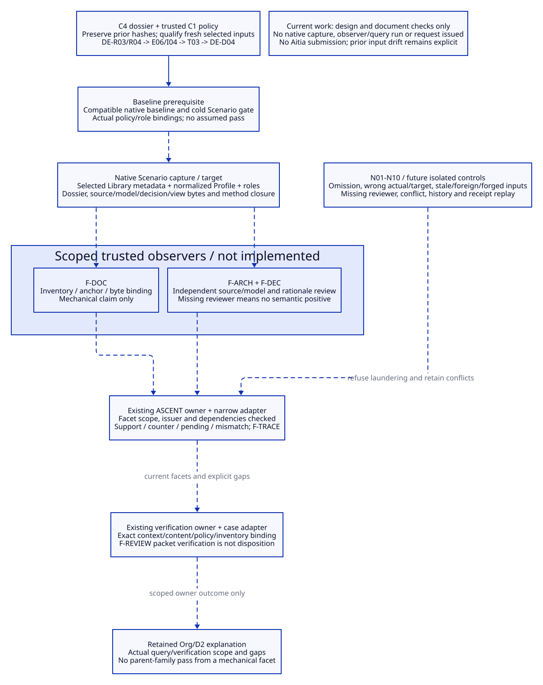

# SPDX-FileCopyrightText: 2026 tao3k team and Contributors
#
# SPDX-License-Identifier: LGPL-2.1-only

#+TITLE: 10.35 Minimal Content Validation Slice
#+LANGUAGE: en
#+PROPERTY: JD_ID 10.35
#+OPTIONS: toc:3 num:t
#+STARTUP: overview
#+TODO: DESIGN VERIFY | QUALIFIED
#+FILETAGS: :design:validation:capture:observer:ascent:aitia:
#+PROPERTY: header-args :eval never :tangle no :exports code

[[file:../../00-09-project/00-documentation/00.01-index.org][Index]] | [[file:10.34-case-design-review-dossier-draft.org][C4 dossier input]] | [[file:10.32-case-content-contract-audit.org::#content-audit-completion-order][C5 gate]] | [[file:10.31-architecture-document-and-decision-contracts.org][Content contracts]]

* DESIGN One bounded chain, four native boundaries
:PROPERTIES:
:CUSTOM_ID: native-content-validation-slice
:RECORDED_ON: 2026-10-20
:STATUS: Validation design only; no native invocation, method result or review request issued
:END:

Use the actual C4 dossier as input and follow one chain:
DE-R03/R04 -> DE-E06 ResourceLifecycle / DE-I04 -> DE-T03 complete-capture target
-> DE-D04 -> selected product bindings -> the draft review packet.
It exercises capture, content observation, ASCENT applicability and existing
Aitia verification boundaries. It is not a general Org interpreter or a check
of every architecture element, decision, tool, model and delivery route.

The original C4 dossier's observed SHA-256 was
=02562ab2fbf5fe30dc75b5db585d49e52da4790f301a27ac51d550dc7d08ee99=.
Those original bytes are retained in the local
[[file:../../../.data/integration-audit-20261020/dossier-before-version-correction-02562ab2.org][pre-correction dossier snapshot]]. The corrected current dossier is still the
input owner; its current digest is recorded under input freshness below. Preserve
the old catalog rather than silently rewriting its expected hashes.

Contract version must be read from the selected native Library export, following
the [[file:10.26-backpressure-public-contracts.org::#contract-version-source][ownership/read design]]. The declaration and qualified capture are pending. The [[file:10.37-library-declarations-and-contract-design.org][10.37 Contract design]]
refines that source to the native shared declaration Contract and role references. Stage names below describe operations; they are not
versions. Namespace, Module/import names and semantic IDs do not contain version
suffixes. Content identities and package-manager versions remain separate.

No new SysML/QNT/Lean/Rust run is needed to validate this content-boundary slice.
Their earlier results remain historical and their broader duties remain open.
The current case's unresolved assignees, cold Scenario regression, compiled
baseline and project review-policy binding are prerequisites, not assumed passes.

* DESIGN Scoped conclusions and exact demand
:PROPERTIES:
:CUSTOM_ID: slice-facets-and-inputs
:END:

The labels F-DOC/F-ARCH/F-DEC/F-TRACE/F-REVIEW below name design-level facets of
the existing DE-O families for this case/chain. They are not implemented relation
names or newly exported Contracts. A future registration must give each facet
an explicit subject, scope and revision, instead of reporting a facet pass as a
pass of the whole DE-O family.

#+NAME: slice-facets
| Facet / parent duty | Exact claim and inputs | Maximum supported conclusion |
|--------------------+------------------------+------------------------------|
| F-DOC / DE-O-DOC | C1 expected roles, dossier D01-D10 bindings and file/anchor inventory; D03/D04/D05 content selected for the chain | Required inventory cannot be shrunk by the candidate; selected locators/content identities agree; no semantic truth claim |
| F-ARCH / DE-O-ARCH | 10.33 E06/I04/T03, actual Scenario func/interface and capture/currentness source seam, selected actual/target views and declared assumptions | Independent inspection confirms current seven-role delegation/split behavior is distinguished from target full capture for this interface only |
| F-DEC / DE-O-DEC | 10.30 DE-D04 choice, version-source metadata, A/I/E/T links and reopen condition; C1 role/revision criteria | Independent rationale review confirms the bounded record is traceable and its assumptions/trigger explicit; no approval of implementation |
| F-TRACE / DE-O-TRACE | DE-R03/R04 ledger, selected model/decision links, F-DOC/ARCH/DEC definitions and actual method inputs/results | The selected chain and evidence scope are connected; missing facets remain visible; no whole-project completeness |
| F-REVIEW / DE-O-REVIEW | Exact packet/capture/policy/inventory identity, scoped results/gaps and actual verifier/role bindings | Existing owner can verify this bounded request's context/content binding when qualified; no stage disposition, release or recipient authority inferred |

Capture binds the full policy-required product inventory and the dossier as
input, with an explicit expected/actual role comparison. Each observer narrows
its footprint to the selected facet's real dependencies. HIST is a labeled
historical reference, not a new content witness; deep historical methods are
not replayed just to check the current chain. A method that uses historical
content must bind the actual referenced bytes and declared source of trust.

The initial input index is not a runnable import closure. A future executor must
select actual compatible POO/Core/ASCENT/Aitia artifacts, observer source and
tool configuration/budgets, and resolve all dependencies needed for those
operations. Direct source hashes in EXT alone do not qualify execution.

* DESIGN Step contracts: input, output and refusal
:PROPERTIES:
:CUSTOM_ID: slice-step-contracts
:END:

#+NAME: slice-step-contracts-table
| Step / owner | Input | Output | Refusal / incomplete boundary |
|--------------+-------+--------+-------------------------------|
| Qualify baseline / project | Identified source/compiled dependencies, native contract checks and existing cold Scenario gate; C1 policy/role selection | Bounded execution basis and explicit unresolved prerequisites | Existing timeout or incompatible artifacts block native qualification; no timeout inflation or fixture standards class substitution |
| Capture / Scenario | Trusted selected Library/expected Contracts, final Profile, dossier, policy-derived inventory, actual contents/mappings and method request | Native validated POO capture plus existing contextual admission; selected identities/bytes and role gaps remain explicit | Missing/conflicting required role or wrong association refuses complete runnable use; public captured?/verified? fields confer no authority |
| Observe / trusted methods | That same capture; F-DOC mechanical criteria; actual source/model criteria; DE-D04 rationale criteria; producer/reviewer identity | Raw check artifacts and scoped issued results with source/criteria identities, footprint, outcome, budget and reviewer provenance | Missing independent semantic reviewer produces no positive ARCH/DEC witness; unknown/timeout/unmapped stays incomplete; JSON is not an issuer |
| Infer / existing ASCENT owner | Issued results, capture, reviewed facet/catalog/dependency rules and actual checked-result association | Current facet support/counter/pending/mismatch plus historical references and trace explanation | Missing/extra/mismatched dependency, foreign occurrence or forged checked flag cannot support current use; rule budgets/incomplete evaluation remain visible |
| Verify packet / existing owner | Same captured content, exact dossier/packet, C1 purpose/policy, expected/actual inventory, facets, counters, missing roles and references | Locally constructed verification-request candidate and owner verification diagnostic/receipt only when actual prerequisites qualify | No request is sent by the slice design; missing context/content verification, wrong issuer, stale/revoked receipt or unresolved policy prevents readiness |
| Explain / project | Exact query/verification outcome, raw references and all remaining whole-case duties | Org/D2 explanation bound to actual outcome and limits | Prepared/bound/checked states cannot be rendered as reviewed/approved/released |

Capture may retain an incomplete draft with explicit missing assignments, but cannot
promote it to an admitted ready review. All operations consume the returned
normalized value and the same occurrence. They do not accept independently
substituted Profile, source scope or dossier fields. Capture/admission, result
issuance and review verification are separate trust boundaries.

Use owned input bytes where execution needs stable content and perform the
required origin/currentness checks at observation, registration and current
review use. A source change can leave a result meaningful for the old snapshot
while refusing current applicability. Digests alone do not make mutable
check-to-use atomic or authenticate a remote producer.

* DESIGN Existing owners and trust allocation
:PROPERTIES:
:CUSTOM_ID: slice-trust-boundaries
:END:

#+NAME: slice-trust-boundaries-table
| Boundary | Reuse / minimum missing adapter | Trust restriction |
|----------+--------------------------------+-------------------|
| Author -> native value/context | Existing ObjectContract/Function Types, Core value-contract/contextual admission; project content values and complete capture remain to implement | Candidate prose/fields cannot select their own trusted expected Contract or required inventory |
| Capture -> observer result | Existing Core Ops, private result issuance/currentness pattern; narrow binding/source/rationale observers and explicit criteria remain to implement | Host-configured observer and qualified independent reviewer are trusted for their declared claim only; the Agent's rationale is not self-verifying |
| Result -> ASCENT | Existing session/clue-exchange and applicability rules; reviewed scoped facet/dependency projection remains to implement | checked is host-supplied validation evidence, never an arbitrary imported assertion; finite derivation cannot invent qualitative judgment |
| Query -> Aitia verification | Existing Core [[file:../../../.gerbil/pkg/github.com/tao3k/poo-flow-core/contribution/verification.ss][verification adapter/admission]] and [[file:../../../scenarios/resource-lifecycle/review/func.ss][local review boundary pattern]]; case-specific policy/inventory adapter remains to implement | Exact constructed adapter/admission identity, content, purpose, validity interval and revocation matter; copied objects/JSON cannot restore authority |
| Verified content -> disposition/delivery | Existing Aitia lifecycle/intake owners, separately selected actual policy and recipients | A local packet-binding check is not a review decision; NASA-specific fixtures cannot establish this project's applicability |

The inspected Core verification owner keeps adapter/admission associations in
private storage; native public POO values remain extensible presentations.
Do not replace this with a project boolean registry, synthetic receipt or second
approval engine. The local backpressure consumer is a source-backed integration
example, not an installed generic reviewer of the new dossier.

If the selected existing review owner cannot express this project's local
design-review policy, that boundary remains unsupported pending a narrow reviewed
adapter/owner extension. Do not invent NASA applicability to make its fixture
path executable. This is a qualifying limitation, not a license to bypass Aitia.

* DESIGN ASCENT gold and constrained positive route
:PROPERTIES:
:CUSTOM_ID: slice-inference-gold
:END:

An isolated future harness uses independently authored expectations for the
following states. No such run or query is performed by this document.

#+NAME: slice-query-gold
| Controlled situation | Expected scoped query / adapter result |
|----------------------+----------------------------------------|
| Capture/input validation refuses | No observation witness or ready verification request; original missing obligation retained |
| Mechanical binding passes; semantic reviewer absent | At most F-DOC support for its binding claim; no F-ARCH/F-DEC positive witness; parent duties remain open; packet records missing reviewer/results |
| Appointed reviewer and qualified criteria provide valid scoped results | Register only the facets actually checked; F-TRACE explains exact dependencies; whole ARCH/DEC/REVIEW families remain unclosed outside slice |
| Same facet has applicable pass and fail | Retain both support and counter; review adapter reports conflict and blocks a success-only readiness classification |
| A required footprint changes after issue | Old result stays historical; mismatched current facet loses applicability; missing/current status is not a rewritten historical failure |
| Context verification only, absent content verification | Existing owner reports the relevant content-verification requirement; no ready stage or disposition inferred |
| Valid local context/content binding for the packet | An actual owner may issue only its scoped verification result under selected policy; semantic stage/disposition and submission remain separate |

Existing local pending means no support, and can coexist with a counter. Never
use absence of pending alone as permission to review/activate. A generic support
rule is not a conjunction of all mandatory facets: publish reviewed explicit
aggregation/applicability conditions if a parent readiness question needs them.
Do not register one mechanical facet under an unqualified parent duty ID.

The positive route requires real role appointments, independently specified
criteria/gold, compatible native dependencies and actual owner-issued results.
Until then only the design and honest missing/incomplete route exist. Qualification
can test adapters in an isolated local harness later; it does not imply sending
a production review request or authorizing any external action.

* DESIGN Negative controls and acceptance
:PROPERTIES:
:CUSTOM_ID: slice-negative-controls
:END:

#+NAME: slice-negative-control-matrix
| Control | Mutation / fault in isolated owned test inputs | Required observation / acceptance |
|---------+----------------------------------------------+-----------------------------------|
| N01 inventory omission | Delete D04 from both candidate files and candidate-provided manifest | Trusted policy still requires it; Capture refuses complete capture; no downstream positive witness |
| N02 actual/target confusion | Relabel T03 full-capture target as current I04 behavior, keeping files syntactically valid | Independent source/model observer reports F-ARCH counter; lint/render success cannot substitute |
| N03 decision claim forgery | Remove DE-D04 rationale/trigger or replace recorded state with authored approved text | Contract/semantic check refuses or counters selected claim; no approval witness is created |
| N04 stale capture or changed origin | Change required source/view/dossier bytes after capture or issue, including same revision label | Current use/registration refuses or loses applicability; old owned snapshot/result remains historical; no assumed filesystem atomicity |
| N05 foreign or forged result | Mix another occurrence's result, saved JSON, forged checked flags or copied admission object | Exact scope/issuer/admission binding fails; no current support or review readiness |
| N06 missing/extra dependency | Omit a required observer input or add an undeclared footprint role | Existing missing/extra/mismatch blocking applies; no arbitrary scope bag accepted |
| N07 reviewer/operation unavailable | Use author self-attestation as independent review, missing reviewer, timeout or observer budget exhaustion | No semantic positive result; raw incomplete outcome retained; no widened watchdog or synthetic heartbeat pass |
| N08 contradictory scoped evidence | Present independently valid applicable pass and fail for the same facet | Both remain queryable; adapter retains conflict; family readiness cannot ignore counter |
| N09 historical laundering | Submit the old 17/3/9 counts or M06 record as a new project-content witness | Subject/method/occurrence binding refuses promotion; historical evidence/counter preserved |
| N10 verification boundary replay | Reuse context-only, expired/revoked/wrong-verifier receipt, or mutate dossier after receipt | Existing owner refuses current readiness; no request, disposition or authority reconstructed |

Acceptance requires Baseline qualification baseline/cold Scenario gate closure under bounded checks;
Capture normalized one-capture semantics and policy-derived inventory; independently
specified positive/negative expectations; precise scoped footprints and private
issuance; complete conflict/missing/stale query behavior; and exact existing-owner
context/content verification with no fabricated applicability. A negative-control
pass validates that refusal path only; it is not acceptance of unsafe content.

Report separate outcomes for structural checks, semantic review, registration/
query completion, packet verification and any remaining stage gates. Unknown,
unsupported and timeout never yield positive support. Preserve every failed run
and its input identity. Full C5 is not qualified until actual required controls
and native prerequisites pass; completing this design does not satisfy them.

* VERIFY Input freshness and current work boundary
:PROPERTIES:
:CUSTOM_ID: slice-input-freshness
:END:

The initial C5 design observed all 138 C4 entries matching before navigation
changes, then recorded two changed index files. Those were historical static
observations. The subsequent version-notation correction changes additional
document/view bytes and the dossier text, while retaining the old expected hash
table and original dossier snapshot. No old observation is relabeled current.
The subsequent [[file:10.36-version-revision-and-namespace-audit.org][native usage audit]] updates explanatory documents and 90.99
without adding that audit retrospectively to the old C4 catalog.

Current dossier digest and catalog drift are recorded after correction below.
Before native use, prepare a new qualified candidate binding from the selected native
Library export and actual content; do not infer a new contract version from these
byte changes or accept the stale C4 catalog as current. None of this static
comparison executes N04 or issues a native result.
[[file:10.38-profile-selection-scenario-capture-and-evidence-use.org::#scenario-capture-basis][10.38 specifies the full selection/acquisition/capture guarantee]] and
[[file:10.38-profile-selection-scenario-capture-and-evidence-use.org::#shared-capture-evidence-and-review][shared inference/review association]]. Its owned input basis and guarded origin
checks do not assert an atomic whole-filesystem snapshot.
[[file:10.39-method-execution-evidence-issuance-and-ascent-projection.org::#application-scoped-ascent-projection][10.39 specifies application-scoped method/evidence projection]] and
[[file:10.39-method-execution-evidence-issuance-and-ascent-projection.org::#query-view-and-aitia-handoff][identified Q/Aitia handoff]]. The C5 facets require the same exact producer/use
association; today's raw usage/key joins are not claimed to supply that target.

Native capture, observers, ASCENT projections/query, verification request and
Aitia submission remain unimplemented/unexecuted. No model/native test or
historical-method rerun is performed. Documentation/link/render checks and
static digest observations supply no DE-O or Aitia witness.

# VERSION-CORRECTION-OBSERVATION
Current corrected dossier SHA-256:
=0ebcb141c89ec38a2ec9939afbef25f155cbd928a873808a4cac06b8fc1caef8=.
Of the preserved 138 input entries, 119 still match; 19 differ:
DOC01, DOC02, DOC04, DOC07, DOC08, DOC09, DOC10, SRC43, SRC46, SRC48, VIEW01, VIEW04, VIEW05, VIEW06, VIEW07, VIEW10, VIEW11, VIEW16, VIEW17.
The original expected catalog remains unchanged. Documentation/view edits and
source drift are neither a contract generation change nor current native capture.
This documentation task edits no implementation or historical receipt. 10.37-10.52
specify the native Contract owner, selected capture, method applications/issuance,
exact ASCENT/Aitia association, project-bound review/recipient use and the integrated
source gap/dependency audit, detailed Types/Contract boundaries and checked
object/Scope publication handoffs, Profile binding/owned C and method A/E/W
execution/issuance/reuse, content/closure/history and accepted ASCENT projection/Q
and independent Aitia context/content/current-receipt and history/authority/
reassessment/withdrawal boundaries; implementation and executable qualification
remain pending. New design documents/views are not added retrospectively to C4.
Requalify the actual required input closure before future current evidence use.
# END-VERSION-CORRECTION-OBSERVATION

[[file:10.46-content-observers-and-reference-closure.org::#content-observers-and-reference-closure][10.46 details WP05 content observers]]: selected product/criterion policy, same-C
bounded Org/architecture/decision/reference checks, actual A/E/W and historical
versus current evidence, qualified semantic findings, invalidation/reuse and
CO01-CO24 controls. This is target design, not executed content qualification.

[[file:10.47-ascent-projection-and-query-view.org::#ascent-projection-and-query-view][10.47 details WP06 application projection and Q]]: independent required units,
exact C/A/E/W/U/basis/run relations, current eligibility/coverage/conflict/gap
semantics, existing Session acceptance/rollback and owned determinate Q for
Aitia; PQ01-PQ26 are future controls, not an executed inference or review.

[[file:10.48-aitia-review-adaptation.org::#aitia-review-adaptation][10.48 details WP07 Aitia review adaptation]]: exact C/Q to R, actual policy/
project/role/product bindings, separate context/inventory/criterion checks,
shared existing-Host mechanics, current Core receipt use, lossless findings and
RV01-RV28 controls. Preparation is inert; no verification or submission occurs.

[[file:10.49-history-authority-and-reassessment.org::#history-authority-and-reassessment][10.49 details WP08 history and decision authority]]: mandated source discovery,
exact C/Q/R/H/action/grant bindings, accepted negative retention, repair/exception/
supersession/withdrawal, genuine prefix custody and HA01-HA31 controls. These
remain target operations; no authority decision or review is submitted here.

[[file:10.50-library-delivery-and-recipient-use.org::#library-delivery-and-recipient-use][10.50 details WP09 Library delivery and recipient use]]: exact C/Q/R and accepted
distribution authority, manifest/product/reference closure, actual transfer and
acknowledgement, receiver-owned trust/verification/capture/review, adoption and
current intended use. Missing/status/withdrawal/replay and DU01-DU30 controls
remain future qualification; no implementation or actual delivery occurs.

[[file:10.51-case-joint-acceptance-plan.org::#case-joint-acceptance-plan][10.51 details WP10 joint acceptance]]: existing entries/file owners, exact
plan/evidence closure and G0-G8 source/compiled/cold/recovery/recipient gates;
216 referenced contract control rows plus JA01-JA32 cross-boundary controls and
OJ01-OJ12 open items. These are future requirements; no implementation,
acceptance execution, review submission or actual delivery occurs.

[[file:10.52-contract-consistency-and-implementation-order.org::#whole-slice-consistency-audit][10.52 reconciles the whole slice]]: policy/Scope/Config handoffs, required-unit
and request-purpose bindings, captured/technical/current-authority lifetimes and
private/exported provenance; S0-S9 implementation dependencies and retained OJ
gates. Design consistency is not implemented or operational qualification.

#+CAPTION: One selected claim chain crosses native capture, scoped observers, existing inference and review verification.

[[file:../../90-99-views/90-architecture-views/90.98-native-content-validation-slice.d2][Editable D2 source]]. C5 validation design is specified; native qualification
and any authorized review submission are future, separate work.

[[file:10.64-contract-consistency-and-implementation-order.org::#audit-dependency-drift][10.64 dependency observations]]: ASCENT advanced during this audit, first
39679ae2 then b03efb55; evidence/interface.ss, program/clue-exchange.ss and
program/trajectory.ss are absent while project imports remain. Core types.ss
also changed at unchanged HEAD. Earlier 19 drifts remain historical; current
EXT01/EXT02 are unavailable and EXT08 changed, giving 22 differences at recheck
(21 at first pass). No stable whole-run dependency cut is claimed; no historical
digest/receipt is rewritten, replacement API inferred or acceptance executed.
