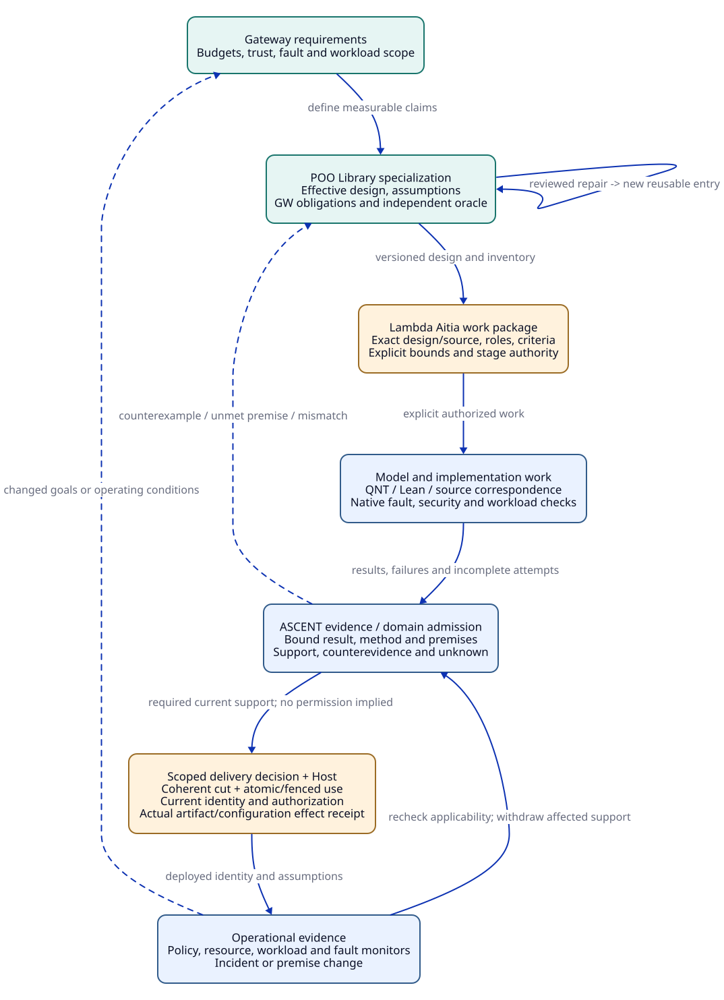

# SPDX-FileCopyrightText: 2026 tao3k team and Contributors
#
# SPDX-License-Identifier: LGPL-2.1-or-later

#+TITLE: 20.01 Gateway Design and SDLC Walkthrough
#+LANGUAGE: en
#+PROPERTY: JD_ID 20.01
#+OPTIONS: toc:3 num:nil
#+STARTUP: overview
#+TODO: OPEN REVIEW | RESOLVED
#+FILETAGS: :case:gateway:sdlc:
#+MACRO: hypothetical Illustrative design state only; no gateway, proof result, test run, or execution integration is implemented here.

{{{hypothetical}}}

[[file:../../../README.org][Overview]] | [[file:../../10-19-design/10-architecture/10.01-core-model.org][Core model]] | [[file:../../10-19-design/10-architecture/10.03-upstream-capabilities.org][Upstream mapping]]

The [[file:20.02-gateway-obligation-ledger.org][detailed ledger]] expands each obligation family, change impact and reuse
decision, including hidden assumptions and unresolved handoffs. The
[[file:../../30-39-evaluation/30-benchmarks/30.01-benchmark-design.org][evaluation protocol]] defines how those controls should later be checked.

* Case intent and baseline
:PROPERTIES:
:CUSTOM_ID: gateway-baseline
:DESIGN_REVISION: G0
:STATUS: proposed
:END:

The [[file:20.03-gateway-design-audit.org][current design audit]] reviews all 24 variants and 12 gaps, records
the committed/live-source boundary, and makes reset subcontrols and coherent-cut
handoffs explicit. Its specifications are not execution or independent-review receipts.
The case tests whether the Library can express a multi-tenant API gateway,
identify obligations after extension, preserve failures, reuse eligible support,
and return operational changes to design work. Every revision name and artifact
name below is illustrative. No acceptance is claimed.

The baseline composes ~Gateway~, ~TenantGateway~, ~BoundedTenantGateway~, and
~ReplicatedGateway~ with ~RetryPolicy~, a security profile, a deployment profile,
and backend contracts. Ordered parents, effective slot providers, and final
receiver observations belong to the snapshot. The design inherits the concerns
listed here, not an executable object hierarchy.

#+NAME: baseline-entries
| Entry or profile | Design responsibility | Consumer-visible promise |
|------------------+-----------------------+--------------------------|
| Gateway | Request lifecycle, routing, errors, observation points | Defined request and upstream-attempt semantics |
| TenantGateway | Validated identity, authorization, policy snapshot, audit | Backend dispatch requires current authorized tenant context |
| BoundedTenantGateway | Queue, attempts, buffer, deadlines | Gateway-owned resources obey explicit local limits |
| ReplicatedGateway | Replica identity, policy distribution, faults | Local guarantees and failure behavior have declared scope |
| RetryPolicy | Replay eligibility, attempt budget, backoff | Retries respect the same resource and backend contracts |
| Security profile | Trust anchors, policy validity, revocation, sensitive data | Invalid or unusable authorization context cannot authorize dispatch |
| Deployment profile | Replica envelope, hardware, workload, budgets | Measurements apply only to the specified environment |
| Backend contract | Operation semantics and cancellation/replay behavior | Replay assumptions are explicit for each route |

Illustrative local parameters are a queue cap Q = 128, upstream-attempt cap C = 64,
request-buffer budget B = 16 MiB, and at most two attempts per logical request.
These values support model discussion only. They do not establish capacity or
performance. A deployment of two replicas does not turn C into a fixed global
service limit. Production throughput and latency targets remain unresolved until
owners specify workload, hardware, distributions, and fault conditions.

Identity comes from validated credentials, not a caller-selected tenant header.
A request binds its authorization and route interpretation to a policy version.
Policy validity includes issuer, version, freshness, and revocation semantics.
During a partition, an unverifiable or expired policy cannot authorize a new
backend dispatch. The exact validity window, trusted-clock assumptions, and
in-flight revocation behavior remain required design inputs.

* Model the request and attempt lifecycles
:PROPERTIES:
:CUSTOM_ID: gateway-lifecycle
:STATUS: proposed
:END:

A logical request may own several sequential upstream attempts. Each attempt has
a unique identity scoped to its process incarnation. Resource ownership is tracked
per attempt, not merely per logical request. Rejected, canceled, and completed
requests must have explicit terminal behavior; resource cleanup follows the
lifecycle of the actual gateway-owned resource.

#+NAME: lifecycle-events
| Event | Guard or effect | Open modeling requirement |
|-------+-----------------+---------------------------|
| Receive | Parse within header/body and buffer limits | Cover malformed and oversized input before queue admission |
| Authorize | Validate identity, route, tenant, and policy applicability | Define version changes and pre-dispatch revalidation |
| Queue | Acquire queue and applicable byte capacity before retaining data | Define deadline and cancellation removal |
| Acquire attempt | Atomically acquire an available local permit | Bind the permit to one attempt identity |
| Dispatch | Require authorized context, permit, and remaining attempt budget | Define ordering against policy expiry and deadline |
| Timeout or cancel | Request cancellation; preserve outstanding ownership as required | Local timeout does not prove remote completion |
| Observe local termination | Close or confirm termination of gateway-owned attempt resources | Define exactly which event authorizes release |
| Release | Remove a currently owned permit exactly once | A duplicate callback cannot create capacity |
| Retry | Require replay eligibility, time, budget, and a new permit | Recheck authorization applicability before dispatch |

Candidate safety properties include:

- Queue ownership is between zero and Q; rejected requests do not retain queue capacity.
- Free permits plus owned permits equals C; distinct attempts cannot share one permit.
- Every release removes existing ownership; duplicate terminal events do not add permits.
- Gateway-retained request buffers, including queued data and retry copies, stay within B.
- Every backend dispatch has an authorized tenant context and an applicable policy.
- Attempt count is bounded; non-idempotent operations without a verified replay contract are not automatically retried.

Candidate progress properties are conditional: with fair scheduling and admitted
cleanup behavior, each local request reaches a response, refusal, or explicit
cancellation outcome, and eligible local resources are eventually reclaimed.
A deadline alone does not prove resource reclamation. Strict bounds on remote
business execution require backend cooperation and a separate protocol.

The microfixture parameters C=1/Q=1/B=2 abstract units are distinct from this
walkthrough's C=64/Q=128/B=16 MiB. No production-to-microfixture preservation
claim is admitted; see the [[file:20.03-gateway-design-audit.org::#audit-fixture-boundaries][explicit profile mapping]].

A finite QNT model must define bounded request, attempt, replica, policy-version,
and fault domains. It should include response loss, cancellation/completion races,
partitions, policy expiry, and replica restart. Bounds, assumptions, invariants,
and fairness conditions remain attached to its result. Lean candidates cover
permit conservation and transition preservation. A source-correspondence obligation
connects these abstract events to implementation behavior before runtime claims
can be accepted.

* Derive the verification inventory
:PROPERTIES:
:CUSTOM_ID: gateway-obligations
:STATUS: proposed
:END:

The inventory below elaborates the GW identifiers introduced in the overview.
Their stable names are retained across revisions, while changed properties or
acceptance criteria require new obligation revisions. Sub-obligations keep
separate methods rather than merging all results into one passing flag.

#+NAME: gateway-obligation-register
| ID | Trigger and claim | Required support | Blocking unresolved input |
|----+-------------------+------------------+---------------------------|
| GW-01 | Tenant dispatch obeys authorization boundaries | Threat analysis, state property, negative interface cases, source correspondence | Identity provider, route semantics, trust roots |
| GW-02 | Local queue, permit, and byte ownership remain bounded | Algorithm proof, QNT interleavings, cleanup correspondence, pressure/fault tests | Parser/transport accounting and cleanup contract |
| GW-03 | Retry is bounded and safe under backend semantics | Replay contract, fault model, lost-response controls, per-attempt accounting | Route-specific idempotency and uncertain-commit policy |
| GW-04 | Replica behavior matches the claimed scope | Multi-replica model, restart/partition controls, scope argument | Replica envelope and any global coordination claim |
| GW-05 | Policy transitions and revocation meet the security profile | Version/expiry model, threat review, distribution and revocation tests | Validity window, clock bounds, in-flight semantics |
| GW-06 | Deployment meets workload-specific performance targets | Fixed-artifact benchmarks and resource/fault measurements | Numeric targets, hardware, workloads, sampling plan |
| GW-07 | Required design concerns are covered | Independent requirements, hazard, interface, threat and method review | Named reviewer and declared coverage boundary |

Example derivation: retries plus a local attempt cap produce the per-attempt
accounting sub-obligation in GW-02/GW-03. Replication plus a local cap produces a
scope obligation in GW-04; a strict global-limit claim would additionally require
a coordination design. Security profiles add review and method requirements even
if no conflict rule fires. This is a conceptual rule review, not an ASCENT run.

GW-07 prevents an empty or insufficient rule set from claiming success merely
because every generated task completed. Security review must include parser
ambiguities, credential handling, cache context, error information, and log leaks.
QNT exploration and Lean proofs alone do not cover these implementation surfaces.

* Revision and evidence walkthrough
:PROPERTIES:
:CUSTOM_ID: gateway-revisions
:STATUS: hypothetical
:END:

** G0: freeze the design and its missing inputs

G0 binds the entries, parent order, profiles, rules R0, assumptions A0, inventory,
and method plans. Missing policy timing and performance targets stay unresolved.
G0 can enter design review; it cannot enter operational acceptance. Resolve these
inputs in a new revision rather than modifying G0 after checks start.

In the following steps, suppose a later candidate G1 has resolved the required
model inputs. Names such as E-permit describe expected artifacts, not existing
files or successful runs.

** G1: a counterexample returns to the design

#+CAPTION: Hypothetical race that a lifecycle model must be able to express.
#+NAME: cancellation-counterexample
#+begin_example
1. Attempt a acquires permit p and dispatches.
2. Its timeout handler requests cancellation and releases p.
3. A concurrent completion callback releases p again.
4. The free-permit count now exceeds the ownership-conservation allowance.
5. Further dispatch can exceed the intended local attempt resource bound.
#+end_example

A model checker returning this trace completes an execution but contradicts the
GW-02 property. SDLC task completion must not turn that result into acceptance.
Retain the trace, model, inputs, and failure. The repair introduces a single
ownership transition authorizing release and defines its cancellation semantics.
This produces G2 with an explicit change footprint.

** G2: invalidate affected support and reuse only with premises

#+NAME: gateway-impact-matrix
| Change | Invalidate or reopen | Potential reusable fragment | Required condition |
|--------+----------------------+-----------------------------+--------------------|
| Release-state transition | GW-02/GW-03 lifecycle results, implementation correspondence, related arguments | Credential parsing lemma | Typed dependencies and implementation footprint exclude release behavior |
| Local limit C | Concrete resource/model cases, measurements, affected policy decisions | Parameterized permit-conservation theorem | Instantiate all bounds and preserve transition/source interpretation |
| Parent order | Effective values, final-receiver observations, downstream inventory and admissions | Independent documentation artifact | No semantic claim without renewed composition/impact checking |
| Policy validity window | GW-01/GW-05, availability and revocation arguments | Pure queue arithmetic lemma | No hidden policy/time dependencies |
| Obligation rules R0 to R1 | Inventory and GW-07 coverage admission, decisions depending on them | Old theorem artifact about an unchanged proposition | New inventory and policy explicitly readmit it |
| Workload or hardware | GW-06 and operational performance decision | Applicable abstract safety theorem | Environment assumptions remain valid |

~Proof.reuse~ is relevant only after expressing the unchanged dependencies and
certifying the patch frame in the chosen typed model. It cannot turn a historical
benchmark into a current performance receipt. ASCENT references bound to G1's
source generation must not be relabeled as G2, even if the obligation rows match.
Produce current support or an explicitly checked transfer.

G2's candidate proof and model results must be checked independently; test/source
correspondence and performance still require their own work. A patched model
passing is insufficient for implementation acceptance.

** G3: adding a response cache extends the Library design

The Agent proposes a cache extension to improve latency. Composition produces G3
with cache-key, authorization-context, policy-version, sensitivity, expiry,
invalidation, and memory responsibilities. New obligations are linked to GW-01,
GW-02, GW-05, and GW-06, with a new GW-07 coverage review.

A cache hit cannot bypass authorization. Tenant identity alone may not distinguish
roles or user-specific permissions; the key and hit-admission contract must cover
the relevant authorization context, route semantics, and sensitive content.
Revocation may require invalidation or reauthorization. Retry copies and retained
responses must fit an explicitly revised byte budget; B is not automatically a
bound on total process memory.

A concrete rejection control is two authorized users with different permissions
receiving a response under an insufficiently scoped key. The coverage review
must demand this control even if the current rule set omitted it. The design
cannot inherit old authorization or performance acceptance unchanged.

** G4: scaling exposes the limit of the baseline claim

Changing the replica envelope affects GW-04/GW-06. For N simultaneously modeled
incarnations satisfying a local counting contract, the sum of their local counts
is bounded by N times C. Restart and remote work may fall outside that local
count; the statement must preserve its scope.

If requirements now demand a fixed global backend-execution limit G, the design
must add coordination, permits or allocation with fencing, recovery and reclaim
semantics. Partitions and uncertain remote completion require explicit safety
and availability tradeoffs. G4 remains blocked until this new design and its
obligations exist; increasing replica count cannot establish the stronger claim.

* Follow the complete SDLC contract
:PROPERTIES:
:CUSTOM_ID: gateway-sdlc
:STATUS: proposed
:END:

#+CAPTION: Gateway lifecycle dependencies, evidence feedback, and Library evolution.

[[file:../../90-99-views/90-architecture-views/90.07-gateway-sdlc-loop.d2][D2 source]]; [[file:../../90-99-views/90-architecture-views/90.01-index.org][paired Org/D2 contract]].

The work package contains the exact revision and inventory, implementation
baseline when authorized, task graph, responsible roles, expected artifacts,
method-specific criteria, execution bounds, stage authority, and result bindings.
No actual lambda-aitia task is created by this document.

#+NAME: sdlc-stage-gates
| Stage | Work and expected output | Required transition check | Return path |
|-------+--------------------------+---------------------------+-------------|
| Requirements | Resolve budgets, timing, trust, backend contract, threat and fault scope | Review assumptions and measurable goals | Infeasible or contradictory goals return to requirements |
| Architecture/design | Compose entries, derive inventory, resolve conflicts, build argument | Completed snapshot and independent GW-07 coverage review | Missing capability or conflict returns to Library specialization |
| Modeling/verification | Define QNT transitions, Lean properties, mappings and negative controls | Bound result, correct interpretation and complete method-specific check | Counterexample returns to design, requirement or model correction |
| Implementation | Implement exact contracts and observation points when authorized | Source/artifact identity and correspondence evidence | Mismatch returns to code or a new design revision |
| Integration | Fault, security, resource and workload checks against exact artifact | All required current admissions and resolved objections | Failed or incomplete result retains its status and opens repair work |
| Delivery | Bind build, configuration, deployment and operational assumptions | Scoped decision, authorized delivery and current identity recheck | Source/config drift refuses corresponding delivery |
| Operation | Monitor policy validity, resources, faults and workload assumptions | Continuing applicability and incident policy | Breach revokes affected acceptance and starts new design/SDLC work |
| Library evolution | Generalize a reviewed project repair | Applicability, compatibility and consumer review | Publish a new entry version without rewriting old history |

The executor returns candidate artifacts with task, design, source, environment,
tool, result, log and counterexample identities. Ingestion checks binding and
completeness; domain admission checks property, method and scope. A final decision
rechecks identity after all work completes. A G1 task finishing after G2 is
published remains a G1 result until an explicit transfer is accepted.

Cancellation, partial output, resource exhaustion, and timeout remain incomplete
or failed evidence as appropriate. Repeating a task preserves prior attempts.
Authority to execute a design review does not authorize deployment. Any deviation
from a required property retains the unmet claim and its bounded approval scope.

Operational example: a credential issuer rotates keys or policy validity cannot
be established during partition. GW-01/GW-05 applicability and operational
acceptance must be re-evaluated. An old security test cannot authorize continued
dispatch. Operational refusal, incident handling and design revision follow the
agreed profile; a generic task scheduler's success flag cannot restore authority.

* Review the loop against the core model
:PROPERTIES:
:CUSTOM_ID: case-review
:STATUS: conceptual-review
:END:

#+CAPTION: Tabletop checks of the design contract; none are executed tests.
#+NAME: lifecycle-review-matrix
| Check | Expected model behavior | Integration boundary still open |
|-------+-------------------------+---------------------------------|
| Parent override changes effective retry | Re-resolve final receiver, derive changed obligations | INT-01/INT-02 |
| All listed checks pass but threat review is absent | GW-07 blocks scoped acceptance | INT-02/INT-04 |
| Last base support is removed from a recursive dependency | Withdraw unsupported conclusion; cycles cannot self-support | INT-02/INT-03 |
| Source changes but answer rows stay identical | Old generation receipt remains ineligible | INT-03/INT-04 |
| A genuinely independent theorem has certified stability/frame | Transport into a new target admission | INT-01/INT-03/INT-04 |
| Counterexample is returned by a successful process | Record contradiction, refuse affected claim, open revision | INT-04/INT-06 |
| Old task returns during new snapshot publication | Bind old result; reject silent current admission | INT-05/INT-06 |
| Policy/window or workload changes after delivery | Revoke affected operational admission and schedule reevaluation | INT-04/INT-06/INT-07 |
| Project repair is proposed for Library reuse | Require generalization and consumer review | INT-01/INT-02 |

The model provides a conceptual return path for every stage, including
counterexamples, stale results, scope changes and operational invalidation. Actual
closure remains open at the [[file:../../10-19-design/10-architecture/10.03-upstream-capabilities.org::#integration-gaps][INT-01 through INT-10 integration obligations]].
The case also exposes unresolved requirements: remote-execution limits,
revocation timing, transport cleanup, concrete performance goals, coverage review,
and verified lambda-aitia correspondence. Those gaps are inputs to further design,
not proof that an integrated lifecycle has passed.

* OPEN Case work register :verification:
:PROPERTIES:
:CUSTOM_ID: case-open-work
:STATUS: open
:END:

- [ ] Resolve timing, trust, workload and deployment parameters.
- [ ] Define the finite gateway state model and its safety/progress assumptions.
- [ ] Define permit/buffer properties and the Lean state/patch interpretation.
- [ ] Specify and review rule templates and GW-07 coverage criteria.
- [ ] Establish dependency registration, evidence admission and reuse conditions.
- [ ] Review all tabletop controls and add independent negative cases.
- [ ] Verify lambda-aitia task/result, stage-authority and standards mappings.
- [ ] Plan source correspondence and runtime acceptance before implementation starts.

All GW obligations remain open. No implementation, proof, test receipt, deployment,
or standards-compliance claim is supplied by this walkthrough.
