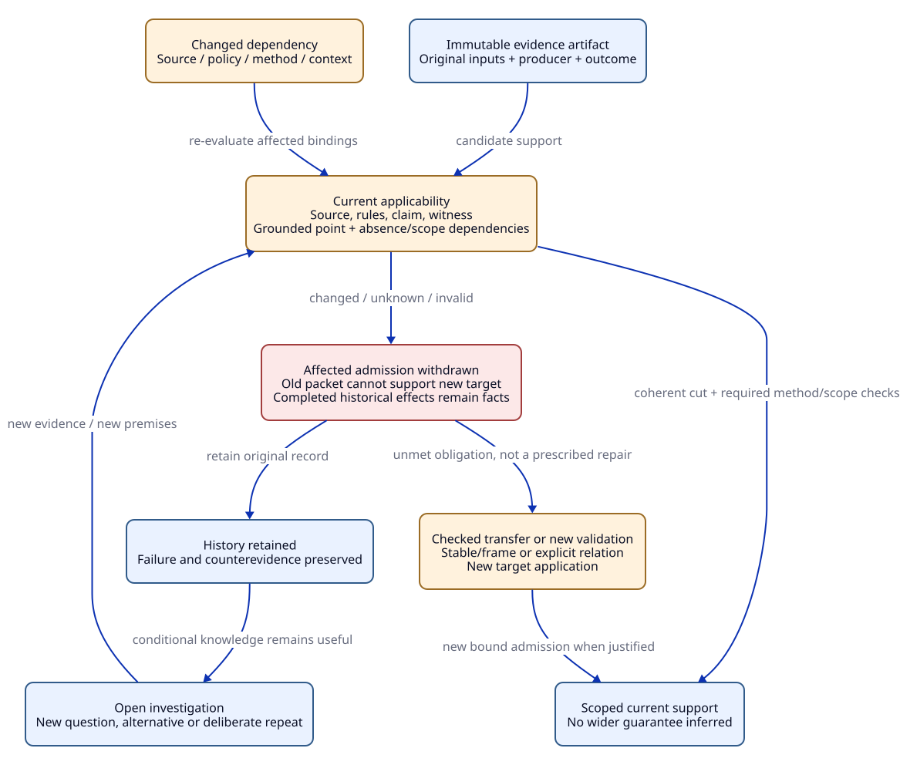

# SPDX-FileCopyrightText: 2026 tao3k team and Contributors
#
# SPDX-License-Identifier: LGPL-2.1-or-later

#+TITLE: 20.02 Gateway Obligation, Change, and Reuse Ledger
#+LANGUAGE: en
#+PROPERTY: JD_ID 20.02
#+OPTIONS: toc:3 num:nil
#+STARTUP: overview
#+TODO: OPEN REVIEW | RESOLVED
#+FILETAGS: :case:gateway:obligations:
#+MACRO: status Tabletop design only. All checks and evidence below are required or hypothetical; none have been executed.

{{{status}}}

[[file:20.01-gateway-sdlc.org][Lifecycle walkthrough]] | [[file:../../10-19-design/10-architecture/10.02-domain-and-rules.org][Domain/rule contract]] | [[file:../../30-39-evaluation/30-benchmarks/30.01-benchmark-design.org][Evaluation plan]]

* Bound instance and finite inventories
:PROPERTIES:
:CUSTOM_ID: ledger-context
:STATUS: proposed
:END:

#+CAPTION: Historical artifacts remain intact while current support is rechecked.

[[file:../../90-99-views/90-architecture-views/90.04-evidence-reuse-invalidation.d2][D2 source]]; [[file:../../90-99-views/90-architecture-views/90.01-index.org][paired Org/D2 maintenance contract]].

Use the walkthrough's G0-G4 design lineages, local Q/C/B parameters, and per-attempt
ownership semantics. The subject set contains the gateway, its replica-incarnation
scope, policy distributor, identity verifier, backend, retry policy, parser/transport
boundary, and optional response cache. Concrete source artifacts remain absent.

Before derivation, freeze route/operation, identity/authorization, lifecycle-event,
fault, resource, assumption, method, reviewer and template inventories. The model
checker additionally needs explicit finite domains, including bounded request and
attempt identities. A production integer budget is not a license to explore an
unbounded state domain. Never equate bounded-model scope with production scope.

R01 applies to gateway/backend and credential/policy interfaces; R02-R06/R08-R10
apply to the baseline. R07 applies when G3 selects a cache. R11-R15 apply to
subsequent changes and evidence epochs. A disabled cache creates no active cache
claims; its negative selection must still belong to the frozen selection scope.

The baseline also selects an explicit owner/reviewer role policy, so GW-07.b is
required even before a particular external standard is selected. Standard-clause
methods are added only when their applicability is reviewed. G0 is an immutable
draft with unresolved inputs: its provisional inventory is not a completed design
receipt or a basis for operational acceptance.

* Assumption register and hidden-premise audit
:PROPERTIES:
:CUSTOM_ID: gateway-assumptions
:STATUS: unresolved
:END:

#+NAME: gateway-assumption-register
| ID | Premise requiring explicit scope | Check / response when unavailable | Affected families |
|----+---------------------------------+-----------------------------------+-------------------|
| A01 | Credential authenticity and tenant/principal binding | Verify trust/config/key rotation; deny unsupported dispatch | GW-01/GW-05 |
| A02 | Frontend and backend interpret parsing/routing consistently | Differential/adversarial parser cases; reject ambiguous framing | GW-01/GW-02/GW-03 |
| A03 | Permit ownership transition is atomic across relevant callbacks | Define linearization point and scheduler model; no inferred atomicity | GW-02/GW-03 |
| A04 | All retained bytes and resource paths are accounted | Inventory parser, queues, retries, compression and transport buffers | GW-02/GW-06 |
| A05 | Local cleanup is eventually observable under stated fairness | Distinguish socket/resource termination from backend business completion | GW-02/GW-03/GW-04 |
| A06 | Route-specific replay contract covers uncertain commit | Verify durable/atomic backend behavior or prohibit automatic replay | GW-03 |
| A07 | Replica incarnation and outstanding-work scope are known | Bound local ownership separately from remote work and restarts | GW-04/GW-06 |
| A08 | Clock, policy validity and revocation semantics are specified | Bind clock domain/skew/expiry; refuse invalid new dispatch | GW-01/GW-05 |
| A09 | Workload and deployment represent the claimed target | Freeze distribution, fault mix, hardware, instrumentation and budgets | GW-06 |
| A10 | Dependency observations include negative/aggregate/external inputs | Certified registry or conservative scope invalidation | All reuse and decisions |
| A11 | Required inventory and methods are complete for the chosen review scope | Independent coverage and applicability review; unknown scope blocks closure | GW-07 and acceptance |
| A12 | Producer/checker/authority identities and artifacts are authentic enough for policy | Check provenance, tool/version, artifact content and current authority | All admissions |
| A13 | Cache key and hit rules preserve full response authorization context | Include relevant principal/role/content scope; reauthorize or invalidate | GW-01/GW-05 plus cache |
| A14 | Monitor observations are timely and failure handling has a defined bound | Specify missing-data/lag behavior and revocation-to-effect ordering | Operational acceptance |

These are premises to resolve, not facts supplied by prose. In particular,
fail-closed behavior for new requests does not establish in-flight revocation;
fair scheduling does not establish backend termination; and a local byte cap does
not establish total process RSS. Different claims must name different boundaries.

* Obligation derivation, one family at a time
:PROPERTIES:
:CUSTOM_ID: atomic-obligations
:STATUS: open
:END:

Suffixes below identify proposed atomic obligation lineages. Each actual instance
must also bind target, template/property revision, context and method inventory.
More than one rule can require the same obligation; preserve all origin supports.

#+NAME: atomic-gateway-obligations
| Instance | Rule and triggering facts | Property / required methods | Premise and failure control |
|----------+---------------------------+-----------------------------+-----------------------------|
| GW-01.a | R01/R02; tenant dispatch consumes identity contract | Credential-to-context correspondence; threat review + interface tests | A01/A02; spoofed tenant header must not authorize |
| GW-01.b | R02; context selects route/backend | Every dispatch authorized under bound scope; model + implementation mapping | A01/A08; policy expiry between queue and dispatch |
| GW-01.c | R07; G3 cache selected | Hit has sufficient current authorization; key and content review + replay | A13; same tenant, different permissions |
| GW-02.a | R03; permit cap C | Free + owned = C; Lean candidate + QNT interleavings | A03; timeout/completion double-release |
| GW-02.b | R03/R04; retry creates attempts | Every attempt acquires once, releases once; model + cleanup mapping | A03/A05; failed acquire or duplicate callback |
| GW-02.c | R03; queue cap Q | Enqueue/dequeue/cancel conserve queue ownership; model + pressure test | A03; canceled queued request leaks slot |
| GW-02.d | R03/R07; buffer cap B, optional cache | All relevant byte owners remain bounded; accounting argument + instrumentation | A04; retry/compression/cache retains uncounted bytes |
| GW-03.a | R04; at most two attempts | Attempt/deadline/retry guards preserve limits; model + interface controls | A05/A06; response lost after commit |
| GW-03.b | R01/R04; backend operation may be non-idempotent | Replay requires applicable backend contract; review + fault reproduction | A06; expiry or crash between dedup and commit |
| GW-03.c | R03/R04; cancel before retry | Define overlap/cleanup policy and per-attempt admission; model + transport mapping | A05; old remote work continues after local timeout |
| GW-04.a | R05; replicated local caps | State only the valid local aggregate scope; argument + restart/partition model | A07; overlapping incarnations or elastic replica count |
| GW-04.b | R05; strict global execution cap newly required | Add coordination/fencing/reclamation contract; protocol proof/check + replay | A05/A07; reclaim while remote work still executes |
| GW-05.a | R06; policy distribution | Version, issuer, freshness and transition semantics; model + security controls | A01/A08; stale policy survives distribution partition |
| GW-05.b | R02/R06; revocation requirement | Bound new/in-flight dispatch behavior and clock/cut interpretation; model + runtime tests | A08/A14; authorization races policy expiry |
| GW-06.a | R08; throughput/latency claim | Predeclared workload-specific target; matched benchmarks | A09; omit refusals/timeouts from latency sample |
| GW-06.b | R03/R08; resource claim | Gateway accounting and measured host resource scope; instrumentation/fault experiments | A04/A09; sampled heap mislabeled request allocation |
| GW-07.a | R09; selected requirements/hazards/interfaces | Coverage and methods reviewed independently; scoped review artifact | A11; empty rule set derives zero work |
| GW-07.b | R10; standard or role policy selected | Clause/version/tailoring and qualified reviewer mapping; review | A11/A12; all tasks pass but required reviewer missing |

GW-04.b is conditional on the stronger G4 claim; it is not discharged by GW-04.a.
GW-01.c is conditional on G3. Each row requiring several methods is an AND of
current method admissions unless an explicitly reviewed alternative is named.
There is no single universal checker result for a GW family.

#+NAME: expected-family-expansion
| Candidate context | Reviewed expected atomic obligation lineages | Inventory boundary |
|-------------------+----------------------------------------------+--------------------|
| Baseline | GW-01.a/b; GW-02.a/b/c/d; GW-03.a/b/c; GW-04.a; GW-05.a/b; GW-06.a/b; GW-07.a/b | 16 proposed lineages; unresolved inputs/methods still block acceptance |
| G2 release repair | Same 16 lineages with changed affected revisions | Cardinality equality does not preserve G1 evidence |
| G3 adds cache | Baseline plus GW-01.c | 17 lineages; GW-02.d and other affected method sets/revisions also change |
| G4 adds strict global claim on G3 | G3 plus GW-04.b | 18 lineages; missing coordination design blocks the stronger claim |

These counts are a manually stated tabletop expectation for this scoped case,
not generated coverage evidence. The full independent oracle must compare exact
keys, premises, required methods and origins, not counts alone. Adding a new threat
or interface may legitimately expand the inventory. A mutation that drops one
required method while retaining every lineage must fail the future oracle.

#+CAPTION: A paper derivation chain with origin support and outstanding work.
#+NAME: permit-derivation-chain
#+begin_example
BoundedTenantGateway selected + cap C -> R03 -> GW-02.a
RetryPolicy selected + cap C          -> R04 -> GW-02.b
GW-02.a requires {Lean property, QNT interleavings, source correspondence}
No implementation source exists       -> source correspondence remains open
Completed model exploration alone     -> no implementation admission
Changed release transition            -> R11 -> GW-02.a/GW-02.b impact
Impacted admissions                  -> R12 -> withdraw eligibility
Certified independent dependencies    -> R13 -> transport candidate only
Complete inventory, missing method    -> R14 -> explicit closure gap
#+end_example

* Change impact and support withdrawal
:PROPERTIES:
:CUSTOM_ID: gateway-change-impact
:STATUS: proposed
:END:

Each change fixes before/after IDs and touched dependencies. Traverse
~depends-on(consumer, prerequisite)~ in reverse from prerequisites. The footprint
includes effective-provider changes even when a field's displayed value is equal.
For alternative origin supports, rederive the conclusion under the new snapshot;
old receipt binding still expires. Unknown footprints invoke A10's conservative
fallback rather than claiming that only the visible slot changed.

#+NAME: detailed-change-ledger
| Change ID | Direct changed inputs | Transitive rework / decision impact | Why superficial equality is insufficient |
|-----------+-----------------------+-------------------------------------+-----------------------------------------|
| CH01 | Release transition / callback ordering | GW-02.a/b, GW-03.c, source mapping, resource argument, related delivery decision | Final counters may match despite an intermediate violation |
| CH02 | C or Q | Concrete instances, bounds, queue/permit model, GW-06, deployment decision | Parameterized safety and measured performance have different premises |
| CH03 | Parent order or final receiver override | Effective observations, impacted rule matches, inventory, downstream admissions | Same slot names do not establish same providers/effects |
| CH04 | Credential issuer/key or policy window | GW-01.a/b, GW-05, operational authority/currentness | Prior signature verification does not cover new trust inputs |
| CH05 | Cache selection/key/expiry | GW-01.c, GW-02.d, GW-05, GW-06, GW-07 | Tenant-only key may omit principal-specific rights |
| CH06 | Backend replay contract/dedup retention | GW-03.a/b/c and consumers; uncertain requests remain unresolved | Same response does not prove one business effect |
| CH07 | Replica envelope/restart/global claim | GW-04, relevant runtime/resource/availability argument, GW-06 | N x C is conditional and not a fixed global bound |
| CH08 | Rule set/standard/tailoring/method policy | Inventory, GW-07, relevant method admissions and decisions | Old obligation rows may match while coverage/criteria changed |
| CH09 | Toolchain/verifier/projection/schema version | Results produced/accepted under that interpretation, transfer criteria | Identical text or result payload does not establish verifier equivalence |
| CH10 | Test helper, directory membership or selected scope | Core test projection/currentness, covered evidence and inventory | Old selected test list excludes newly required checks |
| CH11 | Workload/hardware/monitor validity | GW-06 and operational acceptance; reopen affected assumptions | Observations from an old environment are still historical |
| CH12 | Dependency registry loses a negative/aggregate edge | All potentially affected admissions and impact-coverage obligation | Missing graph edge is a defect, not independence evidence |

A removed obligation needs a justified retirement/applicability record. It cannot
vanish merely because a new template failed to derive it. A removed support that
leaves a grounded alternative permits new support computation; last-support loss
or an unfounded cycle cannot preserve acceptance. Negated premises can create
new obligations after an input removal, so impact handling includes additions.

* Evidence-specific reuse decisions
:PROPERTIES:
:CUSTOM_ID: gateway-reuse-ledger
:STATUS: proposed
:END:

#+NAME: evidence-reuse-ledger
| Candidate artifact | Change / reusable part | Required transfer or recheck | Refusal condition |
|--------------------+------------------------+-----------------------------+-------------------|
| E-permit theorem | CH02, parameterized conservation law | Instantiate admissible C/Q and preserve transitions, stable/frame and source mapping | Concrete bound or transition premise changed without proof |
| E-credential lemma | CH01, pure credential property | Certified dependencies exclude release state; new context admission | Parser/trust/config shares changed code or unmodeled effects |
| E-QNT trace/result | Any changed model/bounds/fairness | Rerun changed instance or prove explicit relation and scope transfer | Equal state counts or no old counterexample |
| E-pressure measurement | CH02/CH11 | New matched workload/artifact/environment run | Old p95 reused for new budget or hardware |
| E-source correspondence | Source/projection changes | Re-establish extraction and observed-event mapping | Same algorithm name or unchanged model text |
| E-ASCENT receipt | New source generation | Current bound replay/support or admitted upstream-supported transfer | Relabeled generation, matching rows or copied digest |
| E-Core selected test result | CH10 | Fresh admitted selected source closure, helpers, test membership and complete execution | Empty selection, stale helper or unfinished process cleanup |
| E-cache review | CH05 | Reassess complete authorization/context/key/invalidation footprint | Mere presence of tenant field |
| E-coverage review | CH08/new hazard | New complete inventory and method/standard review | Same number of obligations |
| E-authorization decision | Policy/principal/resource/cut change | Reevaluate exact authority through Aitia's applicable gate | Supported design claim substituted for current authorization |

A proof's ~stable~ property and patch ~frame~ must be proved over the actual typed
interpretation. A filename-based independence guess is insufficient. Method
admission and authority validity still need checks even when the mathematical
proof transports. An unchanged theorem can be retained as an artifact while its
engineering admission is withdrawn.

* Closed-loop gaps and required responses
:PROPERTIES:
:CUSTOM_ID: gateway-gap-register
:STATUS: open
:END:

The [[file:20.03-gateway-design-audit.org][current design audit]] reviews all 24 variants and 12 gaps, records
the committed/live-source boundary, and makes reset subcontrols and coherent-cut
handoffs explicit. Its specifications are not execution or independent-review receipts.
#+NAME: gateway-gap-register
| Gap ID | Hidden assumption or broken handoff | Required response / future control |
|--------+-------------------------------------+------------------------------------|
| GAP01 | Rules fully cover real hazards | Independent GW-07 oracle and review; omitted threat control |
| GAP02 | Graph contains all external/negative dependencies | Audit registration or invalidate conservatively; missing-edge control |
| GAP03 | Model/property refers to current implementation | Bind source, extraction and transition mapping; model/source mismatch control |
| GAP04 | Local timeout proves remote termination | Separate claims; delayed backend-completion control |
| GAP05 | Selection or passing Case grants acceptance | Require selected coverage, complete natural exit and method admission |
| GAP06 | Evidence remains current until consumed | Recheck at ingestion and decision/effect boundary; concurrent revision control |
| GAP07 | Role assignment proves authorization | Require current decision and authority; expired-role/policy control |
| GAP08 | Operational monitor is immediate and reliable | Specify observation lag, unknown handling and bounded response; delayed-monitor control |
| GAP09 | Same ID across Org/D2/QNT/Lean/JSON means same proposition | Verify interpretation/version mapping; status/units/relation-plane substitution controls |
| GAP10 | New Library version is safe for every consumer | Review compatibility and applicability; old consumer contract control |
| GAP11 | Aitia's pure plan implies Host effect enforcement | Keep gate open until source-bound runtime/authorization receipts exist |
| GAP12 | Benchmark pass rate proves engineering validity | Independent case qualification and matched end-to-end evaluation |

The loop is conceptually complete only if each failure opens work at its actual
owner: requirements, domain design, rule/coverage policy, source mapping, verifier,
authority or operation. A failed mechanism must not be disguised as an Agent
failure, and a verifier defect must not be repaired by weakening the design claim.
All gaps above remain open for implementation qualification.

The [[file:../../30-39-evaluation/30-benchmarks/30.02-gateway-minimal-benchmark.org::#gap-convergence][GAP01-GAP12 convergence matrix]] now names owners, independent oracles, concrete
discriminators and required exit artifacts for each row. The
[[file:../../40-49-research/40-reference-studies/40.02-selected-system-and-proof-case.org::#gateway-correspondence][selected case mapping]] exposes duplicate-identity, temporal/fairness and
source-correspondence hazards. These specifications refine the gaps without
marking any qualification complete.

* OPEN Future check inventory :evaluation:
:PROPERTIES:
:CUSTOM_ID: ledger-open-work
:STATUS: open
:END:

- [ ] Freeze typed gateway objects and expected atomic obligation sets independently of R01-R15.
- [ ] Review each A01-A14 premise, applicability and operational failure response.
- [ ] Supply both positive and adverse cases for each atomic GW lineage.
- [ ] Supply CH01-CH12 expected impact and reuse decisions with missing-edge controls.
- [ ] Test GAP01-GAP12 handoffs under currentness, conflict and unknown conditions.
- [ ] Run the evaluation lanes only after their independent oracles and budgets are fixed.

This inventory extends the [[file:20.01-gateway-sdlc.org::#case-open-work][walkthrough's open work]]. Nothing here is a passing receipt.
