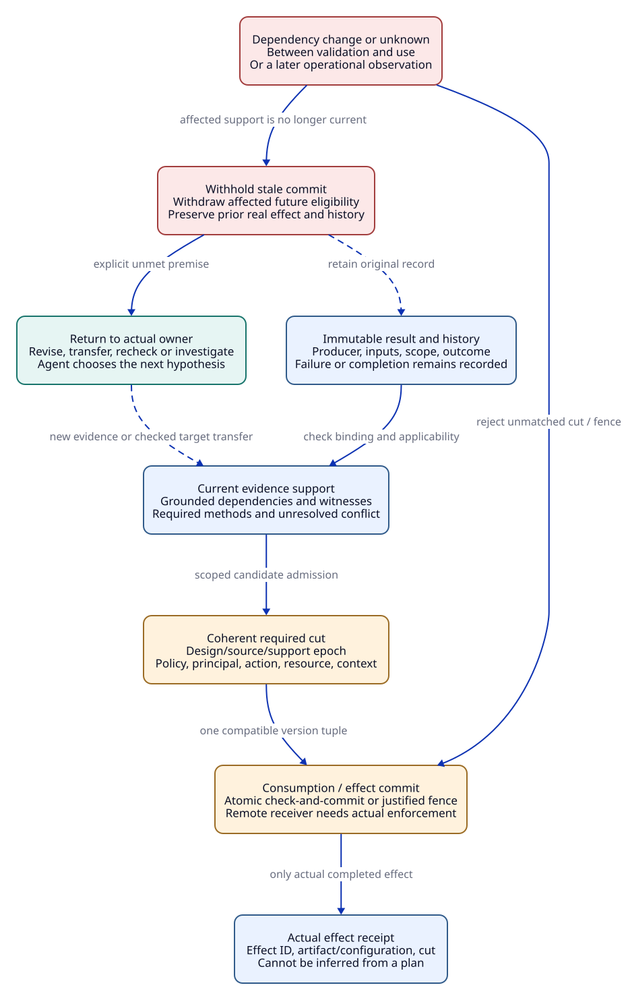

# SPDX-FileCopyrightText: 2026 tao3k team and Contributors
#
# SPDX-License-Identifier: LGPL-2.1-or-later

#+TITLE: 20.03 Gateway Design Audit: Sources, Twenty-Four Variants, and Twelve Gaps
#+LANGUAGE: en
#+PROPERTY: JD_ID 20.03
#+OPTIONS: toc:3 num:nil
#+STARTUP: overview
#+TODO: OPEN SPECIFIED | QUALIFIED
#+FILETAGS: :gateway:audit:design:
#+LINK: smp https://github.com/tao3k/gambit-SMP/blob/2125416e8809b0fab86fd8341876cb984e937589/%s
#+LINK: product https://github.com/tao3k/poo-flow/blob/a74fc2fd63437252175b5a67649ee54b886d3bf4/%s

[[file:20.01-gateway-sdlc.org][Walkthrough]] | [[file:20.02-gateway-obligation-ledger.org][Obligation ledger]] | [[file:../../30-39-evaluation/30-benchmarks/30.03-gateway-variant-contracts.org][24 contracts]] | [[file:../../90-99-views/90-architecture-views/90.01-index.org][Org/D2 views]]

* Audit scope and exact source boundary
:PROPERTIES:
:CUSTOM_ID: audit-source-boundary
:INSPECTED_ON: 2026-10-18
:STATUS: source-inspection-and-specification
:END:

A subsequent [[file:../../10-19-design/10-architecture/10.06-poo-ascent-integration.org::#integration-source-boundary][integration inspection]] records Core PR 19 at 52130d2d: the
root-selected/lazy-Graph and qualification-suite changes discussed below are now
committed there. This audit's 80e2e740 source table and MB09 binding remain
historical specifications and are not silently retargeted.

This is an author audit and correction of the design, not an independent oracle
review, upstream test result, proof check, gateway execution or benchmark score.
The remote PR heads were read again during this audit. Source inspection uses
committed blobs even where the live worktree differs.

#+NAME: audit-source-identities
| Source | Committed identity / observation | Meaning for this audit |
|--------+----------------------------------+------------------------|
| ASCENT PR 1, open | 144ed6e55110c4ccd1fa2a825f79007d1a3317d6; remote head matches local HEAD | [[file:../../../.gerbil/pkg/github.com/tao3k/gerbil-ascent/docs/scheme-design-framework.org][Progressive evidence contract]] and [[file:../../../.gerbil/pkg/github.com/tao3k/gerbil-ascent/docs/features/trajectory-exploration.org][actual versus proposed Trajectory reads]] |
| Core PR 19, open | 80e2e74022c9c4053445475402856c5f369aec48; remote head matches local HEAD | [[file:../../../.gerbil/pkg/github.com/tao3k/poo-flow-core/init.ss][Declarative selection entry]], [[file:../../../.gerbil/pkg/github.com/tao3k/poo-flow-core/module-system/selection/init-syntax.ss][init expansion]], [[file:../../../.gerbil/pkg/github.com/tao3k/poo-flow-core/module-system/building/test-projection.ss][committed Graph/test contract]] |
| SMP application | 2125416e8809b0fab86fd8341876cb984e937589 | [[smp:docs/smp-trajectory-application.md][Scheme/View associations, verified references, read hints and native boundary]] |
| POO Flow parent | a74fc2fd63437252175b5a67649ee54b886d3bf4 | [[product:gerbil.pkg][Committed package declarations]]; its worktree is dirty |
| Live Core and parent worktrees | Uncommitted changes observed; no release/qualification identity assigned | Useful learning observations only; not capabilities established by the pinned PR |

The pinned Core test projection obtains the existing ~selected-graph~ and its
~module-order~, validates requested owners, observes directories and Scheme helper
files, and supports normal (~#f~) and integration suites. The live edited version
instead includes root-selection/eligibility handling, lazy Graph admission and a
qualification suite. This audit does not attribute those edits to the pinned PR
or assume their acceptance. Further integration must choose an immutable source
snapshot and requalify its actual API, rather than mixing the two behaviors.

ASCENT's available thin brief/focus/exact-prefix reads are distinct from the
proposed arbitrary Evidence-DAG relation delta. A declaration, an imported Module,
a clue result and a current verified evidence reference are distinct. SMP gives
an application discipline to transfer; its native repair/stress outcome cannot
be transferred to a gateway. These boundaries constrain justification, while the
Agent remains free to choose and revise hypotheses and experiments.

* Correct the parameter and interpretation boundaries
:PROPERTIES:
:CUSTOM_ID: audit-fixture-boundaries
:STATUS: specified
:END:

#+NAME: gateway-profile-relations
| Context | Exact parameters | Allowed conclusion |
|---------+------------------+--------------------|
| Walkthrough draft G0 | Q=128, C=64, B=16 MiB; replicated-capable design; unresolved production inputs | A design example, not a model check or production capacity claim |
| MB base X0/K0 | One active replica, E0/E1 incarnations, C=1, Q=1, B=2 abstract-buffer-units | A finite semantic microfixture with explicitly selected actions |
| MB06-H | Override C=2 in the declared parameter family | New target application; no copied C=1 measurement or model verdict |
| MB05 | Enable cache and revise affected contracts/origins/methods | U0 plus GW-01.c membership, with changed revisions of affected U0 obligations |
| MB12-A | Override replica count to two and introduce strict remote G=1 | New global requirement GW-04.b; local proofs do not discharge it |

There is no admitted abstraction/refinement from 16 MiB to two abstract units, or
from C=64 to C=1. A future bridge must define observations, traces, fault domains,
and property-preservation conditions. The microfixture is a discriminator, not a
scaled production benchmark. Replicated-capable Library ancestry need not imply
two active replicas in every selected profile.

Each subcontrol resets to its named healthy baseline before applying its declared
mutation, except when the input explicitly defines a cumulative trace. A fault
control may intentionally violate a guard; that does not change the healthy
contract. Same-family H/A cases are semantic controls, not automatically matched
performance experiments. MB06-H and MB06-A exercise different method classes and
cannot be subtracted to claim time savings.

O1 gold data is a separately authored, frozen typed set of obligation revision,
method and origin supports. The proposed table in the contracts is its review
candidate, not an already independent review. A cache/global extension revises
existing obligations as well as adding lineages. GW-04.a now explicitly requires
SC for the stated implementation/replica observation claim. A purely abstract
scope argument may be evaluated separately, but cannot discharge that SC slot.

* Minimal state and external-premise contract
:PROPERTIES:
:CUSTOM_ID: audit-state-contract
:STATUS: specification-only
:END:

#+NAME: audit-state-components
| State component | Independent reference meaning | Healthy transition condition |
|-----------------+-------------------------------+------------------------------|
| Permit owners | Attempt/incarnation keyed allocation records; free counter is checked separately | Acquire atomically tests free>0 and fresh owner, then records one owner and decrements free |
| Local close marker | Gateway-owned resource termination confirmation | Mark close does not itself release; Release requires the exact owned and closed attempt and removes it atomically |
| Queue owners | Logical queued requests and their retained queue slots | Queue/cancel/dequeue update queue ownership exactly once; failed admission leaves state unchanged |
| Byte allocations | Allocation IDs, positive sizes and retained references, distinct from permit weights | New allocation admitted only when total retained size remains <=B; release only at last relevant reference |
| Remote execution | Reference execution truth plus a separate observed-knowledge state | Local timeout cannot set knowledge to stopped; only an admitted backend observation/protocol can do so |
| Replay | Operation contract, committed effects, attempt/reply history | Lost response does not imply no commit; replay requires the applicable idempotency/deduplication contract |
| Evidence applicability | Exact source, rules, proposition, witness, method, context and relevant prefix | Dependency-complete check or conservative invalidation; no self-grounded support cycle |
| External verification | Authentic producer-bound result under declared trust/method policy | A model input may stand for a checked result but is not the producer or proof of its authenticity |
| Use/effect commit | Required dependencies at one coherent cut and actual authorized target | Atomic version check/commit or a justified fencing/lease protocol; an unsupported gap stays open |

A case projection establishes only its named property plane. An abstract Dispatch
in a resource fixture is not evidence that real authentication, parsing or policy
checks succeeded; the full gateway composes and qualifies those obligations
separately. Event naming is canonical: LocalCloseConfirmed marks local closure,
while Release removes the exact permit owner.

A closed local resource may still have an unreleased permit between the two modeled
transitions. Conservation holds there because ownership remains recorded. Bytes
and queue slots may outlive an attempt permit and require separate accounting.
Ownership soundness is not proved solely by the free-counter invariant: a faulty
owner map can hide distinct real allocations.

For progress, O4 must inspect the complete reachable continuation and fair strongly
connected behavior, including explicitly admitted stuttering. A reachable trigger
and one fair successful witness rule out some vacuity; they do not prove all fair
executions terminate. No-op completion can be fair forever without releasing an
owner. Timeouts/resource exhaustion are inconclusive checks, not temporal failures
or proof of progress. Native scheduler and source correspondence remain separate.

* Required subcontrols previously hidden inside family names
:PROPERTIES:
:CUSTOM_ID: audit-subcontrols
:STATUS: exact-paper-inputs-not-executed
:END:

This register supplements the primary cases and their previously named mutations.
It does not create additional top-level variants. All required subcontrols have
separate immutable input/result identities and are AND requirements of their
parent. Pending or inconclusive subcontrols keep the parent unqualified.

#+NAME: audit-reset-subcontrols
| ID / parent | Reset input and exact mutation or trace | Healthy result / independent discriminator |
|-------------+-----------------------------------------+--------------------------------------------|
| S01 / MB01-A | From U0 remove one reviewed hazard binding while preserving generated row count; independently add an unjustified required method/origin | O1 exact gold disagreement; no coverage admission in either reset |
| S02 / MB02-A | owners={a}, free=0; Acquire(b) with a/b same business key | Unchanged state/refusal; O2 counts two actual allocations if the mutant bypasses the guard |
| S03 / MB02-A | queueOwners={r0}, queueFree=0, Q=1; CancelQueued(r0) twice | First removes r0/free=1; duplicate unchanged/refused; O2/O3 observe queue state, not permit count |
| S04 / MB02-A | B=2, allocations x/y each size1 remain retained; attempt permit already released; propose retry allocation z size1 | Refuse z while x/y remain; O2 counts allocation identities and total size3 in the mutant |
| S05 / MB02-A | E1 owners={a-new}, free=0; delayed E0 Release(a) arrives | Keep a-new/free=0; old callback cannot release the new incarnation; O2/O3 compare exact identity |
| S06 / MB03-A | Non-idempotent operation committed once remotely, reply lost, no dedup contract; candidate retries with a fresh permit | Withhold automatic replay; mutant's second remote commit makes effects=2; O3/O6 reject safety inferred from local capacity |
| S07 / MB04-A | Pending a reachable; replace Cleanup(a) effect by no-op and retain WF(Cleanup(a)) | O4 finds a fair pending lasso; label/event counts cannot establish release |
| S08 / MB04-A | Separately constrain Init/actions so pending never occurs | O4 flags failed reachability/non-vacuity; do not demand a false temporal counterexample for a vacuously true implication |
| S09 / MB05-A | Reset valid pA response, then request it as pC/t2 under v0 | Refuse cross-tenant response; O3/O6 evaluate rights independently of key labels |
| S10 / MB06-A | meas0=(C1,W0,H0); separate targets (C2,W0,H0), (C1,W1,H0), (C2,W1,H0) | O5/O6 reject each unmatched application; exact mismatch set follows each isolated input |
| S11 / MB06-A | Claim depends on absence in frozen scope Z={}; insert z into Z without a pre-existing point edge to z | Withdraw affected absence/aggregate support through the scope dependency; unknown registration invalidates conservatively |
| S12 / MB06-A | P depends on Q, Q on P, both initially grounded by base b; remove b | O5 grounded reference closure has no support; recursive reachability cannot become its own evidence |
| S13 / MB07-A | Valid eligible observation family requires length n; display budget cannot fit even an honest reference | Explicit display failure; no unknown/no-change claim or acknowledgement of unseen units; O5 checks actual display units |
| S14 / MB08-A | Validate X0 at cut c0; publish X1 before proposed consume/effect commit at c1 | Reject stale commit or obtain a new fenced admission; O5/O6 require a coherent cut, not two separately successful checks |
| S15 / MB09-A | Reset selected {m1,m2}; selected directories have zero *-test.ss; independently demand mz outside committed module-order | Empty coverage cannot qualify; no fallback scan; out-of-scope demand refuses before poison execution; O1/O3 check both resets |
| S16 / MB10-A | Reset canonical target before each unit/authority/target mutation; raw JSON has duplicate key with conflicting values; separately alter dependency digest | Reject the exact incompatible/raw-byte input before duplicate overwrite; O1/O3/O5 compare original target and raw parsing policy |
| S17 / MB11-A | Valid logical cut=10, observationCut=8, maxLag=2 uses lag<=2; reset with observationCut=7, unknown, or futureCut=11 | First meets the abstract lag rule; each mutation fails its premise; O6 still needs a real clock/lag correspondence before time claims |
| S18 / MB12-A | Reset child with conflicting parent precedence or incompatible explicit budget/profile policy; separately add a stronger consumer | Reject ambiguity through native composition/declared option policy, or create a reviewed explicit resolution/new revision; O1/O6 reject silent contract weakening |

The [[file:../../30-39-evaluation/30-benchmarks/30.03-gateway-variant-contracts.org::#supplementary-property-bindings][supplementary property/mutant table]] binds each new safety discriminator
to its proposed QNT name and exact faulty companion.

S02/S03/S04/S05/S06 close missing design coverage for failed acquire, queue, bytes,
restart and uncertain-commit paths. They do not establish complete security,
performance, fault or retry coverage. In particular, unknown in-flight revocation,
backend deduplication durability, parser equivalence, instrumentation and real
monitor bounds remain explicit open methods even if all finite controls pass.

* Review every top-level variant
:PROPERTIES:
:CUSTOM_ID: audit-24-variants
:STATUS: reviewed-by-document-author-not-qualified
:END:

The following reviews point back to the authoritative input contracts. Each states
a semantic correction or boundary; none is a passed test or independent review.

** MB01-H
:PROPERTIES:
:CUSTOM_ID: mb01-h-review
:CASE_ID: MB01-H
:GAPS: GAP01/GAP12
:STATUS: specified-not-qualified
:END:

[[file:../../30-39-evaluation/30-benchmarks/30.03-gateway-variant-contracts.org::#mb01-h][MB01-H input and acceptance contract]]. O1 cannot certify itself; exact origin/method/revision gold must be independently reviewed.

** MB01-A
:PROPERTIES:
:CUSTOM_ID: mb01-a-review
:CASE_ID: MB01-A
:GAPS: GAP01/GAP09
:STATUS: specified-not-qualified
:END:

[[file:../../30-39-evaluation/30-benchmarks/30.03-gateway-variant-contracts.org::#mb01-a][MB01-A input and acceptance contract]]. Equal lineage counts hide missing methods and hazards; unjustified additions also fail exact comparison.

** MB02-H
:PROPERTIES:
:CUSTOM_ID: mb02-h-review
:CASE_ID: MB02-H
:GAPS: GAP02/GAP03
:STATUS: specified-not-qualified
:END:

[[file:../../30-39-evaluation/30-benchmarks/30.03-gateway-variant-contracts.org::#mb02-h][MB02-H input and acceptance contract]]. Specify separate close/release transitions and guard failures; abstract permit weight is not byte weight.

** MB02-A
:PROPERTIES:
:CUSTOM_ID: mb02-a-review
:CASE_ID: MB02-A
:GAPS: GAP02/GAP03
:STATUS: specified-not-qualified
:END:

[[file:../../30-39-evaluation/30-benchmarks/30.03-gateway-variant-contracts.org::#mb02-a][MB02-A input and acceptance contract]]. Add queue, byte, failed-acquire and old-incarnation controls S02-S05; event labels alone miss ownership defects.

** MB03-H
:PROPERTIES:
:CUSTOM_ID: mb03-h-review
:CASE_ID: MB03-H
:GAPS: GAP03/GAP04
:STATUS: specified-not-qualified
:END:

[[file:../../30-39-evaluation/30-benchmarks/30.03-gateway-variant-contracts.org::#mb03-h][MB03-H input and acceptance contract]]. Separate remote truth from knowledge; only the local claim can be supported after local close.

** MB03-A
:PROPERTIES:
:CUSTOM_ID: mb03-a-review
:CASE_ID: MB03-A
:GAPS: GAP04/GAP10
:STATUS: specified-not-qualified
:END:

[[file:../../30-39-evaluation/30-benchmarks/30.03-gateway-variant-contracts.org::#mb03-a][MB03-A input and acceptance contract]]. Remote completion and replay safety both need backend premises; S06 tests unknown commit independently of permit conservation.

** MB04-H
:PROPERTIES:
:CUSTOM_ID: mb04-h-review
:CASE_ID: MB04-H
:GAPS: GAP03/GAP08
:STATUS: specified-not-qualified
:END:

[[file:../../30-39-evaluation/30-benchmarks/30.03-gateway-variant-contracts.org::#mb04-h][MB04-H input and acceptance contract]]. A fair witness is a non-vacuity control; exhaustive fair-cycle analysis is still required for liveness.

** MB04-A
:PROPERTIES:
:CUSTOM_ID: mb04-a-review
:CASE_ID: MB04-A
:GAPS: GAP08/GAP12
:STATUS: specified-not-qualified
:END:

[[file:../../30-39-evaluation/30-benchmarks/30.03-gateway-variant-contracts.org::#mb04-a][MB04-A input and acceptance contract]]. Starvation, fair no-op and unreachable antecedent are three different outcomes, retained under S07/S08.

** MB05-H
:PROPERTIES:
:CUSTOM_ID: mb05-h-review
:CASE_ID: MB05-H
:GAPS: GAP02/GAP07
:STATUS: specified-not-qualified
:END:

[[file:../../30-39-evaluation/30-benchmarks/30.03-gateway-variant-contracts.org::#mb05-h][MB05-H input and acceptance contract]]. Cache selection revises affected existing obligations as well as adding a lineage; at-use authorization needs a coherent cut.

** MB05-A
:PROPERTIES:
:CUSTOM_ID: mb05-a-review
:CASE_ID: MB05-A
:GAPS: GAP07/GAP09
:STATUS: specified-not-qualified
:END:

[[file:../../30-39-evaluation/30-benchmarks/30.03-gateway-variant-contracts.org::#mb05-a][MB05-A input and acceptance contract]]. Wrong principal, revoked policy and cross-tenant content use independent resets; a shared tenant is not permission equivalence.

** MB06-H
:PROPERTIES:
:CUSTOM_ID: mb06-h-review
:CASE_ID: MB06-H
:GAPS: GAP02/GAP10
:STATUS: specified-not-qualified
:END:

[[file:../../30-39-evaluation/30-benchmarks/30.03-gateway-variant-contracts.org::#mb06-h][MB06-H input and acceptance contract]]. A mathematical artifact can survive an edit while its source/target application expires; Lean and Scheme interpretations need a bridge.

** MB06-A
:PROPERTIES:
:CUSTOM_ID: mb06-a-review
:CASE_ID: MB06-A
:GAPS: GAP02/GAP12
:STATUS: specified-not-qualified
:END:

[[file:../../30-39-evaluation/30-benchmarks/30.03-gateway-variant-contracts.org::#mb06-a][MB06-A input and acceptance contract]]. Measurements need full method-specific bindings; S10-S12 expose parameter, negative-scope and grounded-cycle assumptions.

** MB07-H
:PROPERTIES:
:CUSTOM_ID: mb07-h-review
:CASE_ID: MB07-H
:GAPS: GAP01/GAP09
:STATUS: specified-not-qualified
:END:

[[file:../../30-39-evaluation/30-benchmarks/30.03-gateway-variant-contracts.org::#mb07-h][MB07-H input and acceptance contract]]. Producer attestation does not make contradictory propositions simultaneously resolved; preserve conflict and investigate interpretation.

** MB07-A
:PROPERTIES:
:CUSTOM_ID: mb07-a-review
:CASE_ID: MB07-A
:GAPS: GAP06/GAP09
:STATUS: specified-not-qualified
:END:

[[file:../../30-39-evaluation/30-benchmarks/30.03-gateway-variant-contracts.org::#mb07-a][MB07-A input and acceptance contract]]. Separate selector eligibility, local unknown, display failure and acknowledgement; S13 forbids absence inferred from capacity.

** MB08-H
:PROPERTIES:
:CUSTOM_ID: mb08-h-review
:CASE_ID: MB08-H
:GAPS: GAP06/GAP11
:STATUS: specified-not-qualified
:END:

[[file:../../30-39-evaluation/30-benchmarks/30.03-gateway-variant-contracts.org::#mb08-h][MB08-H input and acceptance contract]]. Trajectory-current is not evidence-current or authorization; all required checks retain separate identities.

** MB08-A
:PROPERTIES:
:CUSTOM_ID: mb08-a-review
:CASE_ID: MB08-A
:GAPS: GAP06/GAP11
:STATUS: specified-not-qualified
:END:

[[file:../../30-39-evaluation/30-benchmarks/30.03-gateway-variant-contracts.org::#mb08-a][MB08-A input and acceptance contract]]. S14 covers validation-to-use drift, which repeated non-atomic checks alone cannot exclude.

** MB09-H
:PROPERTIES:
:CUSTOM_ID: mb09-h-review
:CASE_ID: MB09-H
:GAPS: GAP03/GAP05
:STATUS: specified-not-qualified
:END:

[[file:../../30-39-evaluation/30-benchmarks/30.03-gateway-variant-contracts.org::#mb09-h][MB09-H input and acceptance contract]]. Use the committed Graph API and actual complete source closure; lazy root-only/qualification behavior remains an uncommitted observation.

** MB09-A
:PROPERTIES:
:CUSTOM_ID: mb09-a-review
:CASE_ID: MB09-A
:GAPS: GAP05/GAP06
:STATUS: specified-not-qualified
:END:

[[file:../../30-39-evaluation/30-benchmarks/30.03-gateway-variant-contracts.org::#mb09-a][MB09-A input and acceptance contract]]. Stale helper, empty coverage and out-of-scope demand have separate reset results; do not scan or execute poison to infer eligibility.

** MB10-H
:PROPERTIES:
:CUSTOM_ID: mb10-h-review
:CASE_ID: MB10-H
:GAPS: GAP03/GAP09
:STATUS: specified-not-qualified
:END:

[[file:../../30-39-evaluation/30-benchmarks/30.03-gateway-variant-contracts.org::#mb10-h][MB10-H input and acceptance contract]]. Agree on a typed reviewed proposition and partial observation maps, not only IDs or rendered appearance.

** MB10-A
:PROPERTIES:
:CUSTOM_ID: mb10-a-review
:CASE_ID: MB10-A
:GAPS: GAP09/GAP12
:STATUS: specified-not-qualified
:END:

[[file:../../30-39-evaluation/30-benchmarks/30.03-gateway-variant-contracts.org::#mb10-a][MB10-A input and acceptance contract]]. Malformed bytes and changed target are distinct rejection reasons; the original target remains fixed during qualification.

** MB11-H
:PROPERTIES:
:CUSTOM_ID: mb11-h-review
:CASE_ID: MB11-H
:GAPS: GAP07/GAP08/GAP11
:STATUS: specified-not-qualified
:END:

[[file:../../30-39-evaluation/30-benchmarks/30.03-gateway-variant-contracts.org::#mb11-h][MB11-H input and acceptance contract]]. Separate review, admission, authorization and completed effect, with logical cut/lag, effect identity and actual Host receipt.

** MB11-A
:PROPERTIES:
:CUSTOM_ID: mb11-a-review
:CASE_ID: MB11-A
:GAPS: GAP07/GAP08/GAP11
:STATUS: specified-not-qualified
:END:

[[file:../../30-39-evaluation/30-benchmarks/30.03-gateway-variant-contracts.org::#mb11-a][MB11-A input and acceptance contract]]. Reset each revocation/monitor/plan mutation; withdrawal of future eligibility does not erase an already completed effect.

** MB12-H
:PROPERTIES:
:CUSTOM_ID: mb12-h-review
:CASE_ID: MB12-H
:GAPS: GAP01/GAP10
:STATUS: specified-not-qualified
:END:

[[file:../../30-39-evaluation/30-benchmarks/30.03-gateway-variant-contracts.org::#mb12-h][MB12-H input and acceptance contract]]. Native Core ancestry and option policies own composition; successful construction does not prove semantic substitution.

** MB12-A
:PROPERTIES:
:CUSTOM_ID: mb12-a-review
:CASE_ID: MB12-A
:GAPS: GAP04/GAP10/GAP11
:STATUS: specified-not-qualified
:END:

[[file:../../30-39-evaluation/30-benchmarks/30.03-gateway-variant-contracts.org::#mb12-a][MB12-A input and acceptance contract]]. An explicit two-replica/global override creates new methods and consumer review; S18 also catches unresolved composition conflicts.

* Walk the gateway through the full lifecycle
:PROPERTIES:
:CUSTOM_ID: audit-full-walk
:STATUS: proposed-handoff-contract
:END:

#+CAPTION: A coherent-cut check closes admission races; failures return to their owner and preserve historical records.
#+NAME: audit-currentness-view

[[file:../../90-99-views/90-architecture-views/90.08-gateway-admission-cut.d2][Editable D2 source]]. This is a proposed domain/effect contract, not a new ASCENT runtime API.

#+NAME: audited-sdlc-walk
| Step / owner | Inputs and exact handoff | Reject / return path and retained evidence | Coverage |
|--------------+--------------------------+--------------------------------------------+----------|
| W0 requirements / domain owner | Record G0 missing numeric targets, trust, policy timing, replay and remote scope | Missing inputs remain unknown; create a new requirement revision | MB01; GAP01/08/12 |
| W1 design / Library consumer | Freeze parents, effective receiver, native option policies and chosen deployment profile | Composition conflict/stronger consumer returns to specialization; preserve original draft | MB12; GAP10 |
| W2 inventory / domain + reviewer | Frozen requirements and exact obligation/method/origin revisions, including SC and coverage scope | Missing/extra obligation or method returns to rules/review; derivation cannot approve its own completeness | MB01/05; GAP01/09 |
| W3 verification plan / model and source owners | Scoped properties, action/fault/fairness semantics, authentic method inputs and oracle plan | Unsatisfied premises or failed non-vacuity return to model/design; no proof from a successful example | MB02/03/04/10; GAP03/04/08 |
| W4 execution planning / Aitia + Core | Exact task/source, explicit selected Graph/test suite, Case resource policy and authorized work | Selection remains separate from execution; stale/empty coverage refuses qualification; no new runner | MB09/11; GAP05/07 |
| W5 results / producers and verifiers | Bind result, failure, incomplete attempt, source/tool/environment and target proposition | Wrong binding or failed verification preserves record but yields no current support | MB06/07/08; GAP02/03/06 |
| W6 evidence view / ASCENT and domain associations | Same-witness factors, both polarities, scoped unknowns and honest expandable references | Conflict, invalid hint or display failure remains explicit; Agent may expand or propose another investigation | MB07/08; GAP06/09 |
| W7 admission / domain policy + Aitia | Complete required methods, independent coverage, resolved objections and current dependency cut | Missing support/unknown applicability withholds only dependent target; transfer needs new target admission | MB01/06/12; GAP01/02/10 |
| W8 decision/effect / Aitia + Host | Current principal/action/resource/context and atomic/fenced use of the required cut | Drift refuses stale commit; unsupported Host fence stays an open gate; plan is not effect receipt | MB08/11; GAP06/07/11 |
| W9 operation / operations + backend | Actual deployment identity, observations with clock/lag validity, remote completion and incident scope | Late/unknown monitor or violated premise withdraws affected future eligibility; preserve real past effects | MB03/05/11; GAP04/08/11 |
| W10 Library evolution / consumer reviewers | Reviewed repair, changed footprint, compatibility and new consumer applicability | New version does not rewrite old receipts; dependent consumers reopen, independent fragments may transfer | MB06/12; GAP02/10/12 |

The packet at W8 must validate one coherent version tuple, including the evidence
support epoch and required authorization/policy epoch. Checking each field at a
different instant permits a combination that never existed. The implementation may
use a transaction, compare-and-commit token, or justified fencing/lease protocol;
the design does not prescribe an algorithm. For a remote irreversible effect,
local compare-and-commit alone cannot constrain the receiver: its enforcement or
an explicitly weaker claim is required. A newly discovered race returns to its
actual owner, not to an Agent permission gate on ordinary reasoning.

Counterevidence does not automatically establish the opposite universal theorem.
A conflict can reveal an unsound producer, assumption mismatch or interpretation
error; retain each bound outcome and suspend the affected clean admission.
An aborted prospective publication retains the previous immutable snapshot only
as a record; it cannot undo external source/policy changes or restore obsolete
present-use eligibility. Historical effect completion remains true at its original cut even when permission
or evidence is later withdrawn. No transition erases an incident or retrospectively
turns a real completed action into an action that never occurred.

* Twelve gaps after this audit
:PROPERTIES:
:CUSTOM_ID: audit-gap-disposition
:STATUS: design-refined-all-execution-gates-open
:END:

The [[file:../../30-39-evaluation/30-benchmarks/30.04-oracle-review-data-contracts.org::#oracle-gap-dispositions][30.04 oracle/gap review]] adds exact review-data requirements and residual native
owner responsibilities to these historical audit dispositions. Its
[[file:../../30-39-evaluation/30-benchmarks/30.04-oracle-review-data-contracts.org::#dc-mb-bindings][variant bindings]] do not supersede S01-S18 or retarget pinned Core scenarios.

#+NAME: audited-gap-dispositions
| Gap | Corrected design dependency / closure criterion | Exact controls and unresolved qualification |
|-----+-----------------------------------------------+--------------------------------------------|
| GAP01 | Exact requirement/method/origin revisions; independent coverage cannot be self-derived | MB01-H/A, MB05-H, MB12-H; S01; actual independent review and unseen hazards remain open |
| GAP02 | Separate permit/queue/byte identities; register absence/aggregate scopes and grounded support; unknown footprint invalidates conservatively | MB02-H/A, MB06-H/A; S02-S05/S11-S12; actual dependency observers/Lean transfer remain open |
| GAP03 | Microfixture/production bridge is explicit and currently absent; event truth, observation and implementation are distinct | MB02/03/04/09/10 pairs; S06-S08; QNT/Lean/source/native checking remains open |
| GAP04 | Local release neither proves remote stop nor safe uncertain-commit replay; two local replicas do not imply a strict backend G | MB03-H/A, MB12-A; S06; actual backend/fencing/recovery protocol remains open |
| GAP05 | Pin exact Graph/test API; helper/directory/private-source closure, empty coverage, natural exit and admission stay separate | MB09-H/A; S15; selected process/source qualification remains open |
| GAP06 | Distinguish packet/support/admission currentness; require a coherent cut and validation-to-use commit contract | MB07-A, MB08-H/A, MB09-A; S13-S15; concurrent integration/Host enforcement remains open |
| GAP07 | Reviewer identity is not effect authority; decisions bind exact principal/action/resource/context and cut | MB05-H/A, MB11-H/A; S09/S17; actual identity/policy/revocation controls remain open |
| GAP08 | Universal fair-cycle check differs from witness existence; logical lag rule differs from real-time monitor guarantees | MB04-H/A, MB11-H/A; S07-S08/S17; real scheduling/clock/lag/response bounds remain open |
| GAP09 | Shared IDs do not establish proposition/units/relation-plane equivalence; preserve both polarities and raw input validity | MB01-A, MB07-H/A, MB10-H/A; S13/S16; actual parsers/bridges/adapters remain open |
| GAP10 | Use native POO/option policies with explicit Lean interpretation; changes revise consumer-specific obligations | MB06-H, MB12-H/A; S18; actual consumer/refinement/integration evidence remains open |
| GAP11 | Pure plan, current admission, authorization and completed Host effect are separate; withdrawal is prospective | MB08-H/A, MB11-H/A, MB12-A; S14/S17; real effect fencing and receipt correspondence remain open |
| GAP12 | Subcontrols AND inside their parent; fixed method/oracle versions and incomplete outcomes are preserved; cases do not measure general Agent benefit | All 24; S01-S18; independent oracle qualification, full runs and matched open-solution studies remain open |

Each row now has an explicit specification response and return owner. This is design
refinement, not a declaration that the gap is closed. No independent review or
execution gate is marked qualified. A finite pass cannot certify omitted hazards,
authenticity, real timing, source refinement or general Agent benefit.

** Explicit residual coverage limits
:PROPERTIES:
:CUSTOM_ID: audit-residual-coverage
:STATUS: open
:END:

#+NAME: audit-not-covered-by-24-passes
| Required concern | What the fixed controls actually cover | Remaining work / owner |
|------------------+-----------------------------------------+------------------------|
| Producer and trust authenticity A01/A12 | Binding mismatch/refusal semantics; modeled external verification premise | Actual credentials, forged/compromised producer/checker and trust-rotation controls; security/method owner |
| Parser and routing equivalence A02 | Typed projection and raw duplicate-key rejection contracts | Frontend/backend differential framing, header/body ambiguity, credential/log leakage; source/security owner |
| Bytes and pressure A04/A09 | S04 abstract retained-allocation accounting | Real parser/transport/compression/cache owners, RSS scope, overload/fault measurements; native/resource owner |
| Retry and restart A06/A07 | S05 stale callback and S06 uncertain-commit discriminator | Full retry/backoff/deadline matrix, durable deduplication, restart overlap and recovery protocol; gateway/backend owner |
| Revocation and monitoring A08/A14 | Logical ordering, at-use cut and S17 lag contract | Real clocks/skew, in-flight revocation, missing monitors and bounded effect response; operations/Host owner |
| Performance and Agent efficacy | Method/context applicability and retained failures | Numeric production targets, authentic matched measurements and held-out open Agent tasks; evaluator/workload owner |

The walkthrough reaches each lifecycle handoff on paper. It does not make this
fixed cohort complete for every GW method, threat or fault. These remaining
concerns are explicit coverage obligations of GAP01/GAP03/GAP04/GAP08/GAP12,
not successful results inferred from the added subcontrols. The existing ledger's
unchecked positive/adverse-per-lineage work item remains open.

* POO Flow link and future Module integration
:PROPERTIES:
:CUSTOM_ID: audit-module-integration
:STATUS: historical-design-with-later-link-receipt
:END:

The user-provided ~poo-flow/core/init.ss~ is a concrete selection example. Its
committed form imports [[file:../../../.gerbil/pkg/github.com/tao3k/poo-flow-core/module-system/selection/init-syntax.ss][the selection macro]] and declares Module and Scenario
windows in one epoch. A gateway consumer should author its own selection over
its chosen design Modules, using the existing roles and native POO extension.
Importing the example's entire ~:core/init~ would select that example's modules;
it does not automatically discover a gateway or register ASCENT evidence.

Installed ~gerbil pkg help link~ documents ~gerbil pkg link <pkg> <src>~.
~gerbil pkg help env~ documents execution inside a local package context. The
original proposed commands below are retained as historical design. The later
[[file:../../00-09-project/00-documentation/00.02-local-package-links.org][00.02 local setup receipt]] records the actually executed parent/Core links,
explicit local GERBIL_PATH, observed live checkout identities and qualification
boundary. ASCENT linkage in this original proposal remains unexecuted here.

#+NAME: proposed-local-package-links
#+begin_src sh :eval never :exports code
 gerbil pkg link github.com/tao3k/poo-flow "$HOME/ghq/github.com/tao3k/poo-flow"
 gerbil pkg link github.com/tao3k/poo-flow-core "$HOME/ghq/github.com/tao3k/poo-flow/core"
 gerbil pkg link github.com/tao3k/gerbil-ascent "$HOME/ghq/github.com/tao3k/gerbil-ascent"
#+end_src

A package link binds a package name to a live source directory. It is neither a
Module selection nor a dependency/ABI/semantic compatibility proof. Linking the
parent alone does not establish every submodule or ~:core~ import; Core's separate
package prefix and dependency identity must be available to the consumer. Link
mutation and import/build/currentness evidence are distinct stages.

#+NAME: observed-dependency-boundary
| Package observation | gerbil-poo dependency | ASCENT dependency |
|---------------------+-----------------------+-------------------|
| Committed POO Flow a74fc2fd | 099b381588360a8a49fd772f666a1a00351366f5 | 86ad9ae3469565bea6229b71ef1d9197c6a82d63 |
| Committed Core 80e2e740 | ece6f609357ea918038090559ac051a8d9f3e52f | No direct dependency in its package declaration |
| Live parent/Core package files at inspection | fdeadfa40ca5cee5fe20308985aef1577f2eb49b | Parent still declares 86ad9ae3469565bea6229b71ef1d9197c6a82d63 |
| ASCENT PR being studied | Compatibility must be checked against the chosen consumer | 144ed6e55110c4ccd1fa2a825f79007d1a3317d6 |

The differing declarations are a compatibility question, not proof that integration
fails. A live link may bypass an old tag for development; it must not silently
relabel old dependency receipts as validating the new combination. Freeze the
chosen commits or content manifest, resolve the authoritative declarations under
the existing package workflow, then qualify the actual consumer. Never uninstall
a Gerbil workspace to repair identity/tag conflicts.

#+NAME: proposed-domain-module-responsibilities
| Proposed domain responsibility | Existing owner to reuse | Separate acceptance obligation |
|--------------------------------+-------------------------+--------------------------------|
| Gateway contracts, resource/security/retry objects | Core Module source roles and native POO prototypes | Effective provider, contract, footprint and consumer review |
| Deployment/security/test parameters | Core Profile and explicit option policies | Contextual policy compatibility and required method preservation |
| Engineering facts and same-witness associations | ASCENT Evidence DSL/Session; SMP View/verified-reference pattern | Actual registration/binding and honest progressive projection |
| GW obligation/currentness interpretations | Downstream Scheme associations under Aitia assurance policy | Exact O1 gold, complete inventories and scoped admissions |
| Explicit tests/model/experiment work | Existing Core selected Graph, native Case and Scenario mechanisms | Source closure, complete execution and method-specific verdicts |
| Delivery and operational decisions | Aitia and actual Host | Coherent cut, authorization, remote fencing and genuine effect receipt |

This plan adds domain knowledge and associations, not another resolver, workflow
scheduler, relevance engine or evidence store. An eventual demonstration should
show one explicit selection, one caller-chosen Scheme query, bound support and
counterevidence, a changed-source refusal and a deliberate deeper read, with
actual process results. This original audit created no ~gerbil.pkg~, ~init.ss~,
runtime adapter or package link and executed no upstream build or benchmark.
The later authorized local links are recorded separately in 00.02; they do not
change the historical source pins or establish compiled import/native acceptance.
The gateway work remains English Org and synchronized D2 design documentation.

* OPEN Review and qualification handoff
:PROPERTIES:
:CUSTOM_ID: audit-handoff
:STATUS: open
:END:

- [ ] Independently review the revised O1 slots/origins and all S01-S18 reset inputs.
- [ ] Choose immutable Core/product/POO/ASCENT integration sources and resolve their actual package declarations.
- [ ] Specify the microfixture/source observation bridge and authentic verifier/authority producers.
- [ ] Qualify healthy defenses, exact mutant counterexamples and vacuity/display/incomplete distinctions.
- [ ] Qualify coherent publication/consumption/effect cuts and real remote enforcement separately.
- [ ] Run native/source, security/resource/performance and open Agent-use studies under their own frozen protocols.
