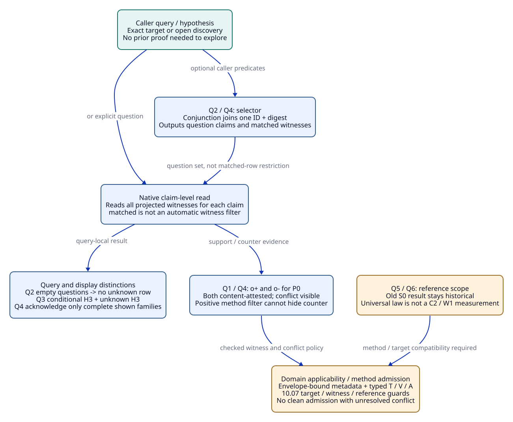
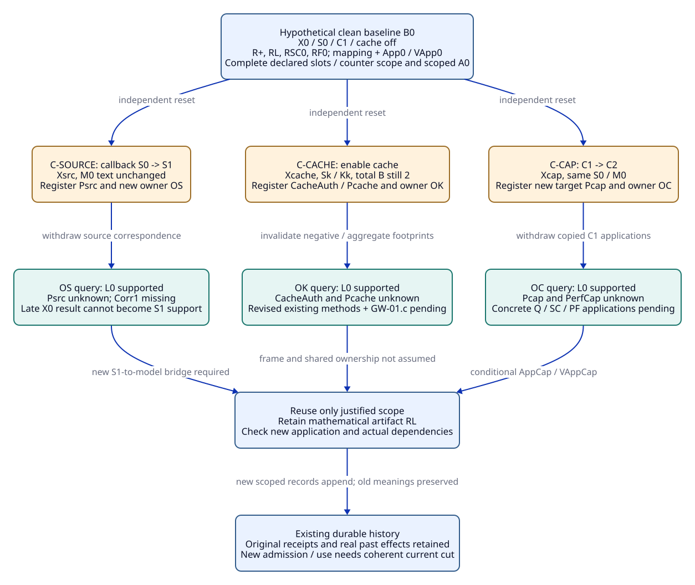

# SPDX-FileCopyrightText: 2026 tao3k team and Contributors
#
# SPDX-License-Identifier: LGPL-2.1-only

#+TITLE: 20.04 Gateway Query Fixtures and Three Change Walkthroughs
#+LANGUAGE: en
#+PROPERTY: JD_ID 20.04
#+OPTIONS: toc:3 num:nil
#+STARTUP: overview
#+TODO: OPEN SPECIFIED | QUALIFIED
#+FILETAGS: :gateway:query:evidence:change:
#+LINK: smp https://github.com/tao3k/gambit-SMP/blob/2125416e8809b0fab86fd8341876cb984e937589/%s

[[file:../../00-09-project/00-documentation/00.01-index.org][Index]] | [[file:../../10-19-design/10-architecture/10.06-poo-ascent-integration.org][10.06 integration contract]] | [[file:20.03-gateway-design-audit.org][Design audit]] | [[file:../../30-39-evaluation/30-benchmarks/30.03-gateway-variant-contracts.org][24 benchmark contracts]]

* Paper-fixture status and notation
:PROPERTIES:
:CUSTOM_ID: query-fixture-status
:STATUS: specified-not-executed
:END:

The [[file:../../10-19-design/10-architecture/10.07-claim-witness-reference-contracts.org][10.07 contracts]] provide typed ClaimDescriptor/WitnessEnvelope and T/V/A fields,
finite rules, independent oracle specifications and refusal/pending codes for
these paper fixtures. Raw native tuple expectations below remain unchanged.

All records, digests, receipts, measurements and verification/admission outcomes
below are explicit hypothetical inputs or expected outputs. None is an actual
file, checked proof, execution receipt or benchmark observation. Tokens d+, T+,
VQ0 and A0 name different fixture objects; they are not computed hashes or signed
attestations and cannot be supplied as genuine production evidence.

The inspected contract is the pinned ASCENT [[file:../../../.gerbil/pkg/github.com/tao3k/gerbil-ascent/python/src/ascent/clue_query_rules.ss][shared Scheme rules]],
[[file:../../../.gerbil/pkg/github.com/tao3k/gerbil-ascent/rust/ascent/src/clues/exchange.rs][read/select/read_selected owner]], [[file:../../../.gerbil/pkg/github.com/tao3k/gerbil-ascent/rust/ascent/src/clues/hypotheses.rs][hypothesis submission]] and
[[file:../../../.gerbil/pkg/github.com/tao3k/gerbil-ascent/rust/ascent/src/clues/slices.rs][slice/checkpoint handling]]. The [[smp:evidence/scenarios/stack-header/clues.ss][SMP selector]] is a
same-witness association reference. This document derives paper expectations from
those sources; it neither executes nor claims correctness of the proposed gateway
projection, verifier, method admission or canonicalizer.

Notation: sets are unordered and duplicate-free; tuples follow the stated relation
schema. Empty set {} is an asserted expected result. A relation not explicitly
listed is outside that case's assertions; internal/helper relations are not
assumed public. All link inputs are empty in these fixtures, so neighbor={}.
Each Q case and each change walkthrough resets to its declared input. They are
not a required Agent reasoning sequence and do not enlarge the top-level 24-case
benchmark cohort. Missing implementation evidence remains unqualified.

* Context, claim and reference identities
:PROPERTIES:
:CUSTOM_ID: fixture-identities
:STATUS: proposed-semantic-inputs
:END:

#+NAME: query-context-register
| Context | Source / interpretation | Effective Profile | Distinguishing scope |
|---------+-------------------------+-------------------+----------------------|
| X0 | S0, K0, model M0 | C1=1, Q=1, B=2 abstract units, cache off | Baseline local gateway, no remote/global acceptance |
| Xcap | S0, K0, model M0 | C2=2, Q=1, B=2, cache off | Configuration change only; not a source or workload equivalence proof |
| Xcache | S0 plus cache contribution Sk, cache interpretation Kk | C1=1, Q=1, B=2 total retained-unit budget, cache on | New cache owners, key/context and invalidation semantics |
| Xsrc | S1, K0, model text M0 retained | C1=1, Q=1, B=2, cache off | Release callback source changes; source-to-M0 correspondence is unknown |

Xcap, Xcache and Xsrc are three separate children of X0, not cumulative changes.
The finite target-application parameter family here is admissible-C={1,2};
no result for C=64 or production scaling follows from these fixtures.
Profile/context identity changes even when source bytes stay S0. Source identity
changes even if the model text and displayed property name stay unchanged.

#+NAME: query-claim-register
| Claim token | Exact proposition/target interpretation | Forbidden substitution |
|-------------+----------------------------------------+------------------------|
| P0 | GW-02.a local permit conservation application to X0/C1 under K0 and declared M0 correspondence | Pcap, Psrc, global remote cap or a complete gateway acceptance |
| Pcap | Same local property applied to Xcap/C2, with its own target/method bindings | Merely relabeling a P0 witness |
| Psrc | Same local property applied to Xsrc/S1; P1 in 10.06 Q5 is an alias for this token | Same model text treated as source equivalence |
| Pcache | Local permit-property application to Xcache | Unchanged numeric C treated as unchanged ownership/dependency semantics |
| PX1C1 / PX0C2 | Diagnostic target claims X1/C1 and X0/C2 used only in Q2's split-factor corpus | A display family label treated as P0 |
| L0 | Universal conservation lemma over the declared M0 transition relation and admissible C | Universal theorem treated as an application to arbitrary source code |
| Corr0 | S0 event/source interpretation implements the required M0 observations in X0 | Corr1 for changed S1 without a new bridge |
| Corr1 | Required S1-to-M0 observation/source correspondence in Xsrc | Old Corr0 or merely unchanged model text |
| Perf0 | Recorded observation of run (C1,W0,H0), 1000 samples, observed p95=8ms | Production latency guarantee or measurement of C2/W1 |
| PerfCap | Required measurement record for target (C2,W1,H0) | Either L0 or the old Perf0 record |
| H3 | New hypothesis: queue contention may limit throughput for X0/W0 | Observation, proven diagnosis or measured improvement |
| CacheAuth | GW-01.c response authorization under Xcache/Kk at use | Tenant field, cached bytes or a prior X0 dispatch review |

Tokens are readable aliases for immutable typed claim keys; they are not an
implemented identity encoding. Every claim string used for engineering admission must bind the reviewed
proposition/interpretation and target scope through the proposed domain mapping.
Arbitrary new hypothesis/query names remain valid exploratory inputs before such
review; this identity requirement is not permission to ask a question.
Query labels, witness factors and source-content receipts alone do not establish
that mapping. Contradictory factor-to-claim associations must fail the domain
mapping check, even if the generic Clue schema accepts their strings.

** Evidence and verification references
:PROPERTIES:
:CUSTOM_ID: fixture-reference-register
:STATUS: hypothetical-reference-catalog
:END:

#+NAME: query-reference-register
| Reference | Exact paper referent / binding | Authority and currentness boundary |
|-----------+--------------------------------+------------------------------------|
| R+ / d+ / s+ | Immutable candidate QNT result artifact for P0, S0/M0/C1; content digest d+ at source label s+ | Reported positive result; engineering validity needs VQ0 and application checks |
| R- / d- / s- | Immutable counterexample artifact for P0, S0/M0/C1; distinct content/source label | Contradictory result retained for investigation; neither record is presumed sound merely by being attested |
| RL / dL / sL | Universal lemma artifact for L0/M0, independent of concrete C and native S0/S1 | Mathematical verification VL0 and native applicability are separate |
| RSC0 / dSC0 / sSC0 | S0-to-M0 correspondence artifact for Corr0/X0 | VSC0 covers only its original source/observation scope |
| RF0 / dF0 / sF0 | Perf0's finite run record (C1,W0,H0), 1000 samples, observed p95=8ms | Content and run validity do not establish statistical/production sufficiency |
| RX1 / dX1 / sX1 | Q2 diagnostic record for PX1C1 with context X1/cap1 | Never a P0 application |
| RX2 / dX2 / sX2 | Q2 diagnostic record for PX0C2 with context X0/cap2 | Never a P0 application |
| T+, T-, TL, TSC0, TF0, TX1, TX2 | Native content-attestation receipt symbols derived from each corresponding (source label,digest) pair | Bind checked bytes; not method-success or engineering admission |
| VQ0, VL0, VSC0 | External verification references for R+, RL, RSC0, including producer, method policy, target, completeness and inputs | Hypothetical successful inputs only where the case explicitly assumes them; not derived by Clue rules |
| A0 | Hypothetical local P0/GW-02.a admission with required L/Q/SC slots bound to RL/R+/RSC0 and V references | Used only by the clean B0 change baseline; neither whole-design nor operational acceptance |
| App0 / VApp0 | Hypothetical baseline law application from L0/M0 to P0/C1/source assumptions and its independent application verification | Required to elaborate A0 under 10.07; no new real proof or native T is asserted |
| AppCap / VAppCap / ACap | Prospective new application artifact, independent application check and Pcap admission | All absent/pending initially; may be introduced only in the explicitly conditional C2 continuation |
| RLate | Old X0/S0 task result arriving after Xsrc publication | Historical record with original task/source bindings; cannot be rebound to Psrc |
| RSC1 / VSC1 | Prospective new S1 correspondence artifact and its independent verification reference for Corr1 | Absent/pending in Q5 and C-SOURCE; never synthesized from VSC0 |
| RH3 / dH / agent3 | Q3 hypothesis body and its owner-computed body digest/source label | Conditional only; no content-attestation T or method/admission V/A reference |

R+, R-, RL, RSC0 and RF0 are distinct artifacts, not five interpretations of
one digest. A0 binds multiple method slots through their own artifacts and
verification references. It does not splice unrelated factor cells into a new
single witness. AppCap may cite prior artifacts as premises but must record its
new target application and checked relation; it is not a freshly labeled old row.
No local file path or invented digest here is a substitute for such an artifact.

** Concrete projected records
:PROPERTIES:
:CUSTOM_ID: fixture-projected-records
:STATUS: proposed-data-not-registered
:END:

#+NAME: fixture-clue-inputs
| Observation ID | Digest | Claim | Polarity | Role | Source | Factor pairs on this exact ID/digest |
|----------------+--------+-------+----------+------+--------+--------------------------------------|
| o+ | d+ | P0 | support | observation | s+ | context=X0; cap=1; interpretation=K0; source=S0; method=Q |
| o- | d- | P0 | counter | observation | s- | context=X0; cap=1; interpretation=K0; source=S0; method=IR |
| oL | dL | L0 | support | observation | sL | model=M0; quantifier=all-admissible-C; method=L |
| oSC0 | dSC0 | Corr0 | support | observation | sSC0 | context=X0; source=S0; model=M0; method=SC |
| oF0 | dF0 | Perf0 | support | observation | sF0 | context=X0; cap=1; workload=W0; environment=H0; method=PF |
| ox1 | dX1 | PX1C1 | support | observation | sX1 | context=X1; cap=1 |
| ox2 | dX2 | PX0C2 | support | observation | sX2 | context=X0; cap=2 |

For example, o+'s clue tuple is (o+,d+,P0,support,observation,s+), its cap factor
is (o+,d+,cap,1), and native content attestation is (o+,d+,T+) after the host
has checked s+->d+. Source label s+ identifies artifact bytes; factor source=S0
identifies the modeled/native program target. Those two source roles are not
interchangeable. Factors use textual values under the inspected native schema.

FactorRows(o) means exactly the factor rows obtained by expanding the last column
of that record, carrying its ID/digest. No undeclared factor is supplied. RF(o)
means (claim,id,digest,name,value,role) for every row in FactorRows(o), using
that record's claim and role. These are finite set abbreviations, not runtime
algorithms or a new tuple format.

* Six queries with exact input and expected relations
:PROPERTIES:
:CUSTOM_ID: six-query-fixtures
:STATUS: paper-expectations-not-native-results
:END:

** Q1: exact claim with both polarities
:PROPERTIES:
:CUSTOM_ID: q1-exact-conflict
:QUERY_ID: Q1
:BENCHMARKS: MB07-H
:END:

Contract/oracle binding: OC/OW preserve distinct E+/E- bindings; OK/OR keep counter review and methods unresolved. T+ or a positive-only selector cannot produce A. See DC05/DC07/DC11. See [[file:../../10-19-design/10-architecture/10.07-claim-witness-reference-contracts.org::#query-change-contract-map][10.07 crosswalk]] and its [[file:../../10-19-design/10-architecture/10.07-claim-witness-reference-contracts.org::#independent-contract-oracles][independent oracle definitions]].
Input: OQ1 projects {o+,o-,oF0} with the corresponding factors, empty links and
host attestations {s+ : d+, s- : d-, sF0 : dF0}. Call read([P0]). No clean A0 is
supplied for this conflict case; its input resets independently of the change
walkthroughs. VQ0 or any contrary result review is unresolved in this corpus.

#+NAME: q1-expected-relations
| Relation / field | Exact expected value | Evidence reference |
|------------------+----------------------+--------------------|
| support | {(P0,o+,d+,s+,T+)} | R+ bytes, content-bound by T+ |
| counterevidence | {(P0,o-,d-,s-,T-)} | R- bytes, content-bound by T- |
| conditional / neighbor | {} / {} | No hypotheses or links supplied |
| relevant_factor | RF(o+) union RF(o-) | All ten supplied factors, including both method values |
| conflict / unknown | {(P0)} / {} | Both polarities are present; unknown does not mean unresolved conflict |
| questions / sourceIdentity | [P0] / OQ1 | Owner identity is a symbolic fixture reference |
| executionAuthorized / runtimeAdmitted | false / false | Native Clue read grants neither |
| Proposed engineering result | clean P0 admission withheld; conflicting references retained | Neither T+ nor T- resolves the method/proposition conflict |

Do not pick the positive witness merely because method=Q appears in a selector.
A content-bound counter record may reveal an erroneous producer, differing hidden
premises or a broken domain mapping. That investigation belongs to verification
and interpretation review; this fixture does not assert that two contradictory
mathematical propositions have both been independently proved.

** Q2: split-factor discovery and explicit unknown
:PROPERTIES:
:CUSTOM_ID: q2-same-witness
:QUERY_ID: Q2
:BENCHMARKS: MB07-A
:END:

Contract/oracle binding: OC checks distinct typed targets; OW expects no same-envelope conjunction. Metadata relabeling without checked mapping is refused as RJ03/RJ04, rather than assumed to change native unknown semantics. See DC02/DC06. See [[file:../../10-19-design/10-architecture/10.07-claim-witness-reference-contracts.org::#query-change-contract-map][10.07 crosswalk]] and its [[file:../../10-19-design/10-architecture/10.07-claim-witness-reference-contracts.org::#independent-contract-oracles][independent oracle definitions]].
Input: OQ2 projects {ox1,ox2}, FactorRows for both, no links, and checked
attestations {sX1->dX1,sX2->dX2}. Selector bindings are {(context,X0),(cap,1)}.
Use the declared same-witness conjunction semantics from 10.06/SMP; no third
record has both factors. Only these two bindings participate in this selector.

#+NAME: q2-expected-relations
| Operation / relation | Exact expected value | Reference and meaning |
|----------------------+----------------------+-----------------------|
| select: matched / question | {} / {} | RX1/RX2 cannot supply one conjunction witness |
| select: unknown_binding | {} | Each requested factor value exists individually |
| select: conjunction_gap | {(context,X0),(cap,1)} | Neither belongs to a complete matched conjunction |
| read_selected: support / counterevidence / conditional | {} / {} / {} | It reads the selector's empty question set |
| read_selected: conflict / unknown / relevant_factor / neighbor | {} / {} / {} / {} | No explicit question was asked by that selector |
| Separate read([P0]): support / counterevidence / conditional | {} / {} / {} | Neither record has exact claim P0 |
| Separate read([P0]): unknown | {(P0)} | Local absence in this complete projected question view, not a universal disproof |
| Separate read([PX0C2]): support | {(PX0C2,ox2,dX2,sX2,TX2)} | Truthful raw content reference for its own distinct target |
| Proposed P0 application of RX2 | refused; mismatch includes target/cap | RX2 is not applicable to P0 even though the label family is permit conservation |

Required malformed-association control: relabel ox2's claim to P0 while keeping
cap=2. The generic native Clue schema does not understand that contradiction;
raw read([P0]) could then return that row as support. The proposed gateway
claim-to-record mapping must reject the association before publishing a trusted
current-target view or refuse the P0 application. It must not claim the generic
native API automatically returns unknown for malformed semantic labels.

** Q3: new hypothesis remains conditional and locally unknown
:PROPERTIES:
:CUSTOM_ID: q3-hypothesis
:QUERY_ID: Q3
:BENCHMARKS: MB07-H
:END:

Contract/oracle binding: H3 may remain an exploratory label. OR forbids using its conditional body as a positive observation/method slot (RJ07); no canonical review or T/V/A is required to ask the question. See [[file:../../10-19-design/10-architecture/10.07-claim-witness-reference-contracts.org::#query-change-contract-map][10.07 crosswalk]] and its [[file:../../10-19-design/10-architecture/10.07-claim-witness-reference-contracts.org::#independent-contract-oracles][independent oracle definitions]].
Input: reset to an otherwise empty exchange OH. Submit one inert hypothesis record
with exactly the allowed fields id=h3, claim=H3, polarity=support, source=agent3,
and factors=[(context,X0),(workload,W0)]. Let dH be the digest the owner derives
from that hypothesis body. No observation/source attestation or V/A reference is
supplied. Then read([H3]). The body is a proposed query fixture, not a submitted
message or implemented request packet.

#+NAME: q3-expected-relations
| Relation | Exact expected value | Evidence reference |
|----------+----------------------+--------------------|
| conditional | {(H3,h3,dH,support,agent3)} | Hypothesis body, not an execution artifact |
| support / counterevidence / conflict / neighbor | {} / {} / {} / {} | No attested observation or links |
| unknown | {(H3)} | No support/counter row; a conditional hypothesis may coexist with local unknown |
| relevant_factor | {(H3,h3,dH,context,X0,hypothesis),(H3,h3,dH,workload,W0,hypothesis)} | Factors remain tied to h3/dH |
| Engineering diagnosis/admission | absent | No native result, performance evidence or authority inferred |

A second batch reusing h3 or supplying attestation/authority fields must reject
atomically under the actual owner contract. This does not forbid a revised idea
with a fresh identity. submit changes retained hypothesis facts; a stable source
owner identity alone is not proof that a later view has no new content. The
checkpoint/current-view comparison must inspect the relevant bound content.

** Q4: discovery filters and complete display acknowledgement
:PROPERTIES:
:CUSTOM_ID: q4-view-and-acknowledgement
:QUERY_ID: Q4
:BENCHMARKS: MB07-A MB08-H
:END:

Contract/oracle binding: OW/OK compare the complete relevant counter scope independently of selector matched. Missing content-bound view checks or hidden positive-only acknowledgement refuses via RJ11; see DC11/DC14. See [[file:../../10-19-design/10-architecture/10.07-claim-witness-reference-contracts.org::#query-change-contract-map][10.07 crosswalk]] and its [[file:../../10-19-design/10-architecture/10.07-claim-witness-reference-contracts.org::#independent-contract-oracles][independent oracle definitions]].
Input: reset OQ1 with exactly the Q1 records unchanged. A caller selector matches
context=X0, cap=1, method=Q on one witness, outputs matched={(P0,o+,d+,observation)}
and question={(P0)}. read_selected still reads all P0 records; it does not restrict
that read to the matched o+ witness. Source/records stay fixed throughout this
case; there is no concurrent submission, inclusion or replacement.

#+NAME: q4-discovery-expected
| Relation | Exact expected value | Required reference |
|----------+----------------------+--------------------|
| selection.matched | {(P0,o+,d+,observation)} | R+ factors satisfy all selector conditions |
| support / counterevidence | {(P0,o+,d+,s+,T+)} / {(P0,o-,d-,s-,T-)} | R- remains visible despite method=IR |
| conflict / unknown | {(P0)} / {} | Do not turn a positive discovery filter into a clean admission |
| relevant_factor | RF(o+) union RF(o-) | Claim read is broader than matched witness set |
| Scoped applicability/admission | conflict remains unresolved; A0 not supplied | All applicable contrary evidence must be considered |

For the separate display-rule fixture, define F0 as exactly the item rows emitted
for Q1: its one support item, one counter item, ten factor items and one conflict
item. Define FF as the full Perf0 family (one support plus five factor items).
All item tuples follow the pinned eight-column item relation. Previous hint
contains exactly FF; current item input is F0; there are no derived-relation
units in this fixture.

#+NAME: q4-display-expected
| Reset / exact rule inputs | Expected acknowledgement relations | Boundary |
|---------------------------+------------------------------------+----------|
| Folded P0 family: previous=FF, item=F0, shown={} | acknowledged=FF; acknowledged_relation={}, pending_relation={}, retained_relation={} | Honest expandable P0 reference may be shown; none of F0 is acknowledged |
| Fully displayed P0: previous=FF, item=F0, shown={(P0)} | acknowledged=FF union F0; all relation-unit sets remain {} | Acknowledgement covers the entire shown family, including counterevidence |
| Return to Perf0 under same source with a changed selector/anchor | prior FF remains usable as a read hint; relevance is re-evaluated | Out-of-scope display is not global withdrawal of Perf0 evidence |
| Missing hint | explicit initial replay, no evidence/history deletion | A fresh read remains legitimate |
| Insufficient bytes for honest body/reference | explicit display error, no successful acknowledgement output | Never unknown, no-change or clean completion |

The first two rows are exact inputs to the declared acknowledgement rules, not a
claim that an unexecuted serializer folds at an invented byte threshold. Native
slice qualification must supply the actual request displayBytes, serialized
body/reference sizes, checkpoint content/digest and anchor identity, and verify
these chosen shown sets. A forged checkpoint that acknowledges only a hidden
positive fragment of F0 is not an admitted previous hint. A scope change can
produce rescope; a source-identity change requires reset rather than rescope.

** Q5: source replacement and a late old result
:PROPERTIES:
:CUSTOM_ID: q5-source-replacement
:QUERY_ID: Q5
:BENCHMARKS: MB08-A MB09-A
:END:

Contract/oracle binding: OC/OU require Psrc rather than P0, and OR keeps VL0 scoped to L0. RLate promotion is RJ03/RJ10; new source mapping/application is PENDING_BINDING/PENDING_METHOD, not false. See [[file:../../10-19-design/10-architecture/10.07-claim-witness-reference-contracts.org::#query-change-contract-map][10.07 crosswalk]] and its [[file:../../10-19-design/10-architecture/10.07-claim-witness-reference-contracts.org::#independent-contract-oracles][independent oracle definitions]].
Input: begin from clean B0 defined below, start task t0 bound to X0/S0/P0, then
publish Xsrc/S1. RLate returns with its original X0/S0 target after publication.
Construct the new current owner OS from unchanged oL only; its references contain
sL->dL. RLate is retained in the existing history journal, not inserted as a
Psrc observation or a fresh Corr1. The old X0 snapshot is separately addressable
through retained history/reconstruction; live Session retention is not required.

#+NAME: q5-expected-relations
| Query or stage | Exact expected result | Evidence references |
|----------------+-----------------------+---------------------|
| OS read([Psrc]): support / counterevidence / conditional / conflict | {} / {} / {} / {} | No current S1 application record supplied |
| OS read([Psrc]): unknown / relevant_factor / neighbor | {(Psrc)} / {} / {} | Means unknown in OS, not false source correctness |
| OS read([L0]): support | {(L0,oL,dL,sL,TL)} | Retained mathematical artifact RL, still over M0 |
| Captured B0 snapshot read([P0]), excluding later RLate | original B0 positive support {(P0,o+,d+,s+,T+)} under its recorded context | R+ and RLate remain X0 records; old A0 is not current Xsrc admission |
| Late-result ingestion as Psrc | refused due to source/target mismatch | Task t0 and RLate retain original identities |
| Engineering S1 application | VSC1 and new application/admission absent; current support withheld | Unchanged M0 bytes do not prove Corr1 |

The new owner may know RL while the current source-correspondence claim remains
unknown. That is useful partial evidence, not complete Psrc support. If the changed
release handler also changes the intended M0 transition interpretation, a new
lemma/model revision is required; retaining the old mathematical artifact still
does not permit its application to that revised interpretation.

** Q6: a retained measurement does not answer a new workload
:PROPERTIES:
:CUSTOM_ID: q6-proof-versus-measurement
:QUERY_ID: Q6
:BENCHMARKS: MB06-H MB06-A
:END:

Contract/oracle binding: OR distinguishes the law, its application and PF record. Wrong-scope V/measurement offered as success is RJ03/RJ06; absent AppCap or PF is pending. See DC10. See [[file:../../10-19-design/10-architecture/10.07-claim-witness-reference-contracts.org::#query-change-contract-map][10.07 crosswalk]] and its [[file:../../10-19-design/10-architecture/10.07-claim-witness-reference-contracts.org::#independent-contract-oracles][independent oracle definitions]].
Input: OQ6 contains {oL,oF0} with their exact factors and host attestations
{sL->dL,sF0->dF0}. The request concerns Xcap/C2/W1/H0. No AppCap, new QNT instance,
new correspondence application, or C2/W1 measurement is supplied at this stage.
Read exact questions [L0,Perf0,PerfCap,Pcap].

#+NAME: q6-expected-relations
| Relation / proposed application | Exact expected result | Reference boundary |
|---------------------------------+-----------------------+--------------------|
| support | {(L0,oL,dL,sL,TL),(Perf0,oF0,dF0,sF0,TF0)} | RL and RF0 retain their original meanings |
| counterevidence / conditional / conflict / neighbor | {} / {} / {} / {} | No additional records supplied |
| unknown | {(PerfCap),(Pcap)} | No concrete target observation yet |
| relevant_factor | RF(oL) union RF(oF0) | Visible C1/W0/H0 measurement bindings and universal M0 lemma bindings |
| RF0 applied to PerfCap | refused; mismatch={cap,workload,target} | Original run observation may remain valid; it is not a C2/W1 run |
| RL applied as performance evidence | refused; method/proposition mismatch | Conservation is not latency measurement |
| RL reused for Pcap | application candidate only; checked target bridge and required slots pending | TL alone does not supply VL0, VAppCap or ACap |

Even a later verified AppCap would not remove the pending PerfCap method slot.
The observation p95=8ms describes only the supplied hypothetical finite run;
production numeric targets, workload representativeness, sampling/statistical
sufficiency and native measurement provenance remain separately open.

* Three independent registration-to-reuse walkthroughs
:PROPERTIES:
:CUSTOM_ID: three-change-walkthroughs
:STATUS: proposed-handoffs-not-runtime-execution
:END:

#+CAPTION: Claims, witnesses and applicability have distinct checks; claim-level reads do not filter every witness by selector bindings.

[[file:../../90-99-views/90-architecture-views/90.13-claim-witness-queries.d2][Editable D2 source]].

** Shared clean baseline B0
:PROPERTIES:
:CUSTOM_ID: change-clean-baseline
:STATUS: hypothetical-positive-control
:END:

B0 projects {o+,oL,oSC0,oF0} and their factors/checked source-content attestations;
there is no o- or hypothesis. Assume external successful VQ0, VL0, VSC0 and
valid scoped A0 as paper positive-control inputs. Under the [[file:../../10-19-design/10-architecture/10.07-claim-witness-reference-contracts.org::#tva-fixture-bindings][full T/V/A contract]],
this additionally assumes App0/VApp0, exact envelope/extraction mappings, complete
required L/Q/SC slot and counter-review scopes, current issuer/method policy and
a coherent cut. The previous shorter A0 notation cannot qualify without those
fields; this elaboration supplies hypothetical assumptions, not new receipts. A0 discharges only P0's local
GW-02.a L/Q/SC slots. All other gateway obligations, workload goals and deployment
authority remain unqualified. Registration names admitted gateway-evidence
constructors, source/declaration revision D0 and this exact record set, using
10.06 R0-R6 and the existing host/source registry and journal.

The [[file:20.05-expanded-admission-controls.org::#dc-baseline][20.05 baseline ledger]] makes the mappings and policies explicit. Each slot
separates owner P0 from its required proposition: SC verifies Corr0 through VSC0;
L verifies P0 through checked App0/VApp0; Q verifies P0 through VQ0. Arg0 connects
them to P0. These references do not all directly verify the same proposition.
The [[file:20.05-expanded-admission-controls.org::#dc-query-change-crosswalk][expanded control crosswalk]] checks all six queries and three change paths.

The [[file:20.06-oracle-packet-integration.org::#three-packet-reviews][20.06 data-package walkthroughs]] map these inputs to the same native
Module/Profile/Scenario and ASCENT owners, with full gold/reference/cut reviews.
The pre-application owners OC/OK/OS below denote the open phases; their later
conditional-ready inputs have different cut/content bodies. No ready-phase
success or new A is inferred from this table.

Each branch below starts afresh from B0. Registry source/constructor metadata is
not rewritten merely to make a late artifact appear current. Effective Profile,
claim interpretation, facts, verifier/policy inputs and relevant source identities
are recorded separately; a mere module name or mount rename cannot equate them.

** C1 -> C2: retain a law, create a new application
:PROPERTIES:
:CUSTOM_ID: change-c1-c2
:CHANGE_ID: C-CAP
:STATUS: all-new-applications-pending
:END:

Contract/oracle binding: OC assigns the new target identity; OU withdraws copied applications; OR requires AppCap/VAppCap and every current required slot. Claim identity, obligation revision and A eligibility are separate. See [[file:../../10-19-design/10-architecture/10.07-claim-witness-reference-contracts.org::#query-change-contract-map][10.07 crosswalk]] and its [[file:../../10-19-design/10-architecture/10.07-claim-witness-reference-contracts.org::#independent-contract-oracles][independent oracle definitions]].
#+NAME: c-cap-handoffs
| Stage | Exact input/update | Expected result and references |
|-------+--------------------+--------------------------------|
| Register B0 | Module exports, D0, X0/C1 and the four B0 records | B0 owner/context; P0 application A0 has its declared local scope only |
| Query B0 | read([P0,L0,Perf0]) | Positive raw references R+,RL,RF0; engineering validity comes from separate V/A inputs |
| Override | New Xcap/C2 Profile; source S0, model M0 and rule declaration D0 unchanged | New target Pcap and configuration/context identity; no mutation of old P0 or A0 |
| Re-register current projection | Same admitted constructor, new effective fact/context binding; carry oL and optionally RF0 as explicitly old-target knowledge | New owner OC; R+ and A0 remain in X0 history, not relabeled Pcap support |
| Query before new application | OC read([L0,Pcap,PerfCap]) | support={(L0,oL,dL,sL,TL)}, unknown={(Pcap),(PerfCap)}; unchanged RL is partial useful support |
| Invalidate | Concrete C1 application, configured QNT-instance and workload applicability for the new target | Withdraw target eligibility for copied C1 results; no deletion of the universal artifact or historical measurement |
| Conditional transfer | Only if a genuine AppCap and VAppCap establish target C2, transition/frame premises and current method policy | New Pcap application/reference; RL reused through checked application, never by changing o+'s cap factor |
| Complete required methods | New/justified Q and SC applications also needed for Pcap; ACap issued only with all required current slots and no unresolved conflict | AppCap or a Lean application alone is not ACap; PerfCap remains independently pending |
| Consume/effect | Coherent current OC/application/support-policy cut, plus separate authority if an effect is requested | Design/model result cannot authorize deployment or remote execution |

C1=1 and C2=2 are parameter values, not theorem versions. Sharing S0 does not
make the changed configuration identical. A cap-independent law can survive while
its concrete admission, pressure behavior and performance evidence do not.

** Enable cache: revised existing obligations as well as a new claim
:PROPERTIES:
:CUSTOM_ID: change-enable-cache
:CHANGE_ID: C-CACHE
:STATUS: cache-methods-and-admission-pending
:END:

Contract/oracle binding: OU uses negative/aggregate/shared ownership footprints, not equal C/B or row counts. Unknown footprint remains PENDING_BINDING/PENDING_SCOPE; reviewed new slots and consumer scope are required. See [[file:../../10-19-design/10-architecture/10.07-claim-witness-reference-contracts.org::#query-change-contract-map][10.07 crosswalk]] and its [[file:../../10-19-design/10-architecture/10.07-claim-witness-reference-contracts.org::#independent-contract-oracles][independent oracle definitions]].
#+NAME: c-cache-handoffs
| Stage | Exact input/update | Expected result and references |
|-------+--------------------+--------------------------------|
| Register/query B0 | Read the same initial P0/L0 support, with cache=false included in selection/dependency scope | Absence of cache is a registered negative-scope premise, not an eternal default |
| Override | Xcache enables response cache while total B remains 2; add Sk/Kk, cache content/principal/policy contracts | New CacheAuth and Pcache targets; byte owners/key/revocation paths become part of the footprint |
| Derive inventory | U0 membership plus GW-01.c; revise affected GW-01/02/05/06 origins, method requirements and interpretations | Existing lineage names do not preserve old admissions; O1 review remains independently required |
| Re-register | New cache projection/constructor contribution if needed, plus complete changed declarations/facts/reference bindings | New owner OK; no automatic attestation, verifier result or cache proof from loading the declaration |
| Query before checks | OK read([CacheAuth,Pcache,L0]) with only oL carried as unchanged mathematical knowledge | support={(L0,oL,dL,sL,TL)}; unknown={(CacheAuth),(Pcache)}; no fabricated hit observation |
| Invalidate | Negative selection/aggregate scopes, response authorization, bytes, revocation, workload and actual shared code dependencies | Withdraw affected new-target eligibility even if C stayed 1 or old row counts match |
| Reuse decision | RL remains a law over M0; new cache sharing/cleanup may violate its application premises | Do not transfer to Pcache until a complete footprint/frame/source argument verifies those premises |
| New methods | Require actual key/current-policy/replay controls, accounting including cache retention, SC and method-specific evidence | T-style content attestation alone cannot discharge these slots; CacheAuth and whole-design acceptance stay pending |
| Use/feedback | Recheck current policy at response use and actual coherent source/permission cut | Wrong-principal/revoked-policy refusal reopens the responsible design/consumer; old effect records remain historical |

A cache may introduce new references to buffers without changing permit arithmetic.
Thus an unchanged permit theorem does not prove retained bytes <=2, valid response
authorization or performance. Disabling/hiding a cache record in a selector is not
a repair for a real cache dependency or applicable counterevidence.

** Source replacement: new current owner, unchanged historical artifacts
:PROPERTIES:
:CUSTOM_ID: change-source-replacement
:CHANGE_ID: C-SOURCE
:STATUS: new-source-correspondence-pending
:END:

Contract/oracle binding: OU rejects stale/mixed-cut use while preserving authentic old content; OR refuses reuse of VSC0 as VSC1. Coherent Host/remote enforcement remains an external qualification gate. See [[file:../../10-19-design/10-architecture/10.07-claim-witness-reference-contracts.org::#query-change-contract-map][10.07 crosswalk]] and its [[file:../../10-19-design/10-architecture/10.07-claim-witness-reference-contracts.org::#independent-contract-oracles][independent oracle definitions]].
#+NAME: c-source-handoffs
| Stage | Exact input/update | Expected result and references |
|-------+--------------------+--------------------------------|
| Start at B0 | Task t0 captures X0/S0/P0, declarations D0, original method policy and source observations | Completion will bind those original inputs, even if it arrives later |
| Publish change | Release callback source S0 -> S1, X0 -> Xsrc; model text M0 unchanged | Current implementation target is Psrc; Corr0/VSC0 does not cover it |
| Re-register | Verify changed source/reference bytes; preserve unchanged mathematical RL; create new current owner OS | New source/context binding; bytes for an old artifact may still match their old digest without being current for S1 |
| Query | OS read([Psrc,L0]) | Exactly Q5: local unknown for Psrc and raw support for L0 |
| Ingest late result | RLate arrives as X0/S0/P0; the old receipt bytes are intact | Append history under t0; reject promotion to Psrc or current Xsrc admission |
| Invalidate | Dependent native tests, selected helpers/compiler/private closure, source-to-event mapping and current applications | Unknown dependency footprint invalidates conservatively; matching model text/answer count cannot retain eligibility |
| Reuse candidate | RL's mathematical M0 proposition stays recorded; independently untouched artifacts may retain scoped eligibility | Native applicability to S1 needs Corr1/new verification; changed intended transitions also require a new model/law |
| New checks and cut | Obtain actual current source/transition/native method results and new admission | Recheck atomic/fenced validation-to-use cut; if S1 changes again, stale commit refuses |
| Retain/release | Old Session may close; original evidence and completed effects remain in the existing durable journal/source authority | Checkpoint reset/replay is not evidence deletion or native milestone reset |

The [[file:20.07-packet-query-and-history-fixtures.org::#late-intake-visibility][20.07 visibility fixtures]] distinguish old-prefix reads, later knowledge
about S0, and the S1 corpus. RLate's recording cut kLate does not replace its
captured input cut k0, and neither authorizes insertion into frozen Pfx0.
The [[file:20.07-packet-query-and-history-fixtures.org::#non-erasure-and-reuse-controls][retention controls]] require old record bodies to survive invalidation of
current applications, without assuming their perpetual usability or accessibility.

Closing or replacing an exchange is not invalidation of immutable history. Nor is
a source-content attestation a filesystem watcher. Authentic old bytes can be
historically useful and simultaneously inapplicable to the new implementation.

#+CAPTION: All three branches reset from B0; changed target applications remain pending while eligible artifacts retain their original meanings.

[[file:../../90-99-views/90-architecture-views/90.14-gateway-three-changes.d2][Editable D2 source]].

* Boundary checks and remaining qualification
:PROPERTIES:
:CUSTOM_ID: query-boundary-checks
:STATUS: semantic-contract-only
:END:

#+NAME: claim-witness-boundaries
| Boundary | Paper discriminator now specified | Required later evidence / linked gap |
|----------+-----------------------------------+--------------------------------------|
| Claim identity versus family label | Q2 malformed claim/cap association; Q5 P0 versus Psrc | Domain canonical mapping and exact native inputs; GAP09 |
| Selector match versus all read witnesses | Q4 positive method selector still reads o- | Native selector/read comparison and independently reviewed applicability projection; GAP01/GAP09 |
| Content attestation versus verified result/admission | Q1 T+/T- cannot resolve conflict; A0 has separate V and method bindings | Genuine producer/checker/currentness receipts; GAP03/GAP07 |
| Same witness versus composed method support | Q2 cannot mix factors; A0 may combine separate L/Q/SC slots only through explicit argument structure | Association and typed multi-method admission controls; GAP02/GAP09 |
| Empty selection, hypothesis unknown, conflict and display failure | Q1-Q4 specify different relation sets or error outcomes | Native query/serialization/non-vacuity controls; GAP06/GAP12 |
| Law versus target application versus measurement | Q6 and C-CAP keep each reference type separate | Actual Lean/application/QNT/source/PF checks; GAP03/GAP10 |
| Source currentness versus authentic old content | Q5/C-SOURCE keep RLate historical and Psrc pending | Concurrent ingestion/use/fence and actual source observers; GAP05/GAP06/GAP11 |
| Numeric equality versus dependency independence | C-CACHE changes ownership even at C1/B2 | Complete negative/aggregate footprint and real cache/security/resource evidence; GAP02/GAP08 |

The exact rendered byte thresholds/checkpoint encodings, proposed domain
canonicalizer, applicability bridge, authentic verifier/authority producers,
complete dependency observers and native/operational behavior remain unimplemented
or unqualified in this repository. The six paper queries and three traces clarify
what must be checked; they do not close the twelve gaps or report benchmark passes.
The Agent remains free to ask other questions, propose new facts/hypotheses and
choose another engineering strategy.
