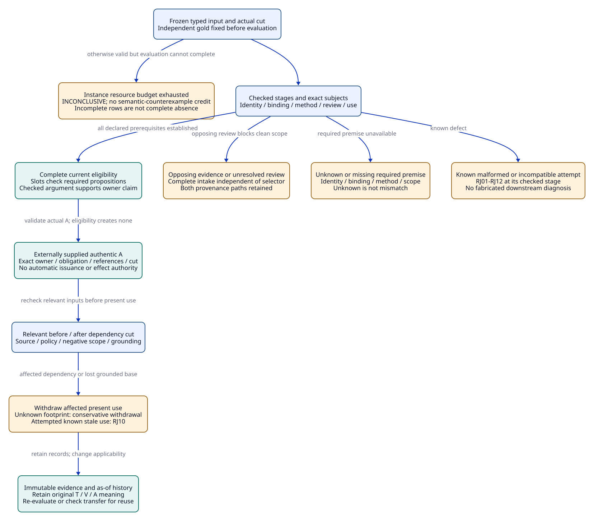
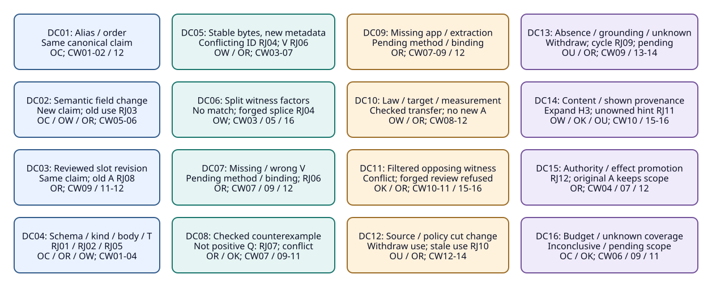

# SPDX-FileCopyrightText: 2026 tao3k team and Contributors
#
# SPDX-License-Identifier: LGPL-2.1-or-later

#+TITLE: 20.05 Expanded Claim, Witness and Admission Controls
#+LANGUAGE: en
#+PROPERTY: JD_ID 20.05
#+OPTIONS: toc:3 num:nil
#+STARTUP: overview
#+TODO: OPEN SPECIFIED | QUALIFIED
#+FILETAGS: :gateway:contracts:oracle:design:

[[file:../../00-09-project/00-documentation/00.01-index.org][Index]] | [[file:../../10-19-design/10-architecture/10.07-claim-witness-reference-contracts.org][10.07 contracts and CW rules]] | [[file:20.04-query-and-change-fixtures.org][20.04 queries and change paths]]

* SPECIFIED Scope, reset discipline and independent gold
:PROPERTIES:
:CUSTOM_ID: expanded-control-scope
:STATUS: paper-contracts-not-executed
:END:

These are the sixteen DC controls of 10.07, expanded into independently reset
subcontrols. They do not add benchmark variants to the existing twenty-four MB
variants. Every artifact, digest, verification, admission, policy certificate
and expected result here is hypothetical. No real oracle, codec, QNT/Lean proof,
native benchmark, signature validation or production admission was executed.

The [[file:../../30-39-evaluation/30-benchmarks/30.04-oracle-review-data-contracts.org][30.04 oracle review contract]] specifies reviewable input/gold records, exact
[[file:../../30-39-evaluation/30-benchmarks/30.04-oracle-review-data-contracts.org::#dc-oracle-packets][DC stage/closure/cut packets]], and bindings to all 24 variants and 12 gaps.
The [[file:20.06-oracle-packet-integration.org::#packet-registration-handoffs][20.06 registration mapping]], [[file:20.06-oracle-packet-integration.org::#three-packet-reviews][three packet reviews]] and
[[file:20.06-oracle-packet-integration.org::#packet-oa-audit][15-assumption audit]] apply those contracts through existing native owners.
These contracts originate in our framework and gateway semantics. Specula and
TLAPS-Bench remain external research, with no role as the production architecture,
gold authority or mandatory gateway qualification dependency.

Each lettered subcontrol starts from B0 below unless it explicitly names another
input. A state transition is asserted only when both cuts are supplied. A failed
attempt to apply an old record to another target does not revoke that record at
its original target/cut. Rejection, pending, conflict and withdrawal are typed
observations about different objects, not mutually exclusive global run states.
The Agent may continue discovery, proposal and experimentation in every case.

The independent oracle families OC/OW/OR/OK/OU are defined in
[[file:../../10-19-design/10-architecture/10.07-claim-witness-reference-contracts.org::#independent-contract-oracles][10.07]]. Gold consists of reviewed descriptor bodies, factor matrices, typed
reference graphs, intake sets and before/after dependency cuts. It must be fixed
before candidate evaluation, by an independently reviewed route. It may share
the published specification, but must not obtain its expected rows from the
candidate rule engine, selector, serializer, hash cache or discovery output.
Shared parser, issuer-policy and assumption mistakes remain common-mode risks.

** Notation and checked-stage outcomes
:PROPERTIES:
:CUSTOM_ID: outcome-algebra
:END:

The following is mathematical fixture notation, not an implemented DSL/API.
Empty braces mean an exact empty result only for a completed named stage/scope.
An unevaluated stage has no asserted result, rather than an invented empty set.

#+NAME: dc-outcome-algebra
| Relation | Meaning and boundary |
|----------+----------------------|
| SameClaim(a,b), DifferentClaim(a,b) | Reviewed canonical descriptor equality/inequality; hashes alone are insufficient |
| DifferentObligation(ob0,ob1) | Exact obligation/argument/policy bodies differ independently of claim identity |
| VerifiedCounter(e,p,m,k) | Authentic complete checking establishes a counterexample in that exact scope, never positive slot support |
| AcceptedAcknowledgement | IDs validated against actual owned prior display history; presentation only |
| Match(w,p,k), SlotSupport(s,w,v,k) | One witness's applicable binding; positive evidence for the slot's required proposition |
| Eligible(p,ob,k) | Complete positive slots, intake/review and policy prerequisites; does not issue A |
| CurrentAUse(a,p,ob,k) | Supplied authentic A matches the owner claim, obligation, references and current cut |
| Reject(code,attempt,stage) | Refuse the malformed or known incompatible attempted input/application at its checked stage |
| Pending(kind,subject,stage) | Missing/unknown required binding, method or scope; no established mismatch |
| Conflict(p,intake,k) | Relevant opposing evidence or unresolved required review blocks clean admission |
| WithdrawnUse(a,k0,k1) | A previously eligible/current use loses qualification after a relevant change |
| History(r,k0) | Immutable original record and its original scoped interpretation remain retained |
| INCONCLUSIVE(run,limit) | Evaluation could not complete within its declared resource envelope; not a semantic failure witness |

Pending kinds identity/binding/method/scope map directly to 10.07's
PENDING_IDENTITY/PENDING_BINDING/PENDING_METHOD/PENDING_SCOPE. Authorized and
Completed name requested operational reference judgments, not executed actions.
CompletedEvaluation distinguishes an exhausted evaluation from completed empty
relations; it does not refer to deployment completion.

Known mismatch and unknown are different oracle answers. Check raw schema/kinds
before semantic joins; check target binding before downstream method admission.
If DC04 parsing rejects, no downstream pending rows are fabricated. Where several
independent defects are deliberately supplied, retain their scoped reasons;
otherwise a single missing input need not generate a cascade of duplicate errors.
An A body can be retained even when CurrentAUse cannot be established. Removing
a prerequisite from a paper input creates an unresolved qualification check, not
proof that an already issued historical A never existed. Actual before/after
withdrawal requires the dependency transition used by DC12/DC13.

#+CAPTION: Refusal and pending are stage-local; conflict and withdrawal preserve historical evidence.

[[file:../../90-99-views/90-architecture-views/90.18-admission-outcome-boundaries.d2][Editable D2 source]].

* SPECIFIED Fully bound paper baseline B0
:PROPERTIES:
:CUSTOM_ID: dc-baseline
:END:

Use the exact P0/Pcap/Psrc/Pcache, L0, Corr0 and Perf0 meanings and observation
bodies from [[file:20.04-query-and-change-fixtures.org::#query-fixture-status][20.04]]. P0 is the local X0/S0/C1/K0 GW-02.a claim under M0;
it is not remote safety or whole-gateway acceptance. Retain complete typed
ClaimDescriptors as D0/Dcap/Dsrc/Dcache. Their symbolic IDs are not real hashes.
Premote changes only consumer scope; Punit changes the explicitly typed bound
unit from abstract units to KiB with no conversion/equivalence certificate.

B0 supplies a frozen owner O0, coherent cut k0, configuration/source dependency
bodies X0/S0/K0, method policy MP0 and admission policy AP0. Policy records name
accepted producer/checker identities, allowed result kinds and revocation
generations. Their authentication is an explicit hypothetical oracle premise,
not a trusted boolean supplied by the candidate. Each required completeness
certificate is authentic for its exact frozen member set and collector/cut.

#+NAME: dc-baseline-reference-ledger
| Object | Concrete symbolic binding | Expected scope |
|--------+---------------------------+----------------|
| Witnesses | E+=(o+,d+,R+,P0,support,{X0,C1,K0,S0,Q}); EL=(oL,dL,RL,L0,support,{M0,all admissible C,L}); ESC0=(oSC0,dSC0,RSC0,Corr0,support,{X0,S0,M0,SC}); EF0=(oF0,dF0,RF0,Perf0,support,{X0,C1,W0,H0,PF}) | Full envelopes also retain origin k0, extraction revision and explicit dependency footprint |
| Native T | T+ binds s+/d+; TL binds sL/dL; TSC0 binds sSC0/dSC0; TF0 binds sF0/dF0 | Host checks actual content digest; envelope associations are separate T-use wrappers |
| Direct V | VQ0 verifies R+/P0/Q; VL0 verifies RL/L0/L; VSC0 verifies RSC0/Corr0/SC | Accepted, complete, authentic positive results under MP0; exact subject bodies retained |
| Mapping V | VMap+, VMapL, VMapSC bind each corresponding artifact extraction to E+, EL, ESC0 and its exact proposition | Separate authentic hypothetical mapping records, so extraction-loss controls are unambiguous |
| Application | App0 maps L0 to P0 using C=1 and explicit frame/assumptions/source mapping; VApp0 verifies that application | No native TApp0 is invented: App0 is not a projected native clue observation |
| Obligation | Ob0 owns P0; argument Arg0 requires AND slots sL0, sQ0, sSC0 | sL0 requires P0 via App0/VApp0; sQ0 requires P0 via VQ0; sSC0 requires Corr0 via VSC0 |
| Intake/review | I0 contains no opposing witnesses; exact collector/required-review scope is complete at k0 | This is reviewed emptiness of the declared scope, not absence of all possible hazards |
| Dependency | Point source S0/X0/K0; policy MP0/AP0 generations; empty cache-owner scope Z0; named slot/intake/guard coverage | Negative scope Z0 is a real dependency, not an implicit cache-off default |
| Admission | A0 authentic under AP0, binds P0/Ob0/Arg0, exact slots and selected T/V/App0 references at k0 | Eligible(P0,Ob0,k0) and CurrentAUse(A0,P0,Ob0,k0); no deployment authority |

A method slot has both an /owner claim/ and a /required proposition/. The SC
slot is owned by P0's obligation but checks Corr0. VSC0 is not a direct proof of
P0. A checked argument composes Corr0 with the model/proof slots to support the
owner. VL0 needs App0/VApp0 before it can discharge P0's L slot. This distinction
is required by CW07/CW09 and is synchronized back into 10.07's join contract.

No independent performance verification or native source refinement follows
from these premises. EF0/TF0's observed p95=8ms for N=1000, W0/H0/C1 is merely the
specified historical measurement body; PerfCap at C2/W1/H0 is a different target.

* SPECIFIED Sixteen expanded controls
:PROPERTIES:
:CUSTOM_ID: expanded-dc-controls
:END:

#+CAPTION: Sixteen contract controls, with independent subcase resets and separate outcome kinds.

[[file:../../90-99-views/90-architecture-views/90.17-expanded-admission-controls.d2][Editable D2 source]].

** SPECIFIED DC01: Alias and field order
:PROPERTIES:
:CUSTOM_ID: dc01
:CONTROL_ID: DC01
:BASELINE: B0 unless explicitly overridden
:STATUS: independently-specified-not-executed
:END:

- Input :: A: submit D0 with display alias gateway-local instead of P0, both explicitly resolved by the frozen alias table. B: submit the same typed D0 fields in reverse raw field order, without duplicate keys. Neither input rewrites an artifact or envelope.
- Expected relations :: SameClaim(D0,D0alias) and SameClaim(D0,D0reordered). Required canonical bytes agree after schema field ordering. CurrentAUse(A0,P0,Ob0,k0) remains qualified under B0. No new witness, V or A is produced.
- T/V/A references :: T+/TL/TSC0 and VQ0/VL0/VSC0/VApp0/VMap* retain exact bodies; A0 remains bound to P0/Ob0. No assertion that rewritten artifact bytes retain their T.
- CW trace :: CW01, CW02 establish canonical equality; CW12 consumes the unchanged A only after normal checks.
- Independent oracle :: OC compares every typed field and schema-ordered encoding against independently reviewed D0 gold; OR confirms no selected reference changed. Equality must not be inferred from aliases or candidate-produced hashes.
- Hidden assumption :: An alias must be unambiguous within its frozen namespace. Unknown alias is pending identity; conflicting aliases are RJ02 in a separate malformed reset.

** SPECIFIED DC02: Proposition-changing fields
:PROPERTIES:
:CUSTOM_ID: dc02
:CONTROL_ID: DC02
:BASELINE: B0 unless explicitly overridden
:STATUS: independently-specified-not-executed
:END:

- Input :: Four independent resets replace exactly one D0 field: cap=2 (Dcap), source=S1 (Dsrc), consumer=remote (Dremote), or bound unit=KiB (Dunit). Present the original E+/VQ0 as direct support for each new target; no application certificate is supplied.
- Expected relations :: DifferentClaim(P0,p) for each p in {Pcap,Psrc,Premote,Punit}. Reject(RJ03,old-direct-application,target-binding). New descriptors themselves are valid; original CurrentAUse(A0,P0,Ob0,k0) is not globally revoked by a query for p.
- T/V/A references :: T+ remains valid for R+; VQ0 remains P0/Q only. A0 is not an admission for any p. At the checked target stage no later V-method success is asserted.
- CW trace :: CW01/CW02 distinguish semantic fields; CW05/CW06 refuse mismatched direct usage; CW12 prevents A target promotion.
- Independent oracle :: OC independently enumerates the four changed typed paths; OW compares each witness factor/target cell. OR checks VQ0 and A0 still name P0. Equivalent unit conversion would require another reviewed proposition/application fixture.
- Hidden assumption :: Source and unit are semantic here by explicit descriptor declaration. This is not a claim that every source edit changes every abstract law.

** SPECIFIED DC03: Slot revision without proposition revision
:PROPERTIES:
:CUSTOM_ID: dc03
:CONTROL_ID: DC03
:BASELINE: B0 unless explicitly overridden
:STATUS: independently-specified-not-executed
:END:

- Input :: A: supply reviewed ObLQ/ArgLQ under AP_LQ at a separately frozen cut kR, removing SC from the required slots but retaining owner P0 and unchanged source/configuration. kR binds the revised policy and complete L/Q coverage. Offer old A0 for ObLQ; compare obligation/argument before any later cut check. B: request SC removal without an accepted obligation/policy revision; retain authoritative Ob0.
- Expected relations :: A: SameClaim(P0,P0), DifferentObligation(Ob0,ObLQ), Reject(RJ08,A0-for-ObLQ,admission-use). Existing L/Q candidates can make Eligible(P0,ObLQ,kR) under the supplied revised policy, but no new A exists. B: Pending(binding,slot-revision-policy-review,policy); Ob0 still requires SC.
- T/V/A references :: T+/TL/TSC0, VQ0/VL0/VSC0/VApp0 and VMap+/VMapL/VMapSC retain their original scopes. VSC0 is reusable Corr0 evidence even if ObLQ does not select it. A0 remains historical/original Ob0 admission, not an automatically revised A.
- CW trace :: CW02 separates claim identity; CW09 checks the exact reviewed slot inventory; CW11 checks policy; CW12 checks A obligation/argument.
- Independent oracle :: OC compares identical claim bodies; OR compares full Ob0/ObLQ slot-set, argument and policy bodies. Independently verify authority for removing a slot rather than accepting the requester's preferred inventory.
- Hidden assumption :: Fewer required methods are a reviewed engineering-policy decision. A selector cannot redefine the authoritative obligation.

** SPECIFIED DC04: Malformed kinds, identity bodies and native content
:PROPERTIES:
:CUSTOM_ID: dc04
:CONTROL_ID: DC04
:BASELINE: B0 unless explicitly overridden
:STATUS: independently-specified-not-executed
:END:

- Input :: A: raw D0 input repeats the cap key before record decoding. B: tag T+'s digest reference as V. C: assert ClaimId=P0 with retained body Dcap; this is an injected hash/body inconsistency, not a real SHA collision. D: construct o+/d+ with a host content map reporting source s+ at dSC0.
- Expected relations :: A rejects RJ01 at raw schema; B rejects RJ02 at typed-reference parsing; C rejects RJ02 at retained-body identity check. D rejects RJ05 at native projection/content construction. No partial trusted owner publication, downstream eligibility or invented pending cascade is an expected successful outcome.
- T/V/A references :: A-C retain B0 records outside the rejected attempted input. D cannot create a valid T+ for that attempted owner; old genuine T+ remains a historical record. No new V/A is accepted.
- CW trace :: CW01 detects duplicate fields/types; CW02 checks body identity; CW03/CW04 check witness/content association before CW16 raw reads.
- Independent oracle :: OC uses raw duplicate-key bytes and explicit typed-reference/body gold before any map decoder can erase duplicates. OR checks reference kinds. OW checks (source,digest) against the independent host-content map for D.
- Hidden assumption :: Raw JSON/Scheme map construction can silently discard duplicate keys. Native attestation errors must not be converted to a partially admitted positive owner.

** SPECIFIED DC05: Metadata substitution under stable bytes
:PROPERTIES:
:CUSTOM_ID: dc05
:CONTROL_ID: DC05
:BASELINE: B0 unless explicitly overridden
:STATUS: independently-specified-not-executed
:END:

- Input :: A-D: independently retain WitnessKey=(o+,d+) and T+ but replace E+ with Ecap(cap=2), Eclaim(claim=Pcap), Epol(polarity=counter) or Efactor(context=X1), respectively; all other fields retain their baseline values. Give each altered full envelope a correctly recomputed symbolic EnvelopeId, so the defect is reuse of an immutable observation identity. E: use a fresh observation/envelope for Pcap, retaining R+ bytes, then offer VQ0 as verification of the new envelope.
- Expected relations :: A-D: Reject(RJ04,conflicting-observation-envelope,registration). E: at the V binding stage Reject(RJ06,VQ0-for-new-envelope,verification). A genuinely new observation may exist, but altered metadata has no checked extraction or target proof merely because bytes match.
- T/V/A references :: T+ still binds the original bytes; native T does not authenticate claim/polarity/factors. VMap+ and VQ0 name E+/P0 and cannot verify a new envelope. A0 remains original-scope only.
- CW trace :: CW03 enforces immutable injective registration; CW04 is content-only; CW05/CW07 require exact metadata/extraction/V bindings.
- Independent oracle :: OW independently compares old/new complete envelope bodies and namespaced observation ownership. OR traverses VMap+/VQ0 subjects to E+, not just d+. Native tuple acceptance alone is not an oracle for domain metadata truth.
- Hidden assumption :: A correct full-envelope hash does not authorize changing the meaning of an existing observation ID. New IDs still need genuine extraction verification.

** SPECIFIED DC06: Split witnesses and prohibited splicing
:PROPERTIES:
:CUSTOM_ID: dc06
:CONTROL_ID: DC06
:BASELINE: B0 unless explicitly overridden
:STATUS: independently-specified-not-executed
:END:

- Input :: A: at the separate Q2-only cut kSplit, query context=X0 AND cap=1 with only ox1={X1,C1} and ox2={X0,C2}. B: fabricate one direct-observation envelope whose context origin is ox2 but whose cap origin is ox1; claim it is one measured/modelled run.
- Expected relations :: A: Match-set={} at the completed factor stage; no rejection is needed for the well-formed query. B: Reject(RJ04,spliced-direct-observation,association). Neither establishes positive P0 slot support. Explicit read(P0) may still report native unknown as in Q2.
- T/V/A references :: TX1/TX2 bind their separate artifacts; neither is T for a combined run. No V or A for P0 is supplied. A0 is not imported into this Q2-specific reset.
- CW trace :: CW03 prevents a fabricated association; CW05 joins factors by one full witness; CW16 retains the raw read/query distinction.
- Independent oracle :: OW handwritten matrix has rows (ox1,X1,1) and (ox2,X0,2); simple independent enumeration yields no row (X0,1). Check extraction origin for B separately from query emptiness.
- Hidden assumption :: A declared multi-premise theorem/application may compose facts through a checked argument. It is not a fictitious single observation with spliced factors.

** SPECIFIED DC07: Missing, wrong and unauthenticated V
:PROPERTIES:
:CUSTOM_ID: dc07
:CONTROL_ID: DC07
:BASELINE: B0 unless explicitly overridden
:STATUS: independently-specified-not-executed
:END:

- Input :: A: B0 without VQ0. B: replace the Q-slot reference with VSC0 and explicitly assert it verifies R+/P0/Q. C: retain a purported VQ0 body whose issuer provenance is unknown rather than known rejected.
- Expected relations :: A: Pending(method,sQ0,verification). B: Reject(RJ06,VSC0-as-Q,verification), because required proposition/method/subject differ. C: Pending(binding,VQ0-issuer,verification). No qualified new CurrentAUse is derived from retained A0 when its prerequisite cannot be established.
- T/V/A references :: T+ remains valid and raw P0 support remains visible. VL0/VApp0 and valid VSC0 retain L/SC meanings. Missing verification does not erase R+ or invalidate its content digest.
- CW trace :: CW04 cannot substitute for CW07; CW09 remains incomplete; CW12 requires established prerequisites. CW16 raw support remains separate.
- Independent oracle :: OR checks the independent slot-to-required-proposition matrix and exact V subjects, then issuer policy. Missing, known wrong, and unknown provenance must yield three distinct gold answers.
- Hidden assumption :: Unknown trust is not evidence of forgery; an authenticated checker rejecting a result is different from an absent verification record.

** SPECIFIED DC08: Successful counterexample checking
:PROPERTIES:
:CUSTOM_ID: dc08
:CONTROL_ID: DC08
:BASELINE: B0 unless explicitly overridden
:STATUS: independently-specified-not-executed
:END:

- Input :: Add a new Q-method countertrace observation wMQ with envelope EMQ, artifact RMQ and valid TMQ. VMQ is authentic, accepted and complete for checking RMQ/P0/Q, with resultKind=counterexample. Supply its checked extraction. Freeze a distinct current usage cut kMQ with changed content and complete opposing intake IMQ with required review; original envelope origins and A0 capture remain k0. Attempt to use VMQ as positive sQ0 support.
- Expected relations :: VerifiedCounter(EMQ,P0,Q,kMQ) remains available; SlotSupport(sQ0,wMQ,VMQ,kMQ)={}. Reject(RJ07,counter-as-positive,result-kind). Conflict(P0,IMQ,kMQ) blocks clean eligibility; baseline positive support is retained, not cancelled by deleting either side.
- T/V/A references :: TMQ binds RMQ bytes; VMQ verifies counterexample validity rather than proposition satisfaction. VQ0 is a separate positive input. No new clean A is issued, and A0 cannot be assumed current for the changed intake.
- CW trace :: CW07 preserves result kind, CW09 requires allowed positive kinds, CW10 retains opposing review, CW11 blocks clean eligibility.
- Independent oracle :: OR checks the VMQ result-kind body independently of its accepted verdict; OK enumerates IMQ and the pending required review. Both positives and counters remain in the expected graph.
- Hidden assumption :: Use a Q-method counter here: the existing o- has method IR and would conflate wrong-method refusal with counterexample-as-proof refusal. Simultaneously accepted satisfaction and counterexample results for an identical model/property/assumption scope are deliberately inconsistent producer inputs. Fail closed on conflict and investigate identity, scope or checker trust; do not infer that such real contradictory proofs were constructed.

** SPECIFIED DC09: Application and extraction gaps
:PROPERTIES:
:CUSTOM_ID: dc09
:CONTROL_ID: DC09
:BASELINE: B0 unless explicitly overridden
:STATUS: independently-specified-not-executed
:END:

- Input :: A: remove App0 and VApp0 from B0. B: keep R+/T+/VQ0 but remove the separately supplied VMap+ extraction binding; all other mapping records remain.
- Expected relations :: A: Pending(method,sL0,checked-application). VL0 still verifies L0 but not P0. B: Pending(binding,E+,extraction). In each reset no complete method/admission prerequisite can be established; retaining A0's body is not a current-use proof.
- T/V/A references :: TL/T+ remain content references. A lacks App0/VApp0; B lacks VMap+ while retaining VQ0's actual subject result. No TApp0 or inferred application success is manufactured.
- CW trace :: CW07 requires checked support binding; CW08 requires target transfer; CW09/CW12 cannot close the missing premise.
- Independent oracle :: OR traverses separate artifact, envelope, extraction and application edges and marks exactly the removed edge unknown. The independent reference graph must not pack all these meanings into a single opaque success flag.
- Hidden assumption :: An application record and a verification of that application are distinct inputs. A readable theorem name alone supplies neither.

** SPECIFIED DC10: Law transfer versus measured performance
:PROPERTIES:
:CUSTOM_ID: dc10
:CONTROL_ID: DC10
:BASELINE: B0 unless explicitly overridden
:STATUS: independently-specified-not-executed
:END:

- Input :: A: request Pcap with VL0 but no AppCap/VAppCap. B: explicitly offer VL0 as VAppCap. C: apply RF0 directly to PerfCap at C2/W1/H0. D: positive conditional control supplies a separately frozen owner Ocap/cut kCap bound to Xcap/S0/C2/K0, genuine hypothetical AppCap/VAppCap, fresh RCap/ECap/TCap/VQCap and RSCcap/ESCcap/TSCcap/VSCcap, checked mappings, and complete slots/intake/current policies for ObCap. VQCap checks Pcap; VSCcap checks CorrCap=(S0 to M0 at Xcap). ACap is absent.
- Expected relations :: A: Pending(method,Pcap-L,application). B: Reject(RJ06,VL0-as-application,verification). C: Reject(RJ03,RF0-to-PerfCap,target-binding). D: Eligible(Pcap,ObCap,kCap), but CurrentAUse(ACap,Pcap,ObCap,kCap)={} and Pending(method,ACap,admission-use); no rule issues ACap. PerfCap remains a separate pending measurement obligation.
- T/V/A references :: TL/VL0 remain reusable for L0 over admissible C={1,2}. D's new references bind exact C2 source/model applications; they are not renamed VQ0/VSC0. TF0/RF0 remain historical C1/W0 evidence.
- CW trace :: CW06/CW08 check transfer assumptions; CW07/CW09 check every new required proposition/method; CW11 eligibility precedes CW12 actual A consumption.
- Independent oracle :: OW checks target factors; OR compares exact application substitutions/frame/source mappings and method slots. Measurement gold names C2/W1/H0, not a mathematical all-C quantifier. Independently require every D premise before its positive answer.
- Hidden assumption :: Mathematical capacity generality does not establish Rust implementation refinement, throughput, tail latency or workload generality.

** SPECIFIED DC11: Selectors and opposing review
:PROPERTIES:
:CUSTOM_ID: dc11
:CONTROL_ID: DC11
:BASELINE: B0 unless explicitly overridden
:STATUS: independently-specified-not-executed
:END:

- Input :: Reset to B0 plus o-/E-/R-/T- from Q1 in complete relevant intake I1 at a distinct usage cut kI, with its required disposition pending and original A0 capture retained at k0. A: use method=Q selection for o+ then read selected claim P0. B: add an ignore disposition with a known unauthorized verification issuer. C: suppress E- from required review because it was not selected.
- Expected relations :: A: raw support and counter plus conflict remain; Conflict(P0,I1,kI) and no clean eligibility. B: Reject(RJ06,forged-disposition,review-authentication); pending review/blocker remains. C: Reject(RJ11,suppressed-intake,review-coverage). A selector does not redefine I1.
- T/V/A references :: T- binds R- bytes, not an established formal defeat. Its unresolved required review suffices to block clean A. VQ0 remains positive Q evidence. A0 cannot cover the newly required I1 by omission.
- CW trace :: CW10 checks full intake independent of selector; CW11 requires review coverage; CW15/CW16 preserve raw family/read semantics.
- Independent oracle :: OK independently enumerates I1={E-}, the exact review requirement and authorized reviewers. OR checks the rejected issuer. Compare raw Q4 rows separately from domain applicability/review verdicts.
- Hidden assumption :: Do not filter E- out because its review guard is unresolved; doing so would use missing review to justify skipping that same review.

** SPECIFIED DC12: Source and policy changes between check and use
:PROPERTIES:
:CUSTOM_ID: dc12
:CONTROL_ID: DC12
:BASELINE: B0 unless explicitly overridden
:STATUS: independently-specified-not-executed
:END:

- Input :: A: explicit k0->kS transition changes required source S0 to S1 after validating A0; all old evidence bytes remain. Validate A0's present use for its own P0/Ob0 at kS. B: explicit k0->kP transition revokes the required MP0 issuer generation while keeping the proposition and Ob0 descriptor bodies unchanged.
- Expected relations :: Both yield WithdrawnUse(A0,k0,kNew) and Reject(RJ10,A0-at-new-cut,current-use). History(A0,k0) and original verification bodies remain. A new Psrc request is a separate target-binding check; it is not needed to isolate the stale-use result here.
- T/V/A references :: T+/TL/TSC0 may remain byte-valid; V/A applicability depends on source/policy generations. Old results retain as-of meaning, without implying present authority after revocation.
- CW trace :: CW13 computes reverse impact; CW14 retains history; CW12 checks current-cut compatibility. Mixed-cut assembly cannot evade these checks.
- Independent oracle :: OU independently traverses point/policy dependencies across k0/kS/kP; OR compares A0's recorded generations with actual current ones. No candidate-provided timestamp or event count substitutes for the cut comparison.
- Hidden assumption :: Policy revocation here changes current trust generation, not Ob0's schema/slot contract. A changed obligation contract would instead require the DC03/RJ08 check.

** SPECIFIED DC13: Negative dependencies and grounded support
:PROPERTIES:
:CUSTOM_ID: dc13
:CONTROL_ID: DC13
:BASELINE: B0 unless explicitly overridden
:STATUS: independently-specified-not-executed
:END:

- Input :: A: k0->kZ replaces empty registered cache-owner scope Z0 with Z1={cacheOwner}; A0 depends on that absence. B: separate logical inference graph has P<-Q, Q<-P and grounded base b->Q supporting APQ at kG0; remove b at kG1. Its complete GB input closure is defined in 30.04, separately from gateway P0/B0. C: start with a complete applicable dependency projection at kU0 including u0; after u0->u1 the affected footprint cannot be established at kU1.
- Expected relations :: A: WithdrawnUse(A0,k0,kZ); attempting old current use rejects RJ10; Pcache methods remain pending. B: no grounded support for P/Q, WithdrawnUse(APQ,kG0,kG1); attempting to justify P solely by its cycle rejects RJ09. C: conservatively WithdrawnUse(A0,kU0,kU1) and Pending(binding,affected-scope,impact); no assertion that the underlying proposition is false.
- T/V/A references :: T+/TL/TSC0, VQ0/VL0/VSC0/VApp0 and A0 remain historical in A/C. APQ and its named external-base evidence remain historical in B. Cache-owner and inference-edge records need their own bindings before reuse. B uses logical derivation/provenance edges, not circular content-hashed V records claiming to authenticate themselves.
- CW trace :: CW13 covers negative/aggregate impact and least grounded support; CW14 retains records; CW09/CW11 cannot use an unsupported justification cycle.
- Independent oracle :: OU manually enumerates Z0/Z1 and reverse dependencies; in B repeatedly mark only nodes reachable from surviving external bases, yielding none; in C use conservative unknown-footprint gold. OR rejects unsupported reference justification.
- Hidden assumption :: A logical proof cycle is not a cryptographic hash fixed point. Removing an empty-scope premise or last external base must be observable, even when positive row counts appear unchanged.

** SPECIFIED DC14: Stable owner identity and display provenance
:PROPERTIES:
:CUSTOM_ID: dc14
:CONTROL_ID: DC14
:BASELINE: B0 unless explicitly overridden
:STATUS: independently-specified-not-executed
:END:

- Input :: A: append the Q3 H3 hypothesis body to O0 using native submit, without changing native sourceIdentity. Read P0 and H3 using a content-bound new view at kH, with relevant P0 dependencies/intake unchanged. B: use the Q1-only corpus OQ1 at kF and its conflicting F0 family (no clean A0), but supply a fabricated prior checkpoint claiming only its positive row was previously shown, with a recomputed checksum and no owned display-history provenance.
- Expected relations :: A: raw H3 conditional and unknown both appear, with its two factors; the four new H3 items require expansion despite stable sourceIdentity. P0's unrelated clean scope is not automatically revoked; any actual current use at kH requires a supported comparison of its complete relevant dependency projection against A0's capture at k0. B: proposed host hint intake rejects RJ11; AcceptedAcknowledgement={}; opposing family remains replayable and required review cannot disappear.
- T/V/A references :: H3 has no native content T or positive V/A. Existing T/V/A retain their scopes. A checkpoint digest is integrity of its body, not evidence of an authentic prior display; no fresh V/A follows from incremental replay.
- CW trace :: CW15 requires valid shown/content/source/anchor provenance; CW16 retains conditional+unknown; CW10 checks counters independently of display hints.
- Independent oracle :: OW compares old/new complete content and raw H3 rows; OK/OU compare acknowledged IDs with an independently owned prior shown-set, which is empty for B. Native checksum success alone is explicitly not the domain oracle.
- Hidden assumption :: The pinned native prior reader checks digest/schema/source/anchor, not authenticated display history. A caller can recompute a fabricated checkpoint checksum. Ownership/provenance enforcement remains an implementation gate; do not report native rejection as already implemented.

** SPECIFIED DC15: No promotion into runtime authority
:PROPERTIES:
:CUSTOM_ID: dc15
:CONTROL_ID: DC15
:BASELINE: B0 unless explicitly overridden
:STATUS: independently-specified-not-executed
:END:

- Input :: Independently offer T+, VQ0, A0, a reviewer-role record or a pure deployment plan as the sole runtime deployment authorization or completed-effect receipt. No actual operational authorization or effect observation is supplied.
- Expected relations :: Reject(RJ12,authority-or-effect-promotion,consumer-boundary) in each attempt. Authorized(deploy)={} and Completed(deploy)={} at the completed reference-validation stage. CurrentAUse(A0,P0,Ob0,k0) may remain valid for its original local engineering admission.
- T/V/A references :: T verifies bytes; V verifies a declared proposition/method; A records scoped admission. Role and plan records retain their own meanings. None is the missing authorization/effect reference.
- CW trace :: CW04/CW07/CW12 preserve reference kinds and scopes; no CW rule manufactures operational authority or execution evidence.
- Independent oracle :: OR compares requested consumer/record kind and required authority/effect subject against independently typed reference gold. No runtime action is performed to test this paper control.
- Hidden assumption :: An admission issuer's role is not blanket deployment permission. Constraints govern justified conclusions/effects without forbidding Agent proposals or reasoning.

** SPECIFIED DC16: Resource exhaustion and unknown completeness
:PROPERTIES:
:CUSTOM_ID: dc16
:CONTROL_ID: DC16
:BASELINE: B0 unless explicitly overridden
:STATUS: independently-specified-not-executed
:END:

- Input :: Independent otherwise well-formed inputs exceed one declared instance budget: A has 513 input facts against 512; B has 129 distinct guard instances against 128; C requires 100001 work units against 100000; D has a well-formed encoded claim descriptor of 4097 bytes against 4096. E stays within budgets but required opposing-intake completeness is unknown.
- Expected relations :: A-D: INCONCLUSIVE(run,corresponding-limit), CompletedEvaluation=false; no qualified new all-clear or A. Partial rows are not complete empty-set answers. E: Pending(scope,intake-completeness,coverage), not an empty complete intake. None earns semantic-counterexample credit or automatically revokes a prior A merely because this run did not finish.
- T/V/A references :: B0's T+/TL/TSC0, VQ0/VL0/VSC0/VApp0 and A0 remain retained at their prior completed context; this run supplies no new admission receipt. A cap-exceeded diagnostic is an evaluation receipt, not T/V/A verification of the proposition.
- CW trace :: CW01 grammar and instance limits are distinct; CW06/CW09/CW11 require actual completeness; CW12 cannot consume an inconclusive run as a new admission.
- Independent oracle :: OC checks syntactic well-formedness separately; independent budget accounting fixes the first exceeded limit. OK checks E's unknown certificate explicitly. Oracle comparison preserves INCONCLUSIVE versus designated semantic rejection/counterexample.
- Hidden assumption :: An invalid length prefix is RJ01; a valid larger input exceeding this benchmark instance's byte budget is INCONCLUSIVE. Instance caps do not restrict the extensible Module/Profile language globally.

* SPECIFIED CW coverage and outcome consistency
:PROPERTIES:
:CUSTOM_ID: cw-dc-consistency
:END:

These rows specify coverage, not measured correctness or coverage percentages.
All CW rules retain their original finite scope; the DC controls do not turn raw
ASCENT semantics into formal engineering admission.

#+NAME: cw-dc-coverage
| Rule | Primary controls | Required consistency check |
|------+------------------+----------------------------|
| CW01 | DC01, DC04, DC16 | Canonical schema equality; duplicate raw fields reject before decoding; instance exhaustion is inconclusive |
| CW02 | DC01-DC04 | Proposition identity separate from obligation/admission identity; retain full bodies |
| CW03 | DC04-DC06 | Immutable namespaced observation/envelope identity; no conflicting re-registration or splicing |
| CW04 | DC04, DC05, DC07, DC15 | Native T binds checked bytes, not metadata truth, positive proof or authority |
| CW05 | DC02, DC06, DC10 | Same-witness complete typed factor joins; no existential factor mixing |
| CW06 | DC02, DC07, DC10, DC16 | Known mismatch refuses attempted application; unknown required guards stay pending |
| CW07 | DC05, DC07-DC10 | V subject/proposition/method/result kind agree; SC requires Corr0, owned by P0 |
| CW08 | DC09, DC10 | Law-to-target application and frame/source mapping checked separately |
| CW09 | DC03, DC07-DC10, DC13 | Complete authoritative AND/allowed-OR slots; positive support grounded externally |
| CW10 | DC08, DC11, DC14 | Complete relevant counter intake and unresolved required review cannot be filtered away |
| CW11 | DC03, DC08, DC10, DC11, DC16 | Eligibility needs complete slots, review and policy; it never creates A |
| CW12 | DC01-DC03, DC07, DC09, DC10, DC12, DC15 | Actual scoped A and current prerequisites; no authority/effect promotion |
| CW13 | DC12, DC13 | Changed point/policy/negative dependencies and last-base removal withdraw affected use |
| CW14 | DC12, DC13 | History remains immutable; withdrawing present use is not deleting/rewriting proof |
| CW15 | DC11, DC14 | Hints cannot hide opposing review; prior-body checksum is not display provenance |
| CW16 | DC04, DC06, DC07, DC11, DC14 | Raw support/counter/conditional/conflict/unknown retain native meanings independently of domain gates |

** Three change paths and six-query regression obligations
:PROPERTIES:
:CUSTOM_ID: dc-query-change-crosswalk
:END:

#+NAME: expanded-query-change-map
| Existing fixture/path | Expanded controls | Required preserved boundary |
|-----------------------+-------------------+-----------------------------|
| Q1 support and counter | DC08, DC11 | Raw conflict and unresolved required review both retained; successful counter verification is not positive proof |
| Q2 split factor witnesses | DC06 | Empty conjunctive match; explicit read unknown distinct from selected-empty read |
| Q3 progressive hypothesis | DC14 | Conditional and unknown may coexist; stable sourceIdentity is insufficient for no-change |
| Q4 filtered read/incremental hints | DC11, DC14 | Select-then-read includes opposing family; only genuinely shown units may be acknowledged |
| Q5 source publication / late result | DC02, DC12 | Old source result stays historical; present use checks source cut |
| Q6 law and performance | DC09, DC10 | Checked law application separate from C2/W1 performance evidence |
| C-CAP, C1 to C2 | DC02, DC09, DC10 | New proposition, explicit transfer and new required Q/SC; old law may retain scope |
| C-CACHE, cache owner insertion | DC13, DC03 | Negative dependency invalidates application; revised slots need policy review |
| C-SOURCE, S0 to S1 | DC02, DC05, DC12 | Immutable envelopes and source mapping; old A cannot become current by unchanged bytes |

* OPEN Hidden assumptions and remaining qualification gates
:PROPERTIES:
:CUSTOM_ID: expanded-hidden-assumptions
:END:

#+NAME: expanded-assumption-dispositions
| Assumption exposed | Design-layer resolution | Implementation/independent evidence still required |
|--------------------+-------------------------+----------------------------------------------------|
| Owner claim equals every V proposition | Slot stores ownerClaim and requiredProposition separately; Corr0 supports P0 through Arg0 | Real domain lowering, checked SC/model/source correspondence and independent fixture runner |
| Accepted positive and counter results must be mutually consistent | Preserve conflict and investigate exact model/property/assumption identity and producer trust | Independent real checker controls; hypothetical contradictory inputs are not actual proofs |
| A checksum authenticates display history | Owned shown-set provenance required for accepted hints; safe replay when untrusted | Actual host cache/journal ownership and tamper controls; native checksum alone insufficient |
| Stable native sourceIdentity implies stable evidence | ViewCut includes relevant content/fact revision | Native submit/read integration, concurrency and generation fencing |
| A changed envelope can reuse observation identity | Fresh full envelope ID cannot conceal conflicting WitnessKey registration | Authentic extraction, injective lowerings, cross-owner immutable association |
| Every failure is a global rejection | Typed stage-local refusal, unknown pending, scoped conflict, temporal withdrawal | Real diagnostic stage ordering and preservation of multiple independent root causes |
| Cyclic logical support is an authenticated proof | Require surviving grounded base; no invented circular-hash fixture | Actual incremental/SMP invalidation and least-fixed-point/reference-graph controls |
| Limits define language validity | Instance resource exhaustion separated from malformed grammar | Independent accounting, retained partial/timeout receipts and exact comparison protocol |
| Reviewed finite scope is all-world completeness | Exact intake/slot/guard/dependency certificates, no global safety claim | Real collection, trust roots, policy review, unknown-hazard discovery and adversarial checks |
| Oracle gold is independent merely because it has another name | Hand-reviewed bodies/matrices/graphs fixed before candidate output | Separate oracle ownership, parser/codec controls and reviewed common-mode risks |

The pinned native boundary can be inspected in
[[file:../../../.gerbil/pkg/github.com/tao3k/gerbil-ascent/rust/ascent/src/clues/slices.rs][prior checkpoint validation]] and
[[file:../../../.gerbil/pkg/github.com/tao3k/gerbil-ascent/rust/ascent/src/clues/exchange.rs][submission and read exchange]]. This documents observed source
capabilities and the additional proposed acceptance boundary; it does not claim
those missing controls are already implemented. POO Module owns domain declarations,
Profile selects reviewed policy/slot variants, Scenario captures these independent
resets, and ASCENT carries clues, queries and trajectories. SMP application and
invalidation mechanisms must preserve the declared cut/footprint contract. No
second evidence engine, mandatory Agent action order or new runtime is proposed.

#+begin_important
Design closure here means explicit inputs, relation meanings, refusal/pending
boundaries and independent expected judgments. Qualification remains open until
real source-bound producers, QNT properties, Lean/application checks, native
projection/ownership, SMP invalidation and consumer fences satisfy those judgments.
Documentation consistency is not an executed oracle or a passed benchmark.
#+end_important
