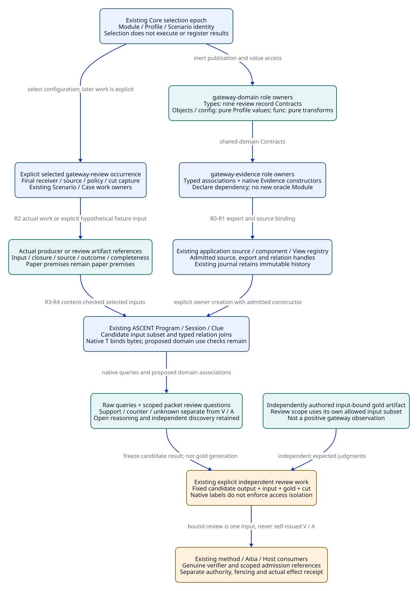
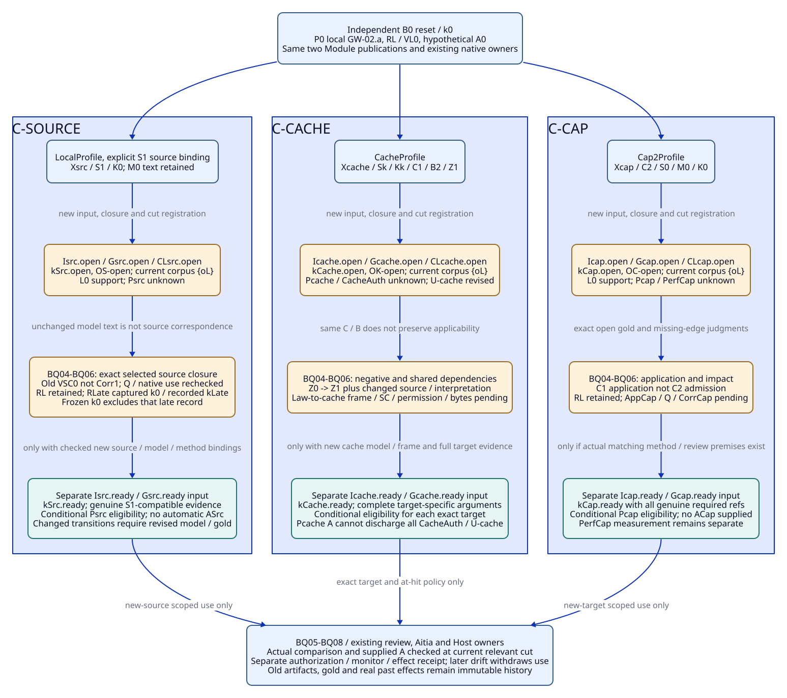

# SPDX-FileCopyrightText: 2026 hardenedlinux Linux Team and Contributors
#
# SPDX-License-Identifier: LGPL-2.1-or-later

#+TITLE: 20.06 Gateway Oracle Packets in Existing POO and ASCENT Owners
#+LANGUAGE: en
#+PROPERTY: JD_ID 20.06
#+OPTIONS: toc:3 num:nil
#+STARTUP: overview
#+TODO: OPEN SPECIFIED | QUALIFIED
#+FILETAGS: :gateway:poo:ascent:oracle:change:
#+LINK: smp https://github.com/tao3k/gambit-SMP/blob/2125416e8809b0fab86fd8341876cb984e937589/%s

[[file:../../00-09-project/00-documentation/00.01-index.org][Index]] | [[file:../../10-19-design/10-architecture/10.06-poo-ascent-integration.org][10.06 existing integration]] | [[file:../../30-39-evaluation/30-benchmarks/30.04-oracle-review-data-contracts.org][30.04 input and gold contracts]] | [[file:20.04-query-and-change-fixtures.org][20.04 query/change inputs]]

* SPECIFIED Scope and immutable source boundary
:PROPERTIES:
:CUSTOM_ID: packet-integration-scope
:STATUS: design-walkthrough-not-executed
:END:

This document maps the nine 30.04 review records into the existing two proposed
gateway publications and existing Core/ASCENT application mechanisms. A packet
means a reviewable tuple of those immutable record references. It is not a new
runtime object hierarchy, evidence store, resolver, scheduler or workflow engine.
No Module, Scenario, constructor, oracle, model, proof or package file is created.

All gateway records, source names, cuts, observations and successful method
premises below are hypothetical paper inputs. Native capability statements are
based on the committed sources below, re-read for this design. They are not a
live remote-head assertion, installed integration or an upstream test result.
Specula/TLAPS-Bench do not participate in these three native-framework packets.

#+NAME: packet-integration-source-boundary
| Source / immutable identity | Actual mechanism used by the design | Additional domain work still proposed |
|-----------------------------+-------------------------------------+----------------------------------------|
| Core 52130d2d338b09622a3f55e37987ddc0375b6187; [[file:../../../.gerbil/pkg/github.com/tao3k/poo-flow-core/init.ss][init]] | One selection epoch, literal Module/Scenario windows; mount names differ from publication identity | Selecting gateway publications, Profile observations and explicit review occurrences |
| ASCENT 144ed6e55110c4ccd1fa2a825f79007d1a3317d6; [[file:../../../.gerbil/pkg/github.com/tao3k/gerbil-ascent/evidence/interface.ss][Evidence DSL]] and [[file:../../../.gerbil/pkg/github.com/tao3k/gerbil-ascent/evidence/declaration.ss][declaration bindings]] | Ordinary Scheme constructor; native Program; sources/outputs relation handles; recorded-only explanation | Typed packet association rules, reviewed metadata and consumer policy |
| Same ASCENT; [[file:../../../.gerbil/pkg/github.com/tao3k/gerbil-ascent/rust/ascent/src/clues/exchange.rs][exchange]] and [[file:../../../.gerbil/pkg/github.com/tao3k/gerbil-ascent/rust/ascent/src/clues/projection.rs][projection]] | Host-content attestation, raw reads, select-then-read, hypothesis submit | Current engineering applicability, gold isolation and authentic producer/admission checks |
| Same ASCENT; [[file:../../../.gerbil/pkg/github.com/tao3k/gerbil-ascent/rust/ascent/src/clues/slices.rs][slice checkpoint reader]] | Digest/schema/source/anchor checks for prior presentation hints | Owned shown-history provenance; checksum alone is insufficient |
| SMP 2125416e8809b0fab86fd8341876cb984e937589; [[smp:evidence/views.json][View registry]], [[smp:evidence/scenarios/stack-header/components.json][component exports]], [[smp:evidence/scenarios/stack-header/clues.ss][clues and selector]] | Existing application source/constructor/View pattern and one-witness association | Gateway-specific domain facts; no transfer of SMP native success or facts |

The selected Core/Scenario APIs and package-binding limits remain those of
[[file:../../10-19-design/10-architecture/10.06-poo-ascent-integration.org::#gateway-init-correspondence][10.06]]. MB09's historical source pin remains unchanged. A Core semantic
Module and an ASCENT evidence-module value are different kinds of object; the
latter wraps Program/explanation/bindings and does not become a Core publication.

* SPECIFIED POO Module, Profile and Scenario allocation
:PROPERTIES:
:CUSTOM_ID: packet-poo-allocation
:STATUS: proposed-domain-record-bindings
:END:

Retain gateway-domain and gateway-evidence from 10.06. These names denote planned
publications using existing role policy, not new directories created here.
Record schemas are domain Contracts; pure values and ordinary native Evidence
constructors remain in their existing role owners. No third oracle Module is
required just to wrap review data.

#+NAME: packet-record-role-allocation
| 30.04 record | Proposed existing role location / responsibility | Explicit work and evidence boundary |
|--------------+--------------------------------------------------+--------------------------------------|
| OracleInputSpec | gateway-domain types Contract, objects Profile values; gateway-evidence types checks reference associations | Resolved effective receiver/source/Scenario occurrence captured explicitly, not by a module display name |
| InputClosure | gateway-domain types for typed root/edge/member states; pure func transforms; evidence association units join retained refs | Domain reviewer/actual artifact owners establish completeness; a graph traversal cannot discover omitted edges |
| CutSpec | domain types; selected Scenario's explicit capture input; evidence types for cut association | Capture actual source/content/policy/selected closure through existing owners, not during POO field lookup |
| CutComparison | domain types and pure comparison policy; explicit verifier/consumer-owned result referenced by evidence | A boolean in config does not certify equal current dependencies or a Host fence |
| TrustPremise | domain Contract and selected policy Profile; actual producer/issuer references handled by existing admission owners | Paper-premise mode never becomes an authentic receipt by serialization |
| OracleGoldSpec | domain types; independently authored retained artifact reference associated by gateway-evidence | Candidate rules do not derive gold. The same declaration grammar does not establish method independence |
| OracleReview | domain review Contract; explicit gateway-review occurrence refers to author/reviewer route and records | All reviews here remain author specifications; independent reviewer and execution evidence absent |
| ComparisonSpec | domain types and pure normalization/comparison policy; explicit review work consumes fixed output/gold refs | Comparison result belongs to that exact input/gold/cut; it is not A or deployment permission |
| BenchmarkBinding | domain types/objects refer to frozen MB/DC subcase contracts; selected Scenario occurrence binds one reviewed mapping | Not a second task manifest, runner or variant counter; 24 parent variants and their mandatory subcontrols remain |

#+NAME: packet-profile-occurrence-map
| Binding | Final receiver / parameter observations | Explicit Scenario occurrence and retained result |
|---------+-----------------------------------------+--------------------------------------------------|
| LocalProfile / base | X0/S0/C1/Q1/B2/K0, cache=false, local claims and complete B0 dependency scope | Separate base review occurrence, with B0's hypothetical evidence inputs |
| Cap2Profile | Direct C override to 2; same S0/M0/K0 interpretation and local scope; changed Xcap | gateway-review occurrence cap-open; a different predeclared cap-ready subcase if genuine new evidence is supplied |
| CacheProfile | cache=true, C1/B2 retained; Sk/Kk, principal/content/policy scope and shared buffer ownership exposed | gateway-review occurrence cache-open; explicit verification/resource work through existing Scenario/Case owners |
| LocalProfile with S1 source binding | Same local parameter values, changed selected implementation source Xsrc/S1; M0 text retained as a separate input | gateway-review occurrence source-open; t0's original occurrence/capture remains distinct |

The inherited value is the design/parameter contract, not another occurrence's
completed evidence or A. Observe the effective final receiver, parent order,
selected role-policy/source identity and dependency closure. An unchanged field
such as C=1 is not proof that cache retention or permission scope is unchanged.
A namespace rename or repeated use of one Profile does not identify two results.

Core's literal selection makes exports available. It does not run gateway-review,
construct a Session, attest bytes or authorize effects. Scenario work is explicit
through existing owners. Automatic package-to-Scenario binding remains an open
integration constraint, not an assumed feature used to complete these packets.

#+CAPTION: Existing POO roles own the review values; existing ASCENT constructors associate evidence without producing their own gold.

[[file:../../90-99-views/90-architecture-views/90.21-packet-module-evidence-binding.d2][Editable D2 source]].

* SPECIFIED Native Evidence DSL and registration mapping
:PROPERTIES:
:CUSTOM_ID: packet-evidence-binding
:END:

The inspected define-evidence accepts a constructor, sources, outputs, optional
explanation and native ascent clauses. Source/output labels bind declared native
relation handles; duplicate/conflicting bindings are checked by the declaration
owner. The declaration owner constructs its native Program from declared relations,
rules, limits and source handles. Ordinary Scheme helpers and native composition
retain their own semantics. This design neither replaces the
grammar nor adds a gateway wrapper language.

#+NAME: packet-evidence-data-mapping
| Data plane / domain meaning | Existing native mechanism / proposed domain facts | Cannot establish by itself |
|-----------------------------+---------------------------------------------------+-----------------------------|
| Source-backed record references | Evidence sources can bind declared relations for typed record kind/ID/body ref, closure edge/member, cut entry, slot and review metadata | Relation labels and strings do not authenticate record bodies or completeness |
| Candidate engineering view | Existing clue(id,digest,claim,polarity,role,source), factor(id,digest,name,value), link(claim,target,label,id,digest); admitted sources/reference bindings as in SMP | Factor vocabularies do not prove extraction truth or source refinement |
| Oracle input/gold specification | Retained refs associated through domain Program sources/outputs for discovery/review | Gold is not projected as an observation supporting Pcap/Pcache/Psrc merely because it states an expected answer |
| Independent review/comparison result | Actual existing reviewer/verifier artifact ref, exact input/gold/output/revision binding; domain facts only after genuine provenance checks | Recorded-only explanation and candidate-derived success cannot create an authentic V |
| Host byte association | Existing host content map and native attested(id,digest,receipt) | T binds bytes, not oracle independence, positive theorem truth or current engineering admission |
| Method slots and target argument | Proposed typed domain joins over exact witness/envelope/proposition/method/policy/cut, using native Program relations | Every AND slot being present does not prove arbitrary argument implication; Arg must be reviewed |
| Native questions and views | binding(name,value) plus admitted caller selector, or explicit question(claim); existing read/read_selected behavior | Selecting a positive witness does not remove a counter from the selected claim's read |

Proposed record/closure/cut relation names are descriptive data, not new installed
native API names. Any future lowering retains complete bodies and injective typed
IDs, including kind, packet/subcase namespace and EnvelopeId. Hash-shaped strings
cannot erase kind or policy differences. Raw duplicate keys must be retained for
J0 before an ordinary map parser can collapse them. Transport JSON is inert data;
no Agent-supplied raw initialization code is evaluated.

A packet reference normally needs no native clue at all. If a real review result
is deliberately exposed as an observation, its claim describes that exact review
subject, such as the comparison of a fixed output to fixed gold. It is not the
underlying gateway property. Non-Clue application/verifier records retain their
genuine producer/content path; no TApp or TGold is invented for unprojected refs.

** Registration through R0-R6
:PROPERTIES:
:CUSTOM_ID: packet-registration-handoffs
:END:

#+NAME: packet-registration-map
| Existing handoff | Packet-specific binding | Refusal / pending boundary |
|------------------+-------------------------+----------------------------|
| R0 Core publication | Two gateway exports, their native role/source identities and required Contracts | Import or folder presence creates neither Scenario result nor trusted packet |
| R1 application binding | Existing source/component/View registry pattern binds admitted constructor/export, exact source refs and declared input/output handles | No parallel packet registry; materialized IDs are typed association data in existing owners |
| R2 explicit results/intake | Capture immutable input/closure/cuts and independently authored gold/review refs; actual method attempts retain source/tool/outcome/completeness | Intended absent, unknown and invalid entries stay explicit; unexpected missing refs are a package/setup defect |
| R3 host content check | Read actual selected artifact bytes; verify source-label/digest association for projected observations | Missing/mismatched native content binding rejects attempted projection RJ05; not-yet-projected work can remain pending |
| R4 domain projection | Same-witness clue factors; domain record/slot/closure/cut associations, with input/gold/output subjects separate | Native T cannot qualify changed envelope metadata; conflicting observation reuse RJ04 |
| R5 existing verification/review/admission | Actual external owners check extraction, proposition, method/result kind, frame, completeness, independent review and argument | No rule issues its own successful V/A; unresolved cells block only dependent conclusions |
| R6 query and consume | Ask raw/discovery or scoped method/impact/review questions at named cuts; actual consumer validates supplied current A | Read/hint/compare is not effect authorization; actual Host boundary remains required |

These are ownership handoffs, not a compulsory reasoning order. A raw query or
hypothesis may precede method planning. Actual V/A or review results from R5 feed
a new input epoch with their own references; their issuance cannot be inferred
inside the same candidate closure that requested them.

The same existing registry may reference candidate and oracle-review constructors,
but their allowed input/producer/consumer scopes must be enforced by existing
application/task/authority owners. A label, source/output declaration or plane
factor is not an access-control boundary. In a future blinded Agent study, gold
must stay outside candidate-accessible inputs until the declared output freeze.
These public paper fixtures are not such a blinded study. Independent gold
means an independent derivation/review route as well as explicit exposure records;
secrecy alone, two sessions or two LLMs cannot establish it.

* SPECIFIED Shared packet queries and exact cut association
:PROPERTIES:
:CUSTOM_ID: packet-query-contracts
:END:

BQ names below identify review questions, not exported functions. Mathematical
domain judgments retain 10.07/30.04 meanings; only raw Clue relations are native
returned answers. A packet can be inspected as typed record refs without a clue
projection. Proposed query joins still need real implementation and qualification.

#+NAME: packet-query-register
| Query | Exact input / inspected closure | Expected result boundary |
|-------+---------------------------------+--------------------------|
| BQ01 publication and occurrence | selected Module IDs/role source, effective Profile receiver, Scenario occurrence/spec revision | Identity/source binding only; no execution/admission |
| BQ02 input/gold package | OracleInputSpec and OracleGoldSpec refs, closure roots, expected-present/absent/invalid/unknown edges, J-stage requests | Enumerate required refs and setup discrepancies; author-spec gold never becomes an executed oracle receipt |
| BQ03 raw gateway knowledge | exact owner/corpus and explicit claims; same-witness selector if discovery requested | Raw support/counter/conditional/conflict/unknown for those claims; no implicit V/A |
| BQ04 required slot and argument | target/Ob/Arg, slot-required propositions, T/V/application/mapping refs, complete scope and policy at use cut | Scoped pending/refusal/conflict/eligibility; owner claim differs from SC proposition |
| BQ05 independent comparison | frozen candidate output, independently fixed gold, input/closure/cut and ComparisonSpec | Exact required/forbidden/scoped unknown judgments; no fabricated result if reviewer/checker has not run |
| BQ06 impact and reuse | captured/use cuts, complete relevant dependency projections, historical/current artifact and application refs | Retained bytes versus retained applicability versus checked new-target transfer, separately |
| BQ07 A and operational consumption | actual A plus owner/Ob/Arg/policy/use cut; separate action/monitor/Host refs if requested | No A from eligibility; no authority/effect from A or plan |
| BQ08 presentation integrity | owner/content identity, selector/anchor, checkpoint body and owned prior shown-set | Hints only; checksum alone cannot authenticate display history or remove opposing review |

The [[file:20.07-packet-query-and-history-fixtures.org::#eight-packet-query-fixtures][20.07 fixtures]] expand every question into exact three-path inputs,
expected relations, evidence/cut bindings and independent judgments:
[[file:20.07-packet-query-and-history-fixtures.org::#bq01][BQ01]], [[file:20.07-packet-query-and-history-fixtures.org::#bq02][BQ02]], [[file:20.07-packet-query-and-history-fixtures.org::#bq03][BQ03]], [[file:20.07-packet-query-and-history-fixtures.org::#bq04][BQ04]],
[[file:20.07-packet-query-and-history-fixtures.org::#bq05][BQ05]], [[file:20.07-packet-query-and-history-fixtures.org::#bq06][BQ06]], [[file:20.07-packet-query-and-history-fixtures.org::#bq07][BQ07]] and [[file:20.07-packet-query-and-history-fixtures.org::#bq08][BQ08]].
The [[file:20.07-packet-query-and-history-fixtures.org::#late-intake-visibility][late-intake visibility table]] separates frozen k0 knowledge from later S0
history; [[file:20.07-packet-query-and-history-fixtures.org::#non-erasure-and-reuse-controls][non-erasure controls]] check that invalidation does not delete reusable inputs.

#+NAME: packet-witness-usage-bindings
| Use | Exact association / preserved original body | Requirement |
|-----+---------------------------------------------+-------------|
| uL-cap.open | (WitnessKey(oL,dL), EL, L0, L, kCap.open), new T-use association with OC-open and unchanged TL | Fresh usage identity; recheck content, policy and L0 footprint; EL's origin remains k0 |
| uL-cache.open | (WitnessKey(oL,dL), EL, L0, L, kCache.open), new T-use association with OK-open | This is L0 knowledge, not Pcache support or a cache frame proof |
| uL-src.open | (WitnessKey(oL,dL), EL, L0, L, kSrc.open), new T-use association with OS-open | Same law statement only; no automatic S1 application |
| uL-cap.ready | (WitnessKey(oL,dL), EL, Pcap, L, kCap.ready) through separately checked AppCap/VAppCap and complete guards | Do not rewrite EL's claim/factors or reuse uL-cap.open for a different tuple |
| Cache/source target uses | New full usage tuples for Pcache or Psrc at their exact use cut | Only after genuine target application/frame/source checks; unknown mapping stays pending |

Native TL still hashes the same source-label/digest; owner/usage metadata belongs
to the external T-use binding, not an invented native receipt extension. Each
usage ID is preallocated within its declared finite instance. Equal artifact
bytes or a shared law witness never make distinct target/cut usages identical.

A native read_selected first selects claims, then reads their witnesses. Filtering
by method=Q does not promise a positive-only read or a smaller opposing intake.
A hypothesis submission can change native facts while sourceIdentity remains
stable. Consumption compares actual relevant fact/content/support generations,
not just sourceIdentity or event count. Changed immutable observation inputs need
a newly constructed current owner; ordinary hypothesis appends retain native
exchange behavior and must still change the content-bound view comparison.

#+NAME: three-path-packet-cut-register
| Cut / owner symbol | Exact input phase | Permitted relation to earlier notation |
|--------------------+-------------------+-----------------------------------------|
| k0 / O0 | Full hypothetical B0 at X0/S0/C1/K0, I0 and Z0 empty-cache scope | Original capture, not a future cut overwritten in place |
| kCap.open / OC-open | Xcap/C2/S0/M0/K0; current Clue corpus {oL}, no AppCap/new Q/SC/A; old artifacts retained outside this current corpus | OC in 20.04's pre-application query denotes this phase |
| kCap.ready / OC-ready | Separately declared conditional input with checked AppCap/new Q/SC/mappings/intake/policy and no ACap | 30.04 kCap/Ocap can denote this phase only when every retained CutSpec/closure body agrees; not an alias of kCap.open |
| kCache.open / OK-open | Xcache/Sk/Kk/C1/B2/cache=true, Z1 cache-owner members, complete reviewed inventory input but unknown application/SC/security/resource results; current corpus {oL} | Owner OK in 20.04; different kind from oracle OK. DC13 kZ isolates only a membership mutation and is not this full cache change |
| kCache.ready / OK-ready | Conditional explicit new cache argument/model interpretation and every target-required slot/review at exact current policy, no new A unless actually supplied | No successful cache proof or completed receipt supplied by this document |
| kSrc.open / OS-open | Xsrc/S1, M0 text retained; current corpus {oL}; no Corr1/checked S1 application/A; t0 history remains S0 | OS in 20.04; 30.04 kS is the source-change discriminator, requiring full body binding before reuse as this expanded cut |
| kLate / existing journal intake | RLate is recorded after kSrc.open, with immutable capture/input scope t0/k0/X0/S0/P0 | Journal-observation creation/intake cut differs from input capture; frozen k0/Pfx0 reads exclude RLate |
| kSrc.ready / OS-ready | Conditional S1-compatible model/transition/source/native applications, mappings and review; no automatic ASrc | Separate input/gold revision; never relabel t0/RLate or A0 |

The [[file:20.08-qr-identity-and-reuse-controls.org::#qr-cut-identity-dag][20.08 identity audit]] makes an important distinction: OC/OK/OS names are
logical application bindings, not proof that native sourceIdentity differs.
Identical actual raw declarations/inputs/attestations yield the same native N_L;
current Profile/usage/T-use/cut checks remain independent. Native hint reset is
conditional on actual source identity, with rescope for changed anchors, not on
a new domain label. The [[file:20.08-qr-identity-and-reuse-controls.org::#qr03][QR03]] and [[file:20.08-qr-identity-and-reuse-controls.org::#qr11][QR11]] controls cover that boundary.

Captured CutSpecs bind frozen input roots/generations before usage/query verdicts.
They do not hash their own ID or a recursively self-containing set of Usage,
T-use and comparison results about that same cut. The
[[file:20.07-packet-query-and-history-fixtures.org::#query-cut-epoch-boundary][input-epoch boundary]] keeps later feedback and review records separately bound.

All labels are case/subcase-qualified symbolic names, not calculated native IDs.
Changing source/fact bindings requires new materialized identities under the
existing owner. A cut's relevant projection includes oracle-definition/review
revision when a comparison result is consumed. Editing an oracle can invalidate
comparison applicability without changing the gateway proposition itself.
Open/ready gold packages are independently predeclared; observed success cannot
be used to edit open gold into ready gold. All per-instance finite budgets remain
those of the chosen reviewed envelope, never a reason to drop counters or scope.

* SPECIFIED Three independently reset data-package reviews
:PROPERTIES:
:CUSTOM_ID: three-packet-reviews
:END:

#+NAME: packet-nine-record-positions
| 30.04 record position | C-CAP open | C-CACHE open | C-SOURCE open |
|----------------------+------------+--------------+---------------|
| OracleInputSpec | Icap.open | Icache.open | Isrc.open |
| InputClosure | CLcap.open | CLcache.open | CLsrc.open |
| CutSpec | k0 and kCap.open retained bodies | k0 and kCache.open retained bodies | k0 and kSrc.open retained bodies |
| CutComparison | CCcap, author-spec comparison of relevant projections | CCcache, author-spec full cache-change comparison | CCsrc, author-spec selected-source comparison |
| TrustPremise | TPcap.open: hypothetical producer/method/AP0 trust bindings | TPcache.open: same trust mode plus declared permission/source/review scope | TPsrc.open: same mode plus captured/current source/checker mapping |
| OracleGoldSpec | Gcap.open | Gcache.open | Gsrc.open |
| OracleReview | Rcap.open, author-spec only | Rcache.open, author-spec only | Rsrc.open, author-spec only |
| ComparisonSpec | CompareCap, required record absent until fixed candidate output exists | CompareCache, same intentional absence | CompareSrc, same intentional absence |
| BenchmarkBinding | BindCap: individual existing MB/DC mapping refs | BindCache: individual existing MB/DC mapping refs | BindSrc: individual existing MB/DC mapping refs |

CompareCap/CompareCache/CompareSrc name required record positions, not completed
comparisons with invented output IDs. The pure comparison policy is predeclared;
a populated immutable ComparisonSpec is created only after a real candidate
output reference is frozen. Actual comparison work returns another properly
bound result reference. No earlier input/gold/history body is edited to add a
successful verdict. Each Bind group contains individual BenchmarkBinding refs
for exact variant/subcase revisions; it is not a new batching object or runner.
Ready positions use separately declared ready input/gold/closure/cut refs and
their own review/compare bindings, never the open packet's comparison result.

The shared paper source-vector below supplies concrete retained-body labels for
source/cut review, not real hashes or files. Every listed member is an input to
its declared selected closure; genuine transitive discovery/coverage remains an
independent qualification requirement. If an actual observer cannot account for
a relevant helper/private/generated dependency, it is unknown, not omitted.

#+NAME: packet-selected-source-vectors
| Input dimension | B0 / cap-open | cache-open | source-open |
|-----------------+---------------+------------+-------------|
| Admitted constructor/role declaration | EDecl0 / domain declaration DDecl0, hypothetical gateway bodies using the inspected native grammar | EDecl0 only if unchanged admitted projection covers the added records; otherwise explicit EDeclCache revision and fresh registration | EDecl0 only if the projection interpretation is unchanged; changed extractor requires new source/mapping identity |
| Implementation source members | Release0, Helper0, declared private/dependency manifest Dep0 under S0; cap changes configuration C1 to C2 | Explicit Sk manifest includes new CacheBody1 and retained/changed release/helper members; each member and negative/aggregate scope reviewed | Release1 replaces Release0 under S1; Helper0 unchanged only if actual bytes/closure agree; changed members cannot hide behind the same count |
| Model / observation interpretation | M0 / K0; C2 is a new parameter application | M0 law retained; cache model/frame interpretation unresolved, Kk explicit | M0 text retained; Corr1/event correspondence unresolved |
| Producer tool identity | Declared checker/toolchain/environment vector Tool0; any actual change gets its own recorded identity | Tool0 reuse only under verified equality/current method policy | Old Bin0, if present historically, is not an S1 binary; new BinSrc and its native receipts absent until genuinely produced |
| Oracle and review source | ODef0 and review-policy source RevDef0; new target-bound Gcap, never copied old comparison | Same definitions only if unchanged; new input-bound Gcache/inventory/permission gold | Same definitions only if unchanged; new input-bound Gsrc and source/trace gold |
| Captured prefixes / history | Pfx0 captured with k0; cap-open has separate current content generation | Fresh cache source/content/member generations; Pfx0 retained as history | t0 binds Pfx0/X0/S0; any equal-count later prefix must have its own content identity |

Each branch resets from B0. The common J0-J9 stage meanings, RB/WB/QB/LB/SB/EB/AB
and IB/HB/PB closures are from 30.04. EB/AB are B0-specific; target analogues below
bind new descriptors/slots, not aliases of those old closures. Walkthrough closure
means every requested judgment has an explicit expected outcome, including pending;
it does not mean the new gateway design has passed verification.

#+CAPTION: Open packets end with scoped pending work; ready packets are separate conditional inputs, not results manufactured by inheritance.

[[file:../../90-99-views/90-architecture-views/90.22-gateway-packet-three-paths.d2][Editable D2 source]].

** SPECIFIED C-CAP: C1 to C2
:PROPERTIES:
:CUSTOM_ID: packet-c-cap
:PATH_ID: C-CAP
:BASELINE: B0
:STATUS: open-target-pending-conditional-ready-input-separate
:END:

#+NAME: cap-packet-data
| Record refs / requested judgment | Exact data and independent gold specification |
|----------------------------------+------------------------------------------------|
| Icap.open / BQ01-BQ02 | Cap2Profile final C=2, Xcap/S0/K0/M0; Pcap/ObCap/ArgCap with mandatory L/Q/SC and local consumer; explicit occurrence cap-open; J1/J2/J3/J4/J8 requested, J5 when prerequisites supplied |
| CLcap.open | Dcap, explicit PerfCap descriptor (C2/W1/H0), ObCap/ArgCap/required slots, selected constructor/source, k0/kCap.open, RB and WB(oL)/RL/TL/VL0/VMapL, original AB retained as history; AppCap/VAppCap, new Q/SC/mappings and ACap expected absent; complete declared intake/guard inventories supplied as hypothetical scope inputs |
| Gcap.open | OC: DifferentClaim(P0,Pcap). BQ03 raw read([L0,Pcap,PerfCap]) gives support={(L0,oL,dL,sL,TL)}, unknown={Pcap,PerfCap}; no fabricated Pcap witness. BQ04 L application pending method, required new Q/SC pending, PF separately pending; no target eligibility/A established |
| CCcap / J8-J6 | Captured k0 versus kCap.open: C/configuration/target dependencies changed; source/model/law bytes unchanged. Refuse copying old concrete current-use qualification; retain History(A0,k0). If old direct P0 artifact is offered for Pcap, J2 RJ03; if old A0 is offered for ObCap, J6 contract comparison RJ08. These are separate requested attempts |
| Review/compare/binding refs | Rcap.open records author route/unassigned independent review, MP0/AP0 and hypothetical mode; CompareCap binds fixed output ref only if an actual comparison is performed. BindCap links MB06-H/A and relevant DC02/09/10/12/16 obligations, not an executed score |

#+NAME: cap-packet-walkthrough
| Handoff / stage | Registration, query, invalidation or reuse decision | Complete scoped outcome / remaining work |
|-----------------+-----------------------------------------------------+------------------------------------------|
| R0-R1 / BQ01 | Select the same two publications, bind Cap2Profile/occurrence and unchanged admitted constructor source | No new publication or framework; changed Profile requires fresh input/context refs |
| R2-R4 / J1-J2 | Retain original AB in existing history; construct current OC-open with only the admitted EL observation; register I/G/CL/cut refs as review data | RL/TL is content-bound for L0. Gold is a specification ref, not another positive Pcap observation |
| R6 / BQ03 | Read L0/Pcap/PerfCap in OC-open; optionally select C=2 | Explicit claim read returns the gold above. A factor selector can find no current C2 observation; selected-empty read is not the same as explicit unknown |
| R5 / BQ04 | Resolve L law plus missing AppCap, then separately required Q and SC at C2; SC required proposition is CorrCap, owned by Pcap | VL0 alone is not VAppCap; missing application pending method, wrong offered subject RJ06 |
| J8 / BQ06 | Compare complete relevant point/policy/slot/negative scope projections | Old A's copied present use is not current target admission; unchanged law artifact remains reusable through a checked new-target application |
| Conditional new input | Icap.ready/Gcap.ready/CLcap.ready bind kCap.ready, AppCap/VAppCap, RCap/ECap/TCap/VQCap, RSCcap/ESCcap/TSCcap/VSCcap, exact extraction mappings, full argument/slots and clean reviewed intake | Only under those genuine external-premise inputs can J5 establish Eligible(Pcap,ObCap,kCap.ready). No ACap supplied => J6 pending method, no CurrentAUse. PerfCap still requires separate C2/W1/H0 measurement |
| R5-R6 / BQ05-BQ07 | Independent comparison and actual scoped A/admission would be separate new records, checked at use cut; authority/effect if requested separately | No actual oracle comparison, V/A issuance or Host action occurs here. A later drift withdraws affected use even if the earlier conditional package was valid |

** SPECIFIED C-CACHE: enable cache
:PROPERTIES:
:CUSTOM_ID: packet-c-cache
:PATH_ID: C-CACHE
:BASELINE: B0
:STATUS: revised-cache-security-resource-and-source-premises-pending
:END:

#+NAME: cache-packet-data
| Record refs / requested judgment | Exact data and independent gold specification |
|----------------------------------+------------------------------------------------|
| Icache.open | CacheProfile Xcache/Sk/Kk/C1/B2, cache owner introduced, exact principal/content/current-policy scope; targets Pcache and CacheAuth; occurrence cache-open; J1-J4/J8 and raw BQ03 |
| CLcache.open | Dcache and CacheAuth descriptor, revised Ob/Arg/slot inventories and U-cache=U0 plus GW-01.c, changed existing lineage meanings/origins; k0/kCache.open and Z0={} to Z1={cacheOwner}; complete selected source/config/member closure; RL/TL/VL0/VMapL retained for L0; current cache model/SC/application/security/resource/PF checks explicitly unknown or absent |
| Gcache.open | Independent O1 exact inventory/required slots revised, not sixteen-lineage count reuse. Raw read([CacheAuth,Pcache,L0]) yields support={(L0,oL,dL,sL,TL)}, unknown={CacheAuth,Pcache}. Known changed negative scope withdraws affected old use; unknown cache frame/model/mapping keeps target slots pending binding/method/scope as appropriate |
| CCcache | Compare source Sk, interpretation Kk, cache-member/aggregate/permission/shared-byte dependencies and required policy/slots at kCache.open against B0, not C alone |
| Review/compare/binding refs | Rcache.open remains author-spec review; CompareCache needs fixed authentic input/output/gold/cut/revision and real review execution; BindCache retains MB05-H/A, DC03/05/11/12/13/15/16 and independent O1/O3/O6/resource obligations |

#+NAME: cache-packet-walkthrough
| Handoff / stage | Registration, query, invalidation or reuse decision | Complete scoped outcome / remaining work |
|-----------------+-----------------------------------------------------+------------------------------------------|
| R0-R1 / BQ01 | Use same domain/evidence publications; bind cache Profile/final receiver and changed constructor contribution only if actual projection source changed | No automatic new Module per concern; changed code needs changed source identity, not an edited name pretending old code is current |
| R2 / BQ02 | Register independent inventory/gold refs and exact closure states; changed cache result records remain absent/unknown, not empty successful sets | Gold cannot derive U-cache from the same candidate rules. Independent reviewer and real oracle implementation remain required |
| R3-R4-R6 / BQ03 | New current OK-open carries only oL; old responses/admissions remain historical outside this corpus | No fabricated cache-hit clue or positive CacheAuth witness. Owner OK-open and oracle family OK have different typed namespaces |
| J8 / BQ06 | Observe empty-to-nonempty cache-owner scope, retained bytes, source/interpretation/permission dependencies | A0's known affected present use withdrawn; attempted stale own-scope use RJ10. An unknown full footprint yields conservative withdrawal plus pending impact, not a claim that a theorem is false |
| R5 / BQ04 | Validate explicit new argument/frame/model interpretation before law transfer to Pcache; review CorrCache and security/resource requirements separately | L0 remains the original M0 law. Whether M0 describes the cache system is unresolved; an unchanged permit law proves neither cached bytes <=2 nor response authorization |
| Required security subcases | Separate healthy pA/t1/v0/private-context hit; pB/t1 wrong-principal hit under v0; same pA after v1 revocation. Freeze independent permission table and at-hit policy cut for each | Healthy authorization requires genuine current evidence; wrong principal rejected; revoked policy cannot reuse an old decision. No mutation leaks between these MB05 subcases |
| Conditional new input | Icache.ready/Gcache.ready/CLcache.ready require reviewed cache-model/frame or revised law, complete revised target slots/argument/intake, exact byte/resource accounting, genuine SC and permission/replay/current-policy controls | Any eligible admission is target-specific. A new Pcache A does not discharge CacheAuth or every U-cache obligation. No such successful evidence or A is supplied here |
| BQ05-BQ07 / feedback | Existing review/authority/Host owners bind comparison, actual admission and at-use permission/fence; changed policy reopens affected consumers | Native T, a review label or a plan cannot replace current authorization or actual effect receipt; operational closure remains open |

** SPECIFIED C-SOURCE: S0 to S1
:PROPERTIES:
:CUSTOM_ID: packet-c-source
:PATH_ID: C-SOURCE
:BASELINE: B0
:STATUS: current-source-correspondence-and-application-pending
:END:

#+NAME: source-packet-data
| Record refs / requested judgment | Exact data and independent gold specification |
|----------------------------------+------------------------------------------------|
| Isrc.open | Local parameter values retained; selected implementation Xsrc/S1, K0 interpretation and M0 text declared unchanged; Psrc/Corr1/new ObSrc/ArgSrc; t0 captures original X0/S0/P0/k0; occurrence source-open |
| CLsrc.open | Dsrc, Corr1, new required slots/guards/intake, exact selected source/helper/compiler/private closure and producer identities; k0/kSrc.open; current WB(oL)/RL/TL/VL0/VMapL; VSC1, new target application/Q/native checks and ASrc absent or unresolved; historical original AB and t0 separate |
| Gsrc.open | OC DifferentClaim(P0,Psrc); raw OS-open read([Psrc,L0]) gives support={(L0,oL,dL,sL,TL)}, unknown={Psrc}. Corr1/source mapping pending; old VSC0 offered as VSC1 rejects RJ06. Unchanged M0 text cannot establish S1 correspondence |
| CCsrc | Required source/selected closure/mapping generations changed; original method artifact bytes may remain valid historically. RLate must bind t0/X0/S0/P0 even after current publication |
| Review/compare/binding refs | Rsrc.open records source/model/checker assumptions and unqualified independent review. CompareSrc binds exact input/gold/output and captured/use cuts; BindSrc retains MB08-H/A and relevant MB09 selection controls, DC02/05/07/09/12/14/16 without retargeting historical MB09 |

#+NAME: source-packet-walkthrough
| Handoff / stage | Registration, query, invalidation or reuse decision | Complete scoped outcome / remaining work |
|-----------------+-----------------------------------------------------+------------------------------------------|
| R0-R2 / BQ01-BQ02 | Preserve t0's source/spec/occurrence; register new actual source refs and explicit current occurrence | Same import/mount/Model name cannot equate S0 and S1. No filesystem watcher is implied by a content attestation |
| R3-R4 / J2 | Verify current source/reference bytes through existing host owner, construct OS-open with only unchanged oL | Genuine old bytes remain true content receipts for old artifacts; no relabeling old o+ or ESC0 as S1 observations |
| R6 / BQ03-BQ04 | Read Psrc/L0; inspect required L/Q/SC/source/native mappings | Raw gold above; SC requires Corr1, not direct Psrc proof by VSC0. No eligible S1 argument from missing mappings |
| Late R2 result | RLate/t0 returns after S1 publication; validate immutable origin rather than dropping it or promoting it | Retain RLate with capture/input cut k0 and recording/intake cut kLate; it did not exist in frozen Pfx0, whose reads still exclude it. Direct attempted application to Psrc is RJ03 at target binding; old A0's own-scope current use after required source change is RJ10. These are separate judgments |
| J8 / BQ06 | Recheck complete selected source/test/helper/private/compiler and interpretation dependencies; unknown observers invalidate conservatively | Withdraw affected application/comparison eligibility; do not erase old source receipts, real past effects or independent law facts |
| Reuse review | RL/VL0 remain L0 under M0. A model Q artifact may remain readable, but VQ0 was scoped to P0 and needs a checked target application or genuine new verification for Psrc | Neither unchanged M0 nor equal test-file count grants Q/SC/native reuse. If S1 changes transition interpretation, revise model/law and gold, not only source metadata |
| Conditional new input | Isrc.ready/Gsrc.ready/CLsrc.ready bind kSrc.ready, real Corr1/VSC1, reviewed source/model/frame applications, every required new target Q/native/mapping/coverage result and policies | Under genuinely supplied matching premises J5 may establish target eligibility; absent ASrc leaves J6 pending method. No current admission/Host receipt is manufactured |
| BQ05-BQ08 / consume and retain | Independent comparison binds oracle definition/review revision too; consume actual A at current relevant cut, use owned display history; old Session may close | A subsequent source/oracle-policy change reopens dependent use. Existing journal/source authority retains history; checkpoint replay is not durable evidence storage |

* SPECIFIED Recheck OA01-OA15 on all three packets
:PROPERTIES:
:CUSTOM_ID: packet-oa-audit
:STATUS: design-dispositions-native-qualification-open
:END:

Each row names the concrete check in C-CAP, C-CACHE and C-SOURCE. Design resolution
means an explicit input/judgment boundary. No row is a completed independent
review or proof of native behavior. OA numbering is preserved from 30.04.

#+NAME: packet-fifteen-assumption-audit
| Assumption | C-CAP check | C-CACHE check | C-SOURCE check | Design disposition / residual gate |
|------------+-------------+---------------+----------------+------------------------------------|
| OA01 framework ownership | Cap2Profile and existing constructor, no external case input | Same two Modules, cache values/obligations | Same selection/producer/journal pattern | No external replay dependency; real Module/Scenario binding still unimplemented |
| OA02 paper gold versus execution | Gcap.open/ready separate author specs | Gcache inventory/permission gold not completed oracle | Gsrc/CompareSrc no actual comparison receipt | Register spec as spec; independent reviewer/checker execution required |
| OA03 absent versus broken input | AppCap/new Q/SC/ACap intentionally absent | Cache model/frame/method results unknown or absent | Corr1/VSC1 and ASrc unresolved | Keep four closure states; unexpected missing retained roots are package/setup defects |
| OA04 closure completeness | Exact L/Q/SC slots, frame and intake | Revised U-cache, Z1, permission/shared-byte/negative scopes | Selected helpers/private/compiler/event mapping | Review declared edge/member/terminal-root completeness; graph traversal alone insufficient |
| OA05 cut identity | kCap.open differs from conditional kCap.ready | kCache.open differs from DC13 isolated kZ | kSrc.open, t0 capture k0, late intake kLate and ready cut differ | Case-qualified retained bodies; actual atomic source capture/use comparisons still required |
| OA06 selective invalidation | C-dependent use withdrawn, L0 retained | Absence/cache/aggregate/permission affected; same C insufficient | S1-dependent source/application use withdrawn | Complete relevant projection, unknown conservative fallback; no blanket deletion or perpetual reuse |
| OA07 slot-required proposition | VSCcap checks CorrCap toward owner Pcap | CorrCache/frame and explicit cache argument required | VSC1 checks Corr1 toward owner Psrc | Review actual argument implication; neither AND inventory nor SC label proves owner claim |
| OA08 opposing evidence | Counter intake cannot be removed by C/method selector | Wrong-principal/revoked-policy review not hidden by tenant filter | Late source result recorded at kLate, never added to old k0; current counter intake separately complete | Pending review blocks clean A; trusted intake and disposition provenance remain integration work |
| OA09 semantic projection | Typed C2/context/units and new target | Same B2 with changed retained owners/permission interpretation | Same M0 label with different implementation | Injective typed lowering and authentic extraction needed; no same-ID equivalence shortcut |
| OA10 full benchmark semantics | MB06 still needs genuine law/application and Q/PF distinction | MB05 still needs independent policy/trace/resource semantics | MB08/09 still need concurrent/selected-process evidence | DC associations do not replace O2/O3/O4 or mandatory parent subcontrols |
| OA11 verified record versus sound result | Positive result kind/frame/model checked | Independent cache/security/model results and assumptions | Correct S1 checker/source/transition scope | Actual genuine trusted verifier runs required; accepted counterexample remains counter, not positive proof |
| OA12 incomplete versus counterexample | Missing evidence pending; limits inconclusive | Unknown model/footprint pending, invalid hit separately refused | Late completion not current success; observer failure unknown | Exact stage-local gold, no timeout/setup failure credit as semantic counterexample |
| OA13 independence and exposure | Gcap not computed from candidate Pcap answers | Independent U-cache/permission table, not candidate rules | Source/trace gold not copied from actual candidate trace | Existing task/authority owners enforce exposure; native relation labels are not an isolation mechanism |
| OA14 accessible/current refs | RL byte availability/trust/method policy rechecked | Cache/source/gold refs and permission revocation rechecked | Historical RLate access distinct from current applicability | Stable ID no access/reuse guarantee; unavailable required bytes stay pending |
| OA15 finite scope and consumers | C in {1,2}, local claim; PerfCap separate | Pcache and CacheAuth separate, no whole-gateway acceptance | M0 finite semantics not universal native/refinement proof | New consumers/protocols/clock/workloads reopen obligations; QNT/Lean/native/operations gates remain |

Additional consequences exposed by this walkthrough are kept inside those same
OA contracts: gold/output access separation is not provided by native labels
(OA13); a ready cut is not an open cut with a nicer name (OA05); the full cache
change is not the isolated Z0->Z1 mutation (OA04/OA06); and a changed oracle
source can invalidate a comparison without changing ClaimId (OA05/OA11). Late
record creation is distinct from its original input capture, so old-prefix
queries never import future evidence (OA05/OA08).
No extra framework primitive or scored Benchmark variant is introduced.

* OPEN Qualification handoff through existing owners
:PROPERTIES:
:CUSTOM_ID: packet-integration-handoff
:END:

- [ ] Review the role/record allocations and exact final-receiver/Scenario binding with Core owners.
- [ ] Independently review every I/G/CL/cut/argument body and intentional absence before implementing the domain associations.
- [ ] Qualify real source/constructor registration, typed extraction, packet access and genuine method-result provenance.
- [ ] Check open/ready and late-result cuts using actual publication/consumption concurrency and conservative invalidation.
- [ ] Obtain real QNT/Lean/SC/native/resource/security/performance evidence only for the targets that require it.
- [ ] Bind actual Aitia admission/authority and Host fences/receipts before any operational conclusion.

#+begin_important
This is a completed design walkthrough to explicit pending/refusal/conditional
outcomes. It delivers no executed oracle, actual V/A, integrated Module, native
acceptance or Agent-efficacy claim. Agent discovery remains open; these graph and
reference constraints govern justified conclusions and effects.
#+end_important
