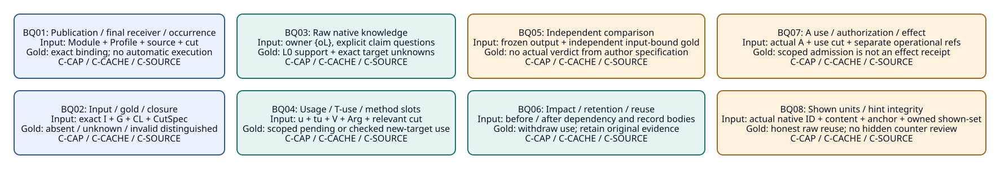
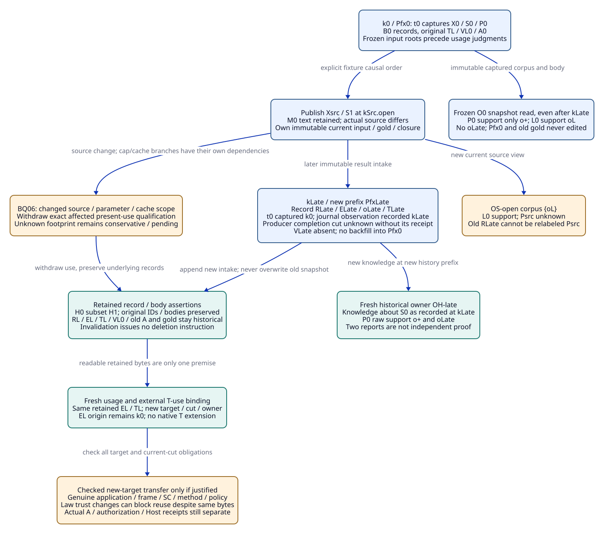

# SPDX-FileCopyrightText: 2026 hardenedlinux Linux Team and Contributors
#
# SPDX-License-Identifier: LGPL-2.1-or-later

#+TITLE: 20.07 Packet Query Fixtures, Snapshot Visibility and Retained Evidence
#+LANGUAGE: en
#+PROPERTY: JD_ID 20.07
#+OPTIONS: toc:3 num:nil
#+STARTUP: overview
#+TODO: OPEN SPECIFIED | QUALIFIED
#+FILETAGS: :gateway:query:oracle:history:reuse:

[[file:../../00-09-project/00-documentation/00.01-index.org][Index]] | [[file:20.06-oracle-packet-integration.org][20.06 native-owner allocation]] | [[file:20.04-query-and-change-fixtures.org][20.04 native raw fixtures]] | [[file:../../30-39-evaluation/30-benchmarks/30.04-oracle-review-data-contracts.org][30.04 review records and stages]]

* SPECIFIED Scope and query result planes
:PROPERTIES:
:CUSTOM_ID: expanded-packet-query-scope
:STATUS: hypothetical-input-and-gold-not-executed
:END:

BQ01-BQ08 are review questions within the existing POO/Core and ASCENT owners,
not new API exports or a new query framework. This document expands 20.06's
questions into concrete paper inputs, expected rows, evidence bindings and
independent review judgments. No Module, oracle, Session, gateway or runtime is
implemented or executed. All IDs, digests, successful external premises and
outcomes remain hypothetical; author gold is not an independently executed oracle.

Each branch resets independently from B0. Native Clue results are distinguished
from proposed domain association/qualification judgments and from actual external
verifier/admission/operational records. The additional mathematical row labels
below describe finite expected relations under the existing Evidence DSL mapping.
They do not add record kinds beyond 30.04 or install native predicates.

#+NAME: expanded-query-result-planes
| Plane | Exact interpretation | Example |
|-------+----------------------+---------|
| Native raw | Actual pinned Clue relation meanings over an explicitly supplied corpus | support(L0,oL,dL,sL,TL); unknown(Pcap) |
| Proposed domain association | Typed relationship to be implemented as domain data/joins through existing owners | InputGold(Icap.open,Gcap.open); Usage(uL-cap.open,wL,EL,L0,L,kCap.open) |
| Qualification judgment | Reviewed expected pending/refusal/conflict/eligibility or applicability at the requested stage/cut | Pending(method,AppCap,J3); WithdrawnUse(A0,k0,kSrc.open) |
| External result | A genuine verifier, independent comparison, Aitia admission, authorization or Host receipt | Not present merely because a gold row says what should happen |

Rows and aliases are case/subcase-qualified. A completed named relation scope can
have an exact empty set; a stage not evaluated has no asserted semantic result.
The statuses and RJ codes retain 10.07/20.05 meanings. Package/setup discrepancies
are distinct from semantic counterexamples and are not assigned invented RJ codes.
BQ questions do not prescribe investigation order or restrict Agent hypotheses.

* SPECIFIED Exact input, usage, T-use and gold bindings
:PROPERTIES:
:CUSTOM_ID: query-binding-ledger
:END:

Reuse B0 from 20.05 and the complete source/record positions of 20.06. For these
open-phase queries, each current Clue corpus is exactly {oL}, with clue tuple
(oL,dL,L0,support,observation,sL), factors {(model,M0),
(quantifier,all-admissible-C),(method,L)}, empty links and host map {sL:dL}.
History retains {R+,RL,RSC0,RF0,App0,VApp0,VQ0,VL0,VSC0,VMap+,VMapL,VMapSC,A0}
and their original metadata. Keeping history does not insert it into that corpus.

#+NAME: expanded-query-path-bindings
| Path | Effective Profile / occurrence / owner | Input/gold/closure and use cut | Target closure intentionally absent or unknown |
|------+----------------------------------------+-------------------------------+------------------------------------------------|
| C-CAP | Cap2Profile, C2/S0/M0/K0/Xcap; cap-open; OC-open | Icap.open / Gcap.open / CLcap.open / kCap.open; TPcap.open, Rcap.open, CCcap | AppCap/VAppCap, new Q/SC mappings and ACap absent; PerfCap separately lacks measurement |
| C-CACHE | CacheProfile, C1/B2/Sk/Kk/Xcache/cache=true; cache-open; OK-open | Icache.open / Gcache.open / CLcache.open / kCache.open; TPcache.open, Rcache.open, CCcache | Cache model/frame/application, CorrCache/security/resource methods unknown or absent; new target admissions absent |
| C-SOURCE | LocalProfile with S1/Xsrc/K0; M0 text retained; source-open; OS-open | Isrc.open / Gsrc.open / CLsrc.open / kSrc.open; TPsrc.open, Rsrc.open, CCsrc | Corr1/VSC1, new source application/Q/native mappings and ASrc unresolved; t0 remains captured at k0 |

OC-open/OK-open/OS-open identify logical application materializations, not
necessarily distinct native sourceIdentity values. Nraw-cap/Nraw-cache/Nraw-src
below mean the actual native digest of declarations/constructor/supplied facts/
attestations/query rules for that raw projection. If those inputs are identical,
the native identities agree (N_L), even though Profile/usage/cut bindings differ.
See [[file:20.08-qr-identity-and-reuse-controls.org::#qr-cut-identity-dag][20.08's identity dependency contract]].

Equal native identity also does not authorize sharing mutable hypotheses or
shown-history state across independently declared scopes. A frozen snapshot
means the captured corpus/output or a faithfully reconstructed owner input;
reading a later mutated live exchange with its old label is not an as-of query.
The [[file:20.08-qr-identity-and-reuse-controls.org::#qr03][QR03 isolation companion]] and [[file:20.08-qr-identity-and-reuse-controls.org::#qr06][QR06 visibility control]] state the exact gold;
no native snapshot API or host isolation implementation is asserted.

The same existing two proposed gateway publications and source/constructor
registration pattern are used throughout. 20.06 supplies EDecl0/DDecl0 and the
source-vector dependencies; an actual changed constructor requires its actual
new source identity. No directory or registry is created by these examples.

#+NAME: expanded-query-usage-tuse-bindings
| Usage ID / exact tuple | T-use input body, separate from native TL | Required checked association |
|------------------------+-------------------------------------------+------------------------------|
| uL-cap.open=(wL,EL,L0,L,kCap.open) | tuL-cap.open=(TL,RL,sL,dL,wL,EL,OC-open,uL-cap.open,HC-cap,kCap.open) | Host check HC-cap binds actual sL bytes; VMapL binds extraction; L0/MP0 footprint current |
| uL-cache.open=(wL,EL,L0,L,kCache.open) | tuL-cache.open=(TL,RL,sL,dL,wL,EL,OK-open,uL-cache.open,HC-cache,kCache.open) | Same original EL, new owner/usage; no Pcache frame inferred |
| uL-src.open=(wL,EL,L0,L,kSrc.open) | tuL-src.open=(TL,RL,sL,dL,wL,EL,OS-open,uL-src.open,HC-src,kSrc.open) | L0 law use only; no S1 source application inferred |
| uL-cap.ready=(wL,EL,Pcap,L,kCap.ready) | tuL-cap.ready=(TL,RL,sL,dL,wL,EL,OC-ready,uL-cap.ready,HC-cap.ready,kCap.ready) | Separate conditional input: authentic AppCap/VAppCap, target guards and complete new method/review closure |

wL is the full namespaced WitnessKey (nsL:oL,dL), not just a business label.
HC-* are explicit hypothetical host-check inputs, not results invented by rules.
Every tuple retains full typed IDs/bodies. Native TL still binds only source
label sL and digest dL; the owner, usage and cut are external T-use fields, not
an extension of TL. EL retains claim L0, its original factors and origin k0.
Multiple usages of EL do not duplicate or mutate the native clue in one owner.

A usage ID is reused only for the identical tuple. A new target, role, envelope
or cut requires another usage ID and corresponding guard/T-use associations.
A native T can remain byte-identical while its old T-use fails the new owner/cut
binding. AppCap and gold refs need no invented native T unless actually projected
as observations; their own authentic content/provenance path is still required.

** Cut identity and input epochs
:PROPERTIES:
:CUSTOM_ID: query-cut-epoch-boundary
:END:

Freeze the exact relevant input roots/generations before evaluating usages about
them. A CutId cannot be the hash of a set that includes its own identity or all
Usage/T-use/ComparisonResult rows that already reference that same CutId. Those
judgment records bind the captured input cut; feedback becomes a separately
identified input epoch. Explicit finite root/member scope and retained cut bodies
are required, rather than a recursive content-hash fixed point.

A review package's current manifest can point to both the immutable captured
CutSpec and its later usage/result records. That manifest does not rewrite the
captured input cut. Evidence/policy changes generate a new cut for present-use
comparison. This is an identity/epoch boundary in the existing owners, not a new
snapshot engine. Atomic capture, exact native integration and concurrency fencing
remain unqualified implementation obligations.

#+CAPTION: Eight review questions keep raw knowledge, scoped bindings and actual external results distinct.

[[file:../../90-99-views/90-architecture-views/90.23-expanded-packet-queries.d2][Editable D2 source]].

* SPECIFIED BQ01-BQ08 concrete query cases
:PROPERTIES:
:CUSTOM_ID: eight-packet-query-fixtures
:END:

Every table row is a separate declared query over the path ledger above. A
conditional-ready row is an independently predeclared input, not an observed
success added to an open-phase gold file. Independent gold routes are those of
30.04; reference lookup alone does not execute them.

** SPECIFIED BQ01: Publication, effective receiver and occurrence
:PROPERTIES:
:CUSTOM_ID: bq01
:QUERY_ID: BQ01
:STAGE: J1; Core publication/source and domain identity inspection
:STATUS: specified-not-executed
:END:

- Input :: The two selected gateway publication IDs, declared dependency, EDecl0/DDecl0, native role-policy/source refs, exact Profile observations and one occurrence/spec revision. No work or result reference is supplied.
- Expected relations :: Exact case-scoped rows are specified below; the result plane and requested stage are part of each judgment.
- Evidence references :: Each row binds its input/gold/closure, retained witness or external record, and captured/use cut. No inferred T/V/A is allowed.
- Refusal and pending :: No ExecutedScenario, method-success or admission row follows from selection. Renaming a mount leaves publication identity unchanged; reusing a Profile does not equate occurrences. Requesting operational authority from a Module selection is a separate RJ12 attempt, not a side effect of this query.
- Independent oracle :: OC/OR compare independently reviewed role/source/publication IDs and final-receiver values. The selected Graph is not inferred from displayed module counts.

#+NAME: bq01-three-path-inputs-and-gold
| Path | Concrete query input | Expected relations / judgment | Evidence and cut binding |
|------+----------------------+-------------------------------+---------------------------|
| C-CAP | Cap2Profile / cap-open, C=2, Xcap/S0/K0, EDecl0 | PublicationBinding(gateway-evidence,gateway-domain); OccurrenceBinding(cap-open,Cap2Profile,Xcap,S0,kCap.open); EffectiveCap(cap-open,2) | Selected source/role bodies, Icap.open, CLcap.open; no ACap |
| C-CACHE | CacheProfile / cache-open, cache=true,C=1,B=2,Sk/Kk | OccurrenceBinding(cache-open,CacheProfile,Xcache,Sk,kCache.open); CacheEnabled(cache-open); required changed source/interpretation refs retained | Icache.open, CLcache.open, reviewed U-cache and EDeclCache if actually changed |
| C-SOURCE | LocalProfile with S1 binding / source-open; original t0 occurrence separate | OccurrenceBinding(source-open,LocalProfile-with-S1,Xsrc,S1,kSrc.open); CapturedOccurrence(t0,X0,S0,k0); no equality of those occurrences | Isrc.open, original t0/selected source closure, k0 and kSrc.open |

** SPECIFIED BQ02: Input/gold package and four-state closure inspection
:PROPERTIES:
:CUSTOM_ID: bq02
:QUERY_ID: BQ02
:STAGE: J1-J2; typed reference and closure review
:STATUS: specified-not-executed
:END:

- Input :: One exact I/G/CL/CutSpec tuple, trust and review-spec refs, predeclared J-stage requests, and each required edge marked present, expected-absent, unknown or deliberately-invalid. Actual comparison result positions remain intentionally absent.
- Expected relations :: Exact case-scoped rows are specified below; the result plane and requested stage are part of each judgment.
- Evidence references :: Each row binds its input/gold/closure, retained witness or external record, and captured/use cut. No inferred T/V/A is allowed.
- Refusal and pending :: Gcap.open paired with Icache.open is a known input/gold binding setup discrepancy, not a failed gateway property. Missing an expected-present RL/body or unreviewed case revision is also a setup discrepancy; deliberate absent AppCap remains pending method at BQ04. Gold is review data and cannot become a supporting Pcap/Pcache/Psrc observation.
- Independent oracle :: OR independently walks typed retained bodies/edges and terminal trust premises; OK checks declared member/coverage scope. No expected closure is derived by copying candidate rows.

#+NAME: bq02-three-path-inputs-and-gold
| Path | Concrete query input | Expected relations / judgment | Evidence and cut binding |
|------+----------------------+-------------------------------+---------------------------|
| C-CAP | Icap.open,Gcap.open,CLcap.open,kCap.open | InputGold(Icap.open,Gcap.open); ExpectedAbsent(AppCap,VAppCap,ACap); separate absent required Q/SC refs; no missing work normalized to successful emptiness | Dcap, PerfCap descriptor, ObCap/ArgCap, RB/WB(oL), TPcap.open,Rcap.open |
| C-CACHE | Icache.open,Gcache.open,CLcache.open,kCache.open | InputGold(Icache.open,Gcache.open); Member(Z1,cacheOwner); Unknown(cache-model/frame); revised required inventory and target scopes explicit | Dcache/CacheAuth, U-cache, exact Z0/Z1/source/permission/aggregate edges, TPcache.open |
| C-SOURCE | Isrc.open,Gsrc.open,CLsrc.open,kSrc.open | InputGold(Isrc.open,Gsrc.open); ExpectedAbsent(VSC1,ASrc); Unknown(S1-application/mapping) as declared; original AB references historical | Dsrc,Corr1, selected source/helper/private/compiler closure, t0/k0, TPsrc.open |

** SPECIFIED BQ03: Raw native knowledge at one exact owner
:PROPERTIES:
:CUSTOM_ID: bq03
:QUERY_ID: BQ03
:STAGE: J9 raw read; J2 only for separately requested domain binding
:STATUS: specified-not-executed
:END:

- Input :: The exact one-clue open corpus specified above, checked host map {sL:dL}, no hypotheses/links, and an explicit question list. Native relation names keep their existing meanings.
- Expected relations :: Exact case-scoped rows are specified below; the result plane and requested stage are part of each judgment.
- Evidence references :: Each row binds its input/gold/closure, retained witness or external record, and captured/use cut. No inferred T/V/A is allowed.
- Refusal and pending :: For every row, counterevidence/conditional/conflict/neighbor are exactly empty under the declared complete raw corpus, and relevant_factor is exactly {(L0,oL,dL,model,M0,observation),(L0,oL,dL,quantifier,all-admissible-C,observation),(L0,oL,dL,method,L,observation)}. executionAuthorized/runtimeAdmitted remain false. Selector binding cap="2" (a native text cell) yields matched={}, question={}, unknown_binding={(cap,"2")}, conjunction_gap={} because no oL cap factor exists; read_selected then has questions=[], support={} and unknown={} within that explicitly empty question scope. That is distinct from the explicit unknown(Pcap) above.
- Independent oracle :: OW manually enumerates the supplied clue/factor rows and exact questions. Native read_selected selects claims then reads their witnesses; a method selector cannot promise positive-only reads in a corpus containing both polarities.

#+NAME: bq03-three-path-inputs-and-gold
| Path | Concrete query input | Expected relations / judgment | Evidence and cut binding |
|------+----------------------+-------------------------------+---------------------------|
| C-CAP | OC-open, questions=[L0,Pcap,PerfCap] | support={(L0,oL,dL,sL,TL)}; unknown={Pcap,PerfCap}; questions preserved; native sourceIdentity=Nraw-cap | RL/EL/TL, HC-cap, tuL-cap.open; Gcap.open fixes raw rows, not method success |
| C-CACHE | OK-open, questions=[CacheAuth,Pcache,L0] | support={(L0,oL,dL,sL,TL)}; unknown={CacheAuth,Pcache}; native sourceIdentity=Nraw-cache | RL/EL/TL, HC-cache, tuL-cache.open; no hit observation or CacheAuth V |
| C-SOURCE | OS-open, questions=[Psrc,L0] | support={(L0,oL,dL,sL,TL)}; unknown={Psrc}; native sourceIdentity=Nraw-src; RLate is outside this current corpus | RL/EL/TL, HC-src, tuL-src.open; Isrc/Gsrc and explicit source-corpus binding |

** SPECIFIED BQ04: Required method slots, usage and T-use
:PROPERTIES:
:CUSTOM_ID: bq04
:QUERY_ID: BQ04
:STAGE: J2-J5; applicability, authentic method/application and reviewed argument
:STATUS: specified-not-executed
:END:

- Input :: One target/obligation/argument, authoritative slot-required propositions, complete required guard/intake domains, exact usage and T-use tuple, T/V/extraction/application refs and current policy/cut. Open target uses are not silently substituted for L0 uses.
- Expected relations :: Exact case-scoped rows are specified below; the result plane and requested stage are part of each judgment.
- Evidence references :: Each row binds its input/gold/closure, retained witness or external record, and captured/use cut. No inferred T/V/A is allowed.
- Refusal and pending :: Reusing uL-cap.open for target Pcap or cut kCap.ready violates its immutable tuple; do not repair this by editing EL. An old T-use offered at a known changed owner/cut fails current-use binding (RJ10); a wrong native source/digest projection separately rejects RJ05. Accepted counterexample verification cannot become positive support (RJ07). Every SC slot checks CorrCap/CorrCache/Corr1 toward the owning gateway claim through a reviewed argument, not a direct proof of that owner.
- Independent oracle :: OW checks one-witness/factor/guard associations; OR compares exact subjects, method policy, result kind, source/extraction/frame and required propositions; OK checks intake. Unknown checker/issuer provenance remains pending binding.

#+NAME: bq04-three-path-inputs-and-gold
| Path | Concrete query input | Expected relations / judgment | Evidence and cut binding |
|------+----------------------+-------------------------------+---------------------------|
| C-CAP | Pcap/ObCap/ArgCap,kCap.open; uL-cap.open proves only scoped L0 knowledge | Pending(method,Pcap-L-application,J3); required Pcap Q/CorrCap slots pending; no justified target eligibility. Separate kCap.ready input with uL-cap.ready/AppCap/VAppCap and all new Q/SC/mapping/review premises can establish Eligible(Pcap,ObCap,kCap.ready) | VL0,VMapL,EL,tuL-cap.open; ready uses distinct tuL-cap.ready,VQCap,VSCcap and complete CLcap.ready |
| C-CACHE | Pcache/CacheAuth obligations,kCache.open; uL-cache.open target=L0 | Pending(binding,cache-frame/model,J3); missing source/security/resource methods pending method; unresolved required scope pending scope only where declared. No Pcache or CacheAuth eligibility from L0 alone | VL0/EL/tuL-cache.open; separate cache model/frame,CorrCache,permission and aggregate/root inventory refs |
| C-SOURCE | Psrc/ObSrc/ArgSrc,kSrc.open; uL-src.open target=L0 | Pending(method,Corr1-check,J3) and declared application/mapping pending; VSC0 explicitly offered as VSC1 rejects RJ06. S1 Q/native closure not discharged by unchanged M0 text | VL0,VMapL,EL,tuL-src.open; RSC0/VSC0 retained for Corr0; new Corr1/RSC1/VSC1 required |

** SPECIFIED BQ05: Gold inspection versus actual independent comparison
:PROPERTIES:
:CUSTOM_ID: bq05
:QUERY_ID: BQ05
:STAGE: J1-J3 reference binding and authentic comparison/review result
:STATUS: specified-not-executed
:END:

- Input :: Predeclared comparison policy CompPolicy0/ODef0/RevDef0; exact I/G/CL/cut and author-review refs. The cold paper inputs have no actual frozen candidate output, populated ComparisonSpec or executed comparison result. Those absent positions are intentional.
- Expected relations :: Exact case-scoped rows are specified below; the result plane and requested stage are part of each judgment.
- Evidence references :: Each row binds its input/gold/closure, retained witness or external record, and captured/use cut. No inferred T/V/A is allowed.
- Refusal and pending :: A separately declared warm input may supply a genuine frozen output Out-p about the same captured cut, independently reviewed gold and populated Compare-p=(I,G,CL,cut,Out-p,CompPolicy0). If its rows exactly match, gold expects a comparison acceptance only after actual independent execution; if execution is absent, pending method remains. A result bound to another input/output/gold or cut cannot be offered as a valid verification (RJ06 at that verification check). Later changed inputs do not rewrite old comparison results; present applicability is rechecked. No rule manufactures the actual result or an A.
- Independent oracle :: OR checks complete input/output/gold/review bodies; OC/OW/OK/OU provide independently fixed judgment gold. Shared parser/policy/model dependencies and gold exposure are recorded; candidate output is never the gold-generation route.

#+NAME: bq05-three-path-inputs-and-gold
| Path | Concrete query input | Expected relations / judgment | Evidence and cut binding |
|------+----------------------+-------------------------------+---------------------------|
| C-CAP | Icap.open,Gcap.open,CLcap.open,kCap.open; CompareCap position absent | GoldSpecBinding(Gcap.open,Icap.open,kCap.open); ExpectedAbsent(candidate-output,CompareCap,comparison-result); pending binding for actual output/independent review, no justified CompareEqual result | Rcap.open author-spec; CompPolicy0, ODef0, RevDef0. Gcap.ready is a separate input-bound gold, not a replacement verdict |
| C-CACHE | Icache.open,Gcache.open,CLcache.open,kCache.open; CompareCache absent | GoldSpecBinding(Gcache.open,Icache.open,kCache.open); no actual comparison or independently accepted inventory/permission decision inferred | Rcache.open, independent inventory/permission gold route, current policy and CLcache closure |
| C-SOURCE | Isrc.open,Gsrc.open,CLsrc.open,kSrc.open; CompareSrc absent | GoldSpecBinding(Gsrc.open,Isrc.open,kSrc.open); no CompareEqual/CurrentAUse from the author specification or RLate | Rsrc.open, selected source/model/oracle/review revisions; RLate capture does not change Gsrc input |

** SPECIFIED BQ06: Change impact, retained artifacts and checked transfer
:PROPERTIES:
:CUSTOM_ID: bq06
:QUERY_ID: BQ06
:STAGE: J8 impact, J3 transfer and J6 current use only when explicitly requested
:STATUS: specified-not-executed
:END:

- Input :: Original k0/B0 dependency graph, new branch cut, full relevant point/negative/aggregate/policy footprints, historical/current usage refs and retained artifact bodies. This input gives no deletion or archival command.
- Expected relations :: Exact case-scoped rows are specified below; the result plane and requested stage are part of each judgment.
- Evidence references :: Each row binds its input/gold/closure, retained witness or external record, and captured/use cut. No inferred T/V/A is allowed.
- Refusal and pending :: WithdrawnUse concerns the exact affected target/usage, not a tombstone on shared artifact IDs. An unknown footprint conservatively withholds affected current use plus pending binding/scope, while preserving records. If VL0 issuer/policy or its actual law dependency changes, retain its historical record but do not assert current verified-law usability. Last grounded derivation loss likewise removes justified current support, not the underlying immutable bytes.
- Independent oracle :: OU independently traverses before/after dependency/member/grounding graphs. OR validates any transfer and trust change. Compare retained stores and frozen snapshot bodies independently of the candidate invalidation output.

#+NAME: bq06-three-path-inputs-and-gold
| Path | Concrete query input | Expected relations / judgment | Evidence and cut binding |
|------+----------------------+-------------------------------+---------------------------|
| C-CAP | k0 -> kCap.open, C/configuration/target changed; L0/M0/tool/method policy footprint unchanged | WithdrawnUse(A0,k0,kCap.open) for copied present-use qualification; Retained(RL,EL,VL0,TL,VMapL,A0); L0 current artifact-law use admissible only under its complete unchanged guards; Pcap transfer pending until distinct AppCap/VAppCap | CCcap, original AB, uL-cap.open/tuL-cap.open; CLcap.ready only for the conditional new-target transfer |
| C-CACHE | k0 -> kCache.open, source Sk/Kk and Z0={} -> Z1={cacheOwner}; shared bytes/permission scopes changed | WithdrawnUse(A0,k0,kCache.open) in the affected source/absence scope; same retained records; L0 unchanged mathematical scope does not establish cache frame, bytes or authorization | CCcache, exact Z0/Z1 members, revised contracts/roots, RL/EL/VL0 and uL-cache.open |
| C-SOURCE | k0 -> kSrc.open, Release0 -> Release1 under S1; current-source correspondence changed | WithdrawnUse(A0,k0,kSrc.open); Retained(R+,RL,RSC0,VQ0,VL0,VSC0,A0); current use of old Corr0 cannot fill Corr1. Retain RLate at kLate with captured k0; original snapshot remains unchanged | CCsrc, selected helper/private/compiler manifests, old/new SC refs; original VQ0 target P0 cannot silently become Psrc |

** SPECIFIED BQ07: Actual A use and operational boundaries
:PROPERTIES:
:CUSTOM_ID: bq07
:QUERY_ID: BQ07
:STAGE: J6 scoped admission consumption; J7 only for an explicit operational request
:STATUS: specified-not-executed
:END:

- Input :: Actual B0 A0 exists only as a hypothetical original positive-control input. New target admissions ACap/ACache/ACacheAuth/ASrc and any operational authorization/monitor/Host receipt are absent in these open inputs. Compare policy and complete relevant capture/use projections when actual A is offered.
- Expected relations :: Exact case-scoped rows are specified below; the result plane and requested stage are part of each judgment.
- Evidence references :: Each row binds its input/gold/closure, retained witness or external record, and captured/use cut. No inferred T/V/A is allowed.
- Refusal and pending :: T/V/A, reviewer role or a pure plan offered as operational authorization/completion rejects RJ12. No Authorized/Completed fact is justified by them. A later source/policy change between validation and consumption requires a new comparison/fence, not a claim that earlier checks suffice. Actual effect enforcement and receipts remain outside these paper queries.
- Independent oracle :: OR checks exact A owner/obligation/argument/selected refs and trust policy; OU checks relevant current cut; O6 operational decision and actual Host evidence remain independent requirements.

#+NAME: bq07-three-path-inputs-and-gold
| Path | Concrete query input | Expected relations / judgment | Evidence and cut binding |
|------+----------------------+-------------------------------+---------------------------|
| C-CAP | A0/P0/Ob0 at captured k0 versus requested Pcap/ObCap/kCap.open | CurrentAUse(A0,P0,Ob0,k0) holds only under complete B0 premises. A0 offered for changed ObCap rejects RJ08 at contract comparison; missing ACap is pending method. Conditional ready eligibility is still not ACap | A0 original body/issuer/slots, AP0 and CCcap; no actual operational refs |
| C-CACHE | A0 retained; request new Pcache or CacheAuth use at kCache.open | Old A0 own-scope present use after known changed dependency rejects RJ10. New target A absent => pending method; any Pcache admission cannot discharge CacheAuth or all U-cache obligations | A0, CCcache/Z1 and revised target/argument/policy; independent at-hit principal/action/context decision still required |
| C-SOURCE | A0 retained, source S1/current Psrc use; RLate original S0 provenance | Known stale own-scope A0 use rejects RJ10; new ASrc absent => pending method. A late artifact is neither ASrc nor proof of source refinement | A0/t0/k0, kSrc.open/kLate, new Corr1/application requirements, actual use-cut comparison absent until supplied |

** SPECIFIED BQ08: Presentation hints, source/content scope and owned shown history
:PROPERTIES:
:CUSTOM_ID: bq08
:QUERY_ID: BQ08
:STAGE: J9 presentation; J4 opposing-review scope remains independent
:STATUS: specified-not-executed
:END:

- Input :: One declared raw query from BQ03, complete logical display units for its claims, source/content/selector/anchor identities, and authentic prior shown-set. For the initial subcase the shown-set and checkpoint are absent; no unit has been acknowledged.
- Expected relations :: Exact case-scoped rows are specified below; the result plane and requested stage are part of each judgment.
- Evidence references :: Each row binds its input/gold/closure, retained witness or external record, and captured/use cut. No inferred T/V/A is allowed.
- Refusal and pending :: A forged prior positive-only family with recomputed checksum and no owned shown provenance rejects RJ11 at proposed host acceptance; the pinned native checksum alone is not claimed to reject it. Reuse the separate OQ1/Q4 conflicting-family control to ensure a selector/hint cannot hide o-. Hypothesis append may keep sourceIdentity while changing view content; evaluate content-bound hints accordingly. No numeric display-byte threshold or implemented host-isolation guarantee is asserted.
- Independent oracle :: OW enumerates exact raw/display units; OK independently checks complete opposing intake; OU compares actual shown/content/source/anchor bindings. Refer to the pinned native slice reader for checksum/reset/rescope behavior, not an invented domain attestation API.

#+NAME: bq08-three-path-inputs-and-gold
| Path | Concrete query input | Expected relations / judgment | Evidence and cut binding |
|------+----------------------+-------------------------------+---------------------------|
| C-CAP | OC-open,kCap.open,questions=[L0,Pcap,PerfCap],Shown={} initially | AcceptedAcknowledgement={}; L0 support plus its three factor units and Pcap/PerfCap unknown units are available for expansion. A later valid ack can contain only actually shown units in its bound family/content scope | RL/EL/TL and raw BQ03 rows, owned shown provenance, Gcap.open; no AppCap/A added by display |
| C-CACHE | OK-open,kCache.open,questions=[CacheAuth,Pcache,L0],Shown={} initially | AcceptedAcknowledgement={}; same L0 family, separate CacheAuth/Pcache unknown families. a cap unknown-family checkpoint cannot acknowledge cache unknowns. Actual native source mismatch resets; shared N_L with changed anchor rescope is possible, and only genuinely shown identical L0 units may be reused | Current OK-open source/content/anchor and host-owned shown history; full relevant counter intake remains independent of selector |
| C-SOURCE | OS-open,kSrc.open,questions=[Psrc,L0]; separately OH-late historical view after kLate | AcceptedAcknowledgement={} initially. O0/old-prefix hint cannot silently acknowledge new historical RLate; a source/anchor change requires reset/rescope checks and honest replay, not history mutation | OS-open raw corpus, OH-late exact history corpus, Pfx0/PfxLate and authentic shown sets; checkpoint is not storage or a source fence |

* SPECIFIED Late intake cannot backfill a captured snapshot
:PROPERTIES:
:CUSTOM_ID: late-intake-visibility
:END:

This separate source-path subcase gives RLate its own explicit observation only
at intake: oLate/dLate/P0/support/observation/sLate, factors
{context=X0,cap=1,interpretation=K0,source=S0,method=Q}. ELate binds RLate and t0's
input capture k0; observation creation/recording is kLate, not k0. The artifact's producer-completion cut is a separate receipt field and
is unknown in this fixture; do not guess that it equals capture or intake. Host map
sLate:dLate and native TLate are explicitly assumed only for this projected
historical-view subcase. Actual method verification VLate is absent. TLate is
not T+; a second positive report is not independent corroboration by default.

The declared causal order is capture t0/k0, publish source-open/S1, then record
RLate at kLate. It is a fixture's explicit journal/prefix order, not a universal
wall-clock or distributed total-order guarantee. Pfx0 is immutable. PfxLate is a
new history prefix including the late intake, not an edited body under Pfx0.

#+NAME: late-record-query-visibility
| Request / exact scope | Corpus and permitted rows | Forbidden inference / evidence reference |
|-----------------------+---------------------------+-------------------------------------------|
| Frozen O0/B0 at k0/Pfx0, read([P0,L0]) | Original {o+,oL,oSC0,oF0}; support={(P0,o+,d+,s+,T+),(L0,oL,dL,sL,TL)}; unknown={} | No oLate or RLate in the snapshot, even when this read is requested after kLate |
| Historical knowledge about S0 at kLate/PfxLate | Fresh historical owner OH-late with original B0 corpus plus oLate; read([P0]) support={(P0,o+,d+,s+,T+),(P0,oLate,dLate,sLate,TLate)} | New recorded knowledge about old scope, not a historical claim that RLate existed at k0; VLate and new A absent |
| Frozen source-open OS-open at kSrc.open, read([Psrc,L0]) | Still {oL}; support={(L0,oL,dL,sL,TL)}, unknown={Psrc} | ELate/P0/S0 cannot become Psrc support. The raw read alone grants no present-use admission |
| Proposed present S1 consumption after late intake | Bind an actual current use cut and complete relevant projection before using any actual A | Frozen kSrc.open raw knowledge is not an automatic currentness fence; late contrary evidence could be relevant under the intake policy and cannot be ignored solely by source label |
| Retained source task/result query | t0 input=(X0,S0,P0,k0), RLate recording=(kLate,PfxLate), current selection=(Xsrc,S1) | Preserve both capture and recording fields; never set record-creation to k0 to make an old-prefix result appear complete |

All other native raw relations in the first three declared corpora follow their
exact input records; no contrary or hypothesis rows were supplied. Expected
absences here are bounded corpus assertions, not all-world assertions. Actual
publication fencing, durable history and source-to-event truth still need native
qualification. A late counter subcase must independently review its relevance to
new targets; history storage is not permission to suppress it from required intake.

#+CAPTION: New history records and new usage bindings preserve old snapshot bodies while changing current knowledge and applicability.

[[file:../../90-99-views/90-architecture-views/90.24-snapshot-visibility-and-retention.d2][Editable D2 source]].

* SPECIFIED Non-erasure, selective reuse and refusal controls
:PROPERTIES:
:CUSTOM_ID: non-erasure-and-reuse-controls
:END:

Retained(r) below means the declared record/body remains in the input history
store for this fixture; it is not a guarantee that all blobs remain readable
forever. Real access revocation, missing bytes, corruption or archival policy
must be handled explicitly by the existing owners. Invalidation itself has no
instruction to delete, relabel or garbage-collect shared artifacts or receipts.

#+NAME: packet-query-refusal-retention-controls
| Control | Concrete input variation | Expected binding/visibility and preserved evidence |
|---------+--------------------------+-----------------------------------------------------|
| QR01 usage tuple change | Offer uL-cap.open with target=Pcap or cut=kCap.ready | Refuse immutable usage-ID conflict; keep original usage/EL/L0 body. Allocate a fresh usage for any checked new application |
| QR02 native content mismatch | Projection reports sL:dOther while clue still binds dL | RJ05 at content projection; old authentic TL/EL/history unchanged; no partial new trusted owner |
| QR03 stale T-use | Offer tuL-cap.open as current OC-ready/kCap.ready binding | Known owner/cut mismatch refuses current use; same TL bytes can still serve fresh valid T-use, not automatically the stale wrapper |
| QR04 wrong gold | Pair Icache.open with Gcap.open or ready output with open gold | Exact input/gold/output binding setup discrepancy, not a gateway counterexample; all immutable gold versions retained |
| QR05 absent versus broken closure | AppCap deliberately absent versus required retained RL unexpectedly missing | Pending method for the former; setup defect for the latter. Neither yields completed target support |
| QR06 late-prefix substitution | Insert oLate into the O0/Pfx0 corpus or retain Pfx0 label with PfxLate body | Frozen snapshot identity/body discrepancy; no retroactive completion or altered old gold |
| QR07 source target promotion | Offer RLate/P0/S0 as direct Psrc/S1 support | RJ03 at target binding; genuine late record and TLate remain historical, VLate still absent |
| QR08 broad invalidation | Source/cache dependency change tries to remove RL/EL/TL/VL0 from history | Compare store-before subset of store-after and unchanged retained bodies; deletion is not an allowed impact operation. Current source-dependent usages may still be withdrawn |
| QR09 law-policy change | Revoke VL0 issuer generation while RL bytes stay dL | Keep RL/VL0/TL/history, withhold current verified-law use pending/invalid under current trust; unchanged bytes are insufficient |
| QR10 lost ground or unknown footprint | Remove last external logical support, or change a dependency whose affected footprint is unknown | Withdraw affected current qualification conservatively; keep immutable records, pending impact when unknown; do not restore a proof merely by retaining its bytes |
| QR11 forged shown history | Prior checkpoint claims unseen positive-only family, checksum recomputed | Proposed host RJ11; native checksum success alone insufficient; required opposing review and expandable records retained |
| QR12 stale consumed result | Genuine old comparison/A remains readable after required source/oracle/policy change | Recheck exact relevant current cut; known stale use RJ10, original record's as-of meaning retained; no authorization or effect from a plan |

The [[file:20.08-qr-identity-and-reuse-controls.org::#expanded-qr-controls][20.08 QR expansion]] gives each control exact input/gold, stage-local
refusal/pending results, retained evidence and three-path/BQ bindings. Its
[[file:20.08-qr-identity-and-reuse-controls.org::#qr-cut-identity-dag][identity DAG]] also distinguishes shared native N_L from domain cut/usage
identity and scopes oracle-input versus later package-review closures.

These controls are subordinate design assertions within the existing DC/MB
contracts, not twelve new benchmark variants. QR01-QR05 exercise CW01-CW09 and
OA03/OA04/OA07/OA09/OA13; QR06-QR07 exercise CW13-CW16 and OA05/OA08/OA12;
QR08-QR10 exercise CW13-CW14 and OA06/OA11/OA14; QR11-QR12 exercise CW10-CW16
and OA05/OA08/OA13. Formal QNT/Lean checks, independent oracle execution and
native/Host evidence remain distinct from this paper consistency review.

** Scoped retention assertions
:PROPERTIES:
:CUSTOM_ID: packet-retention-assertions
:END:

For each path, let H0 be its retained B0 record set and H1 the store after only
the declared registration/intake/invalidation steps. Gold requires H0 subset H1
and identical bodies for every retained H0 ID; late intake adds RLate/ELate and
related refs at its new prefix. Original captured Snapshot(k0/Pfx0) is unchanged.
For declared byte-retained RL, the same artifact can be referred to by multiple
fresh usages without copying it into a different target claim.

Current applicability is checked separately: a source/parameter/negative-scope
change withdraws the exact affected current use, while all old raw/history facts
remain as scoped records. Current L0 law use is allowed only if its own complete
model/assumption/content/checker/policy footprint remains valid. New Pcap/Pcache/
Psrc support requires target-specific checked application and required methods.
This distinguishes retained storage, present scoped usability and certified
new-target transfer; none implies either of the others automatically.

No result here specifies a garbage collector, retention service, universal
append-only infrastructure or access-control implementation. Actual storage and
concurrent publication semantics remain existing-owner qualification obligations.
The design specifies that evidence invalidation itself must not silently destroy
reusable inputs or rewrite previous evaluation receipts.

* OPEN Qualification boundary
:PROPERTIES:
:CUSTOM_ID: packet-query-qualification
:END:

- [ ] Independently review every BQ input/gold/closure and exact expected relation domain.
- [ ] Qualify actual usage/T-use associations, host source maps and typed lowering through existing native constructors.
- [ ] Exercise immutable prefix replay and separate capture/intake/use cuts under concurrent source publication.
- [ ] Qualify impact rules with store/body preservation and separate law-policy/grounding negative controls.
- [ ] Obtain authentic method/comparison/A/authority/Host receipts before marking those consumers complete.

Org/D2 consistency is documentation evidence only. No BQ fixture, oracle, QNT
property, Lean proof, native acceptance or 24-variant score has been executed.
