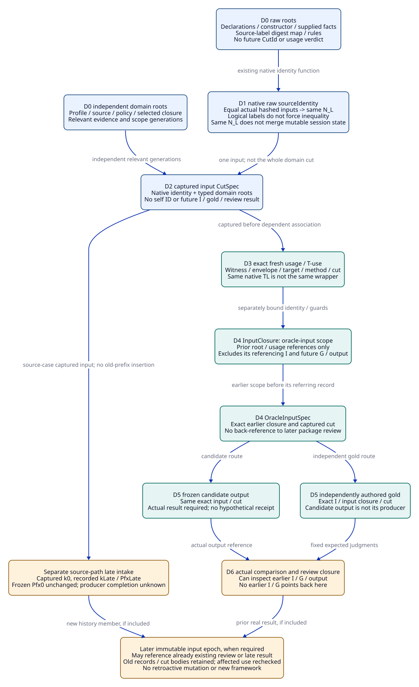
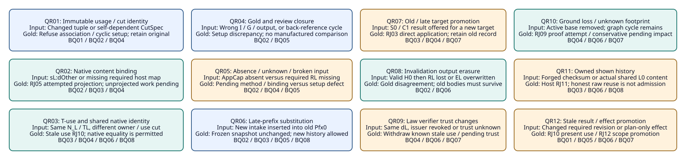

# SPDX-FileCopyrightText: 2026 tao3k team and Contributors
#
# SPDX-License-Identifier: LGPL-2.1-only

#+TITLE: 20.08 Expanded QR Controls for Identity, Late Intake and Evidence Reuse
#+LANGUAGE: en
#+PROPERTY: JD_ID 20.08
#+OPTIONS: toc:3 num:nil
#+STARTUP: overview
#+TODO: OPEN SPECIFIED | QUALIFIED
#+FILETAGS: :gateway:oracle:identity:history:reuse:

[[file:../../00-09-project/00-documentation/00.01-index.org][Index]] | [[file:20.07-packet-query-and-history-fixtures.org][20.07 BQ and QR inventory]] | [[file:20.06-oracle-packet-integration.org][20.06 existing owners]] | [[file:../../30-39-evaluation/30-benchmarks/30.04-oracle-review-data-contracts.org][30.04 data contracts]]

* SPECIFIED Status, exact resets and judgment vocabulary
:PROPERTIES:
:CUSTOM_ID: qr-control-scope
:STATUS: author-specified-gold-not-executed
:END:

The [[file:20.10-existing-owner-concurrency-and-delivery.org::#owner-source-observation][20.10 existing-owner companion]] records the newer local ASCENT 46a46bbe
source and separate capture/reply/delivery gold. These original 144ed6e5-pinned
contracts remain historical inputs, including their source-mismatch reset rule;
current matching-read-contract refresh is not retroactively substituted here.

QR01-QR12 remain subordinate controls of the existing BQ/DC/MB contracts. This
expansion introduces neither a framework nor additional scored benchmark variants.
The same two proposed gateway publications, Core Profiles/Scenario occurrences,
ASCENT Evidence DSL/Program/Clue mechanisms and existing application/review/Host
owners retain their responsibilities. No implementation, hash corpus, oracle run,
QNT/Lean check, native integration or actual V/A receipt is delivered here.

Every lettered subcase starts independently from the specified 20.07 path input.
All accepted host/checker/policy inputs are hypothetical external premises, not
facts created by rules or ordinary JSON flags. Gold for a subcase is an instance
of the existing OracleGoldSpec, bound to its exact OracleInputSpec, input closure,
cut, stage, subject and reviewed expected/forbidden rows. Readable labels such as
I-QR01.cap.A and G-QR01.cap.A name those paper instances, not new record kinds.

The following outcomes must remain distinct. /Refusal/ rejects a checked known
incompatible attempted application or immutable association. /Pending/ means a
required binding, method or scope is unavailable. /Setup discrepancy/ means the
oracle packet itself violates its declared identity/closure/revision contract;
it is not a designated semantic counterexample. /Gold disagreement/ is a candidate
output violating a well-formed frozen contract. /Withdrawal/ changes current-use
qualification across cuts, preserving historical bodies. Incomplete resource-bound
runs remain inconclusive rather than a successful refusal/control observation.

Use RJ codes only for their existing 10.07 conditions. No new RJ code is invented
for usage-ID conflict, cut identity cycles, missing expected-present oracle input
or output-store loss. Stage-local reasons and exact subjects remain review data.
A rejected setup does not create downstream method failures in unevaluated stages.
An Agent may still inspect history, ask raw questions or propose alternatives.

#+NAME: qr-path-reset-ledger
| Path | Concrete open reset and immutable bindings | Supplied / absent boundary |
|------+--------------------------------------------+----------------------------|
| C-CAP | Icap.open/Gcap.open/CLcap.open, kCap.open, OC-open; uL-cap.open=(wL,EL,L0,L,kCap.open), tuL-cap.open | Only oL in raw corpus; AppCap/VAppCap/new Q/SC/ACap absent. Ready input, if used, is separately predeclared |
| C-CACHE | Icache.open/Gcache.open/CLcache.open, kCache.open, OK-open; uL-cache.open=(wL,EL,L0,L,kCache.open), tuL-cache.open | Cache model/frame and source/security/resource slots unresolved; CacheAuth and Pcache separate; Z1 exact members explicit |
| C-SOURCE | Isrc.open/Gsrc.open/CLsrc.open, kSrc.open, OS-open; uL-src.open=(wL,EL,L0,L,kSrc.open), tuL-src.open | Corr1/VSC1/new applications/ASrc unresolved; t0 captured k0; RLate recorded only at kLate in its declared subcase |

All three retain the original EL/RL/dL/sL/TL/VL0/VMapL and B0 A0 bodies in history;
wL=(nsL:oL,dL). Every T-use binds native TL, RL/sL/dL, wL/EL, actual logical
materialization reference, exact usage ID, host-check reference and relevant cut.
These full tuples come from 20.07; no factor/claim/origin is rewritten to extend
EL. Negative subcases vary only the explicitly named field or dependency.

* SPECIFIED Identity dependencies without circular hashes
:PROPERTIES:
:CUSTOM_ID: qr-cut-identity-dag
:END:

The package-linked [[file:../../../.gerbil/pkg/github.com/tao3k/gerbil-ascent/rust/ascent/src/clues/exchange.rs][native exchange constructor]] hashes declarations, constructor,
supplied projection facts, attestations and query rules into sourceIdentity.
It does not automatically include an external gateway Profile, journal use cut
or application namespace. If those hashed inputs agree, sourceIdentity agrees,
even for distinct gateway materialization references and use cuts.

Consequently OC-open/OK-open/OS-open are logical application bindings, not an
assertion of unequal native sourceIdentity values. In the explicit shared-raw
subcase, all three use the same admitted projection source/constructor, supplied
{oL} rows and {sL:dL} attestation map; their native identity is the same symbol
N_L. Their domain contexts and CutSpecs still differ. If actual declarations or
supplied inputs differ, record the actual computed identities and retained input bodies instead; names
alone do not establish equality or inequality. No extra context factor is added
to EL just to force distinct raw identities. Equal native identity also does not
authorize merging mutable exchange/hypothesis or shown-history state across
separately declared application scopes.

#+NAME: qr-identity-dependency-order
| Layer | Concrete identity input / allowed references | Forbidden dependency |
|-------+---------------------------------------------+----------------------|
| D0 upstream roots | Immutable source/config/model/policy bodies, artifact content refs, raw declarations/supplied rows and source-label/digest host checks | Future owner ID, CutId, usage/T-use verdict or input-bound gold about this same instance |
| D1 raw exchange | Nraw=identity(declarations,constructor,supplied,attestations,query-rules); host-created native T | Native input containing a future CutId whose body includes this same Nraw |
| D2 captured input CutSpec | Exact typed root/member generations, domain context/selection, Nraw and existing relevant evidence/policy refs | Own CutId, its future usage/T-use results, or gold/output/comparison records that already reference it |
| D3 use association | Fresh usage and T-use about the captured cut; exact envelope/target/role/owner and independently checked premises | Editing D0-D2 bodies to include a successful result of this association |
| D4 oracle input | InputClosure with scope=oracle-input over prior roots/associations; OracleInputSpec points to that closure/cut | InputClosure containing the InputSpec that references it, or its future G/output/comparison |
| D5 gold and candidate output | Independently authored OracleGoldSpec references I/CL/cut; output references the same exact input basis | Candidate output as the route that generates gold; gold as an input to the captured raw identity |
| D6 later review | Actual ComparisonSpec/result and scope=package-review InputClosure may point to prior I/G/output refs | Prior I or G pointing back to that later review closure, creating a content-identity cycle |
| Next input epoch | Later captured roots may include already materialized prior external results | Reassigning the earlier epoch's ID or retroactively adding that result to its root set |

A stored envelope may carry its own ID in a header outside the schema-defined
hashed body; that header alone is not a forbidden dependency. Review the actual
typed identity-input bytes/edges, not a repeated display label. Prior-epoch cut
references may be raw inputs; the forbidden case is a cut depending on the same
native identity that would itself require that future cut.

Guard/slot/intake definitions and candidate/member roots must be independently
frozen input data. A usage-scoped verdict or completeness record already naming
the new CutId is a later association/judgment, not a root of that same CutId.
Keep all required domain members and check their actual coverage at the proper
stage; do not omit required coverage just to make the graph appear acyclic.

D0-D6 are review dependency labels, not new runtime phases or engine strata.
The two closure scopes are instances of existing InputClosure, with explicit
root-set/scope fields. CLcap.open/CLcache.open/CLsrc.open mean the oracle-input
closure; later package inspection can enumerate I/G/comparison refs without
putting itself back into those original closure identities. No new record type
or registry is needed. Required members cannot be omitted to evade a cycle.

If a proposed packet violates this identity order, its review/setup is refused;
no hash fixed-point search, arbitrary ID or weakened body check repairs it. A
logical inference SCC is different from a content-identity cycle: QR10 checks
its grounded support independently. Unknown dependency graphs are pending rather
than asserted acyclic. Actual source capture, type/identity enforcement and native
factory wiring remain implementation qualification obligations.

#+CAPTION: Captured raw/input identities precede usage and gold; later review can reference them without feeding back into their identity.

[[file:../../90-99-views/90-architecture-views/90.26-qr-identity-and-reuse-boundaries.d2][Editable D2 source]].

* SPECIFIED Twelve individually expanded QR controls
:PROPERTIES:
:CUSTOM_ID: expanded-qr-controls
:END:

The Input, Gold, Judgment, Evidence and Oracle fields below are independently
reviewable specifications, not candidate-derived expected results. Path tables
show the exact selected input/context and its boundary. A positive companion
requires all stated external premises; no real success is asserted here.

#+CAPTION: Twelve control families preserve the distinction between malformed setup, scoped refusal, pending work and retained evidence.

[[file:../../90-99-views/90-architecture-views/90.25-expanded-qr-controls.d2][Editable D2 source]].

** SPECIFIED QR01: Immutable usage and cut identity
:PROPERTIES:
:CUSTOM_ID: qr01
:CONTROL_ID: QR01
:STAGE: J1 association identity; J2 setup/reference review
:BQ_BINDINGS: BQ01 BQ02 BQ04
:STATUS: specified-not-executed
:END:

- Input :: A: submit uL-cap.open again with target=Pcap, retaining every other tuple field. B: independently submit that same ID with cut=kCap.ready instead of kCap.open. C: supply a CutSpec whose identity-body contains its own CutId or a Usage/T-use about that CutId; alternatively include a D1 native input cut factor whose CutSpec contains that same native owner hash.
- Gold :: G-QR01.cap.A/B requires the original usage tuple unchanged and no accepted replacement association. C requires an identity-dependency setup discrepancy with the concrete back-edge retained for review; no usable cyclic cut identity. A positive companion allocates distinct uL-cap.ready and exact target/cut/T-use guards without editing EL.
- Refusal or pending :: A/B: refuse the attempted immutable usage-ID rebinding at J1; no invented RJ number. C: refuse packet identity setup before evaluating dependent applicability. If the original tuple/body is unavailable instead of known different, pending binding remains, not a proven conflict. Fresh usage alone still does not discharge missing AppCap or other target slots.
- Evidence references :: uL-cap.open original body, EL/wL, tuL-cap.open, kCap.open/kCap.ready, D0-D6 reference-edge table, I/G/CL and preallocated usage domain.
- Independent oracle :: OC/OR compare retained full tuples and typed identity-input edges independently; list the specific cycle, not only a candidate hash failure.
- Retention boundary :: Preserve original typed record bodies and original captured prefixes. Re-evaluate only the exact affected use/review scope; no new method success or authority is inferred.

#+NAME: qr01-three-path-bindings
| Path | Concrete selected variation | Expected scoped result |
|------+-----------------------------+------------------------|
| C-CAP | uL-cap.open -> target Pcap or kCap.ready | Refuse conflicting same ID; fresh uL-cap.ready needs AppCap/VAppCap and complete guards |
| C-CACHE | uL-cache.open -> target Pcache at kCache.open | Refuse conflicting ID; no cache frame or authorization created by a new usage name |
| C-SOURCE | uL-src.open -> target Psrc or substitute k0 for kSrc.open | Refuse conflicting ID; origin EL remains k0 and current source use requires new application/Corr1 |

** SPECIFIED QR02: Native content mismatch without historical corruption
:PROPERTIES:
:CUSTOM_ID: qr02
:CONTROL_ID: QR02
:STAGE: J2 native projection/content association
:BQ_BINDINGS: BQ02 BQ03 BQ04
:STATUS: specified-not-executed
:END:

- Input :: A: keep clue (oL,dL,L0,support,observation,sL), but supply host attestation map {sL:dOther}, dOther distinct from dL. B: independently omit required sL binding. C: content transport/check is not yet available and the candidate remains outside the native owner.
- Gold :: A/B: no new successfully installed native observation/T from this attempted projection; old TL, EL, RL and original owner history unchanged. C: expected pending content binding outside the owner. A later correctly checked map {sL:dL} can support a fresh T-use, under its own exact context.
- Refusal or pending :: A/B reject RJ05 at attempted native projection; no partial trusted owner or invented downstream method verdict. C pending binding, not forged-success refusal. A readable artifact name or manually supplied attested row cannot replace host checking.
- Evidence references :: RL/dL/sL, EL/oL, original TL, actual supplied-vs-required host map, HC-cap/HC-cache/HC-src and exact constructor/source bindings.
- Independent oracle :: OW compares the independent source-label/digest table and actual attempted clue; OR retains original receipt/record bodies. Content agreement alone proves no method result.
- Retention boundary :: Preserve original typed record bodies and original captured prefixes. Re-evaluate only the exact affected use/review scope; no new method success or authority is inferred.

#+NAME: qr02-three-path-bindings
| Path | Concrete selected variation | Expected scoped result |
|------+-----------------------------+------------------------|
| C-CAP | OC-open attempt, {sL:dOther} vs required dL | RJ05; retain original cap input and same law artifact |
| C-CACHE | OK-open attempt, required source label sL absent | RJ05 only for attempted projection; unprojected work pending |
| C-SOURCE | OS-open content retrieval unknown before projection | Pending binding; original S0 and law history retained, no S1 proof |

** SPECIFIED QR03: Stale T-use and shared native identity
:PROPERTIES:
:CUSTOM_ID: qr03
:CONTROL_ID: QR03
:STAGE: J2 association inspection; J6 explicitly requested current use
:BQ_BINDINGS: BQ03 BQ04 BQ06 BQ08
:STATUS: specified-not-executed
:END:

The [[file:20.09-exchange-replay-and-display-trajectories.org::#qr03-event-trajectory][20.09 QR03 event trajectory]] fixes each intermediate input, gold and branch reset.

- Input :: A: offer tuL-cap.open as the current binding for uL-cap.ready/OC-ready/kCap.ready while preserving its original body. B: use a current native TL with a wrapper naming the wrong envelope/usage. C: all three open raw projection inputs, declarations, constructor, attestations and rules are identical, giving Nraw-cap=Nraw-cache=Nraw-src=N_L; domain contexts/cuts and T-use wrappers still differ. D: separately create eCap and eCache with that identical raw basis and no hypotheses, then submit only to eCap the existing h3/H3 body with source=agent3 and factors context=X0/workload=W0; do not alter eCache or declare a shared mutable scope.
- Gold :: A: retained TL remains byte-valid but the old wrapper is not a current target/cut binding. B: exact association mismatch, with no accepted witness binding. C: native identity equality permitted; no domain cut/usage/T-use equality inferred. Raw L0 display reuse is separate and possible only under QR11 checks. D gold: eCap read([H3]) has conditional={(H3,h3,dH,support,agent3)} and unknown={H3}; eCache has conditional={} and unknown={H3}; both may retain N_L. eCap content is a new captured state kCap.h3, not frozen kCap.open, and no T/V/A for H3 is manufactured.
- Refusal or pending :: A known stale wrapper offered for present use rejects RJ10 at that use check; missing current wrapper/guard evidence is pending binding. B refuses the exact incompatible association without misreporting a native digest error. C itself is a valid identity control, not an error. D sharing mutable state merely because N_L agrees violates the declared instance scope; deliberate shared-scope use requires a different explicit input/ownership contract. A frozen as-of read uses captured rows/reconstruction, not the now-mutated eCap handle relabeled kCap.open. Do not change native hashing or add cap/source factors to EL to force inequality.
- Evidence references :: Native TL, original/fresh tuL-* bodies, wL/EL, exact logical owner/usage/cut, HC-* refs; native factory identity inputs in the pinned exchange constructor.
- Independent oracle :: OR checks full wrapper subject/cut/owner fields; OC independently compares identical raw identity-input bodies. Native sourceIdentity is not a domain cut, unique mutable-session key or authorization token. OW compares each declared instance's hypothesis/view contents; actual isolation remains a native qualification obligation.
- Retention boundary :: Preserve original typed record bodies and original captured prefixes. Re-evaluate only the exact affected use/review scope; no new method success or authority is inferred.

#+NAME: qr03-three-path-bindings
| Path | Concrete selected variation | Expected scoped result |
|------+-----------------------------+------------------------|
| C-CAP | Old tuL-cap.open offered for uL-cap.ready/kCap.ready | Known stale use RJ10; fresh tuL-cap.ready and new application required |
| C-CACHE | tuL-cap.open offered for uL-cache.open/OK-open, N_L shared | Refuse wrapper mismatch even if native TL and sourceIdentity agree |
| C-SOURCE | tuL-src.open absent, raw N_L/TL present | Pending current binding; no source-equivalence conclusion from N_L |

** SPECIFIED QR04: Input-bound gold and non-cyclic review closure
:PROPERTIES:
:CUSTOM_ID: qr04
:CONTROL_ID: QR04
:STAGE: J1-J2 packet setup; J3 only for a separately offered verification record
:BQ_BINDINGS: BQ02 BQ05
:STATUS: specified-not-executed
:END:

- Input :: A: pair Icache.open/CLcache.open/kCache.open with Gcap.open whose retained body binds Icap.open. B: pair a hypothetical actual Out-cap.ready with open Gcap.open. C: construct CLcap.open containing Icap.open/Gcap.open while those records reference that same CLcap.open; or make I point back to a later package-review closure containing I itself.
- Gold :: A/B: exact input/gold/output/revision/cut binding discrepancy, no comparison success. C: identify the concrete cyclic identity edges and refuse setup. Positive companion uses an oracle-input closure of prior roots, I then independent G, and a later package-review closure without back-reference from I/G.
- Refusal or pending :: Known mismatched input/gold or cyclic closure is a setup defect, not a QNT counterexample or gateway rejection. If actual required gold/ref body is unavailable, hold package qualification pending/blocked as unqualified setup. An actual comparison V offered for the wrong subject separately rejects RJ06; do not apply that V code to a plain gold file lookup.
- Evidence references :: Icap.open/Icache.open, Gcap.open/Gcache.open/Gcap.ready, CL input scopes, exact Out subject/cut if supplied, ODef0/RevDef0 and independent review provenance.
- Independent oracle :: OR traverses retained typed input/gold/output/closure edges; OC checks body identity. Independent gold is never regenerated from the candidate output to repair disagreement.
- Retention boundary :: Preserve original typed record bodies and original captured prefixes. Re-evaluate only the exact affected use/review scope; no new method success or authority is inferred.

#+NAME: qr04-three-path-bindings
| Path | Concrete selected variation | Expected scoped result |
|------+-----------------------------+------------------------|
| C-CAP | Out-cap.ready + Gcap.open | Setup mismatch; Gcap.open and separately predeclared ready gold both retained |
| C-CACHE | Icache.open + Gcap.open | Setup mismatch; required Gcache.open remains explicit |
| C-SOURCE | Isrc.open -> review closure -> Isrc.open cycle | Setup identity cycle; use separate earlier input scope and later review scope |

** SPECIFIED QR05: Expected absence, unknown binding and broken input
:PROPERTIES:
:CUSTOM_ID: qr05
:CONTROL_ID: QR05
:STAGE: J2 input-closure review; J3 method review if setup is adequate
:BQ_BINDINGS: BQ02 BQ04 BQ05
:STATUS: specified-not-executed
:END:

- Input :: A: valid CLcap.open marks AppCap/VAppCap and ACap expected-absent. B: a supplied CLcap.open declares RL expected-present, but the input package lacks its required retained body. C: RL reference exists with current retrieval/trust/extraction status unknown; its original record is still retained, not silently declared absent.
- Gold :: A: Pending(method,Pcap-L-application,J3), absent A cannot become current use. B: missing expected input is an oracle/setup discrepancy, not an evaluated semantic refusal. C: Pending(binding,RL-access-or-mapping,J2/J3 as requested), no established current law use. No case produces target support from an empty missing-input set.
- Refusal or pending :: Only deliberately absent method work is graded as the designated pending control. Unexpected broken oracle setup cannot earn successful negative-control credit. Unknown real access differs from malformed package and from known incompatible scope; stages requiring unavailable inputs remain unevaluated.
- Evidence references :: CLcap.open membership states, RL/EL/TL/VL0/VMapL refs, actual missing/ref-fetch evidence, AppCap/VAppCap and ComparisonSpec positions intentionally absent.
- Independent oracle :: OR checks the independent closure-state table; OK checks declared required domains. Do not shrink closure to observed members or interpret unknown completeness as an empty scope.
- Retention boundary :: Preserve original typed record bodies and original captured prefixes. Re-evaluate only the exact affected use/review scope; no new method success or authority is inferred.

#+NAME: qr05-three-path-bindings
| Path | Concrete selected variation | Expected scoped result |
|------+-----------------------------+------------------------|
| C-CAP | Expected-absent AppCap/VAppCap | Pending method; VL0 remains a law reference, not a target application |
| C-CACHE | Expected-present RL body missing from package | Setup discrepancy; cache model/frame absence remains a separate intended pending input |
| C-SOURCE | RL retained but current retrieval/provenance unknown | Pending binding; no current-law usability assertion or deletion of the record |

** SPECIFIED QR06: Late records cannot replace old prefix bodies
:PROPERTIES:
:CUSTOM_ID: qr06
:CONTROL_ID: QR06
:STAGE: J1-J2 immutable snapshot/closure inspection; J9 raw visibility
:BQ_BINDINGS: BQ02 BQ03 BQ05 BQ08
:STATUS: specified-not-executed
:END:

The [[file:20.09-exchange-replay-and-display-trajectories.org::#qr06-event-trajectory][20.09 QR06 event trajectory]] fixes each intermediate input, gold and branch reset.

- Input :: A: source subcase supplies ELate/oLate with capture t0/k0/P0/S0 and journal recording kLate/PfxLate, then attempts to add oLate to frozen O0/Pfx0. B: keep Pfx0 identity while replacing its retained body by PfxLate. C: try to stamp observation creation k0 using only t0 input-capture provenance; actual producer-completion receipt is absent.
- Gold :: Frozen O0/Pfx0 read([P0,L0]) remains original support {(P0,o+,d+,s+,T+),(L0,oL,dL,sL,TL)}, with no oLate. New OH-late/PfxLate may expose P0 support o+ and oLate under the explicit host-map premises; OS-open still supports only L0 for [Psrc,L0], with unknown Psrc. No record is inserted into an old snapshot by having an older input scope.
- Refusal or pending :: A/C: refuse inconsistent visibility/provenance setup; C cannot establish creation/completion time and keeps producer-completion binding unknown. B is RJ02 if an asserted immutable digest/body disagrees; a mere label does not prove a cryptographic mismatch, but the frozen-body setup discrepancy still blocks grading. Valid late intake is retained, not rejected merely because it arrived late. A frozen query requires the captured corpus/output or its faithful reconstruction through existing owners; native read on a later mutated live exchange is not an as-of API, even when sourceIdentity still matches. No such native snapshot API is claimed here.
- Evidence references :: Original O0/k0/Pfx0 body, t0 capture, ELate/RLate/dLate/sLate/TLate, kLate/PfxLate journal-membership evidence, original Gsrc.open and current OS-open; no VLate or producer-completion receipt supplied.
- Independent oracle :: OU compares independently fixed prefix membership/causal order and old-body equality; OW enumerates raw corpora. Captured scope, actual journal intake and unknown producer completion are distinct fields, not a universal wall clock.
- Retention boundary :: Preserve original typed record bodies and original captured prefixes. Re-evaluate only the exact affected use/review scope; no new method success or authority is inferred.

#+NAME: qr06-three-path-bindings
| Path | Concrete selected variation | Expected scoped result |
|------+-----------------------------+------------------------|
| C-CAP | A new unprojected AppCap candidate recorded at kCap.intake after frozen kCap.open | Visible as new reference only in later package/history; old open closure retains expected absence; no native success inferred |
| C-CACHE | A new unprojected cache-frame artifact at kCache.intake after kCache.open | Later lookup may find it; old cache-open gold/closure unchanged; authenticity/method results still checked separately |
| C-SOURCE | oLate/RLate captured k0, recorded kLate, offered inside Pfx0 | No backfill; new historical view allowed, original frozen and S1 corpora preserved |

** SPECIFIED QR07: Late or old evidence cannot promote its target
:PROPERTIES:
:CUSTOM_ID: qr07
:CONTROL_ID: QR07
:STAGE: J2 target binding; J3 method only after valid target association
:BQ_BINDINGS: BQ03 BQ04 BQ07
:STATUS: specified-not-executed
:END:

- Input :: A: source subcase offers RLate/ELate/P0/S0 as direct Psrc/S1 support without an application. B: parameter companion offers original R+/P0/C1 for Pcap/C2. C: cache companion offers original R+/P0/X0 as Pcache/Xcache/Sk or as CacheAuth. Each companion resets its own branch; it does not import S1 publication into the cap/cache branch.
- Gold :: Every direct mismatched target application is refused; original artifact/native T/history remains. Native old-scope raw support, if projected with checked bytes, is not a verified target-slot result. No Pcap/Pcache/Psrc/CacheAuth or A is obtained by relabeling.
- Refusal or pending :: RJ03 for the known direct target/scope mismatch. A separately requested transfer with missing frame/application/source checks remains pending method/binding rather than fabricated success. A new genuine checked target application may be considered only under its own exact usage/required methods; old VQ0 cannot be renamed as that application.
- Evidence references :: RLate/ELate/TLate/t0/P0/S0 for source; original R+/E+/T+/VQ0 for companions; Dcap/Dcache/Dsrc and CacheAuth descriptor, complete intended interpretation and consumer scope.
- Independent oracle :: OC/OW compare independently reviewed target fields, units/source/configuration and claim interpretation; OR checks required application/method edges. Byte equality is not semantic equivalence.
- Retention boundary :: Preserve original typed record bodies and original captured prefixes. Re-evaluate only the exact affected use/review scope; no new method success or authority is inferred.

#+NAME: qr07-three-path-bindings
| Path | Concrete selected variation | Expected scoped result |
|------+-----------------------------+------------------------|
| C-CAP | R+/E+ at C1 offered directly to Pcap C2 | RJ03; keep old result and law artifact; new target Q/application required |
| C-CACHE | R+/E+ offered as Pcache or CacheAuth | RJ03; no permission/frame or byte-owner proof from old local permit result |
| C-SOURCE | RLate/ELate P0/S0 offered as Psrc/S1 | RJ03; original late history and unknown VLate status preserved |

** SPECIFIED QR08: Invalidation output must preserve reusable input records
:PROPERTIES:
:CUSTOM_ID: qr08
:CONTROL_ID: QR08
:STAGE: J8 impact and store/body comparison
:BQ_BINDINGS: BQ02 BQ06
:STATUS: specified-not-executed
:END:

- Input :: A: valid before-store H0 contains original RL/EL/TL/VL0/VMapL/A0 and frozen cut/gold refs. Run only the declared parameter/cache/source invalidation operation. Candidate after-store Hbad deletes RL or VL0, or overwrites EL claim/origin while retaining its ID. B: instead withdraw only affected current usage and keep all bodies, appending new change/intake records.
- Gold :: A violates the frozen non-erasure/output contract: H0 is not a subset of Hbad or a retained body differs. B satisfies the retention assertion H0 subset H1 with identical old bodies, while old copied present-use eligibility is withdrawn as required. Current law use still requires its own complete unchanged trust/footprint checks.
- Refusal or pending :: Output loss after a valid supplied before-store is a semantic gold disagreement, not QR05 broken-input setup. Refuse completion of the retention control; retain the actual bad output/failure record. No deletion/archival operation is authorized by invalidation. An unavailable byte lookup is recorded separately and does not authorize editing history or asserting current reuse.
- Evidence references :: H0 exact IDs/bodies, candidate Hbad/H1, captured Prefix/CutSpec/gold bodies, independent CCcap/CCcache/CCsrc and changed-scope members; no storage or GC service is introduced.
- Independent oracle :: OU independently compares before/after record membership and immutable bodies, separately from current-use predicates and the candidate invalidator. Retained storage is not proof admission.
- Retention boundary :: Preserve original typed record bodies and original captured prefixes. Re-evaluate only the exact affected use/review scope; no new method success or authority is inferred.

#+NAME: qr08-three-path-bindings
| Path | Concrete selected variation | Expected scoped result |
|------+-----------------------------+------------------------|
| C-CAP | C1->C2 invalidation attempts to delete RL or old A0 | Gold disagreement for loss; lawful result withdraws copied C1 use and preserves history |
| C-CACHE | Z0->Z1/cache change overwrites EL or removes VL0 | Gold disagreement for mutation/loss; cache target/frame work remains pending |
| C-SOURCE | S1 publication drops RSC0/VSC0 or deletes RLate after intake | Gold disagreement for loss; old source correspondence/history retained but not current S1 support |

** SPECIFIED QR09: Same law bytes under revoked or unknown verifier trust
:PROPERTIES:
:CUSTOM_ID: qr09
:CONTROL_ID: QR09
:STAGE: J8 changed-trust impact; J3 verification or J6 stale use as requested
:BQ_BINDINGS: BQ04 BQ06 BQ07
:STATUS: specified-not-executed
:END:

- Input :: A: first supply a complete hypothetical current L0 use at the branch open cut, with VL0 issuer accepted by MP0. Change only that required issuer generation to revoked at kPath.revoke; RL/dL/EL/TL remain unchanged. B: independently make current issuer lookup unknown, not known revoked. Do not additionally change the theorem or source.
- Gold :: A withdraws current verified-law usability for that exact usage; old VL0 accepted verdict remains historical. B withholds current qualification and records unknown trust. Native TL remains valid for unchanged bytes in both cases; neither asserts L0 is false or that every unrelated verifier was revoked.
- Refusal or pending :: A old validation offered for present use rejects RJ10; a verifier record asserted newly admissible under a known forbidden issuer rejects RJ06 at that verification check. B pending binding for current trust, not known-forgery refusal. Current native attestation cannot substitute for either check.
- Evidence references :: RL/dL/EL/TL/VL0, exact MP0 issuer acceptance and revoked-generation records, before/after CutSpecs and usage/T-use bodies, current lookup unknown marker for B.
- Independent oracle :: OR compares issuer/method policy and exact verifier subject; OU traverses only dependent uses. Independent law/source/method scopes prevent blanket revocation of unrelated records.
- Retention boundary :: Preserve original typed record bodies and original captured prefixes. Re-evaluate only the exact affected use/review scope; no new method success or authority is inferred.

#+NAME: qr09-three-path-bindings
| Path | Concrete selected variation | Expected scoped result |
|------+-----------------------------+------------------------|
| C-CAP | kCap.open -> kCap.revoke, VL0 issuer revoked | Withdraw current L0 qualification; bytes and old verdict retained; target Pcap already needs separate application |
| C-CACHE | kCache.open current law trust unknown | Pending binding; no cache proof, no deletion of RL/VL0 |
| C-SOURCE | kSrc.open -> kSrc.revoke, old law V offered as currently valid | Known stale use RJ10; source Corr1 still a separate unresolved method |

** SPECIFIED QR10: Grounding loss and unknown impact without erasure
:PROPERTIES:
:CUSTOM_ID: qr10
:CONTROL_ID: QR10
:STAGE: J8 dependency/grounding impact; J3 attempted unsupported justification
:BQ_BINDINGS: BQ04 BQ06 BQ07
:STATUS: specified-not-executed
:END:

- Input :: A: use 30.04 GB, whose graph-domain P/Q are distinct from gateway P0: P<-Q, Q<-P, external b->Q; valid hypothetical APQ depends on that grounded base at kG0. At kG1 remove b from active premise membership, retaining Rb/Vb/APQ records. B: in a branch with previously complete use dependencies, change registered u0 to u1 but make the affected footprint unknown.
- Gold :: A complete post-change graph has no grounded current P/Q derivation; APQ present-use qualification withdrawn; all original records retained. B conservatively withdraws affected use with pending binding/scope for impact, not a proof of unaffectedness or proposition falsity. A future checked b2 can enter a fresh epoch; retained Rb bytes alone do not reactivate b.
- Refusal or pending :: A attempted cycle-only proof justification rejects RJ09. This is logical grounding, not a cyclic content-hash construction. B pending impact plus conservative withdrawal; an attempted known stale consumption separately uses RJ10. Missing/incomplete graph-domain coverage cannot justify an exact empty-support answer.
- Evidence references :: GB rule/member set, Rb/Vb/ArgG/APQ/MPG/APG and kG0/kG1; or branch before/after dependency and unknown-footprint entries, original retained usage/record bodies.
- Independent oracle :: OU independently marks reachability from active external bases and compares member scopes; OR validates actual support refs. Do not infer grounding merely from records existing in storage.
- Retention boundary :: Preserve original typed record bodies and original captured prefixes. Re-evaluate only the exact affected use/review scope; no new method success or authority is inferred.

#+NAME: qr10-three-path-bindings
| Path | Concrete selected variation | Expected scoped result |
|------+-----------------------------+------------------------|
| C-CAP | Shared GB companion plus C-dependent use review | No graph-domain support after b loss; no assertion that gateway L0 theorem failed |
| C-CACHE | Known cache-owner/aggregate generation changes, full affected footprint unknown | Conservative withdrawal and pending impact; preserve law/history and require complete new footprint |
| C-SOURCE | Selected private/helper dependency changes with unknown mapping footprint | Withhold affected source application/compare use, retain immutable source and law records |

** SPECIFIED QR11: Owned shown history versus native checksum and shared raw reuse
:PROPERTIES:
:CUSTOM_ID: qr11
:CONTROL_ID: QR11
:STAGE: J9 presentation; J4 opposing-review coverage
:BQ_BINDINGS: BQ03 BQ06 BQ08
:STATUS: specified-not-executed
:END:

The [[file:20.09-exchange-replay-and-display-trajectories.org::#qr11-event-trajectory][20.09 QR11 event trajectory]] fixes each intermediate input, gold and branch reset.

- Input :: A: use OQ1/Q4 conflicting P0 family F0 with o+ and o-, supply a prior checkpoint claiming an unseen positive-only row, recompute its checksum, and provide authentic owned Shown={}. B: current owned shown provenance is unavailable rather than known empty. C: in the shared-N_L subcase, a valid prior shown L0 support/factor family is reused across logical cap/cache/source contexts with actual source/content/anchor comparisons.
- Gold :: A: proposed host refuses unseen acknowledgement RJ11; AcceptedAcknowledgement={} and counter/review family retained. B no qualified acknowledgement; safe replay/rescope and pending provenance, not a proven forgery. C may reuse only actually shown identical L0 units if host policy permits; cap-only unknown(Pcap) cannot acknowledge unknown(Pcache/Psrc), and engineering usages never transfer with hints.
- Refusal or pending :: Pinned native checksum checks integrity, not authentic display history. Actual native source mismatch resets hints; same source with changed anchor invokes native rescope, not guaranteed reset. Domain label differences alone do neither. Host display provenance and valid-family acceptance remain unimplemented qualification gates, not claimed native capabilities.
- Evidence references :: OQ1/o+/o-/F0 and reviewed intake, checkpoint schema/body/digest, owned Shown records, N_L or actual distinct Nraw values, complete source/content/selector/anchor and logical family IDs.
- Independent oracle :: OW enumerates exact logical display units; OK enumerates full opposing intake; OU compares independently owned shown history. Native acceptance of a recomputed checksum is not oracle gold for honest acknowledgement.
- Retention boundary :: Preserve original typed record bodies and original captured prefixes. Re-evaluate only the exact affected use/review scope; no new method success or authority is inferred.

#+NAME: qr11-three-path-bindings
| Path | Concrete selected variation | Expected scoped result |
|------+-----------------------------+------------------------|
| C-CAP | Forged acknowledgement for unseen P0 positive-only F0 unit in independent OQ1 control | Host RJ11; no hidden opposing review or clean A |
| C-CACHE | Cap checkpoint reused with shared N_L but different target-question anchor | Native rescope if anchor differs; only authenticated identical L0 units reusable, never cap unknown as cache unknown |
| C-SOURCE | Old-prefix/native-owner hint versus OH-late/PfxLate containing oLate | Actual identity change resets; otherwise exact content/anchor checks and owned shown-set required; no automatic ack of new late record |

** SPECIFIED QR12: Stale comparison/A consumption and unsupported effects
:PROPERTIES:
:CUSTOM_ID: qr12
:CONTROL_ID: QR12
:STAGE: J6-J7 present consumption; J3 comparison-result subject check
:BQ_BINDINGS: BQ01 BQ05 BQ06 BQ07
:STATUS: specified-not-executed
:END:

- Input :: A: supply a genuinely verified hypothetical comparison Comp0 bound to fixed I/G/output/input-cut and ODef0/RevDef0, then change the consumer-required oracle revision to ODef1 before present use. B: independently offer original A0 after a known relevant source/policy generation changes. C: no real authorization/effect receipt, but offer T/V/A/role/plan as its substitute. All prior records stay readable.
- Gold :: A comparison remains an immutable result about its old input/revision; it cannot satisfy a requirement explicitly demanding current ODef1 without new work. B old A cannot satisfy known changed current dependencies. C no justified operational authorization/completion from substitute kinds. Input changes never rewrite old gold to make the prior result current.
- Refusal or pending :: A/B known stale present use rejects RJ10; unknown required current generation instead gives pending binding. Wrong exact comparison subject offered as valid verification rejects RJ06. C scope promotion rejects RJ12. A source edit outside the complete relevant footprint does not automatically invalidate an unrelated comparison, law or A.
- Evidence references :: Comp0 exact I/G/CL/output/captured cut/method/review refs, actual required ODef1 or policy generation, original A0 body and CCpath, explicit absence of action/monitor/Host receipts.
- Independent oracle :: OR checks exact subject/required method and consumer policy; OU checks current relevant generations and capture/use order. O6/actual Host evidence remains necessary for operational effects.
- Retention boundary :: Preserve original typed record bodies and original captured prefixes. Re-evaluate only the exact affected use/review scope; no new method success or authority is inferred.

#+NAME: qr12-three-path-bindings
| Path | Concrete selected variation | Expected scoped result |
|------+-----------------------------+------------------------|
| C-CAP | Comp0 under ODef0 offered where ODef1 now required | RJ10 at current consumption; old comparison/gold retained, no new ACap |
| C-CACHE | A0/old permission record after relevant cache/policy change; plan as effect | Known stale use RJ10; plan promotion RJ12 in separate reset; CacheAuth decision must be current |
| C-SOURCE | Old source comparison/A after S1 publication or another required revision change | RJ10 for changed dependencies; exact old-S0 history retained; no automatic ASrc/Host receipt |

* SPECIFIED BQ coverage, result classes and three boundary audits
:PROPERTIES:
:CUSTOM_ID: qr-bq-boundary-audit
:END:

#+NAME: expanded-qr-bq-coverage
| BQ | QR controls and required judgment boundary |
|----+--------------------------------------------|
| BQ01 | QR01/QR12: publication/occurrence/consumer identity neither executes work nor implies a successful verifier or operational decision |
| BQ02 | QR01/QR02/QR04/QR05/QR06/QR08: well-founded typed packet, explicit closure states and actual source/snapshot bodies |
| BQ03 | QR02/QR03/QR06/QR07/QR11: native content and raw visibility; raw N_L can be shared without domain applicability equality |
| BQ04 | QR01/QR02/QR03/QR05/QR07/QR09/QR10: immutable full usage/T-use, correct target/method/trust/grounding and pending semantics |
| BQ05 | QR04/QR05/QR06/QR12: independent input-bound gold, actual comparison result, old-prefix and required current revision binding |
| BQ06 | QR03/QR08/QR09/QR10/QR11/QR12: record retention, current applicability and checked transfer/presentation reuse are separate |
| BQ07 | QR07/QR09/QR10/QR12: authentic scoped A and exact present cut; no target amplification or plan-to-effect promotion |
| BQ08 | QR03/QR06/QR11: native identity/content/anchor and independently owned shown units, never a history mutation or admission |

#+NAME: qr-three-boundary-dispositions
| Boundary | Required gold across controls | What remains unqualified |
|----------+-------------------------------+--------------------------|
| Non-cyclic identity | QR01/QR04 use D0-D6 typed edges; oracle-input closure excludes its referencing I/G/result; raw factory inputs exclude a cut depending on their own Nraw | Actual native source/metadata placement, canonical identity/body checking and atomic capture |
| Late isolation | QR06/QR07 preserve frozen Pfx0, distinct intake PfxLate, exact original target; producer completion remains unknown without a receipt | Real journal visibility/replay/publication guarantees and source-to-event truth |
| Evidence reuse | QR03/QR08-QR12 preserve bytes/bodies while rechecking full use/trust/grounding/policy/cut; raw display reuse is not method or A reuse | Actual incremental invalidation, access/retention policy, verifier integration and Host fences |

CW01-CW16, OA01-OA15 and all twenty-four MB parent contracts retain their original
scope. QR identity/setup checks refine OA03/OA04/OA05/OA09/OA13; late visibility
refines OA05/OA08/OA12; reuse/trust/fencing refines OA06/OA07/OA10/OA11/OA14/OA15.
These associations specify review obligations, not qualified coverage or scores.

A successful control outcome can be a precise refusal, explicit pending status,
correct selective withdrawal or permitted scoped reuse. Packet setup failure,
wrong unrelated failure and budget exhaustion cannot replace the intended
discriminator. Preserve every actual discrepancy and original revision when a
future independent reviewer adjudicates or changes this contract.

* OPEN Native-owner qualification handoff
:PROPERTIES:
:CUSTOM_ID: qr-qualification-boundary
:END:

- [ ] Independently review each exact I/G/closure/cut/body tuple and every control's expected result class.
- [ ] Qualify existing native factory identity placement with both identical and distinct raw-input controls.
- [ ] Qualify full usage/T-use association, native content checking and authentic method/issuer bindings.
- [ ] Exercise actual old-prefix replay, late intake and non-erasure under concurrent publication.
- [ ] Qualify grounded invalidation, conservative unknown handling and exact consumer current-use fences.
- [ ] Retain genuine oracle/method/A/authority/Host receipts before claiming any implementation or operational closure.

No executable oracle or new workflow is defined here. Org/D2/structure checks
confirm documentation consistency only, not semantic/native acceptance.
