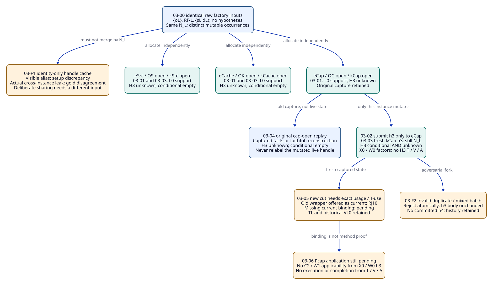
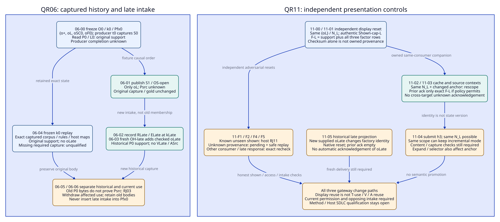

#+TITLE: 20.09 Exchange Isolation, Frozen Replay and Display Trajectories
#+LANGUAGE: en
#+PROPERTY: JD_ID 20.09
#+OPTIONS: toc:3 num:nil
#+STARTUP: overview
#+TODO: OPEN SPECIFIED | QUALIFIED
#+FILETAGS: :gateway:trajectory:oracle:isolation:replay:

[[file:../../00-09-project/00-documentation/00.01-index.org][Index]] | [[file:20.08-qr-identity-and-reuse-controls.org][20.08 QR controls]] | [[file:20.07-packet-query-and-history-fixtures.org][20.07 BQ contracts]] | [[file:../../00-09-project/00-documentation/00.02-local-package-links.org][Local package links]]

* SPECIFIED Scope, event inputs and gold notation
:PROPERTIES:
:CUSTOM_ID: trajectory-contract
:STATUS: author-specified-not-executed
:END:

The [[file:20.10-existing-owner-concurrency-and-delivery.org::#owner-source-observation][20.10 existing-owner companion]] records the newer local ASCENT 46a46bbe
source and separate capture/reply/delivery gold. These original 144ed6e5-pinned
contracts remain historical inputs, including their source-mismatch reset rule;
current matching-read-contract refresh is not retroactively substituted here.

These are complete finite review trajectories for QR03, QR06 and QR11, including
positive companions, adversarial forks and explicit stopping conditions. They
instantiate the existing OracleInputSpec, OracleGoldSpec, InputClosure, CutSpec,
usage and T-use contracts. Event labels, branch labels, captured-state labels and
oracle worksheets below are review notation, not new framework records, a
scheduler, a snapshot service or a gateway implementation. No native experiment,
independent oracle execution, QNT/Lean result or actual V/A is supplied.

The existing gateway-domain/gateway-evidence publication design, Core Profiles
and explicit Scenario occurrences, ASCENT Evidence/Program/Clue mechanisms and
SMP association pattern retain their responsibilities. Scenario/application
owners capture inputs and request work; native exchanges answer raw questions;
existing review/Host owners check applicability, provenance and current use.
Agent hypothesis generation remains open. Evidence constraints govern justified
conclusions and effects, not the Agent's choice of investigation.

#+NAME: trajectory-input-and-gold-contract
| Field | Exact interpretation for every event |
|-------+-------------------------------------|
| Input identity | I03-nn, I06-nn or I11-nn denotes a distinct OracleInputSpec with retained event body, predecessor-state ref, requested stage, questions/selector and oracle-input closure |
| Gold identity | G03-nn, G06-nn or G11-nn independently binds that exact I, closure, captured cut, stage, expected relations and forbidden relations; never inferred from candidate output |
| Predecessor | The immediately preceding row on that main trace; a named fork explicitly states its reset event and does not mutate the main trace |
| State capture | An existing owner captures exact facts, hypothesis bodies, declaration/rule versions, host maps, relevant policy and question/selector inputs; sourceIdentity alone is insufficient |
| Cut order | D0 roots -> D1 native identity -> D2 captured cut -> D3 usage -> D4 input closure/I -> D5 gold/output -> D6 comparison; no event puts its own later gold into its captured cut |
| Stage | J1 identity/selection; J2 binding/setup; J3 method/application; J4 opposing intake; J5 argument/admission; J6 current use; J7 effect request; J8 impact/retention; J9 raw read/presentation, as in 20.07/20.08 |
| Empty result | Exact absence only within the complete declared raw corpus/question scope; unknown method or policy binding is a separate pending judgment |
| Candidate completion | Actual complete native output required for comparison; partial/timeout/cancelled output is inconclusive, never successful negative-control credit |
| References | Symbolic refs below denote the full retained typed bodies in 20.07/20.08, not truncated labels accepted as identity checks |

Fork IDs also allocate their own I/G suffixes, for example I03-F1/G03-F1,
with the named reset capture and exact changed input; no failed fork edits a main
trace gold.

No fabricated hashes are supplied. Native N_L is the digest of identical actual
factory inputs under the pinned constructor; dH is the native digest of the
exact h3 input body. Before execution, the owner must instantiate all symbolic
content refs with authentic retained bytes and actual digests. A missing required
body is a setup discrepancy, not a designated semantic counterexample.

** Shared exact row vocabulary
:PROPERTIES:
:CUSTOM_ID: trajectory-row-vocabulary
:END:

#+NAME: trajectory-row-definitions
| Symbol | Complete logical row or finite set |
|--------+------------------------------------|
| SL | support={(L0,oL,dL,sL,TL)} |
| S0 | support={(P0,o+,d+,s+,T+),(L0,oL,dL,sL,TL)} for questions [P0,L0] |
| S0Late | support={(P0,o+,d+,s+,T+),(P0,oLate,dLate,sLate,TLate),(L0,oL,dL,sL,TL)} for [P0,L0] |
| RF-L | relevant_factor={(L0,oL,dL,model,M0,observation),(L0,oL,dL,quantifier,all-admissible-C,observation),(L0,oL,dL,method,L,observation)} |
| CH | conditional={(H3,h3,dH,support,agent3)} |
| RF-H | relevant_factor={(H3,h3,dH,context,X0,hypothesis),(H3,h3,dH,workload,W0,hypothesis)} |
| U(q) | unknown={q}; this is a raw question with no attested support/counter, not a universal proposition-falsity claim |
| Empty-other | counterevidence={}, conflict={}, neighbor={}; conditional={} unless CH is explicitly listed |

These are named logical projections for comparison, not a replacement native
serialization. Native output must be compared through the reviewed typed mapping
including all its columns. No factor is silently dropped by that mapping.
Original o+ factors are context=X0, cap=1, interpretation=K0, source=S0,
method=Q. oLate has context=X0, cap=1, interpretation=K0, source=S0, method=Q.
The earlier S0 row symbol and the source label S0 occupy different typed fields.

* SPECIFIED QR03: Independent exchanges sharing native identity
:PROPERTIES:
:CUSTOM_ID: qr03-event-trajectory
:CONTROL_ID: QR03
:BQ_BINDINGS: BQ01 BQ03 BQ04 BQ06 BQ08
:END:

The complete raw open corpus is {oL}, factors RF-L, no links or hypotheses,
host map {sL:dL}; identical declarations/constructor/supplied facts/attestations/
query rules produce N_L. Create distinct eCap/eCache/eSrc mutable instances for
OC-open/OK-open/OS-open. Their logical owners, context, cut and use tuples remain
separate even though Nraw-cap=Nraw-cache=Nraw-src=N_L. Allocate independent
constructors with the same inputs; do not use include to clone this corpus:
including another oL corpus would collide on clue identity, and native include
is composition rather than an independent snapshot API.

Submit h3 exactly as id=h3, claim=H3, polarity=support, source=agent3,
factors=[(context,X0),(workload,W0)]. h3 is a conjecture about the original
context/workload. Staging it in eCap does not establish applicability to Xcap,
C2 or W1. The hypothesis input has no digest, receipt or authority field supplied
by the Agent; dH is computed from its body by the native hypothesis path.

#+NAME: qr03-event-gold
| Event | Concrete input and action | Captured state / cut | Step gold and forbidden result | Evidence references / independent oracle |
|-------+---------------------------+----------------------+--------------------------------+------------------------------------------|
| 03-00 | J1/J2: Reset from three independently selected open path inputs; construct eCap/eCache/eSrc separately | kCap.open/kCache.open/kSrc.open; exact {oL} basis | All native identities N_L; pairwise distinct mutable occurrences; no Scenario execution from Module selection | I/G03-00; Core occurrence refs, CLcap/cache/src.open, exact native factory bodies; OC compares identity inputs, OR checks ownership |
| 03-01 | J9: Each handle read([L0,H3]) before submission | Three original open captures | Each returns SL, RF-L, U(H3), Empty-other, no RF-H; no H3 T/V/A | I/G03-01; EL/RL/dL/sL/TL, VL0 historical; OW independently enumerates each handle's declared corpus |
| 03-02 | J2: Submit exactly h3 only to eCap; no mutation requested on peers | Fresh cap capture kCap.h3, original kCap.open retained | eCap contains oL+h3+RF-H; eCache/eSrc remain {oL}; N_L may remain unchanged on all; old cut body unchanged | I/G03-02; h3 body/dH, original/fresh capture refs; OW checks per-instance membership, OU compares old body |
| 03-03 | J9: Read([L0,H3]) on all three after submission | kCap.h3, kCache.open, kSrc.open | eCap: SL+CH+RF-L+RF-H+U(H3), Empty-other; peers: SL+RF-L+U(H3), conditional={}; no attested support(H3) anywhere | I/G03-03; actual requested handle refs, h3 and raw rows; OW compares exact independent expected sets |
| 03-04 | J2/J9: Replay cap-open read([L0,H3]) from retained capture or faithful reconstruction, not mutated live handle | Exact kCap.open and original closure; fresh read occurrence | SL+RF-L+U(H3), conditional={}, no RF-H; identical gold to 03-01 cap scope. Reading live eCap as kCap.open is a setup discrepancy | I/G03-04; kCap.open retained facts/output + reconstruction inputs, original G03-01 scope; OU/OW inspect membership and actual replay source |
| 03-05 | J2/J6: Request current T-use at kCap.h3; offer original tuL-cap.open as its current wrapper | New usage uL-cap.h3=(wL,EL,L0,L,kCap.h3) required | Known old owner/cut wrapper cannot satisfy new use: RJ10 at J6. If current binding absent, pending binding; a fresh wrapper needs HC and all unchanged guards checked | I/G03-05; TL/EL/wL, exact original and attempted wrapper tuples; OR compares subject/owner/cut, OU checks footprint |
| 03-06 | J3/J7: Preserve history; request Pcap applicability and operational completion using h3 or TL | Current cap capture with no AppCap/new Q/SC/A | Pcap application/method pending; hypothesis and TL supply no method V/A. Explicit effect promotion rejects RJ12; no Authorized/Completed row | I/G03-06; missing-slot states, VL0/AppCap absence, no operational receipt; OR/OK check exact slots and requested effect |

Every event has its own I/G as defined above; a read-only event reuses its captured
input cut without pretending the read itself changes upstream source generations.
If a new hypothesis capture lies outside a complete law-use footprint, scoped
qualification may be re-established after the wrapper and guards are checked;
a changed whole-exchange identity is not required for withdrawing an incorrect
wrapper. Retaining VL0 does not manufacture AppCap.

#+NAME: qr03-adversarial-forks
| Fork / reset | Concrete variation | Independent gold |
|--------------+--------------------+------------------|
| 03-F1 from 03-00 | Application keys its mutable-handle cache only by N_L, returning eCap as eCache | Setup ownership mismatch if alias visible before execution; if distinct instances were supplied but h3 leaks after 03-02, semantic gold disagreement at 03-03. Do not grade either as successful isolation |
| 03-F2 from 03-02 | Submit duplicate h3 with a changed factor; separately submit batch [fresh h4 with the exact h3 body except id=h4, duplicate h3] | Native duplicate-ID refusal is atomic: no changed h3 and no committed h4; N_L and before-state bodies retained; no new RJ enum for native validation |
| 03-F3 from 03-00 | Explicitly declare a deliberately shared mutable scope | Different input/ownership contract; not evidence of independence. Shared observations must not be reported as 03-03 passing |
| 03-F4 from 03-03 | Copy tuL-cap.open to cache usage because TL and N_L agree | Refuse exact owner/usage/cut mismatch; if absent mapping instead, pending binding. Common bytes remain reusable only through fresh checked association |

#+CAPTION: Equal native identity permits shared immutable inputs; independent occurrences retain separate mutable hypotheses and cut-bound uses.

[[file:../../90-99-views/90-architecture-views/90.27-independent-exchange-trajectory.d2][Editable D2 source]].

* SPECIFIED QR06: Freeze, late intake and faithful replay
:PROPERTIES:
:CUSTOM_ID: qr06-event-trajectory
:CONTROL_ID: QR06
:BQ_BINDINGS: BQ02 BQ03 BQ05 BQ06 BQ08
:END:

This trace resets independently to B0. Its O0 corpus is
{o+,oL,oSC0,oF0}, original attestation map and original complete factors, with no
hypotheses or counter. The typed source generation S0, capture k0/Pfx0 and exact
input content are frozen before the change. A hypothetical producer task t0
captures X0/S0/P0 at k0; no producer completion time/receipt is supplied.

ELate is created/recorded at kLate with RLate/dLate and capture provenance t0/k0;
it is not an observation created at k0. The explicit historical subcase projects
oLate=(oLate,dLate,P0,support,observation,sLate) using actually checked
{sLate:dLate}. TLate is conditional on that real projection/check when eventually
executed; it is not an existing delivered receipt. VLate and ALate are absent.

#+NAME: qr06-event-gold
| Event | Concrete input and action | Captured state / cut | Step gold and forbidden result | Evidence references / independent oracle |
|-------+---------------------------+----------------------+--------------------------------+------------------------------------------|
| 06-00 | J2/J9: Freeze original O0/B0 and producer input capture t0; read([P0,L0]) | k0/Pfx0, exact original corpus/output retained | S0 with original factors; Empty-other; no oLate. Completion field=unknown | I/G06-00; t0 capture, O0, original T+/TL and G0; OU checks independently fixed prefix members, OW enumerates rows |
| 06-01 | J1/J2/J9: Publish S1/Xsrc and construct OS-open {oL}, no relation to t0 completion asserted | kSrc.open/PfxSrc, distinct Isrc.open/Gsrc.open | read([Psrc,L0])=SL+RF-L+U(Psrc), Empty-other; Corr1/application/new Q/A absent; O0 and G06-00 unchanged | I/G06-01; CCsrc, EL/TL/VL0, exact OS-open inputs; OC/OR compare source and capture identities |
| 06-02 | J2: Receive hypothetical RLate for captured P0/S0 task and record ELate at kLate | PfxLate after Pfx0 and source publication in this fixture's causal journal | New retained historical reference only; Pfx0 unchanged. Producer completion still unknown; no VLate or current Psrc support | I/G06-02; t0 input, RLate/dLate, intake membership; OU checks journal order, OR checks provenance fields |
| 06-03 | J2/J9: Project historical O0+oLate into fresh OH-late after independent digest checking | kLate/PfxLate historical materialization; not OS-open | read([P0,L0])=S0Late with original and late factors, Empty-other. TLate only from actual host/native check; no VLate/A follows | I/G06-03; old full corpus, sLate:dLate check and projection refs; OW enumerates complete new historical input |
| 06-04 | J2/J9: Request frozen replay of original read([P0,L0]) | Exact k0/Pfx0, same pinned method/mapping and questions | S0, not S0Late; all original relevant factors; no oLate/h3. Retained output or faithful captured-input reconstruction required | I/G06-04; original cut, rules/declarations, host maps/output and G06-00; OU compares old body/members, OW compares rows |
| 06-05 | J3/J9: Query current source packet and new historical packet separately | OS-open/kSrc.open versus OH-late/kLate | Source read([Psrc,L0]) stays SL+RF-L+U(Psrc), Empty-other; historical read([P0,L0]) gives S0Late with original/late relevant factors, Empty-other. Attempted direct Psrc proof from RLate rejects RJ03; no ASrc | I/G06-05; distinct I/G/CL/cut and claim/source refs; OR checks applicability, OW enumerates each corpus |
| 06-06 | J6/J8: Invalidate affected present use and retain after-store H1 | Current change/intake cut, unchanged frozen earlier bodies | H0 subset H1 with identical old bodies, plus ELate; current known stale use RJ10, new method pending. No deletion of RLate/RL/VL0/A0 | I/G06-06; H0/H1 body membership and CCsrc footprint; OU independently checks non-erasure and scoped withdrawal |

S0Late is gold only for the explicitly supplied historical projection. Recording
an unprojected artifact alone at 06-02 does not automatically produce native rows.
A historical packet at kLate is a new current read /about old source S0/, not a
redefinition of what was visible at k0. The journal order is a fixture premise,
not a total distributed wall clock or a claim that every real deployment orders
publication and intake this way.

#+NAME: qr06-adversarial-forks
| Fork / reset | Concrete variation | Independent gold |
|--------------+--------------------+------------------|
| 06-F1 from 06-03 | Append oLate to frozen Pfx0 or replay the current live handle under k0 | Setup inconsistent snapshot; if asserted immutable digest/body differs, RJ02 for that exact mismatch. A same-N_L hypothesis mutation from QR03 demonstrates why sourceIdentity equality alone cannot validate replay |
| 06-F2 from 06-02 | Stamp producer completion or observation creation k0 solely from t0 capture | Refuse inconsistent provenance setup; completion remains unknown, ELate recording remains kLate |
| 06-F3 from 06-04 | Required captured rules/facts/host-map unavailable; current code used instead | Pending/unqualified replay binding, or setup discrepancy if expected-present package body missing; never a faithful replay pass |
| 06-F4 from 06-02 | Independently supply late counter evidence about P0/S0 | Fresh packet's raw counter follows actual corpus; required current opposing review assesses relevance explicitly. Never hide it merely because Psrc has a different source; original k0 remains unchanged |

* SPECIFIED QR11: Display checkpoints, ownership and limited reuse
:PROPERTIES:
:CUSTOM_ID: qr11-event-trajectory
:CONTROL_ID: QR11
:BQ_BINDINGS: BQ03 BQ06 BQ08
:END:

Start a new independent three-path open reset with the common {oL}/N_L basis.
Define A-cap as the pinned native anchor digest of scope set {L0,Pcap,PerfCap}
and selectorIdentity=[]; A-cache uses {CacheAuth,Pcache,L0}; A-src uses {Psrc,L0}.
These exact sorted scope sets are the union of questions and expand, not list
order or the questions field alone. A real selected read additionally includes
its actual selectorIdentity. Hypothesis/view contents are not anchor inputs.

Let F-L be the complete native eight-column item rows for L0 derived from the
exact {oL}+RF-L inputs under the pinned rules; Relations={} in these direct-read
fixtures. The eight-column worksheet below is independently specified from the pinned
[[file:../../../.gerbil/pkg/github.com/tao3k/gerbil-ascent/python/src/ascent/clue_query_rules.ss][item schema and rules]], not a candidate-produced family digest.
The named logical projection is SL+RF-L, no counter/hypothesis/link. F-cap-U
is the separate unknown(Pcap) display unit, F-cache-U unknown(Pcache), and
F-src-U unknown(Psrc); none are interchangeable with F-L or each other.

#+NAME: qr11-exact-native-item-gold
| Unit | kind | claim | id | digest | a | b | c | d |
|------+------+-------+----+--------+---+---+---+---|
| F-L row 1 | support | L0 | oL | dL | sL | TL | "" | "" |
| F-L row 2 | factor | L0 | oL | dL | model | M0 | observation | "" |
| F-L row 3 | factor | L0 | oL | dL | quantifier | all-admissible-C | observation | "" |
| F-L row 4 | factor | L0 | oL | dL | method | L | observation | "" |
| F-cap-U | unknown | Pcap | "" | "" | "" | "" | "" | "" |
| Cap performance unit | unknown | PerfCap | "" | "" | "" | "" | "" | "" |
| F-cache-U | unknown | Pcache | "" | "" | "" | "" | "" | "" |
| Cache authorization unit | unknown | CacheAuth | "" | "" | "" | "" | "" | "" |
| F-src-U | unknown | Psrc | "" | "" | "" | "" | "" | "" |

The Unit column is review notation, not a ninth native column. "" denotes an
actual empty text cell, not a missing value. TL stands for the actual opaque
native receipt text already bound by the fixture, not a new authority field.
F-L is exactly four rows and must be acknowledged as a complete displayed family;
no positive-only fragment can acknowledge an opposing family. Relations={} is
explicit for these direct slices; selector association/trace display is a
separate input with its own three-column relation rows.

Shown-cap-L is a hypothetical authentic receipt from the existing consumer owner
for completed delivery/acceptance of exactly F-L. It is an explicit external
premise, not issued by these documents or guaranteed by a returned native slice.
The receipt binds consumer/principal/access policy, exchange scope, captured
state, native identity, anchor, exact items/relations, delivery occurrence and
accepted payload. Here shown means that declared completed-delivery contract,
not proof of human attention or model understanding. Cross-context display reuse
is permitted only in the explicit same-consumer/policy positive companion.

#+NAME: qr11-event-gold
| Event | Concrete input and action | Captured state / cut | Step gold and forbidden result | Evidence references / independent oracle |
|-------+---------------------------+----------------------+--------------------------------+------------------------------------------|
| 11-00 | J9: Open cap direct slice request with no checkpoint, exact A-cap scope | Frozen cap-open {oL}/N_L, owned shown={} | Native mode=initial; current raw gold SL+RF-L+U(Pcap)+U(PerfCap). No prior qualified acknowledgement. Budget failure is inconclusive, not shown success | I/G11-00; exact request, factory rows, RF-L; OW enumerates full scope, not only chosen brief |
| 11-01 | J9: Supply authentic completed delivery Shown-cap-L and native checkpoint containing exactly F-L, no unknown units; all source/schema/checksum/arity checks valid | Same cap-open state/consumer, anchor A-cap | Host accepts prior acknowledgement exactly F-L. Repeat has native mode=incremental; F-cap-U and unknown(PerfCap) remain unacknowledged unless separately actually shown | I/G11-01; checkpoint body/digest, exact native rows, authentic Shown-cap-L; OU compares owned delivery, OW compares units |
| 11-02 | J9: Reuse that checkpoint on independent cache exchange with same N_L, exact A-cache request; declared same-consumer policy permits common law display reuse | Frozen cache-open, different domain cut and anchor | Native mode=rescope because A-cache differs. Permitted prior ack exactly F-L after source/content/policy/provenance checks; never F-cache-U or CacheAuth unknown. Fresh cache T-use still required | I/G11-02; shown receipt, native item equality, cache input/anchor, policy refs; OC/OW/OU compare each binding |
| 11-03 | J9: Repeat cross-context reuse on source-open {oL}, exact A-src scope | Source-open/N_L and its own captured cut | Native mode=rescope from A-cap; prior ack at most F-L under the same positive premises. Unknown(Psrc) remains new. No Corr1/source equivalence/A from presentation | I/G11-03; source request, F-L equality and owned policy/receipt, tuL-src.open; OW/OR compare scope versus method boundary |
| 11-04 | J9: In cap exchange submit h3; ask same A-cap scope with old authentic checkpoint | Fresh kCap.h3, unchanged N_L and A-cap | Native mode may remain incremental; H3 outside this scope supplies no ack or observation. Query [L0,H3] explicitly instead: new anchor, CH+U(H3)+RF-H; never attested H3 support | I/G11-04; h3, old checkpoint and exact new scope/capture; OW derives question-scoped rows, OU checks generation binding |
| 11-05 | J9: At historical OH-late, attempt earlier O0 hint after 06-03 | Exact OH-late actual Nraw and PfxLate, earlier checkpoint retained | With the same declaration/rule setup and newly supplied oLate facts, historical factory identity changes: native reset, prior ack={}. Never ack unseen oLate; any different same-identity mutation needs its own content check | I/G11-05; actual before/after factories/identities and F(P0) item sets, old owned shown; OC/OW/OU check input and shown differences |

The ordinary digest non-collision premise is explicit for 11-05. It is not
a guarantee of identity inequality for every kind of state change: hypothesis
submission in 11-04 is the counterexample.

For native item-delta review, F-H is exactly
(hypothesis,H3,h3,dH,support,agent3,"","") plus
(factor,H3,h3,dH,context,X0,hypothesis,"") and
(factor,H3,h3,dH,workload,W0,hypothesis,""). U-H is
(unknown,H3,"","","","","",""). Each row below uses the fixed F-L-only
prior checkpoint from 11-01, not a checkpoint silently extended by an intervening
response. The initial row uses no prior.

#+NAME: qr11-native-delta-gold
| Event / exact scope | added items | retained items | removed items | changed claims |
|---------------------+-------------+----------------+---------------+----------------|
| 11-00 {L0,Pcap,PerfCap} | F-L, F-cap-U, unknown(PerfCap) item | {} | {} | {L0,Pcap,PerfCap} |
| 11-01 same scope, prior F-L | F-cap-U, unknown(PerfCap) item | F-L | {} | {Pcap,PerfCap} |
| 11-02 {CacheAuth,Pcache,L0}, prior F-L | unknown(CacheAuth) item, F-cache-U | F-L | {} | {CacheAuth,Pcache} |
| 11-03 {Psrc,L0}, prior F-L | F-src-U | F-L | {} | {Psrc} |
| 11-04 after h3, original cap scope, prior F-L | F-cap-U, unknown(PerfCap) item | F-L | {} | {Pcap,PerfCap} |
| 11-04 after h3, explicit {L0,H3}, prior F-L | F-H, U-H | F-L | {} | {H3} |

Relations and their deltas are empty in this direct-read fixture. Exact newly
acknowledged items in the outgoing checkpoint additionally depend on what full
families the actual response displays; the item-delta table alone does not
assert they were delivered. Native anchor mode and content delta are separate:
rescope can retain F-L, and incremental can contain new hypothesis items.

11-01 is a conditional captured-checkpoint input, not a guarantee that any numeric
displayBytes value makes the renderer produce exactly that subset. Its authentic
shown premise must cover precisely those native items. Display capacity controls
presentation; it cannot reduce semantic intake or justify dropping a counter.
No byte threshold, UI delivery implementation or cross-consumer grant is claimed.

** Forged, unknown and racing display branches
:PROPERTIES:
:CUSTOM_ID: qr11-display-forks
:END:

These forks reset independently; none silently replaces the positive checkpoint
or owned receipt in the main trajectory.

#+NAME: qr11-adversarial-forks
| Fork / reset | Concrete input | Native boundary | Proposed host / independent gold |
|--------------+----------------+-----------------+----------------------------------|
| 11-F1 reset OQ1/Q4 | Conflicting P0 family F0 with o+ and o-, owned Shown={}; forged prior positive-only items, valid clue-slice.v1 schema/arity/source/anchor and recomputed checksum | Checksum validates integrity only; native prior need not reject ownership forgery | J9 RJ11 for known unseen acknowledgement; AcceptedPriorAck={}. Preserve complete raw support/counter and J4 opposing intake; no clean A from hiding o- |
| 11-F2 reset 11-F1 | Owned shown provenance unknown rather than known empty | Valid checksum still gives no ownership conclusion | Pending binding, safe replay/rescope with no qualified prior ack; not proven forgery. Independently complete opposing review remains required |
| 11-F3 from 11-01 | Old checksum with edited body; separately wrong schema or malformed item/relation arity with same source | Pinned native errors for checksum/schema/arity; do not conflate with RJ11 | Preserve failed input. No successful negative control for ownership unless that distinct condition was reached |
| 11-F4 from 11-02 | Different consumer/principal or access generation; native N_L/content unchanged | Native checksum/anchor checks do not enforce consumer authorization | Known forbidden reuse refused at host policy check; unknown permission pending; raw content equality cannot grant access |
| 11-F5 from 11-01 | Slice captured at state a; in-flight relevant hypothesis or policy change creates state b; old response arrives late with same N_L | sourceIdentity may match; anchor may also match | Associate completed delivery only with captured a. No current-b ack promotion without exact content/scope/permission recheck; keep a's authentic historical receipt |
| 11-F6 from 11-04 | Add H3 to expand while leaving questions unchanged, or change selected-read selectorIdentity | Anchor uses union scope and selector identity, not questions alone | Recompute actual anchor and expected units. Changed scope/selector cannot inherit arbitrary unknown/factor acknowledgements |

For 11-F1, the independently specified F0 is exactly thirteen item rows:
(support,P0,o+,d+,s+,T+,"","");
(counter,P0,o-,d-,s-,T-,"","");
(conflict,P0,"","","","","",""); and the ten rows
(factor,P0,i,d,name,value,observation,"") for the following exact pairs.
There are no hypothesis, link, unknown or relation rows for this P0 scope.

#+NAME: qr11-conflicting-family-factors
| i | d | Exact (name,value) pairs |
|---+---+--------------------------|
| o+ | d+ | (context,X0), (cap,"1"), (interpretation,K0), (source,S0), (method,Q) |
| o- | d- | (context,X0), (cap,"1"), (interpretation,K0), (source,S0), (method,IR) |

The forged prior in 11-F1 contains exactly the support item and five o+ factor
items, not the o- or conflict rows; the attacker recomputes its body checksum.
Host gold still rejects prior acknowledgement because owned Shown is known
empty. Independent raw gold remains support={(P0,o+,d+,s+,T+)},
counterevidence={(P0,o-,d-,s-,T-)}, conflict={P0}, all ten factors and no unknown.
A current response may disclose the complete family and obtain a new authentic
delivery receipt; the old forgery does not become authentic retroactively.

AcceptedPriorAck above means qualified reuse from a supplied prior checkpoint,
not rows newly delivered by the current response. A safe replay may produce a
new genuine delivery receipt and new acknowledgements afterward. Rejecting prior
history does not forbid new display or exploration.

#+CAPTION: Frozen replay, late intake and display hints use distinct captured scopes; accepted presentation reuse never transfers engineering qualification.

[[file:../../90-99-views/90-architecture-views/90.28-frozen-replay-and-display.d2][Editable D2 source]].

* SPECIFIED Three-path packet binding and retained references
:PROPERTIES:
:CUSTOM_ID: trajectories-three-paths
:END:

Each path starts independently from B0. C-CAP changes C1 to C2 while S0/M0/K0
remain fixed. C-CACHE enables cache with Sk/Kk and Z1={cacheOwner}, distinct
Pcache and CacheAuth obligations. C-SOURCE changes S0 to S1/Xsrc while M0 text
remains fixed. They are not successive changes in one shared run.

#+NAME: trajectory-three-path-application
| Path | QR03 registration and isolation | QR06 capture/intake/replay | QR11 display reuse | Current evidence boundary |
|------+--------------------------------+---------------------------+--------------------+---------------------------|
| C-CAP | OC-open/eCap/N_L; uL-cap.open/tuL-cap.open bind EL at kCap.open. h3 creates kCap.h3, never changes peer hypotheses | A new unprojected AppCap candidate at kCap.intake is absent from old CLcap.open/Gcap.open; later package can reference candidate, not automatic VAppCap/TApp | A-cap -> A-cache/A-src may reuse authentic F-L only; no Pcap/PerfCap unknown acknowledgement across targets | AppCap/new Q/CorrCap/PerfCap still separate; a new target usage uL-cap.ready and complete checked ready input required |
| C-CACHE | OK-open/eCache/N_L; uL-cache.open/tuL-cache.open independent despite common TL; no h3 leak | Cache-frame candidate recorded at kCache.intake remains unprojected until explicit work; old closure/gold unchanged; no automatic verified cache frame | Same N_L yields rescope only when actual anchor changes; F-L reuse conditional on owned same-consumer policy; authorization generation rechecked | Pcache frame/model/source/resource and CacheAuth/security slots unresolved. Same capacity or display bytes cannot discharge them |
| C-SOURCE | OS-open/eSrc/N_L; uL-src.open/tuL-src.open; no equivalence from common N_L | t0 capture k0, ELate record kLate; O0 replay S0, OH-late S0Late, OS-open SL+U(Psrc) remain separate | Common-law hint may reuse F-L; actual OH-late identity mismatch resets, otherwise content-bound check. No unseen oLate ack | Corr1/application/S1 Q pending, no VLate/ASrc. Late counter relevance requires independent current review |

All original RL/EL/dL/sL/TL/VL0/VMapL and A0 bodies remain retained. A new T-use
associates unchanged native TL/RL/sL/dL/wL/EL with exact logical materialization,
usage, HC and captured cut. It does not alter native TL or turn old VL0 into a
new target application. A fresh wrapper alone establishes neither method success
nor authority. All three open paths have executionAuthorized/runtimeAdmitted=false.

BQ02 checks I/G/CL/cut bindings and four-state closure membership; BQ03 enumerates
raw rows; BQ04 checks T-use/application; BQ05 compares actual output to independent
gold under the same input; BQ06 checks selective withdrawal/non-erasure; BQ08 checks
hints. BQ01 occurrence identity and BQ07 actual consumption remain required. No
presentation route bypasses BQ04/BQ07, J4 opposing review or Host effect receipts.

* SPECIFIED Hidden-assumption disposition and qualification gates
:PROPERTIES:
:CUSTOM_ID: trajectory-assumption-audit
:END:

These checks refine the existing OA01-OA15 inventory. They add no gap category,
benchmark variant, new admission engine or forced Agent action order.

#+NAME: trajectory-hidden-assumptions
| Existing assumption | Concrete discriminator in these trajectories | Design disposition | Still needs implementation evidence |
|---------------------+-----------------------------------------------+--------------------+-------------------------------------|
| OA01 owner boundaries | 03-00/03-F1; selection versus constructing independent exchange occurrences | Explicit owner inputs; N_L is not an occurrence key | Core-to-native allocation and no accidental handle aliasing |
| OA02 paper versus run | Every I/G event; 11-01 authentic shown premise | No event/gold table issues an actual T/V/A/delivery receipt | Complete real outputs and independent comparison receipts |
| OA03 absence versus damage | 06-F3; deliberate absent AppCap versus missing captured facts | Four-state closure retained; no negative-control credit for broken setup | Authentic retrieval/status and frozen-input availability |
| OA04 closure completeness | 06-04 includes facts/rules/maps; 11-00 includes all question families | No replay from a convenient sourceIdentity-only manifest | Complete actual member/dependency capture and typed mappings |
| OA05 cut and races | 03-02, 06-02, 11-F5; equal N_L across mutations | State/cut and original membership explicit; no self-referential gold roots | Atomic capture and late-response association/fencing |
| OA06 selective invalidation | 03-05/06-06; invalidate use, retain bytes and independent peers | Separate raw, wrapper, method and current-use predicates | Exact dependency footprint, conservative unknown handling, retention |
| OA07 required proposition | 03-06 and each three-path application row | L0/H3/display never silently become Pcap/Pcache/Psrc/CacheAuth | Authentic application/frame/argument checks |
| OA08 opposing intake | 06-F4 and 11-F1/F2 | Source label/selector/hint cannot waive complete counter review | Actual intake completeness and accepted disposition provenance |
| OA09 semantic projection | dH computed from exact native body; F-L requires eight-column row enumeration | No fabricated native hashes or digest-only gold shortcut | Typed encoding parity, actual digest and extraction qualification |
| OA10 full benchmark scope | All trajectories remain subordinate QR/BQ controls | Existing 24 MB variants and method/resource/performance controls unchanged | Full parent QNT/Lean/native/performance lanes remain open |
| OA11 sound method | 06-03 no VLate; 03-06 no target proof | Raw trusted bytes and conjecture separate from verified method/application | Trusted checker/issuer runs over exact subjects |
| OA12 incomplete result | 11-00 budget failure; all event completion rules | Limits/cancellation inconclusive, never a correct refusal by default | Natural complete process results and actual failure-stage classification |
| OA13 independence/exposure | Each independent gold worksheet and 11-F4 consumer branch | Candidate output is not gold; hints give no isolation/ACL | Existing review/task authority separation and negative controls |
| OA14 current access | 11-F4/F5; old captured host map versus current retrieval | Historical replay consistency separate from current permission/availability | Real policy checks and authentic completed delivery/binding |
| OA15 finite scope/consumer | H3 at X0/W0 staged in cap; explicit anchor union; same-consumer F-L companion | No context inheritance, model truth or cognitive proof from location/display | Actual native isolation/replay/display tests and operational consumers |

The paper contract resolves what should be compared, which refusal/pending stage
applies, and which records must survive. It does not establish that native state,
host checkpoint acceptance or capture atomicity already enforces these choices.
The package-linked [[file:../../../.gerbil/pkg/github.com/tao3k/gerbil-ascent/rust/ascent/src/clues/exchange.rs][exchange]] and [[file:../../../.gerbil/pkg/github.com/tao3k/gerbil-ascent/rust/ascent/src/clues/hypotheses.rs][hypothesis]] paths explain the identity and atomic-submit
boundaries; [[file:../../../.gerbil/pkg/github.com/tao3k/gerbil-ascent/rust/ascent/src/clues/slices.rs][slice code]] explains checksum/schema/source/anchor modes. Actual owned-display
provenance, current-use qualification and faithful historical replay remain
existing application/Host integration obligations.

#+begin_quote
A design-level closure states exact inputs, retained bodies, expected and
forbidden outcomes, independence and unresolved qualification. It is not a
native pass. The linked live POO Flow sources are available for the later explicit
consumer demonstration; no implementation is added by these trajectories.
#+end_quote

* OPEN Review checklist
:PROPERTIES:
:CUSTOM_ID: trajectory-handoff
:END:

- [ ] Instantiate exact I/G/closure/cut bodies and native row worksheets independently before scoring.
- [ ] Exercise distinct equal-N_L exchanges and atomic invalid-submit companions without cache aliasing.
- [ ] Reconstruct old captures from retained exact inputs and distinguish historical versus current access checks.
- [ ] Compare authentic, forged, unknown and in-flight shown-history cases with complete opposing intake.
- [ ] Preserve failed/partial outputs and retained historical receipts; qualify all three path-specific fresh usages.
- [ ] Require genuine method/application, review, current-use and Host receipts before claiming SDLC completion.
