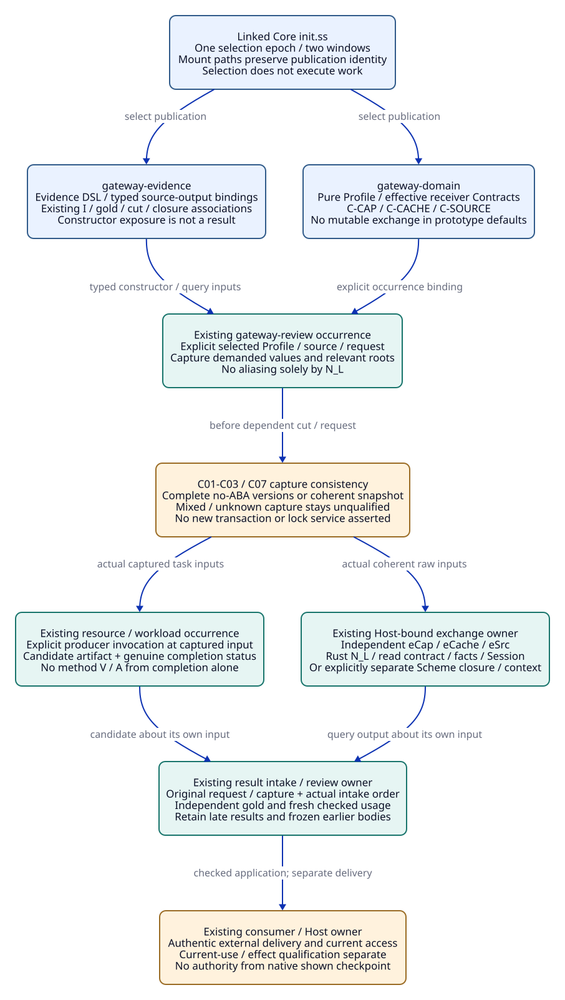
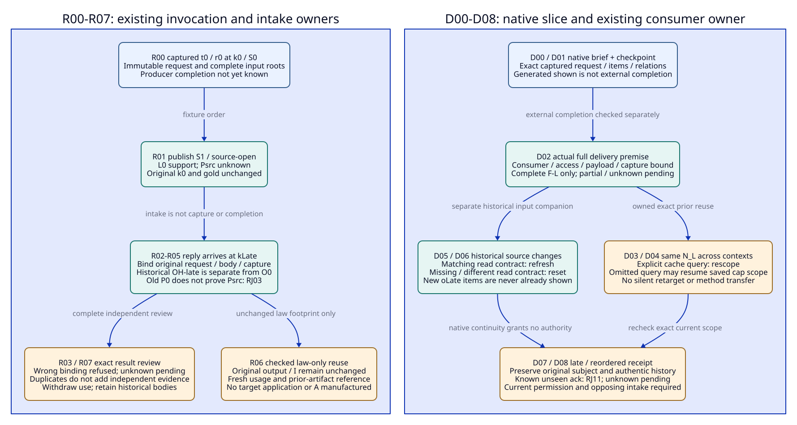

#+TITLE: 20.10 Existing Owners for Capture, Late Replies and Display Confirmation
#+LANGUAGE: en
#+PROPERTY: JD_ID 20.10
#+OPTIONS: toc:3 num:nil
#+STARTUP: overview
#+TODO: OPEN SPECIFIED | QUALIFIED
#+FILETAGS: :gateway:owners:concurrency:delivery:closure:
#+LINK: ascent-now https://github.com/tao3k/gerbil-ascent/blob/46a46bbeb2a3252ee9c29ae30c2bf7ee611634c4/%s

[[file:../../00-09-project/00-documentation/00.01-index.org][Index]] | [[file:20.09-exchange-replay-and-display-trajectories.org][20.09 finite trajectories]] | [[file:../../10-19-design/10-architecture/10.06-poo-ascent-integration.org][10.06 Module integration]] | [[file:../../00-09-project/00-documentation/00.02-local-package-links.org][Local source links]]

* SPECIFIED Source observation and revision boundary
:PROPERTIES:
:CUSTOM_ID: owner-source-observation
:INSPECTED_ON: 2026-10-18
:CORE_REVISION: 52130d2d338b09622a3f55e37987ddc0375b6187
:ASCENT_REVISION: 46a46bbeb2a3252ee9c29ae30c2bf7ee611634c4
:STATUS: inspected-source-design-not-executed
:END:

The existing local links resolve to the POO Flow parent and separate Core source
directories recorded in 00.02. The linked Core HEAD remains 52130d2d; its init.ss
matches that committed blob. The broader Core worktree is dirty. In particular,
the live selection macro adds init.build-run to the shared init projection and
export list; that addition is not part of the committed Core pin. No gateway
implementation or concurrency guarantee is inferred from that uncommitted export.

ASCENT local HEAD is now 46a46bbe. The inspected Rust exchange/slice, Scheme
exchange/session and query-rule files match that HEAD. The 20.09 gold remains
bound to its explicit older 144ed6e5 source pin. It is not relabeled as current
qualification. Current-source companions below have separate I/G identities and
an explicit method/source revision; they add no scored MB variants. No remote PR
head or CI status is asserted by a local checkout observation.

#+NAME: owner-live-source-content
| Inspected live file | SHA-256 of observed bytes | Relation to inspected HEAD |
|---------------------+---------------------------+----------------------------|
| Core init.ss | 85e8cb8c7325247a0e3e10497c57797b0c02ff37885f511275bbc9886c4d2244 | Matches Core pin |
| Core module-system/selection/init-syntax.ss | 7e75495f948cb40429faf5f10979b6bbe01faed34e3383eaf165068fe9b410ec | Dirty addition described above |
| ASCENT rust/ascent/src/clues/exchange.rs | e1ea8db23cb0487d5105762d78ba59ab9affce5c26acda1da4d9672dbaad12c8 | Matches current ASCENT pin |
| ASCENT rust/ascent/src/clues/slices.rs | 45dbe1432aa5a74534ef1905440c49b8db14105217481ad37e83871ba442849d | Matches current ASCENT pin |
| ASCENT program/clue-exchange.ss | 219c8c8c46f515118e75030957fdedfe160a0b0e7eb7d66a762dd881c925be63 | Matches current ASCENT pin |

These observations are not a complete runnable dependency manifest. Any later
consumer must capture the actual selected source closure, toolchain, native
binding and effective configuration before claiming reproducibility.

** Current source changes that alter the review contract
:PROPERTIES:
:CUSTOM_ID: owner-current-source-differences
:END:

#+NAME: owner-source-surface-matrix
| Existing surface | Observed source behavior | Consequence for 20.09 and this companion |
|------------------+--------------------------+------------------------------------------|
| [[file:../../../.gerbil/pkg/github.com/tao3k/poo-flow-core/init.ss][Core init]]; [[file:../../../.gerbil/pkg/github.com/tao3k/poo-flow-core/module-system/source/init.ss][inert reader]]; [[file:../../../.gerbil/pkg/github.com/tao3k/poo-flow-core/module-system/selection/init-syntax.ss][committed selection macro]] | One selection epoch, Module and Scenario windows, mount access paths; no implicit provider realization or test execution | Gateway publications and occurrences are selected through this mechanism; importing the upstream example is not gateway registration |
| [[file:../../../.gerbil/pkg/github.com/tao3k/poo-flow-core/profile-composition/README.org][Bounded scope/Profile selection]] | Scope binding preserves identity without traversal; named ProfileBundle selection is a different form | A Profile reference is not a frozen final receiver; capture the demanded effective values/source revisions explicitly |
| [[file:../../../.gerbil/pkg/github.com/tao3k/poo-flow-core/scenarios/null/interface.ss][Scenario publication]]; [[file:../../../.gerbil/pkg/github.com/tao3k/poo-flow-core/scenarios/null/objects.ss][native Scenario inheritance]]; [[file:../../../.gerbil/pkg/github.com/tao3k/poo-flow-core/scenarios/null/func.ss][provider binding]] | Actual existing role publication and POO inheritance with platform-bound provider checks | Reuse that organization, not null-resource facts or its platform acceptance, for proposed gateway occurrences |
| [[file:../../../.gerbil/pkg/github.com/tao3k/poo-flow-core/modules/opentofu/execution.ss][Existing explicit Job/run boundary]] | Selected publication, admission, run and currentness checks surround an explicit invocation | Illustrates existing owner placement; it is not an implemented gateway read/reply/delivery path or distributed atomic transaction |
| [[ascent-now:rust/ascent/src/clues/exchange.rs][Rust ClueExchange]] | Owns facts, source identity, read_contract and SourceSession; read clones facts, submit stages then commits, include rejects duplicate clues | Distinct eCap/eCache/eSrc stay explicit mutable occurrences; native source identity is not occurrence identity or a domain cut |
| [[ascent-now:rust/ascent/src/clues/slices.rs][Current Rust slice/checkpoint]] | Adds readContractIdentity and saved query; changed source with matching read contract yields refresh, mismatching/missing contract yields reset | 20.09 11-05 reset is old-pin gold. Current source requires refresh/reset companions with independent expected rows |
| [[ascent-now:program/clue-exchange.ss][Scheme open-clue-exchange]] | Host verify/context callbacks; closure-local clues/generation; submit base check; query context checks; retained snapshot/restore | Existing alternative owner surface, not the Rust ClueExchange API. Its snapshot is not a complete gateway historical cut |
| [[ascent-now:program/session.ss][Scheme Session]] | Retained accepted source rows and recovery; outer list/row copies, nested host values remain shared | Session recovery is not a cross-owner atomic capture or guaranteed deep copy of every host value |

Rust slice resume uses the checkpoint's saved query when questions are omitted;
selected reads may resume selector sources/constructor/bindings. It does not
retarget that saved cap query merely because the application now shows a cache
Profile. Native current mode order is: no prior -> initial; changed source with
nonmatching/missing read contract -> reset; changed source with matching read
contract -> refresh; otherwise equal anchor -> incremental, unequal -> rescope.
A malformed body/schema still errors before those modes. Item/relation arity
checks apply after the early reset branch. Preserve actual failure stage.

The read contract hashes projection declaration strings, constructor and query
rules; it excludes supplied facts, attestations, gateway Profile and consumer
permission. Matching read contract permits native continuity; it does not assert
source equivalence, immutable-state equality, honest display or engineering reuse.
Native shown rows are those placed in the returned brief, not an external
transport acknowledgement from its consumer. A supplied read-contract field
with a recomputed checkpoint checksum is also not trusted provenance: compare
the actual constructor/declaration/rule inputs and owned prior body independently.
Neither mode refresh nor a matching claimed contract authenticates the checkpoint.

* SPECIFIED Allocation to the existing owners
:PROPERTIES:
:CUSTOM_ID: existing-owner-allocation
:END:

No new runtime component, queue, registry, lock service, snapshot store or receipt
class is introduced. The names below identify responsibilities inside existing
owners. Gateway field refinements remain proposed data Contracts and associations
in the two publications from 10.06. None is a newly exported upstream API.

#+NAME: gateway-owner-allocation
| Responsibility / location | Inputs it owns | Explicit action and returned evidence | Must not own by implication |
|---------------------------+----------------+---------------------------------------+------------------------------|
| Consumer-owned init selection | Actual init body, selected publications, declared dependencies, Module/Scenario windows | Existing Core selection/Graph and source admission | No exchange allocation, producer run or display merely from selection |
| gateway-domain types/objects/config | LocalProfile, Cap2Profile, CacheProfile; source/model/permission/workload values and Contracts | Pure POO extension of effective receiver; preserve required methods and assumptions | No mutable exchange singleton, observed success or native session in Profile defaults |
| gateway-evidence types/func/config | Evidence DSL constructors, source/output mappings, typed claim/witness and input/gold/closure associations | Expose constructor and query Contracts; existing native ASCENT evaluation when explicitly called | Declaration labels do not grant ACL, oracle independence or shown provenance |
| Existing selected gateway-review occurrence | Chosen receiver/Profile, selected source and relevant generations, exact request/capture provenance | Explicit capture/read/review work under existing Scenario/Case/application execution boundary | Profile equality never equates two occurrence identities or mutable exchange instances |
| Existing gateway-resource-check/workload occurrence | Captured task inputs, actual producer/run provenance, method limits and result status | Return candidate artifact and completed/failed/partial/cancelled status to the review owner | No automatic method V/A from a completed artifact or old task input scope |
| Host-bound native exchange owner | Rust eCap/eCache/eSrc handles and raw factory inputs, or explicitly chosen Scheme closure/context/verify | Owner-controlled submit/read/slice/snapshot operations appropriate to the selected surface | No implicit sharing by N_L; no unqualified cross-surface digest/generation conversion |
| Existing result intake/review owner | Exact request/capture refs, returned payload, actual intake order, current required scope | Retain late/duplicate results, compare independent gold, create fresh checked usage/association if justified | No old cut insertion, result-label rebinding, candidate-derived gold or deletion on invalidation |
| Existing consumer/Host delivery owner | Actual target consumer/access policy, captured response body, delivery occurrence and completion evidence | Record exact completed delivery and qualify prior shown reuse; current effect fences remain separate | Native checkpoint checksum or generated brief is not external delivery, V/A or authority |

A gateway review using three Profiles allocates three occurrences and three raw
exchanges even when all start with {oL}/N_L. The pure law bytes and immutable
projection declarations may be shared. A native handle is not cached in a POO
prototype by N_L. Provider binding, selected-package closure and actual Scenario
invocation still require their existing admission paths; .run in the OpenTofu
example is evidence of an explicit work boundary, not a prescribed new gateway
method name. Gateway callable names and integration wiring remain unimplemented.

#+CAPTION: Existing selection, Profile and Scenario owners allocate raw exchanges and consume evidence; display and effect authority remain explicit Host responsibilities.

[[file:../../90-99-views/90-architecture-views/90.29-existing-owner-concurrency.d2][Editable D2 source]].

* SPECIFIED Input fields and exact reference closures
:PROPERTIES:
:CUSTOM_ID: owner-packet-closures
:END:

The [[file:20.11-expanded-boundary-review-packets.org][20.11 expanded packets]] enumerate complete C07/R06/D04/D05 inputs,
intermediate gold, exact root/absence states and refusal/pending companions. They
retain these owners, source pins and parent controls without adding a framework.

C-, R- and D- event labels below identify concurrency, reply and delivery review
steps. I-Cnn/G-Cnn, I-Rnn/G-Rnn and I-Dnn/G-Dnn are instances of the existing
OracleInputSpec/OracleGoldSpec. Each binds its requested stage, exact source
revision, event body, earlier oracle-input closure and captured cut. These names
are not record classes. Gold is independently authored before candidate scoring.

#+NAME: owner-input-fields
| Existing packet/provenance position | Required concrete content | Binding and absence rule |
|-------------------------------------+---------------------------+--------------------------|
| Selection/Profile roots in CutSpec | Init/source/publication identities; effective final receiver values; Local/Cap2/Cache Profile and required method/domain members | A lazy Profile pointer or folder name is insufficient; required missing roots are setup defects |
| Native owner/capture provenance | Occurrence and actual exchange-instance association, selected Rust/Scheme API, exact raw facts/hypotheses/maps/rule bytes, relevant source and monotone generations | N_L alone is insufficient; unknown atomic capture stays pending/unqualified, not an exact old-snapshot claim |
| Request provenance in OracleInputSpec | Existing invocation/request occurrence, captured cut, questions/expand/selector/bindings, method/limits, producer/consumer target | Owner-generated correlation is separate from payload assertions. Capture does not contain its later request/result/gold |
| Result provenance/retained artifact | Original request/capture refs, immutable payload/body digest, actual completion status if supplied, intake order, native source/read-contract/anchor when returned | Intake does not infer producer completion time; wrong known binding is refused for that application, unknown binding pending |
| Usage/T-use association | EL/wL/RL/sL/dL/TL plus fresh exact owner/target/role/cut/HC references | New target/cut requires fresh usage; unchanged TL does not copy the old wrapper or supply method V |
| Owned shown evidence in delivery/review provenance | Consumer/principal/access generation, request/response body, exact full items/relations, completed-delivery occurrence, capture and prior provenance | Returned checkpoint is candidate hint state until external completion is established; partial or unknown delivery yields no qualified newly shown family |
| Independent review roots | Fixed OracleDef/ReviewDef, typed row worksheet, required/absent/unknown closure-state table, independent source/permission/ordering facts | Candidate outputs cannot generate their own gold or reduce required membership |

#+NAME: owner-closure-membership
| Closure shorthand / scope | Exact root/member expansion for these fixtures | Expected absent / unknown boundary |
|---------------------------+-----------------------------------------------+------------------------------------|
| Roots-path | Selected init/publications/occurrence/effective receiver; path source/model/interpretation/workload/policy; complete required slots and changed-scope members | Different cap/cache/source roots are never inferred from common N_L |
| Raw-L | Actual declaration strings/constructor/query rules/runtime-method identity, {oL}+RF-L, no links/hypotheses, {sL:dL}, RL/EL/wL/TL origin bodies and their authentic mapping/HC inputs | No invented H3/late observation, V/A or target application |
| CL-Cnn: oracle-input | Roots-path + Raw-L or explicitly captured h3 extension + before/after generation observations + actual owner/request association + fixed independent oracle definitions | Current AppCap/cache-frame/Corr1 work absent as declared; missing capture means setup defect if expected-present, otherwise unknown binding |
| CL-Rnn: oracle-input | Applicable CL-C capture roots + original producer request t0 and input capture + immutable returned candidate when received + actual journal membership/correlation + independently required target/slot table | Producer completion unknown unless actual receipt supplied; no VLate or new A; no old-prefix membership for late input |
| CL-Dnn: oracle-input | Applicable captured raw state + exact request and checkpoint body/digest/schema/read contract/saved query + native output candidate if already materialized + independently owned prior shown/access facts + full required item/relation worksheet | Direct-read relations={} only for explicitly direct reads; external completed delivery not inferred from brief |
| Later package-review closure | Earlier I/G/cut/closure bodies, actual output/failed attempt, actual comparison and delivery receipts if present | No earlier I/G references this same later closure; absent actual receipt is not replaced by its future name |

These are explicit abbreviations for enumerated existing record references, not
wildcard scans such as all current evidence. Every child reference retains its
body and typed edges down to independently frozen terminal roots; the applicable
four-state closure table distinguishes expected-present, expected-absent, unknown
and irrelevant. A native output used as a later input is already materialized
before that later capture; it is not fed backward into its own producing input.
A delivery result enters a later review closure, not the input closure whose
future result it is. No recursive hash fixed point or weakened closure is needed.

* SPECIFIED Concurrent capture mapped to QR03 and QR06
:PROPERTIES:
:CUSTOM_ID: concurrent-owner-trajectory
:QR_BINDINGS: QR03 QR06
:BQ_BINDINGS: BQ01 BQ02 BQ03 BQ04 BQ06
:END:

The C/R/D labels are finite review notation, not runtime phases. C00-C02
form the mixed-capture discriminator; C03 restarts from C00's pristine Raw-L as
its positive companion, followed by C04. C05/C06 use the separately specified
Scheme reset. C07 independently restarts at C01 for the ABA/aliasing fork.
A failure never silently edits the positive companion input or its gold.

Reset to C-CAP open at the current Rust source pin: eCap/eCache/eSrc contain
{oL}, common N_L and matching read contract RC-L. kCap.open and its retained
input remain distinct from future kCap.h3. h3 is exactly the X0/W0 conjecture in
20.09. The independent raw gold is SL+RF-L+U(H3) before h3, and additionally
CH+RF-H on eCap afterward; H3 stays unknown because hypotheses are unattested.

#+NAME: concurrent-capture-event-gold
| Event / stage | Input and existing owner action | Step gold / refusal or pending | I/G, closure and oracle references |
|---------------+---------------------------------+--------------------------------+------------------------------------|
| C00 J1/J2 | Consumer selects two gateway publications and review occurrence with Cap2Profile; explicit owner constructs eCap and independent peer handles | Selection is inert; explicit construction is separately bound to the occurrence. Common N_L does not merge handles | I/G-C00, CL-C00; Roots-cap, Raw-L, native factory refs; OC/OR compare selection, input bytes and occurrence association |
| C01 J2 | Review owner reads relevant generation vector g0 and begins copying actual source/Profile/raw state for capture | Partial copy is not yet an accepted coherent kCap.open. No query result/current T-use from this incomplete capture | I/G-C01, CL-C01; before vector and exact copied members; OU independently fixes required members |
| C02 J2/J8 | A source/policy update or h3 submission occurs during the copying interval; final vector is g1 distinct from g0 | Mixed capture refused as coherent input; retain failed attempt. Pending recapture, no credit as native semantic counterexample | I/G-C02, CL-C02; actual before/after roots/mutation order; OU checks capture membership rather than candidate pass flag |
| C03 J2 | Positive companion: existing owner excludes mutation for the full copy, or proves a consistent immutable input snapshot with complete no-ABA generations | Accept exact captured kCap.open only under supplied ownership/version evidence. An unproved equal start/end vector remains insufficient | I/G-C03, CL-C03; actual capture/ownership premise and immutable member bodies; OU/OC compare all required roots |
| C04 J9 | Bind read rCap0 to captured open facts and read([L0,H3]); later submit h3 to live eCap under its owner | rCap0 output is SL+RF-L+U(H3), conditional={}; live next capture has CH+RF-H. Old rCap0 input/gold unchanged, peers unaffected | I/G-C04, CL-C04; captured rows, h3 and per-handle association; OW enumerates old/new sets independently |
| C05 J2/J9 | Existing Scheme-surface companion: context changes while verify/query runs; separately test a stable query with observed old context | Detected before/after context difference raises native error. Stable query with old observed context gives stale if all observations verified; failed verification instead prioritizes unavailable | I/G-C05, separate Scheme CL-C05 with callback context/row/digest/verify refs; OR/OW check actual branch. No Rust digest or receipt is substituted |
| C06 J2 | Scheme companion: two submits use base generation g; first completes and increments it before second checks | Second rejects stale clue generation; no second append. Arbitrary concurrent/reentrant dispatch is not qualified merely by this sequential base check | I/G-C06, Scheme CL-C06; exact dispatch order, closure generation and complete row bodies; OU compares before/after accepted state |
| C07 J2/J8 | Context/root changes A->B->A during capture, or mutable nested input changes behind a shared reference; endpoint labels look equal See [[file:20.11-expanded-boundary-review-packets.org::#c07-full-packet][expanded C07 packet]]. | No coherent-capture success without stronger monotone generation/ownership proof. Preserve attempt and mark capture binding pending; do not infer no change from equal endpoint labels | I/G-C07, CL-C07; independent change journal/nested bytes and relevant member set; OU exposes ABA/aliasing discriminator |

C05/C06 subcases have separately suffixed I/G inputs; they never share one
mutable gold. Use the actual Scheme callback protocol, not Rust hypothesis JSON
or a Rust TL string. Define contexts A=(owner-cap,scheme-src-0,prefix-0,rule-46),
B=(owner-cap,scheme-src-0,prefix-1,rule-46), and
C=(owner-cap,scheme-src-1,prefix-1,rule-46), in the exact field order
(ownerIdentity,sourceIdentity,prefixIdentity,ruleIdentity).

The Scheme observation input soL is id=soL, claim=L0, polarity=support,
role=observation, source=sL, factors=[(model,M0),(quantifier,all-admissible-C),
(method,L)], links=[]. Its Scheme digest dSL binds scheme-src-0 and those exact
fields in the source-defined encoding; dSL is not assumed equal to native dL.
For this positive companion, the trusted callback has actual checked bindings
for soL/dSL/sL under both A and B; neither is inferred from a JSON flag.
The trusted verify callback supplies a genuine nonempty receipt only for the
specified checked (soL,dSL,sL,context) subject. That is an external premise,
not evidence constructed by this document. Initial submit at base=0 succeeds
under A and yields generation=1. Retain its original context-A observed view.

#+NAME: scheme-companion-step-gold
| Subcase / input | Concrete scheduling or changed input | Source-specific step gold |
|-----------------+--------------------------------------+---------------------------|
| C05.change | Query L0 starts at A, context is B at the post-query comparison | Error trusted context changed during clue query; no successful detached view from that call. Keep failure, not a semantic-refusal score |
| C05.stable | Query L0 remains at B, callback verifies soL/dSL/sL under B; observed argument is the retained context-A view | status=stale; support={(L0,soL,dSL,sL,receipt-SL-B)}, exactly the three observation factors, no counter/conditional/conflict/neighbor/unknown. Receipt is separately authentic and is not method V |
| C05.unavailable | Query L0 stays at C; original soL still belongs to scheme-src-0, observed view remains A | status=unavailable, unavailable={soL}, support={}, unknown={L0}, original three relevant factors remain, counter/conditional/conflict/neighbor={}. Unavailable takes precedence over observed-context stale; no current attestation from old source |
| C06.base | At A/generation=1, first submit id=hS1, claim=H3, polarity=support, role=hypothesis, source=agent3, factors=[(context,X0),(workload,W0)], links=[] at base=1; second uses id=hS2 but still base=1 after first completes | First generation=2, second stale-generation error; accepted clue IDs exactly {soL,hS1}. Query H3 at stable A with no observed argument has status=unread and returns conditional={(H3,hS1,dHS1,support,agent3)}, its two exact X0/W0 hypothesis factors and unknown={H3}; support/counter/conflict/neighbor={}; dHS1 is the actual source-defined Scheme body digest |

The Scheme snapshot after C06.base retains exactly those clue bodies and
generation=2 with ownerIdentity=owner-cap; it omits the complete gateway source,
permission and historical verifier closure. These concrete companions illustrate
existing alternative ownership; the scored Rust row identities in 20.09 remain
unchanged and no unqualified cross-surface digest or hypothesis conversion occurs.

Rust &mut operations and staging prevent certain intra-call aliasing/partial
submit cases; they do not freeze external Profile/source/permission owners.
Scheme before/after context equality checks do not themselves exclude ABA,
reentrant mutation, multiple dispatchers or changes to hidden verifier state.
The gateway must use the existing owner's controlled invocation boundary and
complete captured roots. No universal transaction API, lock or native historical
read method is asserted. Unknown actual ownership/consistency evidence remains
an implementation qualification gate, not a license to serialize the Agent's
entire reasoning or deny independent exploration.

* SPECIFIED Late producer and query replies mapped to QR06
:PROPERTIES:
:CUSTOM_ID: late-reply-owner-trajectory
:QR_BINDINGS: QR03 QR06
:BQ_BINDINGS: BQ02 BQ03 BQ04 BQ05 BQ06 BQ07
:END:

R03 variations independently fork after R02; R04-R07 continue the genuine
R02 intake, not a rejected or unknown R03 association. No failed branch changes
the original request body or a later positive gold.

This independent source-path reset uses original t0/Pfx0/k0/P0/S0 and the
source-open OS-open/kSrc.open/Psrc state from 20.09. Producer replies and query
replies are different: a producer returns an artifact for later checking, while
a query returns relations about already captured inputs. Neither is an A or
current-use authorization. Completion time is unknown unless actually supplied.

#+NAME: late-reply-event-gold
| Event / stage | Input and existing owner action | Step gold / refusal or pending | I/G, closure and oracle references |
|---------------+---------------------------------+--------------------------------+------------------------------------|
| R00 J2 | Existing producer occurrence dispatches t0 for captured P0/S0/k0; review owner dispatches raw query r0 for fixed O0/Pfx0 | Both requests retain exact invocation/capture refs; no result, completion time, VLate or shown receipt yet | I/G-R00, CL-R00; original t0/r0/capture bodies and independent journal roots; OU/OR compare scope |
| R01 J1/J2/J8 | Publish S1/Xsrc, select source-open review occurrence and construct OS-open {oL} | New Isrc.open/Gsrc.open/CLsrc.open; raw source gold SL+RF-L+U(Psrc). Old Pfx0 bodies unchanged | I/G-R01, CL-R01; CCsrc and actual new source roots; OC/OW compare distinct inputs |
| R02 J2 | Intake receives immutable hypothetical RLate from t0 at kLate; check transport correlation and artifact body independently | Retain candidate about P0/S0 with intake kLate, completion unknown. No old-prefix insertion, native projection, VLate or Psrc support automatically | I/G-R02, CL-R02; actual request/intake/body refs, expected absent VLate/A; OR/OU check binding and causal order |
| R03 J2 | Independently offer wrong known request/capture/digest; positive companion repeats identical genuine reply; unknown correlation companion lacks authoritative request body | Wrong binding refused for attempted association; duplicate identical body retained/referenced without mutating old output or counted twice as independent evidence; unknown binding pending. A correlation failure does not prove artifact theorem false | I/G-R03 subcases, CL-R03; independent original request and body equality table; OR/OC compare exact pairs |
| R04 J2/J9 | Explicit host checks sLate:dLate and constructs historical OH-late from captured O0 plus oLate; separately replay original O0 | OH-late read P0/L0 gives S0Late plus exact factors; O0 replay gives original S0 support set only. TLate requires actual native check; VLate still absent | I/G-R04, CL-R04; old/new raw roots, host-map premises and 20.09 exact worksheet; OW/OU compare two fixed corpora |
| R05 J9/J6 | r0 result arrives after S1 publication and is routed using its original request/capture; application tries to consume it as Psrc current proof | Historical output about P0 remains valid only for its captured input; direct Psrc promotion RJ03. Known stale original own-scope current use RJ10; no ASrc from either | I/G-R05, CL-R05; r0 original I/G/output, Psrc slot table and current source cut; OR/OU check exact requested use |
| R06 J2/J3 | Source-open law-only query about L0 arrives late; native row bytes still match current L0 and complete relevant method/access roots remain unchanged See [[file:20.11-expanded-boundary-review-packets.org::#r06-full-packet][expanded R06 packet]]. | Retain original output with original I/cut. Checked new L0 usage/application may reference it as a prior external artifact in a fresh input; never relabel its Out/I as a new run. Psrc application/Corr1 remain pending | I/G-R06, CL-R06; exact old output, unchanged L0 footprint/trust/body checks, new usage/T-use refs; OR/OU assess selective reuse |
| R07 J8/J6 | Current source intake completes; withdraw affected present uses while retaining old cut/input/gold/result/receipt bodies and failed attempts | H0 subset H1 with identical old bodies. Late counter relevance reviewed under complete current intake; no blanket source-label filtering or historical deletion. No effect undo is inferred | I/G-R07, CL-R07; before/after store and footprint, opposing-review inventory; OU/OK compare retention and scope |

Scheme retained snapshot restores only its declared ownerIdentity, generation
and clue bodies with digest/duplicate checks. Restored queries still obtain the
current context and re-run verify; restoring old clues under a changed current
source may produce unavailable observations. Historical gateway replay therefore
needs the retained context/verifier/source-policy inputs or a retained authentic
output, plus current permission to access it. Snapshot alone supplies neither
past verifier state nor an as-of source API. Rust source identity and Scheme
sourceIdentity from trusted context are typed separately; no digest parity or
cross-surface receipt transfer is assumed without an independently checked map.

* SPECIFIED Display confirmation and current checkpoint recovery
:PROPERTIES:
:CUSTOM_ID: display-owner-trajectory
:QR_BINDINGS: QR03 QR06 QR11
:BQ_BINDINGS: BQ02 BQ03 BQ06 BQ08
:END:

D00-D02 form the cap-delivery companion; D03 uses D02's positive exact
F-L prior, while D04 independently varies that same saved-query request. D05 is
a separate historical O0/OH-late reset with its own ten-item owned prior, and
D06 is its independent contract-mismatch/missing fork. D07/D08 are independent
late/forged/reordered-delivery controls with their before-state explicitly fixed.
Partial/unknown D02 delivery never feeds a positive D03 reuse claim.

Reset to the current Rust {oL} three-path input. F-L is exactly the four native
item rows in 20.09; direct-read relations={}. For the positive D02/D03 companion, require an actual complete native response
whose only fully displayed family is L0 and whose checkpoint items are exactly
the four F-L rows; other requested families remain deferred. This is an explicit
conditional input, not a prediction for an arbitrary displayBytes value. Suppose
the independent consumer owner can supply an authentic completed-delivery receipt
for that exact payload and F-L under the
stated same-consumer/policy positive companion. Native slice construction alone
does not supply that premise. All receipt names here are conditional inputs to
existing delivery/review provenance, not delivered implementation artifacts.

#+NAME: display-confirmation-event-gold
| Event / stage | Input and existing owner action | Step gold / refusal or pending | I/G, closure and oracle references |
|---------------+---------------------------------+--------------------------------+------------------------------------|
| D00 J9 | Capture cap request rCap at kCap.open with explicit scope {L0,Pcap,PerfCap}, A-cap, N_L, RC-L, no prior | Native initial; SL+RF-L+U(Pcap)+U(PerfCap); no qualified prior or newly completed external delivery acknowledgement | I/G-D00, CL-D00; exact request/factory/code/item worksheet; OW/OC enumerate scope and rows |
| D01 J9 | Native slice returns complete brief and checkpoint; external delivery has not completed | Retain immutable payload/returned checkpoint as candidate. No newly qualified owned shown receipt just because native checkpoint includes items | I/G-D01, CL-D01; actual native result/status and expected absent delivery; OU distinguishes generation from completed delivery |
| D02 J9 | Consumer/Host receives authentic completion for the stipulated exact rCap response/body with only full F-L shown, correct principal/access/capture; alternatively only partial delivery or lost completion evidence | Positive companion qualifies newly shown F-L only. Partial/unknown completion qualifies no new complete F-L; retry/replay allowed, no false positive-only family acknowledgement | I/G-D02 subcases, CL-D02 with receipt as prior materialized input; OW compares all four items, OU authentic completion/policy |
| D03 J9 | Reuse authentic F-L hint on cache-open with explicit {CacheAuth,Pcache,L0}, A-cache; same consumer/policy permitted | Same N_L and RC-L, changed anchor => rescope. Prior reusable items exactly F-L; new unknown CacheAuth/Pcache items not acknowledged. No engineering usage/method transfer | I/G-D03, CL-D03; actual prior/owned receipt and current target/anchor/policy; OW/OR/OU compare exact association |
| D04 J9/J2 | Same prior checkpoint has saved cap query; application omits questions on cache exchange while claiming cache-target response See [[file:20.11-expanded-boundary-review-packets.org::#d04-full-packet][expanded D04 packet]]. | Current native resumes saved cap query, giving SL+RF-L+U(Pcap)+U(PerfCap); same N_L and resumed A-cap yield incremental mode; it does not auto-retarget. Refuse mislabeled cache-response association; explicit new cache query restores D03 scope | I/G-D04, CL-D04; retained saved query, effective resumed request and independent target table; OR/OW compare exact scope, no new RJ enum |
| D05 J9/J8 | Authentic prior historical O0 checkpoint includes readContractIdentity RC0; OH-late adds actual checked oLate under identical projection declarations/constructor/rules See [[file:20.11-expanded-boundary-review-packets.org::#d05-full-packet][expanded D05 packet]]. | Changed raw source but same RC0 => current native refresh. Same P0/L0 anchor; added items exactly oLate support plus its five factors, removed={}, retained=all ten original P0/L0 items, changed={P0}; current item count=16. No newly owned acknowledgement of oLate | I/G-D05, CL-D05; original/current raw bodies, exact old prior items, late six-row worksheet below; OW/OC compare independently |
| D06 J9 | Same historical source change, but valid prior has nonmatching or absent readContractIdentity | Current native reset; previous items/relations discarded for native delta; all current P0/L0 items added, retained={}, removed={}. Distinct G from refresh and from old-pin 11-05 | I/G-D06, CL-D06; explicit valid checkpoint body/contract variant and current code pin; OW/OR compare branch inputs |
| D07 J9/J8 | Old delivery result arrives after source/access/consumer changes; independently try valid-checksum invented shown rows with known empty or unknown owned history | Keep completion about its captured request; no current promotion without exact content/permission checks. Known unseen prior acknowledgement RJ11; unknown provenance pending + safe replay. Current denial prevents reuse even if bytes unchanged | I/G-D07 subcases, CL-D07; actual consumer/policy generations, known/unknown shown table and body refs; OU/OK check honest history and opposing intake |
| D08 J9/J8 | Response/receipt retransmitted or reordered; old cap/current cache or old/current historical response have distinct immutable bindings | Same receipt/body/subject duplicate grants no extra shown scope; conflicting body under same ID refused, unknown ownership pending. Reordered results do not overwrite newer owner association; preserve all genuine history | I/G-D08, CL-D08; request/response/receipt identity pairs, complete before/after associations and access roots; OR/OU compare immutable identities and current scope |

D05 fixes a concrete prior: all original P0/L0 items actually shown and owned,
no Perf0/Corr0 items for that question scope, and no relation rows. The six added
rows are exactly (support,P0,oLate,dLate,sLate,TLate,"","") and
(factor,P0,oLate,dLate,name,value,observation,"") for
{(context,X0),(cap,"1"),(interpretation,K0),(source,S0),(method,Q)}.
Native mode refresh admits prior continuity for delta calculation; the Host can
retain only genuinely shown unchanged items under current permission. Adding a
new late counter instead requires recomputing the complete opposing family and
its conflict item; no prior positive-only family can acknowledge that changed
full family. D05 does not assert a numeric display capacity or exact outgoing
checkpoint subset before actual presentation/delivery.

Independent mode companions keep source/schema/checksum/arity well formed. If a
malformed checkpoint fails earlier, retain that failure and leave later mode/
shown checks unevaluated. A gold mismatch, wrong-scope association, native error,
pending provenance and resource-incomplete output are different outcomes. No
new benchmark score or rejection-code taxonomy is introduced.

#+CAPTION: Native payload, external delivery and later reuse are distinct events; current-source refresh permits deltas without granting ownership or engineering applicability.

[[file:../../90-99-views/90-architecture-views/90.30-late-reply-and-display-confirmation.d2][Editable D2 source]].

* SPECIFIED Three-path closure and remaining assumptions
:PROPERTIES:
:CUSTOM_ID: owner-three-path-assumption-audit
:END:

#+NAME: owner-three-path-review
| Path / existing owner allocation | Concurrent capture / late reply | Display / reference closure | Still-open engineering boundary |
|----------------------------------+---------------------------------+-----------------------------+---------------------------------|
| C-CAP: Cap2Profile -> cap review occurrence -> eCap/OC-open | C1->C2 creates new domain roots even when Raw-L/N_L unchanged. Old C1 producer output stays at its old capture; h3 mutates only eCap. Fresh checked L0 association can reuse unchanged law bytes | Explicit cap scope; new cut/usage/T-use, actual HC and target application refs; saved cap scope cannot be silently used as cache scope | AppCap/new Q/CorrCap/PerfCap and exact workload still pending; capture atomicity and actual wrapper/consumer fencing unqualified |
| C-CACHE: CacheProfile -> separate cache review/resource occurrences -> eCache/OK-open | Enabling cache changes Sk/Kk/Z1 and permission/shared-byte scope, not just capacity. Late cache-frame candidate remains unverified in new intake, absent in old frozen input | CL-D includes CacheAuth and Pcache independently, negative-scope membership and access generation; common F-L reuse conditional on full owned provenance | Cache frame/model/permission/resource methods, complete U-cache and current at-hit authorization remain unqualified; no same-N_L shortcut |
| C-SOURCE: source-selected Profile/receiver -> source review/producer occurrences -> eSrc/OS-open | S0->S1 publication races with t0/k0 and r0; kLate is intake, not completion/capture. OH-late and frozen O0 remain separate, never aliased by native identity | Current Rust D05 refresh versus D06 reset determined by actual read contract; Scheme restore re-verifies current context; saved query/consumer/access roots explicit | Corr1/application/S1 Q/ASrc absent; historical access, complete opposing review and source/runtime correspondence still unqualified |

#+NAME: owner-hidden-assumption-disposition
| Existing assumption | Concrete hidden premise exposed | Design resolution / exact discriminator | Remaining implementation evidence |
|---------------------+--------------------------------+-----------------------------------------+-----------------------------------|
| OA01 ownership | Same Profile, N_L or selection window means one live owner | C00/C04 distinguish publication, effective receiver, occurrence and mutable handle; no default singleton | Actual Core-to-exchange allocation and boundary admission |
| OA02 paper versus execution | Generated brief/checkpoint means delivered evidence | D01/D02 separate native payload from authentic complete delivery | Genuine process/native/delivery receipts and independent review |
| OA03 missing versus absent | Missing request/capture can be treated as unrelated late noise | R03 four-state closure; required unavailable body blocks grading, unknown actual correlation pending | Authentic retrieval and preserved setup-failure classification |
| OA04 closure | Context tuple or Session row copy captures all external mutable input | C01-C03/C07 include selected sources, demanded receiver, nested values and verifier/policy footprint | Atomic coherent capture or retained consistent snapshot, immutable nested ownership |
| OA05 cut/races | Equal endpoint context/source identity excludes an intervening change | C07 exposes ABA; late output has original capture and separate intake; no cut/result identity cycle | Monotone generations, actual coordination and current-use fence |
| OA06 reuse/invalidation | Every late reply must be discarded, or every retained byte remains usable | R06 selective checked L0 reuse, R07 non-erasure; D05 display continuity separate | Complete impact/trust/access footprint and scoped adoption checks |
| OA07 required proposition | Profile placement, law/hypothesis or shown items prove changed target | Fresh usage/application and exact Pcap/Pcache/Psrc/CacheAuth slot table | Authentic method/frame/source correspondence and argument |
| OA08 opposing intake | Prior displayed support may suppress newly relevant counter | D05 changed full family and R07 current intake, independent of hint scope | Actual intake completeness and accepted counter disposition |
| OA09 semantic mapping | Rust and Scheme sourceIdentity/digest/generation/snapshot are interchangeable | Surface discriminator and exact source revision in every I; no direct receipt/hash conversion | Independently checked cross-surface mapping if one is later selected |
| OA10 benchmark scope | Native refresh or replay closes all parent variants | Separate current-source companion gold, no added score or automatic MB revision | Existing 24 parent variants and method/performance/native gates |
| OA11 verifier result | Scheme host verify or TL establishes method soundness | Verify is raw observation attestation; method V/application still separate; unavailable precedence explicit | Genuine checker/issuer/subject validation over current scope |
| OA12 partial results | Stale/timeout/cancelled transport can be counted as intended refusal | Exact reached stage recorded; failed completion produces no qualifying semantic answer or delivery | Complete bounded execution and authentic failure provenance |
| OA13 independence/exposure | Saved query/checkpoint labels enforce isolation and policy | D04 actual effective scope checked; gold/owned history independent of candidate | Existing task/review authority and host source/access admission |
| OA14 accessible/current refs | Successful restore or old shown receipt grants current access | R04 replay requires historical inputs and current access; D07 permission/consumer recheck | Real retention/retrieval/authorization and completed delivery |
| OA15 scope/consumers | Native mode refresh means unchanged source semantics or engineering admission | D05 compares exact deltas; current gateway methods/Host effects remain separate | Actual selected consumer, native isolation, replay and operational evidence |

* OPEN Existing-owner qualification handoff
:PROPERTIES:
:CUSTOM_ID: owner-qualification-handoff
:END:

- [ ] Independently instantiate all current-source I/G/closure/body/mapping inputs; preserve old-pin gold and failed attempts.
- [ ] Qualify actual capture consistency, no-ABA generations, non-reentrant ownership and immutable nested inputs at the existing boundary.
- [ ] Exercise late/duplicate/wrong/unknown correlated producer and query replies across all three paths without history loss or cross-owner promotion.
- [ ] Exercise genuine/partial/unknown/forged/reordered delivery and saved-query refresh/reset companions under exact current permission.
- [ ] Retain real method/application/current-use and Host effect receipts before claiming SDLC closure.

Org/D2 and source-content checks validate documentation and observations only.
No gateway init, module, runner, lock, snapshot implementation, oracle, QNT model,
Lean proof or native integration is written or executed by this document.
