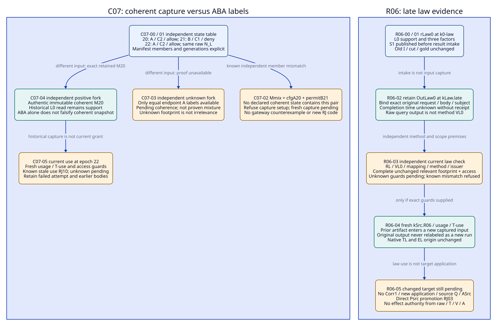
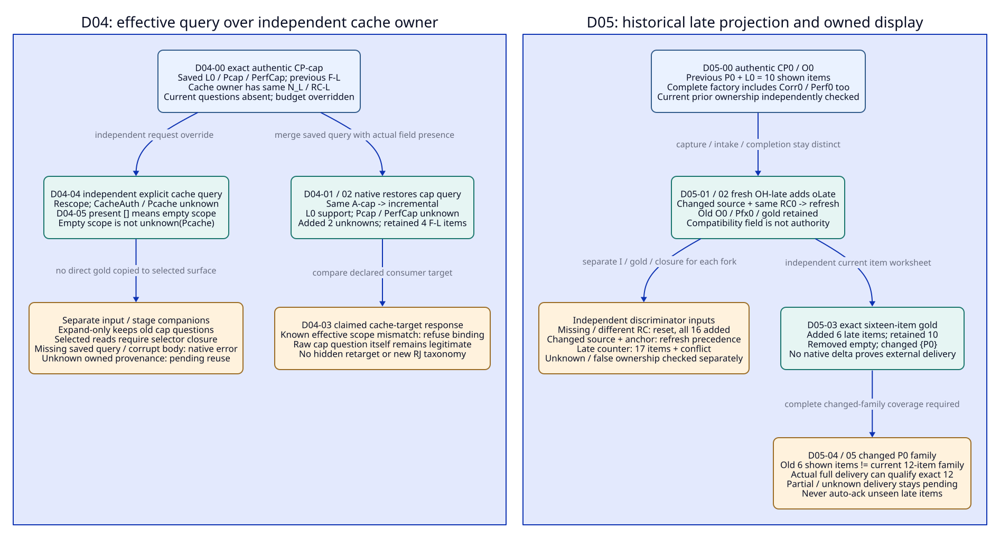

# SPDX-FileCopyrightText: 2026 tao3k team and Contributors
#
# SPDX-License-Identifier: LGPL-2.1-or-later

#+TITLE: 20.11 Expanded C07, R06, D04 and D05 Review Packets
#+LANGUAGE: en
#+PROPERTY: JD_ID 20.11
#+OPTIONS: toc:3 num:nil
#+STARTUP: overview
#+TODO: OPEN SPECIFIED | QUALIFIED
#+FILETAGS: :gateway:packets:aba:reuse:resume:refresh:

[[file:../../00-09-project/00-documentation/00.01-index.org][Index]] | [[file:20.10-existing-owner-concurrency-and-delivery.org][20.10 existing owners]] | [[file:20.09-exchange-replay-and-display-trajectories.org][20.09 row worksheets]] | [[file:../../30-39-evaluation/30-benchmarks/30.04-oracle-review-data-contracts.org][Oracle contracts]]

* SPECIFIED Contract scope and common packet body
:PROPERTIES:
:CUSTOM_ID: expanded-boundary-packet-scope
:STATUS: author-specified-not-executed
:INSPECTED_ON: 2026-10-19
:ASCENT_REVISION: 46a46bbeb2a3252ee9c29ae30c2bf7ee611634c4
:CORE_REVISION: 52130d2d338b09622a3f55e37987ddc0375b6187
:END:

The [[file:20.12-selected-read-use-race-and-counter-packets.org][20.12 child packets]] instantiate the selected-read, current-use race and
late-counter branches with exact selector/binding and relation-unit input,
use-time policy order and complete opposing-family delivery gold. They retain
these existing owners and source revisions; deferred presentation is distinguished
from incomplete evaluation.

These four packets expand existing 20.10 controls; they add no publication,
framework, runner, oracle implementation or scored MB variant. The linked Core
init still selects Module/Scenario windows in one epoch. gateway-domain retains
pure Profile/Contract responsibility; gateway-evidence retains declarations and
typed associations; selected review/producer occurrences, native exchange and
existing result/consumer/Host owners retain their 20.10 responsibilities.

Local Core and ASCENT HEADs were re-observed at the revisions above. Source
semantics below use committed blobs at those pins, including ASCENT slice resume,
prior-mode selection and item/acknowledgement rules. The dirty Core macro noted
in 20.10 is not treated as a new capture or runtime capability. Older 144ed6e5
gold remains historical; no old result or rejection code is rewritten.

Complete input here means an enumerated, reviewable specification of values,
typed references, root membership and absence states, including each branch.
It is not a runnable package of producer bytes/checker receipts: symbols such as
dL, RC-L and TL must resolve to actual retained bodies/digests/authentic checks
before execution. Uninstantiated required bytes are not a native pass.[fn:paper]

#+NAME: expanded-common-packet-contract
| Existing position | Required body in all four packets |
|-------------------+-----------------------------------|
| OracleInputSpec identity | I-C07-nn, I-R06-nn, I-D04-nn or I-D05-nn; exact requested stages, branch predecessor, source/method revision, finite operation and its actual argument values |
| CutSpec | Existing path-specific domain roots, actual native occurrence/state binding, complete relevant member/generation manifest and captured prefix; excludes its own ID and later usage/I/G/output/delivery records |
| InputClosure | CL with the same family/event suffix and scope=oracle-input; enumerated earlier roots/associations, four-state membership table and independently fixed OracleDef/ReviewDef/worksheet |
| OracleGoldSpec | G with the same suffix, binding the exact I/CL/cut/revision and stage; expected/forbidden relations and refusal/pending/setup outcomes independently authored before scoring |
| Actual output position | A genuine complete candidate output or actual failure about that input; expected-absent before execution. A later review may use an already materialized earlier output as input |
| Reference identity | Full typed record/body/digest, not just printable names. Artifact origin, capture, intake and completion fields stay distinct; missing completion is unknown |
| Use and display | Fresh exact usage/T-use where requested; completed delivery and prior shown provenance where requested. Neither is inferred from native source identity or returned checkpoint |
| Later review closure | Retained earlier I/G/CL/cut and actual output/comparison/delivery bodies; no backward reference from the earlier I/G to this same later closure |

Every event table row below has its own I/G/CL suffix. A fork uses its own suffix
and the stated reset input; it never edits main-line gold. Braces denote exact
finite sets. Empty means asserted empty only within the specified scope; unknown
is a separate binding state. Limits, cancellation and incomplete output remain
inconclusive, not a correct semantic refusal. No branch manufactures actual V/A.

** Shared terminal references and item schema
:PROPERTIES:
:CUSTOM_ID: expanded-packet-terminal-roots
:END:

#+NAME: expanded-terminal-root-register
| Reference | Exact retained interpretation |
|-----------+-------------------------------|
| Select-path | Actual init body/declared publication sources and dependencies, selected review occurrence, demanded effective Profile receiver, relevant policy/method definitions; not just the mount path |
| Roots-cap | Cap2Profile: C=2,Q=1,B=2,cache=false,S0,K0,M0,Xcap; Pcap/PerfCap targets, complete required slot/member definitions |
| Roots-cache | CacheProfile: C=1,Q=1,B=2,cache=true,Sk,Kk,Xcache,Z1={cacheOwner}; Pcache and CacheAuth separate, complete U-cache/negative/permission/member definitions |
| Roots-src | Source-selected LocalProfile: C=1,Q=1,B=2,cache=false,S1,K0,M0,Xsrc; Psrc target, Corr1/application/Q and access requirements explicit |
| Decl-L | Exact existing EDecl0/DDecl0 source vectors and constructor selection from 20.06, pinned query rules, native runtime/method identity; actual declaration strings must be retained, not replaced by their names |
| Raw-L | Complete clue {(oL,dL,L0,support,observation,sL)}, factors {(oL,dL,model,M0),(oL,dL,quantifier,all-admissible-C),(oL,dL,method,L)}, links={}, host map {sL:dL}; no hypotheses |
| Law-records | RL/dL/sL, EL with original L0/origin k0, wL=(nsL:oL,dL), native TL; authentic VL0, VMapL and MP0/method/issuer/extraction/availability inputs when verified law reuse is requested |
| SL / RF-L | support={(L0,oL,dL,sL,TL)}; the three L0/oL/dL observation relevant_factor rows for model=M0, quantifier=all-admissible-C, method=L |
| Native item row | Eight text cells (kind,claim,id,digest,a,b,c,d); empty text is "", not absent. Direct-read relation rows are exactly {} |
| F-L | (support,L0,oL,dL,sL,TL,"","") plus three (factor,L0,oL,dL,name,value,observation,"") rows for the Raw-L factors; exactly four items |
| U(q) | One native item (unknown,q,"","","","","",""); the corresponding raw unknown relation is {q} |
| O0 / B0 | Captured original {o+,oL,oSC0,oF0}, all original factors and checked source maps at k0/Pfx0; no counter/hypotheses/links |
| OQ1 counter fixture | Separate {o+,o-,oF0} corpus, P0 support/counter, ten factors and conflict; use only the explicit D05 counter fork, never silently insert into B0 |

All source-label/digest host checks and method/delivery receipts remain external
premises if not actually supplied. Native T binds bytes; V verifies its exact
method subject; A and operational receipts have their own scope. A raw query
output is not a replacement proof of RL or a new method-verification receipt.

* SPECIFIED C07 packet: ABA and coherent capture
:PROPERTIES:
:CUSTOM_ID: c07-full-packet
:PARENT_EVENT: C07
:BQ_BINDINGS: BQ01 BQ02 BQ03 BQ06
:END:

The main discriminator resets to the existing cap review occurrence/eCap with
Raw-L/N_L/RC-L, no hypotheses. Capture requires Select-cap, Roots-cap, Raw-L,
Law-records as applicable and the complete relevant permission/config source
manifest. The trusted owner journal records three coherent states in causal
order, without claiming a universal distributed clock.

#+NAME: c07-concrete-aba-input
| Owner epoch | Display label | Configuration member | Permission member | Native exchange |
|-------------+---------------+----------------------+-------------------+-----------------|
| 20 | A | cfgA20: C=2,Q=1,B=2,cache=false | permitA20: consumer=reviewer-1, access=allow, generation=20 | Independent eCap, Raw-L/N_L |
| 21 | B | cfgB21: C=1,Q=1,B=2,cache=false | permitB21: consumer=reviewer-1, access=deny, generation=21 | Same eCap and Raw-L/N_L |
| 22 | A | cfgA22: same parameter bytes as cfgA20, new generation=22 | permitA22: access=allow, generation=22 | Same eCap and Raw-L/N_L |

A manifest M20 independently enumerates coherent epoch-20 member bodies; M21 and
M22 enumerate their own exact bodies. The mixed attempted manifest Mmix names
cfgA20 and permitB21 plus otherwise unchanged Raw-L/Decl-L. No declared coherent
state contains that pair. Its same endpoint label A and N_L do not make it M20
or M22. Generation equality is meaningful only with complete coverage and no
wrap/reuse in the declared owner lifetime; a restart requires a distinct owner
incarnation binding. Those are assumptions to verify, not supplied lock code.

#+NAME: c07-complete-closure
| Closure member | Membership and exact dependency |
|----------------+---------------------------------|
| Required roots | Select-cap, cfgA20/permitA20, cfgB21/permitB21, cfgA22/permitA22, M20/M21/M22, causal journal 20->21->22, Decl-L, Raw-L and native owner association |
| Capture attempt input | Existing invocation c07-copy; first endpoint label A; copied cfgA20 then permitB21; second endpoint label A; retained attempted Mmix body |
| Independent oracle roots | Fixed OracleDef/ReviewDef and independent state-to-member table above; scope includes both config and permission, not just N_L |
| Expected absent | Accepted coherent CutSpec for Mmix, successful output from that mixed capture, new current usage/T-use/A/delivery or effect receipt |
| Unknown companion | If journal/generation/member coverage is genuinely unknown, record that state. A packet declaring it expected-present but omitting its body is a setup defect |
| Positive companion | Independently retained immutable M20 with authentic existing-owner consistency provenance about M20, or coherent fresh M22. Provenance about the manifest may precede the CutSpec; a later judgment about that CutId is not a root of that same cut |

#+NAME: c07-expanded-event-gold
| Event / stage | Concrete input / action | Step gold, refusal or pending | Exact closure / independent oracle |
|---------------+-------------------------+--------------------------------+-------------------------------------|
| C07-00 J1/J2 | Freeze c07-copy's required domain from epoch 20; start copying cfgA20 | Incomplete capture only; no accepted coherent cut/read result yet | CL-C07-00: Select-cap, M20, Decl-L/Raw-L, operation, required scope/definitions; OU enumerates coverage |
| C07-01 J2 | Journal advances to 21; copy permitB21, then advances to 22; endpoint display label returns A | Preserve exact Mmix attempt. Known independent mismatch with every coherent state, despite equal A labels/N_L | CL-C07-01 adds already materialized journal/M21/M22/attempt; OC/OU compare member identities |
| C07-02 J2/J8 | Ask to register Mmix as coherent kCap.open or to grade its read as a valid capture | Refuse inconsistent capture setup; no coherent cut/result from this association. Pending a new coherent capture. Not a gateway counterexample and no invented RJ enum | CL-C07-02: prior attempt and independent state table; OU distinguishes known mismatch from missing ownership proof |
| C07-03 J2 | Independent unknown fork from C07-00: only equal endpoint labels available; journal/complete member-version proof unknown | Pending capture binding; not proven ABA or proven mixture. No successful coherent capture from endpoint equality | CL-C07-03: exact missing-state declarations and retained endpoint observations; OR/OU check unknown versus known inconsistent |
| C07-04 J2/J9 | Independent positive fork: use immutable M20 with authentic consistency provenance, even while live owner is at 22 | Historical cut about M20 may be captured and replayed faithfully: read([L0])=SL+RF-L, unknown/counter/conditional/conflict/neighbor={}. ABA occurrence alone does not invalidate a proven coherent immutable capture | CL-C07-04: M20/provenance, Decl-L/Raw-L, source maps, historical access permission and actual replay input; OW/OU compare rows and roots |
| C07-05 J2/J6 | Request present use at epoch 22 from the M20 artifact | Keep original cut/body. Fresh current association requires exact M22 use footprint/trust/access checks; known stale own-scope wrapper RJ10, unknown guards pending. No automatic current grant from historical replay | CL-C07-05: old cut/output, M22 relevant roots, fresh usage/T-use or declared absence; OR/OU inspect exact current-use demand |

C07-03/C07-04 independently reset to their stated input; they do not repair or
relabel Mmix. A known extra mutation wholly outside a proven complete relevant
footprint need not invalidate an unrelated law use. Unknown footprint is not
proof of irrelevance. Mutable nested host values require actual immutable bytes
or deep ownership: if asserted body/digest is known mismatched, RJ02 applies to
that integrity assertion; if ownership is merely unknown, capture stays pending.
The Scheme context endpoint check can miss A->B->A; its generation, Rust N_L and
the gateway owner epoch above are separate typed fields, not interchangeable.

* SPECIFIED R06 packet: late law evidence and fresh scoped reuse
:PROPERTIES:
:CUSTOM_ID: r06-full-packet
:PARENT_EVENT: R06
:BQ_BINDINGS: BQ02 BQ03 BQ04 BQ05 BQ06 BQ07
:END:

This packet resets independently to the original L0 law corpus under S0 and
current-source review under S1. Existing invocation rLaw0 captured k0-law/Raw-L
and requested [L0] before S1 publication. It returns the complete raw rows
SL+RF-L, counter/conditional/conflict/neighbor/unknown={}; the original I-law0,
G-law0 and cut are retained. Result OutLaw0 arrives at kLaw.late after publication.
Its intake is known; producer completion time is unknown unless a genuine
producer receipt is added in a separate input. No new clue/ELate is created just
because a detached query result arrives late.

#+NAME: r06-complete-input-body
| Existing input position | Concrete value / dependency |
|-------------------------+-----------------------------|
| Original request/capture | rLaw0, original occurrence/exchange association, [L0], k0-law/Raw-L, Decl-L, limits/completion status; exact I-law0/G-law0/CL-law0 and complete output body OutLaw0 |
| Current context | Source review occurrence/eSrc/OS-open, Roots-src, kSrc.open, independent source publication/intake order; S0->S1 not inferred as unchanged |
| Reusable subject | EL/L0 with original origin k0, RL/dL/sL, wL, TL. OutLaw0 is a raw discovery/result artifact, not VL0 or a native receipt for an unprojected new clue |
| Verified-law premises | Actual retained VL0 checks RL/L0 under L; VMapL authentic mapping; MP0/issuer/method revision and current relevant L0-law definition, access and complete dependency footprint unchanged in the positive companion |
| Fresh association | New uL-src.R06=(wL,EL,L0,L,kSrc.R06); tuL-src.R06=(TL,RL,sL,dL,wL,EL,OS-R06,uL-src.R06,HC-src.R06,kSrc.R06); authentic HC and all guards checked separately |
| Required target absence | Corr1/VSC1, Psrc application/new source Q and ASrc absent or unresolved as in source-open. No A/operational authority for Psrc from a law-only use |
| Independent review | Fixed method/issuer/footprint table, original request-output binding and order; current required consumer demand names L0 law knowledge separately from Psrc implementation correctness |

CL-R06-nn includes exactly these required input bodies at the relevant stage,
with expected-absent future associations/results and unknown completion time.
An artifact may enter a fresh captured input only after it exists. kSrc.R06
includes the already received OutLaw0 and actual current roots, not a future
usage/verification/gold about that same cut. Its usage/T-use is a later bound
association included in the oracle-input closure, not a root of the cut it names.
Nothing rewrites I-law0, OutLaw0 or G-law0 to claim a new execution.

#+NAME: r06-expanded-event-gold
| Event / stage | Concrete input / action | Step gold, refusal or pending | Exact closure / independent oracle |
|---------------+-------------------------+--------------------------------+-------------------------------------|
| R06-00 J2/J9 | Dispatch rLaw0 at k0-law and capture exact Raw-L query input | Expected raw gold SL+RF-L with all other public read relations empty; actual result expected-absent until complete evaluation | CL-R06-00: original request/input, independent row worksheet, source/method definitions; OW enumerates rows independently |
| R06-01 J1/J2/J8 | Publish S1/Roots-src before rLaw0 result intake | Source-open read([Psrc,L0])=SL+RF-L+unknown{Psrc}; old captured input/gold unchanged | CL-R06-01 adds current publication/current-source roots; OC/OU compare source and capture order |
| R06-02 J2 | Receive complete OutLaw0 at kLaw.late; validate exact old request/output/subject/body bindings | Retain original output and actual intake. No automatic current T-use/V/A; completion time still unknown. Known mismatch refused for that association, unknown request binding pending | CL-R06-02: actual prior result, request/cut/row mapping and intake provenance; OR/OC check association |
| R06-03 J2/J3/J8 | Compare actual L0 footprint, RL bytes, VL0/VMapL subject, method/issuer/access policy against current required law use | Positive premise establishes only checked L0-law reuse applicability. No native reread required merely to rediscover identical rows, but raw result alone never supplies VL0 or guards | CL-R06-03: full before/current footprint/member/trust/body table, original result, consumer law-only requirement; OR/OU independently check completeness and unchanged relevant roots |
| R06-04 J2/J3 | Capture kSrc.R06 with existing OutLaw0/current roots; bind fresh usage and T-use using actual HC and checked premises | Scoped current L0 reference may be qualified conditional on all authentic inputs; native TL/original EL/VL0 remain original. No new source application or method success emitted merely by copying rows | CL-R06-04: new cut/manifest plus fresh uL/tuL/HC, authentic law checks and reviewed mapping; OR checks complete association, not name equality |
| R06-05 J3/J6/J7 | Ask whether this discharges Psrc or authorizes delivery/execution | Psrc application/Corr1/new Q pending; direct use of source-specific S0 proof for Psrc RJ03, known stale A0 own-scope present use RJ10, effect promotion RJ12 only when actually attempted. Keep all old bodies | CL-R06-05: current target/slot/consumer table, old law/result and fresh scoped association; OR/OK compare exact requested proposition and effect |

#+NAME: r06-refusal-and-pending-companions
| Independent fork from R06-02 / separate I/G/CL suffix | Concrete changed input | Exact result / boundary |
|-----------------------------------------------------+------------------------+-------------------------|
| R06-revoked | Same RL/dL/EL/TL/VL0 and old output; authoritative current policy MP1 revokes issuer(VL0), accepted under old MP0 | Withdraw current verified-law use; old records remain historical. Newly offered inadmissible V rejects RJ06; a known stale present-use attempt rejects RJ10 |
| R06-unknown | Current issuer/access lookup or complete dependency-footprint membership genuinely unknown, not known revoked | Pending binding/scope as requested; no current verified-law transfer, no proven forgery/proposition falsity |
| R06-no-method | Closure explicitly marks VL0 expected-absent while actual Raw-L/OutLaw0 is present | Pending method for verified-law use; raw SL does not generate VL0. No new method success or A |
| R06-broken-input | Closure declares VL0 or OutLaw0 expected-present but required retained body is missing | Setup defect, not a successful semantic refusal. Do not shrink required closure to observed artifacts |
| R06-wrong-subject | Retained output body names rOther/captureOther while attempted association claims rLaw0/k0-law | Known incompatible result association refused at J2, without claiming native digest error. If actual asserted body/digest mismatch is independently established, that separate integrity assertion is RJ02 |
| R06-current-race | Positive reuse checks were captured at kSrc.R06 but a relevant access/method generation changes before consumption  See [[file:20.12-selected-read-use-race-and-counter-packets.org::#use-race-full-packet][expanded use-race packet]]. | Keep old checked association with its captured cut. Current consumption requires the actual use-time comparison; known stale use RJ10, unknown current guard pending. Earlier validation is not remote fencing |

The forks do not edit the positive CL or its gold. An unchanged whole-output
digest does not prove semantic scope/issuer/permission continuity. Conversely,
a known unrelated source edit outside the independently complete L0 footprint
need not revoke that mathematical law or delete its old evidence.

#+CAPTION: Coherent capture and selective late-law reuse use existing owners, exact earlier roots and fresh current associations; equal labels never prove those conditions.

[[file:../../90-99-views/90-architecture-views/90.31-aba-and-late-law-packets.d2][Editable D2 source]].

* SPECIFIED D04 packet: saved query and effective request
:PROPERTIES:
:CUSTOM_ID: d04-full-packet
:PARENT_EVENT: D04
:BQ_BINDINGS: BQ02 BQ03 BQ08
:END:

This independent direct-Rust-slice fixture uses eCache/OK-open with Raw-L/N_L,
RC-L and Roots-cache. The target review wants exactly {CacheAuth,Pcache,L0}.
Use authentic prior CP-cap from 20.10 D02's positive companion: only complete
F-L was displayed and delivered under the same consumer/policy. This is an
explicit actual-input requirement, not a claim any displayBytes produces it.

#+NAME: d04-complete-input-body
| Existing input position | Concrete value / dependency |
|-------------------------+-----------------------------|
| CP-cap.body | schema=clue-slice.v1; sourceIdentity=N_L; readContractIdentity=RC-L; anchorIdentity=A-cap; items=F-L; relations={} |
| CP-cap.body.query | questions=[L0,Pcap,PerfCap], expand=[], displayBytes=Bcap; selection and bindings absent; no future checkpoint or result in this saved query |
| CP-cap.digest | Actual native digest of that retained body; Bcap is the actual retained positive integer from the authenticated earlier request, whose completed output met the exact F-L-only premise |
| Prior provenance | Authentic completed-delivery/body association and exact four owned items; consumer=reviewer-1, current access permits this L0 display reuse; no previously shown cache or cap unknown items |
| Current call | Direct slice(request={checkpoint:CP-cap,displayBytes:8192}); questions, expand and bindings absent in this call; the explicit display budget overrides saved Bcap |
| Current owner/target | Independent cache occurrence/eCache, Raw-L/N_L/RC-L, Roots-cache and cut kCache.D04, declared cache question set/required scope |
| Independent worksheet | Fixed saved-query merge/anchor rule, F-L and exact U(Pcap), U(PerfCap), U(CacheAuth), U(Pcache) rows; direct relation rows={} |

Bcap and its authenticated output are required terminal inputs, just as actual
body digests are. Their feasibility/value is not inferred from this design. If
not supplied, the positive fixture is uninstantiated and cannot be scored; do
not invent a numeric budget or a forged CP to force that input into existence.
The current request uses the explicit integer 8192 for its own presentation;
no particular outgoing displayed subset is part of the semantic row gold.

CL-D04-nn enumerates CP body/digest/query, genuine prior-delivery/policy roots,
actual current request (including absent fields), current factory/occurrence,
Roots-cache/target table, method definition and independent worksheets. Native
output and new delivery are expected-absent until actually supplied. Unknown
owned provenance withholds qualified prior reuse, even if native parsing succeeds.

#+NAME: d04-expanded-event-gold
| Event / stage | Concrete input / action | Step gold, refusal or pending | Exact closure / independent oracle |
|---------------+-------------------------+--------------------------------+-------------------------------------|
| D04-00 J2/J9 | Capture CP-cap and cache direct request with questions absent | Valid body/schema/source/item/relations and exact absence of query override; no target retargeting has occurred | CL-D04-00: complete CP-cap/current request and source/target/provenance roots; OC/OR check full body |
| D04-01 J9 | Native saved_query reads CP-cap.body.query and merges current fields | Effective query keeps [L0,Pcap,PerfCap], expand=[], displayBytes=8192; outgoing saved query excludes the checkpoint field | CL-D04-01: actual old query/current field-presence table, pinned merge rules; OR independently derives effective fields |
| D04-02 J9 | Evaluate on eCache {oL}, scope {L0,Pcap,PerfCap}; no selector | Mode=incremental because source and A-cap agree. Current items=F-L plus U(Pcap),U(PerfCap), added=two unknown items, retained=F-L, removed={}, changed={Pcap,PerfCap}; raw SL+RF-L, unknown={Pcap,PerfCap}, other public read relations={} | CL-D04-02: effective query/anchor and raw corpus/previous rows; OW enumerates exact native item/read projections |
| D04-03 J2/J9 | Offer that response as satisfying the declared cache-target request | Refuse wrong-scope response association; it was a legitimate raw cap question, not a cache answer or gateway counterexample. No new RJ enum; current cache-target result still pending | CL-D04-03: actual effective request/output plus independent cache target set; OR compares exact scope and requested association |
| D04-04 J9 | Independent explicit-query fork from D04-00: request checkpoint plus questions=[CacheAuth,Pcache,L0] and expand=[] | Direct slice bypasses saved-query resume. Mode=rescope, current items=F-L+U(CacheAuth)+U(Pcache), added=two cache unknown items, retained=F-L, removed={}, changed={CacheAuth,Pcache}; target binding can be correct, methods remain pending | CL-D04-04: exact fresh request and original CP, cache worksheet/target; OW/OR compare explicit scope |
| D04-05 J9 | Independent explicit-empty fork: request checkpoint plus questions=[] and expand=[] | No saved cap query restored; mode=rescope. Scope={}, raw support/unknown/factors={} and all other public read relations={}; item added/retained/removed/changed={} under scoped-delta rules. This is not unknown(Pcache) or completion of the cache target | CL-D04-05: field-presence and empty-scope worksheet; OW/OR distinguish absent questions from present empty list |

Scope changes do not imply retraction of out-of-scope prior history: native
acknowledgement rules may retain earlier rows not newly displayed. D04-05's empty
in-scope delta does not erase CP-cap or authenticate a cache result. Incoming
prior reuse, returned native checkpoint items and newly completed external
delivery remain separate. No outgoing acknowledgement subset is predicted
without actual full-family presentation and delivery.

#+NAME: d04-refusal-and-pending-companions
| Independent fork from D04-00 | Concrete changed input | Exact result / boundary |
|-----------------------------+------------------------+-------------------------|
| Expand-only override | Current request adds expand=[Pcache] but questions remains absent | Saved cap questions remain; effective union {L0,Pcap,PerfCap,Pcache}, mode=rescope, added=three unknown items, retained=F-L, removed={}, changed={Pcap,PerfCap,Pcache}; raw SL+RF-L, unknown={Pcap,PerfCap,Pcache}, other public read relations={}. Missing CacheAuth still prevents matching exact cache target |
| No saved query | Valid prior lacks query; direct request has only checkpoint | Native error checkpoint has no resumable query declaration; provide an explicit query. No later mode/scope success from this attempt |
| Corrupt checkpoint | Edited body with old digest, or invalid schema | Native integrity/schema error before later mode/target checks; record reached stage, not successful wrong-target discrimination |
| Unknown shown/access | CP bytes valid but completed-delivery ownership or current permission unknown | Pending binding for qualified prior reuse; raw reading may continue through a safe path only under applicable current access |
| Selected-read surface | Checkpoint has selection plus bindings/expand; caller chooses slice_selected or resumes its saved selector  See [[file:20.12-selected-read-use-race-and-counter-packets.org::#selected-read-full-packet][expanded selected-read packet]]. | Different explicit input, not the direct fixture. Required selector declarations/constructor/binding values, projected question/association rows and their three-column relation items must be supplied and independently enumerated; absent required bodies are setup defects |

The pinned selected path uses inherited_request and re-runs selector questions;
it can inherit saved bindings/expand even when a direct explicit question call
would not. No direct fixture gold is silently reused for that path. Agent choice
of arbitrary raw questions remains open; only the asserted result-to-target
association is refused when scope is known wrong.

* SPECIFIED D05 packet: refresh delta and honest shown reuse
:PROPERTIES:
:CUSTOM_ID: d05-full-packet
:PARENT_EVENT: D05
:BQ_BINDINGS: BQ02 BQ03 BQ06 BQ08
:END:

This independent historical fixture resets to O0/B0, not eCache or OutLaw0.
Native owners eHist0 and fresh eHistLate use the same actual declaration strings,
constructor and query rules. Their supplied observations are respectively B0
and B0+oLate, with independently checked corresponding source maps. Under the
ordinary non-collision premise N0 differs from Nlate, while both read contracts
are RC0. Each is an actual computed value to record at execution, not an invented
hash or authorization token. Producer capture and intake follow 20.09 QR06.

#+NAME: d05-complete-input-body
| Existing input position | Concrete value / dependency |
|-------------------------+-----------------------------|
| Original raw owner | O0 at k0/Pfx0, {o+,oL,oSC0,oF0}, original complete factors/maps, no links/hypotheses/counter; read questions=[P0,L0] |
| Historical prior CP0.body | schema=clue-slice.v1; sourceIdentity=N0; readContractIdentity=RC0; anchorIdentity=A0-hist for {P0,L0} with no selector; items=F0-hist, relations={}; saved query questions=[P0,L0], expand=[], displayBytes=Bhist (the authentic original positive integer) |
| F0-hist exact ten items | F-L plus (support,P0,o+,d+,s+,T+,"","") and five (factor,P0,o+,d+,name,value,observation,"") for {(context,X0),(cap,"1"),(interpretation,K0),(source,S0),(method,Q)} |
| Prior provenance | Actual CP0 body/digest, authentic completed delivery of all ten items under reviewer-1 and allowed current access; no claim that a checksum or selected numeric budget alone supplies it |
| Late input | ELate/RLate/dLate, t0 input capture k0/P0/S0, recorded kLate; oLate=(oLate,dLate,P0,support,observation,sLate) with five factors matching the P0 factor set above; checked sLate:dLate |
| Current historical factory | Fresh OH-late at kLate/PfxLate, exact B0+oLate supplied facts/maps, same declaration/constructor/rule/runtime pin; no new VLate/A and no Psrc correspondence |
| Current call | Direct slice with checkpoint=CP0, explicit questions=[P0,L0], expand=[], displayBytes=8192; no selector/bindings |
| Independent worksheet | F-L, six original P0 items and six late P0 items; four-state root table, actual N0/Nlate/RC0/anchor/code comparisons and independent prior shown/current permission table |

CL-D05-nn includes every factory/input/map/code body required to compute both
identities, the exact CP/query/provenance, current historical cut/request, late
capture/intake distinction and independent item worksheet. Other B0 observations
are required factory members even though Corr0/Perf0 are out of this query's
item scope. Future delivery and VLate/A are expected-absent; producer completion
time is unknown. Dropping out-of-question factory members would change identity
and cease to instantiate this exact fixture.

#+NAME: d05-expanded-event-gold
| Event / stage | Concrete input / action | Step gold, refusal or pending | Exact closure / independent oracle |
|---------------+-------------------------+--------------------------------+-------------------------------------|
| D05-00 J2 | Capture independently authenticated CP0 with ten items and exact O0/member/source roots | Establish retained prior input only; no late item or future completed delivery. Bad expected-present root setup does not earn semantic-control credit | CL-D05-00: original factory, full CP/body/provenance and exact worksheet; OR/OC check source and item binding |
| D05-01 J2/J8 | Intake RLate and construct fresh OH-late after genuine digest checking | Fresh historical state contains oLate; Pfx0/O0/gold immutable. TLate only if actual host/native projection succeeds; VLate remains absent | CL-D05-01 adds actual late candidate/intake/map and new factory; OU/OW compare old/new membership |
| D05-02 J9 | Native prior compares changed N0->Nlate and matching actual RC0, same explicit anchor | Mode=refresh, retaining CP0's previous rows for delta computation; not reset and not proof of identical source semantics | CL-D05-02: actual two source/read-contract identities plus factories/code and valid prior; OC/OR independently check branch |
| D05-03 J9 | Evaluate direct scope [P0,L0] with previous=F0-hist | Current items=16; added=the six oLate support/factor items, retained=all ten originals, removed={}, changed={P0}; raw support=P0(o+,oLate) and L0(oL), all 13 relevant factors, unknown/counter/conditional/conflict/neighbor={} | CL-D05-03: complete old/current raw and exact sixteen-item worksheet; OW enumerates each item independently |
| D05-04 J9 | Inspect returned native brief/checkpoint before any new external delivery receipt | Candidate checkpoint is not owned delivery. Historical already-shown unchanged rows remain recorded; no new qualified shown acknowledgement for six oLate items. Entire changed P0 family cannot be called fully seen from its old six-item subset | CL-D05-04: actual output as prior materialized input, original shown/current access facts, independent changed-family worksheet; OU/OW compare exact display scope |
| D05-05 J9/J8 | Conditional positive companion supplies authentic completion for the actual full current P0 family; partial/unknown companion lacks that completion | Full current P0 family is exactly twelve items: old six + late six. Genuine completed delivery can qualify those exact items under policy. Partial/unknown delivery grants no newly completed whole P0 family; no VLate/Psrc/A or operational authority follows | CL-D05-05 subcases: exact payload/capture/consumer/access and actual or absent completion; OU independently checks authentic full-family coverage |

The native acknowledgement relation can carry old rows forward when a family is
not newly shown. Therefore historical item-level memory is distinct from the
statement that the entire changed P0 family has been delivered. The Host must
check exact current family membership and authentic delivery; it must not delete
old shown history or label unseen late rows as delivered to simplify that test.

#+NAME: d05-refusal-and-pending-companions
| Independent fork from D05-00 | Concrete changed input | Exact result / boundary |
|-----------------------------+------------------------+-------------------------|
| D06 missing/different contract | Valid CP0 body has absent/nonmatching readContractIdentity, changed native source, checksum valid | Native reset; previous={}, added=all 16 current items, retained={}, removed={}, changed={P0,L0}. Host may still retain old authentic history; reset is not deletion or fresh delivery |
| Source and anchor both change | Matching RC0, changed source; explicit current questions=[L0] | Mode=refresh takes precedence over anchor rescope; current items=F-L, retained=F-L, added/removed/changed={}. P0 prior is outside current scoped removal, not proven absent or fully reviewed |
| New late counter | Use independently checked oLateCounter/dLateCounter/sLateCounter with counter polarity instead of the six late-support items, in a separate reset; original late-support bodies remain retained  See [[file:20.12-selected-read-use-race-and-counter-packets.org::#late-counter-full-packet][expanded late-counter packet]]. | Current 17 items: ten originals + six late counter/factor items + conflict(P0); added=seven, retained=ten, removed={}, changed={P0}. Raw conflict={P0}; complete current P0 family has 13 items, not the old six. No clean A from prior positive-only display |
| False contract metadata | Checkpoint claims matching RC0 with recomputed checksum, but independent actual code/owned prior body does not support that binding | No qualified compatibility/owned reuse from the claimed field. Known association mismatch refused; unknown authentic code/provenance pending. Record actual native outcome without calling it a valid compatibility control |
| No authentic shown receipt | Correct native refresh output but known empty or unknown prior owned shown history | Known unseen prior acknowledgement attempt RJ11; unknown provenance pending + safe replay. Native continuity alone is not dishonest until that incompatible acknowledgement is actually asserted |
| Native/body failure or limits | Invalid checksum/schema or required current map fails; alternatively actual evaluation is incomplete | Preserve reached native error or inconclusive run. Do not count it as correct refresh, counter-intake or honest-delivery qualification |

#+CAPTION: Saved-query scope, native refresh deltas and authenticated whole-family delivery are separate checks over exact packet inputs.

[[file:../../90-99-views/90-architecture-views/90.32-saved-query-and-refresh-packets.d2][Editable D2 source]].

* SPECIFIED Three-path binding and hidden-assumption audit
:PROPERTIES:
:CUSTOM_ID: expanded-packets-three-paths
:END:

The path matrix is a deliberate parameter substitution into the four existing
packet families, not three accumulated changes. Do not substitute a path's
logical context for native identity or a saved query's effective scope.

#+NAME: expanded-packets-path-matrix
| Path | C07 capture roots | R06 permitted law-only reuse | D04 effective-query check | D05 refresh boundary |
|------+-------------------+-----------------------------+---------------------------+----------------------|
| C-CAP | Demand cfg C=2/S0/M0/K0 and actual permission epochs; C1/C2 ABA endpoint equality insufficient | Fresh uL-cap.R06 at exact cap use cut and HC-cap.R06; EL/TL/VL0 unchanged, AppCap/CorrCap/PerfCap unresolved | Saved cap query matches cap target only if actual scope/consumer demand still that exact cap set; resumed raw match does not supply target methods | Same Raw-L source across C1->C2 need not refresh: N_L unchanged and same anchor incremental, changed scope rescope. Historical B0+late fixture remains a separate input |
| C-CACHE | Capture Sk/Kk/Z1 and complete negative/permission/retained-owner scope; same C/B not coherence | Fresh uL-cache.R06, HC-cache.R06 and actual current law access; no Pcache frame or CacheAuth proof from L0 | Cap resume is wrong cache-target association; explicit cache query or fully specified selected-read input required | Same {oL} may keep N_L/RC-L; cache label alone does not select refresh. Actual new supplied facts/source and RC comparison determine mode; permission denial separately prevents reuse |
| C-SOURCE | Capture S1 plus selected helpers/policy/verifier/permission roots; old t0 capture stays k0 | Fresh uL-src.R06/tuL-src.R06 for L0 only; Corr1/new Psrc application/Q/ASrc absent | Saved cap questions do not become Psrc questions; explicit [Psrc,L0] gives F-L+U(Psrc) in source-open | OH-late is historical P0/S0 input, not current OS-open/Psrc. Its refresh or full P0 delivery never proves S1 correspondence; frozen O0 remains ten-item historical query state |

Each path-specific R06 T-use substitutes its exact logical owner, fresh usage,
HC and captured use cut in the full tuple; all other RL/EL/wL/TL fields retain
their original bodies. No new T for OutLaw0 is invented because it was not
projected as an observation. New-target application requires distinct target
usage and genuine application/method evidence, not merely another law-use name.

#+NAME: expanded-packets-hidden-assumptions
| Existing assumption | Discriminator made explicit | Design disposition / remaining evidence |
|---------------------+-----------------------------+-----------------------------------------|
| OA01 owner identity | Equal N_L, endpoint label or Profile does not equate occurrences | Exact occurrence/incarnation/member association; actual independent ownership still unqualified |
| OA02 paper versus run | Complete packet contract is not actual source/checker/delivery bytes | All symbolic refs must resolve authentically before execution; no design-to-pass promotion |
| OA03 closure states | Missing required journal/VL0/CP differs from genuinely unknown state or deliberate absence | Known malformed package is setup defect, unknown actual binding pending, declared absent method pending |
| OA04 coverage | Relevant config/permission/nested/member roots versus a convenient subset; B0 members outside questions still factory inputs | Enumerate exact required closure and independent scope; actual capture/dependency completeness remains open |
| OA05 ABA/cut order | ABA alone does not prove mixture; Mmix membership does. A proven immutable M20 can still be historical | Separate known inconsistency, unknown coherence and positive immutable capture; no self-dependent CutSpec or future delivery root |
| OA06 reuse | Late raw result versus checked law use versus new target application | Fresh exact usage and unchanged law footprint required; history retained and actual impact guards still needed |
| OA07 subject | L0/OutLaw0/displayed P0 cannot become Pcap/Pcache/Psrc/CacheAuth | Required target applications and independent permission/source/resource methods stay explicit |
| OA08 opposing evidence | Late counter creates extra conflict item and changed complete P0 family | Independent intake and full-family membership cannot be suppressed by prior positive-only shown state |
| OA09 representation/surface | Absent versus [] query; direct versus selected inheritance; native/Scheme identity fields | Exact typed field presence, effective arguments and eight/three-column mappings; selected companions require their own complete data |
| OA10 benchmark scope | Packet gold refinements are not added MB variants or completed parent evaluations | Existing 24 variants and native/QNT/Lean/performance obligations unchanged |
| OA11 sound verifier | OutLaw0 raw support cannot replace actual VL0/VMapL/issuer checks | Law-only positive companion conditional on authentic method premises; no native T for unprojected query output |
| OA12 completion/failure | Early native error, inconclusive evaluation, unknown completion time and semantic rejection differ | Retain actual reached stage and original failed input; no unrelated failure credit |
| OA13 independence/provenance | Candidate checksum or matching claimed RC0 does not independently authenticate gold/compatibility/shown history | Independent worksheet/code/member/policy/receipt roots; actual task/Host isolation remains open |
| OA14 current access | Historical replay/receipt does not grant current permission or availability | Exact current consumer/access checks; known forbidden reuse refused, unknown access pending |
| OA15 scope/consumer | Refresh with changed anchor, out-of-scope non-removal and item memory versus fully shown family | Native mode/delta are bounded facts; actual current consumer, source correspondence and operational effects need separate evidence |

* OPEN Qualification and source rationale
:PROPERTIES:
:CUSTOM_ID: expanded-boundary-qualification
:END:

The package-linked [[file:../../../.gerbil/pkg/github.com/tao3k/gerbil-ascent/rust/ascent/src/clues/slices.rs][slice implementation]] fixes saved-query merge, absent/empty behavior,
mode precedence and checkpoint fields. The package-linked [[file:../../../.gerbil/pkg/github.com/tao3k/gerbil-ascent/python/src/ascent/clue_query_rules.ss][item/acknowledgement rules]] fix
scoped removed/retained/changed relations and the difference between item history
and a whole newly shown family. The [[file:../../../.gerbil/pkg/github.com/tao3k/gerbil-ascent/program/clue-exchange.ss][Scheme exchange]] supplies endpoint context
checks without proving a global no-ABA guarantee. [[file:../../../.gerbil/pkg/github.com/tao3k/gerbil-ascent/program/session.ss][Session ownership]] explicitly
leaves nested host values to a separate contract. [[file:../../../.gerbil/pkg/github.com/tao3k/poo-flow-core/init.ss][Core init]] supplies selection,
not a gateway transaction or delivery API.

- [ ] Independently instantiate each I/G/CL/cut and all required terminal bodies; retain old gold and genuine failures.
- [ ] Qualify actual coherent capture/no-ABA coverage, source/permission/current-use checks and selective law reuse at existing owner boundaries.
- [ ] Execute direct resume/explicit/empty/expand and separately complete selected-read companions under the pinned method.
- [ ] Exercise refresh/reset/changed-anchor/late-counter branches with authentic owned delivery and complete current intake.
- [ ] Require actual method/application/current-use and Host operational receipts before SDLC completion.

[fn:paper] Org parsing, links, source lookup, diagram rendering and finite table
coverage are documentation checks. They do not execute these oracle/native
controls or supply missing artifact, verifier, delivery or effect evidence.
