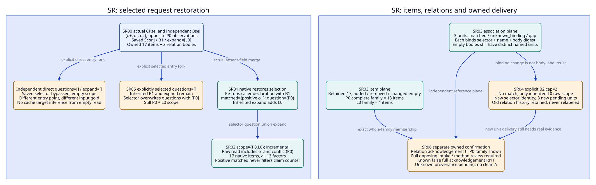
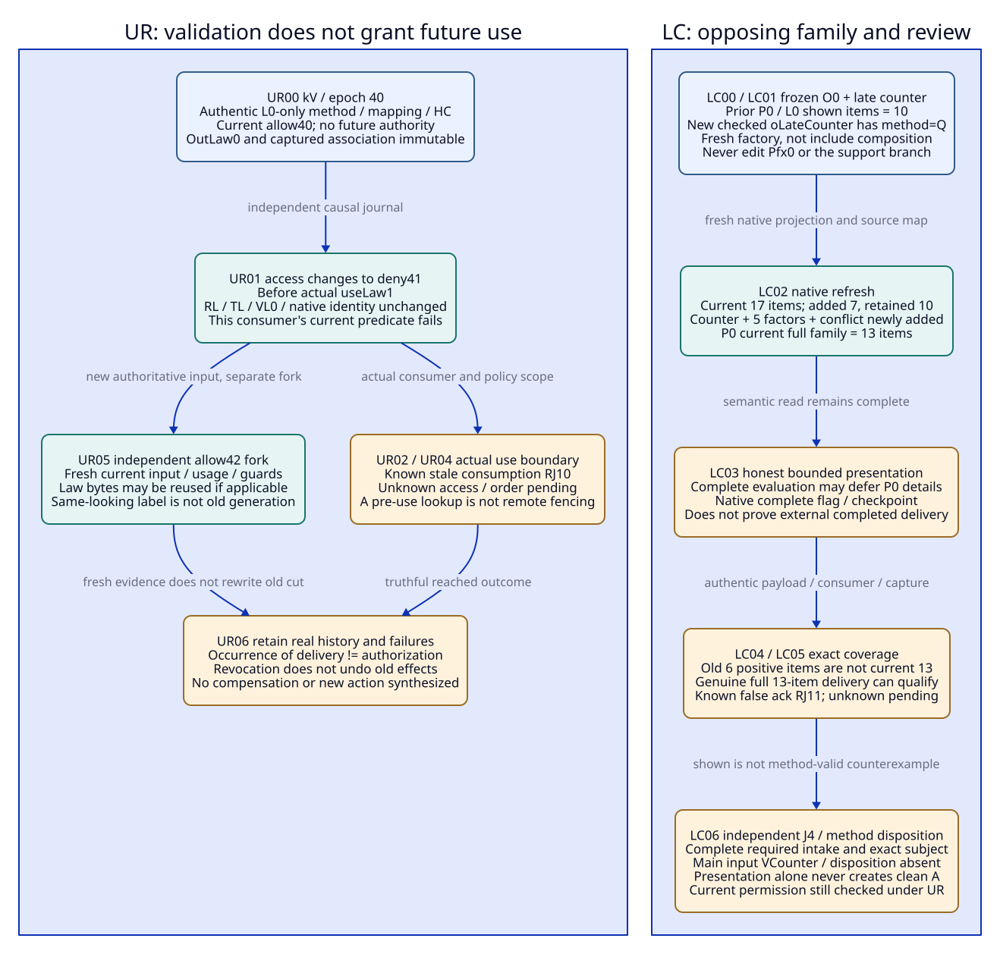

# SPDX-FileCopyrightText: 2026 tao3k team and Contributors
#
# SPDX-License-Identifier: LGPL-2.1-or-later

#+TITLE: 20.12 Selected Read, Use-Time Race and Late Counter Packets
#+LANGUAGE: en
#+PROPERTY: JD_ID 20.12
#+OPTIONS: toc:3 num:nil
#+STARTUP: overview
#+TODO: OPEN SPECIFIED | QUALIFIED
#+FILETAGS: :gateway:selector:currentness:counterevidence:delivery:

[[file:../../00-09-project/00-documentation/00.01-index.org][Index]] | [[file:20.11-expanded-boundary-review-packets.org][20.11 parent packets]] | [[file:20.10-existing-owner-concurrency-and-delivery.org][Existing owner allocation]] | [[file:20.04-query-and-change-fixtures.org::#q4-view-and-acknowledgement][Discovery and opposing evidence]]

* SPECIFIED Scope, ownership and source boundary
:PROPERTIES:
:CUSTOM_ID: selected-race-counter-scope
:INSPECTED_ON: 2026-10-19
:ASCENT_REVISION: 46a46bbeb2a3252ee9c29ae30c2bf7ee611634c4
:CORE_REVISION: 52130d2d338b09622a3f55e37987ddc0375b6187
:STATUS: author-specified-not-executed
:END:

The [[file:20.13-binding-confirmation-use-race-and-counter-disposition.org][20.13 refinement]] supplies complete SR04/UR04/LC06 packets for
new-selector relation confirmation, actual consumption-bound authority and
method-checked counter disposition. Parent inputs/gold remain unchanged; these
child records use the same existing ownership and source revisions.

The local linked Core and ASCENT HEADs were re-observed at these pins. Sources
are inspected, not executed here. 20.11's selected-read, R06-current-race and
D05 late-counter branches are expanded as existing OracleInputSpec/OracleGoldSpec,
InputClosure, CutSpec, usage/T-use and delivery/review provenance instances.
There is no new framework, publication, native runner, authority service, stored
receipt class or scored benchmark variant.

Core init selects Modules/Scenarios, gateway-domain supplies pure Profiles and
Contracts, gateway-evidence supplies caller-owned Evidence declarations and typed
associations, and selected occurrences explicitly request native work. Existing
exchange owners retain mutable state; existing result/review/consumer/Host owners
retain correlation, method/currentness, opposing-intake and delivery duties.
No Profile or native sourceIdentity becomes a mutable-exchange singleton.

SR, UR and LC labels below denote selected-read, use-race and late-counter review
steps. I-SRnn/G-SRnn/CL-SRnn, I-URnn/G-URnn/CL-URnn and
I-LCnn/G-LCnn/CL-LCnn are earlier-record-bound instances of existing contracts,
not runtime phases. Each row has its own exact I/G/closure/captured cut/stage and
independent oracle worksheet. Forks explicitly reset and never edit earlier gold.
Digest comparisons use actual encoded bodies and the declared ordinary non-collision
premise; printable names alone prove neither equality nor inequality.
Symbolic native digests/receipts must resolve to real bytes/authentic premises
before execution; this paper input completeness is not a runnable receipt bundle.

* SPECIFIED Shared typed input and closure contract
:PROPERTIES:
:CUSTOM_ID: selected-race-counter-closures
:END:

#+NAME: selected-race-counter-input-contract
| Existing position | Required input and identity boundary |
|-------------------+--------------------------------------|
| Selection/occurrence roots | Actual Core init/publication/dependency bodies, demanded effective Profile/receiver and distinct review/producer/exchange associations; use existing Roots-cap/cache/src and slot/member inventories from 20.11 |
| Native roots | Exact projection declarations/constructor/query rules/runtime pin, supplied clue/factor/link rows and independently checked source maps; native source/read-contract/selector/anchor fields remain distinct |
| Request and restore | Actual API entry point, checkpoint body/digest/saved selection/bindings/expand and exact absent versus present fields; retained original request/capture association |
| CutSpec and InputClosure | Cut binds independently frozen relevant roots/generations and captured state; new usage/I/G/output/delivery about that cut is later. Oracle-input closure enumerates earlier roots/associations with four-state membership |
| Independent gold | Exact subject, stage, semantic row sets, item/association encodings and refusal/pending/setup classes, authored separately from candidate output; integrity checking a payload does not establish its semantic truth |
| Method/use roots | Actual RL/EL/wL/TL/VL0/VMapL/method/issuer/footprint/access inputs for the requested law use, plus current consumer demand and actual use-time authority evidence when required |
| Shown/intake roots | Independently owned prior completed-delivery bodies and item/relation membership, complete required opposing-intake inventory and actual disposition provenance; no ownership from checksum alone |
| Later review roots | Retained earlier I/G/CL/cut, actual completed/failed/partial evaluation, actual native presentation and external delivery records; no earlier I/G points back to that same later closure |

Missing expected-present bodies make a setup defect. Deliberate absent method
work is pending method; genuinely unknown current access/footprint/ownership is
pending binding/scope. Evaluation timeout/cancellation/incompleteness is
inconclusive. A complete evaluation with an honest deferred presentation is a
valid bounded read, not an incomplete evaluation; it does not confirm delivery
of deferred items. presentationComplete is native rendering metadata, not an
external completed-delivery or engineering-admission receipt.

* SPECIFIED Selected-read packet and restored selector inputs
:PROPERTIES:
:CUSTOM_ID: selected-read-full-packet
:PARENT_BRANCH: 20.11 D04 selected-read surface
:BQ_BINDINGS: BQ02 BQ03 BQ06 BQ08
:END:

This independent corpus Bsel is exactly {o+,o-,oL}, not the B0 or OQ1 factory
manifest. o+ and o- have claim P0, opposite observation polarities and original
s+/d+/T+ and s-/d-/T- bindings; both have context=X0, cap="1",
interpretation=K0 and source=S0. o+ has method=Q, o- has method=IR. oL is the
original L0 law with model=M0, quantifier=all-admissible-C, method=L. All links
and hypotheses are empty. Host map={s+:d+,s-:d-,sL:dL}. The native identity is
Nsel and the projection read contract RCsel, independently computed from the
actual factory inputs. Do not reuse O0's identity for this different corpus.

The main SR factory, declarations and bindings remain fixed through selector
evaluation and claim reading. Any actual intervening relevant mutation requires
a separately captured input and comparison; old selector rows cannot certify
a later raw state. Native ownership and external policy consistency still need
the existing boundary qualification.

Sconj denotes exactly the existing CONJUNCTIVE_SELECTOR declaration string in
[[file:../../../.gerbil/pkg/github.com/tao3k/gerbil-ascent/rust/ascent/tests/integration/clues/requests.rs][the pinned ASCENT source fixture]], constructor=query. It requires at least
one binding and matches all factor name/value pairs on one (id,digest) witness;
matched witnesses project claims into question. It exports question, matched,
unknown_binding and conjunction_gap. This source is a concrete existing semantic
reference, not a public gateway publication or a test run performed here.
The gateway wiring/actual declaration bytes still need to be supplied through
its existing evidence owner. No new Scheme implementation is written.

#+NAME: selected-read-complete-input
| Input position | Exact value / required premise |
|----------------+--------------------------------|
| Existing occurrence | Independent historical gateway-review occurrence/exchange eSel over Bsel; raw review target={P0,L0}, not a claim that this proves Pcache/Pcap/Psrc |
| Selector source | sources=[Sconj], constructor=query; complete declaration bytes/constructor and pinned RULES schema available |
| B1 bindings | Ordered text pairs [(context,X0),(cap,"1"),(method,Q)] |
| CPsel.body | schema=clue-slice.v1, sourceIdentity=Nsel, readContractIdentity=RCsel, anchorIdentity=Asel1, items=Fsel (all 17 items below), relations=Rsel1 (three units below) |
| CPsel.body.query | selection={sources:[Sconj],constructor:query}, bindings=B1, expand=[L0], displayBytes=Bprior; questions absent, checkpoint absent |
| Prior provenance | Actual CPsel body/digest and positive-integer Bprior, authentic previous complete delivery of all Fsel items and Rsel1 relation bodies under reviewer-1/current allowed access; no chosen byte budget is asserted to produce this state |
| Current resume call | Rust slice({checkpoint:CPsel,displayBytes:8192}); questions, bindings and expand absent, no caller-supplied selectorIdentity |
| Requested current result | Exact effective raw scope and association roots; no new method V/A, gateway execution or effect authority requested by native slice |

The prior full-delivery premise is conditional on actual supplied evidence. If
its bodies/budget/receipt are unavailable, the positive fixture is uninstantiated;
unknown owned provenance cannot be repaired by recomputing a checkpoint checksum.

** Exact semantic and relation-unit worksheets
:PROPERTIES:
:CUSTOM_ID: selected-read-relation-worksheet
:END:

#+NAME: selected-read-binding-gold
| Effective bindings | matched | question | unknown_binding | conjunction_gap |
|--------------------+---------+----------+-----------------+-----------------|
| B1 | {(P0,o+,d+,observation)} | {P0} | {} | {} |
| B2=[(context,X0),(cap,"2"),(method,Q)] | {} | {} | {(cap,"2")} | {(context,X0),(method,Q)} |
| Bempty=[] | {} | {} | {} | {} |

B2 has individually matching context and method factors but no single witness
satisfies all three bindings. It does not create question(Pcap). Bempty matches
nothing under this declaration's explicit has_binding premise; this is caller
policy in Sconj, not a universal empty-binding rule for every Evidence DSL.

For B1 with inherited expand=[L0], effective scope={P0,L0}. Raw gold is
support={(P0,o+,d+,s+,T+),(L0,oL,dL,sL,TL)},
counterevidence={(P0,o-,d-,s-,T-)}, conflict={P0}, thirteen observation
relevant_factor rows (five o+, five o-, three oL), unknown/conditional/neighbor={}.
Fsel is exactly 17 native eight-column items: two support, one counter, thirteen
factor and one conflict item. The complete P0 family has 13 items; L0 has four.
The selector's matched set contains only o+, while the raw claim read still
contains o-. No clean A is supplied for this contradictory raw fixture.

Let sigma(B) be the pinned native selectorIdentity digest of
{schema:digest(RULES),sources:[Sconj],constructor:query,bindings:B}.
Asel1 hashes scope={P0,L0} and sigma(B1). The actual ordered binding list, not
its nickname or an unordered set, enters sigma. Projection source identity and
read contract do not automatically change when only the selector/bindings change.

#+NAME: selected-read-relation-unit-gold
| Name | B1 exact relation body | Native three-column unit |
|------+------------------------+--------------------------|
| matched | ~[[P0,o+,d+,observation]]~ | (sigma(B1),matched,digest(the exact body)) |
| unknown_binding | [] | (sigma(B1),unknown_binding,digest([])) |
| conjunction_gap | [] | (sigma(B1),conjunction_gap,digest([])) |

Rsel1 is exactly these three units, including the two empty-result bodies.
The short singleton question body ~[[P0]]~ is inline under the pinned encoding-size
comparison, not a fourth relation unit; selectorIdentity itself is metadata, not
a trace unit. Retain/check the actual body encoding and comparison in the input
worksheet. Wide questions require their own question relation unit and closure.
The body digest checks exact ordered native Data lists; a semantic set match
alone never licenses rewriting a digest. Multiple-row B2 bodies must preserve
actual encoding order while independently checking the exact semantic sets above.

#+NAME: selected-read-expanded-event-gold
| Event / stage | Input / existing owner action | Step gold and forbidden result | Closure and independent oracle |
|---------------+-------------------------------+--------------------------------+--------------------------------|
| SR00 J2/J9 | Capture complete CPsel, Bsel, Sconj and actual resume call with bindings/expand absent | Valid restored-input setup only; no automatic fresh delivery or new result from a named receipt | CL-SR00: full factory/map/code, CP/body/provenance and exact request/target/worksheet; OC/OR compare required bodies |
| SR01 J9 | Native slice resumes CPsel.query selection; slice_selected inherits B1 and expand=[L0], then re-runs query | Selection exactly B1 row of binding table; original request does not directly supply trusted question rows | CL-SR01: saved/current field-presence map and exact selector body; OW/OR independently enumerate same-witness matches |
| SR02 J9 | Derive scope from selector question union inherited expand | Scope={P0,L0}, same Nsel and Asel1 => incremental; raw support/counter/conflict/factors exactly as above. No suppression of o- by positive matched witness | CL-SR02: complete Bsel, selection/scope/anchor and raw worksheet; OW checks all claim-level records |
| SR03 J9 | Compare actual current items and relation units against authenticated prior | Item retained=Fsel(17), added/removed/changed={}; current Rsel1 three units have retained_relation=Rsel1, pending_relation={}. No fresh external delivery inferred; prior reuse conditional on policy/provenance | CL-SR03: exact old/current item/ordered relation bodies, selector identity and owned access roots; OW/OU compare both reference planes |
| SR04 J9 | Independent fork from SR00: override bindings=B2, leaving expand absent  See [[file:20.13-binding-confirmation-use-race-and-counter-disposition.org::#binding-confirmation-full-packet][expanded bindings and confirmation packet]]. | Inherit expand=[L0], new sigma(B2), scope={L0}, mode=rescope; raw SL+RF-L only. Items retained=F-L(4), added/removed/changed={}; no Pcap unknown inferred. Three current B2 relation units are pending, none currently retained from Rsel1 | CL-SR04: explicit override and B2 independent worksheet/current relation bodies; OW/OR check scope and selector-qualified units |
| SR05 J9 | Independent fork: explicitly call slice_selected(Sconj,{checkpoint:CPsel,questions:[],displayBytes:8192}), bindings/expand absent | Selector re-runs with inherited B1 and overwrites questions to [P0]; expand=[L0] survives. Same scope/rows/mode as SR02, not empty-query gold | CL-SR05: exact API choice, field presence, inherited arguments and source worksheet; OR/OW distinguish selected from direct entry |
| SR06 J4/J9 | Existing consumer asks whether matched-only or relation acknowledgement proves complete opposing review | No. Full current P0 family and required J4 inventory/dispositions checked independently. Known false positive-only acknowledgement RJ11; unknown provenance pending; no A from displayed selector association | CL-SR06: actual shown items/relation bodies, complete opposing inventory and claimed consumer demand; OU/OK compare exact scope |

Native acknowledgement rules retain old relation units even when selector identity
changes. SR04's pending three B2 units do not erase the old three Rsel1 units;
if actual native presentation shows all new relation bodies, the returned
checkpoint can contain their union. New external ownership still needs actual
completed delivery. A matched relation receipt does not acknowledge a P0 family. Likewise, the current
SR04 four-item L0 read does not delete old P0 item history or establish that the
required opposing-intake domain is empty. Check the consumer's required scope
independently of what the selector happened to ask.

#+NAME: selected-read-refusal-pending-forks
| Reset / exact changed input | Step gold / refusal or pending |
|-----------------------------+--------------------------------|
| SR00, selected call bindings=[] | Explicit empty replaces inherited B1; selector question/matched/unknown/gap all empty, expand=[L0] remains, scope={L0}; rescope; only F-L retained. New selector-qualified relation units require their own presentation/ownership |
| SR00, direct slice with questions=[] and expand=[], checkpoint retained | Direct path bypasses saved selection; scope={}, all raw/item current relations empty and mode=rescope. No current selector units; old checkpoint history retained. This differs from SR05 |
| SR00, selected call expand=[], bindings absent | Inherit B1, selector question={P0}, scope={P0}; rescope, 13 P0 items retained, added/removed/changed={}. Out-of-scope L0 history is not a retraction |
| SR00, same semantic B1 pairs reordered | sigma changes if ordered native binding bytes change; effective matches/scope can stay equal while anchor rescope and relation units need new selector-qualified binding. No arbitrary hash normalization |
| SR00, explicit different selector to slice_selected | Explicit selector replaces saved selection, but saved bindings/expand may remain inherited. Require actual new declaration, question/association body and three-column worksheet; no copied Sconj gold |
| SR00, selector lacks question or has wrong question row arity | Native error at actual selector/output validation; later scope/presentation checks unevaluated. Missing required declared source body is setup defect instead |
| SR00, valid bytes but prior ownership/current access unknown | Pending qualified reuse, not a native completeness proof; safe reads/delivery still require applicable access. Claim source labels are not ACLs |

#+CAPTION: Selected restore re-runs declarations with inherited bindings/expand; raw opposing evidence and three-column association history remain independently bound.

[[file:../../90-99-views/90-architecture-views/90.33-selected-read-restore-and-relations.d2][Editable D2 source]].

* SPECIFIED R06-current-race packet and actual use boundary
:PROPERTIES:
:CUSTOM_ID: use-race-full-packet
:PARENT_BRANCH: 20.11 R06-current-race
:BQ_BINDINGS: BQ02 BQ04 BQ05 BQ06 BQ07 BQ08
:END:

Reset independently to the positive 20.11 R06 L0-only association, not the SR
conflict corpus. OutLaw0 remains bound to original rLaw0/k0-law and raw SL+RF-L.
At kV/epoch 40, the source review owner has actual RL/EL/wL/TL, VL0/VMapL,
accepted method/issuer MP0, complete unchanged law footprint and allowed access
for reviewer-1. uL-src.R06 and its full T-use/HC tuple bind that captured use cut,
not every future consumer action. No ASrc or gateway effect receipt is supplied.

#+NAME: use-race-complete-input
| Existing input position | Concrete value / dependency |
|-------------------------+-----------------------------|
| Earlier verified-use input | Exact OutLaw0/original I/G/CL/cut, RL/EL/wL/TL/VL0/VMapL/MP0, actual footprint/access/HC and fresh law-only usage/T-use from R06; hypothetical positive premises require authentic bodies |
| Validation capture kV | Source-open Roots-src plus relevant law/consumer access projection; epoch/incarnation and immutable member manifest at 40; access allow40 and accepted issuer40 |
| Intended use | Existing consumer invocation useLaw1 requires current permission for reviewer-1 to consume/display that L0 reference; any separate operational action retains its own Host authorization requirement |
| Changed input kU | At epoch 41, authoritative access deny41 replaces allow40 before actual consumption; RL/dL/TL and native raw identity unchanged |
| Independent order | Existing owner journal validation40 -> deny41 -> useLaw1, with actual subject/incarnation/member generations; not a global wall clock |
| Required use evidence | Actual current access/method lookup and consumption-bound comparison or enforcement evidence. Prior check, detached output or a local timestamp is not remote fencing |
| Expected absent/unknown | No completed authorized current use/effect by default; access lookup unknown in its fork; producer completion time remains as recorded, not derived from intake |

CL-URnn enumerates the original result/association and exact before/current
method/access/consumer manifests and order. Earlier validation records remain
immutable input. A later comparison naming kU is outside that cut's identity
roots. The actual use receipt, if one later exists, enters a later review closure.
Do not omit the access member to keep a law-footprint comparison conveniently
unchanged: mathematical validity and this consumer's permission are different
required predicates of the requested use.

#+NAME: use-race-expanded-event-gold
| Event / stage | Input / existing owner action | Step gold and forbidden result | Closure and independent oracle |
|---------------+-------------------------------+--------------------------------+--------------------------------|
| UR00 J2/J3 | Capture positive verified-law applicability at kV/40 with authentic old result, VL0/mapping/HC/access inputs | Law-only association about kV may be qualified; no future permission, ASrc, delivery or effect authority from it | CL-UR00: complete R06 positive roots/usage and exact consumer demand; OR/OU check subject, scope and authentic premises |
| UR01 J8 | Authoritative access changes to deny41 before useLaw1 | Preserve RL/TL/VL0/OutLaw0 and old validation; current access predicate for this consumer no longer holds | CL-UR01 adds actual policy generation/order and current consumer identity; OU independently enumerates affected uses |
| UR02 J6 | Consumer attempts present use with old allow40/T-use as if unchanged | Known stale own-scope consumption RJ10; no qualified current permitted use, even if RL bytes and native sourceIdentity agree. Law truth is not revoked | CL-UR02: old/current permission roots, intended use and original wrapper; OR/OU compare exact current-use demand |
| UR03 J6 | Independent unknown fork from UR00: current permission lookup has no authoritative answer | Pending current binding; no invented deny, permitted use or forgery finding. Actual effect/completion still absent | CL-UR03: explicit unknown state and required lookup domain; OR/OU distinguish unavailable from known mismatch |
| UR04 J6/J7 | Independent race fork: pre-use lookup saw allow40, deny41 occurs after that lookup but before protected use; no consumption-bound evidence supplied  See [[file:20.13-binding-confirmation-use-race-and-counter-disposition.org::#checked-use-race-full-packet][expanded actual use boundary packet]]. | Prior lookup insufficient to qualify permitted use. Known deny at actual use refuses it; unknown actual ordering/enforcement pending. Local pre/post checks do not establish atomic or remote fencing | CL-UR04: exact check/update/use order and actual or absent boundary evidence; OU/OR assess effect-specific demand |
| UR05 J2/J6 | Independent reauthorization fork: authority later grants allow42; capture actual current input and bind a fresh exact usage/guards | Current L0 use may requalify only with genuine fresh permission/method/footprint/current-use evidence; old RL/TL/VL0 reusable if applicable. Past deny does not force theorem rerun or erase history | CL-UR05: immutable allow42/member/incarnation manifest, prior artifact and fresh association/evidence; OR/OU check all required current predicates |
| UR06 J8 | Genuine earlier delivery/effect occurred before revocation, or a real unauthorized use occurred after it; review both as separate actual inputs | Retain truthful historical receipts and actual failures. Later revocation does not undo prior effects; genuine completion is not proof of authorization. No compensating action or new effect synthesized | CL-UR06 subcases: actual receipt/subject/order and required authority policy; OR/OU separate occurrence, permission and current reuse |

#+NAME: use-race-refusal-pending-forks
| Independent change | Exact review outcome |
|--------------------+----------------------|
| Method issuer revoked instead of access | Known stale current use RJ10; newly offered inadmissible V RJ06 at that verification check. Raw TL and retained law bytes are not automatically false |
| allow40 -> deny41 -> same-looking allow42 | Endpoint labels do not erase generations/incarnation. Require actual current scope and boundary evidence; fresh allow can requalify through UR05, not by relabeling old wrapper |
| Proven unrelated source change | Mathematical-law reuse eligibility may survive outside a complete relevant footprint, but fresh exact binding is required if the consumer cut/owner changes. Unknown footprint is pending, not proof of irrelevance |
| Different consumer/principal | Same RL/OutLaw0/display items do not carry permission across consumers. Known forbidden reuse refused under its actual policy; unknown authorization pending |
| Source-specific Psrc or actual gateway operation requested | L0 association does not discharge Corr1/new application/Q/ASrc; operational promotion without genuine authority RJ12 when actually attempted |

Existing Core publication admission and explicit Job boundaries illustrate where
checks belong. The inspected [[file:../../../.gerbil/pkg/github.com/tao3k/poo-flow-core/modules/opentofu/execution.ss][OpenTofu example]] has local currentness checks;
it does not provide a demonstrated gateway distributed use transaction, remote
fence or display authorization API. The required boundary evidence remains an
implementation/Host qualification obligation, not a new service designed here.

* SPECIFIED D05 late-counter packet and complete opposing presentation
:PROPERTIES:
:CUSTOM_ID: late-counter-full-packet
:PARENT_BRANCH: 20.11 D05 new late counter
:BQ_BINDINGS: BQ02 BQ03 BQ04 BQ06 BQ07 BQ08
:END:

Reset independently to O0/B0={o+,oL,oSC0,oF0} with no old o- and no late-support
oLate. Use the actual prior CP0 from 20.11 with all ten original P0/L0 items
shown and authentically delivered, no relation rows and explicit questions
[P0,L0]. The new independent candidate is RLateCounter/dLateCounter, source
label sLateCounter and clue oLateCounter. Its capture is original t0/k0/P0/S0;
recording is at kCounter/PfxCounter, completion time unknown unless genuinely
supplied. No old Pfx0 body or late-support artifact is edited.

#+NAME: late-counter-complete-input
| Existing input position | Concrete value / dependency |
|-------------------------+-----------------------------|
| Original factory/prior | Exact B0 declarations/constructor/supplied rows/maps, N0/RC0; CP0 schema/body/digest/anchor/query and ten owned items; actual prior consumer/access provenance |
| New counter clue | (oLateCounter,dLateCounter,P0,counter,observation,sLateCounter) |
| Counter factors | (context,X0),(cap,"1"),(interpretation,K0),(source,S0),(method,Q), all keyed to oLateCounter/dLateCounter |
| Host content input | Actual RLateCounter bytes, checked {sLateCounter:dLateCounter}, authentic mapping to the projected clue/factors; native TCounter only on successful real projection |
| New owner | Fresh historical OH-counter containing exactly B0 plus that counter, corresponding source map; fresh whole-corpus factory under the same projection declarations/constructor/RULES (not an include call), native source NCounter differs from N0 under non-collision, read contract RC0 unchanged |
| Current native call | Direct Rust slice with checkpoint CP0, explicit questions=[P0,L0], expand=[], displayBytes=8192; no selector, no relation items |
| J4 opposing-intake roots | Complete required candidate/member domain for P0 at this capture includes o+ and oLateCounter, provenance/scope checks and independently required method/disposition slots; candidate store size alone does not prove domain completeness |
| Expected absent | Genuine VCounter/disposition, clean A for this conflict input, ASrc/new target application and actual new completed display/effect receipts unless separately supplied |

This counter has method=Q, as in its 20.11 factor specification; it is not the
method=IR o- used in SR. Reusing SR's binding B1 on this different counter corpus
could match both P0 witnesses. A positive-only matched result from SR is not
silently transplanted here. Native observation attestation does not prove this
candidate counterexample is method-valid or applicable to a different source.

#+NAME: late-counter-exact-item-gold
| Family / item kind | Exact native rows | Count |
|--------------------+-------------------+-------|
| L0 unchanged F-L | Original support plus three observation factor rows | 4 |
| Original P0 support | (support,P0,o+,d+,s+,T+,"","") | 1 |
| Original P0 factors | Five (factor,P0,o+,d+,name,value,observation,"") using context=X0,cap="1",interpretation=K0,source=S0,method=Q | 5 |
| Late counter | (counter,P0,oLateCounter,dLateCounter,sLateCounter,TCounter,"","") | 1 |
| Late counter factors | Five (factor,P0,oLateCounter,dLateCounter,name,value,observation,"") using the exact counter factors above | 5 |
| Conflict | (conflict,P0,"","","","","","") | 1 |

Fcounter is the 17-item union. Its complete P0 family has 13 items; prior P0
memory covers only the old six. Raw gold for [P0,L0] is support={P0/o+,L0/oL}
with their complete original tuples, counterevidence={(P0,oLateCounter,
dLateCounter,sLateCounter,TCounter)}, all thirteen relevant_factor rows,
conflict={P0}, unknown/conditional/neighbor={}. No direct-read relation units
exist in this packet; selector units would require a separate SR-style input.

#+NAME: late-counter-expanded-event-gold
| Event / stage | Input / existing owner action | Step gold and forbidden result | Closure and independent oracle |
|---------------+-------------------------------+--------------------------------+--------------------------------|
| LC00 J2 | Capture original O0/CP0 and authenticated ten-item prior history | Preserve exact original input; no late counter, new verified result or full changed-family delivery yet | CL-LC00: full old factory/code/CP/query/shown/access roots and independent worksheet; OC/OR verify original association |
| LC01 J2/J8 | Record RLateCounter at kCounter and explicitly project fresh OH-counter using actual checked content/map | New counter observation only after successful real host/native check; frozen Pfx0/O0 unchanged; no automatic VCounter or ASrc | CL-LC01 adds already materialized candidate/intake/projection roots; OU/OW compare capture versus recording and complete corpus |
| LC02 J9 | Read/slice [P0,L0] using CP0 and new owner | Mode=refresh from changed source/matching RC0; current Fcounter=17, added=seven counter/factor/conflict items, retained=ten originals, removed={}, changed={P0}. All raw opposing evidence remains present | CL-LC02: actual old/new source/read-contract identities, maps and seventeen-item worksheet; OW/OC independently enumerate delta |
| LC03 J9 | Inspect bounded native brief/checkpoint before external delivery; P0 may be fully displayed or honestly deferred | Native evaluationComplete can be true while presentationComplete=false. Honest summary/reference does not acknowledge full P0. Newly generated checkpoint/shown does not supply external completion even if presentationComplete=true | CL-LC03: actual complete evaluation/native brief and independent family/reference/shown ledger; OW/OU compare semantic versus presentation scope |
| LC04 J4/J9 | Consumer offers old six positive P0 items or selector matched unit as proof of full current opposing presentation | Known false complete-family acknowledgement RJ11; current P0 has 13 items including counter, all ten factors and conflict. Unknown authentic coverage instead pending; old item history retained | CL-LC04: exact claimed/owned item and relation sets, full opposing worksheet; OU/OK compare required versus delivered coverage |
| LC05 J9 | Conditional positive companion supplies authentic completed delivery of the actual full current 13-item P0 family for the correct consumer/capture/access scope | Qualify exactly that completed presentation under its policy. It establishes neither method validity/disposition of the counter nor permission for every future reuse; no new A or effect from display | CL-LC05: exact payload, all thirteen item identities, actual delivery/completion/access bindings; OU/OW check independent full-family membership |
| LC06 J3/J4/J6 | Review actual opposing-intake completeness, source/applicability and method/disposition before any clean admission/current use  See [[file:20.13-binding-confirmation-use-race-and-counter-disposition.org::#counter-disposition-full-packet][expanded method and disposition packet]]. | Main input has VCounter/disposition absent => opposing review pending, clean A withheld. Genuine later accepted/rejected/irrelevant disposition is a new authenticated input, never inferred from display or used to erase raw counter/history | CL-LC06: complete intake/member/method/current-source/consumer domain, actual or declared absent disposition records; OR/OK assess exact J4 and method demand |

Full opposing evidence presentation means the declared capture's complete family
plus authentic coverage, not proof that all possible future counterexamples have
been discovered. A genuine method-valid counterexample can affect its exact
P0/source scope through reviewed rules; it does not make universal L0 false or
prove Psrc violated. Simultaneously supplied incompatible method results require
source/assumption/mapping review, not a claim that contradictory theorems are both
proved. A source label difference alone cannot waive required current intake.

#+NAME: late-counter-refusal-pending-forks
| Independent input variation | Exact outcome / boundary |
|-----------------------------+--------------------------|
| New native source, missing/different valid read contract | reset; previous native rows discarded for delta, all 17 added, retained/removed={}, changed={P0,L0}; old owned history not deleted |
| Native include composition instead of fresh whole-corpus projection | A different input: include derives read_contract from the pair of prior contracts, not automatically RC0. Compare the actual composed identity; mismatch gives reset with all 17 current items added. Do not force refresh from semantic row equality. Duplicate clue identities in an attempted include reject the composition before this comparison |
| Partial native presentation with honest reference | Valid bounded read if evaluation complete; P0 full-family delivery pending. If budget cannot even represent honest references, actual native display error, not a semantic counterexample |
| Full native presentation but lost/partial external completion | No new qualified complete P0 delivery; preserve actual payload and unknown/partial receipt state; safe replay allowed subject to permission |
| Display completed, VCounter/method scope unknown | Presentation can be established independently; J4/method/current-use qualification remains pending, no clean A |
| Actual counter mapping/source bound known wrong | Refuse that attempted method/target association under its actual condition; do not edit stored raw observations or treat the full presentation receipt as false solely for that reason |
| Permission or consumer changes before delivery/reuse | Apply UR actual-use/current-access checks. Retain authentic historical completion if it happened; occurrence alone is not authorization |

#+CAPTION: Current-use permission and complete opposing-family delivery require independent current predicates; neither earlier verification nor a fully rendered brief supplies them.

[[file:../../90-99-views/90-architecture-views/90.34-use-time-race-and-opposing-delivery.d2][Editable D2 source]].

* SPECIFIED Reference-closure expansion and three-path audit
:PROPERTIES:
:CUSTOM_ID: selected-race-counter-path-audit
:END:

#+NAME: selected-race-counter-closure-membership
| Closure family | Enumerated required roots / earlier records | Explicit absent/unknown boundary |
|----------------+---------------------------------------------+----------------------------------|
| CL-SRnn | Complete Bsel and map, actual projection/runtime/selector bytes, CPsel/body/query/owned items and relation bodies, field-presence/API/bindings/expand/target, selector question/matched/unknown/gap and ordered three-column digest worksheets, current access and independent OracleDef/ReviewDef | No future native output/delivery/A; genuinely unknown owned access pending. Changed selector requires its own full association/encoding input |
| CL-URnn | Original OutLaw0 request/cut/gold, actual RL/EL/TL/VL0/mapping/HC/usage, method/issuer/footprint and consumer roots, immutable validation/use manifests, actual authoritative policy/incarnation/order and boundary evidence for that stage | No implicit effect/completion/remote fence. Required missing body setup defect; genuinely unknown current lookup or consumption ordering pending |
| CL-LCnn | Full B0 plus the independently recorded counter when present, source maps and actual code/factory identities, CP0/ten-item prior and current 17-item worksheet, authentic completed delivery/current permission if present, complete independent opposing-intake/member/method/disposition domain | VCounter/disposition/A/new delivery absent in main input; unknown method/provenance remains distinct from known wrong mapping or a broken package |
| Later package-review closure | Earlier I/G/CL/cut and actual result/error/brief/current-use/delivery/disposition records | No earlier I/G or cut points back to this same later closure. A later disposition enters a new input epoch; it is not retroactively inserted into the original counter capture |

#+NAME: selected-race-counter-three-paths
| Independent change path | Selected-read binding boundary | Use-time race boundary | Opposing evidence / delivery boundary |
|-------------------------+--------------------------------+------------------------+---------------------------------------|
| C-CAP | Cap2Profile does not rewrite saved cap="1" binding or Sconj source. Actual cap="2" override on the specified corpus gives B2 no-match/gap, not Pcap support. Explicit target requests remain separate | Current law access/method must be checked at actual C2 consumer use; reused law bytes do not supply AppCap/new Q/CorrCap/PerfCap or current authority | Historical P0 counter requires scoped relevance/method review; full P0 presentation is not Pcap proof/refutation. Existing complete current opposing-intake demand cannot be waived |
| C-CACHE | Native same source across Profiles can preserve old selector/bindings/expand; explicit Pcache/CacheAuth questions are not inferred from P0 discovery. Binding labels never grant tenant access | Actual hit/use principal/action/access generation, Sk/Kk/Z1/owner scope and frame remain relevant. Valid law or a copied receipt does not replace at-use CacheAuth | Required cache/permission/resource counter domains are separate from historical P0's 13-item family; complete display of one family is not complete U-cache or at-hit authorization |
| C-SOURCE | Same model text does not restore a selector as an S1 correspondence proof. Raw old P0 read and explicit [Psrc,L0] source-open read stay separate | S1 method/access generation changes before use require current guards; intact RL/TL/VL0 may support fresh L0 use but not Corr1/new application/Q/ASrc | OH-counter is historical S0/P0, never inserted into O0/Pfx0 or silently retargeted to Psrc. Current review assesses relevance under complete scope; permission and genuine delivery checked separately |

#+NAME: selected-race-counter-hidden-assumptions
| Existing assumption | Explicit discriminator / design resolution | Still requires actual evidence |
|---------------------+--------------------------------------------+--------------------------------|
| OA01 owner | Bsel/O0/OH-counter and source-open are distinct native/occurrence inputs; same Profile/N does not merge handles | Real allocation, selected source/occurrence admission |
| OA02 paper versus actual | Authentic CP/prior/full delivery and method premises are conditional required inputs, not receipts issued here | Real input/output/authority/completion bodies |
| OA03 missing versus unknown | Required selector/method/CP/order/disposition body differs from expected-absent or genuinely unknown | Authentic retrieval and exact reached-stage classification |
| OA04 closure | Selected reads include three-column traces and actual selector bytes; counter factory includes out-of-question B0 inputs; use includes current permission | Complete required member/dependency and encoding closure |
| OA05 concurrency | Current check can race before actual effect; ABA can restore same labels with new generations | Coherent capture, monotone incarnation-aware comparisons and actual consumption-bound enforcement |
| OA06 reuse | Prior item/relation memory retained; changed sigma needs fresh unit binding; earlier verified-law history survives current-use withdrawal | Actual impact/currentness/access checks without erasure |
| OA07 proposition | matched, full presentation, raw T and method V are not each other's subjects or new target application | Exact source/claim/argument/method/consumer mappings |
| OA08 opposing evidence | Positive matched witness still yields full same-claim counter read; 13-item P0 display and complete J4 intake/disposition differ | Genuine full intake, current scope and reviewed contrary disposition |
| OA09 encoding/surface | Direct [] versus selected [] overwrite; bindings/expand inheritance; ordered digests and empty relation units | Source/byte/native mapping parity and explicit API call |
| OA10 benchmark scope | SR/UR/LC are subordinate existing controls, not new scored cases | Unchanged 24 parent MB variants, formal/native/performance gates |
| OA11 verifier | A counter observation is not a validated counterexample; a delivered family is not its method disposition | Actual trusted verifier/issuer/source/method review |
| OA12 completion | Evaluation complete, deferred presentation, external completion and authorized use are four separate predicates | Actual bounded execution, honest native payload and authentic delivery/authority |
| OA13 independence | Selector/checkpoint/native flags do not authenticate gold, ACL, owned provenance or effect permission | Independent worksheets/policy/intake/receipt roots and task/Host separation |
| OA14 current access | Historical observed/delivered truth retained after revocation, without authorizing future reuse | Current actual consumer/access checks and precise use-time boundary |
| OA15 finite consumer scope | Full declared family is not complete future discovery, all U-cache obligations or whole-gateway admission | Actual target protocol/consumer and operational qualification |

* OPEN Qualification handoff
:PROPERTIES:
:CUSTOM_ID: selected-race-counter-qualification
:END:

- [ ] Independently instantiate exact source/CP/bindings/ordered relation and item bodies; preserve all original parent gold and failures.
- [ ] Qualify selected resume, explicit selector, empty binding/question/expand and relation-history companions without suppressing opposing raw evidence.
- [ ] Exercise real validation/update/use ordering, reauthorization, unknown access and genuine boundary evidence at existing owners.
- [ ] Exercise actual late-counter projection, honest deferred/full presentation, external delivery and independent complete opposing review.
- [ ] Require genuine method/current-use/Host operational evidence before SDLC completion; no native/API result or doc check substitutes for it.

The package-linked [[file:../../../.gerbil/pkg/github.com/tao3k/gerbil-ascent/rust/ascent/src/clues/slices.rs][slice/association implementation]], [[file:../../../.gerbil/pkg/github.com/tao3k/gerbil-ascent/rust/ascent/src/clues/exchange.rs][selector and exchange owner]],
[[file:../../../.gerbil/pkg/github.com/tao3k/gerbil-ascent/python/src/ascent/clue_query_rules.ss][claim/item/acknowledgement rules]] and [[file:../../../.gerbil/pkg/github.com/tao3k/gerbil-ascent/rust/ascent/src/clues/cells.rs][native row encoding]] ground these contracts.
Only English Org and paired D2/SVG are authored. No gateway implementation,
selector implementation, oracle execution, QNT/Lean proof, remote use fencing or
native/delivery integration is written or run here.
