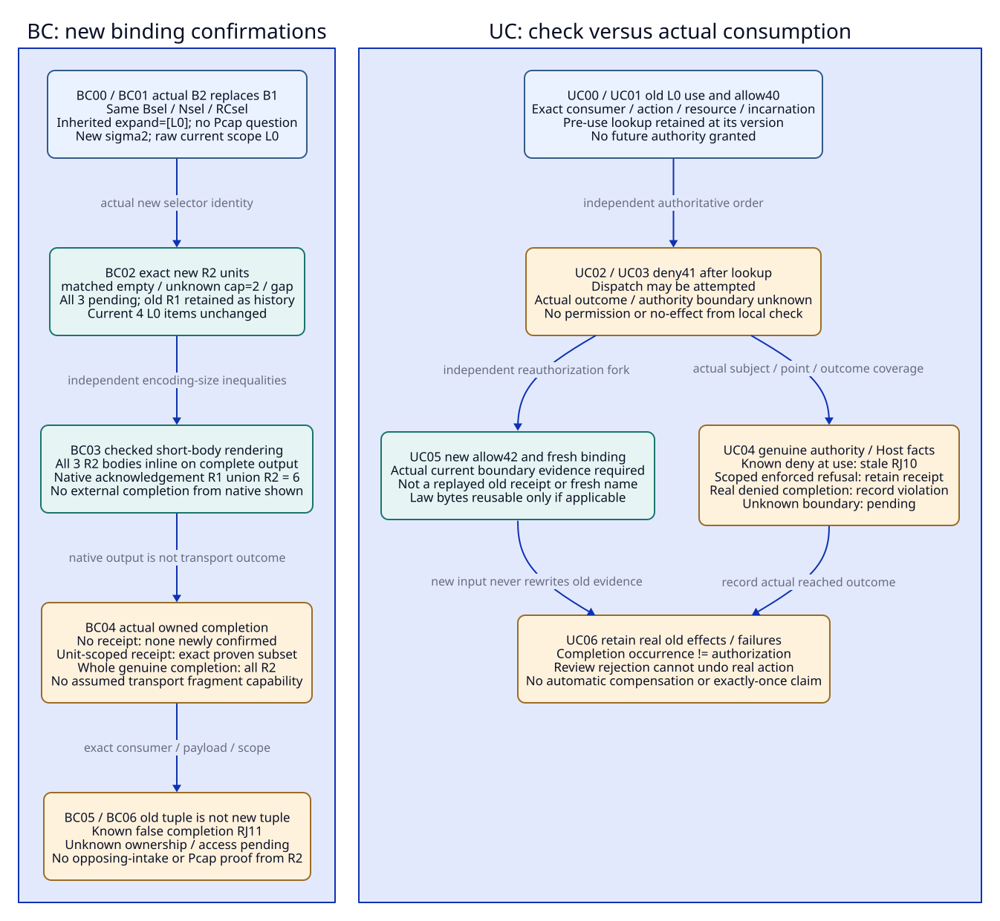
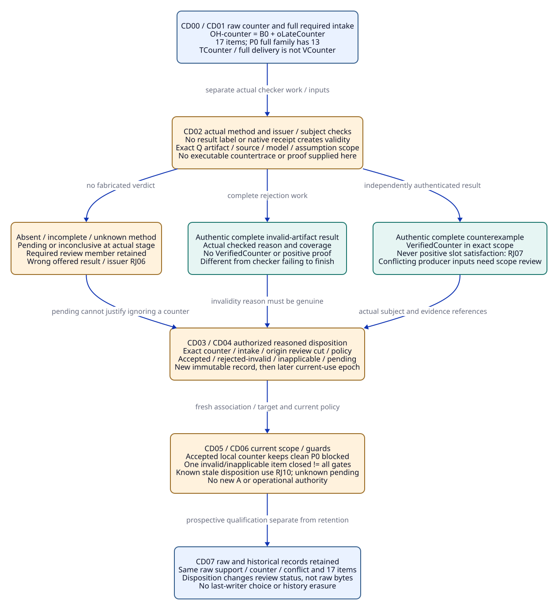

# SPDX-FileCopyrightText: 2026 tao3k team and Contributors
#
# SPDX-License-Identifier: LGPL-2.1-or-later

#+TITLE: 20.13 Binding Confirmation, Use Race and Counter Disposition
#+LANGUAGE: en
#+PROPERTY: JD_ID 20.13
#+OPTIONS: toc:3 num:nil
#+STARTUP: overview
#+TODO: OPEN SPECIFIED | QUALIFIED
#+FILETAGS: :gateway:bindings:confirmation:race:disposition:

[[file:../../00-09-project/00-documentation/00.01-index.org][Index]] | [[file:20.12-selected-read-use-race-and-counter-packets.org][20.12 parent packets]] | [[file:20.05-expanded-admission-controls.org][DC method/review controls]] | [[file:../../10-19-design/10-architecture/10.07-claim-witness-reference-contracts.org][Claim/witness/T-V-A contracts]]

* SPECIFIED Source, ownership and packet convention
:PROPERTIES:
:CUSTOM_ID: confirmation-race-disposition-scope
:INSPECTED_ON: 2026-10-19
:ASCENT_REVISION: 46a46bbeb2a3252ee9c29ae30c2bf7ee611634c4
:CORE_REVISION: 52130d2d338b09622a3f55e37987ddc0375b6187
:STATUS: author-specified-not-executed
:END:

Local ASCENT and linked Core HEADs were re-observed at these revisions. The
existing selected-read/acknowledgement code and Core selection/explicit execution
boundaries ground this refinement. No remote PR status, native control result,
checker receipt or implementation qualification follows from that observation.

These packets refine 20.12 SR04, UR04 and LC06 through existing OracleInputSpec,
OracleGoldSpec, CutSpec, InputClosure, usage/T-use, verification and
ReviewDisposition/delivery provenance. They add no framework, registry, admission
engine, lock service, protocol implementation, new rejection code or scored MB
variant. gateway-domain/gateway-evidence and existing selected occurrence,
exchange, review, consumer and Host responsibilities stay as in 20.10.

BC, UC and CD label binding-confirmation, use-consumption and counter-disposition
review steps. Each event BCnn/UCnn/CDnn has its own I/G/CL with that suffix and
exact stage/cut/source/method binding. Forks reset to a named earlier input and
have separate suffixed I/G/CL. Gold is independently authored; candidate output
cannot generate it. These are finite review views, not a mandatory Agent action
order. Agent hypotheses and alternative investigations remain open.

#+NAME: confirmation-common-input-contract
| Existing packet position | Required body / identity boundary |
|--------------------------+-----------------------------------|
| Upstream roots | Actual selected init/publications/dependencies, effective Profile/receiver, occurrence and native owner association; exact code/runtime/constructor/facts/maps, domain/consumer/method definitions |
| Captured cut | Independently frozen relevant root/member/generation manifest and native capture; no own ID, future usage/gold/disposition/use result as a root |
| Oracle-input closure | Earlier roots and usage associations, fixed independent OracleDef/ReviewDef/worksheet, four-state required/absent/unknown/irrelevant membership; no reference back from those roots to this same future I/G |
| Actual evidence | Retained exact native items/relation bodies, genuine method/issuer/access/current-use/disposition/delivery inputs where required; symbolic refs do not supply missing actual bytes or authority |
| Later package review | Earlier I/G/CL/cut plus actual native result/error, checker/review outcome and real use/delivery records; no earlier I/G points to this same later closure |

Missing expected-present bodies are setup defects. Deliberate absent work is
pending method; unknown authority/currentness/coverage is pending binding/scope.
A complete checker that rejects an invalid artifact differs from an incomplete
checker run, which remains inconclusive. A complete evaluation with an honest
deferred presentation is a valid bounded read, not full external delivery.
Keep native evaluation, native presentation, owned completion, method validity,
review disposition and operational permission as separately scoped predicates.

* SPECIFIED SR04 packet: new bindings and relation confirmation
:PROPERTIES:
:CUSTOM_ID: binding-confirmation-full-packet
:PARENT_EVENT: SR04
:BQ_BINDINGS: BQ02 BQ03 BQ06 BQ08
:END:

Reset to 20.12's exact Bsel={o+,o-,oL}, host map
{s+:d+,s-:d-,sL:dL}, no links/hypotheses. Native source Nsel/read contract RCsel
and actual projection/rule inputs stay fixed. Sconj is exactly the pinned
CONJUNCTIVE_SELECTOR string from ASCENT's existing requests fixture, constructor
query. No new selector implementation or caller rule policy is introduced.

#+NAME: binding-confirmation-complete-input
| Input position | Exact value / premise |
|----------------+-----------------------|
| B1 old selection | [(context,X0),(cap,"1"),(method,Q)]; matched={(P0,o+,d+,observation)}, question={P0}, unknown_binding/conjunction_gap={} |
| CPsel saved request | selection={sources:[Sconj],constructor:query}, bindings=B1, expand=[L0], actual Bprior; questions/checkpoint absent in saved query |
| CPsel body and owned history | Valid schema/digest/Nsel/RCsel/Asel1, all 17 original Bsel items Fsel and three old relation units R1; authentic completed delivery/body binding under reviewer-1 and allowed access |
| Current invocation | Explicit slice_selected(Sconj,{checkpoint:CPsel,bindings:B2,displayBytes:8192}); questions and expand absent, so expand=[L0] is inherited |
| B2 replacement | Ordered [(context,X0),(cap,"2"),(method,Q)]; it replaces the entire bindings field, not a patch retaining cap="1" |
| Current selector result | matched={}, question={}, unknown_binding={(cap,"2")}, conjunction_gap={(context,X0),(method,Q)}; no same-witness match, no inferred Pcap question |
| Scope and items | question union expand={L0}; mode=rescope, raw SL+RF-L only; current F-L=4 retained items, added/removed/changed={}; original out-of-scope P0 history not deleted |
| Consumer demand | Confirm the actual B2 relation bodies, not an assertion of Pcap proof or complete P0 opposing intake; native authority flags remain false |

Let sigma1/sigma2 be the actual pinned selectorIdentity values for ordered
B1/B2 and actual declaration/schema bytes. Ordinary non-collision is the stated
identity premise, not equality inferred from short labels. Current relation
units R2 have the following exact semantic body contract.

#+NAME: binding-confirmation-relation-units
| Unit | Exact current body / ordered encoding requirement |
|------+---------------------------------------------------|
| r2m=(sigma2,matched,dm2) | Body=[]; dm2=digest of that exact native Data list |
| r2u=(sigma2,unknown_binding,du2) | Body: ~[[cap,"2"]]~; du2 binds this exact one-row body |
| r2g=(sigma2,conjunction_gap,dg2) | Semantic rows={(context,X0),(method,Q)}; retain actual ordered native body, independently check both rows, then check its native encoding/digest |

R2 is exactly these three units; the empty question result is inline under the
pinned short-result encoding comparison, not a fourth relation unit. The old
matched relation has a different body; even if an old and new relation body
happens to be byte-identical, its different selector identity prevents copying
owned confirmation to the new unit by name alone. No row-order normalization
may rewrite native digests to force reuse. The oracle independently checks
semantic rows and separately checks actual byte integrity.

** Native acknowledgement and external ownership are separate
:PROPERTIES:
:CUSTOM_ID: binding-confirmation-gold
:END:

Before native presentation, pending_relation=R2 and retained_relation={} relative
to previous_relation=R1. At the acknowledgement-rule boundary, if S is the
actually fully presented subset of R2, acknowledged_relation=R1 union S.
The native rule retains all old relation units. It does not overwrite R1 by
relation name, and native shown_relation is not a transport-completion receipt.

For this short B2 fixture, the positive input includes the independently checked
encoding inequalities raw(body) <= reference(body) for all three bodies. Thus a
successful complete native rendering presents S=R2, with exactly six acknowledged
relation units R1 union R2, before any external completion. Qualify these
inequalities from actual encodings; do not invent a
matched-only native brief if the pinned renderer necessarily inlines every
small result. A full successful native payload can still have partial or unknown
external delivery. Unit-scoped external completion is an input only when the
existing consumer contract actually establishes exact unit/body boundaries; no
fragment-delivery endpoint or transport capability is assumed here. The exact external family of cases is below.

#+NAME: binding-confirmation-ownership-gold
| Actual input at review stage | Native versus owned gold |
|------------------------------+--------------------------|
| Complete native output only; no external completion | For this qualified short-body input, native acknowledgement=R1 union R2 (six units); newly qualified owned R2 confirmations={} |
| Authentic completed delivery contract covers only r2m and its exact response/capture/consumer/body | Newly qualified owned units={r2m}; r2u/r2g unconfirmed. This is an explicit unit-scoped completion premise, not an arbitrary subset of a whole-payload completion |
| Truncated delivery with no independently established unit/body boundary | No invented completed unit. Required R2 ownership remains pending even if some bytes arrived |
| Authentic completion covers all three current units and actual bodies | Newly qualified owned R2=R2 under that policy; historical R1 still retained separately |
| Known unseen r2u/r2g asserted as already completed from old R1 | RJ11 for that known false acknowledgement; unknown authentic provenance instead pending binding |

#+NAME: binding-confirmation-event-gold
| Event / stage | Concrete input / owner action | Step gold and forbidden result | Closure / independent oracle |
|---------------+-------------------------------+--------------------------------+------------------------------|
| BC00 J2 | Capture exact CPsel/R1/Fsel, Bsel/Sconj and new B2 invocation | Valid input and prior owned history only; no new result, external delivery, V/A or Pcap evidence | CL-BC00: all old source/CP/provenance and independent target/encoding roots; OC/OR check bodies |
| BC01 J9 | Restore selection and expand, replace bindings with B2, re-run selector | Exact B2 result above, scope={L0}, sigma2/anchor change and rescope; no cap="1" member survives in B2 | CL-BC01: actual API/field-presence/merge inputs and semantic worksheet; OW/OR enumerate all four selector outputs |
| BC02 J9 | Compute current item and three-column relation deltas | Four F-L items retained; no item delta; R2 all pending, none currently retained from R1. Old P0/R1 history remains | CL-BC02: exact old/current item and ordered relation bodies; OW/OU compare both planes |
| BC03 J9 | Native renders actual inline/deferred association bodies and returns checkpoint | For the checked short-body input, S=R2 and acknowledged_relation has exactly six units R1 union R2; native metadata alone yields no newly owned external unit | CL-BC03: actual completed native payload and source-defined encoding/presentation facts; OW/OU distinguish computed and delivered |
| BC04 J9 | Independently supply actual no/partial/unit-scoped/full completion about BC03 payload | Apply exact ownership table; only proven completed units become owned. Unknown completion stays pending; no fabricated partial native result | CL-BC04 subcases: actual consumer/capture/payload/unit boundaries and genuine completion or absence; OU checks exact receipt scope |
| BC05 J9/J2 | Attempt to reuse old sigma1 receipts as sigma2, or replace R1 by a name-keyed R2 map | Known incompatible identity association refused; false owned completion RJ11 when asserted. Preserve old rows and authentic history rather than erasing them | CL-BC05: exact attempted unit IDs, original bodies and owned ledger; OR/OU compare full tuple, not labels |
| BC06 J4/J9 | Ask whether the empty matched body or confirmed R2 proves complete opposing review/Pcap support | No Pcap support from no match; out-of-scope P0 raw counter and required intake still exist. Genuine R2 delivery is presentation only, no A or target method result | CL-BC06: full Bsel and complete required opposing/target scope independent of selected questions; OK/OR assess exact claim |

#+NAME: binding-confirmation-forks
| Independent fork from BC00 | Exact refusal/pending/reuse boundary |
|----------------------------+-------------------------------------|
| Ordered binding pairs change but semantic match set does not | Actual sigma/digest comparison still controls unit identity. Same relation name/body does not establish same selector-qualified unit |
| Current binding field missing instead of explicit B2 | B1 is inherited; this is a different input and uses its original selection/scope gold, not BC01's no-match gold |
| Expected-present ordered relation body missing | Setup defect; no successful semantic/acknowledgement score from the damaged packet |
| Actual current access unknown or denied | Unknown qualified reuse pending; known forbidden reuse refused under its policy, regardless of native identity or old completion |
| Native rendering capacity/error/incomplete evaluation | Retain actual reached stage. Honest deferred presentation is valid bounded reading; evaluation incompleteness is inconclusive, not new owned confirmation |

#+CAPTION: Bindings replace the saved field; selector-qualified relation units, native acknowledgement history and external completion are checked separately.

[[file:../../90-99-views/90-architecture-views/90.35-binding-confirmation-and-use-boundary.d2][Editable D2 source]].

* SPECIFIED UR04 packet: check, authority change and actual consumption
:PROPERTIES:
:CUSTOM_ID: checked-use-race-full-packet
:PARENT_EVENT: UR04
:BQ_BINDINGS: BQ02 BQ04 BQ05 BQ06 BQ07 BQ08
:END:

Reset independently to 20.12's genuine conditional L0-only R06 association at
kV/40, not the BC conflict corpus. Original OutLaw0/rLaw0/k0-law and
RL/EL/wL/TL/VL0/VMapL/MP0/HC/full T-use tuple remain immutable. Existing
consumer invocation useLaw1 explicitly requires current permission for
reviewer-1 and the protected consume/display operation. Neither old method
verification nor native output supplies that permission for arbitrary later use.

#+NAME: checked-use-race-input
| Input position | Concrete value / independent premise |
|----------------+--------------------------------------|
| Earlier positive association | Exact 20.12 UR00/R06 authentic law/mapping/issuer/footprint/HC and fresh usage at kV/40; no ASrc or operational authority inferred |
| Authority identity/scope | Authority incarnation auth-1, consumer reviewer-1, action consume-L0, resource=(RL,dL,L0), tenant=tenant-A, context=Xsrc; actual relevant method/access member domain and authority contract retained |
| Pre-use lookup | Authenticated lookup at authority generation 40 returns allow40; its retained body binds this subject and observed version only |
| Update event | Relevant authority member changes to deny41 before useLaw1; independently supplied journal order is lookup40 -> deny41 -> attempted use |
| Exact action binding | Existing owner invocation/request ID useLaw1, captured artifact/body and selected consumer/target/operation; retries and duplicate results retain their original subjects |
| Actual boundary evidence | Expected-absent in main input; separate positive/refusal companions supply genuine authority/Host evidence about the same action and actual authoritative consumption boundary |
| Review roots | Current policy definition requires authority current at the protected consumption point; genuine completion, attempted dispatch and permitted application remain distinct |

A local enqueue or old allow receipt is not the declared consumption point by
itself. For the explicit negative companion the independent authority/Host record
states deny41 was current at that point. For the unknown companion only earlier
lookup/update/dispatch are known, with no authoritative consumption ordering.
No total clock, distributed transaction, use token format or enforcement service
is implemented or invented by this contract.

#+NAME: checked-use-boundary-table
| Actual independently supplied fact | Gold at the requested use boundary |
|------------------------------------+------------------------------------|
| deny41 current at the declared point; attempted old own-scope use | Reject known stale present use RJ10; no qualified permitted consumption |
| Earlier lookup allow40 and later update/dispatch, but actual boundary/order unknown | Pending currentness/authority binding; neither authorized completion nor proven unauthorized occurrence |
| Genuine authority-enforced refusal at deny41 | Refusal receipt retained; actual protected completion absent only if that receipt's scope genuinely establishes it. Local exception alone cannot prove no remote effect |
| Actual completion occurred while deny41 was current | Record truthful occurrence and policy violation; not an authorized completion. Rejection during review cannot undo the real event |
| Actual authoritative consumption preceded deny41 under valid allow40 | Historical permission/completion can be established in that separate ordering input; no automatic grant for future reuse |
| New authoritative allow42 and fresh complete exact action binding | New use may qualify through actual current-use evidence; old allow40 is not relabeled or replayed as that evidence |

An action ID alone does not establish idempotence/exactly-once execution or
fencing. Such a guarantee needs the actual existing Host/authority protocol and
receipt scope. If a dispatch was attempted but no outcome is available, record
attempted/unknown outcome; do not assert either completion or no effect. Artifact
identity/lease expiry/local time alone does not replace the authority's declared
version and consumption semantics.

#+NAME: checked-use-race-event-gold
| Event / stage | Concrete input / owner action | Step gold and forbidden result | Closure / independent oracle |
|---------------+-------------------------------+--------------------------------+------------------------------|
| UC00 J2/J3 | Capture old verified-law association and exact consumer/action/currentness policy | Law-only historical qualification at kV may hold; future permitted use/completion still absent | CL-UC00: complete original law/usage and policy/action/incarnation roots; OR checks exact demand |
| UC01 J6 | Existing owner performs authenticated pre-use lookup, returns allow40 | Retain lookup about generation 40, not a future fence or protected completion | CL-UC01: actual lookup/subject/version and required action binding; OR/OU check receipt scope |
| UC02 J8 | Actual authority changes relevant member to deny41 after lookup | Old lookup stays true as history; current prospective eligibility changes for affected use | CL-UC02: authoritative update/incarnation/member and independent causal order; OU checks relevance |
| UC03 J6/J7 | Main input attempts use with old allow40, supplies no actual consumption-bound evidence | Cannot qualify permitted completion from prior check. If only dispatch is known, actual outcome/currentness pending; no automatic remote no-effect claim | CL-UC03: exact attempted action and explicit boundary-evidence absence; OR/OU distinguish attempt and effect |
| UC04 J6/J7 | Independent deny-at-boundary/refusal/completed/unknown companions add genuine actual boundary facts | Apply full boundary table: known stale use RJ10, genuine refusal scoped as recorded, unknown pending, real unauthorized completion retained as violation | CL-UC04 subcases: actual authority/Host body, subject/version/order and outcome coverage; OR/OU independently adjudicate |
| UC05 J2/J6 | Independent fresh allow42 companion binds a new exact usage/action and actual current boundary | Law bytes/TL/VL0 reusable only where still applicable; current permission/guard evidence new. No copied old wrapper or generated authority from a fresh name | CL-UC05: actual allow42/footprint/consumer and new exact association/use evidence; OR/OU check full scope |
| UC06 J8 | Inspect before/after store and any genuine completed effects or failed attempts | Retain original lookup/validation/receipts/errors. Prospective withdrawal is not historical erasure or effect reversal; no compensation or retry synthesized | CL-UC06: original/after record bodies and actual effect/history inputs; OU/OR compare retention versus current usability |

#+NAME: checked-use-race-forks
| Independent variation | Exact refusal/pending boundary |
|-----------------------+--------------------------------|
| Pre-check and post-check both look allowed after allow40 -> deny41 -> allow42 | Same-looking endpoint labels do not prove permission at actual intervening consumption. Require incarnation-aware versions and actual ordering |
| Wrong action/consumer/body under a genuine boundary receipt | Refuse exact incompatible association; genuine receipt remains history about its real subject |
| Only unrelated authority member changes | Do not revoke law truth or unrelated use from a proven irrelevant change; complete relevant footprint still required. Unknown relevance pending |
| Method issuer revoked, not access | Newly inadmissible V RJ06 at its method check, known stale current use RJ10; retained raw TL/math bytes not deleted |
| Claimed no remote effect from local timeout or exception | No such inference without genuine authority/Host outcome coverage; actual run/dispatch status retained, outcome unknown |

Package-linked Core [[file:../../../.gerbil/pkg/github.com/tao3k/poo-flow-core/modules/opentofu/execution.ss][explicit tasks]] check currentness before/after process work. That
shows existing placement, not proven atomic remote use. Core [[file:../../../.gerbil/pkg/github.com/tao3k/poo-flow-core/init.ss][selection]] does
not add fencing, exactly-once semantics or a gateway transaction. Actual boundary
qualification remains an existing Host integration obligation.

* SPECIFIED LC06 packet: counter method verification and disposition
:PROPERTIES:
:CUSTOM_ID: counter-disposition-full-packet
:PARENT_EVENT: LC06
:BQ_BINDINGS: BQ02 BQ03 BQ04 BQ05 BQ06 BQ07 BQ08
:END:

Reset independently to 20.12's OH-counter=B0+oLateCounter, not Bsel/o- or the
late-support branch. Source/polarity/factor bodies remain exactly those inputs.
The raw P0/L0 query has 17 items and conflict={P0}; P0's full family has 13
items. The counter artifact is RLateCounter/dLateCounter, native TCounter binds
its checked bytes, and ELateCounter/wCounter bind that same immutable
observation/envelope. A genuine 13-item completed delivery is an optional separate
presentation input; it is not VCounter or a ReviewDisposition.

#+NAME: counter-disposition-complete-input
| Existing input position | Concrete body / independent scope |
|-------------------------+-------------------------------------|
| Raw evidence | Exact B0+oLateCounter factory, maps, NCounter/RC0, original Pfx0 and counter intake/capture distinction; all seventeen raw items/13-item P0 worksheet |
| Counter subject | ELateCounter/wCounter, RLateCounter/dLateCounter/sLateCounter/TCounter, P0/X0/S0/K0/M0, method=Q, exact trace/artifact/body mapping and original origin |
| Review input domain | RequiredIntake ICounter requires {E+,ELateCounter} with exact authenticated provenance, source/assumption relevance, complete required review/member/coverage definitions; required counter member cannot be omitted because its guard is unresolved |
| Q-method contract | Actual reviewed checker/replay definition/version, property/model/source/interpretation assumptions, resource/completion limits, issuer policy MPQ0 and required extraction/trace-scope mapping |
| Method result position | Main input VCounter expected-absent. Separate companions supply genuine complete counterexample / complete invalid-artifact / incomplete-or-unknown results bound to the exact subject and checker contract |
| ReviewDisposition position | Exact counter envelope, intake/cut, reason, accepted/rejected/inapplicable/pending assessment, authorized reviewer/policy revision and supporting actual method/applicability references; no raw ignore flag |
| Positive/argument positions | Original VQ0/VL0/source-application evidence retained if supplied under the particular companion; no new clean A by default. Other required method/argument/consumer guards are separate |
| Consumer/current roots | Current local-P0 or explicitly distinct Psrc/Pcache/Pcap demand, complete relevant source/access/method/review generations and actual use-time checks |

These are the existing 10.07 VerificationRecord/ReviewDisposition and 20.05
VerifiedCounter/Conflict/Eligible contracts, not an ASCENT native result kind
implemented here. Trusted checker/reviewer work is external: an Agent's
resultKind string, elapsed time, role label or successful native content check
cannot create it. Symbolic authentic result premises are uninstantiated until
actual bodies/authority are supplied, not executable counterexamples created by
this document.

** Finite method and disposition gold
:PROPERTIES:
:CUSTOM_ID: counter-method-disposition-gold
:END:

#+NAME: counter-method-result-gold
| Independently supplied method input | Expected method/application outcome |
|-------------------------------------+-------------------------------------|
| VCounter absent, expected-absent | Pending(method,counter-check,J3); no VerifiedCounter and no positive SlotSupport from TCounter |
| Authentic complete VCounter-valid, exact Q subject, resultKind=counterexample | VerifiedCounter(ELateCounter,P0,Q,kMethod); no positive Q-slot support. Attempted promotion as satisfaction rejects RJ07 |
| Authentic complete VCounter-invalid, resultKind=invalid-artifact with actual checked reason | No VerifiedCounter; checker completed its rejection work. This is not an incomplete run, a positive proof of P0 or a forged artifact finding by default |
| Actual checker timeout/cancelled/incomplete or unknown completion | Inconclusive method run / pending method as requested; no successful validity or rejection verdict invented |
| Genuine result for wrong artifact/property/source/method or forbidden issuer | Reject offered verification association RJ06; original genuine result remains scoped to its actual subject |

#+NAME: counter-disposition-gold
| Exact review input / independent branch | Expected scoped review / admission boundary |
|-----------------------------------------+---------------------------------------------|
| Required counter, disposition absent or unknown | Pending review; unresolved required counter blocks clean P0 eligibility, even if a presentation receipt exists |
| Genuine VCounter-valid plus authenticated accepted-counter disposition under actual local P0 scope | Applicable defeating counter/review blocker remains; no clean P0 eligibility or new A. Preserve raw support and counter and both method records |
| Genuine VCounter-invalid plus authenticated rejected-invalid disposition, exact checked reason and complete reviewer coverage | This counter's required review may close under policy without treating it as valid defeat. Raw observation/conflict stay. No automatic Eligible/A: other positive slots, all intake/argument/current-use guards still checked |
| Authenticated inapplicable-to-target disposition with genuine source/assumption mapping for a distinct Psrc requirement | May close only that explicitly justified target-specific relevance item; it does not clear local P0 review or every current intake. Source label mismatch alone is insufficient |
| Ignore/pending label without authentic reason/support/authorized reviewer | No closure from label alone. Known forged/unauthorized disposition RJ06; genuinely unknown supporting authority/evidence pending |
| Later review policy/issuer/source changes | Old disposition remains historical; present-use qualification must be reassessed at the relevant cut, known stale use RJ10, unknown current binding pending |

A rejected-invalid disposition needs actual checked invalidity, such as the
reviewed checker's missing-transition-witness diagnosis with its exact artifact
coverage/reason body. A checker failing to finish that diagnosis is a different
input. The design defines neither a new M0 model nor an invented countertrace.
The accepted-counter companion with simultaneously accepted satisfaction for
identical model/property/assumptions is deliberately inconsistent producer input,
as in DC08. Fail closed and investigate scope/extraction/issuer trust; do not
claim real contradictory proofs were constructed or that L0 was falsified.

#+NAME: counter-disposition-event-gold
| Event / stage | Concrete input / owner action | Step gold and forbidden result | Closure / independent oracle |
|---------------+-------------------------------+--------------------------------+------------------------------|
| CD00 J2/J4 | Freeze complete local P0 intake/member/required method/review scope over OH-counter | Raw counter and unresolved required review included; no required member dropped because verification absent. Raw 17-item query unchanged | CL-CD00: full factory, envelope/mapping, independent RequiredIntake/ReviewDef/worksheet; OW/OK enumerate membership |
| CD01 J3/J9 | Supply native TCounter and optionally genuine full 13-item delivery, but no VCounter/disposition | Trusted bytes/presentation only. Method/review pending, clean eligibility withheld; no VerifiedCounter or positive support from display | CL-CD01: actual T/content and actual/absent delivery, explicit method/review absence; OR/OU distinguish evidence kinds |
| CD02 J3 | Independently submit actual checker outcome in each finite method companion | Apply method table: complete valid counter, complete invalid artifact, wrong-scope refusal or incomplete run remain distinct. No invented method success from result labels | CL-CD02 subcases: actual checker/artifact/scope/result-kind/completion/issuer roots; OR independently checks method contract and authentic binding |
| CD03 J4 | Review actual outcome and source/applicability under exact ICounter/reviewer policy | Authorized reasoned disposition can assess that counter; absent/unknown required support leaves pending. Native selector/hint cannot issue or authenticate it | CL-CD03: fixed intake/reviewer policy plus already materialized checker/scope evidence; OK/OR compare reason, authority and exact subject |
| CD04 J2/J4 | Register genuine disposition and assess at fresh review input epoch kReview | Keep earlier raw/intake captures; disposition is a new immutable record. Its use association binds kReview, not an edit of earlier I/G or its own identity roots | CL-CD04: existing completed disposition body and current required roots, exact fresh association; OC/OR/OU check identity/cut order |
| CD05 J4/J6 | Compare accepted-valid, rejected-invalid, inapplicable-target and unknown companions for the requested target | Apply disposition table. Closing one invalid/inapplicable item never proves all positive slots/intake/argument guards or produces A; accepted local counter still blocks clean P0 | CL-CD05 subcases: actual selected outcome, full target/argument/intake and authenticated review coverage; OK/OR assess exact unresolved blockers |
| CD06 J6/J8 | Reviewer authorization/source/method changes before current consumption of earlier disposition | Currentness rechecked as UC packet requires. Known stale disposition use RJ10; unknown binding pending; immutable original method/review/raw/delivery bodies retained | CL-CD06: exact before/current dependency/consumer and actual boundary facts; OU/OR compare relevant scope |
| CD07 J8/J9 | Query raw OH-counter and compare before/after retained records following any disposition | Same raw support/counter/conflict and 17 items unless a separate actual raw input changes. History preserved; no native row deletion or rewritten positive-only acknowledgement to enact disposition | CL-CD07: original/after store and actual raw owner/input/ref bodies; OW/OU independently compare retention and native query |

#+NAME: counter-disposition-reference-birth-order
| Existing record/input | Earlier required roots / permitted references | Forbidden back-reference |
|-----------------------+-----------------------------------------------+--------------------------|
| kCounter capture | Actual raw artifact/map/projection, frozen intake/member requirements | Future VCounter or Disposition0 |
| kMethod0 checker input | Actual prior counter/source/model/method/policy roots | Its future checker result VCounter |
| VCounter | Exact prior kMethod0/subject/checker and actual result/completion | A later current-use cut including this same VCounter as an identity root |
| kDisp0 review-task input | Already materialized VCounter if required, frozen intake/relevance/reviewer policy | Future Disposition0 |
| Disposition0 | Origin review input kDisp0, exact intake/counter/reason/policy/support refs | Future kReview that includes this same disposition |
| kReview current-use input | Actual prior Disposition0/method evidence and independently captured current required roots | Its own usage verdict or future current-use result |
| Disposition use at kReview | Existing association about retained Disposition0, target and current guards/cut | Editing Disposition0 or earlier capture bodies to include this later use |

This is content-reference dependency order for the existing records, not another
runtime pipeline. An input without VCounter uses its explicitly absent/unknown
branch instead; the table does not generate a method result to fill that gap.
Each actual artifact or disposition can become a later input only after it is
materialized, with its original subject and origin retained.

Method/ReviewDisposition records are not projected into this raw factory merely
because they exist. No new native T is invented for an unprojected method or
review artifact. A later richer projection requires its actual new source/cut,
method binding and independent raw gold. Raw conflict(P0) and domain unresolved
review/defeat are distinct predicates; an authenticated review can resolve an
invalid/inapplicable item without editing the contradictory raw bytes.

#+NAME: counter-disposition-forks
| Independent variation | Exact refusal/pending/retention boundary |
|-----------------------+------------------------------------------|
| VCounter-valid offered as positive Q-slot success | RJ07; valid counter remains in its actual method scope, never satisfaction |
| Required counter hidden by current selector/questions | RJ11 if known required intake suppressed; raw no-match/empty scope is not complete review coverage |
| Existing verified disposition body replaced under same ID | Known immutable association/body mismatch refused; RJ02 only for an actual asserted digest/body integrity mismatch. Original record retained |
| Old invalidity or relevance disposition copied to new counter/artifact | Exact subject mismatch refused, or pending when actual binding unknown; no reason-string-based reuse |
| Accepted and rejected dispositions both supplied with no authorized resolution | Preserve both; review-policy conflict/pending remains, no last-writer-wins choice or clean admission. Genuine later policy-authorized resolution is a new input |
| Missing expected-present VCounter/disposition body | Setup defect instead of intended semantic refusal; deliberately expected-absent method/review remains pending |

#+CAPTION: A counter's trusted bytes, method result, reasoned authorized disposition, current use and raw history retain separate identities and effects.

[[file:../../90-99-views/90-architecture-views/90.36-counter-method-and-disposition.d2][Editable D2 source]].

* SPECIFIED Reference closures and independent path review
:PROPERTIES:
:CUSTOM_ID: confirmation-race-disposition-paths
:END:

#+NAME: confirmation-expanded-closure-membership
| Closure family | Exact prior roots/records and independent worksheet | Absent/unknown/current boundary |
|----------------+----------------------------------------------------+--------------------------------|
| CL-BCnn | Bsel/host map/projection/RULES/Sconj source and runtime; CPsel/Fsel/R1 and actual prior provenance; B2/current API/field-presence/expand, full current R2 ordered bodies/digests and raw scope, current consumer/access and actual native/external completion for that stage | Future output/completion/A absent; missing required body setup defect, unknown ownership/access pending. Never infer new units from old relation names |
| CL-UCnn | Complete original law/artifact/verification/usage/lookup bodies, exact action/resource/principal/incarnation/currentness contract, before/current authority member manifests, independent lookup/update/consumption order and actual Host outcome coverage if supplied | No implicit remote fence, no-effect, exactly-once or completion. Unknown actual boundary/order/effect remains pending/unknown; a real occurrence is not permission |
| CL-CDnn | OH-counter full factory/maps/raw 17-item worksheet, exact counter envelope/artifact/target/source/model/method contract, complete RequiredIntake/reviewer/issuer/argument/member scope, actual completed method and review outcomes when supplied, exact current consumer/use roots | Main VCounter/disposition absent; complete invalid checker result differs from incomplete checker; one closed review item does not discharge every other gate |
| Later package-review closure | Earlier I/G/CL/cut and actual output/error/verification/disposition/use/delivery/history results | No prior I/G points back to this same later closure. Method/review work requested by an earlier input becomes a separately captured later input before use |

A disposition can name its origin input/cut. A fresh current use about that
record is a later association, not a backward reference inserted into the cut
whose identity would depend on that same use. Receipt headers outside hashed
bodies do not repair a real dependency cycle; inspect actual typed body edges.
Retain all required candidates/negative/aggregate/currentness members rather than
weakening closure to avoid a cycle or manufacture an all-clear.

#+NAME: confirmation-three-paths
| Independent path | Binding-confirmation scope | Check-to-use race | Counter method/disposition boundary |
|------------------+----------------------------+-------------------+-------------------------------------|
| C-CAP | Actual B2 cap="2" no-match on Bsel yields L0-only scope, not Pcap support; new sigma-qualified unit confirmation required despite unchanged raw Nsel | Actual C2 consumer/use/access and method currentness checked at declared boundary; old law/lookup cannot grant future use or replace AppCap/CorrCap/new Q/PerfCap | Historical P0 invalid/applicable review does not automatically qualify Pcap. Genuine target application/method/complete intake remain separate |
| C-CACHE | Native Profile label does not patch B1/B2 or acknowledge Pcache/CacheAuth; current relation receipt is not tenant access | Principal/action/Sk/Kk/Z1/retained-owner/hit permission and cache frame stay in required scope; local pre/post checks do not prove at-hit enforcement | Rejecting one P0 counter does not clear cache security/resource/permission counter domains or complete U-cache. Target-specific inapplicability needs actual mapping and authorized reason |
| C-SOURCE | Saved selector/unit confirmation under S0 does not prove S1 correspondence; new context and exact usage separate | S1 method/access/current authority changes before use demand current checks, not just unchanged RL/TL/VL0. No Corr1/new Psrc application/Q/ASrc inferred | S0/P0 counter retained and reviewed; authenticated Psrc-specific relevance judgment cannot erase local P0 review or every S1 counter. Actual source mapping/current intake needed |

#+NAME: confirmation-hidden-assumptions
| Existing assumption | Concrete discriminator | Design resolution / remaining evidence |
|---------------------+------------------------+----------------------------------------|
| OA01 owner | Same native identity/relation name/action label does not establish same occurrence or authority incarnation | Full typed scope and actual owner binding; real gateway allocation/authority integration unqualified |
| OA02 design versus actual | Conditional method/disposition/unit-completion premises are not emitted receipts | All required source/result/authority bytes must be supplied before execution/scoring |
| OA03 closure states | Missing expected-present differs from absent work and unknown current facts | Setup defect versus pending method/binding/scope recorded at exact stage |
| OA04 coverage | Partial relation delivery and one counter disposition do not cover all required units/intake/argument roots | Exact per-unit and full-domain membership independently enumerated |
| OA05 race/identity | Pre/post allow and a request ID do not prove authority at actual use, no-effect or exactly-once | Actual incarnation/version/order/outcome coverage needed; no cyclic cut/result identity |
| OA06 reuse/retention | New sigma confirmation and current review use differ from reusable old bytes/history | Full tuple/current guards required, no name-keyed overwrite or broad deletion |
| OA07 proposition | VerifiedCounter is not satisfaction; invalid/inapplicable review is not positive proof or A | Method result/target/argument/consumer scope remain separate |
| OA08 opposing evidence | Pending counter cannot be omitted; raw conflict and scoped reviewed blocker differ | Complete RequiredIntake, authentic reasoned dispositions and exact current target coverage |
| OA09 encoding/surface | B2 replaces bindings; actual encoding order/native inline rules constrain acknowledgement gold | Semantic sets and byte identities independently checked, no fabricated native partial output |
| OA10 benchmark scope | BC/UC/CD are child controls of existing packets, not new scored MB cases | Original 24 parent variants and formal/native/performance obligations unchanged |
| OA11 checker soundness | Complete invalid-artifact result differs from incomplete run and valid counterexample | Authentic checker completion/result-kind/issuer/subject evidence needed |
| OA12 completion | Native presented, externally completed, authorized and method-valid are independent predicates | Actual reached-stage/delivery/effect status retained without unrelated-failure credit |
| OA13 authority/independence | Ignore flag, role, checksum and method label authenticate no disposition or effect | Existing review/Host authority and independent worksheet/policy roots required |
| OA14 current access | Genuine old completion or review remains history after revocation | Current actual consumer/access/issuer checks needed; truthful occurrence is not permitted reuse |
| OA15 scope/consistency | Conflicting method/disposition premises need resolution, not theorem falsity or last-writer selection | Fail closed on unresolved conflict; real source/assumption/authority and operational qualification remain |

* OPEN Qualification handoff
:PROPERTIES:
:CUSTOM_ID: confirmation-race-disposition-handoff
:END:

- [ ] Instantiate exact new relation bodies/encodings and genuine native/external acknowledgement scope independently.
- [ ] Qualify actual check/update/consumption ordering and outcome coverage at existing Host/authority boundaries.
- [ ] Supply authentic method/checker/reviewer/source/target evidence for every counter-disposition branch, including invalid versus incomplete work.
- [ ] Preserve raw, method, review, use and effect history while checking full required current scope across all three paths.
- [ ] Require genuine method/current-use/Host receipts before SDLC closure.

The package-linked [[file:../../../.gerbil/pkg/github.com/tao3k/gerbil-ascent/rust/ascent/src/clues/slices.rs][selector/presentation]] and [[file:../../../.gerbil/pkg/github.com/tao3k/gerbil-ascent/python/src/ascent/clue_query_rules.ss][acknowledgement rules]] ground BC.
Existing [[file:20.05-expanded-admission-controls.org::#dc08][DC08]] and [[file:20.05-expanded-admission-controls.org::#dc11][DC11]] ground counter result-kind and review-authentication
boundaries. Only English Org and paired D2/SVG are authored; no gateway, checker,
review engine, remote fence, oracle, QNT/Lean or native/delivery run is implemented
or executed here.

* SPECIFIED BC04 / UC04 / CD05 refinement
:PROPERTIES:
:CUSTOM_ID: confirmation-disposition-child-packets
:END:

[[file:20.14-partial-delivery-consumption-authority-and-blocker-closure.org][20.14]] expands genuine unit-scoped completion, actual consumption-bound authority
and item-specific counter blocker closure. Parent factory inputs, historical
gold and source pins remain unchanged; the child supplies independently scoped
inputs and later closures rather than backfilling earlier cuts.
