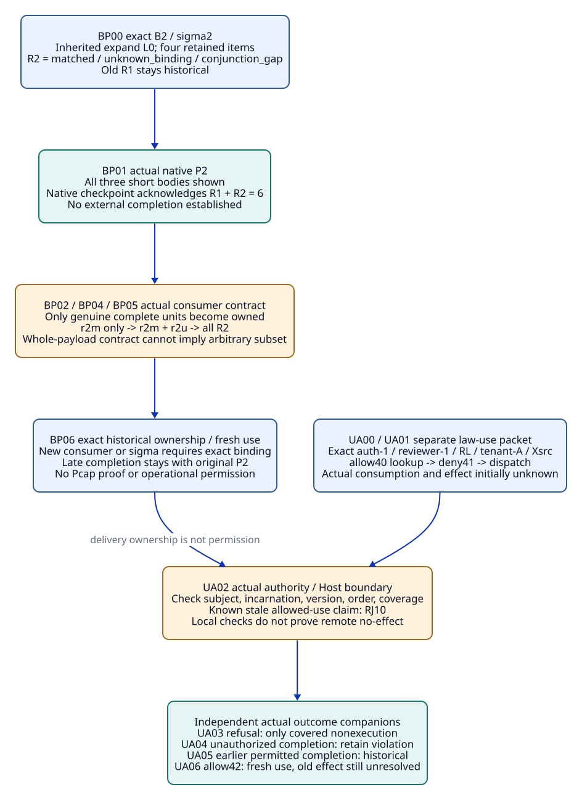
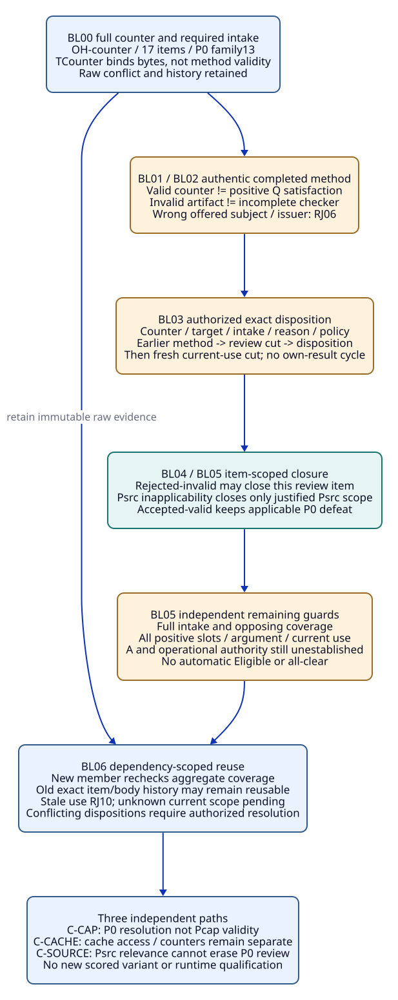

#+TITLE: 20.14 Partial Delivery, Consumption Authority and Blocker Closure
#+LANGUAGE: en
#+PROPERTY: JD_ID 20.14
#+OPTIONS: toc:3 num:nil
#+STARTUP: overview
#+TODO: OPEN SPECIFIED | QUALIFIED
#+FILETAGS: :gateway:delivery:authority:blockers:

[[file:../../00-09-project/00-documentation/00.01-index.org][Index]] | [[file:20.13-binding-confirmation-use-race-and-counter-disposition.org][20.13 parent packets]] | [[file:../../10-19-design/10-architecture/10.07-claim-witness-reference-contracts.org][Claim / witness / T-V-A contracts]]

* SPECIFIED Existing owners and independent input contract
:PROPERTIES:
:CUSTOM_ID: partial-authority-blocker-scope
:INSPECTED_ON: 2026-10-19
:ASCENT_REVISION: 46a46bbeb2a3252ee9c29ae30c2bf7ee611634c4
:CORE_REVISION: 52130d2d338b09622a3f55e37987ddc0375b6187
:STATUS: author-specified-not-executed
:END:

This finite refinement expands BC04, UC04 and CD05 of 20.13. It uses existing
OracleInputSpec, OracleGoldSpec, InputClosure, CutSpec, usage/T-use,
VerificationRecord, ReviewDisposition and delivery provenance. BP, UA and BL
are review-row labels only. No new registry, receipt class, transport,
authorization service, execution fence or scored Benchmark variant is proposed.

The linked [[file:../../../.gerbil/pkg/github.com/tao3k/poo-flow-core/init.ss][Core init]] selects Modules and Scenarios in one graph epoch;
selection does not realize providers or link business scopes. gateway-domain
owns claim/Profile/Scenario application and required obligations;
gateway-evidence owns exact evidence associations. Existing selected occurrence
and exchange owners retain capture and response association. The consumer owns
its actual delivery contract; the existing Host/authority owns operational
permission and occurrence evidence. Review authority owns reasoned disposition.
A Module declaration or Profile label cannot supply any of those receipts.

#+NAME: partial-authority-common-packet
| Existing position | Complete input requirement |
|-------------------+----------------------------|
| Identity roots | Actual selected init/publications/dependencies, Module/Profile/Scenario/receiver and occurrence; native constructor/rules/runtime/projection/map identities; exact consumer, method, issuer and authority definitions |
| Frozen stage | Earlier relevant root/member/generation manifest and independent OracleDef/ReviewDef worksheet; exclude this same future I/G, response, completion, disposition and current-use verdict |
| Membership | Mark each required member expected-present, deliberately absent, unknown or irrelevant with scoped reason; expected-present missing body is setup defect, not a semantic pass |
| Input and gold | I-BPnn/I-UAnn/I-BLnn bind the indicated cut and worksheet. G with the same suffix is authored from that input independently of candidate output; CL with that suffix enumerates the closure below |
| Actual outcomes | Supply exact bytes and authenticated result-kind, subject, policy, order and coverage. Symbols below are reference names, never substitute receipts or fabricated digest values |
| Later review | Actual outcomes become members of a later captured input and later package review. Earlier frozen I/G/CL are not backfilled; late results cannot change their gold |

Parent packet references are transitive input requirements: the actual bodies,
ordered encodings, declarations and provenance enumerated in 20.13 must be
materialized in each InputClosure. A document link or short alias alone does not
satisfy an expected-present input. Preserve exact original source pins and
factory-specific facts; do not merge the three reset corpora.

The three families reset independently to the parent factory indicated below.
Forks are separate inputs, not mutually inconsistent facts in one execution.
These tables constrain evidence claims while leaving Agent discovery and
alternative hypotheses open. Their row order is a review trajectory, not a
mandatory scheduler or harness.

* SPECIFIED BC04: complete units under partial external delivery
:PROPERTIES:
:CUSTOM_ID: partial-relation-packet
:PARENT_EVENT: BC04
:BQ_BINDINGS: BQ02 BQ03 BQ06 BQ08
:END:

#+NAME: partial-relation-input
| Position | Concrete input |
|----------+----------------|
| Factory | Exact parent Bsel={o+,o-,oL}, map{s+:d+,s-:d-,sL:dL}, no links/hypotheses; actual Nsel/RCsel/RULES/Sconj and runtime |
| Prior checkpoint | CPsel with B1=[(context,X0),(cap,"1"),(method,Q)], expand=[L0], old R1 three relations and Fsel 17 items; authentic prior completed delivery to reviewer-1 |
| New request | slice_selected(Sconj,{checkpoint:CPsel,bindings:B2,displayBytes:8192}); B2=[(context,X0),(cap,"2"),(method,Q)] replaces the entire bindings field; questions/expand absent, inherited expand=[L0] |
| New semantic gold | matched={}, question={}, unknown_binding={(cap,"2")}, conjunction_gap={(context,X0),(method,Q)}; scope={L0}, four retained items, item added/removed/changed empty |
| Exact units | R2={r2m,r2u,r2g}; each full tuple=(sigma2,name,digest(actual ordered Data body)); r2m body=[], r2u body: ~[[cap,"2"]]~; r2g actual ordered two-row body with the parent semantic set |
| Actual payload P2 | Full genuine native result/capture/response association and body digest; independently verify parent short-body inequalities, so native shows all R2 and checkpoint acknowledges R1 union R2 |
| Consumer contract Kunit | Independently supplied existing contract identifies reviewer-1, P2/capture/exchange, complete unit/body boundaries and completion scope; only a genuine contract can establish unit-scoped completion |
| Main completion | Actual Kunit evidence covers complete r2m only. r2u/r2g completion deliberately absent; current access evidence supplied for this exact consumer/scope. If Kunit cannot be supplied, this is an uninstantiated conditional packet |

The existing [[file:../../../.gerbil/pkg/github.com/tao3k/gerbil-ascent/python/src/ascent/clue_query_rules.ss][acknowledgement rules]] union previous and shown
relations. [[file:../../../.gerbil/pkg/github.com/tao3k/gerbil-ascent/rust/ascent/src/clues/slices.rs][Native presentation]] does not attest external completion.
Do not manufacture a matched-only native output for these three short bodies.
External partiality is governed by the actual consumer contract, not by changing
native inline encoding or splitting arbitrary byte prefixes into new units.

#+NAME: partial-relation-step-gold
| Event / independent stage input | Expected relation / gold | Evidence / closure addition |
|--------------------------------+--------------------------+-----------------------------|
| BP00 freeze B2 request before result | New sigma2; pending native relations=R2, retained current relations={}; old owned R1 remains historical | CL-BP00: factory, CPsel/R1/Fsel/provenance, B2 and inherited expand, OracleDef and actual access roots; future P2/completion absent |
| BP01 genuine full P2 now supplied | Native shown R2; native acknowledged R1 union R2=6 units; no new external owned unit | CL-BP01 adds genuine native bytes/T association and independent three-body encoding worksheet |
| BP02 add genuine r2m-only completion | New owned={r2m}; unconfirmed={r2u,r2g}; complete-current-relations=false, with known incomplete coverage rather than all-clear | CL-BP02 adds Kunit, exact consumer/P2/capture/unit/body and authenticated completion; T-use about this delivery stays scoped |
| BP03 attempt to count old R1 as remaining completion | Known selector/unit mismatch refused, RJ11 when offered as unseen-current confirmation; ownership unchanged | CL-BP03 adds offered old/new association and exact sigma/digest comparison; unknown provenance instead stays pending |
| BP04 genuinely complete r2u later | At this later capture owned={r2m,r2u}; r2g still unconfirmed. BP02 input/gold unchanged | CL-BP04 adds actual later completion and its original P2 association; no backfill into old snapshot |
| BP05 genuine r2g completion under current permitted access | All R2 externally completed in this scope; no Pcap proof, full P0 opposing intake, method V, argument A or operational grant follows | CL-BP05 adds actual r2g body/completion and current access/use roots; keep original completion times |
| BP06 change access or consumer before reuse | Retain completed history and immutable bodies. Known disallowed current reuse refused; unknown access pending; new consumer needs its own supported association | CL-BP06 adds actual changed authority/consumer roots and fresh usage, not a rewritten P2 or erased R1/R2 |

#+NAME: partial-relation-independent-forks
| Fork reset | Changed concrete input | Independent oracle decision |
|------------+------------------------+-----------------------------|
| BP02-none from BP01 | No external completion record | New owned={}; native six-unit acknowledgement remains true |
| BP02-prefix from BP01 | Truncated bytes with no contract-established complete-unit boundary | No invented owned unit; delivery scope pending even if a textual prefix contains [] |
| BP02-whole from BP01 | Kwhole only promises whole-payload completion; whole completion absent | A claimed r2m-only completion is unsupported under Kwhole; no inferred subset |
| BP02-wrong from BP01 | Completion belongs to another exchange/consumer/P2 digest | Known association mismatch refused; actual record retained for its real scope; unknown association pending |
| BP05-late from BP02 | Late authentic completion for old P2 after a newer B3 capture | Add historical P2 completion only; B3 query/ownership unchanged until fresh exact binding checks; never infer B3 units from names |

An empty matched body is a delivered negative query result, not absence of a
receipt and not proof that cap="2" is impossible in the full engineering domain.
No-match on this factory cannot remove independently required opposing evidence.
Each later delivery step requires its actual completion-time consumer/access
binding and a fresh current-use association where ownership is reused. Historical
completion persists when current access is denied; it cannot be relabeled as a
currently permitted read. Byte equality alone establishes neither causal order
nor authority.

#+CAPTION: Native acknowledgement, exact external unit ownership and actual consumption authority remain distinct.

[[file:../../90-99-views/90-architecture-views/90.37-partial-delivery-and-consumption-authority.d2][Editable D2 source]].

* SPECIFIED UC04: authorization at the actual consumption boundary
:PROPERTIES:
:CUSTOM_ID: consumption-authority-packet
:PARENT_EVENT: UC04
:BQ_BINDINGS: BQ02 BQ04 BQ05 BQ06 BQ07 BQ08
:END:

#+NAME: consumption-authority-input
| Position | Concrete input |
|----------+----------------|
| Independent reset | Genuine conditional L0-only OutLaw0/rLaw0/k0-law, immutable RL/EL/wL/TL/VL0/VMapL/MP0/HC and complete original T-use from 20.13; not Bsel or counter factory |
| Exact action | authority incarnation=auth-1, consumer=reviewer-1, action=consume-L0, resource=(RL,dL,L0), tenant=tenant-A, context=Xsrc, exact invocation/body=useLaw1 |
| Authority contract Kauth | Actual existing authority/Host definition identifies the consumption event, relevant method/access domain, version ordering and enforcement/record scope; no invented token/fence or global clock |
| Known prefix | Genuine lookup allow40 at kV/40; genuine deny41 update precedes attempted dispatch; actual consumption/order/outcome initially unknown |
| Boundary input | Main deliberately lacks consumption-bound authority/Host result. Companions independently supply deny-current, enforced refusal, unauthorized completion, earlier permitted completion or renewed allow42 |
| Claim boundary | A lawful artifact/verification association is not authority to execute; a truthful occurrence is not permitted completion. ActionID alone establishes neither idempotence nor exactly-once |

#+NAME: consumption-authority-step-gold
| Event / stage | Expected gold | Exact evidence / closure |
|---------------+---------------+--------------------------|
| UA00 freeze original law use and allow40 lookup | Historical lookup allowed in its exact scope; actual consumption authorization and completion unestablished | CL-UA00: full law/T/V/usage bodies, request subject, Kauth/authority/issuer roots, independent ordering worksheet |
| UA01 add deny41 and attempted dispatch | Old lookup cannot authorize current use; actual boundary/outcome unknown => pending. Dispatch alone proves neither execution nor remote no-effect | CL-UA01 adds authentic deny41 and dispatch/body/order records; future effect deliberately unknown |
| UA02 add genuine boundary record showing deny41 current at actual attempted use | Offered permitted use based on allow40 is known stale, RJ10; do not infer refusal, execution or nonexecution unless record covers it | CL-UA02 adds actual boundary subject/incarnation/version/order and coverage, fresh use association |
| UA03 independent enforced-refusal companion to UA02 | Refusal established exactly as recorded. Nonexecution established only for contract-covered effect; unrelated/earlier effects remain unknown or historical | CL-UA03 adds real Host/authority refusal and its coverage; no fabricated remote completion receipt |
| UA04 independent completed-under-deny companion to UA02 | Retain occurrence and unauthorized-use violation. No qualified permitted completion, no erasure by later review or retry | CL-UA04 adds actual completion/result/effect coverage bound to useLaw1 and deny41; violation retained |
| UA05 independent earlier-consumption companion to UA00 | Actual consumption/completion under allow40 before deny41 may establish historical permitted completion; no permission after deny41 | CL-UA05 supplies genuine alternative event ordering and boundary coverage; does not coexist with contradictory UA02 ordering |
| UA06 independent renewed-use companion after UA01 | Genuine allow42 plus fresh exact use/boundary checks may qualify this later action; old attempt outcome still unknown unless separately established | CL-UA06 adds actual renewal, new invocation and order/outcome evidence; no relabeling allow40 or silent retry |

#+NAME: consumption-authority-independent-forks
| Fork | Oracle decision and reason |
|------+----------------------------|
| UA02-local | Local pre/post check or exception without authoritative actual boundary coverage: pending; no remote-no-effect inference |
| UA02-order | Wall-clock labels without the actual authority's causal/version semantics: pending ordering, not a guessed linearization |
| UA04-late | Truthful old completion arrives after a new snapshot: associate with original action/authority epoch; frozen current snapshot unchanged; assess permission from original actual boundary |
| UA06-subject | allow42 covers another tenant/resource/incarnation: refuse known offered mismatch, pending unknown subject; original deny41 remains relevant |
| UA06-effects | Earlier outcome unknown and no existing idempotence/compensation contract: renewal is not safe-retry/exactly-once evidence; retain unresolved effect obligation |

The existing [[file:../../../.gerbil/pkg/github.com/tao3k/poo-flow-core/modules/opentofu/execution.ss][execution checks]] illustrate pre/post currentness checks;
they do not establish remote atomic enforcement or these gateway receipts.
The oracle independently compares actual subject, event coverage and authority
order. It must not use the candidate's success label as its permission oracle.

* SPECIFIED CD05: item closure and independent remaining blockers
:PROPERTIES:
:CUSTOM_ID: counter-blocker-packet
:PARENT_EVENT: CD05
:BQ_BINDINGS: BQ02 BQ03 BQ04 BQ05 BQ06 BQ07 BQ08
:END:

#+NAME: counter-blocker-input
| Position | Concrete input |
|----------+----------------|
| Independent factory | OH-counter=B0+oLateCounter; B0={o+,oL,oSC0,oF0}; full parent map/projection/constructor/RULES and genuine native capture; no Bsel o- or late support |
| Counter | (oLateCounter,dLateCounter,P0,counter,observation,sLateCounter); contextX0/cap"1"/interpretationK0/sourceS0/methodQ; actual RLateCounter/ELateCounter/wCounter/TCounter association |
| Raw worksheet | P0/L0 query has 17 items: L0 family4, old support family6, late counter family6, conflict(P0)1; P0 family13; raw support/counter/factors/conflict preserved |
| Frozen intake | ICounter requires {E+,ELateCounter}; exact relevant membership/coverage/negative roots, target P0/X0/S0/K0/M0, argument policy and authenticated reviewer/issuer definitions |
| Method input | Exact Q checker/replay definition/version, artifact/trace/property/assumptions/limits, issuer MPQ0 and mapping; actual complete result absent in main until independently supplied |
| Review input | Existing ReviewDisposition binds origin input/cut, intake, exact counter, target/reason, supporting verification, reviewer/policy and accepted/rejected/inapplicable/pending outcome |
| Deliberately open guards | Independent positive Q satisfaction, full domain intake/coverage, complete argument, current use/access and A output deliberately absent or unknown as itemized below; a disposition cannot create them |

#+NAME: counter-blocker-step-gold
| Event / stage | Independent gold | Closure addition |
|---------------+------------------+------------------|
| BL00 capture full raw counter and intake | TCounter only binds actual bytes; review-required counter retained; method absent => pending; raw conflict(P0) present | CL-BL00 full factory/17-item worksheet, exact envelopes/maps, ICounter/coverage/member/policy/argument roots |
| BL01 genuine method run requested, no completed result | Required method/review pending; native display/delivery not VCounter; no positive slot success | CL-BL01 exact checker input and origin kMethod0; no future result in its own cut |
| BL02 independent completed method companions | Valid counterexample => VerifiedCounter, never positive Q. Complete invalid-artifact rejection => no VerifiedCounter; incomplete/timeout => inconclusive | CL-BL02 actual result/issuer/subject/completion/reason and independent method worksheet; wrong offered subject/issuer RJ06 |
| BL03 authentic disposition at later kDisp0 | Accepted-valid retains applicable defeat; rejected-invalid can resolve this exact required review item if policy/support/coverage complete; unknown or unauthorized review cannot do so | CL-BL03 actual V if required, origin review input, immutable disposition/reviewer/policy/target/intake/reason support |
| BL04 fresh current kReview and usage | Recheck disposition applicability and required intake under current roots. Known stale use RJ10; unknown binding pending; old disposition remains history | CL-BL04 prior disposition plus current issuer/policy/source/consumer/coverage roots, no own future use verdict |
| BL05 inspect each blocker below | Close only justified item; report all remaining guards separately. No automatic Eligible, A or operational permission | CL-BL05 exact current blocker worksheet with actual supporting references or explicit absent/unknown states |
| BL06 real later supporting evidence or root change | Recompute affected current associations only; earlier gold/history unchanged. New counter/member invalidates old aggregate coverage, not all immutable evidence | CL-BL06 actual changed roots/new membership/new usage and genuine outcomes, with per-dependency reuse decision |

#+NAME: counter-blocker-ledger
| Guard / concrete status at BL05 | Genuine rejected-invalid for P0 | Genuine accepted-valid for P0 | Genuine inapplicable-to-Psrc only | Required evidence before closure |
|--------------------------------+--------------------------------+------------------------------+----------------------------------+----------------------------------|
| Q method run on this counter | Complete invalid result closes run-completion question, establishes rejection only | Complete valid counter establishes scoped defeat | Only supplied actual method scope established | Exact completed checker/result-kind/issuer/subject; incomplete work remains pending |
| This counter's required P0 review | May close if authentic complete reason/policy/intake coverage | Review performed, but applicable defeat still blocks clean P0 | P0 item unchanged; Psrc-specific relevance may close | Actual authorized disposition and current target/cut/intake use |
| Applicable verified defeat of P0 | None from this invalid artifact; not proof of no other defeat | Remains blocking | P0 defeat unchanged; Psrc applicability separately justified | Enumerate required opposing members and all applicable defeats |
| Full intake / coverage | Remains pending in this packet | Remains pending | Remains pending for each target | Complete required membership, negative/aggregate coverage and current roots |
| Positive Q satisfaction and all positive slots | Remain deliberately absent | Remain absent; counter cannot fill slot (RJ07) | Remain absent | Genuine positive target-specific V and full required slot set |
| Argument / Eligible candidate | Remain pending | Clean P0 blocked by defeat as well as other missing guards | No inherited Psrc argument | Actual argument premises plus complete positive/intake/no-unresolved-review conditions |
| Current use / access | Unknown; remains pending | Unknown; remains pending | Unknown; remains pending | Actual consumer/issuer/authority/current-root binding at use |
| A output / operational effect | No A supplied; effect permission/completion unestablished | Same, with local defeat retained | Same for each target | Genuine argument output plus separate actual operational authorization/occurrence where requested |
| Raw conflict and historical evidence | Retained; not a permanent blanket review veto after justified resolution | Retained and applicable defeat remains | Retained in original scope | Never mutate raw corpus to make domain closure appear clean |

ReviewBlock(c,k) follows the existing finite contract: an unresolved required
review member or applicable verified defeat blocks clean scope. Authenticated
invalidity/inapplicability can resolve the particular justified review member.
It does not establish complete coverage, all positive slots or the absence of
other defeats. Conversely, a retained raw conflict is not by itself a permanent
veto after all applicable domain review conditions are genuinely resolved.

#+NAME: counter-blocker-independent-forks
| Fork | Independent oracle decision |
|------+-----------------------------|
| BL03-flag | Agent ignore flag/reason text without actual reviewer authority/support: known forged/forbidden association RJ06; unknown authority pending |
| BL03-target | Psrc-specific inapplicability copied to P0 or a new counter: refuse known scope mismatch; keep original valid scope; unknown mapping pending |
| BL04-dual | Both accepted/rejected dispositions with no authorized resolution: retain both, unresolved review conflict; no last-writer selection |
| BL04-policy | Reviewer/issuer/policy revoked before use: historical disposition retained; known stale current use RJ10, unknown currentness pending |
| BL06-member | New independently required counter joins intake: old item closure may remain reusable in its exact scope; aggregate closure must be rechecked with new member |
| BL06-inconsistent | Genuine counterexample and genuine satisfaction asserted for identical complete scope: fail closed on inconsistent producer premises; investigate identity/extraction/method, never infer L0 false |

#+CAPTION: Resolving one counter review item closes only that justified blocker; independent guards and raw history retain their scope.

[[file:../../90-99-views/90-architecture-views/90.38-counter-item-and-remaining-blockers.d2][Editable D2 source]].

* SPECIFIED Typed reference closure, independent oracle and three paths
:PROPERTIES:
:CUSTOM_ID: partial-authority-blocker-closures
:END:

#+NAME: partial-authority-reference-birth
| Earlier node | Later node allowed to reference it | Forbidden reverse edge / scope |
|--------------+------------------------------------+--------------------------------|
| Actual roots / fixed OracleDef / member manifest | Input cut, I and independent G | No cut includes its own ID, future gold or own future outcome |
| Native capture / response and exact ordered units | T/P2 and later delivery record; fresh delivery use | A unit receipt cannot redefine P2 or native selector identity |
| Actual authority/Host event and contract | Later original-action outcome association and oracle input | Outcome cannot rewrite original authorization version/order or older frozen snapshot |
| kMethod0 and exact counter/checker input | Authentic VCounter | Origin cut cannot depend on its own future VCounter |
| Earlier VCounter and actual review roots at kDisp0 | Immutable ReviewDisposition | Origin review cut cannot contain that same future disposition |
| Prior disposition, current roots and required intake at kReview | Current usage/T-use and later package evaluation | No rewriting old disposition/cut to include its later current-use verdict |
| Earlier I/G/CL and actual candidate/results | Later package-review closure | Earlier gold cannot depend on candidate output or that same later closure |

T references actual bytes/capture and exact use scope, V references actual
method/subject/result/issuer, A references actual argument and its admitted
premises. Neither T nor delivery ownership implies V; neither V nor a resolved
review implies A; no T/V/A substitutes for operational authorization. Method and
review records are not projected into raw ASCENT facts merely by existing.
No fresh native T is invented without an actual new projection/capture.

#+NAME: partial-authority-tva-references
| Events | T / T-use reference | V reference | A / operational boundary |
|--------+---------------------+-------------+--------------------------|
| BP00-BP01 | Prior CPsel/R1 provenance; genuine P2 binds current native bytes and sigma2. New external completion absent | No new V from native relation output | A absent; no execution grant |
| BP02-BP06 | Actual Kunit completion references P2/capture/exchange/consumer and each complete unit; later T-use references exact prior receipt and current access roots | Existing evidence bodies retained, not upgraded by delivery | Complete R2 ownership remains a read claim; Pcap/argument/operational obligations unchanged |
| UA00-UA02 | Original law TL and full T-use plus genuine lookup/update/dispatch/boundary records with their own scopes | Original VL0/VMapL/method applicability retained; no fabricated new V | Actual current permission/completion unknown or denied as specified; no ASrc |
| UA03-UA06 | Actual refusal/completion/renewal references original or new exact action and authority epoch; outcome references do not overwrite lookup | No permission inferred from law V | Covered refusal, violation, historical allowed completion or fresh use separately established; no effect claim beyond actual coverage |
| BL00-BL01 | Actual TCounter/raw17 references; method/review absent | VCounter absent | No A or Eligible; required review remains |
| BL02-BL03 | Counter envelope/bytes plus genuine checker/reviewer origin inputs; no new raw T for unprojected records | Genuine completed VCounter with result-kind and exact subject; invalidity result never positive satisfaction | Actual disposition references supporting method evidence and authorized reason; no argument/effect grant |
| BL04-BL06 | Fresh current usage/T-use refers to prior immutable V/disposition and actual current roots/intake | Exact method evidence may reuse only with current applicability/issuer guards | Independent argument/current-use/effect guards stay explicit; no new A unless genuinely supplied later |

The independent oracle consumes actual immutable bodies plus separate authored
semantic/encoding, authority-order and method/review worksheets. It independently
checks field presence, whole bindings replacement, unit tuples and completion
coverage; authority subject/order/outcome coverage; and each blocker predicate.
It does not replay candidate conclusions into gold. Missing required evidence
keeps setup/pending/refusal distinctions; no actual oracle run is claimed here.

#+NAME: partial-authority-path-matrix
| Independent change | Relation / delivery binding | Actual-use authority | Disposition / reuse / remaining guards |
|--------------------+-----------------------------+----------------------+-----------------------------------------|
| C-CAP: C1 to C2 | B2 cap="2" result on Bsel remains L0-only; new sigma2 units require own supported completion; old native/receipt bytes retained | Exact C2 consumer/action/resource and current authority checks; old allow or L0 verification cannot grant a C2 effect | P0 item resolution not Pcap validity; law-only bytes may reuse with fresh applicability; AppCap/new Q/CorrCap/PerfCap still required |
| C-CACHE: enable cache | Cached P2 may reuse immutable payload; new consumer/tenant/current relation scope must bind delivery; cache hit is not owned completion | Actual hit/use must cover Sk/Kk/Z1{cacheOwner}, tenant/action/resource and cache permission/frame; unknown earlier effect not safe retry | P0 invalidity does not resolve Pcache/CacheAuth/security/resource counters or complete U-cache; new required members reopen aggregate coverage only |
| C-SOURCE: S0 to S1 | S0 completion remains historical; same body/name not S1 correspondence or selector association; exact bytes can remain reusable | LocalProfileS1/Xsrc has fresh method/source/current authority scope, even if RL/TL/VL0 unchanged | Psrc-specific inapplicability cannot erase P0 review; Corr1/new application/Q/ASrc still absent; current mapping/review/intake required |

#+NAME: partial-authority-hidden-assumptions
| Assumption | Concrete test in these packets | Design resolution / actual remaining obligation |
|------------+--------------------------------+--------------------------------------------------|
| OA01 owner | BP02-wrong, UA06-subject | Bind occurrence/exchange/consumer/authority incarnation, not native ID or role alone |
| OA02 actual versus design | Kunit/Kauth and BL02 authentic outcomes | Conditional inputs explicitly uninstantiated until genuine bodies supplied |
| OA03 four-state membership | BP02-none/prefix, BL01 and expected-present rule | Absent work pending; unknown scope pending; missing promised body setup defect |
| OA04 partial coverage | BP02/BP04, BL05 ledger | Enumerate units and independent guards; one item cannot imply whole closure |
| OA05 race | UA01-UA06 | Actual boundary ordering/coverage required; local check not atomic enforcement |
| OA06 reuse | BP05-late, BL06-member | Reuse exact immutable subjects; recheck current uses and aggregate dependencies |
| OA07 proposition | BP05, BL02/BL05 | Negative query not domain impossibility; counter validity not satisfaction; no auto A |
| OA08 opposing intake | BL00/BL06-member | Selector/delivery cannot suppress independently required counter membership |
| OA09 encoding | BP01/BP02-prefix | Native inline acknowledgement versus actual complete external units; no invented prefix unit |
| OA10 evaluation | These finite child rows | Existing 24 scored variants unchanged; no new successful Benchmark run inferred |
| OA11 method | BL02 | Complete invalid rejection differs from timeout/incomplete work |
| OA12 completion | UA03/UA04, BP01/BP02 | Separate rendering, delivery, authority, occurrence and covered nonexecution |
| OA13 authority | BL03-flag, UA02-order | Real policy/issuer/causal-order evidence; label/checksum is insufficient |
| OA14 currentness | BP06/BL04-policy | History retained; known stale use refused, unknown current use pending |
| OA15 consistency | BL04-dual/BL06-inconsistent | No last-writer outcome or contradictory producer-premise promotion |

* OPEN Qualification handoff
:PROPERTIES:
:CUSTOM_ID: partial-authority-blocker-handoff
:END:

- [ ] Supply genuine existing consumer completion contracts and exact unit/capture/body records for all delivery forks.
- [ ] Supply actual authority/Host boundary definitions and scoped ordering/refusal/completion records; establish the extent of no-effect evidence.
- [ ] Supply genuine checker/reviewer inputs and independent item/aggregate guard worksheets, including conflicting and late outcomes.
- [ ] Instantiate all three paths with exact existing Module/Profile/Scenario and exchange bindings without replacing parent historical packets.
- [ ] Execute independent oracle/native/QNT/Lean and operational qualification only in later implementation work; retain failed/pending historical evidence.

This document specifies design discriminators and finite expected results.
English Org and paired D2/SVG are the only new artifacts. It supplies no gateway,
oracle, checker, effect fence, transport or runtime implementation and no passing
native, formal, performance or deployed-system receipt.

* SPECIFIED Late-origin and expanded-member refinement
:PROPERTIES:
:CUSTOM_ID: partial-authority-late-child
:END:

[[file:20.15-late-outcome-origin-and-expanded-intake-reuse.org][20.15]] expands BP05-late, UA04-late and BL06-member with original-subject
binding, later captured views and reason-dependent item reuse. Historical
parent inputs/gold remain frozen; new members require current aggregate review.
