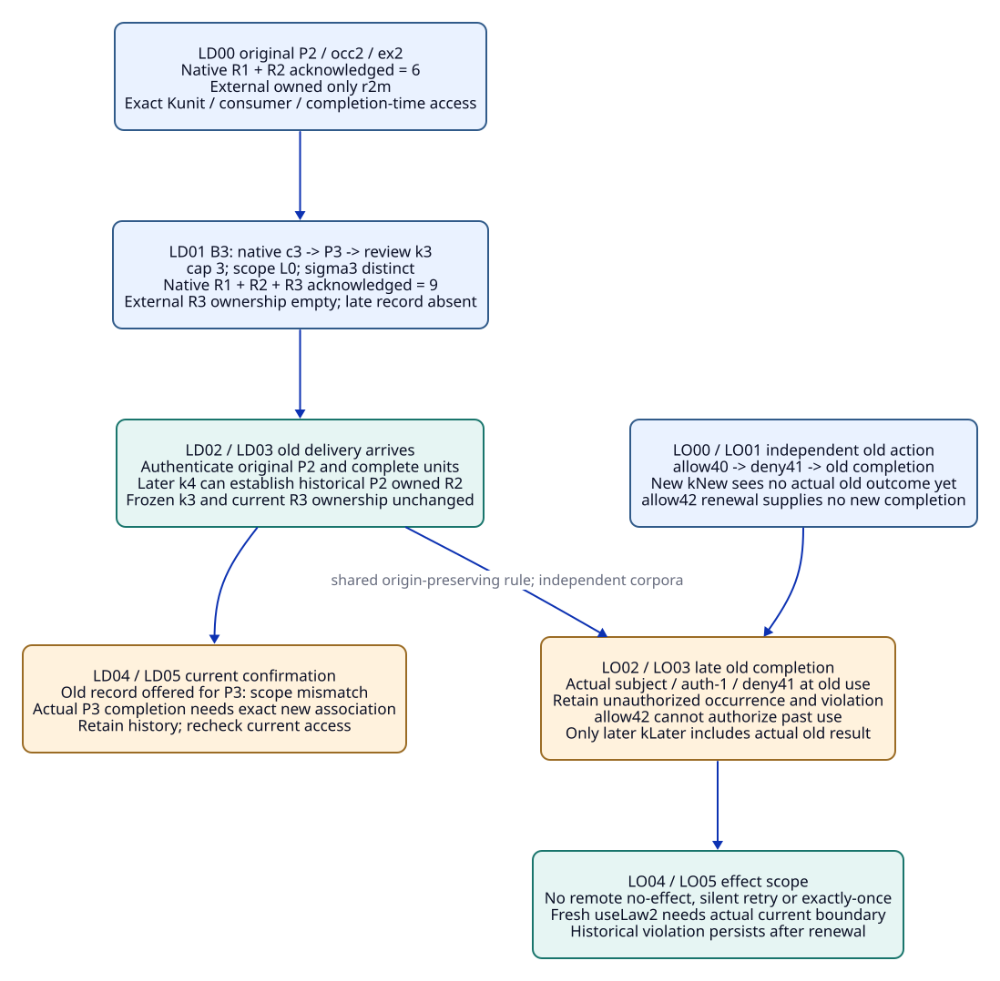
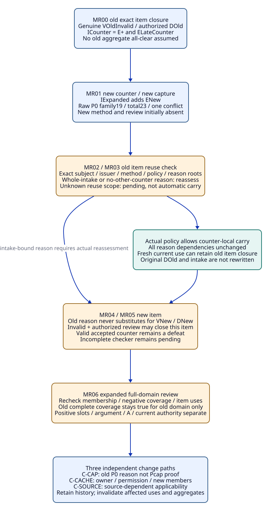

# SPDX-FileCopyrightText: 2026 tao3k team and Contributors
#
# SPDX-License-Identifier: LGPL-2.1-or-later

#+TITLE: 20.15 Late Outcome Origin and Expanded Intake Reuse
#+LANGUAGE: en
#+PROPERTY: JD_ID 20.15
#+OPTIONS: toc:3 num:nil
#+STARTUP: overview
#+TODO: OPEN SPECIFIED | QUALIFIED
#+FILETAGS: :gateway:late-results:intake:reuse:

[[file:../../00-09-project/00-documentation/00.01-index.org][Index]] | [[file:20.14-partial-delivery-consumption-authority-and-blocker-closure.org][20.14 parent packets]] | [[file:../../10-19-design/10-architecture/10.07-claim-witness-reference-contracts.org][Claim / witness / T-V-A contracts]]

* SPECIFIED Scope and existing package owners
:PROPERTIES:
:CUSTOM_ID: late-origin-member-scope
:STATUS: author-specified-not-executed
:END:

This refinement expands BP05-late, UA04-late and BL06-member. LD, LO and MR are
finite review labels for existing OracleInputSpec/OracleGoldSpec, CutSpec,
InputClosure, usage/T-use, VerificationRecord, ReviewDisposition and delivery
provenance. They do not introduce a framework, temporal database, event service,
receipt class, runtime protocol or additional scored Benchmark variant.

[[file:../../../.gerbil/pkg/github.com/tao3k/poo-flow-core/init.ss][The package-linked Core init]] supplies Module/Scenario selection ownership.
gateway-domain owns claim/Profile/Scenario application and obligations;
gateway-evidence owns evidence associations. Existing occurrence/exchange owners
retain capture/request/response association, consumers own their actual delivery
contracts, Host/authority owns actual permission/occurrence records, and the
authorized reviewer owns disposition. Selection alone realizes none of them.
Source links follow the package environment; version resolution belongs to
package management rather than repeated documentation shortcuts.

#+NAME: late-origin-common-contract
| Existing packet field | Required input and boundary |
|-----------------------+-----------------------------|
| Parent closure | Materialize all actual parent factory, declaration, projection, mapping, runtime, request, consumer, issuer, method and policy bodies; document links/labels are not actual evidence |
| Stage identity | Frozen root/member/generation manifest with exact occurrence, exchange and subject bindings; separate original event, later arrival and later review capture using actual causal evidence, not wall-clock guesses |
| I / G / CL | Each LDnn/LOnn/MRnn has its own I, independently authored G and enumerated CL; a fork has a separate suffixed input and gold |
| Membership states | Expected-present missing body is setup defect; deliberately absent work remains pending; unknown scope/currentness remains pending; irrelevant needs a scoped reason |
| Capture rule | A late result absent from an older frozen input cannot become its member retroactively. A later input may include that genuine old-origin result and compute a new bounded answer |
| Evidence admission | Authenticate subject, actual bytes, coverage and authority independently. Late arrival alone is neither invalidity nor current permission |
| Oracle independence | Fixed independent semantic/encoding, authority-order and review/coverage worksheets precede candidate evaluation; no candidate success label generates gold |

k3, k4, kNew and kLater name frozen review captures of prior records. Native
source captures are separate earlier nodes: c3 precedes P3, which may then enter
k3. A native source cut never includes its own future response. Each current-use
verdict is later than the review cut it consumes; no header alias repairs an
actual cyclic body reference.

The three families reset independently. All authentic completion/checker/review
premises remain uninstantiated until actual bodies and authority are supplied.
These rows describe finite review views and permit alternative Agent discovery;
they prescribe no compulsory execution order.

* SPECIFIED BP05-late: original delivery versus a newer capture
:PROPERTIES:
:CUSTOM_ID: late-delivery-origin-packet
:PARENT_EVENT: BP05-late
:BQ_BINDINGS: BQ02 BQ03 BQ06 BQ08
:END:

#+NAME: late-delivery-complete-input
| Field | Concrete input |
|-------+----------------|
| Reset | Exact 20.14 BP02 Bsel={o+,o-,oL}, map{s+:d+,s-:d-,sL:dL}, Nsel/RCsel and genuine CPsel/R1/Fsel; no links/hypotheses |
| Original selected request | B2=[(context,X0),(cap,"2"),(method,Q)], inherited expand=[L0], exact Sconj/constructor/query rules; P2 response/capture belongs to original occurrence occ2/exchange ex2 with actual owner identity |
| Original units and history | R2={r2m,r2u,r2g}, full (sigma2,name,actual ordered-body digest); matched=[], unknown_binding one cap="2" row, conjunction_gap contextX0/methodQ; genuine P2 shows all three, native acknowledges six R1 union R2; externally owned at BP02={r2m} only |
| Newer independent request | B3=[(context,X0),(cap,"3"),(method,Q)] replaces whole bindings, same Sconj/Nsel/RCsel, inherited expand=[L0], new occurrence occ3/exchange ex3 and earlier native capture c3; frozen review input k3 includes genuine P3 from c3; independent worksheet establishes sigma3 distinct from sigma2 |
| B3 gold | matched={}, question={}, unknown_binding={(cap,"3")}, conjunction_gap={(context,X0),(method,Q)}, scope={L0}; four retained items, item added/removed/changed empty. R3 contains three actual sigma3-qualified units |
| Native versus external B3 | Genuine P3 shown in full with parent short-body encoding inequalities independently checked; native checkpoint from P2 acknowledges R1 union R2 union R3=9 distinct units. No authentic external R3 completion supplied |
| Actual delayed completion | Existing Kunit covers complete r2u and r2g for exact P2/ex2/occ2/reviewer-1 with permitted completion-time access; actual completion precedes k3, result arrival follows k3. Original k3 manifest does not contain this result |
| Later review | k4 contains original P2 completion records plus k3/P3 history and current access roots. A fresh use association may assess history; no result is retargeted to P3 |

B3 is a deliberately distinct binding input, not an inferred meaning of C2 or a
new engineering property. Relation names and byte-identical empty matched bodies
cannot overcome different selector identities. Actual row order and Data encoding
must be checked separately from set-valued semantic worksheets.

#+NAME: late-delivery-step-gold
| Event / stage input | Independently expected gold | Evidence / reference closure |
|---------------------+-----------------------------+------------------------------|
| LD00 freeze BP02 | Original external owned={r2m}; r2u/r2g completion absent from this input; native acknowledgement six | CL-LD00 all parent Bsel/CPsel/P2/R2 and Kunit/access/provenance roots, independent B2 worksheet; future late result absent |
| LD01 capture genuine P3 at k3 | Native acknowledgement nine; current external R3 ownership={}; known incomplete current delivery. Original frozen BP02 unchanged | CL-LD01 adds B3/P3/occ3/ex3/k3, actual ordered R3, independent cap="3" worksheet and current access roots |
| LD02 receive genuine old completion after k3 | Authenticate exact P2/occ2/ex2/unit/consumer and actual event/arrival order; k3 membership/gold unchanged | CL-LD02 adds actual Kunit records, origin body coverage and ordering evidence to a later input only |
| LD03 review at k4 | Historical P2 owned=R2 in the new k4 view; P3 owned remains empty. BP02 and k3 still report what they captured | CL-LD03 adds k4 manifest/current usage referring to original completion, not a rewritten P2/k3 |
| LD04 offer old completion as P3 confirmation | Known sigma/exchange/subject mismatch refused; RJ11 when offered as unseen-current confirmation. Retain genuine P2 record | CL-LD04 exact offered association and independent unit tuple comparison; unknown origin instead pending |
| LD05 fresh genuine P3 completion companion | Only authentic ex3/P3/consumer/unit coverage establishes R3 ownership in a later capture; no Pcap/P3 engineering proof or operational grant | CL-LD05 actual P3 completion/access and fresh use; original P2 records remain reusable only in their exact scope |

#+NAME: late-delivery-forks
| Fork | Concrete changed input | Independent decision |
|------+------------------------+----------------------|
| LD02-partial | Authentic old completion covers r2g only | At later review P2 owned={r2m,r2g}; r2u still unconfirmed, P3 unchanged |
| LD02-no-order | Genuine completion body, event-before-k3 ordering unknown | May establish exact eventual old delivery in later view; cannot assert completion existed at k3 or permission at event without actual scope/order support |
| LD02-wrong-owner | Same Nsel and relation names, different actual exchange/consumer | Refuse known offered association mismatch; unknown origin pending; retain record in its actual scope |
| LD03-revoked | Completion was permitted, current access revoked before k4 | Retain historical completion; known disallowed current reuse refused, unknown access pending; no newly permitted read |
| LD03-duplicate | Same authentic completion body delivered twice | No extra distinct unit/coverage; no claim about transport exactly-once. Same asserted identity with conflicting body requires integrity/association investigation |

#+CAPTION: Late records retain original delivery/action subjects; only a later captured review can include them.

[[file:../../90-99-views/90-architecture-views/90.39-late-delivery-and-outcome-origin.d2][Editable D2 source]].

* SPECIFIED UA04-late: truthful old completion under denied authority
:PROPERTIES:
:CUSTOM_ID: late-action-origin-packet
:PARENT_EVENT: UA04-late
:BQ_BINDINGS: BQ02 BQ04 BQ05 BQ06 BQ07 BQ08
:END:

#+NAME: late-action-complete-input
| Field | Concrete input |
|-------+----------------|
| Independent reset | Original genuine conditional L0-only OutLaw0/rLaw0/k0-law, RL/EL/wL/TL/VL0/VMapL/MP0/HC and full T-use from 20.14; not Bsel |
| Old action subject | useLaw1/request/body, authority incarnation auth-1, reviewer-1, consume-L0, resource=(RL,dL,L0), tenant-A, Xsrc; exact existing Kauth and relevant method/access domain |
| Actual event order | Authentic allow40 lookup; deny41 update; old action actually consumes/completes under deny41. Actual completion record is not yet delivered to the reviewer |
| New capture | kNew freezes known lookup/update/dispatch, no actual old consumption-bound result. allow42 renewal is genuinely present for its exact scope, but no new consumption/completion follows merely from renewal |
| Late result | Existing authentic Host/authority completion and deny-current boundary records arrive after kNew, covering old useLaw1 subject, original auth-1/version/order and specified effect extent |
| Later capture | kLater includes those actual records, original request and kNew provenance plus current roots; new action useLaw2, if requested, requires its own actual subject/boundary/outcome evidence |

#+NAME: late-action-step-gold
| Event / stage input | Independent gold | Closure addition |
|---------------------+------------------+------------------|
| LO00 freeze allow40/deny41/dispatch | Actual old boundary and effect unknown; pending actual outcome, no qualified permitted completion or remote no-effect | CL-LO00 full original law/T/V/usage/action/Kauth/authority bodies and independent subject/order worksheet |
| LO01 freeze kNew with allow42 | Renewal known only in its recorded scope; useLaw1 outcome still unknown in this snapshot; useLaw2 actual use/completion absent | CL-LO01 authentic renewal/current roots and kNew member manifest; future late body excluded |
| LO02 receive old completion/boundary records | Authenticate original subject, actual completion and deny41-at-use order. Arrival under allow42 cannot reauthorize old use | CL-LO02 genuine result/effect extent, Kauth boundary records and causal order, added to a later input |
| LO03 review at kLater | Known actual unauthorized occurrence retained with violation; offered allow40-based permitted use RJ10. Original kNew gold unchanged | CL-LO03 later manifest/usage and exact old-origin records; no substitution of renewal/current authority for original boundary |
| LO04 assess effects and retry demand | Known covered occurrence remains; unrelated/partial effects unknown unless covered. No silent retry, compensation or exactly-once conclusion | CL-LO04 actual coverage plus existing effect/idempotence/compensation contract if supplied; absent contract supplies no guarantee |
| LO05 independent fresh useLaw2 companion | May establish later permitted completion only with actual allow42-current boundary and full subject/outcome coverage; old violation persists | CL-LO05 genuinely new invocation and actual authority/Host evidence; original action association unchanged |

#+NAME: late-action-forks
| Fork | Changed actual input | Independent decision |
|------+----------------------+----------------------|
| LO02-before-deny | Authentic alternative ordering: old consumption completed under allow40 before deny41 | Historical allowed completion may establish; separate input, not combined with denied-at-use main ordering |
| LO02-completion-only | Completion authentic but authority at actual use unknown | Establish covered occurrence only; permission remains pending, no fabricated violation or grant |
| LO02-incarnation | Result from auth-2 or another tenant/body offered for auth-1/useLaw1 | Known subject mismatch refused, unknown binding pending; keep original-scope record |
| LO03-local-failure | Local exception supplied instead of actual Host result | No inference of remote nonexecution; old outcome remains pending |
| LO05-repair | Authorized remediation record genuinely supplied | Assess exactly its covered effect; it does not erase original unauthorized occurrence or prove all compensation succeeded |

* SPECIFIED BL06-member: expanded intake and closed-item reuse
:PROPERTIES:
:CUSTOM_ID: expanded-intake-reuse-packet
:PARENT_EVENT: BL06-member
:BQ_BINDINGS: BQ02 BQ03 BQ04 BQ05 BQ06 BQ07 BQ08
:END:

#+NAME: expanded-intake-complete-input
| Field | Concrete input |
|-------+----------------|
| Independent old corpus | OH-counter=B0+oLateCounter, exact parent map/projection/RULES/constructor/runtime, old 17-item P0/L0 query/P0 family13, raw conflict(P0) |
| Old item evidence | ELateCounter/wCounter/RLateCounter/TCounter, exact P0/X0/S0/K0/M0/Q; genuine complete invalid-artifact result VOldInvalid and authenticated rejected-invalid disposition DOld bound to old ICounter={E+,ELateCounter}, origin method/review cuts and actual policy/reason |
| Old item current use | Earlier genuine item closure for that counter only; all old issuer/policy/applicability roots supplied. No old full-domain all-clear or positive Q/A assumed |
| Added counter | oNewCounter with new unique ID/digest/source key sNewCounter; claim P0, stance counter, kind observation; exactly five factors contextX0/cap"1"/interpretationK0/sourceS0/methodQ; actual RNew/dNew/ENew/wNew and host mapping sNewCounter:dNew |
| New projection | OH-expanded=OH-counter+oNewCounter, fresh native projection/capture and NExpanded, same read contract RC0 if independently verified, same query[P0,L0]/declarations/constructor. No V or disposition projected as raw facts |
| Independent raw gold | New counter contributes six unique items; P0 family19, total23=4 L0+6 support+6 old counter+6 new counter+1 conflict. conflict(P0) remains one set relation, not one per counter |
| Expanded intake | IExpanded={E+,ELateCounter,ENew}; complete actual required membership/relevance/coverage definitions for this bounded P0 review, including negative/aggregate dependency roots. VNew/DNew deliberately absent initially |
| Item reuse premise | Actual review policy may permit reusing a counter-local checked reason under expanded intake only if unchanged subject/method/relevance/issuer and all reason dependencies are established; main starts with this scope evidence unknown |
| Remaining guards | Positive Q and required positive-slot completion absent, argument/A absent, operational permission/completion unestablished. Coverage complete only when actual full-domain worksheet supplied later |

A new member does not make a previously unresolved aggregate complete. Here old
aggregate coverage was already pending; it remains pending and must be checked
against IExpanded. In a separate companion with a genuinely complete old intake,
that old complete result stays true for its frozen domain but cannot establish
complete current coverage of the expanded domain.

#+NAME: expanded-intake-step-gold
| Event / stage | Independent expected gold | Closure addition |
|---------------+---------------------------+------------------|
| MR00 freeze genuine old item closure | Old counter review resolved-invalid in its exact old target/intake/policy scope; no global Eligible/A | CL-MR00 full old factory/intake/actual VOldInvalid/DOld, origin cuts, reviewer and checked-reason dependencies |
| MR01 add genuine new projection/member | Fresh NExpanded and raw23 worksheet; RequiredIntake=IExpanded. No inference of VNew or DNew from raw counter bytes | CL-MR01 actual new artifact/envelope/map/source, full projection and native capture, independent item/member worksheet |
| MR02 offer DOld as current expanded coverage | Old body remains valid history; unknown item-reuse scope pending. Known whole-intake all-clear offered for missing ENew coverage refused, RJ11 when required opposing member is knowingly omitted | CL-MR02 actual offered use, old/new member manifests and reason/policy dependencies, no reason-string transfer |
| MR03 supply genuine policy/applicability carry evidence | If policy truly permits counter-local reuse and all dependencies unchanged, new current-use association can retain old item closure under expanded review; DOld itself is not rebound or rewritten | CL-MR03 actual policy/reviewer/issuer/subject/relevance/negative-dependency coverage plus fresh usage bound to IExpanded |
| MR04 assess new item without method/review | ENew method/review pending; ReviewBlock(P0,current) remains. Old item need not reopen when MR03 guards hold; aggregate coverage/positive/argument/current-use guards still separate | CL-MR04 full required opposing intake and explicit missing VNew/DNew; no copied old invalidity reason |
| MR05 independent genuine new invalidity/disposition companion | Genuine complete invalid-artifact VNew and authorized rejected-invalid DNew may close new item only. No positive Q satisfaction, full intake coverage or A created | CL-MR05 actual new method cut/result and later review cut/disposition with exact new subject/reason/issuer |
| MR06 actual full bounded coverage worksheet supplied | If complete relevant membership, review and all no-defeat conditions established, this review block may close. Missing positive Q/slots, argument/A and current operational guards still prevent complete engineering closure | CL-MR06 actual current aggregate/negative coverage and item-use associations for both counters; full positive/argument/access/effect positions explicitly absent or unknown |

#+NAME: expanded-intake-reuse-forks
| Fork | Concrete scope change | Independent decision |
|------+-----------------------+----------------------|
| MR03-intake-bound | Actual DOld policy requires exact whole-intake equality | Retain old record, refuse known direct current use; genuine new authorized review required for IExpanded, even if old artifact unchanged |
| MR03-negative | Old reason depends on no-other-counter or a full-intake comparison | Addition changes that reason dependency; old item reuse not established until actual reassessment, no automatic local carry |
| MR03-policy | Reviewer/method issuer/policy revoked or source interpretation changed | Known stale use RJ10, unknown applicability pending; old immutable bytes/history retained |
| MR05-valid | Genuine completed valid counterexample and accepted-local DNew | New applicable defeat remains blocking clean P0 even with complete delivery and coverage; cannot fill positive Q (RJ07) |
| MR05-incomplete | New checker times out or fails to complete | Pending/inconclusive, not invalid artifact and no reason to close new review |
| MR06-old-complete | Genuine complete old aggregate over ICounter supplied | Preserve historical bounded completeness; recheck expanded membership/negative coverage and new item before current aggregate closure |

#+CAPTION: Expanded membership rechecks aggregates and reason dependencies while preserving exact reusable evidence and historical closure.

[[file:../../90-99-views/90-architecture-views/90.40-expanded-intake-and-item-reuse.d2][Editable D2 source]].

* SPECIFIED Reference closure, three paths and hidden assumptions
:PROPERTIES:
:CUSTOM_ID: late-origin-member-closures
:END:

#+NAME: late-origin-typed-reference-closure
| Existing record / boundary | Earlier required references | Later association and prohibited inference |
|----------------------------+-----------------------------+--------------------------------------------|
| Original P2 delivery | Original occurrence/exchange/capture/P2 digest/sigma2/unit bodies and actual Kunit consumer/access | Late record binds original units; later k4 may include it, k3 cannot gain future members |
| Actual old action completion | Original action/body/authority incarnation/actual boundary version/order and effect coverage | Later kLater evaluates historical occurrence/permission; current allow42 cannot grant past authorization |
| Old invalidity V and DOld | Actual old checker/artifact/subject/issuer, earlier method cut; review cut contains prior V and authentic intake/policy/reason roots | Current expanded use references immutable old disposition plus current applicability; no rewriting old intake or origin cut |
| New counter capture / intake | Actual new bytes/map/projection, existing relevant member and negative roots | IExpanded/new usage includes new member; old coverage cannot silently acquire it |
| New V / DNew | Earlier new method input, then genuine result in later review input/cut, then genuine disposition | New aggregate capture may contain prior dispositions and current roots, never its own future aggregate verdict |
| I / independent G / CL | Fixed oracle/review worksheets and stage-specific frozen roots, no own future output | Actual candidate/native/method/delivery/use results enter later package review only; gold never derived from candidate |

Actual event, arrival and capture order require genuine contract/causal evidence.
A late result can inform a fresh review of an old event without changing the
original snapshot's membership or gold. Neither result arrival nor review time
replaces actual use-time authority. No new timestamp API or global ordering
service is implied. Digest equality supplies byte identity, not origin, order,
permission or coverage.

#+NAME: late-origin-tva-guards
| Family | T / T-use | V / review | A / effect |
|--------+-----------+------------+------------|
| LD | Original native P2/P3 byte capture and exact unit completion separately referenced; fresh current access/use required | No V from relation completion; old method witnesses retain exact applicability | No property/argument/effect grant from ownership or cached presentation |
| LO | Original law TL/T-use plus authentic old action/boundary/completion records, later origin-preserving association | Law VL0/VMapL does not authorize operational use | Actual covered historical violation/permission separate from current A or effect authority; no retroactive repair |
| MR | Old TCounter remains scoped to old raw capture; actual new projection needs its own authentic native capture/T; no T invented for unprojected review records | Exact VOldInvalid/DOld potentially reusable only after current dependency checks; ENew requires its own V/review | Aggregate item closure does not supply positive slots/argument/A or operational authority |

#+NAME: late-origin-three-paths
| Independent path | Late delivery and completion | New member and closed-item reuse | Still required |
|------------------+------------------------------+---------------------------------+----------------|
| C-CAP: C1 to C2 | Original P2/action receipt remains original; B3 is only an independent selector control, not evidence for Pcap. Later actual C2 use needs its own authority | Old P0 invalidity applies only to its full claim/assumption scope; new Pcap counters and their required membership cannot inherit old reason text | AppCap/new Q/CorrCap/PerfCap, current intake/argument and exact use guards |
| C-CACHE: enable cache | Cached old response and late completion cannot confirm a new tenant/exchange or authorize a hit; old unknown/unauthorized effect is not safe-retry evidence | Cache owner, Sk/Kk/Z1 and Pcache/CacheAuth may introduce new required counters and negative dependencies; old local item reason reusable only if actual policy/scope permits | Complete U-cache, security/resource/permission/frame coverage and actual at-hit authorization |
| C-SOURCE: S0 to S1 | Late S0 completion/action retains original source/context; same law bytes do not prove S1 correspondence or source-specific permission | Source-dependent invalidity/relevance may change. Psrc-specific inapplicability cannot erase P0 history; old S0 disposition not automatically current for S1 | Corr1/new application/Q/ASrc, actual source mapping, current review/intake and authority |

#+NAME: late-origin-assumption-audit
| Assumption | Concrete discriminator | Design closure / remaining qualification |
|------------+------------------------+-------------------------------------------|
| OA01 owner | LD02-wrong-owner / LO02-incarnation | Full original occurrence/exchange/action/incarnation, not same native ID |
| OA02 actual inputs | Delayed completion and MR03 scope evidence | Conditional records need actual bodies/policy; no emitted receipts asserted |
| OA03 states | Unknown order / absent VNew / missing expected body | Pending order/method versus setup defect distinguished |
| OA04 coverage | LD02-partial / MR06 | Exact units and expanded member/negative coverage; no single-item all-clear |
| OA05 timing | LD02-no-order / LO02 | Event, arrival and capture differ; genuine causal/authority order required |
| OA06 reuse | MR03-intake-bound / MR03-negative | Item-local reuse conditional on actual policy and full reason dependencies |
| OA07 proposition | LO03 / MR05-valid | Truthful completion not permission; valid counter not satisfaction |
| OA08 opposing evidence | MR01/MR04 | New required counter included while method pending; selector cannot hide it |
| OA09 encoding | LD01 sigma3 / raw23 worksheet | Ordered tuple/byte integrity separate from semantic sets; conflict counted once |
| OA10 evaluation | Three finite child controls | Existing 24 scored variants unchanged; no Benchmark/formal/native pass inferred |
| OA11 method | MR05-incomplete | Incomplete work cannot justify invalid-artifact disposition |
| OA12 completion | LO04 / LD03-duplicate | Covered actual effect/units only; no exactly-once or total compensation inference |
| OA13 authority | LO02 actual boundary / MR03 actual policy | Arrival/current role label cannot supply historical authorization or review authority |
| OA14 currentness | LD03-revoked / MR03-policy | Preserve truthful historical records; recheck current use and issuer scope |
| OA15 consistency | Old gold versus later view | New captured answer may differ without mutating old gold; contradictory same-scope producer records require investigation, not last-writer choice |

* OPEN Qualification handoff
:PROPERTIES:
:CUSTOM_ID: late-origin-member-handoff
:END:

- [ ] Materialize actual old/new captures, ordered relation bodies and independently established completion/order/consumer scope.
- [ ] Supply authentic old action/authority boundary and effect coverage, including unknown-order and alternative-order companions.
- [ ] Supply genuine counter bytes, policy/reason dependencies, new method/review outcomes and expanded full-domain coverage worksheets.
- [ ] Instantiate all three paths in existing Module/Profile/Scenario and exchange ownership; preserve old receipts and failed/pending outcomes.
- [ ] Perform independent oracle/native/QNT/Lean/operational qualification in later implementation work.

Only English Org and paired D2/SVG are authored here. No runtime, oracle,
checker, transport, effect fencing or package dependency implementation is
provided, and no passing native/formal/performance/operational receipt is claimed.

* SPECIFIED Unknown-order and negative-dependency refinement
:PROPERTIES:
:CUSTOM_ID: late-origin-unknown-child
:END:

[[file:20.16-unknown-order-negative-dependencies-and-defensive-engineering.org][20.16]] expands LD02-no-order, LO02-completion-only and MR03-negative.
It explicitly drops the respective known-order/known-authority premises in
unknown companions and adds DE01's bounded defensive-engineering case. Original
parent inputs and gold remain frozen.
