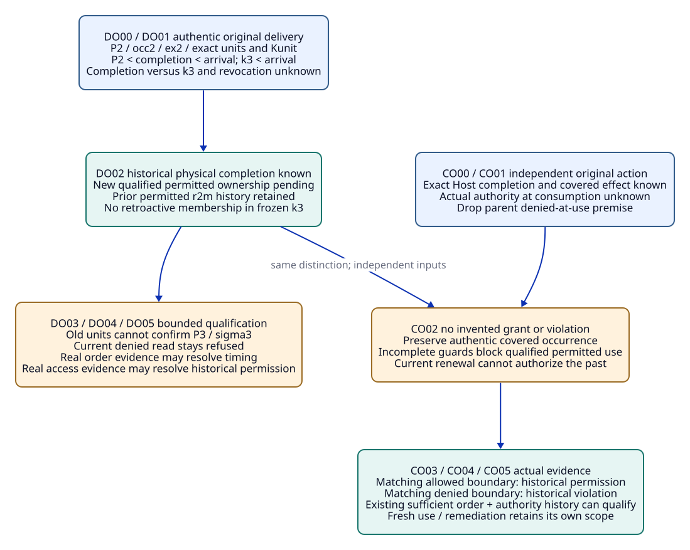
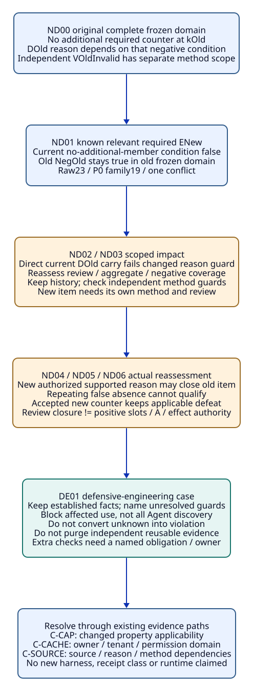

# SPDX-FileCopyrightText: 2026 tao3k team and Contributors
#
# SPDX-License-Identifier: LGPL-2.1-or-later

#+TITLE: 20.16 Unknown Order, Negative Dependencies and Defensive Engineering
#+LANGUAGE: en
#+PROPERTY: JD_ID 20.16
#+OPTIONS: toc:3 num:nil
#+STARTUP: overview
#+TODO: OPEN SPECIFIED | QUALIFIED
#+FILETAGS: :gateway:unknown-order:negative-dependencies:defensive-engineering:

[[file:../../00-09-project/00-documentation/00.01-index.org][Index]] | [[file:20.15-late-outcome-origin-and-expanded-intake-reuse.org][20.15 parent packets]] | [[file:../../10-19-design/10-architecture/10.07-claim-witness-reference-contracts.org][Claim / witness / T-V-A contracts]]

* SPECIFIED Existing owners, input convention and bounded claims
:PROPERTIES:
:CUSTOM_ID: unknown-negative-scope
:STATUS: author-specified-not-executed
:END:

This document expands LD02-no-order, LO02-completion-only and MR03-negative.
DO, CO and ND label finite inputs/gold/closures in the existing OracleInputSpec,
OracleGoldSpec, CutSpec, InputClosure, usage/T-use, VerificationRecord,
ReviewDisposition and delivery-provenance contracts. DE01 is a cross-packet
defensive-engineering case, not a new framework, rule engine, receipt class,
authorization service, temporal store or scored Benchmark variant.

[[file:../../../.gerbil/pkg/github.com/tao3k/poo-flow-core/init.ss][Core's package-linked init]] selects Module and Scenario windows. Existing
gateway-domain owns claims/Profile/Scenario application and obligations;
gateway-evidence owns evidence associations; occurrence/exchange owners retain
original captures; consumer/Host/authority and authorized reviewer retain their
respective delivery, permission, occurrence and disposition responsibilities.
Package management resolves source versions; document source navigation uses
package files. Selection is not provider realization or runtime authorization.

#+NAME: unknown-negative-common-input
| Existing position | Required complete input |
|-------------------+--------------------------|
| Parent closure | Materialize actual parent factory, source/runtime/declaration/rules, mapping, ordered relation bodies, consumer and method/authority/reviewer contracts; aliases and document links do not supply missing bytes |
| Event / capture order | Actual origin, arrival and review-capture references plus authenticated causal edges where known. Mark other comparisons unknown; do not infer total order from labels or unsynchronized clocks |
| Independent input and gold | Each DOnn/COnn/NDnn has an independent I/G/CL and fixed semantic/authority/review worksheet. Named forks reset inputs; contradictory histories are never combined |
| Four states | Missing expected-present body is setup defect; absent work pending method; unknown applicability/order/currentness pending scope; irrelevant needs actual scoped justification |
| Capture identity | Native source capture precedes its result; later review cut may contain prior results. A cut excludes its own future verdict, gold and usage result; old input membership/gold remains immutable |
| Genuine premises | Actual completion/checker/review/authority records must be supplied. Symbolic result names describe conditional packets, not emitted or executed receipts |

A genuine later record can establish a past occurrence while leaving its order
relative to an older capture unknown. That occurrence is not therefore known to
have been a member of the older snapshot, nor does it become authorized because
it is authentic. Physical completion, qualified owned delivery, current reuse,
method validity, review closure and effect permission remain separate claims.

* SPECIFIED LD02-no-order: delivery known, its earlier timing unknown
:PROPERTIES:
:CUSTOM_ID: unknown-delivery-order-packet
:PARENT_EVENT: LD02-no-order
:BQ_BINDINGS: BQ02 BQ03 BQ06 BQ08
:END:

#+NAME: unknown-delivery-complete-input
| Position | Concrete input |
|----------+----------------|
| Original reset | Exact 20.15 LD00 Bsel/CPsel/P2/occ2/ex2/Nsel/RCsel; original B2=[(context,X0),(cap,"2"),(method,Q)], expand=[L0], full R2 three sigma2-qualified ordered units and native acknowledgement R1 union R2=6 |
| Prior owned delivery | Genuine permitted completion of r2m only at BP02; no actual completion of r2u/r2g in that frozen input |
| Newer review k3 | Exact B3=[(context,X0),(cap,"3"),(method,Q)], earlier native c3, genuine P3 and actual R3; L0 scope, four retained items; native checkpoint nine units, external R3 ownership empty; no delayed record in k3 |
| Late actual record LDu | Authentic existing Kunit records complete r2u/r2g bodies for P2/ex2/occ2/reviewer-1. P2 precedes completion; completion precedes authenticated arrival aD; k3 precedes aD. Completion versus k3 is unknown |
| Access input | Actual consumer permission contract and scope, an earlier permitted P2 request and a genuine revocation rD after k3 but before aD; completion versus rD and actual completion-bound access unknown. No unseen grant/interval continuity assumed |
| Later review kD | Contains LDu and all earlier actual subject/contract/order records. Current access denied under the authentic revocation scope; no fresh current-read grant supplied |

This fork drops LD02's event-before-k3 and permitted-completion premises; it
retains genuine completion and original subject/body association. Do not carry
those dropped premises from the parent main trajectory into this input.

#+NAME: unknown-delivery-step-gold
| Event / stage | Independent expected gold | Exact evidence / closure |
|---------------+---------------------------+--------------------------|
| DO00 freeze k3 without LDu | r2m prior owned; r2u/r2g not confirmed by this snapshot; external R3 ownership empty | CL-DO00 complete parent CPsel/P2/P3/R1/R2/R3 and original provenance, k3 manifest/independent semantic worksheet |
| DO01 receive authentic LDu after k3 | Exact eventual physical delivery of r2u/r2g established in later input; no known completion-before-k3 conclusion. Frozen k3 unchanged | CL-DO01 actual Kunit/body/unit/consumer provenance, P2-to-completion-to-aD and k3-to-aD evidence; omitted comparisons explicitly unknown |
| DO02 inspect historical access | Historical physical completion covers all R2 when combined with genuine r2m history; newly qualified permitted ownership of r2u/r2g remains pending. Do not equate an allowed request with allowed completion | CL-DO02 exact rD/authority/contract and actual access-at-completion position unknown; current denied access separately known |
| DO03 attempt current P3 ownership/use | Original P2 record cannot confirm sigma3/ex3 units; known offered substitution refused, RJ11 for unseen-current confirmation. Current denied read refused within actual policy scope | CL-DO03 exact offered usage/unit comparison and current consumer/access roots; preserve genuine P2 physical delivery and prior r2m ownership |
| DO04 genuine historical-order companion | Actual before-k3 completion evidence may establish that historical timing in a later review, not add a member to old k3. Permission still requires actual boundary access evidence | CL-DO04 real new order evidence and fresh later cut; no inferred permission from chronology alone |
| DO05 genuine historical-access companion | Actual completion-bound permission can qualify original-unit ownership in later view; actual denial can establish unauthorized delivery if the contract defines that violation. Neither supplies current P3 completion | CL-DO05 actual authority/subject/order/coverage record; retain outcome scope and original snapshot identity |

#+NAME: unknown-delivery-order-worksheet
| Independently possible history | What an actual qualifying record could establish | Shared conclusion from main input alone |
|--------------------------------+-------------------------------------------------+----------------------------------------|
| P2 -> completion -> k3 -> rD -> aD | Before-k3 completion if actual order supplied; access still separately checked | Eventual exact original delivery only |
| P2 -> k3 -> completion -> rD -> aD | After-k3/before-revocation completion if proven; request-time allow still not a complete authority contract | No known before/after-k3 answer |
| P2 -> k3 -> rD -> completion -> aD | After-revocation completion if proven; denial-at-boundary only with actual authority scope/coverage | Historical authorization pending; current denied read remains denied |

These histories are discriminators, not executable traces or exhaustive authority
histories. The oracle checks actual causal edges and separately permission scope;
it cannot choose the convenient history. Identity/body mismatch is refused;
unknown order is pending, not a forged-result finding.

#+NAME: unknown-delivery-forks
| Fork | Changed actual input | Independent decision |
|------+----------------------+----------------------|
| DO01-unit | Genuine completion covers only r2g | Eventual physical delivery of r2m/r2g only; r2u completion pending |
| DO01-clock | Receipt contains incomparable host timestamps only | No new cross-host causal edge; ordering remains unknown |
| DO04-after | Genuine evidence establishes completion after k3 | Later review records that timing; frozen k3 membership/gold unchanged |
| DO05-access-only | Authentic permitted completion scope supplied without comparison to k3 | Historical permitted original-unit ownership may establish; before-k3 timing still unknown |

#+CAPTION: Authentic historical delivery or completion does not supply unknown order or historical authority.

[[file:../../90-99-views/90-architecture-views/90.41-unknown-order-and-historical-authority.d2][Editable D2 source]].

* SPECIFIED LO02-completion-only: occurrence known, authority unknown
:PROPERTIES:
:CUSTOM_ID: completion-only-authority-packet
:PARENT_EVENT: LO02-completion-only
:BQ_BINDINGS: BQ02 BQ04 BQ05 BQ06 BQ07 BQ08
:END:

#+NAME: completion-only-complete-input
| Position | Concrete input |
|----------+----------------|
| Independent reset | Original genuine L0-only OutLaw0/rLaw0/k0-law, RL/EL/wL/TL/VL0/VMapL/MP0/HC and exact full T-use from 20.15. Retain subject/artifact bindings; explicitly drop main LO's deny41-at-actual-use premise |
| Exact original action | useLaw1/body, auth-1, reviewer-1, consume-L0, resource=(RL,dL,L0), tenant-A, contextXsrc, actual existing Kauth boundary/coverage definition |
| Known events | Genuine allow40 lookup, deny41 update, dispatch and later authentic Host completion result OC1 covering exact old action/effect extent; their available causal edges do not establish authority at actual consumption |
| Unknown order/coverage | No genuine boundary-version record or complete ordering/authority history establishes allow40 or deny41 at consumption. In particular do not retain a deny-before-dispatch plus closed authority interval that would decide the boundary |
| Arrival and capture | kNew has no OC1 member. Its genuine allow42 renewal is not old authorization; OC1 arrives later, then kC captures OC1 with original subject and actual partial-order evidence |
| Remaining positions | New action useLaw2 completion absent; old action permission unknown; remote effect outside OC1's covered extent unknown; no repair/idempotence/compensation evidence supplied |

#+NAME: completion-only-step-gold
| Event / stage | Independent expected gold | Closure addition |
|---------------+---------------------------+------------------|
| CO00 freeze kNew | Old actual completion/authority unestablished in this snapshot; renewal alone no completion | CL-CO00 full law/T/V/usage/action/Kauth/actual lookup/update/renewal bodies and partial-order worksheet |
| CO01 receive genuine OC1 | Establish exact covered old occurrence in later view; reject retargeting to useLaw2. No historical permitted-use or unauthorized-use verdict yet | CL-CO01 actual Host issuer/result/action/body/effect extent and arrival/origin association; boundary authority deliberately unknown |
| CO02 inspect authorization alternatives | Historical authority pending; no grant and no proven violation. Withhold qualified permitted-use conclusion while guards are incomplete; report pending scope rather than a known-mismatch refusal or forbidden actual event | CL-CO02 actual authority definition/member/coverage state and independent comparison worksheet; no candidate success-label oracle |
| CO03 genuine allowed-at-use companion | With actual matching subject/incarnation/version/order/coverage, historical permitted completion may establish in a new captured input; no present/future grant | CL-CO03 authentic boundary/access and original-action association; original kNew unchanged |
| CO04 genuine denied-at-use companion | Actual unauthorized occurrence/violation established; known old-allow-based permitted use RJ10. Retain truthful OC1 | CL-CO04 authentic denied boundary and scope/order; this is a separate input from CO03 |
| CO05 later use or remediation requested | New useLaw2 requires actual current authority/boundary/outcome. Old effect outside coverage remains unknown; remediation cannot erase original occurrence | CL-CO05 genuine current request/authority/remediation records only if supplied; absent bodies remain explicit |

#+NAME: completion-only-forks
| Fork | Changed actual input | Independent decision |
|------+----------------------+----------------------|
| CO01-extent | Host record covers one sub-effect only | That covered occurrence known; remainder unknown, no invented all-or-nothing completion |
| CO02-closed-order | Authentic causal order plus complete authority history establishes denial at use without a dedicated boundary receipt | May derive known denial from that actual contract/closure; do not demand a new receipt type when existing evidence suffices |
| CO02-open-order | Action timing known, relevant authority grants/revocations incomplete | Time alone insufficient; authority pending |
| CO02-conflict | Incompatible genuine authority records lack authorized resolution | Preserve both and pending/conflict; no last-writer choice, grant or fabricated definite violation |

* SPECIFIED MR03-negative: new counter changes the old reason dependency
:PROPERTIES:
:CUSTOM_ID: negative-review-recheck-packet
:PARENT_EVENT: MR03-negative
:BQ_BINDINGS: BQ02 BQ03 BQ04 BQ05 BQ06 BQ07 BQ08
:END:

#+NAME: negative-review-complete-input
| Position | Concrete input |
|----------+----------------|
| Old reset | Exact OH-counter/B0/ELateCounter/artifact/map/raw17 factory and old required ICounter={E+,ELateCounter}; genuine VOldInvalid and authorized rejected-invalid DOld, their origin method/review cuts and current-use provenance |
| Independent method scope | Actual VOldInvalid establishes complete invalid-artifact result for the old artifact/Q subject. Its declared dependencies do not include absence of other counters. Issuer/source/method applicability is separately checked |
| Old review reason | Actual policy/reason for DOld additionally requires complete relevant P0/Q review-domain inventory and no additional required counter besides ELateCounter at old cut kOld. Call this exact worksheet condition NegOld, not a new native relation |
| Old absence closure | Genuine complete frozen inventory/member/relevance/negative coverage at kOld supports NegOld there. No global or future absence is inferred; DOld closes only its original authorized item scope |
| Added member | Exact 20.15 oNewCounter/RNew/dNew/ENew/wNew with five factors contextX0/cap"1"/interpretationK0/sourceS0/methodQ, genuine mapping and known required relevance to the same domain |
| New source/intake | Genuine OH-expanded capture, raw23/P0 family19/one conflict; IExpanded={E+,ELateCounter,ENew}. New native source identity and actual ordered bodies separate from old raw17 capture |
| New reason state | ENew is an actual additional required member, so the analogous no-additional-member condition at expanded cut is known false. Full current domain coverage may still be incomplete; one known relevant counter already refutes absence |
| Deliberate open work | VNew/DNew absent; old current disposition reassessment absent. Positive Q/slot completion, argument/A and actual operational authorization remain absent or unknown |

No-other-counter cannot by itself prove artifact invalidity. The independent
method result and inventory-dependent review reason have separate scopes here.
If the actual method result also depends on that negative inventory, it is not
the independent-method main input: use the ND02-method fork below.

#+NAME: negative-review-step-gold
| Event / stage | Independently expected gold | Closure addition |
|---------------+-----------------------------+------------------|
| ND00 freeze old complete inventory and DOld | NegOld true for exact kOld domain; authentic old item closure historical. No future or expanded absence | CL-ND00 actual full old domain/negative coverage, old V/disposition/cuts/issuer/policy/reason dependency worksheet |
| ND01 add known required ENew | Current analogous absence false; old NegOld remains true for its frozen domain. New method/review absent; current full coverage not inferred | CL-ND01 actual new counter/member/relevance/map/projection/raw23 worksheet and expanded current roots |
| ND02 attempt unchanged DOld current reuse | Known changed required reason dependency prevents direct carry; stale current use RJ10 where its guard is asserted unchanged. Preserve old disposition and independent VOldInvalid bytes | CL-ND02 exact offered current usage, old/new inventory and reason guards; no all-evidence purge |
| ND03 compute affected work | Reassess old item's current disposition and expanded aggregate/negative coverage; independently validate old method applicability before reuse. ENew has its own pending method/review | CL-ND03 dependency-specific current worksheet, reviewer/policy/issuer/source roots and actual unknown/absent work positions |
| ND04 genuine new old-item review companion | New authorized DOld2 may close old item under expanded scope only with actual policy-permitted supporting reason. Repeating false no-additional-member reason cannot qualify; a role label supplies no waiver | CL-ND04 actual new review input/cut/reason/support/policy and immutable later disposition; DOld not rewritten. ENew remains pending |
| ND05 genuine new-item result companion | Complete invalid result plus authorized review may close ENew; complete accepted valid counter leaves applicable defeat; incomplete checker stays pending | CL-ND05 actual new method input/result and later review/disposition, each with exact subject/issuer/reason coverage |
| ND06 review all independent guards | Current review block closes only if actual old/new required reviews, full coverage and no applicable defeat are established. Positive slots, argument/A/current use/effect still separate | CL-ND06 full current member/negative coverage and actual item-use records; no inferred global all-clear from two labels |

#+NAME: negative-review-forks
| Fork | Concrete changed input | Independent decision |
|------+------------------------+----------------------|
| ND01-possible | New candidate discovered but required relevance or actual body unknown | Current absence/coverage pending until qualified; no known false absence and no silent exclusion |
| ND01-irrelevant | Genuine policy/subject/relevance mapping proves new member outside the named domain | Do not invalidate that domain's absence solely by label; recheck actual domain/dependency equality and current issuer guards |
| ND02-method | Actual old method/replay result also depends on no-other-counter inventory | Method applicability also needs reassessment; unchanged artifact alone cannot preserve current V use |
| ND04-no-reason | Reviewer repeats original false inventory reason or has no permitted replacement | Old item's current review remains unresolved; historical DOld retained |
| ND06-remove | Actual later member removal supplied | Recompute current relevant membership/negative coverage and authorized review use; do not resurrect an old complete aggregate by deletion alone |

#+CAPTION: Changed negative dependencies trigger scoped reassessment, while defensive engineering preserves established facts and open discovery.

[[file:../../90-99-views/90-architecture-views/90.42-negative-dependencies-and-defensive-engineering.d2][Editable D2 source]].

* SPECIFIED DE01: defensive engineering without global defensive blocking
:PROPERTIES:
:CUSTOM_ID: defensive-engineering-case
:END:

The gateway case exposes two avoidable defensive reactions: treating any unknown
as an established violation, or discarding all usable evidence and forcing a
complete rerun. The existing guard/review contracts support a narrower response:
retain established facts, block only uses whose required guards are unresolved
or mismatched, and identify the next evidence that could resolve them.

#+NAME: defensive-engineering-case-gold
| Case step / concrete trigger | Bounded defensive result | Work the Agent may pursue under actual existing permissions |
|------------------------------+--------------------------+------------------------------------------------------------|
| DE01-S0 authentic LDu, unknown completion order/access | Preserve eventual original delivery; historical timing/access pending, current denied read refused | Seek existing causal/access records; do not demand invented transport acknowledgements or delete P2 |
| DE01-S1 authentic OC1, unknown historical authority | Preserve covered occurrence; no authorized-completion or violation claim yet | Inspect existing authority/Host contracts and order/coverage, with no automatic retry or effect execution |
| DE01-S2 actual ENew invalidates negative review reason | Suspend affected current DOld usage and aggregate claim; preserve independent old method result subject to current guards | Reassess dependency-bearing review item and new counter, reuse independent unchanged inputs rather than global rerun |
| DE01-S3 existing causal/authority or review evidence becomes sufficient | Re-evaluate only affected current associations in a later input, leaving frozen history unchanged | Alternative evidence paths may discharge the same obligation if actual policy/coverage supports them; no mandatory new receipt format |
| DE01-S4 required evidence remains unavailable | Specific use/closure remains pending or refused as actually known; unresolved effect is not safe retry | Continue separately permitted modeling, hypothesis exploration and unaffected work; no invented blanket permission |

#+NAME: defensive-engineering-guard-review
| Existing obligation / failure | Defensible boundary | Unjustified defensive behavior to avoid | Evidence needed to change the work |
|-------------------------------+---------------------+-----------------------------------------+------------------------------------|
| Actual immutable body/identity integrity | Existing capture/association owner checks exact body and subject | Swallowing a mismatch into empty success; treating missing expected body as a normal negative result | Actual body/digest/subject and explicit setup/refusal outcome |
| Actual use-time permission/currentness | Existing consumer/Host checks the relevant action boundary | Trusting request-time allow, or blocking every unrelated investigation because one action is pending | Actual boundary/order/authority coverage; alternative existing sufficient evidence allowed |
| Repeated validation of unchanged immutable evidence | Reuse an authentic exact result only within declared dependency and issuer scope | Re-running every checker merely because a new unrelated fact arrived, or deleting all cache/history | Exact subject/dependency equality and current guards; remaining check/race obligations not waived |
| Changed negative review dependency | Reassess affected reason/current usage and aggregate coverage | Rechecking nothing because artifact bytes match; rebuilding every independent method result | Actual negative-domain/member change and reason dependency manifest |
| Missing effect outcome or compensation | Preserve unknown effect and block any use requiring its resolution | Automatic retry/compensation or a success-shaped fallback with no effect contract | Existing effect/idempotence/compensation evidence and actual outcome coverage |

For each proposed extra guard, identify the existing obligation, owner, scoped
failure, supporting evidence and affected consumer. If no new required condition
is checked, an extra layer is not automatically an assurance improvement.
Conversely, an actual use-time race is not discharged by deduplicating earlier
checks. Agent-generated implementation options can vary while these claim and
use boundaries remain explicit. Any reduction of duplicate work still requires
later correctness and cost evaluation; no performance improvement is claimed.

This is a design case rather than a claim of a new protective mechanism.
ASCENT's [[file:../../../.gerbil/pkg/github.com/tao3k/gerbil-ascent/python/src/ascent/clue_query_rules.ss][existing native acknowledgement rules]] preserve scoped history; the
[[file:../../10-19-design/10-architecture/10.07-claim-witness-reference-contracts.org][existing finite guard contract]] requires complete guard domains and permits
absence only over named complete domains. Agent freedom remains in discovering
hypotheses and evidence paths; admission/operational authority still belongs to
its actual owners. A timeout or an extra check is not proof of safety.

* SPECIFIED Reference closure and independent three-path audit
:PROPERTIES:
:CUSTOM_ID: unknown-negative-reference-closure
:END:

#+NAME: unknown-negative-typed-closures
| Family | Complete earlier roots / T-V-A scope | Cut and reuse boundary |
|--------+-------------------------------------+------------------------|
| DO | P2/P3 native captures/T and actual ordered units, original consumer/exchange, Kunit and actual LDu, partial-order/access roots; no new V/A from delivery | Later review includes LDu; original k3 never gains it. Unknown order/access remains explicit despite authentic bytes |
| CO | Original RL/TL/VL0/VMapL/full T-use, actual Kauth/Host action/completion/effect extent and partial authority history; V not effect permission | Later outcome association retains original action/incarnation; neither renewal nor arrival replaces actual use-time authority |
| ND old method | Exact old artifact/checker/issuer/subject/cut/result and dependency manifest; actual VOldInvalid result-kind, never positive satisfaction | Independent method may remain reusable only after its own current guards; inventory-dependent-method fork rechecks it |
| ND old/current review | Earlier actual V/reason/inventory/policy/negative coverage -> origin review cut -> DOld; then current roots/expanded inventory -> fresh usage | Current changed negative dependency blocks old use; new review input precedes DOld2, which may enter a later aggregate cut |
| ND aggregate | Actual IExpanded/member/relevance/negative coverage, both item dispositions/current uses and applicable defeats; positive slots/A positions separately explicit | Complete member inventory alone not complete method/review; no own future aggregate verdict or candidate-derived gold in the cut |
| Package review | Earlier I/G/CL and actual candidate/native/method/review/delivery/use results | Earlier independent gold has no reverse edge to candidate output or later review closure |

The oracle compares actual event edges, coverage and required dependencies
independently. It reports known facts alongside pending order/permission, not a
single success flag. Known mismatches, unknown guards, incomplete runs and
missing setup inputs retain their existing distinct outcomes. No new rejection
code or executable oracle is introduced.

#+NAME: unknown-negative-three-paths
| Independent change | Unknown history / authority | Negative-dependency reassessment | Remaining engineering obligations |
|--------------------+-----------------------------+----------------------------------+------------------------------------|
| C-CAP: C1 to C2 | P2/B2 and B3 are query controls, not Pcap validity. Late original completion cannot qualify new C2 actual use | Required Pcap members or changed applicability can alter a reason domain; old P0 absence cannot be transferred by cap label | AppCap/new Q/CorrCap/PerfCap, full current intake/argument and actual use authority |
| C-CACHE: enable cache | Cache record/old completion proves only covered original facts; tenant/hit authority and unknown old effects stay separate | Sk/Kk/Z1{cacheOwner}/Pcache/CacheAuth can add relevant counters and invalidate owner/permission/absence comparisons; unchanged bytes alone insufficient | Complete U-cache/security/resource/frame/permission and actual at-hit authorization; no inferred safe retry |
| C-SOURCE: S0 to S1 | Historical S0 timing/permission not current S1 correspondence/access; law bytes do not decide source-specific authority | S1 can alter reason relevance and checker assumptions; recheck actual dependencies. Psrc inapplicability cannot erase P0 history | Corr1/new application/Q/ASrc, current source mapping/intake/review/argument and authority |

#+NAME: unknown-negative-hidden-assumptions
| Assumption | Concrete discriminator | Design boundary / actual evidence still needed |
|------------+------------------------+-------------------------------------------------|
| OA01 owner | DO original units / CO original action | Same native ID/body not original exchange/consumer/incarnation |
| OA02 actual | LDu/OC1/DOld2 conditional packets | Genuine records and actual supporting authority, not symbolic names |
| OA03 states | DO01-clock / ND01-possible | Unknown order/relevance differs from mismatch, false absence or setup defect |
| OA04 coverage | CO01-extent / ND06 | Sub-effect, inventory and review completeness are separate |
| OA05 order | DO histories / CO02-closed-order | Use actual causal/authority coverage; infer no total order from arrival |
| OA06 reuse | ND02-method / ND04 | Changed negative reason rechecks affected uses; independent bytes not broadly deleted |
| OA07 proposition | CO02 / ND05 | Occurrence not permission; invalid artifact not positive Q; no fabricated violation |
| OA08 opposing | ND01 relevant ENew | Known member refutes absence even before complete enumeration; unresolved relevance stays pending |
| OA09 native semantics | DO R2/R3 / ND raw23 | Native acknowledgement not qualified owned delivery; no new native review relation invented |
| OA10 evaluation | DE01-S1 and child controls | Existing 24 scored variants unchanged; no formal/native/performance pass claimed |
| OA11 method | ND02-method / ND05 incomplete | Method dependency and run completion independently checked |
| OA12 effects | CO05 / DE01-S4 | Actual occurrence scope retained; pending effect/permission not safe retry |
| OA13 authority | CO02-closed-order / ND04 | Existing sufficient evidence may qualify without inventing mandatory receipt types; role alone insufficient |
| OA14 currentness | DO current denial / ND changed reason | Historical truth retained while specific current usage is blocked |
| OA15 consistency | DO/CO independent forks | Do not import dropped parent premises; resolve incompatible records without last-writer choice or global purge |

* OPEN Qualification handoff
:PROPERTIES:
:CUSTOM_ID: unknown-negative-handoff
:END:

- [ ] Materialize authentic completion, causal-order, historical-access and current-use inputs with exact coverage and deliberate unknowns.
- [ ] Instantiate old/new negative-domain membership and real reviewer reason/policy dependencies; distinguish independent from inventory-dependent methods.
- [ ] Supply genuine reassessment/checker/reviewer/authority outcomes and independent worksheets across all three change paths.
- [ ] Evaluate DE01's bounded blocking and alternative evidence paths against actual existing contracts, retaining failed/pending historical outcomes.
- [ ] Execute native/oracle/QNT/Lean/operational qualification only in later implementation work.

Only English Org and paired D2/SVG are authored. These design discriminators
supply no runtime, checker, oracle, transport or protective-system implementation
and no passing execution, formal, performance or operational receipt.

* SPECIFIED Sufficiency and method requalification refinement
:PROPERTIES:
:CUSTOM_ID: unknown-negative-sufficiency-child
:END:

[[file:20.17-sufficient-evidence-and-bounded-revalidation.org][20.17]] expands DO05-access-only, CO02-closed-order and ND02-method.
It distinguishes sufficient scoped evidence from independently required current
checks and continues DE01 without adding universal defensive gates. Historical
parent input/gold and independent reset boundaries remain unchanged.
