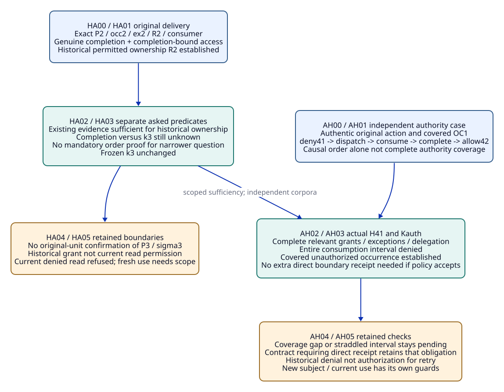
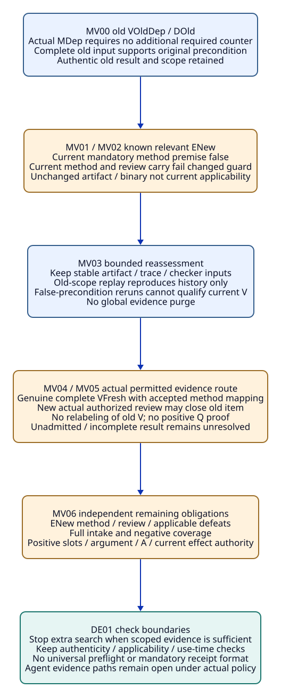

# SPDX-FileCopyrightText: 2026 tao3k team and Contributors
#
# SPDX-License-Identifier: LGPL-2.1-or-later

#+TITLE: 20.17 Sufficient Evidence and Bounded Revalidation
#+LANGUAGE: en
#+PROPERTY: JD_ID 20.17
#+OPTIONS: toc:3 num:nil
#+STARTUP: overview
#+TODO: OPEN SPECIFIED | QUALIFIED
#+FILETAGS: :gateway:sufficiency:revalidation:defensive-engineering:

[[file:../../00-09-project/00-documentation/00.01-index.org][Index]] | [[file:20.16-unknown-order-negative-dependencies-and-defensive-engineering.org][20.16 parent packets and DE01]] | [[file:../../10-19-design/10-architecture/10.07-claim-witness-reference-contracts.org][Existing claim / witness / T-V-A contracts]]

* SPECIFIED Existing owners and finite evidence questions
:PROPERTIES:
:CUSTOM_ID: sufficient-evidence-scope
:STATUS: author-specified-not-executed
:END:

This document expands DO05-access-only, CO02-closed-order and ND02-method.
HA, AH and MV label finite existing OracleInputSpec/OracleGoldSpec, CutSpec,
InputClosure, usage/T-use, VerificationRecord and ReviewDisposition inputs.
There is no new framework, receipt kind, evidence service, checker language,
authority protocol or scored Benchmark variant. DE01 remains the existing
cross-packet defensive-engineering case.

[[file:../../../.gerbil/pkg/github.com/tao3k/poo-flow-core/init.ss][The package-linked Core init]] supplies Module/Scenario selection boundaries.
gateway-domain owns claim/Profile/Scenario application and required obligations;
gateway-evidence owns evidence associations; original occurrence/exchange,
consumer/Host/authority and reviewer retain their actual capture, delivery,
permission, effect and disposition responsibilities. Selection is not provider
realization or permission. Package management resolves versions; source links
navigate package files rather than repeating revision shortcuts.

#+NAME: sufficient-evidence-common-input
| Existing input position | Complete requirement |
|-------------------------+----------------------|
| Parent materialization | Actual source/runtime/rules/declarations, factory/projection/mapping, ordered bodies, original captures, requests, evidence and consumer/method/authority/reviewer contracts; document links and aliases are not actual evidence |
| Scoped question | Exact subject, requested predicate, consumer/action and historical/current scope. An unrequested timing fact is not automatically a prerequisite of permitted historical delivery |
| I / G / CL | Each HAnn/AHnn/MVnn has independent I/G/CL; fixed oracle/semantic/authority/method worksheets precede candidate evaluation. Separate forks never combine incompatible premises |
| Frozen cut | Earlier immutable records and actual root/member/generation coverage; native capture precedes result, method input precedes result, review input precedes disposition, current-use cut precedes verdict. Exclude own future outcomes |
| Membership | Expected-present missing body is setup defect; deliberate absent work pending method; unknown binding/coverage pending scope; irrelevant requires a supported scoped reason |
| Sufficiency | Establish the existing required predicate from genuine applicable inputs. Do not require a newly invented record format or rerun solely because the same sufficient evidence arrived by another permitted route |
| Authenticity | Supplied result names remain conditional until actual bytes, issuer, authority, scope and completion/coverage are materialized; arrival time and candidate success labels supply none of these |

* SPECIFIED DO05-access-only: permitted historical delivery without cut order
:PROPERTIES:
:CUSTOM_ID: historical-access-sufficiency-packet
:PARENT_EVENT: DO05-access-only
:BQ_BINDINGS: BQ02 BQ03 BQ06 BQ08
:END:

#+NAME: historical-access-complete-input
| Position | Concrete input |
|----------+----------------|
| Original reset | Exact 20.16 DO factory Bsel/CPsel/P2/occ2/ex2/Nsel/RCsel/Kunit; B2 cap="2", expand=[L0], sigma2-qualified R2; authentic native P2 shows all three, native R1 union R2 six units; genuine prior permitted r2m ownership |
| Later query history | B3 cap="3", earlier native c3 then P3 then frozen review k3; actual R3 and native nine-unit checkpoint; external R3 ownership empty; k3 contains no LDu |
| Genuine late completion | Actual LDu binds complete r2u/r2g bodies, consumer reviewer-1, original occ2/ex2/P2/unit digests and Kunit. P2 precedes completion, completion precedes arrival aD, k3 precedes aD; completion versus k3 remains unknown |
| Existing historical access evidence AHist | Genuine existing authority/consumer evidence binds the same actual completion occurrence(s), principal, action, resource, tenant, policy and authority incarnation and establishes permitted completion in that scope. It need not compare the occurrence to k3 |
| Dropped premise | DO's unknown completion-time access is replaced by actual AHist. Its request-time allow alone is still insufficient; no new receipt schema is specified for AHist |
| Current state | Actual current revocation denies this read/reuse scope; no fresh current grant supplied. Historical permission evidence and current denial are independently bound and consistent |
| Asked question | Did reviewer-1 complete permitted receipt of these original R2 units? Historical original ownership is requested. Before-k3 completion and current P3 ownership are separately unestablished questions |

#+NAME: historical-access-step-gold
| Event / stage | Independently expected gold | Exact evidence / closure |
|---------------+-----------------------------+--------------------------|
| HA00 freeze original DO later view without AHist | Original physical delivery known; new qualified permitted ownership pending; before-k3 unknown, P3 ownership empty | CL-HA00 complete P2/P3/R1/R2/R3/Kunit/LDu and partial-order worksheet, actual current denial and missing historical-access position |
| HA01 supply genuine AHist at a later capture | Exact completion-time permission established for r2u/r2g; with prior r2m history, qualified historical original ownership=R2 | CL-HA01 actual completion/access subject join, issuer/policy/incarnation/coverage and later frozen input; no own future verdict |
| HA02 evaluate asked historical ownership | Existing LDu plus AHist is sufficient for this predicate. Do not leave it pending merely because completion-versus-k3 is unknown | CL-HA02 fixed independent ownership worksheet and original completion/access references; no new order receipt or duplicate native read required |
| HA03 ask before-k3 question separately | Still pending historical order; old k3 membership/gold unchanged. AHist does not fabricate a causal edge or insert LDu into k3 | CL-HA03 exact asked timing predicate and actual partial-order coverage; known unknown comparison retained |
| HA04 offer current P3 ownership/read | Old sigma2/ex2 does not confirm sigma3/ex3 units; unseen-current substitution RJ11. Current denied read refused within actual policy scope; history retained | CL-HA04 actual offered association and current consumer/access roots; no historical grant promoted to current authority |
| HA05 genuine later current-use companion | Fresh exact current access/use evidence may permit its own scope; P3 ownership still needs actual matching P3 completion unless actual existing provenance already covers it | CL-HA05 actual new grant/usage and any genuine P3 completion, no automatic retry or ownership transfer |

#+NAME: historical-access-forks
| Fork | Changed concrete input | Independent oracle decision |
|------+------------------------+-----------------------------|
| HA01-subset | AHist covers r2g only, r2u access unknown | Historical qualified owned={r2m,r2g}; r2u physical completion known but permitted ownership pending |
| HA01-request | Only request-time allow supplied instead of completion-bound evidence | Historical permission remains pending; no authenticity or policy coverage inferred |
| HA01-subject | Authentic access body covers another tenant/consumer/incarnation | Known offered mismatch refused; unknown subject binding pending; retain its real original scope |
| HA02-order-required | Actual requested consumer predicate explicitly requires completion before k3 | That stronger predicate remains pending until order supplied. It does not invalidate the narrower already established historical ownership |

#+CAPTION: Sufficient existing historical access or closed authority history answers its scoped question without mandatory new receipt formats.

[[file:../../90-99-views/90-architecture-views/90.43-historical-access-and-authority-sufficiency.d2][Editable D2 source]].

* SPECIFIED CO02-closed-order: denial from existing complete authority history
:PROPERTIES:
:CUSTOM_ID: authority-history-sufficiency-packet
:PARENT_EVENT: CO02-closed-order
:BQ_BINDINGS: BQ02 BQ04 BQ05 BQ06 BQ07 BQ08
:END:

#+NAME: authority-history-complete-input
| Position | Concrete input |
|----------+----------------|
| Independent reset | Genuine L0-only RL/EL/wL/TL/VL0/VMapL/MP0/HC and full original T-use; exact useLaw1/body/auth-1/reviewer-1/consume-L0/resource=(RL,dL,L0)/tenant-A/contextXsrc and genuine OC1 covering original completion/effect extent |
| Actual causal edges | Authenticated authority/Host evidence proves allow40 lookup -> deny41 effective -> dispatch -> actual consumption -> covered completion -> allow42 effective. Arrival of OC1 is later than kNew, which lacked OC1 |
| Relevant authority closure H41 | Actual existing authority contract Kauth and complete relevant grant/revoke/delegation/member/version coverage establish deny41 throughout the entire consumption interval before allow42. No grant or exception applying to this exact subject is omitted |
| Boundary coverage | Existing action/Host trace proves the actual consumption point or interval lies wholly inside that denied interval; causal order has the authority's genuine semantics, not guessed cross-host timestamps |
| No dedicated record | A separate direct boundary-version receipt is deliberately absent. Kauth permits the actual existing history/trace route to establish the same authority-at-use predicate; a dedicated receipt is not independently required by this input |
| Effect versus enforcement | Kauth defines permission and evidence coverage, not an asserted perfect fence preventing the observed action. Actual unauthorized occurrence can therefore coexist with normative denial |
| Other questions | OC1's uncovered effects, new useLaw2, compensation and current authorization remain absent/unknown as in 20.16; law V is not an operational grant |

#+NAME: authority-history-step-gold
| Event / stage | Independent expected gold | Closure addition |
|---------------+---------------------------+------------------|
| AH00 original CO view before complete order/history | Covered occurrence known; authority-at-use pending, no grant or violation yet | CL-AH00 full original law/action/OC1/Kauth and actual partial authority inputs, independent permission worksheet |
| AH01 genuine causal edges supplied | Actual consumption lies after deny41 and before allow42; time order known, but permission remains pending until relevant authority completeness established | CL-AH01 actual Host/authority causal subject joins and interval coverage; no fabricated empty grant set |
| AH02 actual H41 supplied | Complete relevant subject/interval authority coverage establishes deny41 at consumption. No dedicated boundary receipt needed for this contract | CL-AH02 actual grant/revoke/member/delegation/exception closure, issuer/incarnation/version semantics and independent comparison worksheet |
| AH03 evaluate original completion | Covered unauthorized occurrence/violation established; offered old allow40-based qualified permitted use RJ10. Retain truthful OC1 and frozen kNew | CL-AH03 earlier OC1/order/H41 and fresh review/current association; candidate label cannot decide authority |
| AH04 request another record or rerun | If the required predicate is already established, merely reformatting it as a new receipt or rerunning the old action supplies no missing premise and is not required | CL-AH04 exact asked predicate and existing sufficient references; execution/retry still requires independent actual authorization/effect safety |
| AH05 change subject or interval | Re-evaluate relevant affected scope. H41 may remain sufficient history for useLaw1; it does not prove authority for auth-2/useLaw2 or another tenant/resource | CL-AH05 actual new scope/current roots and required membership; unaffected historical records not deleted |

#+NAME: authority-history-forks
| Fork | Changed actual input | Independent oracle decision |
|------+----------------------+-----------------------------|
| AH02-gap | Grant/delegation/exception history incomplete or relevant authority member unknown | Authority-at-use pending; no known denial just from deny41 plus empty logs |
| AH02-straddle | Actual consumption interval crosses allow42, no precise sub-effect timing | Whole completion cannot be called entirely denied; qualify actual covered sub-effects only, remainder pending |
| AH02-policy | Actual Kauth independently requires a direct boundary record | History-only route insufficient for that policy; required record remains pending. No silent weakening to avoid a check |
| AH02-conflict | Conflicting authentic grant/deny inputs without authorized resolution | Preserve conflict/pending; no last-writer selection or invented definite violation |

* SPECIFIED ND02-method: inventory-dependent method result needs requalification
:PROPERTIES:
:CUSTOM_ID: dependent-method-requalification-packet
:PARENT_EVENT: ND02-method
:BQ_BINDINGS: BQ02 BQ03 BQ04 BQ05 BQ06 BQ07 BQ08
:END:

#+NAME: dependent-method-complete-input
| Position | Concrete input |
|----------+----------------|
| Independent old reset | Exact OH-counter/old artifact/map/raw17, ICounter={E+,ELateCounter}, actual complete old inventory kOld, genuine old rejected-invalid disposition DOld and complete old checker/replay result |
| Method-dependent companion | Replace 20.16's independent VOldInvalid premise with genuine VOldDep. Actual checker/method contract MDep declares no additional required P0/Q counter beyond ELateCounter in its named complete input domain as a precondition for this result's applicability |
| Old result scope | Genuine complete invalid-artifact outcome only in its exact method/input/assumption scope. It is not a positive Q satisfaction. Old absence condition true at kOld; original VOldDep/DOld/cuts immutable |
| Actual added member | Exact known required relevant ENew/oNewCounter/RNew/map/five factors from parent; genuine expanded projection raw23/P0 family19/one conflict and IExpanded={E+,ELateCounter,ENew} |
| Changed precondition | Analogous no-additional-member condition is false at expanded scope. Artifact bytes/checker binary may be unchanged, but method applicability and inventory-dependent review reason both changed |
| Current work | No genuine newly applicable method result, replacement review or ENew method/disposition supplied initially. Positive slots, argument/A and operational guards remain separate |
| Candidate evidence routes | Existing policy may admit a separately defined inventory-independent artifact validator or checked extraction/replay result. Actual definition/result/issuer/admission mapping must be supplied; an Agent cannot delete MDep's declared assumption by inspecting unchanged bytes |

A failed precondition is not an incomplete checker run and is not an established
invalid artifact in the new scope. Replaying kOld can reproduce an old result
without qualifying the expanded domain. Re-running an unchanged method with a
known-false mandatory precondition cannot manufacture a current applicable V.

#+NAME: dependent-method-step-gold
| Event / stage | Independent expected gold | Exact closure addition |
|---------------+---------------------------+------------------------|
| MV00 freeze genuine old method/review | VOldDep and DOld retain their authentic old result and scope; no expanded result exists | CL-MV00 exact old artifact/checker/contract/result/issuer, dependency manifest/complete old inventory and prior review references |
| MV01 supply known relevant ENew | Current mandatory method precondition and old reason condition false; raw bytes/history unchanged, new native capture genuine | CL-MV01 expanded actual member/relevance/domain/projection/negative comparison worksheet; no inference from mere discovery label |
| MV02 offer unchanged current VOldDep/DOld | Known stale applicability usage RJ10 when its required dependency is asserted unchanged. Both current method and review use need reassessment; actual old outcomes not retracted | CL-MV02 offered usage/required subject and exact old/new dependency comparison; no all-evidence purge |
| MV03 assess possible work | Reuse stable old artifact/trace/checker inputs where actual guards permit. Stop treating repeated old-scope replay or false-precondition rerun as a path to current qualification | CL-MV03 actual method definition and allowed evidence-policy routes, explicit changed/unchanged dependency worksheet |
| MV04 genuine alternative admitted result companion | Actual complete inventory-independent VFresh for old artifact may support current counter review only if the real method/reviewer policy admits its exact subject/result/extraction. It is a separate result, never a relabeling of VOldDep or positive Q proof | CL-MV04 actual method/input cut/result/issuer/scope and genuine policy/admission/mapping references, plus current root checks |
| MV05 actual authorized review companion | Genuine later DOldFresh may close old item only with applicable support and an allowed current reason; ENew still needs its own method/review and aggregate coverage | CL-MV05 earlier VFresh/current IExpanded/reason/policy/reviewer in review input, then later immutable disposition and fresh use |
| MV06 review remaining guards | Old item closure alone not clean P0. ENew unresolved review/possible defeat, full coverage, positive slots/argument/A and actual effect authority remain separately open | CL-MV06 full current member/review/negative coverage worksheet and explicit absent/unknown independent positions |

#+NAME: dependent-method-forks
| Fork | Concrete changed input | Independent oracle decision |
|------+------------------------+-----------------------------|
| MV01-unknown | Required relevance of new candidate not established | Method applicability pending, not known false precondition; no automatic member exclusion |
| MV03-replay | Genuine replay completes under exact old kOld | Historical reproduction only; no current expanded V or changed assumption discharge |
| MV04-unadmitted | Real validator result exists but method policy/admission mapping absent or forbidden | Unknown admission pending; known forbidden offered binding refused. Correct-looking artifact label does not substitute required method |
| MV04-incomplete | Alternative checker times out or fails to complete | Inconclusive/pending; not a complete invalid-artifact result and not a false-precondition verdict |
| MV05-old-reason | Current reviewer repeats false old no-additional-member condition | No supported current closure; preserve original history, request actual supported reassessment rather than arbitrary retries |

#+CAPTION: Actual dependency changes determine necessary method/review requalification; unchanged-scope replay and redundant checks supply no new current evidence.

[[file:../../90-99-views/90-architecture-views/90.44-dependent-method-and-check-boundaries.d2][Editable D2 source]].

* SPECIFIED DE01: evidence sufficiency and checks that remain necessary
:PROPERTIES:
:CUSTOM_ID: sufficient-evidence-check-boundaries
:END:

#+NAME: sufficient-evidence-check-review
| Concrete question | Existing evidence already sufficient when genuine and applicable | Check that must remain | Additional work not justified solely by this question |
|-------------------+-----------------------------------------------------------------+------------------------+--------------------------------------------------------|
| Historical permitted original-unit ownership | Exact LDu plus completion-bound AHist and prior permitted r2m history | Exact original unit/body/consumer/authority scope and actual issuer/coverage | Mandatory completion-versus-k3 evidence when that timing is not a premise of the asked predicate; duplicate native read |
| Denial at actual old consumption | Complete H41 plus authentic causal/Host interval evidence under Kauth | Relevant grant/delegation/exception completeness, exact action/incarnation and interval coverage | A new direct boundary receipt format when the actual contract already accepts this route |
| Current reuse of old method after ENew | Old result supplies historical method fact only; changed precondition does not qualify current use | Method dependency/current issuer/policy and subject checks, actual admitted alternative if used | Repeated old-scope replay or global artifact purge |
| Current operation or cache hit | Historical T/V/review/delivery evidence alone insufficient | Actual current-use authority/subject and necessary effect/coverage/race checks | Requiring an unrelated historical order fact to block separately permitted investigation |
| Aggregate clean-scope claim | Complete current required intake/review/positive slots and no applicable defeat under existing finite rules | Negative/aggregate coverage and all independently required guards | Treating a new supported old-item disposition as global success |

This review allocates each check to its existing obligation and owner; it does
not add a new universal preflight gate. Established sufficient evidence stops
that specific search. Missing evidence keeps its specific use pending or refused
as actually known. Required authenticity, applicability, authority-at-use and
coverage cannot be removed merely to reduce check count. Agent exploration and
implementation choices remain open within the existing graph constraints.

If a current mutable root can change between check and use, an earlier check or
cache hit is not a use-time guarantee. Actual existing authority semantics and
necessary consumption-bound checks remain required. No check-elimination,
performance or concurrency claim follows from these paper packets.

* SPECIFIED Reference closure and three independent change paths
:PROPERTIES:
:CUSTOM_ID: sufficient-evidence-reference-closure
:END:

#+NAME: sufficient-evidence-reference-birth
| Earlier actual records | Later association / independent worksheet | Forbidden inference or cycle |
|------------------------+--------------------------------------------+------------------------------|
| P2/native capture, exact R2, Kunit, LDu, AHist/authority scope | Later HA review input and ownership usage about original occurrence | No invented k3 order edge, no insertion into old k3, no current P3 ownership |
| Original law/action/OC1, actual causal edges and H41/Kauth/issuer/member coverage | Later AH authority-at-use result; then package review | No new boundary record required unless actual contract requires it; no future result in origin cut |
| Old artifact/MDep/dependency/domain/result and old DOld | MV current-use comparison with actual IExpanded | No deletion of old historical result, no removal of declared premise by aliasing |
| Genuine alternative method definition/policy and earlier checker input | Later actual VFresh, then later review input, then DOldFresh | No method acceptance from candidate result label; review cut cannot contain its own future disposition |
| Prior dispositions, actual current intake/negative/issuer/consumer roots | Later current uses and aggregate verdict | No aggregate result or future A included in its own cut; old item closure not full positive/argument/effect authority |
| Earlier I/G/CL and fixed independent oracle worksheets | Later review of actual candidate/native/method/use outcomes | Candidate output never generates gold; old frozen inputs/gold not rewritten |

T binds actual bytes/capture and exact use association; V binds actual method,
subject, assumptions, completed result and issuer; A binds actual argument and
its admitted premises. Historical access or authority-history reasoning is not
a new native V/A kind. Unprojected checker/review/permission records do not create
new raw ASCENT facts or native T receipts merely by existing.

#+NAME: sufficient-evidence-three-paths
| Independent path | Existing sufficient evidence / limitation | Checks retained and bounded affected work |
|------------------+--------------------------------------------+------------------------------------------|
| C-CAP: C1 to C2 | HA may close historical P2 ownership without k3 order; AH may decide old action denial. Neither proves Pcap or authorizes C2 use | Recheck exact property/application/method/intake changes; AppCap/new Q/CorrCap/PerfCap and actual C2 current authority remain; requalify only dependency-affected old method/review uses |
| C-CACHE: enable cache | Actual same-scope cached immutable result may support its original predicate; no old completion/grant transfers tenant/hit authority | Check Sk/Kk/Z1{cacheOwner}/Pcache/CacheAuth, relevant new counter/negative domains and complete U-cache. Retain necessary at-hit authority/race/effect checks, avoid unrelated full reruns |
| C-SOURCE: S0 to S1 | Law or artifact bytes may remain reusable in exact method scope; S0 historical completion/authority not S1 correspondence | Actual source/interpretation/assumption changes determine affected method/review work; Corr1/new application/Q/ASrc and current intake/source mapping/authority remain |

#+NAME: sufficient-evidence-assumption-audit
| Assumption | Concrete discriminator | Design boundary / actual qualification still needed |
|------------+------------------------+----------------------------------------------------|
| OA01 owner | HA01 exact completion / AH exact action | Same bytes/native ID not consumer/action/incarnation binding |
| OA02 genuine inputs | AHist/H41/VFresh | Materialize actual records and policy; no emitted receipt claimed |
| OA03 state | AH02-gap / MV04-incomplete | Pending authority/run/admission differs from known false precondition or forbidden use |
| OA04 coverage | AH interval / HA subset | Complete relevant authority and actual unit/effect extent, not record count |
| OA05 order | HA02 vs HA03 | Historical permission can be established without global-cut comparison; stronger timing question remains open |
| OA06 reuse | MV02/MV03 | Reuse stable inputs, requalify changed assumptions; old replay not current proof |
| OA07 proposition | VFresh / AH03 | Counter artifact validation not positive Q; actual denial not blanket theorem falsity |
| OA08 opposing | MV06 | ENew remains required while unresolved; one old-item closure not full intake |
| OA09 native | HA P2/P3 checkpoint | Native shown/acknowledged remains separate from permitted original-unit completion |
| OA10 evaluation | DE01 check review | Existing 24 scored variants unchanged; no runtime/check-elimination/performance pass |
| OA11 method | MDep false precondition | Cannot rerun into applicability; alternate method needs real accepted scope/mapping |
| OA12 effects | AH04 / current operation | Sufficient historical reasoning no authorization for replaying operation or safe retry |
| OA13 policy | AH02-policy / MV04-unadmitted | Use existing sufficient routes only where actual contracts accept them; no waived mandatory evidence |
| OA14 currentness | HA current denial / mutable-root use | Historical qualification not a fresh grant; actual use-time checks retained |
| OA15 consistency | Independent family resets | Do not import dropped parent premises; resolve actual contradictory records without last-writer selection |

* OPEN Qualification handoff
:PROPERTIES:
:CUSTOM_ID: sufficient-evidence-handoff
:END:

- [ ] Materialize actual completion-bound access records and complete authority/causal interval coverage with independent worksheets.
- [ ] Inspect genuine old method dependency declarations and actual admissible alternative method/review policy; retain false-precondition and incomplete-run distinctions.
- [ ] Instantiate required current-use/race, coverage and source/tenant/property guards for all three paths without adding universal checks.
- [ ] Qualify independent oracle/native/QNT/Lean and actual operational behavior in later implementation work; preserve old failed/pending evidence.

Only English Org and paired D2/SVG are authored here. These packets specify
reviewable sufficiency and remaining obligations; they implement no runtime,
oracle, checker, transport, authority or defensive-check optimization and supply
no passing execution/formal/performance/operational receipt.

* SPECIFIED Policy-required checks refinement
:PROPERTIES:
:CUSTOM_ID: sufficient-evidence-policy-child
:END:

[[file:20.18-policy-required-checks-and-evidence-admission.org][20.18]] expands HA02-order-required, AH02-policy and MV04-unadmitted.
It distinguishes actual policy requirements, pending required evidence and
refused offered associations while preserving genuine original evidence.
Original parent gold remains frozen.
