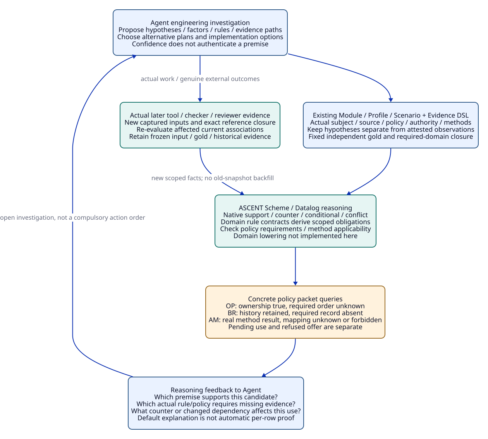
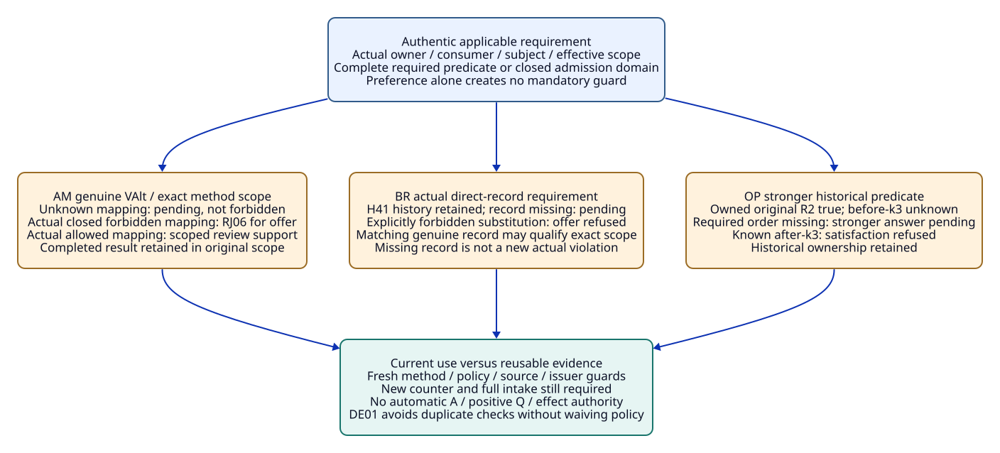

# SPDX-FileCopyrightText: 2026 tao3k team and Contributors
#
# SPDX-License-Identifier: LGPL-2.1-or-later

#+TITLE: 20.18 Policy-Required Checks and Evidence Admission
#+LANGUAGE: en
#+PROPERTY: JD_ID 20.18
#+OPTIONS: toc:3 num:nil
#+STARTUP: overview
#+TODO: OPEN SPECIFIED | QUALIFIED
#+FILETAGS: :gateway:policy:admission:reasoning:

[[file:../../00-09-project/00-documentation/00.01-index.org][Index]] | [[file:20.17-sufficient-evidence-and-bounded-revalidation.org][20.17 parent packets]] | [[file:../../10-19-design/10-architecture/10.08-engineering-library-and-rust-trajectories.org][Shared engineering Library and Rust trajectories]]

* SPECIFIED ASCENT inference, Agent discovery and existing ownership
:PROPERTIES:
:CUSTOM_ID: policy-admission-scope
:STATUS: author-specified-not-executed
:END:

This document expands HA02-order-required, AH02-policy and MV04-unadmitted.
OP, BR and AM are finite views of existing OracleInputSpec/OracleGoldSpec,
CutSpec, InputClosure, usage/T-use, VerificationRecord and ReviewDisposition.
It adds no framework, registry, admission engine, receipt kind or scored MB case.

The Agent proposes engineering hypotheses, relationships and evidence paths.
ASCENT's Scheme/Datalog program expresses scoped relations and derivations over
supplied facts. Its actual Evidence DSL and query sources ground this design;
the gateway domain obligations below are finite rule contracts, not implemented
native relations. Existing Module/Profile/Scenario, gateway-domain,
gateway-evidence, occurrence/exchange, consumer/Host/authority and reviewer
ownership remains unchanged. Their genuine external premises are not created
by a model's confidence or by a rule firing.

#+NAME: policy-admission-input-contract
| Existing field | Required input |
|----------------+----------------|
| Complete parent closure | Actual parent source/runtime/rules, factory/maps/ordered bodies, original captures and evidence, method/authority/reviewer contracts. Materialize bodies; a document link is not evidence |
| Required policy | Authentic applicable consumer/authority/method policy, issuer/owner, exact action/subject/effective scope and actual dependency manifest; no requirement inferred from Agent preference |
| Policy state | Missing expected-present body is setup defect; unknown policy/admission coverage remains pending. Absence is forbidden only under actual closed policy/allowlist semantics and complete relevant membership |
| Stage I/G/CL | Every OPnn/BRnn/AMnn has separate independent I/G/CL and fixed semantic/policy/oracle worksheet; forks reset premises rather than combining contradictory policies |
| Capture | Prior records enter later cuts; no own future result, disposition, usage verdict or gold in its own cut. Frozen older inputs/gold do not change when policy or evidence arrives |
| Current use | Policy's effective time/scope distinguishes historical facts from current admissibility. Current policy cannot invent a past violation or rewrite the original authority state |

* SPECIFIED HA02-order-required: stronger historical predicate
:PROPERTIES:
:CUSTOM_ID: order-policy-packet
:PARENT_EVENT: HA02-order-required
:END:

#+NAME: order-policy-complete-input
| Position | Concrete input |
|----------+----------------|
| Exact original evidence | Full 20.17 HA parent P2/occ2/ex2/B2 cap="2"/sigma2/R2/Kunit, actual LDu covering r2u/r2g and completion-bound AHist; prior permitted r2m history. These establish qualified historical original-unit ownership=R2 |
| Other snapshot | Earlier native c3 then P3 then frozen review k3, B3 cap="3"/sigma3/R3, native nine-unit checkpoint, no actual R3 external completion. k3 has no LDu member |
| Known ordering | P2 precedes original completion; completion precedes aD, k3 precedes aD; comparison of original completion to k3 unknown |
| Actual consumer policy POrder | Authenticated existing consumer policy explicitly requires both permitted original delivery and completion before the exact k3 capture for the requested historical consumer predicate. Its required domain enumerates these two premises |
| Current access | Actual current read denial retained. The stronger requested predicate and historical ownership do not supply current display/execution authority |
| Open evidence | Real completion-before-k3 causal evidence deliberately absent. LDu/AHist are genuine scoped inputs; no new order-receipt format is mandated |

#+NAME: order-policy-step-gold
| Event | Independent expected relations / gold | Closure addition |
|-------+---------------------------------------+------------------|
| OP00 supply actual parent history | Historical owned R2 established; timing unknown. No stronger policy verdict yet | CL-OP00 actual P2/P3/R2/R3/Kunit/LDu/AHist/capture and independent unit/access/order worksheet |
| OP01 supply authentic POrder and requested predicate | Required guard domain includes before-k3; historical ownership true, order unknown => stronger predicate pending | CL-OP01 actual consumer/policy/owner/effective scope and complete required premise inventory |
| OP02 query missing support | Missing evidence is actual causal relation for completion versus k3; duplicate native reading or another access proof does not discharge it | CL-OP02 exact required predicate and current support/missing-member worksheet, no candidate-generated gold |
| OP03 genuine before-k3 companion | Stronger historical predicate may establish with exact authentic causal evidence; k3 membership/gold stays frozen | CL-OP03 actual new order evidence in later input; no backfill into old cut |
| OP04 genuine after-k3 companion | Stronger predicate known false; offered claim of satisfaction refused. Narrower historical permitted ownership retained; no fabricated unauthorized delivery | CL-OP04 genuine opposing order and exact offered claim; separate input from OP03 |
| OP05 change or withdraw requested policy | Later authentic policy/query change gets a new capture/use. Narrower predicate may be answerable without timing; old pending/false gold unchanged | CL-OP05 actual authorized policy/query scope and current access roots; Agent cannot waive POrder |

#+NAME: order-policy-forks
| Fork | Changed actual input | Independent decision |
|------+----------------------+----------------------|
| OP01-role | Agent or unqualified reviewer asserts an extra check without authentic policy | No new required policy established. Existing scoped answer remains; unknown actual policy remains pending if required |
| OP01-missing | POrder body marked expected-present but missing | Setup defect, not semantic pending that could be scored as a valid policy decision |
| OP03-other-cut | Real order establishes before k2, not required k3 | No substitution without actual causal relation; stronger predicate pending or known mismatch as actual facts support |
| OP05-current | Current policy adds timing requirement after original delivery | New requested admission assessed under its own scope; past permission/ownership not retroactively erased |

* SPECIFIED AH02-policy: real direct-record requirement
:PROPERTIES:
:CUSTOM_ID: boundary-record-policy-packet
:PARENT_EVENT: AH02-policy
:END:

#+NAME: boundary-policy-complete-input
| Position | Concrete input |
|----------+----------------|
| Independent original action | Exact 20.17 AH genuine RL/TL/VL0/VMapL/full T-use, useLaw1/auth-1/reviewer-1/consume-L0/resource=(RL,dL,L0)/tenant-A/Xsrc and OC1 covered completion |
| Actual history support | Genuine H41 relevant grant/revoke/delegation/exception coverage and actual causal order deny41 -> dispatch -> consumption -> covered completion -> allow42; original kNew lacked OC1 |
| Changed policy companion | Actual Kauth evidence/admission clauses additionally require a direct consumption-bound record for the requested policy-qualified authority verdict. Permission-state semantics and evidence-admission conditions are separately retained |
| Deliberate absent member | Required direct record RBoundary absent; no claim it exists or must use a newly invented format. Actual policy defines required subject/incarnation/boundary/issuer/coverage |
| Meaning boundary | History-derived denial candidate and authentic covered occurrence retained; history-only support does not satisfy this policy-qualified verdict. Missing direct evidence itself is not a new unauthorized operational occurrence |
| Open work | No new action, retry, compensation or fresh current grant follows. Historical input bodies and genuine history remain reusable in their exact permitted scopes |

#+NAME: boundary-policy-step-gold
| Event | Independent expected relations / gold | Closure addition |
|-------+---------------------------------------+------------------|
| BR00 original history/OC1 supplied | History supports denied-interval reasoning and covered occurrence; no new direct record manufactured | CL-BR00 complete old subject/H41/Kauth semantic clauses/OC1/order/effect extent and independent worksheet |
| BR01 authentic stricter admission clauses supplied | Required record coverage incomplete => policy-qualified verdict pending. Preserve history-derived candidate, not a qualified result under these clauses | CL-BR01 actual policy issuer/effective scope/required direct-record domain; RBoundary deliberately absent |
| BR02 offer history-only route as satisfying all clauses | Known unsupported route binding refused when policy explicitly forbids substitution; required-record work still pending. One refused offer does not invalidate authentic H41 | CL-BR02 exact offered use, actual closed substitution policy and required member state |
| BR03 actual matching RBoundary companion | Exact valid direct record plus all other actual guards may qualify requested verdict; no extra duplicate format required | CL-BR03 actual record/body/issuer/action/incarnation/boundary/coverage and later captured use |
| BR04 actual wrong/contradictory record companion | Known wrong subject/issuer offered association refused; unknown binding pending; contradictory genuine history/record preserved for authorized resolution, no last-writer result | CL-BR04 actual original record scope, offered mapping and conflict/policy resolution state |
| BR05 record unavailable / authorized policy change | Unavailable required record leaves this verdict pending; genuine authorized later policy change may allow another route in a new capture. Do not weaken old policy/gold or execute a retry to generate history | CL-BR05 actual availability or policy-change authority/effective scope and current usage |

#+NAME: boundary-policy-forks
| Fork | Changed actual input | Independent decision |
|------+----------------------+----------------------|
| BR01-unknown | Direct-record requirement or effective scope unknown | Policy binding pending; do not assert either extra obligation or history-only admission |
| BR02-advice | Mere preferred record style, no actual mandatory policy clause | Do not promote preference to a required guard; apply actual accepted sufficient history route |
| BR03-partial | Record covers only one sub-effect/boundary | Qualify only covered scope; remaining required coverage pending |
| BR05-retroactive | New current policy offered as proof the historical action violated a new old-time requirement | Refuse unsupported temporal binding; real original authority facts retained |

* SPECIFIED MV04-unadmitted: genuine method result versus allowed use
:PROPERTIES:
:CUSTOM_ID: method-admission-policy-packet
:PARENT_EVENT: MV04-unadmitted
:END:

#+NAME: method-admission-complete-input
| Position | Concrete input |
|----------+----------------|
| Independent reset | Exact parent old artifact/VOldDep/DOld/MDep and complete old kOld inventory; known required ENew makes old mandatory absence premise false at IExpanded; raw23/P0 family19/one conflict |
| Actual alternative result | Genuine complete inventory-independent VAlt for exact old artifact/subject, actual method MAlt/input/trace/extraction/checker/result-kind/issuer. It is a real invalid-artifact validation result, not a positive P0/Q satisfaction |
| Required consumer use | Current old-counter review under exact IExpanded, current reviewer/method policy/required method scope. A result existing is not an accepted mapping into that obligation |
| Main unknown route | Admission mapping for MAlt into this exact review obligation is unknown; actual policy/member coverage needed to decide allow/forbid is absent or incomplete. No closed-world prohibition inferred |
| Known forbidden companion | Separate authentic closed policy explicitly forbids this exact MAlt/issuer/result use, or complete allowlist with genuine closed semantics excludes it. Do not mix with main unknown input |
| Other open obligations | Old current review reassessment, ENew method/review, aggregate/negative coverage, positive slots/argument/A and actual operational authority remain distinct |

#+NAME: method-admission-step-gold
| Event | Independent expected relations / gold | Closure addition |
|-------+---------------------------------------+------------------|
| AM00 genuine VAlt supplied | Preserve actual completed method fact in its real scope; cannot relabel old VOldDep or infer accepted current method mapping | CL-AM00 full artifact/MAlt/input/result/issuer/extraction plus old/new inventory/method dependency worksheet |
| AM01 query actual admission with unknown mapping | Current VAlt-use pending admission; not known forbidden and not admitted. Required old current review remains unresolved | CL-AM01 exact required consumer/obligation/policy/domain/member coverage and explicitly unknown mapping |
| AM02 known forbidden-policy companion | Offered current binding refused, RJ06 for actual forbidden method/issuer association. Genuine VAlt and stable inputs retained; no reason to rerun same checker to obtain permission | CL-AM02 actual closed forbidden/allowlist semantics, completeness and exact offered association |
| AM03 actual allowed mapping companion | Authentic applicable method/issuer/subject/result/extraction mapping may qualify this particular review support; still no positive Q satisfaction or automatically closed review | CL-AM03 actual admitted route/policy owner/effective scope and all required current guards in later capture |
| AM04 actual supported authorized review | Genuine later disposition may close old item only with admitted support and allowed reason. ENew and other aggregate/argument/use obligations remain pending as actually supplied | CL-AM04 prior qualified support/current intake in earlier review cut, then actual disposition and later usage |
| AM05 policy/source/issuer changes before reuse | Retain historical VAlt/disposition; reassess affected current mapping. Known stale use RJ10, unknown current policy pending; no broad evidence deletion | CL-AM05 actual changed roots/dependencies and fresh usage; old input/gold immutable |

#+NAME: method-admission-forks
| Fork | Changed actual input | Independent decision |
|------+----------------------+----------------------|
| AM01-open-list | MAlt absent from incomplete or nonexhaustive list | Pending mapping, no prohibition by absence |
| AM02-other-scope | Genuine ban concerns another consumer/target/issuer | Cannot infer this use forbidden without actual scope match; current mapping pending or allowed as independently supplied |
| AM03-role | Agent confidence or reviewer role string replaces actual admission authority | No accepted mapping; known forged association refused, unknown authority pending |
| AM03-incomplete | Actual checker did not complete | Pending method as well as any unresolved admission; never a completed invalid-artifact result |

* SPECIFIED DE01 rule trajectory: policy requirement versus redundant defense
:PROPERTIES:
:CUSTOM_ID: policy-rule-trajectory
:END:

[[file:../../../.gerbil/pkg/github.com/tao3k/gerbil-ascent/evidence/interface.ss][define-evidence]] binds ordinary Scheme constructors to native programs with
source/output relation handles. [[file:../../../.gerbil/pkg/github.com/tao3k/gerbil-ascent/python/src/ascent/clue_query_rules.ss][Existing clue rules]] distinguish attested
observations, hypotheses, support/counter/conflict and shown relations. The
following is a paper specialization of existing guard/review contracts, not
implemented new source schemas or executable rules.

#+NAME: policy-rule-derivation-contract
| Existing relation meaning / rule premise | Finite consequence | Packet discriminator |
|------------------------------------------+--------------------+----------------------|
| Authentic applicable policy requires predicate p for use u | p belongs to u's required guard domain | OP01 timing, BR01 direct record, AM01 admission mapping |
| Actual fact establishes a narrower predicate q | q remains established in its scope; no inferred stronger p | Historical ownership true while before-k3 pending |
| Required p unknown, complete evidence not supplied | Specific use pending; no automatic forbidden actual event | OP02, BR01, AM01 |
| Known policy forbids offered mapping or supplied fact contradicts asserted required guard | Offered association refused; retain actual original evidence | OP04, BR02, AM02 |
| Actual closed policy admits exact route and every required guard matches | Route may support its scoped candidate, not automatically A or operational permission | BR03, AM03/AM04 |
| Preference for duplicate check lacks actual required predicate | No new mandatory guard; reuse sufficient applicable existing evidence | BR02-advice and DE01 |
| Policy/member/source root changes | Re-evaluate dependent current uses and aggregates; frozen facts/gold retained | OP05, BR05, AM05 |

The Agent can propose predicates, engineering factors, rules and alternative
investigations. ASCENT can evaluate represented relations and expose gaps or
conflicts; external checker/reviewer/authority inputs determine whether those
premises are genuine. It does not derive trust from an Agent's own assertion.
The actual [[file:../../../.gerbil/pkg/github.com/tao3k/gerbil-ascent/evidence/declaration.ss][default explanation]] reports recorded declaration dependencies, not
per-row proof lineage. Exact per-conclusion support/cut closure here is an
explicit review contract, not a claimed existing automatic proof-trace feature.

#+CAPTION: Agent proposals and genuine inputs feed existing inference; derived requirements expose specific evidence gaps while alternative investigation remains open.

[[file:../../90-99-views/90-architecture-views/90.45-policy-requirements-and-agent-inference.d2][Editable D2 source]].

* SPECIFIED Typed closure, reuse and three independent paths
:PROPERTIES:
:CUSTOM_ID: policy-admission-closures
:END:

#+NAME: policy-admission-reference-closure
| Family | Earlier actual roots / T-V-A | Required use and retained scope |
|--------+------------------------------+---------------------------------|
| OP | P2/P3 native/T/body/unit captures, genuine original completion/access and exact policy/query roots, later actual order if supplied | Owned historical delivery retained; stronger before-k3 guard separately evaluated; old k3 never gains late member; no new V/A or current grant |
| BR | Original law/T/V/full usage, OC1/H41/causal/authority semantics and exact admission clauses, actual direct record if supplied | Candidate denial reasoning preserved; policy-qualified use requires actual clauses; no invented record, past violation or current effect grant |
| AM | Actual old/new factory/intake, old dependency/result, MAlt/VAlt/extraction/issuer plus admission domain/mapping and later reviewer roots | Actual V retained even when offered use refused; current mapped support differs from new disposition, aggregate/A or operational authority |
| Later review / cut | Earlier I/G/CL/fixed independent worksheet and actual inputs/results; method input -> V -> review input -> disposition -> current cut -> use verdict | No future verdict/disposition in its own origin; no candidate-derived gold; policy changes create later uses, not rewritten old outcomes |

#+NAME: policy-admission-three-paths
| Independent change | Required policy versus evidence reuse | Still required |
|--------------------+----------------------------------------+----------------|
| C-CAP: C1 to C2 | Exact Pcap consumer may require timing/direct records or method mapping; only authentic scope establishes that requirement. Old P0/body evidence retains original use, no copied acceptance | AppCap/new Q/CorrCap/PerfCap, actual C2 intake/argument/current authority; unresolved stronger policy scoped to actual consumer |
| C-CACHE: enable cache | Cached body/result may reuse exact subject; tenant/hit/owner/Sk/Kk/Z1/Pcache/CacheAuth policy can require different boundary or method evidence. No ban from an incomplete admission list | Complete U-cache/security/resource/permission/frame/current at-hit guards; no extra global replay merely for a record style preference |
| C-SOURCE: S0 to S1 | Source/interpretation/method/issuer changes can change mapping and required review; old S0 historical facts remain, current S1 acceptance rechecked | Corr1/new application/Q/ASrc, actual source mapping, current intake/argument/authority; no retrospective rewriting of S0 policy |

#+NAME: policy-admission-assumption-audit
| Assumption | Concrete discriminator | Bounded design outcome |
|------------+------------------------+------------------------|
| OA01 owner | All policy/consumer/action joins | Scope and authority, not role/native ID |
| OA02 actual | POrder/Kauth/MAlt/VAlt bodies | Conditional inputs require authentic actual records |
| OA03 states | OP01-missing / AM01 | Setup defect, pending and known forbidden distinct |
| OA04 coverage | BR03-partial / AM01-open-list | No all-clear or closed prohibition from partial domain |
| OA05 time | OP03/OP05 / BR05-retroactive | Historical order, policy effective scope and arrival separate |
| OA06 reuse | BR02/AM02 refusal | Refused association does not delete genuine evidence |
| OA07 proposition | OP04/AM03 | False stronger predicate not unauthorized delivery; validation not positive Q |
| OA08 opposing | AM04 | Required ENew retained while old support admitted |
| OA09 native | Policy-rule table | Domain rules not existing native admission implementation |
| OA10 evaluation | Three child families | Existing 24 MB cases unchanged; no scored run |
| OA11 method | AM03-incomplete | Incomplete result differs from genuine but unadmitted result |
| OA12 completion | BR missing direct record | Missing evidence not a new actual violation or effect |
| OA13 policy | BR02-advice / AM02 | Actual mandatory/closed policy needed; preference no extra guard |
| OA14 currentness | AM05 | Current mapping rechecked, old result/history retained |
| OA15 consistency | BR04 | Preserve contradictory genuine inputs; authorized resolution, no last-writer choice |

#+CAPTION: Pending requirements and refused offered bindings coexist without erasing genuine evidence or completing unrelated guards.

[[file:../../90-99-views/90-architecture-views/90.46-required-policy-and-admission-outcomes.d2][Editable D2 source]].

* OPEN Qualification handoff
:PROPERTIES:
:CUSTOM_ID: policy-admission-handoff
:END:

- [ ] Materialize actual policy ownership/effective scope, required predicate domains, closed admission semantics and real evidence bodies.
- [ ] Qualify stronger historical predicates, policy-qualified authority verdicts and method use independently across all three paths.
- [ ] Evaluate actual ASCENT/domain lowering, per-conclusion support and independent oracle without claiming recorded-only explanation is proof lineage.
- [ ] Perform native/QNT/Lean/operational qualification in later implementation work; retain historical failed/pending/refused outcomes.

Only English Org and D2/SVG are authored. No gateway, rule-engine extension,
oracle, checker, authority service or protective mechanism is implemented here.
