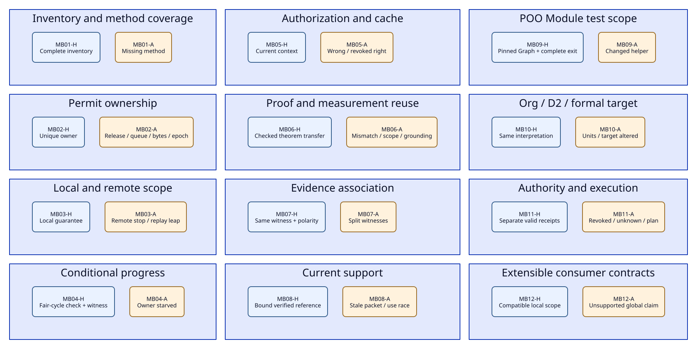

# SPDX-FileCopyrightText: 2026 tao3k team and Contributors
#
# SPDX-License-Identifier: LGPL-2.1-only

#+TITLE: 30.02 Minimal Gateway Benchmark and GAP01-GAP12 Convergence Contract
#+LANGUAGE: en
#+PROPERTY: JD_ID 30.02
#+OPTIONS: toc:3 num:nil
#+STARTUP: overview
#+TODO: OPEN REVIEW | QUALIFIED
#+FILETAGS: :evaluation:gateway:oracle:

[[file:30.01-benchmark-design.org][Evaluation framework]] | [[file:../../40-49-research/40-reference-studies/40.02-selected-system-and-proof-case.org][Selected reference dossier]] | [[file:../../10-19-design/10-architecture/10.04-evidence-driven-workflow.org][ASCENT/QNT architecture]] | [[file:../../20-29-cases/20-gateway/20.02-gateway-obligation-ledger.org][Gateway ledger]]

* Objective and actual status
:PROPERTIES:
:CUSTOM_ID: minimal-benchmark-scope
:STATUS: specified-not-implemented
:END:

#+CAPTION: The fixed evaluation cohort contains twelve paired families and twenty-four contracts.

[[file:../../90-99-views/90-architecture-views/90.06-benchmark-variants.d2][D2 source]]; [[file:../../90-99-views/90-architecture-views/90.01-index.org][paired Org/D2 maintenance contract]].

Make the existing Library model falsifiable with a small, exact cohort. Check
engineering claims, obligations, change impact, evidence-driven reasoning and
admission without importing Specula's architecture or a TLAPS-based production
workflow. The cohort derives from our POO Library, ASCENT evidence associations,
SMP application discipline and gateway claim/consumer boundaries. External research
can prompt review questions; it is not the authority for oracle gold or a
required gateway dependency. See [[file:30.04-oracle-review-data-contracts.org::#framework-owned-evaluation][framework ownership and research separation]]. New protocol models are authored in QNT, checked through the established
TLC backend path, and paired with independent semantics and Lean/native evidence
where required. No model, oracle, harness, task manifest or score is implemented
or executed by this document.

Convergence below means explicit inputs, responsible owners, discriminator cases
and exit receipts. It does not mean the twelve gaps have already passed. Design
specification, finite qualification, source correspondence and deployed acceptance
retain separate statuses.

The [[file:30.03-gateway-variant-contracts.org][24 detailed variant contracts]] specify each input, expected evidence,
independent oracle, proposed QNT property and reuse/invalidation condition.
The [[file:../../10-19-design/10-architecture/10.05-agent-reasoning-and-design-convergence.org::#benchmark-product-boundary][fixed cohort measures evidence behavior]]; it does not define the Agent's
hypothesis space or prescribe investigation order.

* Freeze a small engineering workload
:PROPERTIES:
:CUSTOM_ID: pilot-profile
:STATUS: proposed-frozen-profile-v1
:END:

#+NAME: pilot-finite-profile
| Dimension | Initial proposed finite scope | Interpretation boundary |
|-----------+-------------------------------+-------------------------|
| Gateway replicas | One local replica; two process incarnations, at most one restart | Local ownership and remote outstanding work remain separate |
| Requests and attempts | Two logical request slots, two attempt slots per request per incarnation | Attempt identity includes request, slot and incarnation; no business-key deduplication |
| Queue / local attempt caps | Q = 1, C = 1 | Real guards must preserve these bounds |
| Request-buffer budget | Two abstract byte units, per-attempt weights fixed in the fixture | Arithmetic model only; no claim about real bytes or RSS |
| Authorization | Two tenants; three principals, including two differently permitted principals in one tenant; two routes | Catch tenant-only cache/context assumptions |
| Policy and evidence epochs | Two versions of policy, source and rule context | Exercise replacement, expiry and same-count/different-content reads |
| Timing | Explicit deadline/expiry/cancellation events and declared order | No real-time latency guarantee without clock/mapping work |
| Faults | Delayed/lost response, duplicate callback, one cancellation, partition/expiry and restart where selected | Each case declares its enabled fault subset |
| Continuation | Stop new admissions after the two-request workload; allow remaining completion/cleanup and stuttering | No arbitrary depth cutoff may silently become a liveness guarantee |

Finite identity domains are checker scope, not production constraints. Distinguish
model-defined guards from enumeration constraints. For temporal checks, justify
that any cutoff/reduction does not create or remove the claimed fair behavior;
otherwise mark that result inconclusive. Start without symmetry or view reduction
that could erase principal, attempt, epoch or callback distinctions.

Every instance fixes property, selected actions, weak/strong fairness, initial
state, enabled faults and required observations. A reachable trigger and a fair
witness are mandatory for a claimed progress result. Fairness belongs to specific
actions/owners; generic worker fairness cannot justify every request's cleanup.

* Independent oracle contract
:PROPERTIES:
:CUSTOM_ID: independent-oracles
:STATUS: proposed
:END:

#+NAME: oracle-register
| Oracle ID | Independent definition / input | Required disagreement controls |
|-----------+--------------------------------+--------------------------------|
| O1 obligation/coverage | Reviewer-authored exact required property/method/origin sets from fixed requirements, hazards and contracts | Remove one required method with unchanged row count; omit a hazard; add an unjustified requirement |
| O2 resource state | Explicit per-attempt owner records and event history; occupancy counts actual active records instead of trusting the tested free counter | Duplicate release, repeated business key, wrong epoch, queued cancel and unaccounted buffer |
| O3 trace relation | Reviewed allowed pre/post transition relation plus event schema and explicit stuttering policy | Delete/reorder/duplicate an event; change its principal, attempt or source mapping |
| O4 progress | Independently enumerated finite graph with reachable-trigger and fair-cycle checks, plus reviewed fairness contract | Remove per-owner fairness, replace completion by no-op, provide an unsatisfiable antecedent |
| O5 evidence applicability | Independent relational/set expectation keyed by exact observation ID/digest and source/contract/premise tuple | Split factors across witnesses, hide counterevidence, use old receipt, acknowledge unseen output |
| O6 admission/authority | Aitia-owned method and decision policy interpreted against frozen required slots and exact scope | Role substituted for authorization, planning substituted for Host receipt, expired policy/monitor |

The [[file:30.04-oracle-review-data-contracts.org::#oracle-packet-contract][30.04 review records]] bind independent inputs/gold, judgment stages, reference
closures and cuts. Its [[file:30.04-oracle-review-data-contracts.org::#dc-mb-bindings][24-row binding table]] and [[file:30.04-oracle-review-data-contracts.org::#oracle-gap-dispositions][12-gap review]] preserve the
additional semantic evidence required beyond DC metadata contracts.

O2/O3/O4 are semantic specifications for a future simple reference checker, not
code delivered here. Their author must not copy the optimized evaluator or derive
expected transitions from its emitted results. Review the reference independently
and seed intentional faults on both sides. Lean can certify appropriate reference
laws; do not assume its relation to source or QNT without the explicit bridge.

For C = 1, initial free count 1 and no owners: acquire(a) gives owner {a}/free 0;
release(a) gives no owners/free 1; a duplicate release(a) must leave that state
unchanged or be refused. An implementation giving free 2 disagrees with O2 even
if a set of business keys still looks bounded. This is a paper expectation,
not a trace executed in this repository.

A positive QNT/TLC result and positive reference TLA/TLC result share a backend.
They are not independent O4 evidence. The bridge must also compare reviewed
observations against an independent finite semantics and declared assumptions.
Similarly, expected obligations cannot be the same ASCENT rule result relabeled
as gold. Future native event mapping and actual execution evidence remain required
for source/runtime claims.

** Concrete evidence-view expectations

Fix question P = the local permit-property claim revision, context G2, cap = 1.
Observation identity is the pair ID/digest. The association selector requires both
context and cap on that same pair. These are paper fixtures for O5, not fabricated
production receipts. A native positive-control test must obtain real applicable
verification/admission references through the existing owner path.

#+NAME: evidence-oracle-fixtures
| Fixture | Bound input | Independently expected observation |
|---------+-------------+------------------------------------|
| EV01 | o1/d1 is an applicable attested support observation for P, with G2 and cap 1 | Eligible witness set {o1/d1}; local support contains that pair; no whole-gateway acceptance follows |
| EV02 | EV01 plus o2/d2, an applicable attested counter observation for the same P/context | Both polarities and their distinct references remain; conflict is visible and requires resolution |
| EV03 | o1/d1 has cap 1/G1; o2/d2 has cap 2/G2; both share claim label P | Eligible conjunction-witness set is empty; do not manufacture cap 1/G2 or conclude global absence |
| EV04 | o3/d3 proposes P as a hypothesis with matching factors but no attestation | Conditional hypothesis may be returned; it cannot populate admitted support |
| EV05 | Source changes to G3 while o1/d1 retains only its G2 receipt | Current G3 support excludes that old receipt; history remains; an explicit G3 question has unknown support if no current positive/counter evidence exists |
| EV06 | Only part of a claim family is displayed, with other detail retained but unseen | No full-family acknowledgement or absence conclusion; deeper reads remain available |
| EV07 | Same event count but changed prefix content | Prior prefix-bound packet is stale; no unchanged-view verdict from count equality |

For EV03, distinguish selector eligibility from the clue evaluator's unknown row:
if the selector produces no question, an empty output is not an unknown/disproof
verdict. If a caller explicitly asks P with no eligible current evidence, unknown
is the appropriate local query outcome. O5 grades these stages separately. This is a scoped applicability expectation:
the generic native claim-level read does not automatically apply selector-factor
filters. If old/malformed records keep the same broad claim string, its raw
read can still return support; the domain must check canonical claim/envelope
bindings or refuse that application. The [[file:../../20-29-cases/20-gateway/20.04-query-and-change-fixtures.org::#q2-same-witness][exact Q2 fixture]] and [[file:../../10-19-design/10-architecture/10.07-claim-witness-reference-contracts.org::#independent-contract-oracles][OC/OW oracle contracts]]
make this boundary explicit.

EV05's read hints and evidence admissions are separate: clearing a hint cannot
erase history, and retaining a hint cannot preserve invalid support. EV02 records
opposition even when it prevents a clean current result; the benchmark never
rewards hiding contrary observations to reduce output cost.

* Minimal fixed cohort: twelve families, twenty-four variants
:PROPERTIES:
:CUSTOM_ID: minimal-case-cohort
:STATUS: tabletop-selection
:END:

Each MB family has exactly two preselected variants: H is a valid control under
explicit premises; A changes one documented boundary or defect. Freeze exact
inputs, expected verdict, required output set and all oracle obligations before
execution. Multi-check variants require every named subcheck. The two variants
are separate task IDs; a family closes only when both behave as expected.

#+NAME: minimal-gateway-cases
| Family | H control | A discriminator and expected response | Oracles / covered concerns |
|--------+-----------+---------------------------------------+----------------------------|
| MB01 inventory | Independently expected baseline 16 lineage set plus exact required method slots | Drop a threat/method while preserving displayed count; O1 mismatch blocks closure | O1; GAP01/GAP12 |
| MB02 ownership | Acquire/release with unique attempt and incarnation preserves cap/accounting | Duplicate release or merge two attempts by business key; reject resource claim with exact witness | O2/O3; GAP02/GAP03 |
| MB03 local versus remote | Local teardown result is admitted only for local resources | Timeout while remote work remains; remote-stop/global execution claim stays unsupported | O2/O3/O6; GAP04 |
| MB04 conditional progress | Reachable request plus satisfiable per-owner cleanup fairness and a valid completion transition | Remove cleanup fairness; progress must not be accepted, with fair-cycle discriminator | O3/O4; GAP03/GAP08 |
| MB05 policy/cache | Fresh policy and sufficient principal/role/tenant context authorize a hit | Same-tenant wrong-principal cache hit after policy change; refuse authorization and reopen affected obligations | O1/O3/O6; GAP02/GAP07/GAP09 |
| MB06 justified transport | A parameterized proof has checked stability/frame and unchanged interpretation | Reuse an old concrete measurement after cap/workload change; refuse that admission | O1/O5/O6; GAP02/GAP10 |
| MB07 evidence association | All factors on one attested observation; support and counterevidence retain their own references | Split matching factors over two witnesses; no invented support and preserve unknown/counterevidence | O5; GAP01/GAP09 |
| MB08 concurrent revision | Current source/contract/prefix and a verified result reference agree | Old task returns after replacement or same-count changed prefix; retain history and refuse current support | O5/O6; GAP06 |
| MB09 Module/test selection | Correct selected Graph, helper/test closure, nonempty suite and natural completion | Add/edit a selected helper/test during work; currentness refusal; no old passing admission | O1/O3/O6; GAP05/GAP06 |
| MB10 projection/target | IDs, units, relation planes, claim and premise interpretation match canonical context | Same IDs with altered units/authority relation or weakened target; refuse semantic/target binding | O1/O3/O5; GAP03/GAP09 |
| MB11 role/monitor/effect | Current reviewer authority, applicable monitor and actual authorized effect receipt where required | Role revoked or monitor unavailable; pure plan cannot substitute for current authority/effect | O6; GAP07/GAP08/GAP11 |
| MB12 composition/evolution | Reviewed local contract, coverage and consumer scope remain applicable | Add strict global claim without coordination design; reopen compatibility and block stronger operational claim | O1/O5/O6; GAP01/GAP10/GAP11/GAP12 |

A diagnosis or correct refusal is task success when it matches the frozen expected
outcome. An adverse case must not be scored as failed simply because it exposes a
real gap. Conversely, model completion without the expected verdict is not success.

Use additional mandatory mechanism controls within the relevant task contract:
MB04 must also reject a completion no-op and a vacuous antecedent; MB07 preserves
opposing evidence and admits no hidden-family read; MB09 checks empty selection
and unselected poison; MB10 checks duplicate keys, unsupported enums and altered
canonical dependencies. These are required acceptance assertions, not extra scored
rows that can inflate the denominator. If their input variation requires distinct
runs, record subcase IDs and close the parent only when all finish as expected.

Optional reference qualification is reported outside this 24-variant gateway score and is not a prerequisite for framework-native variants:
RS is the Specula scenario's source/trace/replay qualification, currently blocked
on its missing exact native inputs; RT is the selected CommitLiveness unit/context
and its finite progress/witness/adverse controls. No reference run or inferred
whole-module score is counted as gateway performance.

* Evidence interaction and change endpoints
:PROPERTIES:
:CUSTOM_ID: evidence-endpoints
:STATUS: proposed
:END:

The candidate path uses existing ASCENT Evidence declarations, Session/Clue
exchange, currentness checks and Trajectory. For each task bind the question,
source/rules, interpretation, observation ID/digest, applicable method result,
contract and scope. Read-hint/checkpoint identity is separate from support validity.

#+NAME: evidence-endpoint-contract
| Endpoint | Independent observation required |
|----------+----------------------------------|
| Query | Support, counterevidence, conditional/unknown and expandable references are truthful for the selected context |
| Conjunction | Every factor uses one compatible witness; no cross-run join manufactures a valid experiment |
| Withdrawal | A source/policy/method change revokes dependent current support, preserving historical artifacts |
| Reuse | Current applicability or certified transfer is checked; unchanged row count alone is irrelevant |
| Read continuation | Scope changes do not retract other evidence; partial display does not acknowledge unseen detail |
| Decision | Required methods, coverage, objections and authority are checked on the final current target |
| Effect | Aitia/Host boundary requires actual current authorization and execution evidence |

An Agent may invent a hypothesis absent from the initial evidence window or repeat
an experiment intentionally. The benchmark does not force a query sequence, rank
hypotheses, treat unknown as contradiction or inspect private reasoning. Score
observable claims, queries, source use, discriminating experiments and justified
outcomes. Missing interface discovery is a measured integration issue, not a
reason to inject task answers into tool descriptions.

* Resource envelope and optional Agent pilot
:PROPERTIES:
:CUSTOM_ID: pilot-budgets
:STATUS: proposed-no-runs
:END:

Initial component-run envelope: one worker, 2 GiB memory and 60 seconds per finite
checker invocation; source preparation/compilation is measured separately and
bound to the target. These are predeclared pilot limits, not observed requirements.
An unchanged timeout remains a nonpass at that budget. Changing a bound or budget
creates a new protocol/profile; never replace the original receipt. Require real
exploration progress and natural completion, not synthetic heartbeat output.

Only after framework-component and independent-oracle qualification, compare two narrow Agent
tasks: repair the double-release design and reassess a cache/policy revision.
The control has the same tools and raw sources; the intervention additionally
exposes the composed Library and current ASCENT evidence/reuse interface. Keep
underlying source information equivalent and report interface/setup costs.

Proposed pilot: two tasks x two arms x three paired repetitions = twelve sessions.
Randomize order and use the same model/settings for each pair. Per-session limits
are 600 seconds, 20 external tool calls, six checker invocations and 20,000
provider-accounted generated tokens where enforceable. If usage cannot be observed
or bounded, retain the run with that limitation outside a strict token-matched
comparison. No model calls are made by this plan.

Measure first-attempt justified completion, post-change correctness, false reuse,
observed discovery/use, intentional versus unjustified repetition, new falsifiable
hypotheses, source/method work, and total cost across all evidence epochs. Include
failed checks, setup, corrections and verifier work. Twelve sessions are a pilot,
not proof of general Agent benefit or a production speedup.

* GAP01-GAP12: explicit convergence criteria
:PROPERTIES:
:CUSTOM_ID: gap-convergence
:STATUS: all-qualification-gates-open
:END:

#+NAME: gap-convergence-matrix
| Gap | Domain owner and concrete exit artifact | Discriminator / pilot coverage | Remaining limit after a finite pass |
|-----+-----------------------------------------+--------------------------------+------------------------------------|
| GAP01 coverage | Domain reviewer: requirements/threat/interface inventory mapped to exact required methods and reviewed omissions | O1; MB01/MB07/MB12 | Review scope can omit real-world hazards; new hazards reopen it |
| GAP02 dependencies | Domain/ASCENT integration: complete positive/negative/aggregate registration or conservative fallback plus checked transfer footprint | O1/O2/O5; MB02/MB05/MB06 | Opaque external effects still require broad invalidation |
| GAP03 source correspondence | Model/source owner: property/action/trace mapping and source-bound controls | O2/O3/O4; MB02/MB04/MB10, RS/RT | Finite trace agreement is not universal source refinement |
| GAP04 remote completion | Gateway/backend owner: separate local/remote contracts with confirmed completion protocol for any stronger claim | O3/O6; MB03 | Without backend cooperation, remote execution bound remains unaccepted |
| GAP05 selection/completion | Core/domain owner: selected coverage/currentness and full process exit receipts | O1/O6; MB09 | Does not qualify unselected Modules or later changed sources |
| GAP06 currentness race | ASCENT/Aitia/Host integration: old-task and prefix-change refusal at ingestion, consumption and effect boundary | O5/O6; MB08/MB09 | Distributed enforcement requires actual Host integration |
| GAP07 authority | Aitia authority owner: principal/action/resource/context/policy decision binding and revocation checks | O6; MB05/MB11 | Evidence support and a role assignment still do not grant execution |
| GAP08 monitor/timing | Operations owner: clock/lag/unknown contract and bounded response protocol | O4/O6; MB04/MB11 | No real-time response guarantee without actual timing/environment evidence |
| GAP09 projection semantics | Domain/adapter owner: typed canonical mapping and round-trip/negative controls | O1/O3/O5; MB05/MB07/MB10 | No equivalence for unrepresented prose or unsupported types |
| GAP10 Library consumers | Library/consumer owner: explicit strengthening/compatibility and changed-consumer review | O1/O5; MB06/MB12 | New consumers and environments require new applicability checks |
| GAP11 plan-to-effect | Aitia/Host owner: current admission, authorization, fenced execution and actual receipt | O6; MB11/MB12 | Open Host effect gates cannot be closed by a model or plan result |
| GAP12 evaluation validity | Independent evaluator: frozen cohort/oracles/scorer, exposure/budget audit, full results and scope report | All oracles; all MB families | A pilot cannot establish general efficacy, native correctness or external novelty |

The [[file:../../20-29-cases/20-gateway/20.03-gateway-design-audit.org::#audit-gap-disposition][current audit dispositions]] refine every row and add S01-S18
reset subcontrols. Each parent includes its required subcontrols under AND
acceptance; missing/inconclusive work is unqualified, not an omitted denominator.
A reachable trigger and fair witness do not replace complete fair-cycle analysis.

No row is marked qualified here. Completion requires the named artifacts and the
relevant positive/adverse/unknown controls, reviewed under exact identities. Design
review can approve this convergence plan without pretending to close native or
operational gates. A row may remain intentionally out of scope only through an
explicit contract decision retaining the corresponding unaccepted claim.

* OPEN Design-to-qualification handoff :evaluation:
:PROPERTIES:
:CUSTOM_ID: minimal-open-work
:STATUS: open
:END:

- [ ] Review the selected finite profile and MB01-MB12 exact input/expected-output contracts.
- [ ] Assign independent oracle authors/reviewers and actual Aitia/Core owners.
- [ ] Keep optional RS/RT research qualification separate; qualify external bindings only for cases explicitly importing those assets.
- [ ] Specify QNT/compiler/TLC and Lean/native correspondence for this pilot.
- [ ] Freeze method slots, clock/fairness, budget, scoring and result-record semantics.
- [ ] Qualify component and boundary controls before the optional Agent pilot.
- [ ] Produce actual source/authority/effect receipts before any operational closure claim.
