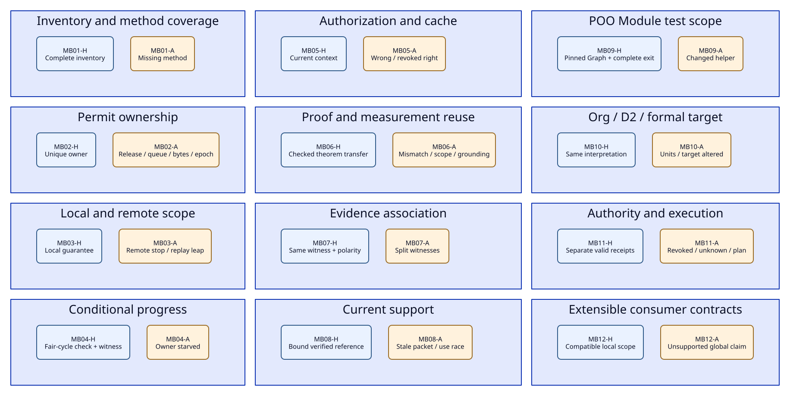
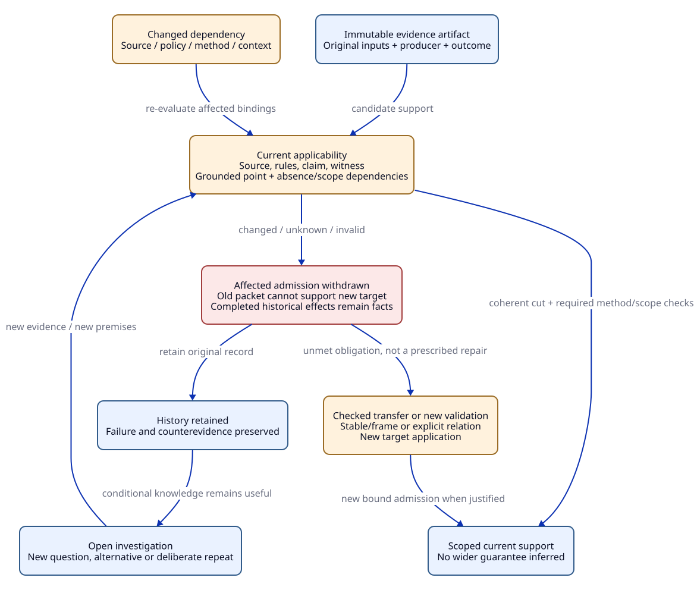

# SPDX-FileCopyrightText: 2026 tao3k team and Contributors
#
# SPDX-License-Identifier: LGPL-2.1-or-later

#+TITLE: 30.03 Gateway Benchmark: Twenty-Four Variant Contracts
#+LANGUAGE: en
#+PROPERTY: JD_ID 30.03
#+OPTIONS: toc:3 num:nil
#+STARTUP: overview
#+TODO: OPEN REVIEW | QUALIFIED
#+FILETAGS: :evaluation:gateway:variants:

[[file:30.02-gateway-minimal-benchmark.org][Pilot envelope and oracles]] | [[file:../../10-19-design/10-architecture/10.05-agent-reasoning-and-design-convergence.org][Reasoning and design convergence]] | [[file:../../90-99-views/90-architecture-views/90.01-index.org][Org/D2 correspondence]]

The [[file:../../20-29-cases/20-gateway/20.03-gateway-design-audit.org][current design audit]] supplies exact source boundaries, reset subcontrols,
per-case review and the full lifecycle/gap disposition. The Audit constraints
field below is part of each proposed contract. No new top-level variants are added.

* Interpretation and shared inputs
:PROPERTIES:
:CUSTOM_ID: variant-contract
:STATUS: specified-not-executed
:END:

These are 24 explicit semantic fixtures, MB01-H through MB12-A. They are proposed
input/output contracts, not executable tests, fabricated receipts or passed
benchmarks. Proposed QNT property names below identify intended propositions;
no new QNT source or implemented export is supplied. Oracles O1-O6 retain their
independent definitions in the [[file:30.02-gateway-minimal-benchmark.org::#independent-oracles][pilot protocol]].

The [[file:30.04-oracle-review-data-contracts.org::#dc-mb-bindings][30.04 bindings]] map every variant to DC review obligations, exact judgment
stages and closure patterns while retaining its case-specific semantic oracles.
These are framework-owned gateway contracts. Optional external studies neither
supply expected outputs nor gate native variants. A mapping is not a result and
cannot copy P0's local A0 into all U0 obligations.

The fixed cases test the validity and usability of evidence. They do not prescribe
Agent query order, architecture, code structure or a finite set of hypotheses.
Valid alternative solutions may satisfy the same contract. A proposed contract
revision remains visible as a revision, rather than masquerading as proof of the
original target. Hypotheses can be explored before they have admitted support.

For adverse inputs, the healthy model must preserve its safety/admission invariant
by refusing, reporting uncertainty or withdrawing support. The designated faulty
companion omits a named guard or changes an action; it must expose the specified
violation. A correct refusal counts as a successful task outcome. A checker error,
timeout or unrelated failure is not the required counterexample.

#+NAME: variant-shared-context
| Symbol | Concrete fixture meaning |
|--------+--------------------------|
| X0 / X1 | Two immutable project design/source contexts with distinct content identities |
| K0 / K1 | Claim/contract interpretation revisions; same label alone cannot equate them |
| E0 / E1 | Process incarnations; callback/attempt identities include incarnation |
| a / b | Attempts (request r0, slot 0, E0) and (r0, slot 1, E0); same business key, distinct resources |
| a-new | Attempt (r0, slot 0, E1), distinct from a after restart |
| C / Q / B | Initial cap 1, queue cap 1, buffer budget 2 abstract units |
| pA / pB / pC | Principals: pA and pB in tenant t1, pC in t2; pA allowed private route, pB only public route |
| v0 / v1 | Policy revisions; v0 permits pA private, v1 revokes that permission |
| h0 / h1 | Different immutable event-prefix content identities, even when event counts coincide |
| o1/d1, o2/d2 | Distinct observation ID/digest pairs; no factor join across these pairs |
| m1 / m2 / mz | Proposed domain Module identities for resource, security and unselected poison fixture |
| f0 / fh0 / fh1 | Test input digest, original helper digest and changed helper digest |
| src0 / bin0 | Required exact source/artifact bindings; no actual implementation is supplied here |

Only declared fields change in a variant. Required unknown inputs remain unknown;
model booleans standing for verified external premises are abstractions and cannot
be emitted as real attestations. Native qualification must obtain genuine results
through existing ASCENT/Core/Aitia owners. Every evidence artifact must bind its
producer, inputs, method policy, outcome, completeness and intended scope.

** Exact obligation/method inventory for O1

Let U0 be the sixteen baseline lineages below. U-cache contains U0 plus GW-01.c;
U-global contains U0 plus GW-04.b. Membership is not the complete revision:
cache/global overrides also revise affected existing claims, origins and method
slots. Never retain old admission merely because a lineage stays in the set. Origin means an applicable rule/binding, not proof discharge.
Method slots are required independently: removing SC cannot be hidden by another
passing Q result. This table fixes the proposed benchmark's expected inventory;
its domain completeness still needs independent review.

#+NAME: variant-method-codes
| Code | Required evidence class |
|------+-------------------------|
| AR | Scoped architecture/compatibility argument |
| TR | Threat/security review |
| IR | Negative interface or fault/replay control |
| Q | Complete relevant QNT check and designated controls |
| L | Applicable Lean law/proof and its premises |
| SC | Exact source/model/observation correspondence |
| RR | Resource accounting plus pressure/fault measurement |
| PF | Matched workload/artifact/environment performance evidence |
| CR | Independent requirement/hazard/interface/method coverage review |
| RV | Role/applicability/tailoring review under the selected policy |

#+NAME: variant-required-inventory
| Lineage | Origin templates | Required slots |
|---------+------------------+----------------|
| GW-01.a | R01, R02 | TR, IR, SC |
| GW-01.b | R02 | Q, IR, SC |
| GW-02.a | R03 | L, Q, SC |
| GW-02.b | R03, R04 | Q, IR, SC |
| GW-02.c | R03 | Q, RR, SC |
| GW-02.d | R03; R07 additionally if cache selected | AR, RR, SC |
| GW-03.a | R04 | Q, IR, SC |
| GW-03.b | R01, R04 | AR, IR, SC |
| GW-03.c | R03, R04 | Q, IR, SC |
| GW-04.a | R05 | AR, Q, IR, SC |
| GW-05.a | R06 | Q, TR, IR, SC |
| GW-05.b | R02, R06 | Q, IR, SC |
| GW-06.a | R08 | PF |
| GW-06.b | R03, R08 | RR |
| GW-07.a | R09 | CR |
| GW-07.b | R10 | RV |
| GW-01.c, conditional | R07 | TR, IR, SC |
| GW-04.b, conditional | R05, explicit global claim | AR, L, Q, IR, SC |

** Reuse, source locks and owner mapping

Reuse always distinguishes an immutable artifact from its admission to a new
context. A same-source read additionally checks current source/rules, contract,
observation/digest, method, scope and prefix as relevant. A changed-context transfer
requires a justified relation and fresh target admission. Unknown footprint means
conservative invalidation; it is not proof of independence. Read acknowledgements
never discharge obligations.

#+NAME: variant-owner-map
| Families | Existing mechanisms to consume | Domain work still required |
|----------+--------------------------------+----------------------------|
| MB01/MB06/MB12 | Core POO composition/Profiles; Lean proof stability/frame; ASCENT support dependencies | Domain contracts, exact methods, compatibility and coverage |
| MB02/MB03/MB04 | SMP's source/QNT/ASCENT/native separation; native Core Cases | Gateway ownership, local/remote events and progress correspondence |
| MB05/MB10/MB11 | Core contextual Profiles and explicit execution; Aitia assurance/authority | Actual security/monitor/projection/Host integration |
| MB07/MB08 | ASCENT Evidence DSL, same-witness relations, currentness and Trajectory/read hints | Domain associations and actual Agent-visible discovery |
| MB09 | Core selected Graph, test/source projection, native std/test and Case policy | Gateway Module fixtures and genuine process evidence |

No new navigator, test runner, evidence database or authority mechanism is proposed.

* Variant map
:PROPERTIES:
:CUSTOM_ID: variant-map
:END:

#+CAPTION: The 24 fixtures are paired comparisons, not an Agent execution sequence.
#+NAME: variant-pairs-map

[[file:../../90-99-views/90-architecture-views/90.06-benchmark-variants.d2][D2 source]]. Node keys MB01_H etc. map to Org anchors mb01-h etc.

* Inventory and resource semantics

** MB01-H: complete baseline work inventory
:PROPERTIES:
:CUSTOM_ID: mb01-h
:CASE_ID: MB01-H
:STATUS: specified
:END:

- Input :: X0/K0 selects tenant authorization, bounded resources, replication, retry and role review; cache and strict-global claim are disabled. Supply U0 and exactly the method/origin table above. No implementation receipts exist.
- Expected evidence :: A completed inventory derivation with all sixteen lineages, exact methods/origins, explicit pending method slots and no claim of implementation acceptance. CR records its review scope rather than deriving its own completeness.
- Independent oracle :: O1 compares exact typed sets and applicability against its separately authored table; it does not consume the candidate's rows as gold.
- QNT property :: InventoryFaithful: a complete inventory view equals the reviewed expected set. NoPrematureAcceptance: a required pending method prevents scoped implementation acceptance. No fairness premise is needed for these safety properties.
- ASCENT reuse / invalidation :: Reuse the inventory only under identical selection/rules/contracts/review scope; evidence fragments remain separately scoped. Change of role, threat, template or method set invalidates inventory/CR and downstream decisions, preserving history.
- Design / later :: Set meanings and review requirements can converge now; actual rule admission, complete evaluation and independent coverage review remain unqualified.
- Audit constraints :: Freeze an inventory revision with applicability and per-slot origin supports, not only U0 membership. The fixture is a proposed gold specification awaiting independent review; see the audit coverage map. See [[file:../../20-29-cases/20-gateway/20.03-gateway-design-audit.org::#mb01-h-review][MB01-H review]].

** MB01-A: a missing method hidden by unchanged lineage count
:PROPERTIES:
:CUSTOM_ID: mb01-a
:CASE_ID: MB01-A
:STATUS: specified
:END:

- Input :: Same X0/U0, but the candidate removes SC from GW-02.a while still reporting sixteen lineages and complete coverage. O1's table is unchanged.
- Expected evidence :: Exact missing slot {(GW-02.a, SC)}, inventory disagreement and refusal of the completeness/implementation claim. Other correctly bound support is retained; the Agent may propose a reviewed change rather than silently rewriting the requirement.
- Independent oracle :: O1 independently detects the set difference despite equal lineage counts; O6 checks that the unresolved required slot blocks acceptance.
- QNT property :: RequiredMethodsPreserved: an accepted inventory contains every expected obligation/method pair. The ignore-method-set mutant must violate it; a healthy gate remains safe by withholding acceptance.
- ASCENT reuse / invalidation :: Prior mathematical evidence is not deleted. Revoke the faulty inventory/coverage admission and its consumers; do not copy a previous complete status to this altered method context.
- Design / later :: The mismatch is decidable on paper. Real derivation, policy and consumer invalidation still require integration tests.
- Audit constraints :: Also reject a removed hazard and an unjustified added method/origin in independent reset subcontrols. Completeness cannot be certified by the same derivation that is being graded. See [[file:../../20-29-cases/20-gateway/20.03-gateway-design-audit.org::#mb01-a-review][MB01-A review]].

** MB02-H: explicit permit ownership
:PROPERTIES:
:CUSTOM_ID: mb02-h
:CASE_ID: MB02-H
:STATUS: specified
:END:

- Input :: X0/E0, C=1, free=1, owners={}. Apply Acquire(a), Dispatch(a), LocalCloseConfirmed(a), Release(a). Every owner record has weight 1; no retry, restart or remote-stop claim is selected. Dispatch is a resource-plane observation here, not an authorization attestation.
- Expected evidence :: Ordered state/transition observations: owners {a}, free 0 after acquire; owners {}, free 1 after release. No acquisition lacks capacity and no release lacks an owned local resource.
- Independent oracle :: O2 counts owner records independently of free; O3 verifies guards, event order and the permitted local termination event.
- QNT property :: PermitConservation: free + cardinality(owners)=C, with 0<=free<=C; OwnershipSound: each allocation has one distinct attempt/incarnation owner. Check all modeled interleavings, not only this witness trace.
- ASCENT reuse / invalidation :: Source-bound permit-law and trace fragments may support the scoped local claim. Transition, cap, epoch interpretation, instrumented event or compiler changes reopen affected support; business-key equality is insufficient for reuse.
- Design / later :: Ownership events and arithmetic are specifiable now. QNT/Lean checks, callback atomicity and native allocation/source mapping remain later gates.
- Audit constraints :: Acquire, local-close marking and release are distinct linearizable transitions. Release requires owned AND locally closed; a failed acquire is unchanged state. Permit weights are not byte-allocation weights. See [[file:../../20-29-cases/20-gateway/20.03-gateway-design-audit.org::#mb02-h-review][MB02-H review]].

** MB02-A: duplicate release and collapsed attempt identity
:PROPERTIES:
:CUSTOM_ID: mb02-a
:CASE_ID: MB02-A
:STATUS: specified
:END:

- Input :: Extend MB02-H with a second Release(a) callback after the first. Required companion subcase uses a and b with the same business key but distinct attempt IDs; C remains 1, so b cannot allocate while a owns the permit.
- Expected evidence :: Healthy duplicate handling is refusal or unchanged owners {}, free 1. The faulty double-increment state free=2 is an exact counterexample. A business-key-only owner set must not hide two real allocations.
- Independent oracle :: O2 counts distinct allocation records and recognizes the duplicate; O3 rejects a nonexistent ownership transition.
- QNT property :: ReleaseIdempotent, OwnershipSound, FailedAcquireNoChange, QueueCancelConservation, RetainedBytesBound and IncarnationOwnership. Mutants double-release-adds-capacity and merge-attempt-by-business-key must violate the corresponding property with a bound trace.
- ASCENT reuse / invalidation :: Counterevidence is attached to the failing transition/source, not every future algorithm. A repaired release transition creates a new context; recheck affected laws/traces while retaining genuinely independent credential evidence.
- Design / later :: The forbidden state and identity contract converge now. Actual concurrent callback linearization and model/source correspondence require proof/native controls.
- Audit constraints :: The mandatory reset subcontrols include failed acquire, queued cancellation, retained-byte overflow and an E0 callback against E1 ownership. Exact starting states and expected results are in the audit subcontrol register. See [[file:../../20-29-cases/20-gateway/20.03-gateway-design-audit.org::#mb02-a-review][MB02-A review]].

** MB03-H: local completion with remote work still outstanding
:PROPERTIES:
:CUSTOM_ID: mb03-h
:CASE_ID: MB03-H
:STATUS: specified
:END:

- Input :: a owns a local permit and remoteRunning(a)=true. Apply LocalTimeout, CancelRequested, LocalCloseConfirmed, Release(a); remote completion has not been observed. The target claim covers local resources only.
- Expected evidence :: Local owners={}, free=1 and remote state still true or explicitly unknown under its observation contract. The local result supports the local claim; no remote-stop or exactly-once business claim is emitted.
- Independent oracle :: O2/O3 evaluate separate local-resource and remote-execution states; O6 limits admission to the claim's scope.
- QNT property :: LocalRemoteSeparated: local timeout/close/release alone cannot establish RemoteStopped; PermitConservation still holds. No assumption of eventual backend completion is introduced.
- ASCENT reuse / invalidation :: Keep local-lifecycle evidence applicable to this local property; reuse cannot widen it to a backend-execution limit. Backend protocol or observation semantics changes trigger new correspondence work.
- Design / later :: Local/remote contract separation converges now. Real transport termination and any stronger backend guarantee require execution evidence.
- Audit constraints :: Record remote truth in the reference model separately from observable remote knowledge. Missing acknowledgement yields unknown knowledge, even if the reference execution still has a remote worker. See [[file:../../20-29-cases/20-gateway/20.03-gateway-design-audit.org::#mb03-h-review][MB03-H review]].

** MB03-A: unsupported remote-stop inference
:PROPERTIES:
:CUSTOM_ID: mb03-a
:CASE_ID: MB03-A
:STATUS: specified
:END:

- Input :: Same observed sequence as MB03-H, but a candidate asserts RemoteStopped(a) and frees a global backend-execution slot solely because LocalTimeout occurred. No backend acknowledgement or fencing contract exists.
- Expected evidence :: Preserve the local result, expose the missing remote-completion premise and refuse the stronger claim. Do not turn absence of an acknowledgement into a proof of ongoing or stopped remote execution.
- Independent oracle :: O3 finds no remote completion event; O6 rejects scope amplification. O2 keeps any explicitly modeled remote ownership separate.
- QNT property :: RemoteAdmissionNeedsRemoteEvidence and ReplayRequiresBackendContract. The timeout-implies-remote-stop mutant violates it; a healthy view retains the missing premise without preventing new hypotheses.
- ASCENT reuse / invalidation :: The local receipt remains historical/current for its own scope as applicable. Withdraw global-limit admission depending on the false bridge; a later genuine backend protocol may enable a new scoped transfer.
- Design / later :: The invalid implication can be rejected by design review. Backend cancellation, acknowledgement, fencing and real remote-resource bounds cannot close without implementation.
- Audit constraints :: Add a lost-reply-after-commit non-idempotent replay subcontrol. Local release plus a fresh permit cannot establish that replay is safe; backend deduplication or idempotency remains an unmet premise. See [[file:../../20-29-cases/20-gateway/20.03-gateway-design-audit.org::#mb03-a-review][MB03-A review]].

* Progress, security and transfer

** MB04-H: conditional cleanup progress with a reachable trigger
:PROPERTIES:
:CUSTOM_ID: mb04-h
:CASE_ID: MB04-H
:STATUS: specified
:END:

- Input :: a owns a resource; cancellation requested; Cleanup(a) remains enabled until done; no new requests arrive after the finite workload. Require weak fairness for each continuously enabled Cleanup owner. Supply a reachable pending state and a complete fair witness that releases a.
- Expected evidence :: Trigger reachability and a fair witness establish non-vacuity only; the liveness verdict additionally requires complete reachable fair-cycle analysis showing no fair counterexample to eventual local release. Retain the enabling/termination assumptions; no wall-clock or backend-termination claim follows.
- Independent oracle :: O4 independently checks reachable fair cycles and the witness; O3 checks the completion transition actually removes ownership.
- QNT property :: PendingEnabledCleanupLeadsToRelease under the stated per-owner weak fairness. Also check NonVacuousPending and FairWitnessSatisfiesPremises; neither a disabled trigger nor impossible fairness may earn credit.
- ASCENT reuse / invalidation :: The progress result binds action semantics, fairness, scope, source and checker. Changing any of these invalidates progress admission, even if safety evidence remains reusable.
- Design / later :: Conditional progress and its assumptions are specifiable now. QNT liveness, fairness satisfiability and actual cleanup-enablement behavior remain to verify.
- Audit constraints :: An example fair run never proves universal liveness. Cleanup must remain enabled until a real ownership-removing transition; actions, stuttering and fairness are fixed for the full reachable continuation. See [[file:../../20-29-cases/20-gateway/20.03-gateway-design-audit.org::#mb04-h-review][MB04-H review]].

** MB04-A: aggregate fairness does not release a particular owner
:PROPERTIES:
:CUSTOM_ID: mb04-a
:CASE_ID: MB04-A
:STATUS: specified
:END:

- Input :: Keep a pending/enabled as above but remove its cleanup fairness. Another worker action toggles an unrelated bit forever; aggregate worker progress is satisfied. Required subcontrols make Cleanup a no-op and make the pending antecedent unreachable.
- Expected evidence :: For the primary case, a reachable lasso leaves a owned while other work progresses, so the unconditional per-owner claim is not admitted. The no-op control defeats real progress; the unreachable-trigger control is vacuous and must not qualify.
- Independent oracle :: O4 checks the actual fairness/action relation and fair cycle, not event counts. O3 catches a completion label with no release state change.
- QNT property :: PerOwnerProgressRequiresItsPremises; when checking the stronger unsupported liveness target, obtain its designated temporal counterexample. A gate mutant that accepts an aggregate-fair result as per-owner evidence violates ProgressAdmissionSound.
- ASCENT reuse / invalidation :: Retain the old conditional theorem with its premises, but withdraw its applicability here. The Agent may investigate another progress argument; the countertrace is not a permanent ban on the architecture.
- Design / later :: The premise mismatch converges on paper. Backend fairness compilation and real scheduler/cleanup correspondence still require tests.
- Audit constraints :: The no-op mutation has a reachable pending state and can satisfy fairness while retaining ownership forever. The unreachable-trigger subcontrol is separately scored as vacuous, never as a temporal counterexample. See [[file:../../20-29-cases/20-gateway/20.03-gateway-design-audit.org::#mb04-a-review][MB04-A review]].

** MB05-H: cache hit under current full authorization context
:PROPERTIES:
:CUSTOM_ID: mb05-h
:CASE_ID: MB05-H
:STATUS: specified
:END:

- Input :: X0 with cache selected; pA/t1 requests private route under valid v0. Cache key/context records the relevant principal/permission scope, route, content scope and policy interpretation. At hit use, v0 is still applicable.
- Expected evidence :: Matching authorization/key/version observations and U-cache inventory, including revised buffer/resource and revocation methods. The hit can support only the scoped allowed response; no implicit all-tenant equivalence.
- Independent oracle :: O1 checks new/changed method slots; O3/O6 independently evaluate pA's right to that content at hit time.
- QNT property :: ResponseRequiresCurrentAuthorization and CacheContextMatchesRequest. Parser/key computation and real policy verification are correspondence obligations, not assumed proved by these abstract checks.
- ASCENT reuse / invalidation :: Reuse applies only with identical relevant authorization/content/policy premises. New principal rights, policy, key function, cache expiry or buffer behavior reopens affected GW-01/02/05/06 support.
- Design / later :: Authorization and key scope can converge now; parser/security replay, revocation and memory/performance evidence require implementation.
- Audit constraints :: Use a complete request/content selector, including representation inputs admitted by the response contract. At-use authorization is an atomic/fenced applicability requirement; a stale successful lookup is insufficient. See [[file:../../20-29-cases/20-gateway/20.03-gateway-design-audit.org::#mb05-h-review][MB05-H review]].

** MB05-A: wrong-principal hit and policy revocation controls
:PROPERTIES:
:CUSTOM_ID: mb05-a
:CASE_ID: MB05-A
:STATUS: specified
:END:

- Input :: Primary: reuse pA's private response for pB/t1 under unchanged fresh v0 using a tenant-only key. Required separate subcase: same pA, but v1 has revoked private access before hit use. Vary one premise per subcase.
- Expected evidence :: Refuse the private response in both cases, identify the wrong principal/context or revoked policy, preserve any relevant cached artifact as data rather than authorization and reopen scoped security obligations.
- Independent oracle :: O3/O6 evaluate the fixed policy/principal table independently of the cache decision; O1 detects affected obligations.
- QNT property :: NoCrossPermissionResponse and CurrentPolicyAtUse. Ignore-principal and ignore-revocation mutants must violate their corresponding properties; a healthy model rejects the hits.
- ASCENT reuse / invalidation :: The old hit's receipt cannot authorize pB or v1. Retain old observations and applicable unrelated proofs; invalidate current hit/key-policy admission and consumer decisions.
- Design / later :: The invalid substitution is explicit now. Actual key construction, policy race and cache-hit enforcement need source/runtime tests.
- Audit constraints :: Reset before each principal/policy mutation. An extra cross-tenant substitution uses pC; resource and cache-invalidation checks remain independent of permission refusal. See [[file:../../20-29-cases/20-gateway/20.03-gateway-design-audit.org::#mb05-a-review][MB05-A review]].

** MB06-H: transport a parameterized proof, instantiate a new target
:PROPERTIES:
:CUSTOM_ID: mb06-h
:CASE_ID: MB06-H
:STATUS: specified
:END:

- Input :: Explicit profile override changes C=1 to C=2, within a declared finite {1,2} parameter scope. A candidate universal permit-conservation lemma has explicit transition/observation premises unchanged by this edit; the formal fixture supplies an external successful-verification premise. No actual checked lemma is asserted here.
- Expected evidence :: Keep the universal artifact and produce a checked application to the C=2 target with current premises. Concrete C=1 admissions are not relabeled; changed concrete model/performance obligations stay pending.
- Independent oracle :: O1/O5/O6 check theorem versus instance identity, typed stable/frame or transfer proof, new parameter application and current policy.
- QNT property :: TransferNeedsUnchangedSemanticDependencies and NewInstanceBindsNewCap. It models the transfer protocol with explicit proof-verification premises; only Lean checking establishes the mathematical transfer itself.
- ASCENT reuse / invalidation :: Reuse the theorem's supported fragment; issue a new target reference only after checked application. Changes to transitions, theorem interpretation, source correspondence, tool or method policy invalidate affected applicability.
- Design / later :: The distinction between universal artifact and concrete admission converges now. Actual Lean/frame verification and native applicability remain later gates.
- Audit constraints :: The universal artifact is distinct from its C=1 and C=2 applications. Lean stable/frame premises require an explicit Scheme/domain interpretation; the QNT gate models those external checks rather than proving them. See [[file:../../20-29-cases/20-gateway/20.03-gateway-design-audit.org::#mb06-h-review][MB06-H review]].

** MB06-A: measurement from another budget and workload
:PROPERTIES:
:CUSTOM_ID: mb06-a
:CASE_ID: MB06-A
:STATUS: specified
:END:

- Input :: Candidate submits a performance result meas0 measured on src0/bin0, C=1, workload W0, environment H0 as evidence for C=2/W1. No checked equivalence/measurement-transfer policy covers those changed inputs.
- Expected evidence :: Exact mismatch {cap, workload}; withhold the target performance admission while retaining meas0 as an observation of its original run. A compatible abstract theorem is evaluated separately.
- Independent oracle :: O5 compares full production/application bindings; O6 checks the method-specific transfer policy. O1 leaves PF required for the new target.
- QNT property :: MeasurementAdmissionMatchesContext, NegativeScopeInvalidates and NoUngroundedCyclicSupport. The compare-only-display-label mutant must violate it; proof transport cannot stand in for a required measurement.
- ASCENT reuse / invalidation :: Withdraw changed workload/cap performance support and dependent claims. Do not invalidate an independent law solely because a measurement expired; do not reuse that law as a latency result.
- Design / later :: The inapplicability is explicit now. New workload measurements, instrumentation scope and statistical sufficiency need actual runs.
- Audit constraints :: Separate cap-only, workload-only and combined mismatches. Add negative-scope insertion and cyclic-support/base-removal subcontrols; incomplete dependency registration must trigger conservative invalidation. See [[file:../../20-29-cases/20-gateway/20.03-gateway-design-audit.org::#mb06-a-review][MB06-A review]].

* Evidence-driven discovery and currentness

** MB07-H: one witness per conjunction, both polarities visible
:PROPERTIES:
:CUSTOM_ID: mb07-h
:CASE_ID: MB07-H
:STATUS: specified
:END:

- Input :: Explicit question P/K0 in X0 with cap 1. o1/d1 is a current attested support observation with factors {X0, cap 1}; o2/d2 is an applicable attested counter observation with the same interpretation. A third unverified proposal is a hypothesis.
- Expected evidence :: Support {o1/d1}, counterevidence {o2/d2}, visible conflict and conditional hypothesis, with distinct references and no automatic clean acceptance of P. Attestation binds a source/check result; conflicting results still need review.
- Independent oracle :: O5 computes the typed relation sets from explicit records and exact witness joins, independent of the native clue result. O6 preserves the unresolved conflict.
- QNT property :: SameWitnessAssociation, CounterevidenceVisible and HypothesisIsNotSupport. Local support and contrary evidence may coexist; unknown is not emitted as if neither were present.
- ASCENT reuse / invalidation :: Applicable fragments may be reused in their declared context; selective reads preserve opposite polarity. Changed witness bytes, source, rules, interpretation or verifier applicability revoke affected support, not history.
- Design / later :: Relation meanings and expected sets converge now. Native bindings, actual external attestation and Agent-visible progressive use require qualification.
- Audit constraints :: Attested means a producer/result binding, not the truth of P. Opposite results for the same proposition require a conflict investigation; do not admit both as resolved mathematical truth. See [[file:../../20-29-cases/20-gateway/20.03-gateway-design-audit.org::#mb07-h-review][MB07-H review]].

** MB07-A: no synthetic witness from split factors
:PROPERTIES:
:CUSTOM_ID: mb07-a
:CASE_ID: MB07-A
:STATUS: specified
:END:

- Input :: o1/d1 has {X1, cap 1}; o2/d2 has {X0, cap 2}; both carry claim label P. The requested conjunction is {X0, cap 1}. No current record has both. Required subcontrols suppress a counter record or attempt to acknowledge a partly displayed family.
- Expected evidence :: Eligible conjunction witnesses={}. An explicit question with no eligible positive/counter evidence remains locally unknown. If selection emits no question, empty output is not itself a disproof or unknown row. Preserve expandable records; no full-family acknowledgement for hidden detail.
- Independent oracle :: O5 independently grades selector eligibility, query outcome, polarity and read acknowledgement as different stages.
- QNT property :: SameWitnessAssociation, UnknownIsUnproved, CounterevidenceVisible, ReadAcknowledgesOnlyShown and HonestDisplayOrError. Join-by-claim, hide-counter and acknowledge-hidden mutants must violate their designated predicates.
- ASCENT reuse / invalidation :: Reuse individual records only under their own factors. A changed selector may reveal another useful record without globally retracting existing evidence. No cached conjunction may be forged across records. The [[file:../../10-19-design/10-architecture/10.06-poo-ascent-integration.org::#gateway-query-contract][native query mapping]] requires a separate applicability bridge: read_selected selects claims, not a guarantee that every returned witness matches all selector factors.
- Design / later :: The join error and open-world meaning converge now. Real selectors, native projection, partial-display handling and observable Agent continuation still need tests.
- Audit constraints :: Reset before split-witness, hidden-counter and partial-ack mutations. Capacity too small for an honest body/reference is an explicit display error, never unknown or evidence absence. See [[file:../../20-29-cases/20-gateway/20.03-gateway-design-audit.org::#mb07-a-review][MB07-A review]].

** MB08-H: current verified support under an unchanged prefix
:PROPERTIES:
:CUSTOM_ID: mb08-h
:CASE_ID: MB08-H
:STATUS: specified
:END:

- Input :: Query and consume a result for X0/K0 with source generation g0, rule revision R0 and prefix h0 of two events. Independent verification binds the same observation, contract and result reference. No dependencies change before use.
- Expected evidence :: A current scoped evidence reference and truthful same-context reuse; the packet, verification and original history remain linked. A read acknowledgement is reported separately from the evidence verdict.
- Independent oracle :: O5 compares source/rule/contract/witness/prefix bindings and verification state; O6 checks only the requested admission scope.
- QNT property :: CurrentEvidenceNeedsBoundVerification and PrefixContentBinding. Exploration-current status and Evidence Chain validity are separate checks, both required when relevant.
- ASCENT reuse / invalidation :: Same-context fragment reuse is allowed while every relevant binding and admission remains current. Read-hint eviction permits replay and does not erase evidence or SMP-style milestones.
- Design / later :: Binding/currentness semantics converge now. Actual interface, prefix integrity and atomic read/use integration need verification.
- Audit constraints :: Packet-prefix identity, Evidence Chain support and admission/authority currentness are separate conjuncts. Read-window reuse is not new evidence production or automatic arbitrary-DAG delta support. See [[file:../../20-29-cases/20-gateway/20.03-gateway-design-audit.org::#mb08-h-review][MB08-H review]].

** MB08-A: late result and same-count different-content packet
:PROPERTIES:
:CUSTOM_ID: mb08-a
:CASE_ID: MB08-A
:STATUS: specified
:END:

- Input :: Primary: start an X0/K0 attempt, replace sources with X1, then receive its completed X0 result. Independent subcase compares a retained h0 packet against another immutable prefix h1 with the same two-event count; original history is not rewritten.
- Expected evidence :: Preserve the old attempt/result as history and refuse current X1 support. Count equality cannot admit h0 as h1. Invalid hints cause explicit replay, not false no-change or deleted observations.
- Independent oracle :: O5 checks full identity and independent verification; O6 rechecks at ingestion/use. Original and later snapshots are compared without importing future evidence into an old prefix.
- QNT property :: NoStaleEvidenceReference, PrefixContentBinding, HistoryRetained and CoherentCutAtUse. Ignore-generation, compare-event-count-only and reset-history mutants produce the relevant counterexamples.
- ASCENT reuse / invalidation :: Source replacement revokes dependent current references and projections. Independent unchanged theorem fragments may be readmitted through checked transfer; mere result/row equality is insufficient. The Agent can still investigate the old attempt under its recorded conditions.
- Design / later :: The race policy converges now. Concurrent publication, real late-result handling and Host-boundary currentness require implementation tests.
- Audit constraints :: Add a change after successful validation but before consumption/effect. Require a coherent cut and version-fenced commit or an explicit unsupported race boundary; periodic rechecks alone do not close the race. See [[file:../../20-29-cases/20-gateway/20.03-gateway-design-audit.org::#mb08-a-review][MB08-A review]].

* Module and projection contracts

** MB09-H: selected Module tests with genuine complete execution
:PROPERTIES:
:CUSTOM_ID: mb09-h
:CASE_ID: MB09-H
:STATUS: specified
:END:

- Input :: Pinned Core PR 19 selected Graph whose complete module-order is {m1,m2}, with m1's selected test a-test.ss at f0 and helper at fh0; mz contains a poison body but is unselected. Projection chooses the normal suite (#f) or explicit integration suite. This committed API obtains the existing Graph; it does not promise the later uncommitted root-only/lazy Graph behavior. Selected sources remain unchanged through validation and final process exit.
- Expected evidence :: Exact selected owner/test/helper closure, no forced mz body, source-current checks and natural execution completion with exit 0. Actual result admissions need real native receipts; abstract true flags in a QNT fixture are not those receipts.
- Independent oracle :: O1 checks selection/coverage against declared input; O3 verifies execution/exit observations; O6 requires complete current evidence before acceptance.
- QNT property :: SelectedScopeOnly, SelectedSourcesCurrent and CompleteProcessRequired. These abstract source and exit observations; they do not prove the file observer or Gerbil runner correct.
- ASCENT reuse / invalidation :: A result depends on the selected Graph, test files, helpers, suite, toolchain and method policy. Unselected unrelated edits need not invalidate it under complete registration; hidden selected dependencies do.
- Design / later :: Scope/effect semantics converge now using Core's existing projection and Case mechanisms. Real discovery/currentness, poison isolation and full natural exit remain implementation gates.
- Audit constraints :: Freeze Module owner closure, suite, directory membership, helpers, compiler/private imports and method policy. Empty test discovery is a coverage gap even if an inert projection can be returned; natural exit 0 is necessary but not sufficient. See [[file:../../20-29-cases/20-gateway/20.03-gateway-design-audit.org::#mb09-h-review][MB09-H review]].

** MB09-A: a selected helper changes after projection
:PROPERTIES:
:CUSTOM_ID: mb09-a
:CASE_ID: MB09-A
:STATUS: specified
:END:

- Input :: Build MB09-H's projection, then change its selected helper from fh0 to fh1 during validation before final admission. Test path and file count are unchanged. Required subcontrols select an empty suite and explicitly request unselected mz.
- Expected evidence :: Refuse the stale selection/result; identify the changed helper. Empty selection cannot trigger an implicit directory scan; unselected mz cannot be accepted as a selected owner. Keep the original run record.
- Independent oracle :: O1 compares exact closure, not counts; O3/O6 check source revalidation and final completeness.
- QNT property :: SelectedSourcesCurrent and NoEmptySelectionFallback. Ignore-helper and skip-final-currentness mutants violate the corresponding safety predicate; a correct process with stale sources is not admitted as current.
- ASCENT reuse / invalidation :: Invalidate selected-test support and its covered admissions; preserve separate unaffected evidence only with complete dependency knowledge. New source context and real rerun/transfer are required.
- Design / later :: The dependency and empty-selection contracts converge now. Actual filesystem/import/source-window handling and process lifecycle need native verification.
- Audit constraints :: Reset before stale-helper, empty-suite and explicitly unselected-owner demands. Refusal concerns the requested scope; never execute the poison body to diagnose selection. Do not assume uncommitted qualification-suite behavior. See [[file:../../20-29-cases/20-gateway/20.03-gateway-design-audit.org::#mb09-a-review][MB09-A review]].

** MB10-H: shared semantic target across Org/D2/QNT/Lean/JSON
:PROPERTIES:
:CUSTOM_ID: mb10-h
:CASE_ID: MB10-H
:STATUS: specified
:END:

- Input :: Canonical K0 declares local buffer budget value 2 with unit abstract-buffer-unit. Org claim, D2 typed edge, QNT observation, Lean proposition reference and JSON metadata all bind X0/K0 and that same scoped quantity; structural and authority relations have distinct kinds.
- Expected evidence :: Interpretation/mapping record, exact IDs/units/relation kinds and source hashes, plus independently checked canonical-target agreement. D2 render and Org parse success are documentation evidence, not semantic proof.
- Independent oracle :: O1/O3/O5 compare reviewed observations and the canonical target, separately from renderer/parser output.
- QNT property :: AdmittedProjectionPreservesTarget and RelationPlanePreserved. The model consumes validation outcomes; actual parser/canonicalizer correctness remains an external obligation.
- ASCENT reuse / invalidation :: Reuse only with unchanged proposition, interpretation, projection producer, units and relevant source bindings. Formatting-only transfers need a justified identity/observation relation; same text label is not sufficient.
- Design / later :: Typed correspondence and paired Org/D2 update rules converge now. Actual conversions, parsers, proof statements and round-trip controls require implementation qualification.
- Audit constraints :: The canonical target is a reviewed typed interpretation, not a shared text label. Each projection states its partial observation mapping and unrepresented facts; correspondence needs independent checking. See [[file:../../20-29-cases/20-gateway/20.03-gateway-design-audit.org::#mb10-h-review][MB10-H review]].

** MB10-A: same identifier with altered units or target
:PROPERTIES:
:CUSTOM_ID: mb10-a
:CASE_ID: MB10-A
:STATUS: specified
:END:

- Input :: Primary: keep X0/K0 and numeric value 2 but replace abstract-buffer-unit with KiB in submitted metadata without a conversion relation. Required isolated subcontrols relabel a structural support edge as authority, weaken the fixed proof target, add a duplicate JSON key or alter a canonical dependency.
- Expected evidence :: Refuse the exact incompatible binding or malformed projection. A reviewed new target can be proposed, but cannot be credited as proving the original K0 target. Preserve the proposal as conditional rather than outlawing the idea.
- Independent oracle :: O1/O3/O5 compare canonical interpretations, uneditable context and raw parser contract independently of self-reported validity.
- QNT property :: AdmittedProjectionPreservesTarget and EvidenceDoesNotAuthorize. Trust-ID-only and accept-invalid-projection mutants violate these properties; malformed-byte parsing itself is not proved by the abstract state model.
- ASCENT reuse / invalidation :: Withdraw affected interpretation/source/projection support and downstream admissions. Old facts remain valid only for their original units/target; a new equivalent mapping needs fresh checked support.
- Design / later :: Invalid substitutions are specified now. Real JSON/Org/D2/QNT/Lean processing and trusted-checker context require actual tests.
- Audit constraints :: Reset before unit, relation-plane, weaker-target, duplicate-key and canonical-dependency mutations. Duplicate keys must be rejected from raw bytes before a normal map silently overwrites one. See [[file:../../20-29-cases/20-gateway/20.03-gateway-design-audit.org::#mb10-a-review][MB10-A review]].

* Authority and extensible design scope

** MB11-H: independent review, current observation and actual effect scope
:PROPERTIES:
:CUSTOM_ID: mb11-h
:CASE_ID: MB11-H
:STATUS: specified
:END:

- Input :: A policy permits reviewer r in the specified review scope; monitor observation m is valid at its declared cut and lag bound. A separately authorized principal/action/resource/context is current. An effect-completion claim additionally names its bound Host execution receipt.
- Expected evidence :: Distinct review, evidence-admission, authorization and execution observations. A pure plan supports planning only. In a formal model, these are explicit checked external premises; no native completion exists in this repository.
- Independent oracle :: O6 evaluates Aitia's scoped roles/policy/monitor/Host conditions; O3 checks the declared effect observation rather than deriving it from a plan.
- QNT property :: RoleIsNotAuthority, CurrentMonitorRequired and EffectCompletionNeedsBoundReceipt. The healthy protocol may accept only the scope whose separate conditions hold.
- ASCENT reuse / invalidation :: Evidence support can be retained independently of permissions. Current principal/policy/cut/receipt bindings must be rechecked where used; a previous allow or review cannot be transferred by claim-label equality.
- Design / later :: Owner and gate separation converge now. Real monitor validity, authorization provider, fencing and Host completion remain implementation/operational gates.
- Audit constraints :: Use a declared logical cut/clock and inclusive lag test; bind effect ID, artifact/configuration and authorization at execution. A past completed effect remains a historical fact after later revocation. See [[file:../../20-29-cases/20-gateway/20.03-gateway-design-audit.org::#mb11-h-review][MB11-H review]].

** MB11-A: revoked role, unknown monitor, or plan substituted for effect
:PROPERTIES:
:CUSTOM_ID: mb11-a
:CASE_ID: MB11-A
:STATUS: specified
:END:

- Input :: Primary: revoke review authority before decision use while retaining the old review record. Independent subcontrols make the required monitor unavailable and supply only a pure plan for an effect-completed claim. Reset to MB11-H before each mutation; monitor and plan substitutions do not inherit the revoked-reviewer input.
- Expected evidence :: Mark affected review/decision applicability stale or unknown, retain the observed record and withhold the unsupported scope/effect. Do not infer failed engineering reasoning from a denied external action.
- Independent oracle :: O6 checks current policy, observation applicability and actual receipt presence; O3 refuses a plan-to-execution event substitution.
- QNT property :: NoStaleAuthority, UnknownMonitorBlocksDependentAdmission, ObservationCutAndLagValid and PlanDoesNotCompleteEffect. Role-as-permission, treat-unknown-as-current and plan-as-receipt mutants violate their respective predicates.
- ASCENT reuse / invalidation :: Preserve unaffected design/proof support and historical review. Revoke only dependent decision/effect eligibility under the actual policy; new observations or authorization can reopen the path without erasing the earlier denial.
- Design / later :: The missing implications converge now. Actual revocation races, time/lag bounds and distributed Host enforcement must await implementation.
- Audit constraints :: Reset the three controls. Unknown/late/future-dated monitor inputs block only dependent claims; revocation withdraws future eligibility without rewriting a genuine prior effect receipt. See [[file:../../20-29-cases/20-gateway/20.03-gateway-design-audit.org::#mb11-a-review][MB11-A review]].

** MB12-H: compatible local design extension
:PROPERTIES:
:CUSTOM_ID: mb12-h
:CASE_ID: MB12-H
:STATUS: specified
:END:

- Input :: A POO child specializes the baseline local gateway with the same local permit and authorization contracts, fixed parent order and explicit final-receiver observations. Consumer cLocal asks only those local guarantees; no strict-global claim is selected. Mandatory U0 methods remain.
- Expected evidence :: Effective-provider/contract map, compatibility argument, complete required inventory and candidate independent theorem transfers. Scoped decisions require their methods; composition success alone does not prove behavior or performance.
- Independent oracle :: O1 checks final contracts and consumers; O5/O6 verify actual transfer premises and claim scope independently of inheritance syntax.
- QNT property :: CompositionPreservesRequiredContracts and ConsumerAdmissionMatchesScope. Resolver correctness and Lean contract-strengthening laws need their separately qualified interpretations.
- ASCENT reuse / invalidation :: Reuse unchanged supported fragments with current frame/stability/applicability checks. Overrides affecting final receiver, negative requirements, methods or consumers trigger impacted rechecks; new ideas remain possible beyond this child.
- Design / later :: Contract/refinement policy and scope converge now. Effective Scheme/Lean correspondence, source execution and consumer integration remain later work.
- Audit constraints :: Reuse Core native POO ancestry and explicit option policies; the Lean interpretation is an explicit bridge. No generic append/merge across all slots is assumed, and changed overrides require new obligation revisions. See [[file:../../20-29-cases/20-gateway/20.03-gateway-design-audit.org::#mb12-h-review][MB12-H review]].

** MB12-A: strict global claim without a coordination design
:PROPERTIES:
:CUSTOM_ID: mb12-a
:CASE_ID: MB12-A
:STATUS: specified
:END:

- Input :: Explicit replicated-profile override: two local replicas, each C=1, and a new consumer requests strict backend-execution limit G=1. The candidate provides only the two local proofs and no coordination/fencing/reclamation design. Each replica can own one distinct attempt.
- Expected evidence :: Keep applicable local results, derive GW-04.b and compatibility/method gaps for the stronger consumer, and refuse global/operational acceptance. The possible aggregate of two locally owned attempts distinguishes the contracts; remote execution needs even more evidence.
- Independent oracle :: O1 derives stronger requirements from the explicit consumer goal; O2 exhibits the local aggregate; O5/O6 reject scope amplification. The Agent may propose any sound coordination or revised requirement with an explicit new design.
- QNT property :: GlobalClaimNeedsGlobalContract, ConsumerAdmissionMatchesScope and CompositionConflictExplicit. Local-proof-implies-global mutant violates scope admission; no-coordination input must not be mislabeled a failed local proof.
- ASCENT reuse / invalidation :: Preserve local theorem artifacts, re-evaluate their application under the new composition, and leave new global methods pending. New consumer/claim/profile invalidates prior whole-design acceptance rather than all historical knowledge.
- Design / later :: The incompatible claim and missing design are explicit now. A chosen distributed protocol, proof/model correspondence and real failure/recovery behavior require implementation verification.
- Audit constraints :: The two-replica input is an explicit override of the one-replica microfixture. Add conflicting-parent/profile and changed-consumer controls; reject or resolve through declared Core policies rather than inventing a resolver. See [[file:../../20-29-cases/20-gateway/20.03-gateway-design-audit.org::#mb12-a-review][MB12-A review]].

** Supplementary property and mutant bindings
:PROPERTIES:
:CUSTOM_ID: supplementary-property-bindings
:STATUS: specification-only
:END:

#+NAME: supplementary-qnt-discriminators
| Parent / controls | Additional proposed property | Designated defective companion |
|-------------------+------------------------------+--------------------------------|
| MB02-A / S02 | FailedAcquireNoChange | Allocate with zero free permits or collapse distinct attempts |
| MB02-A / S03 | QueueCancelConservation | Cancel fails to remove queue ownership or duplicates its capacity return |
| MB02-A / S04 | RetainedBytesBound | Ignore retained retry/parser/transport byte owners when admitting allocation |
| MB02-A / S05 | IncarnationOwnership | Old callback releases new-incarnation owner by reused business/slot identity |
| MB03-A / S06 | ReplayRequiresBackendContract | Infer replay permission from timeout or local free capacity |
| MB06-A / S11 | NegativeScopeInvalidates | Register existing point reads but omit the absence/aggregate scope identity |
| MB06-A / S12 | NoUngroundedCyclicSupport | Retain recursive support after its last grounded base is removed |
| MB07-A / S13 | HonestDisplayOrError | Convert insufficient display capacity into unknown/no-change or acknowledge hidden units |
| MB08-A / S14 | CoherentCutAtUse | Commit after dependency change using earlier independent validation flags |
| MB11-A / S17 | ObservationCutAndLagValid | Accept missing, over-lag or future-dated observation as current |
| MB12-A / S18 | CompositionConflictExplicit | Silently resolve incompatible parents/profile policy or weaken a required consumer contract |

Every property is a proposed predicate over the declared finite state/observation
relation. Its mutant must reach the designated semantic violation; generic checker
errors do not qualify it. Any unrepresentable external premise remains a model gap.
These controls do not automatically add or discharge an engineering method slot: O1
independently freezes the required inventory, while supplemental controls test the
reasoning substrate and event interpretation.

* Supplemental obligations and open-solution policy
:PROPERTIES:
:CUSTOM_ID: variant-completion-boundary
:STATUS: proposed
:END:

The required subcontrols above have their own input/receipt identities and remain
inside their parent A variant's AND acceptance. Record every attempted and missing
subcontrol; do not silently skip one or inflate the top-level 24-variant score.
The H and A labels refer to control families, not trusted versus untrusted Agents.
No result in this document is an actual positive observation.

A QNT property constrains the modeled evidence or transition relation. It cannot
prove an omitted domain premise, understand arbitrary prose, validate an actual
checker binary or compel useful Agent reasoning. An input for which a property
cannot be represented honestly remains unresolved, with an explicit model gap.

The evaluator grades semantic targets, evidence integrity and expected refusals.
An Agent may choose a different algorithm, propose a new experiment or establish
an equivalent argument. Exact-output fixtures grade the reasoning substrate;
open architecture tasks use reviewed requirement/property equivalence and allow
alternative trajectories. New valid evidence can change a prior design decision
without corrupting the fixed historical task/result record.

#+CAPTION: Changed premises withdraw current support while retaining artifacts and open alternatives.
#+NAME: variant-reuse-map

[[file:../../90-99-views/90-architecture-views/90.04-evidence-reuse-invalidation.d2][D2 source]]. The [[file:../../10-19-design/10-architecture/10.05-agent-reasoning-and-design-convergence.org::#design-gap-classification][design/implementation matrix]] classifies GAP01-GAP12.

* OPEN Qualification register :qualification:
:PROPERTIES:
:CUSTOM_ID: variants-open-work
:STATUS: open
:END:

- [ ] Independently review all exact fixtures, method inventories and oracle definitions.
- [ ] Author QNT state/action/property models without changing the contracts to fit a result.
- [ ] Bind trusted method/authority premises to actual producers rather than synthetic receipts.
- [ ] Qualify each healthy defense and designated faulty companion under fixed scope and budgets.
- [ ] Test Core selected-source execution and ASCENT/SMP-style witness/currentness/read semantics.
- [ ] Establish source, parser, performance, authorization and Host evidence separately.
- [ ] Evaluate Agent benefit with open-solution tasks and observable evidence use, without prescribed reasoning paths.
