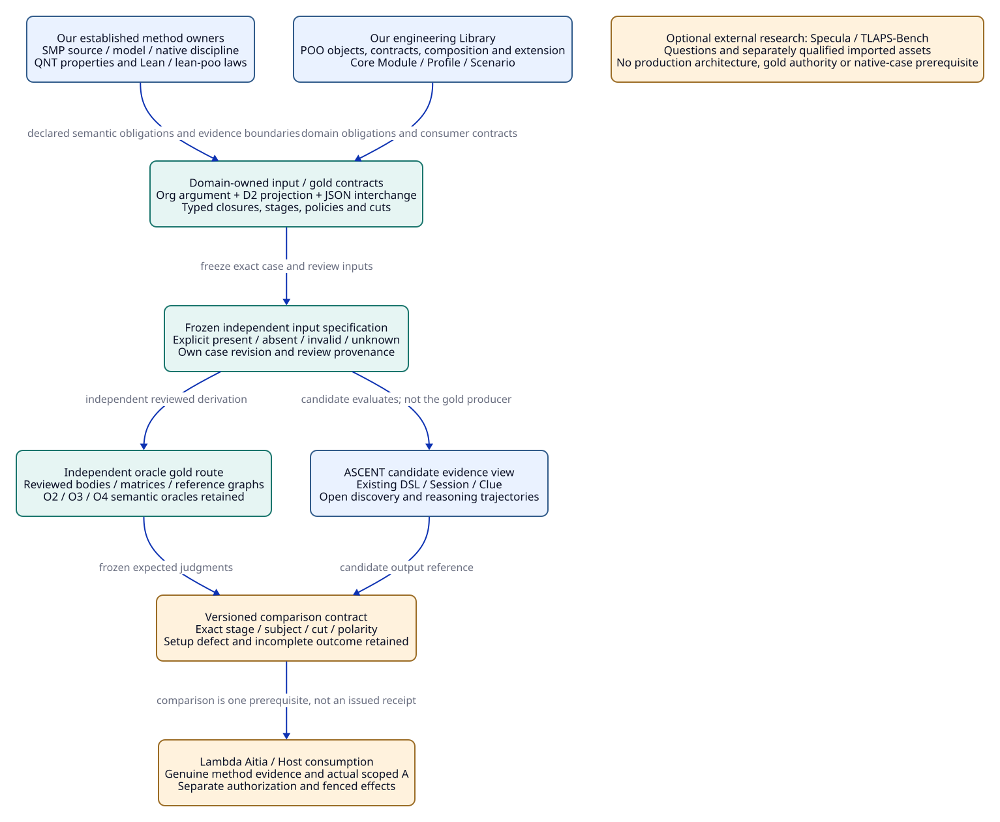
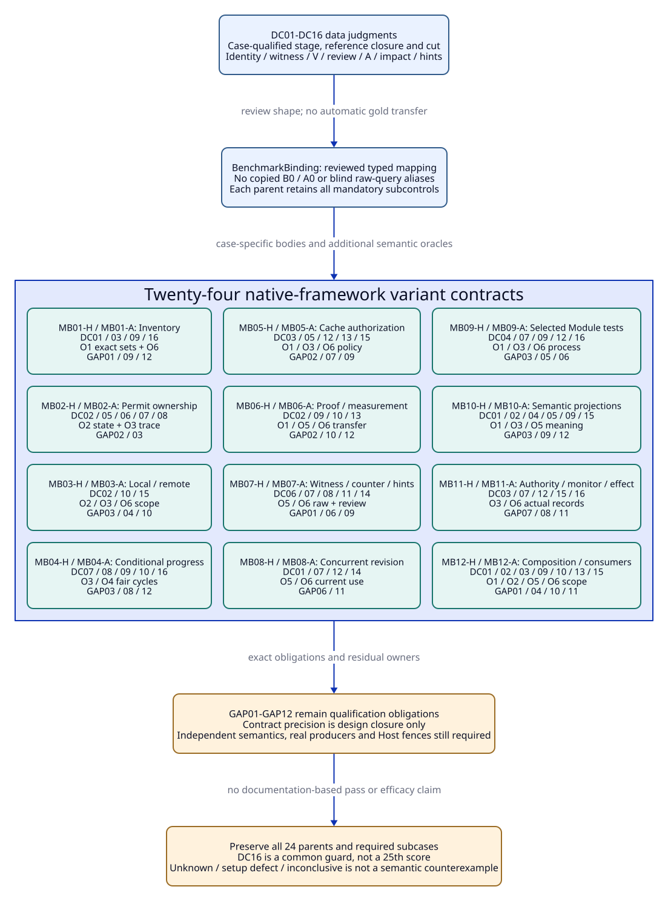

# SPDX-FileCopyrightText: 2026 tao3k team and Contributors
#
# SPDX-License-Identifier: LGPL-2.1-only

#+TITLE: 30.04 Framework-Owned Oracle Inputs, Gold and Coverage Contracts
#+LANGUAGE: en
#+PROPERTY: JD_ID 30.04
#+OPTIONS: toc:3 num:nil
#+STARTUP: overview
#+TODO: OPEN SPECIFIED | QUALIFIED
#+FILETAGS: :evaluation:oracle:gold:contracts:

[[file:../../00-09-project/00-documentation/00.01-index.org][Index]] | [[file:../../20-29-cases/20-gateway/20.05-expanded-admission-controls.org][20.05 DC controls]] | [[file:30.03-gateway-variant-contracts.org][24 variants]] | [[file:30.02-gateway-minimal-benchmark.org::#gap-convergence][12 gap criteria]]

* SPECIFIED Architectural ownership and reference boundary
:PROPERTIES:
:CUSTOM_ID: framework-owned-evaluation
:STATUS: proposed-data-contract-not-implementation
:END:

The primary design is our engineering Library: native POO composition of domain
objects, Core Module/Profile/Scenario organization, ASCENT Evidence DSL and open
evidence trajectories, SMP's source/model/native application discipline, QNT
protocol properties with the established TLC backend, Lean/lean-poo laws and
applications, and Lambda Aitia/Host SDLC consumption. Org owns the argument;
D2 projects its relationships; JSON is a proposed interchange representation.
No imported benchmark architecture defines these responsibilities.

Specula case studies and TLAPS-Bench are optional comparative research in area
40. Their examples can prompt a review question or supply an explicitly qualified
external case. They supply neither gateway truths nor authority for our gold.
The DC cases originate in our claim/witness/T/V/A contracts, and the MB cases in
our gateway obligations, changes and consumer boundaries. No external tasks,
proof skeletons, workflow order, grader, dataset or score formula is adopted as
our execution system. RS/RT reference qualification is separate from the gateway
cohort; an unavailable external replay does not block a framework-native case.
If a particular future case imports an external asset, only that case acquires
its source/license/interpretation/qualification dependencies through a reviewed
case revision. Historical research receipts remain intact.

#+NAME: oracle-framework-owners
| Concern | Existing owner and design use | Boundary |
|---------+-------------------------------+----------|
| Objects, extension, final receiver | POO; reviewed domain Contracts and argument composition | Inheritance alone is not proof or universal consumer compatibility |
| Module / Profile / Scenario | Core selection/source closure; policy/parameter choice; explicit case occurrence | These documents do not claim a new Core API or automatic Scenario package binding |
| Evidence registration/query/trajectory | ASCENT native declarations, Program/Session/Clue and domain associations | Independent expected rows must not be candidate ASCENT rows under another label |
| Source-to-model-to-native reasoning | SMP application discipline and registered component/View provenance | SMP facts, native success and domain-specific tests are not gateway receipts |
| Protocol and algorithm obligations | QNT-authored properties; Lean/lean-poo laws, frame/application premises | TLC is a backend, not an independent second oracle; metadata agreement does not prove a theorem |
| SDLC, admission, authority and effects | Existing Lambda Aitia/domain and Host owners | A0, role and plan records cannot become an actual operational receipt |
| Oracle review package | Proposed domain data consumed through those owners | No new engine, evidence database, task runner or mandatory Agent reasoning path |

Source capability claims retain the immutable identities in
[[file:../../10-19-design/10-architecture/10.06-poo-ascent-integration.org::#integration-source-boundary][10.06]]. MB09 retains its separately pinned historical case contract in
[[file:../../20-29-cases/20-gateway/20.03-gateway-design-audit.org::#audit-source-boundary][20.03]]; a later Core capability requires a versioned case review, not silent
replacement of its selected-source semantics. No live PR-head claim is made here.

#+CAPTION: Framework-owned declarations and evidence feed independently reviewed judgments; external studies remain optional research.

[[file:../../90-99-views/90-architecture-views/90.19-framework-oracle-review.d2][Editable D2 source]].

* SPECIFIED Integration through existing Module and Evidence owners
:PROPERTIES:
:CUSTOM_ID: oracle-existing-owner-binding
:END:

The [[file:../../20-29-cases/20-gateway/20.06-oracle-packet-integration.org::#packet-poo-allocation][20.06 allocation]] binds these record values to the existing two gateway
Module roles, selected Profiles and explicit Scenario occurrences. Its
[[file:../../20-29-cases/20-gateway/20.06-oracle-packet-integration.org::#packet-registration-handoffs][R0-R6 registration map]] and [[file:../../20-29-cases/20-gateway/20.06-oracle-packet-integration.org::#packet-query-contracts][BQ review questions]] retain native ASCENT
DSL/Program/Clue semantics. They specify domain data associations, not installed
APIs or a separate packet service. A gold record is not a positive observation
for the gateway claim; registered labels cannot establish trust or isolation.

Its [[file:../../20-29-cases/20-gateway/20.06-oracle-packet-integration.org::#three-packet-reviews][three complete design walkthroughs]] expand C-CAP/C-CACHE/C-SOURCE into input,
gold, closure, cut, query and reuse judgments. The [[file:../../20-29-cases/20-gateway/20.06-oracle-packet-integration.org::#packet-oa-audit][OA01-OA15 audit]] names each
branch's actual remaining owner/evidence obligation. Open and conditional-ready
cuts are distinct snapshots: this document's kCap positive-control cut may match
kCap.ready only under exact retained-body equality. It never means the earlier
cap-open corpus with missing methods. Likewise isolated kZ and kS controls cannot
silently stand for full cache/source packet closures. These are explicit case
bindings; all original 24 parent variants and mandatory subcontrols remain.

* SPECIFIED Reviewable input, closure and gold records
:PROPERTIES:
:CUSTOM_ID: oracle-packet-contract
:STATUS: normative-proposed-records
:END:

These are proposed data contracts, not implemented structs, Scheme forms, JSON
schemas or stored receipts. Symbolic references inherit the typed identity and
retained-body rules of [[file:../../10-19-design/10-architecture/10.07-claim-witness-reference-contracts.org][10.07]]. No full fixture hashes, signatures or raw byte
corpora have been produced. A paper expected value is labelled as such. It cannot
be registered as genuine T, V, A, QNT success or an independent oracle execution.

#+NAME: oracle-review-records
| Record | Required fields and exact binding | Refused shortcut |
|--------+-----------------------------------+------------------|
| OracleInputSpec | schema/revision; DC/MB/subcase IDs; domain Module/Profile/Scenario source/spec references; oracle family/revision; raw vector/body references; typed target/obligation/argument; patch from explicit reset; closure roots; stage requests; named cuts; limits; required observations | Inheriting unspecified state from the previous subcase or inferring truth from verified=true |
| InputClosure | root set; typed reference-edge table; retained bodies/kinds; expected-present, expected-absent, deliberately-invalid and unknown entries; completeness scope; terminal trust roots; exact excluded scopes | Calling a missing required result an empty complete scope; recursively accepting any digest-shaped edge |
| CutSpec | immutable snapshot ID/body; owner/content/source/configuration/contract/rule generations; method/admission/authority-policy generations; guard/slot/intake/dependency-scope revisions; selected source/test closure; relevant prefix; capture/use roles | One event count, sourceIdentity, wall-clock timestamp or same label standing for all currentness |
| CutComparison | captured cut; requested use cut; exact relevant dependency projection; checked equality/change/unknown cells; comparison-policy reference; outcome/evidence provenance | Rewriting the captured cut or declaring all unrelated new events stale by default |
| TrustPremise | exact hypothetical or actual mode; producer/checker/issuer identity; policy revision and revocation scope; subject/body binding; authenticator/reviewer provenance; unknown/known-invalid distinction | A candidate-supplied signature-valid or complete flag as a trust root |
| OracleGoldSpec | input/body/closure/cut references; oracle and contract revision; judgment stage/subject; required rows; forbidden rows; complete relation domains; unresolved cells; exact diagnostic tuples; not-evaluated stages; review provenance | A digest-only expected result, whole-run Boolean, candidate-derived gold or unscoped absence claim |
| OracleReview | author/reviewer identities and responsibilities; independent derivation route; reviewed input/gold bodies; shared dependencies; dissent/limitations; revision lineage | Calling this author specification an already completed independent review |
| ComparisonSpec | candidate-output reference kept separate; frozen input/gold identities; normalization allowed; exact equality or subset/forbidden predicates per declared relation; timeout/unknown handling; discrepancy subject | Normalizing away polarity, witness identity, stage, units, cut or incomplete outcomes |
| BenchmarkBinding | MB variant/subcase revision; DC contract role; explicit typed symbol/interpretation mapping; additional semantic oracles; exact required results and residual scope | Treating DC-to-MB association as a passed variant or copying B0's A0 into all gateway obligations |

InputClosure uses four different input states. /Expected absent/ is deliberately
missing evidence in a well-formed control (for example VQ0 in DC07-A); /unknown/
is unestablished provenance or scope; /deliberately invalid/ is the submitted
object to reject; /expected present/ has a retained body and typed binding.
Unexpected missing references, wrong case revisions, or missing oracle gold are
an oracle-package/setup defect. They are not the designated semantic refusal,
pending outcome or counterexample. No implementation status code is introduced.

The [[file:../../20-29-cases/20-gateway/20.07-packet-query-and-history-fixtures.org::#query-binding-ledger][20.07 query bindings]] give explicit per-path usages, T-use and gold references.
Its [[file:../../20-29-cases/20-gateway/20.07-packet-query-and-history-fixtures.org::#query-cut-epoch-boundary][input-epoch constraint]] excludes CutId/hash self-reference: freeze the input
root set before evaluating usages/results about it; feedback binds a new input
epoch. Source capture, record intake and requested consumption cuts are separate.
The [[file:../../20-29-cases/20-gateway/20.07-packet-query-and-history-fixtures.org::#late-intake-visibility][late-result visibility gold]] forbids future records in frozen old prefixes;
[[file:../../20-29-cases/20-gateway/20.07-packet-query-and-history-fixtures.org::#packet-retention-assertions][retention gold]] distinguishes stored history, present usability and target transfer.

The [[file:../../20-29-cases/20-gateway/20.08-qr-identity-and-reuse-controls.org::#qr-cut-identity-dag][20.08 dependency order]] scopes InputClosure instances explicitly: the earlier
oracle-input closure excludes its referencing InputSpec/future gold/results;
a later package-review closure can inspect them without back-references from I/G.
Native sourceIdentity is derived from actual raw projection inputs, not from
external Profile/cut labels; shared N_L therefore does not equate domain use.
The [[file:../../20-29-cases/20-gateway/20.08-qr-identity-and-reuse-controls.org::#expanded-qr-controls][twelve QR data controls]] retain original record types and separate setup
problems, semantic output disagreements, scoped refusals and pending work.

A closure may terminate at an explicit independently reviewed trust assumption;
it cannot terminate at an arbitrary candidate assertion. It need not recursively
verify its trust root forever. All trust assumptions remain visible in the
claim boundary. Optional references outside the requested stage are labelled
excluded or not evaluated, rather than silently assumed successful.

** Gold judgment rows and comparison domains
:PROPERTIES:
:CUSTOM_ID: gold-row-contract
:END:

#+NAME: oracle-gold-row-fields
| Field | Example / constraint |
|-------+----------------------|
| case / subcase / input revision | DC07 / B / hypothetical-input-r1; independent reset from B0 |
| stage / subject / scope | J3 / VSC0-as-Q / slot sQ0 of P0/Ob0 |
| captured / use / relevant cut | k0 / k0 / QB plus slot policy; retained explicit bodies |
| required row | Reject(RJ06,VSC0-as-Q,J3), with observed=(RSC0,Corr0,SC), required=(R+,P0,Q) |
| forbidden row | SlotSupport(sQ0,o+,VSC0,k0); CurrentAUse is forbidden only if J6 was separately requested and completed |
| reason references | VSC0 body; RSC0; Corr0; authoritative sQ0 body; MP0 |
| completeness / unresolved | Complete inspected V-to-slot comparison; other methods not re-executed; no invented downstream pending rows |
| review / status | author-proposed gold; independent reviewer unassigned; execution absent |

A required row is exact in all typed fields. A forbidden row is scoped to its
explicit evaluated domain. Set equality is used only when that relation's scope
and evaluation are complete; otherwise compare justified positive/negative
judgments and explicit unknowns. A missing row is not automatically a false row.
Duplicate incompatible scalar judgments are invalid; compatible duplicate
presentations may be compared as sets only where declared set semantics allow
it. Raw event multiplicity/order and ordered argument lists remain significant.

No oracle calculates gold by running the candidate ASCENT rules, relying on its
canonical hash, or trusting an optimized invalidator's output. OC uses reviewed
encoding/typed-body vectors; OW enumerates an explicit witness matrix; OR walks
retained typed subjects/policy/application edges; OK enumerates intake/review;
OU traverses independently declared dependencies and before/after cuts. O2/O3/O4
retain their separate state/trace/fair-cycle semantics from 30.02. Manual gold
and a future naive checker still need independent review and seeded fault
controls. Two LLMs or two backends sharing a faulty policy/parser are not by
that fact independent.

* SPECIFIED Judgment stages, closure vocabulary and cuts
:PROPERTIES:
:CUSTOM_ID: stage-closure-cut-contract
:END:

These are dependency levels for particular judgments, not a mandatory Agent
workflow. Requests can ask only for a raw view or an identity judgment. An Agent
can discover alternatives, examine counters and propose experiments throughout.
Every result identifies the stage actually evaluated.

#+NAME: oracle-judgment-stages
| Stage | Declared judgment | Required context and boundary |
|-------+-------------------+-------------------------------|
| J0 raw format | Duplicate keys, schema, kind tags, unambiguous typed input | Original bytes before map decoding; not an instance-resource verdict |
| J1 identity/registration | Canonical descriptor equality, retained body, immutable namespaced witness binding | Alias namespace and encoding revision; does not prove proposition truth |
| J2 witness/projection | Native content association, per-witness factors, extraction and requested target binding | Same witness; raw read rows separately labelled; unknown mapping stays pending |
| J3 method/application | V subject/proposition/method/result kind, checked extraction/application/frame | Slot-required proposition may differ from obligation owner; no external success manufactured |
| J4 inventory/review | Required slot/guard/intake coverage and authorized dispositions | Missing complete coverage cannot be treated as empty set |
| J5 eligibility | Checked argument, positive slots, scope/review and policy | No automatic A issuance |
| J6 present A use | Actual A body/issuer/obligation and current relevant cut | Eligibility plus authentic supplied A, not execution permission |
| J7 operational boundary | Actual action authorization, monitor applicability and effect receipt | Separate Aitia/Host/operations subjects and current policy |
| J8 change impact | Before/after dependencies, negative/aggregate scopes, grounded bases | Withdraw affected present use; keep immutable history |
| J9 presentation | Native raw read, hints, shown-family provenance and content-bound view | Checkpoint integrity is not authentic display history; no method discharge |

#+NAME: oracle-closure-register
| Closure | Exact root family and recursively required typed edges | Excluded / missing boundary |
|---------+--------------------------------------------------------+-----------------------------|
| RB | raw request/vector; D0 and requested descriptor; claim/encoding schemas; namespace/alias table; retained typed body/ID assertions | No artifact/V/A needed for J0/J1 |
| WB(w) | WitnessKey/EnvelopeId; envelope body; artifact/source/digest map; actual native T and T-use association if projected; factors/projection/interpretation/footprint; requested descriptor/cut | Extraction verification is a separate required edge when requested; no implicit positive V |
| QB | WB(o+), VMap+, VQ0, required sQ0 proposition/method and MP0; complete required usage guards | VSC0 cannot replace P0/Q; Q result meaning is separate from checker acceptance |
| LB | WB(oL), VMapL, VL0/L0; App0/from-to/substitutions/frame/source/assumptions; VApp0; required sL0/MP0 | No native TApp0; exact external content path for application artifacts remains required |
| SB | WB(oSC0), VMapSC, VSC0/RSC0/Corr0; required sSC0/MP0; explicit Arg0 link toward P0 | Corr0 is required proposition; P0 is owner, not VSC0's direct theorem |
| EB | RB, QB, LB, SB; Ob0/Arg0; exact authoritative slots, guard and review domains; I0/dispositions/coverage certificates; MP0/AP0 and current dependency bodies | No A required for J5; B0 certifies only GW-02.a, not all U0 lineages |
| AB | EB plus actual hypothetical A0 body/issuer/authentication, exact selected refs and scope/cut dependencies | No deployment permission, performance result or Host effect |
| CB | WB(o-) or WB(wMQ), exact opposing intake membership/coverage and required dispositions/authentication; requested P0 | Unresolved required review is enough to block clean A; formal defeat is not presumed from T- |
| GB | Separate graph-domain P/Q descriptors; rule graph (P<-Q, Q<-P, b->Q); external Rb/Vb grounding premise; MPG/APG; ArgG; complete graph/intake review CG; supplied APQ and kG0 | Hypothetical trusted external base is not a self-authenticating proof cycle; no native Tb unless projected |
| IB | before/after relevant dependency/member/grounding tables; original admitted root and its AB or GB closure; cut-comparison policy | Missing footprint causes conservative uncertainty, not proof of unaffectedness |
| HB | original/current raw content/read rows; actual owned shown-set and provenance; checkpoint body/schema/digest/source/anchor; selector/expansion request | Recomputed checkpoint checksum supplies integrity only |
| PB | requested principal/action/resource/context; authority and monitor policy; current reviewer/decision/observation records; actual bound effect receipt if completion claimed | Existing T/V/A/plan is not the missing operational record |

In GB, P/Q are graph-domain propositions distinct from gateway P0. Rb/Vb are
hypothetical authentic external evidence for the ground premise under MPG;
APQ explicitly selects that base and ArgG's grounded derivation under APG at
kG0. No b/Vb authenticity is established by the P/Q cycle. Removing b from the
current member set at kG1 leaves the immutable Rb/Vb/APQ bodies historical and
removes the only externally grounded support. It does not prove P or Q false.

These names are review shorthand, not an implemented cache or resolver. Every
root is expanded to its body/typed edges until explicitly terminal. A subcase
patch can mark a required node absent or invalid without erasing the edge from
the reviewed contract. /RB only/ means no imported A0/V premises are needed or
trusted by that judgment. Actual genuine producer verification remains separate
from the paper external-premise mode of all DC fixtures.

#+NAME: oracle-cut-register
| Cut | Frozen body / permitted comparison | Scope boundary |
|-----+------------------------------------+----------------|
| k0 | B0 O0, X0/S0/C1/K0/M0, MP0/AP0, Ob0/Arg0, complete I0, empty cache-owner Z0; captured source/content/prefix and guard/slot/dependency identities | Common reset; no external execution inferred |
| kR | Same relevant source/configuration as k0; reviewed ObLQ/ArgLQ and AP_LQ, complete revised slot coverage | Independent revised-policy snapshot; no silent reuse of A0's old contract |
| kCap | Ocap, Xcap/S0/C2/K0/M0, Pcap/CorrCap/ObCap and exact new evidence/intake/policy bindings | Positive new-target eligibility in DC10-D, not original k0 |
| kMQ / kI | k0's unchanged point inputs plus explicitly revised content/intake: wMQ/IMQ or o-/I1, respectively | Rebind current usage checks without editing original envelope origin or A0 capture cut |
| kSplit | OQ2 raw corpus {ox1,ox2}, factors (X1,C1)/(X0,C2), host map sX1:dX1 and sX2:dX2; explicit P0 question if requested | No clean B0/A0 imported; complete selector domain only |
| kF | OQ1 raw corpus {o+,o-,oF0}, exact host map and P0 family; authentic prior shown-set empty in DC14-B | Presentation-only conflict fixture; no imported clean A0 or resolved verification |
| kH | Same native sourceIdentity O0, changed hypothesis content/view; H3 added; relevant P0 review/intake policy unchanged | No false no-change from native owner ID; no blanket invalidation of unrelated P0 admission |
| kS / kP / kZ | Explicit k0 transition changes source S1 / issuer trust generation / cache-owner membership Z1 | Relevant change invalidates captured-use qualification; keep original k0 history |
| kG0 -> kG1 | Separate APQ logical graph P<-Q, Q<-P, grounded b->Q; then remove b | No A0 assumptions and no circular content-hashed proof records |
| kU0 -> kU1 | kU0 has the original complete applicable AB dependency projection including generation u0; change to u1 makes the affected footprint unavailable at kU1 | Conservative withdrawal and pending impact; no claim that the proposition is false |

Cut names are qualified by input/subcase revision; equal display labels across
independent resets do not identify the same snapshot. The cut register is the
union of possible case names, not a requirement to load all cuts into one run.
The 10.07 limits apply to each independent evaluation instance; a manifest
exceeding its declared cap is inconclusive until a reviewed envelope revision,
never silently truncated.

The comparison is over the /declared complete relevant projection/, not equality
of unrelated global event counters. A new raw hypothesis view kH need not change
P0's required generations. Reuse at kH requires an actual supported comparison
under current policy; it cannot rewrite A0's captured k0. If that comparison or
footprint is unavailable, present use remains pending. Cryptographic source
identity alone does not supply this comparison.

* SPECIFIED DC01-DC16 oracle input and gold packets
:PROPERTIES:
:CUSTOM_ID: dc-oracle-packets
:END:

Each row is a proposed OracleInputSpec/OracleGoldSpec pair, not a serialized or
executed result. Lettered subcases reset independently. /Jx only/ leaves later
stages not evaluated. A downstream J5/J6 judgment is included only where its
closure and coverage were deliberately supplied. All positive external-premise
records are hypothetical. Stage-local observed/expected fields use 20.05 bodies.

#+NAME: dc-oracle-packet-ledger
| ID / input patch | Stage and reference closure | Cut / subject | Required gold and forbidden conclusion | Independent route |
|------------------+-----------------------------+---------------+----------------------------------------+-------------------|
| DC01-A alias; B raw field reorder | J0/J1 RB; optional J6 AB unchanged | k0 / D0 and P0/Ob0 | SameClaim and canonical equality; if J6 requested CurrentAUse(A0,P0,Ob0,k0); no new receipt | OC reviewed field/byte order, OR unchanged A refs |
| DC02-A cap=2; B S1; C remote; D KiB | J1 RB then J2 WB(o+) with new target descriptor; no inferred transfer | k0 historical evidence / requested Pcap, Psrc, Premote, Punit | Distinct ClaimId; RJ03 attempted direct target binding; old P0 record retained, no downstream method verdict | OC one-field vectors, OW target/factor matrix |
| DC03-A reviewed ObLQ/AP_LQ; B unreviewed slot removal | A J1 RB, J4/J5 EB restricted to reviewed L/Q, J6 supplied old A0; B J4 authoritative Ob0 review | A kR vs A0 capture k0; B k0 | A same claim/new obligation; eligible new contract under its supplied complete premises, old A RJ08 at contract comparison; B pending binding for policy review, SC still required | OC body equality, OR reviewed authoritative slot/policy bodies |
| DC04-A duplicate cap; B T tagged V; C P0 ID/body Dcap; D wrong host source/digest | A/B J0 RB; C J1 RB; D J2 WB(o+) with deliberately invalid content-map edge | k0 / respective submitted object | RJ01 / RJ02 / RJ02 / RJ05 at named stage; no partial trusted projection; later stages not evaluated | OC raw independent vectors, OR type/body table, OW host-map comparison |
| DC05-A Ecap; B Eclaim; C Epol; D Efactor under same (o+,d+); E fresh envelope with VQ0 offered for it | A-D J1 WB(o+) registration bodies; E J3 fresh WB plus offered old VQ0, target-slot policy | k0 / observation ID conflict or new V subject | A-D RJ04 despite correctly new EnvelopeId and valid T+; E RJ06 wrong subject; no new qualified mapping or positive slot | OW full immutable envelopes, OR exact VMap+/VQ0 subjects |
| DC06-A split ox1/ox2; B fabricated direct-observation splice | A J2 WB(ox1), WB(ox2) factor scope complete; B J1/J2 deliberately spliced envelope | kSplit with Q2-only corpus, no AB / requested X0 AND C1 | A exact matched set empty, no RJ; explicit raw read(P0) unknown if requested; B RJ04; no invented single witness | OW enumerate rows (X1,1),(X0,2), retain each origin |
| DC07-A omit VQ0; B replace with VSC0; C issuer provenance unknown | J3 QB patched: absent V, deliberately wrong subject, or unknown trust; other B0 refs retained only for separately requested later checks | k0 / sQ0 | A pending method; B RJ06; C pending binding. No positive slot from missing/wrong/untrusted V. J6, if requested with AB patch, cannot establish current use | OR exact slot-required P0/Q versus observed subject/method and issuer cells |
| DC08 add EMQ/RMQ/TMQ/VMQ positive-check verdict, counterexample result kind; offer as positive | J3 QB plus new checked EMQ closure; J4/J5 EB+CB complete IMQ | kMQ / sQ0 and P0/IMQ | VerifiedCounter retained; RJ07 offered positive use; no positive slot from VMQ; conflict blocks clean eligibility; no A auto-issued | OR result-kind comparison; OK intake enumeration; contradictory producer inputs investigated |
| DC09-A absent App0/VApp0; B absent VMap+ | J3 LB minus application, or QB minus mapping; J5 patched EB only if requested | k0 / L slot or E+ extraction | Pending method / pending binding. Old VL0 remains L0; no established complete eligibility or current A from absent prerequisites | OR exact missing edge, not opaque success flag |
| DC10-A no AppCap; B VL0 offered as VAppCap; C RF0 to PerfCap; D complete new cap evidence without ACap | A J3 LB law/new target; B J3 typed application; C J2 WB(oF0) new measurement target; D J3-J5 full EBcap; J6 absence of ACap explicit | A-C captured k0, requested target; D kCap | A pending method; B RJ06; C RJ03; D Eligible(Pcap,ObCap,kCap), no CurrentAUse(ACap,...) and pending method for the absent ACap at requested J6; PerfCap independently pending measurement, never discharged by VL0 | OW full production factors; OR application/frame/slot/coverage graph |
| DC11-A method=Q; B forged ignore disposition; C suppressed opposing intake | J9 raw select/read; J4/J5 EB+CB with complete I1; B invalid disposition issuer edge; C expected I1 vs submitted subset | kI / P0 and exact E- review | A raw both polarities/conflict and domain conflict; B RJ06, unresolved review retained; C RJ11. No clean A by selector choice | OK complete I1 independent of selector; OR disposition authority |
| DC12-A source changed; B issuer generation revoked | J8 IB over AB; J6 attempted current A0 use for its own P0/Ob0 | k0->kS or k0->kP | WithdrawnUse and RJ10 attempted current use; History(A0,k0). No retroactive deletion or rewritten source provenance | OU before/after point/policy edges; OR recorded/current generations |
| DC13-A insert cache owner; B last base b removed; C unknown changed footprint | A/C J8 IB over AB; B J8 GB closure plus J3 attempted cycle justification; A J6 stale use only if requested | k0->kZ; kG0->kG1; kU0->kU1 | A withdraw, attempted old use RJ10; B no grounded support, withdraw APQ, RJ09 offered unsupported justification; C conservative withdraw + pending binding. No false proposition conclusion | OU explicit member sets/grounded reachability; OR no self-justification |
| DC14-A append H3; B forged prior shown positive row with recomputed digest | J9 HB plus complete raw corpus; B deliberately invalid shown provenance, authentic prior shown-set empty; P0 present-use comparison separately scoped | A k0->kH stable native sourceIdentity; B Q1 conflicting-view cut kF | A conditional+unknown H3 and two factors, four new items; B proposed host RJ11, AcceptedAcknowledgement empty, full family replayable; native checksum rejection not claimed | OW content/row difference; OK/OU independently owned shown history, no candidate checkpoint as gold |
| DC15 T/V/A/role/plan offered as operational authority or effect | J7 PB requested required record absent; supplied AB/role/plan bodies type-checked in their own scopes | k0 / exact deploy principal/action/resource/context or effect-completion subject | RJ12 attempted promotion; no authorization/completion judgment from those substitute kinds; local A0 remains scoped | OR independent consumer/type/authority matrix; no runtime action |
| DC16-A 513 input facts; B 129 guards; C 100001 work; D 4097-byte descriptor; E unknown intake coverage | A-D declared evaluation envelope with otherwise valid stage inputs; E J4 EB with required certificate unknown | k0 / bounded run or intake scope | A-D INCONCLUSIVE at first exceeded instance limit, evaluation incomplete; partial rows not complete gold. E pending scope. No new A or semantic-counterexample credit | Independent limit accounting, OC well-formedness separately, OK completeness cell |

** Disputed and unresolved inputs
:PROPERTIES:
:CUSTOM_ID: oracle-disagreement-policy
:END:

A specification contradiction, stale review, unexpected absent root or invalid
oracle setup suspends grading for the affected subcase. Preserve candidate and
gold identities plus disagreement; adjudicate under a reviewed new version.
Do not change gold to match candidate output, turn a timeout into an intended
counterexample, or delete an unfavorable historical result. A known wrong result
under the fixed contract and an unqualified comparison setup remain distinct.

Intentionally inconsistent producer premises in DC08 test fail-closed conflict
handling. They are not a constructed pair of actual sound contradictory proofs.
Before crediting any real method result, independently check exact source/model,
property, quantifiers, assumptions, method completeness and checker trust.

* SPECIFIED Bind all twenty-four benchmark variants
:PROPERTIES:
:CUSTOM_ID: dc-mb-bindings
:END:

Each row needs its own BenchmarkBinding and complete input/gold body. The table
maps /contract obligations/, not copied artifacts or passed checks. B0 and A0
cover only one local GW-02.a claim. The full U0 inventory and case-specific
security/resource/progress/effect claims still require their own evidence.
O2/O3/O4 are not replaced by OC/OW/OR/OK/OU. A DC row can supply the same review
shape while its symbols/propositions, policies and traces differ.

Explicit mappings preserve typed values, relation plane, proposition, witness
association, origin and cut. Similar strings are not aliases. In particular Q2's
diagnostic PX1/PX0 labels and MB07's same P labels have different raw inputs;
only the no-factor-splicing obligation is shared until a reviewed raw-query
mapping is supplied. No native raw-result gold is copied between them blindly.

#+NAME: dc-to-24-benchmark-bindings
| Variant | DC contract obligations / stage / closure pattern | Required case-specific gold beyond that mapping | Residual semantic evidence / gap scope |
|---------+--------------------------------------------------+-------------------------------------------------+-----------------------------------------|
| MB01-H | DC01/DC03/DC09/DC16; J1/J4/J5; RB + EB generalized to U0 | Exact 16 lineage/origin sets and every authoritative method slot, no missing/extra rows; B0 alone insufficient | Independent O1 coverage and O6; GAP01/12 |
| MB01-A | DC03-B/DC09/DC16; J4; required U0 versus submitted slot set | Missing SC detected despite 16 displayed lineages; no unauthorized policy revision. DC03-A reviewed relaxation is a different input | O1 set difference/O6 block; GAP01/09/12 |
| MB02-H | DC02/DC05/DC07; J1-J3 WB expanded to attempt/resource identities | Own-state gold C=1: owners {} -> {a} -> {}, free 1 -> 0 -> 1 with valid close-before-release | O2/O3 state/trace semantics and QNT/native mapping; GAP02/03 |
| MB02-A | DC05/DC06/DC08; J1-J3 witness/trace identity, not theorem gold | Duplicate release refused/idempotent, never free=2; distinct a,b not merged by business key; queue/buffer/incarnation companion controls retained | O2/O3 and designated state fault witnesses; GAP02/03 |
| MB03-H | DC02/DC10/DC15; J2/J3/J6 scoped local support, PB separate | Local owner released while remoteRunning=true; local admission never implies RemoteStopped | O2/O3/O6 local/remote relation; GAP03/04 |
| MB03-A | DC02/DC15; J2 target scope and J7 operational boundary | No remote completion/fencing event; refuse claimed remote stop/global release, preserve remote uncertainty | O2/O3/O6, backend/replay semantics remain open; GAP04/10 |
| MB04-H | DC07/DC09/DC10/DC16; J3/J4 method/assumption closure | Reachable trigger, actual ownership-removing transition and universal relevant fair-cycle check, not one successful path | Independent O3/O4 finite semantics plus QNT/Lean/source bridge; GAP03/08 |
| MB04-A | DC08/DC09/DC16; J3 result/assumption meaning | Fair infinite behavior starving the owner when fairness removed; no-op completion and unreachable-trigger controls separately detected | O3/O4 non-vacuity and designated lasso/witness; GAP08/12 |
| MB05-H | DC03/DC05/DC12/DC15; J4 new cache slots, J7 PB at hit cut | pA/t1 private hit authorized under fresh v0 with complete principal/permission/content context | O1/O3/O6 independent permission table and cache trace; GAP02/07 |
| MB05-A | DC05/DC12/DC13/DC15; J2 principal factors, J7 policy cut, J8 cache footprint | Same-tenant pB denied under v0; separate pA revoked under v1; no inherited mutation between resets | O1/O3/O6 policy/cache semantics; GAP07/09 |
| MB06-H | DC02/DC09/DC10-D; J3-J5 LB + new target evidence at cap2 cut | Checked universal law, exact application/frame, complete case-required new Q/SC and current scope; eligibility alone not A | O1/O5/O6 plus genuine Lean/QNT evidence; GAP02/10 |
| MB06-A | DC02/DC10-C; J2 measurement target/method scope | meas0 src0/bin0/C1/W0/H0 cannot discharge C2/W1 PF; original measurement retained | O5/O6 transfer policy and actual PF production; GAP02/12 |
| MB07-H | DC07/DC08/DC11/DC14; J2/J4/J9 WB+CB+HB | Same-witness support and counter retained; hypothesis conditional; unresolved conflict blocks clean A | O5/O6 exact raw/query and review gold; GAP01/09 |
| MB07-A | DC06/DC11/DC14; J2 factor conjunction and J9 hints | No eligible witness despite raw matching claim labels; suppress-counter/partly shown-family controls retain expansion/review | O5 raw-label-aware mapping, host display provenance; GAP06/09 |
| MB08-H | DC01/DC07/DC12 unchanged-cut control; J3/J6 AB pattern | Exact g0/R0/K0/h0 and genuine verified subject, unchanged relevant inputs through use; no invented before/after drift | O5/O6 current-use/consumption integration; GAP06/11 |
| MB08-A | DC12/DC14; J8 IB and J6/J9 | Late X0 result after X1 retained as historical; equal-count h0/h1 distinguished by actual content; no future rows in old snapshot | O5/O6 concurrent ingestion/use fencing; GAP06/11 |
| MB09-H | DC07/DC09/DC12 unchanged closure/DC16; J3/J4/J6 selected-source extension of EB | Exact pinned selected Graph/module/test/helper closure, nonempty suite, unselected poison isolation, natural complete exit 0 | O1/O3/O6 genuine process evidence; no MB09 retargeting; GAP03/05 |
| MB09-A | DC04/DC12/DC16; J1 selected-source closure then J8/J6 | fh0->fh1 refuses old qualification despite same file count; empty suite/unselected mz subcontrols distinct | O1/O3/O6 native projection/revalidation/exit observations; GAP05/06 |
| MB10-H | DC01/DC02/DC05/DC09; J0-J3 RB/WB + explicit cross-surface mapping | Same local quantity 2 abstract-buffer-unit, distinct structural/authority planes across Org/D2/QNT/Lean/JSON | O1/O3/O5 actual parser/extractor/mapping controls; GAP03/09 |
| MB10-A | DC02/DC04/DC05/DC15; J0/J1/J2/J7 as applicable | Unit swap, duplicate raw key, structural-to-authority edge, weakened target and changed canonical dependency isolated by subcase | O1/O3/O5 immutable-context and semantic correspondence; GAP09/12 |
| MB11-H | DC03/DC07/DC12 unchanged-policy control/DC15; J4/J7 PB | Current scoped review, monitor within lag bound, separate actual authorization and bound Host effect receipt if effect claimed | O3/O6 real authority/clock/Host inputs; GAP07/08/11 |
| MB11-A | DC07/DC12/DC15/DC16; J7 PB with explicit missing/changed entries | Reviewer revocation; separate unknown monitor; separate plan-only effect claim; exact refusal versus pending per subject | O3/O6 policy, monitor and effect semantics; GAP07/08/11 |
| MB12-H | DC01/DC03/DC09/DC10; J1/J3-J6 generalized EB | POO parent order/final receiver and unchanged local consumer obligations with genuine transfer premises; no automatic global promise | O1/O5/O6 composition/Lean interpretation; GAP01/10 |
| MB12-A | DC02/DC03/DC10/DC15; J2/J4/J7 new consumer closure | Two local C=1 permits can total 2 > G=1; reopen stronger coordination/fencing requirements; local A not global A | O1/O2/O5/O6 and new protocol design required; GAP04/10/11 |

DC13's negative-scope/grounding controls supplement MB02/MB05/MB06/MB12 within
existing parent contracts; they do not prove those state/authorization semantics.
DC16 is also a common evaluation guard for every variant, without creating a
25th scored row. DC14's raw/hint controls cannot prove Host-effect fencing.
Mandatory S01-S18 and other parent subcontrols in 20.03/30.03 remain required;
this mapping does not replace, drop or reweight them. A parent completes only
when all required bindings, semantic controls and case-specific judgments close.

* SPECIFIED Revisit all twelve gaps
:PROPERTIES:
:CUSTOM_ID: oracle-gap-dispositions
:END:

Design-level disposition means a precise contract and residual responsibility.
No row is marked qualified by documentation or an oracle/variant association.

#+NAME: oracle-twelve-gap-map
| Gap | DC/data-contract contribution | Native framework owner and remaining closure evidence |
|-----+-------------------------------+-------------------------------------------------------|
| GAP01 coverage | DC03/09/11/16; complete required sets, independent O1 gold and intake | Domain/POO reviewer must independently review U0 hazards/methods; OC/OR cannot discover all omitted requirements |
| GAP02 dependencies | DC05/10/12/13; typed footprint, absence/aggregate/member cuts and transfer edges | ASCENT/SMP application + domain registration; actual incremental invalidation, fallback and checked Lean frame |
| GAP03 source correspondence | DC02/04/05/07/09/10; exact artifact/proposition/extraction closure | QNT/Lean/native/source owners; genuine SC and O2/O3/O4 mapping; byte attestation alone insufficient |
| GAP04 remote completion | DC02/15; consumer/target distinction and nonpromotion | Gateway/backend + Aitia/Host require actual remote completion/fencing/replay contract; DC metadata does not supply it |
| GAP05 selected execution | DC07/09/12/16; selected closure/completeness fields and use cut | Core owner must qualify exact selected sources/helper/tests/nonempty suite/natural exit under the case pin |
| GAP06 currentness | DC12/14; captured/use cuts, actual content and owned hint provenance | ASCENT/SMP/Aitia/Host must enforce ingestion/use/publication comparisons under concurrency |
| GAP07 authority | DC03/11/12/15; authoritative policy/disposition/operational record kinds | Aitia identity/decision owner must supply actual principal/context/revocation enforcement |
| GAP08 time/progress | DC07/09/10/16; required assumptions, monitor and incomplete semantics | O3/O4 + operations owner must qualify fairness, reachability, clocks, lag and response; a cut ID alone has no time guarantee |
| GAP09 projection | DC01/02/04/05/06/11/14; raw vectors, typed planes, one-witness factors, separate raw read | Domain adapter/ASCENT owner must qualify real parsers, projection/extraction and aliases, including common-mode controls |
| GAP10 consumers | DC02/03/09/10; owner-versus-required proposition and exact new target application | Library/POO/Lean consumer reviewers must verify final receiver/contracts/frame and environment-specific compatibility |
| GAP11 plan/effect | DC12/15; A use versus operational authorization/effect record and fence cut | Aitia/Host must deliver actual fenced effects/receipts; evidence-view correctness cannot close this gap |
| GAP12 evaluation validity | DC04/08/16; separate oracle setup, independent gold/review route, stable bindings/denominator | Independent evaluator must qualify oracle implementations, shared-dependency faults, all parent subcontrols and matched Agent study |

#+CAPTION: DC associations preserve case-specific semantic obligations and open qualification gates.

[[file:../../90-99-views/90-architecture-views/90.20-oracle-benchmark-gap-bindings.d2][Editable D2 source]].

* OPEN Hidden assumptions and review responsibilities
:PROPERTIES:
:CUSTOM_ID: oracle-hidden-assumptions
:END:

#+NAME: oracle-hidden-assumption-register
| ID / hidden assumption | Contract resolution / negative review question | Still required |
|------------------------+-------------------------------------------------+----------------|
| OA01 External research defines our architecture | Ownership table and native case derivation; can the gateway case run with no area-40 asset? | Actual native case packaging and dependency audit; no external replay gate by default |
| OA02 A paper gold table is an independent oracle run | Separate author specification, reviewer provenance and executed result | Independent author/reviewer assignment and real checker receipts |
| OA03 All referenced nodes should be present | Distinguish intentionally absent/unknown/invalid input from unexpected broken package | Real loader/schema/type enforcement and discrepancy retention |
| OA04 A reference closure is complete because edges exist | Require reviewed edge types, terminal roots, dependency/member coverage and excluded scope | Authentic extraction/collection, trust roots and omitted-edge fault controls |
| OA05 Same cut label means same snapshot | Retained CutSpec bodies and scoped CutComparison; case-qualified names | Atomic source capture, publication/ingestion/use fencing and source transport integrity |
| OA06 Every new event invalidates all A, or none | Compare complete relevant projection; H3 is independent only under declared policy/intake scope | Real footprint registration; unknown projection pending/conservative withdrawal |
| OA07 SC verifies the owner proposition directly | Separate owner P0, required Corr0 and checked Arg0 implication | Genuine source/model correspondence and argument-method policy, not arbitrary AND slots |
| OA08 A dependency label can erase contrary facts | Complete intake independent of selector and pending disposition | Real trusted intake collection and authenticated review provenance |
| OA09 Hash/serialization equality supplies semantic equivalence | Independent raw/type/unit vectors and explicit interpretation mapping | Real canonicalizer, collision/body checks, parser diversity and semantic bridges |
| OA10 Contract mapping proves all benchmark semantics | Every MB row retains O1/O2/O3/O4/O5/O6 and full native case scope | Actual resource/progress/security/effect semantic oracles and designated mutants |
| OA11 Body-valid V means its result is sound and compatible | Method policy, accepted result kind, exact theorem/model/assumption subject; DC08 conflict retained | Genuine trusted verifier execution, source refinement and consistency investigation |
| OA12 An oracle unknown or timeout is a semantic counterexample | Distinct setup defect, pending, conflict, rejection, withdrawal and inconclusive outcomes | Real resource/completeness receipts and predeclared scoring/denominators |
| OA13 Two reviews/checkers imply independence | Record shared parsers, source mappings, prompts/models, policy authors and backends | Seed faults on oracle and candidate routes; adjudicate without rewriting old results |
| OA14 Stable IDs grant perpetual access/reuse | Current trust/visibility/authority policies bind every real lookup/use | Authenticated artifact access/revocation handling; unavailable bytes remain pending, not fabricated |
| OA15 Finite fixtures cover every schedule and consumer | Frozen finite scope and declared assumptions; each stronger consumer gets new obligations | QNT/Lean scope arguments, native stress/operations evidence and broader domain review |

No Agent-efficacy or general performance conclusion follows from these contracts.
The fixed comparison domain constrains justified conclusions, not an Agent's
hypotheses or investigation order. Alternative sound designs remain admissible
through an explicit reviewed contract/consumer mapping. Changed requirements do
not rewrite the result of the original case.

- [ ] Assign independent input/gold authors and reviewers; resolve dissent under immutable revisions.
- [ ] Materialize raw vectors and exact case-qualified cuts through existing Module/Scenario owners.
- [ ] Review each typed reference closure and deliberate absence before implementing an oracle.
- [ ] Qualify OC/OW/OR/OK/OU independently, including oracle-route faults; retain O2/O3/O4 semantics.
- [ ] Obtain genuine QNT/Lean/source/native/Host receipts for each claim that needs them.
- [ ] Execute every mandatory parent subcontrol before reporting any 24-variant result.
