#+TITLE: 90.01 Paired Org and D2 Architecture Views
#+LANGUAGE: en
#+PROPERTY: JD_ID 90.01
#+OPTIONS: toc:2 num:nil
#+STARTUP: overview
#+FILETAGS: :design:diagrams:workflow:
#+PROPERTY: RENDERER d2-v0.9.0
#+PROPERTY: LAYOUT dagre
#+PROPERTY: THEME 0
#+PROPERTY: PAD 24

[[file:../../../README.org][Overview]] | [[file:../../10-19-design/10-architecture/10.05-agent-reasoning-and-design-convergence.org][Agent/design rationale]] | [[file:../../30-39-evaluation/30-benchmarks/30.03-gateway-variant-contracts.org][24 variant contracts]]

* Org and D2 are maintained together
:PROPERTIES:
:CUSTOM_ID: org-d2-contract
:STATUS: documentation-contract
:END:

Org specifies the domain meaning, assumptions, claims, evidence and workflow
boundaries. D2 is the paired editable graph projection, with SVG as its rendered
view. A diagram is part of the design work, not a placeholder for future output.
Changes to a represented relationship, owner, state, variant or workflow update
the relevant Org text, D2 source and SVG in the same change.

All maintained prose and diagram labels are English. D2 and generated SVG are
visual companion artifacts to Org documentation; they are not an alternative
prose format, runtime implementation or a second semantic engine. Node/edge
relationships must remain faithful to the declared claim and relation plane.
Colors describe roles/control types; no color indicates an executed pass.

#+NAME: org-d2-pairs
| Org semantic owner | D2 source | Rendered view | Interpretation |
|--------------------+-----------+---------------+----------------|
| [[file:../../10-19-design/10-architecture/10.05-agent-reasoning-and-design-convergence.org::#agent-design-purpose][Agent/design purpose]] | [[file:90.02-agent-evidence-loop.d2][agent-evidence-loop]] |  | Open reasoning and evidence feedback; no prescribed action sequence |
| [[file:../../10-19-design/10-architecture/10.05-agent-reasoning-and-design-convergence.org::#existing-mechanisms][Existing mechanisms]] | [[file:90.03-domain-evidence-graph.d2][domain-evidence-graph]] | 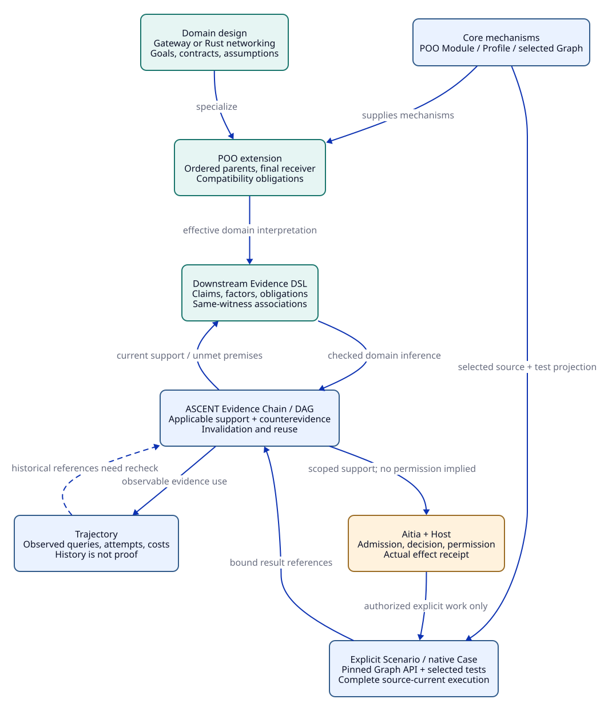 | Core composition, domain associations, ASCENT and Aitia authority ownership |
| [[file:../../30-39-evaluation/30-benchmarks/30.03-gateway-variant-contracts.org::#variant-completion-boundary][Evidence reuse boundary]] | [[file:90.04-evidence-reuse-invalidation.d2][evidence-reuse-invalidation]] | 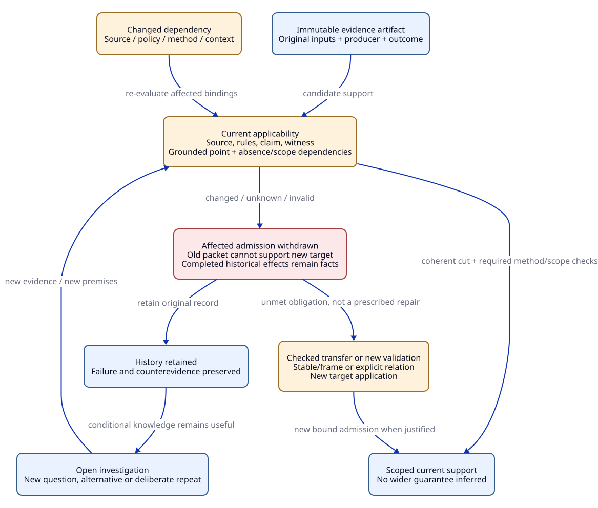 | Changed support, retained history and conditional revalidation/transfer |
| [[file:../../10-19-design/10-architecture/10.05-agent-reasoning-and-design-convergence.org::#design-convergence-definition][Design convergence]] | [[file:90.05-design-qualification.d2][design-qualification]] | 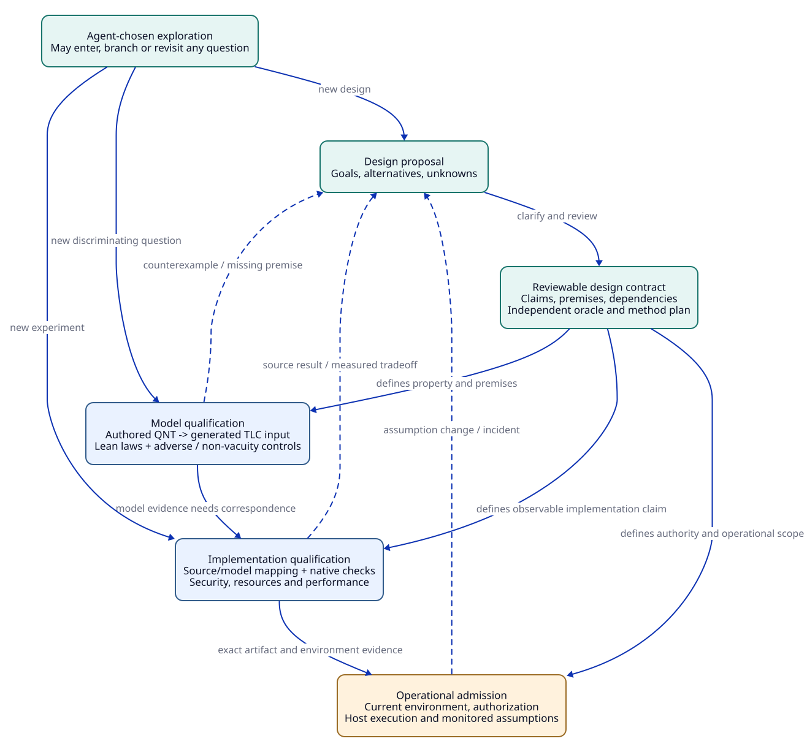 | Acceptance dependencies and feedback; investigation remains Agent-chosen |
| [[file:../../30-39-evaluation/30-benchmarks/30.03-gateway-variant-contracts.org::#variant-map][Variant map]] | [[file:90.06-benchmark-variants.d2][benchmark-variants]] | 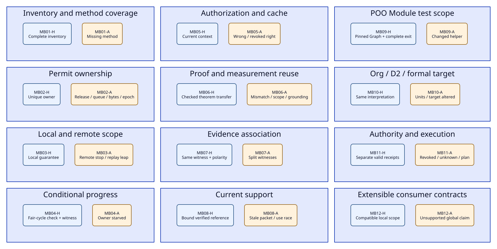 | Twelve paired families and all 24 Org case anchors; no execution order |
| [[file:../../20-29-cases/20-gateway/20.01-gateway-sdlc.org::#gateway-sdlc][Gateway SDLC]] | [[file:90.07-gateway-sdlc-loop.d2][gateway-sdlc-loop]] | 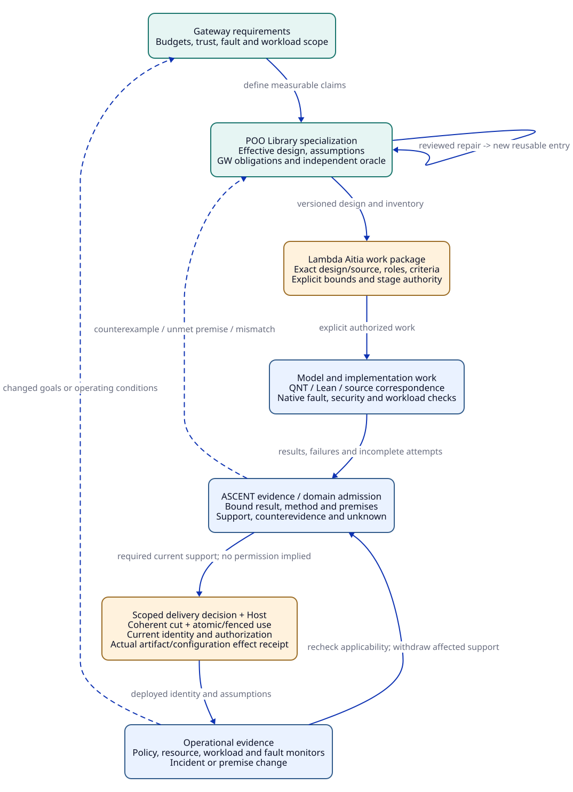 | Versioned work package, evidence return, scoped delivery, operational invalidation and Library evolution |
| [[file:../../20-29-cases/20-gateway/20.03-gateway-design-audit.org::#audit-full-walk][Coherent admission/use cut]] | [[file:90.08-gateway-admission-cut.d2][gateway-admission-cut]] | 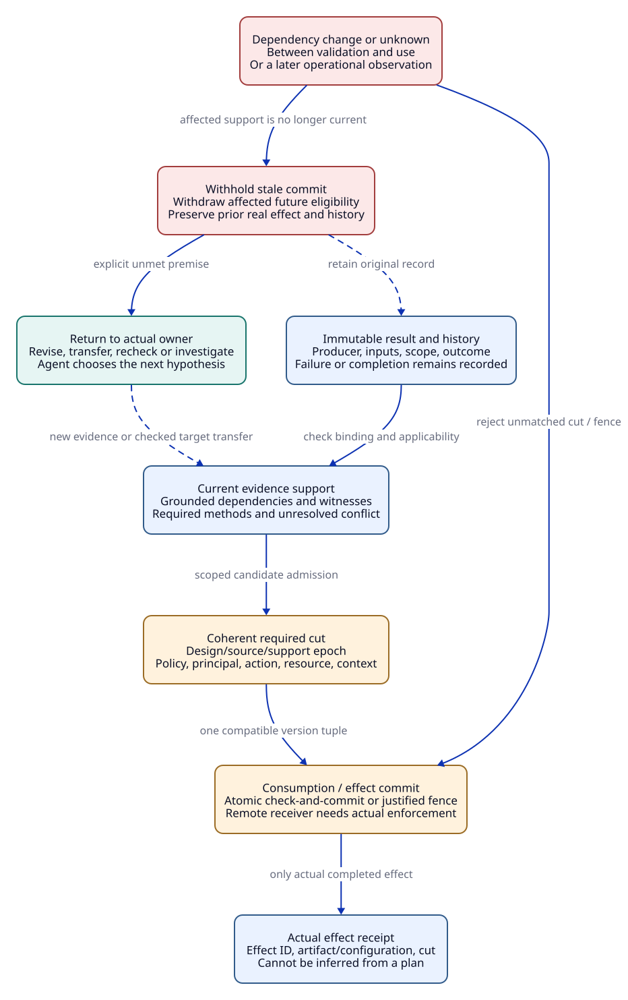 | Validation-to-use race, actual effect receipt, prospective withdrawal and retained history |
| [[file:../../00-09-project/00-documentation/00.01-index.org::#jd-navigation][Documentation organization]] | [[file:90.09-documentation-map.d2][90.09 Documentation map]] | 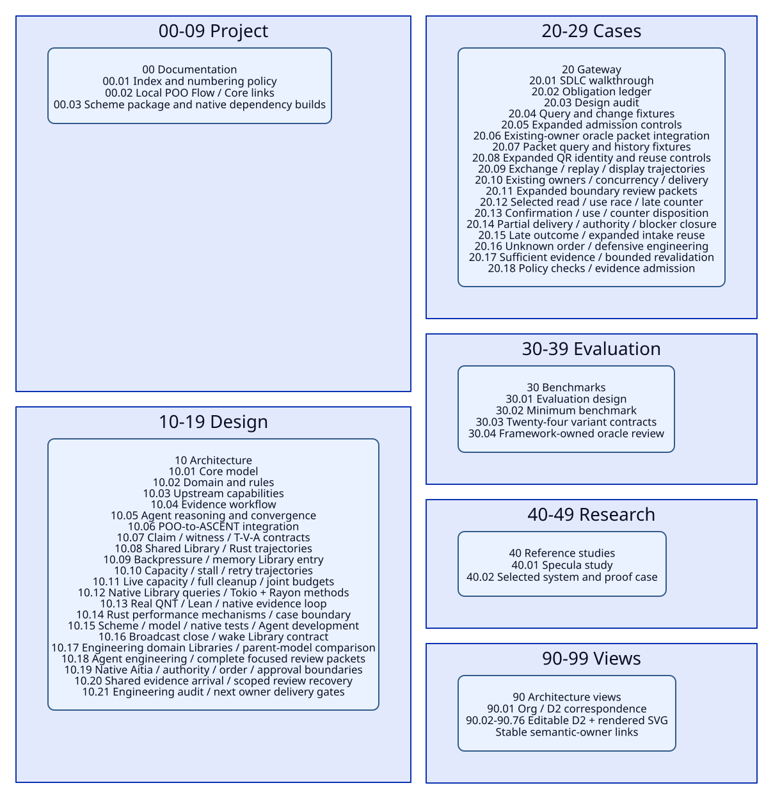 | Johnny.Decimal area/category/item navigation; not an execution order |
| [[file:../../10-19-design/10-architecture/10.06-poo-ascent-integration.org::#gateway-module-organization][POO integration]] | [[file:90.10-poo-ascent-bridge.d2][90.10-poo-ascent-bridge]] | 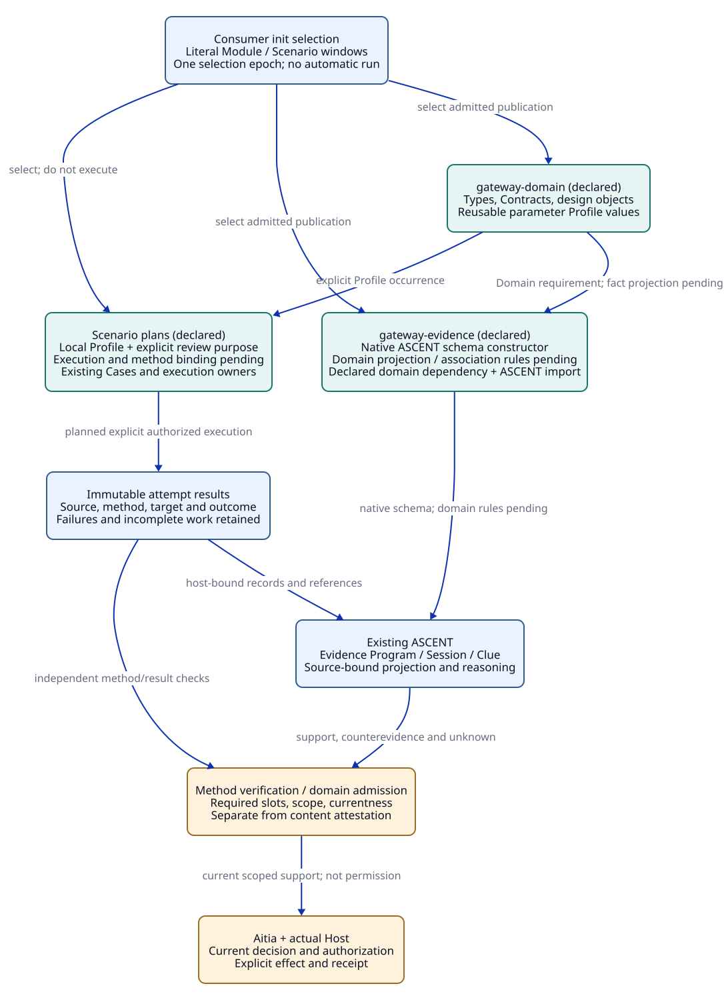 | Two declared design Modules, inherited Profile values and inert Scenario plans |
| [[file:../../10-19-design/10-architecture/10.06-poo-ascent-integration.org::#gateway-query-contract][Registration and query]] | [[file:90.11-evidence-registration-query.d2][90.11-evidence-registration-query]] | 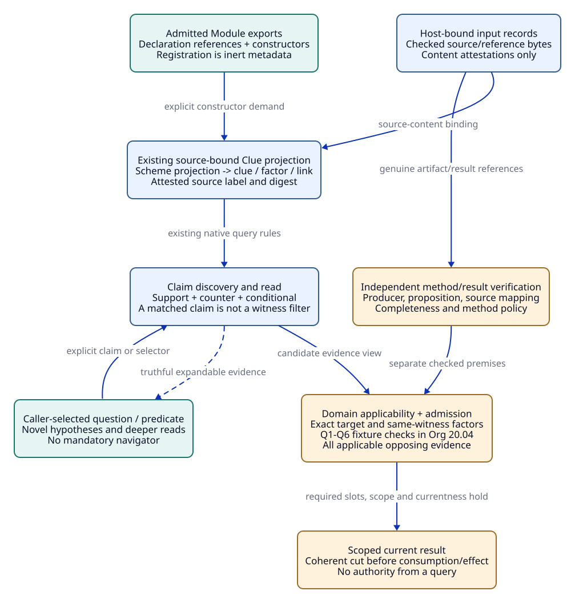 | Content attestation, discovery, witness applicability and method admission |
| [[file:../../10-19-design/10-architecture/10.06-poo-ascent-integration.org::#gateway-integration-changes][Owner change and reuse]] | [[file:90.12-gateway-owner-reuse.d2][90.12-gateway-owner-reuse]] | 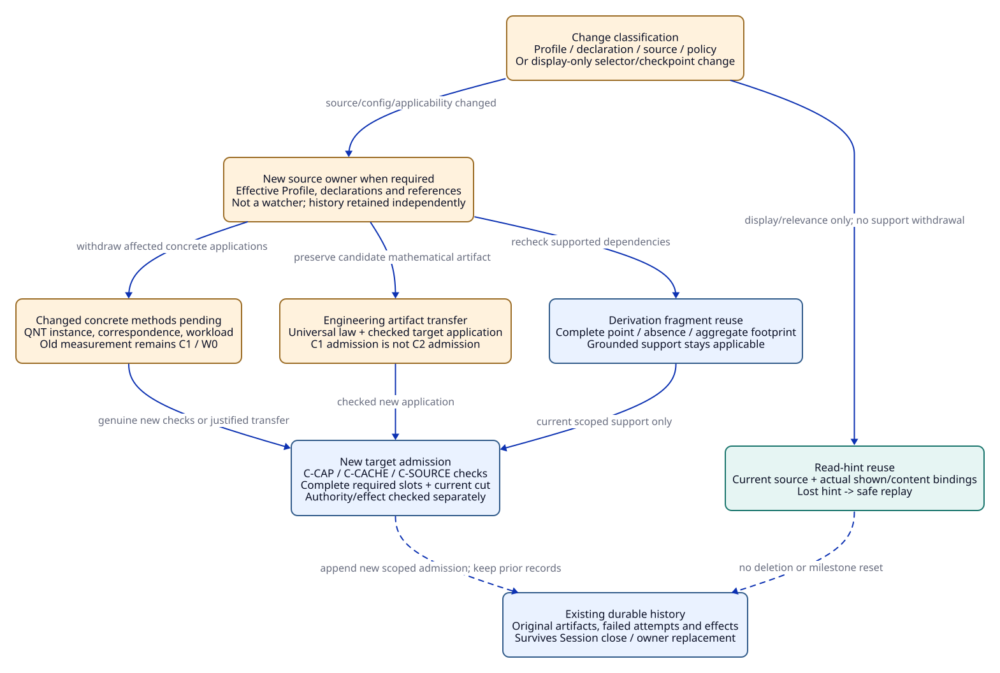 | Read hints, grounded derivation reuse and checked engineering transfer |
| [[file:../../20-29-cases/20-gateway/20.04-query-and-change-fixtures.org::#six-query-fixtures][Claim/witness query boundaries]] | [[file:90.13-claim-witness-queries.d2][90.13-claim-witness-queries]] | 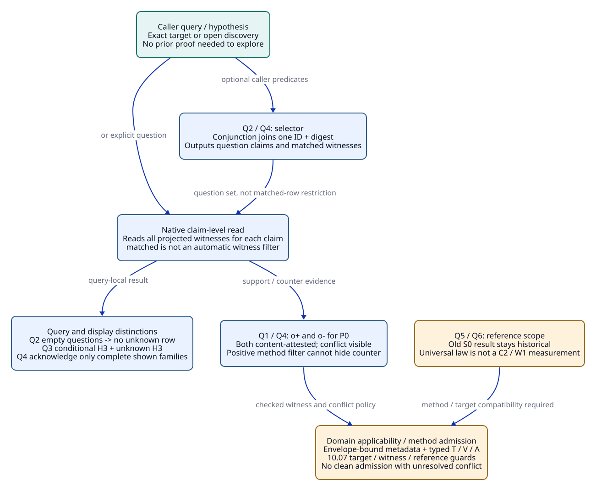 | Exact paper query/change boundaries; no executed verdict |
| [[file:../../20-29-cases/20-gateway/20.04-query-and-change-fixtures.org::#three-change-walkthroughs][Three independent gateway changes]] | [[file:90.14-gateway-three-changes.d2][90.14-gateway-three-changes]] | 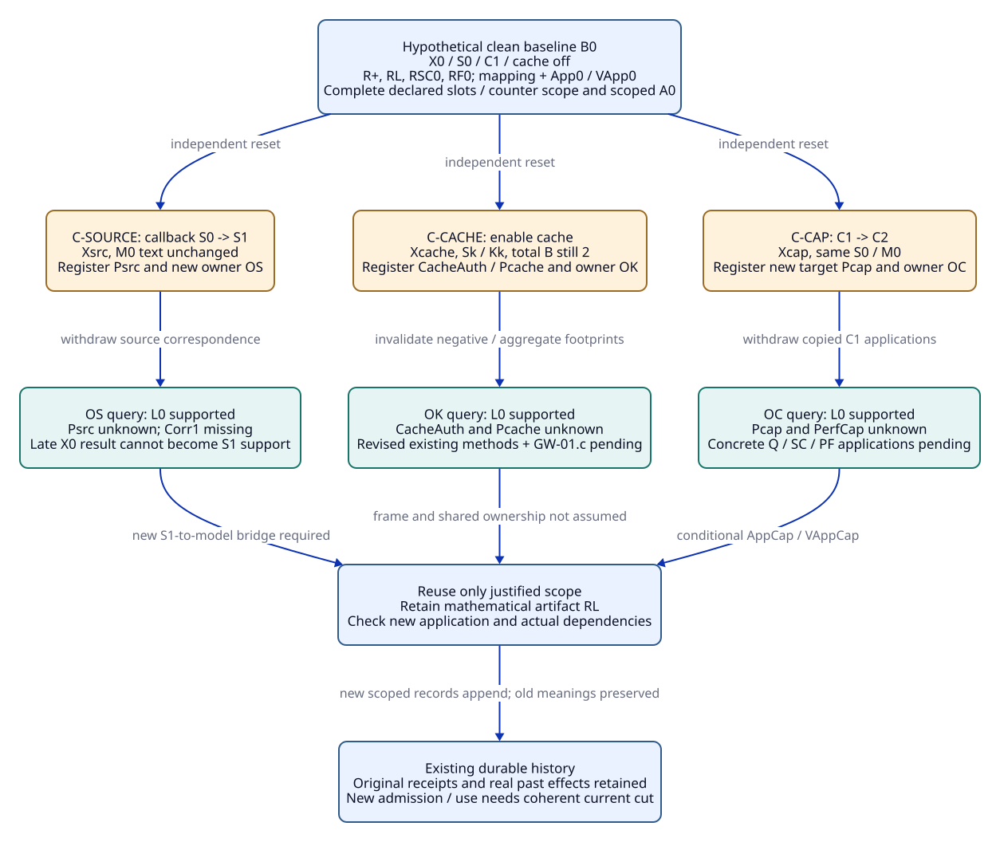 | Exact paper query/change boundaries; no executed verdict |
| [[file:../../10-19-design/10-architecture/10.07-claim-witness-reference-contracts.org::#witness-applicability-contract][Claim/witness/TVA contract]] | [[file:90.15-claim-witness-tva-contract.d2][90.15-claim-witness-tva-contract]] | 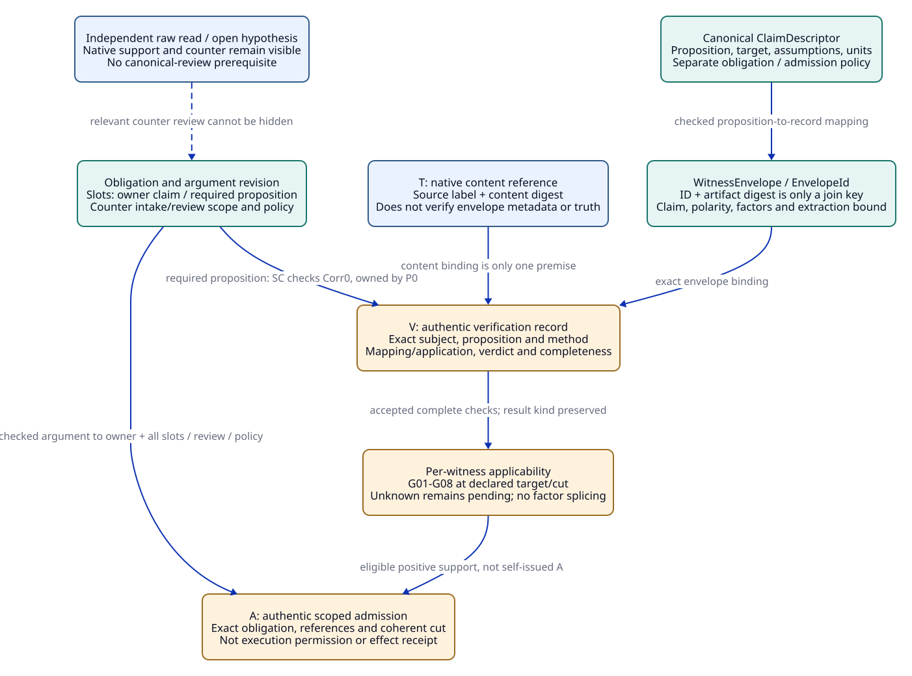 | Proposed data/rule boundaries; no issued V/A or runtime result |
| [[file:../../10-19-design/10-architecture/10.07-claim-witness-reference-contracts.org::#finite-claim-witness-rules][Finite inference and independent oracles]] | [[file:90.16-finite-admission-oracles.d2][90.16-finite-admission-oracles]] | 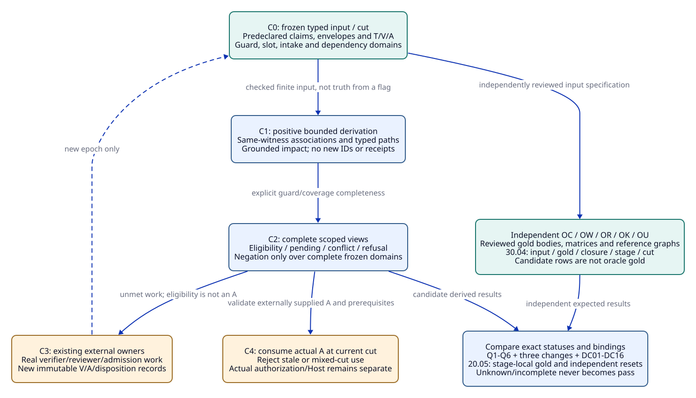 | Proposed data/rule boundaries; no issued V/A or runtime result |
| [[file:../../20-29-cases/20-gateway/20.05-expanded-admission-controls.org::#expanded-dc-controls][Expanded admission controls]] | [[file:90.17-expanded-admission-controls.d2][90.17-expanded-admission-controls]] | 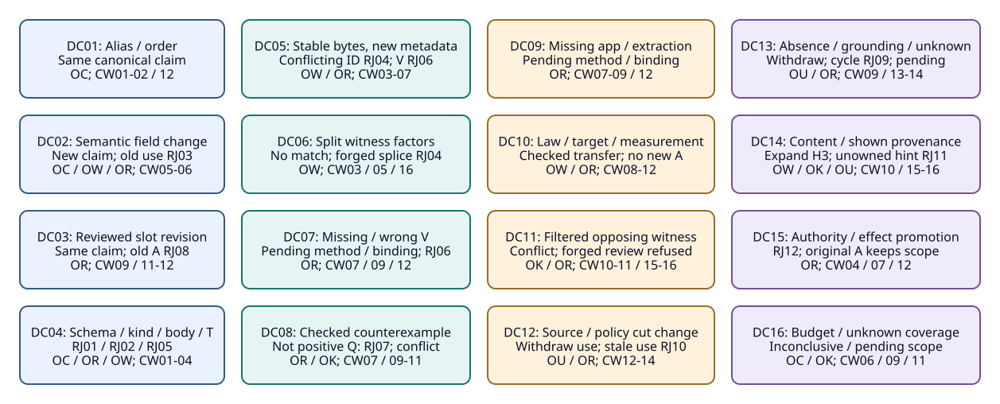 | Paper controls; no executed oracle or admission |
| [[file:../../20-29-cases/20-gateway/20.05-expanded-admission-controls.org::#outcome-algebra][Admission outcome boundaries]] | [[file:90.18-admission-outcome-boundaries.d2][90.18-admission-outcome-boundaries]] | 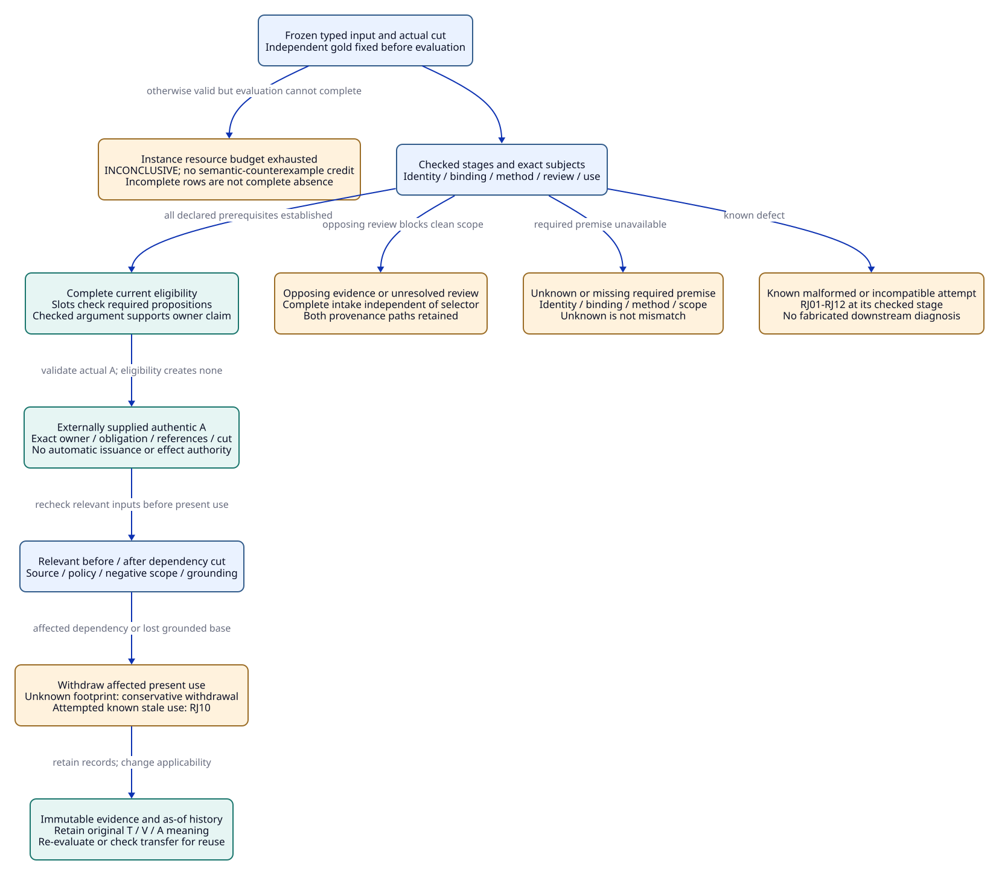 | Paper controls; no executed oracle or admission |
| [[file:../../30-39-evaluation/30-benchmarks/30.04-oracle-review-data-contracts.org::#framework-owned-evaluation][Framework-owned oracle review]] | [[file:90.19-framework-oracle-review.d2][90.19-framework-oracle-review]] | 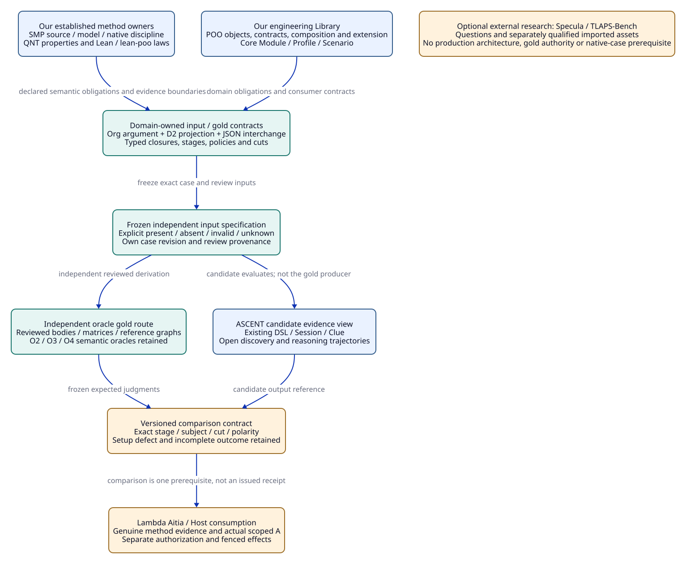 | Proposed review contracts; no oracle execution or qualified variant |
| [[file:../../30-39-evaluation/30-benchmarks/30.04-oracle-review-data-contracts.org::#dc-mb-bindings][Oracle, benchmark and gap bindings]] | [[file:90.20-oracle-benchmark-gap-bindings.d2][90.20-oracle-benchmark-gap-bindings]] | 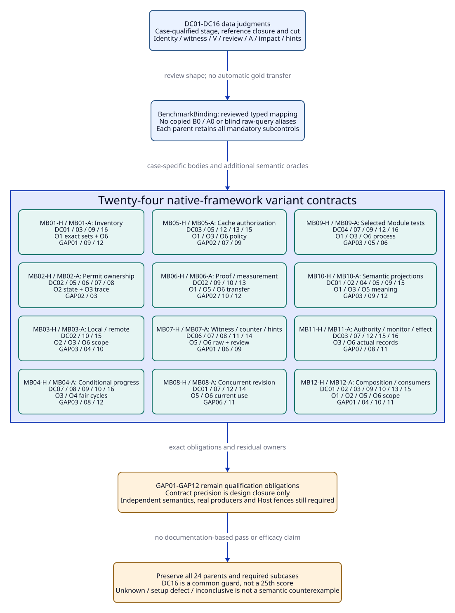 | Proposed review contracts; no oracle execution or qualified variant |
| [[file:../../20-29-cases/20-gateway/20.06-oracle-packet-integration.org::#packet-poo-allocation][Packet binding to existing Module and Evidence owners]] | [[file:90.21-packet-module-evidence-binding.d2][90.21-packet-module-evidence-binding]] | 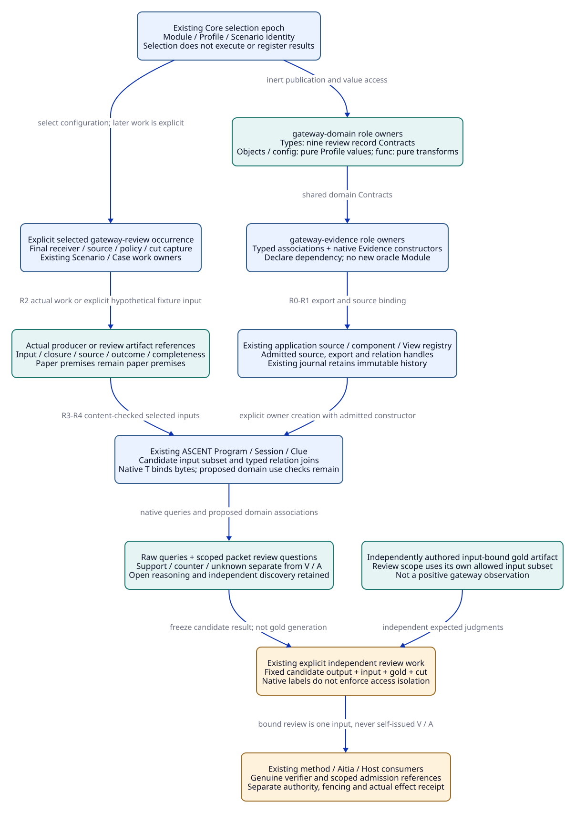 | Design mapping and conditional paper inputs; no integrated or executed oracle |
| [[file:../../20-29-cases/20-gateway/20.06-oracle-packet-integration.org::#three-packet-reviews][Gateway packet change reviews]] | [[file:90.22-gateway-packet-three-paths.d2][90.22-gateway-packet-three-paths]] | 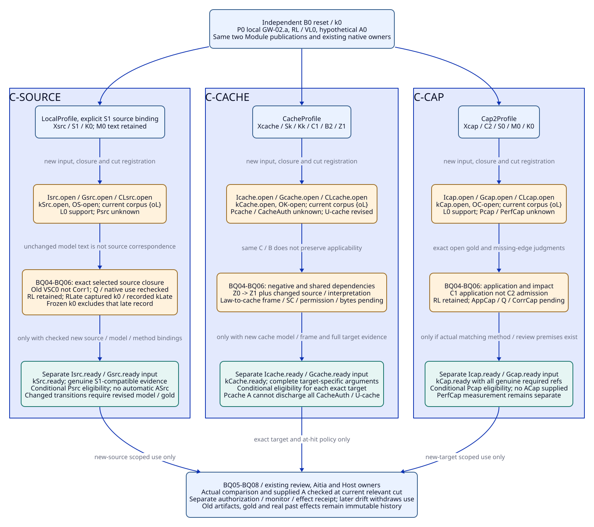 | Design mapping and conditional paper inputs; no integrated or executed oracle |
| [[file:../../20-29-cases/20-gateway/20.07-packet-query-and-history-fixtures.org::#eight-packet-query-fixtures][Eight expanded packet query contracts]] | [[file:90.23-expanded-packet-queries.d2][90.23-expanded-packet-queries]] | 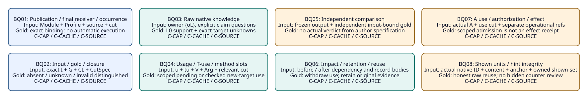 | Paper query/visibility/retention gold; no oracle or native execution |
| [[file:../../20-29-cases/20-gateway/20.07-packet-query-and-history-fixtures.org::#late-intake-visibility][Snapshot visibility and retained evidence]] | [[file:90.24-snapshot-visibility-and-retention.d2][90.24-snapshot-visibility-and-retention]] | 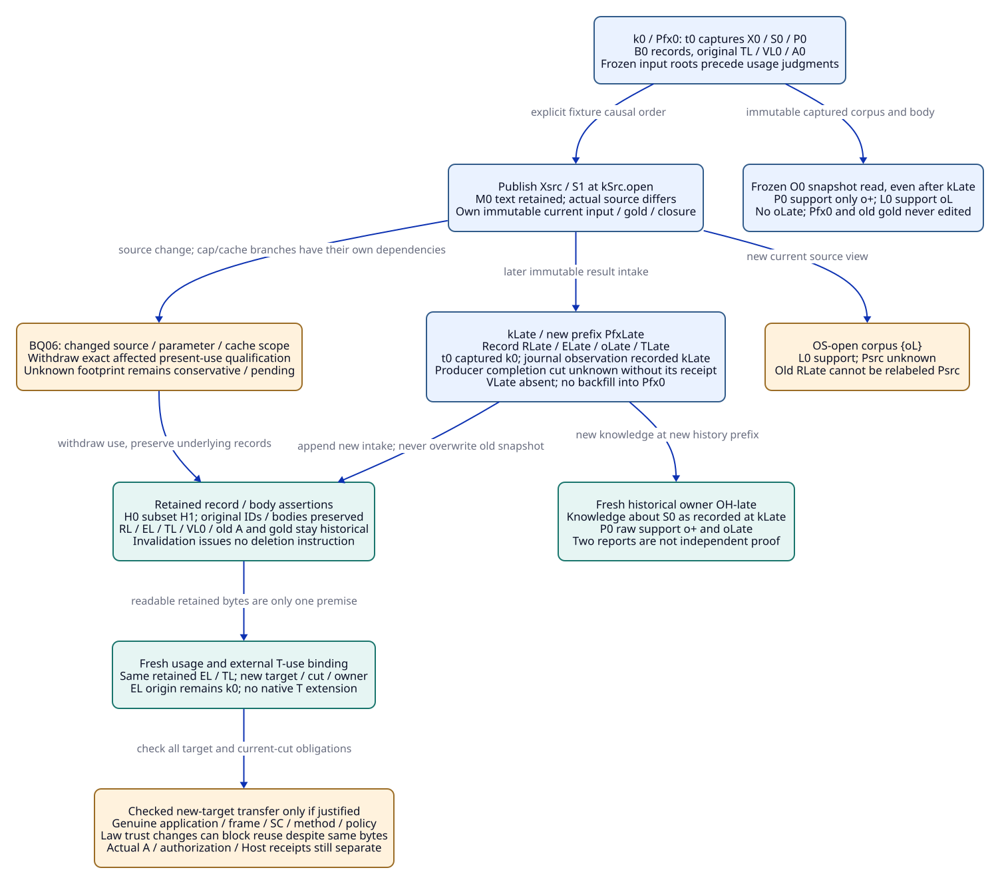 | Paper query/visibility/retention gold; no oracle or native execution |
| [[file:../../20-29-cases/20-gateway/20.08-qr-identity-and-reuse-controls.org::#expanded-qr-controls][Twelve expanded QR controls]] | [[file:90.25-expanded-qr-controls.d2][90.25-expanded-qr-controls]] | 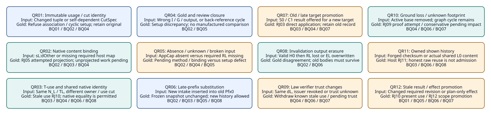 | Author-specified control gold; no executed native or oracle acceptance |
| [[file:../../20-29-cases/20-gateway/20.08-qr-identity-and-reuse-controls.org::#qr-cut-identity-dag][QR identity and reuse boundaries]] | [[file:90.26-qr-identity-and-reuse-boundaries.d2][90.26-qr-identity-and-reuse-boundaries]] | 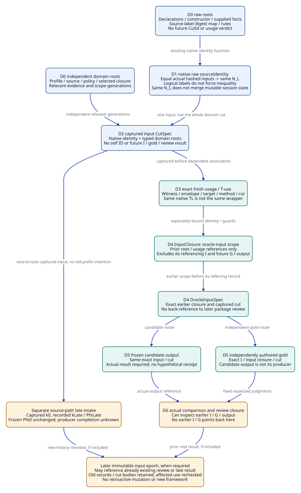 | Author-specified control gold; no executed native or oracle acceptance |
| [[file:../../20-29-cases/20-gateway/20.09-exchange-replay-and-display-trajectories.org::#qr03-event-trajectory][Independent exchange event gold]] | [[file:90.27-independent-exchange-trajectory.d2][90.27-independent-exchange-trajectory]] | 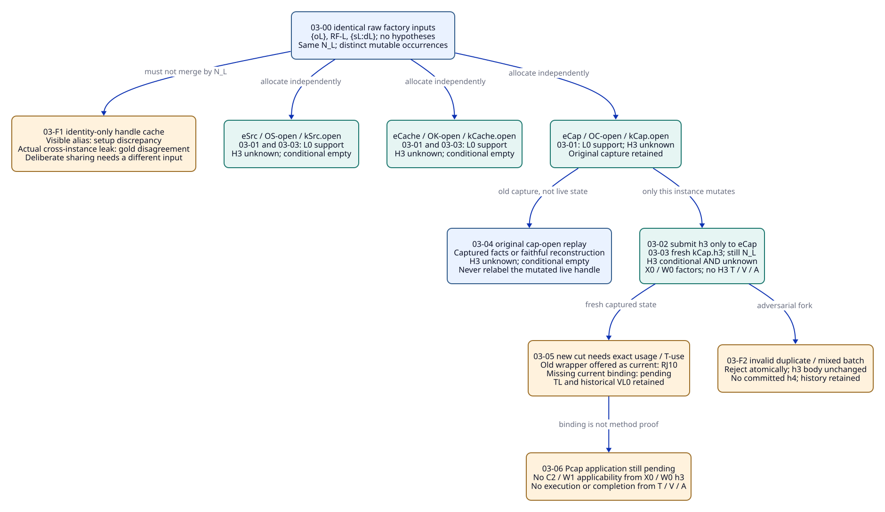 | Paper event gold and scoped reuse; native/Host qualification open |
| [[file:../../20-29-cases/20-gateway/20.09-exchange-replay-and-display-trajectories.org::#qr06-event-trajectory][Frozen replay and display event gold]] | [[file:90.28-frozen-replay-and-display.d2][90.28-frozen-replay-and-display]] | 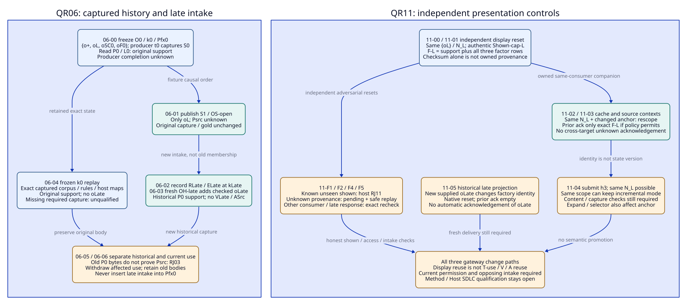 | Paper event gold and scoped reuse; native/Host qualification open |
| [[file:../../20-29-cases/20-gateway/20.10-existing-owner-concurrency-and-delivery.org::#existing-owner-allocation][Existing owners and coherent capture]] | [[file:90.29-existing-owner-concurrency.d2][90.29-existing-owner-concurrency]] | 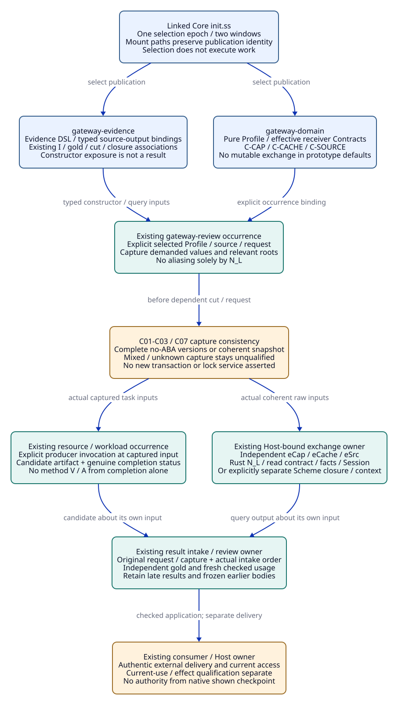 | Current-local-source design companion; native and Host qualification remain open |
| [[file:../../20-29-cases/20-gateway/20.10-existing-owner-concurrency-and-delivery.org::#display-owner-trajectory][Late reply and display confirmation]] | [[file:90.30-late-reply-and-display-confirmation.d2][90.30-late-reply-and-display-confirmation]] | 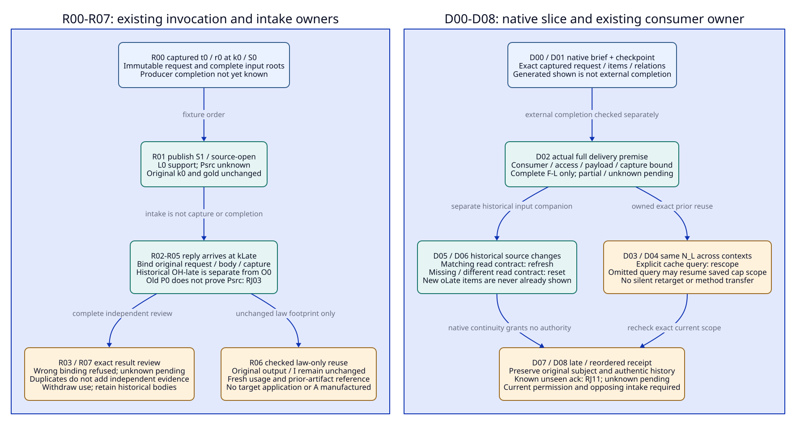 | Current-local-source design companion; native and Host qualification remain open |
| [[file:../../20-29-cases/20-gateway/20.11-expanded-boundary-review-packets.org::#c07-full-packet][ABA and selective late-law reuse]] | [[file:90.31-aba-and-late-law-packets.d2][90.31-aba-and-late-law-packets]] | 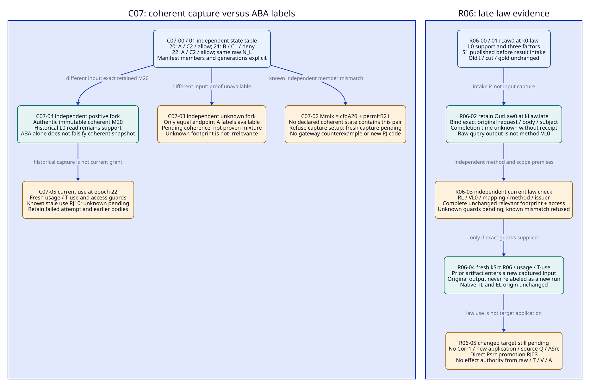 | Exact paper packets and gold; no executed oracle or native control |
| [[file:../../20-29-cases/20-gateway/20.11-expanded-boundary-review-packets.org::#d04-full-packet][Saved query and refresh review]] | [[file:90.32-saved-query-and-refresh-packets.d2][90.32-saved-query-and-refresh-packets]] | 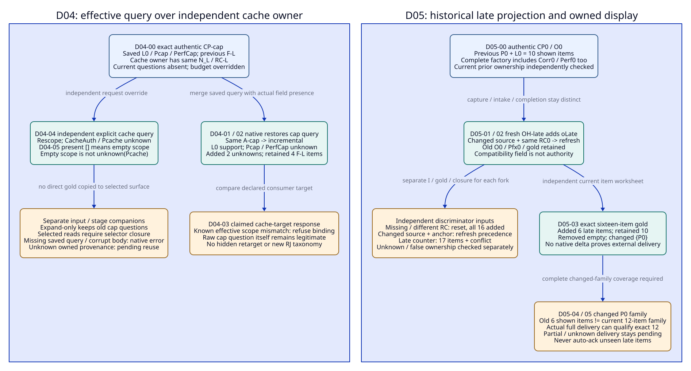 | Exact paper packets and gold; no executed oracle or native control |
| [[file:../../20-29-cases/20-gateway/20.12-selected-read-use-race-and-counter-packets.org::#selected-read-full-packet][Selected restore and relation units]] | [[file:90.33-selected-read-restore-and-relations.d2][90.33-selected-read-restore-and-relations]] | 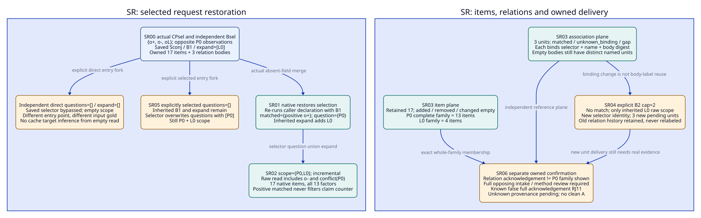 | Paper input/step gold; actual native/current-use/delivery qualification open |
| [[file:../../20-29-cases/20-gateway/20.12-selected-read-use-race-and-counter-packets.org::#use-race-full-packet][Current use and complete opposing delivery]] | [[file:90.34-use-time-race-and-opposing-delivery.d2][90.34-use-time-race-and-opposing-delivery]] | 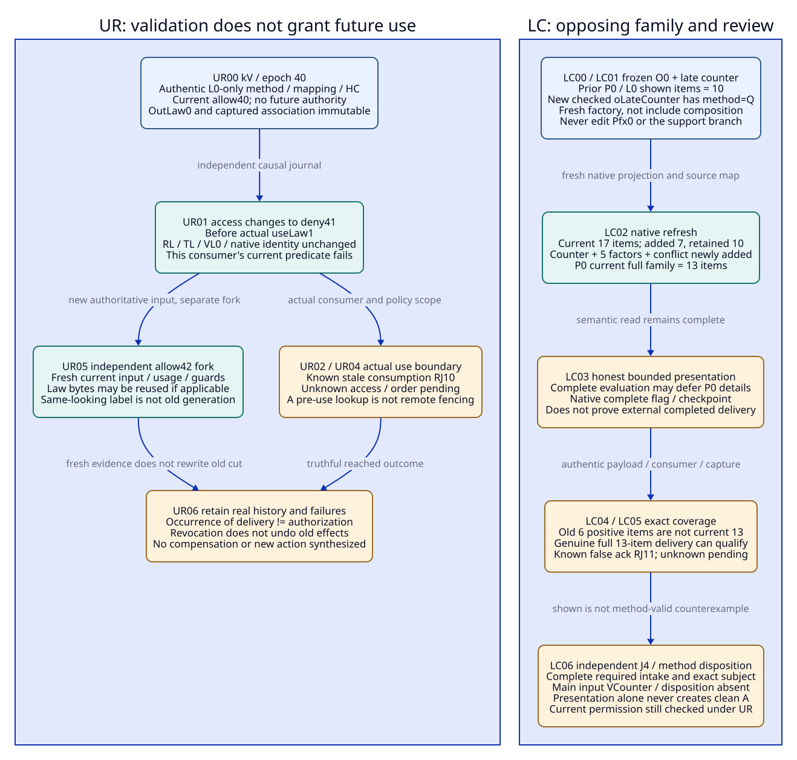 | Paper input/step gold; actual native/current-use/delivery qualification open |
| [[file:../../20-29-cases/20-gateway/20.13-binding-confirmation-use-race-and-counter-disposition.org::#binding-confirmation-full-packet][Binding confirmation and consumption boundary]] | [[file:90.35-binding-confirmation-and-use-boundary.d2][90.35-binding-confirmation-and-use-boundary]] | 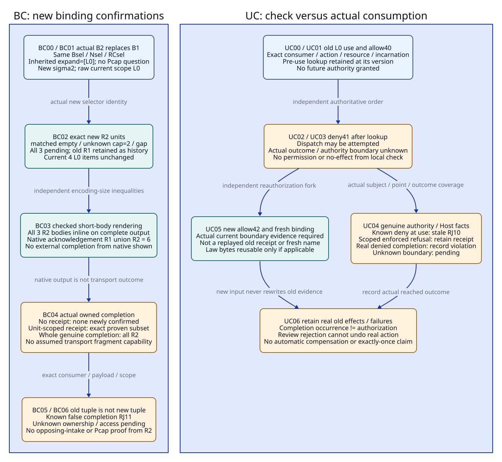 | Paper input/step gold; actual method/current-use/disposition qualification open |
| [[file:../../20-29-cases/20-gateway/20.13-binding-confirmation-use-race-and-counter-disposition.org::#counter-disposition-full-packet][Counter method and authorized disposition]] | [[file:90.36-counter-method-and-disposition.d2][90.36-counter-method-and-disposition]] | 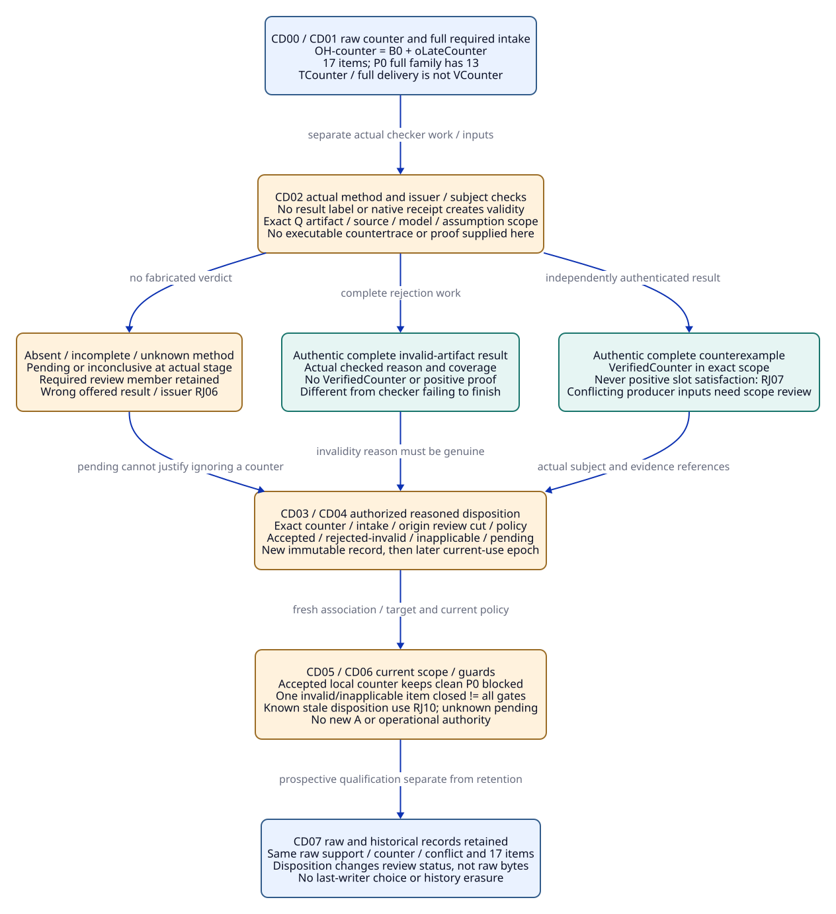 | Paper input/step gold; actual method/current-use/disposition qualification open |
| [[file:../../20-29-cases/20-gateway/20.14-partial-delivery-consumption-authority-and-blocker-closure.org::#partial-relation-packet][Partial delivery and actual consumption authority]] | [[file:90.37-partial-delivery-and-consumption-authority.d2][90.37-partial-delivery-and-consumption-authority]] | 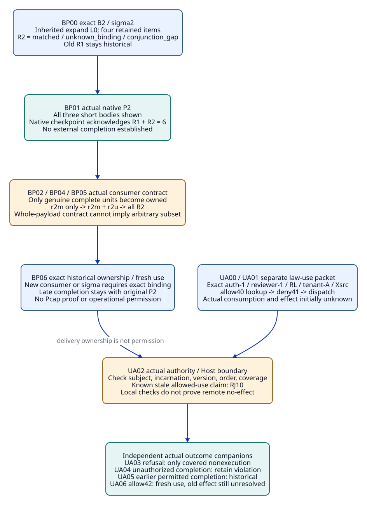 | Paper input/step gold; actual delivery/authority/method qualification open |
| [[file:../../20-29-cases/20-gateway/20.14-partial-delivery-consumption-authority-and-blocker-closure.org::#counter-blocker-packet][Counter item and remaining blockers]] | [[file:90.38-counter-item-and-remaining-blockers.d2][90.38-counter-item-and-remaining-blockers]] | 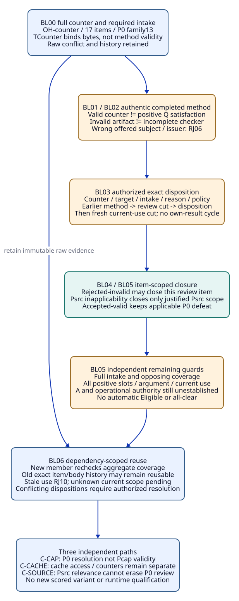 | Paper input/step gold; actual delivery/authority/method qualification open |
| [[file:../../20-29-cases/20-gateway/20.15-late-outcome-origin-and-expanded-intake-reuse.org::#late-delivery-origin-packet][Late delivery and outcome origin]] | [[file:90.39-late-delivery-and-outcome-origin.d2][90.39-late-delivery-and-outcome-origin]] | 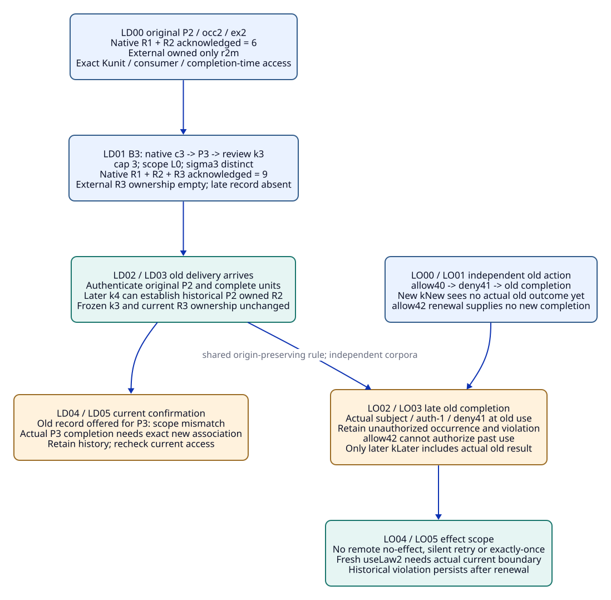 | Paper input/step gold; actual origin/authority/review qualification open |
| [[file:../../20-29-cases/20-gateway/20.15-late-outcome-origin-and-expanded-intake-reuse.org::#expanded-intake-reuse-packet][Expanded intake and item reuse]] | [[file:90.40-expanded-intake-and-item-reuse.d2][90.40-expanded-intake-and-item-reuse]] | 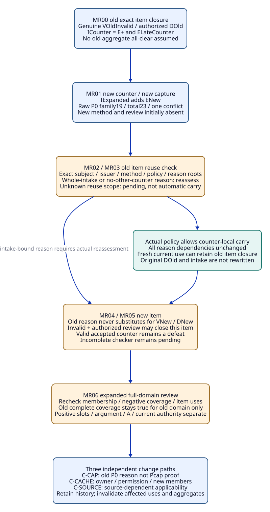 | Paper input/step gold; actual origin/authority/review qualification open |
| [[file:../../20-29-cases/20-gateway/20.16-unknown-order-negative-dependencies-and-defensive-engineering.org::#unknown-delivery-order-packet][Unknown order and historical authority]] | [[file:90.41-unknown-order-and-historical-authority.d2][90.41-unknown-order-and-historical-authority]] | 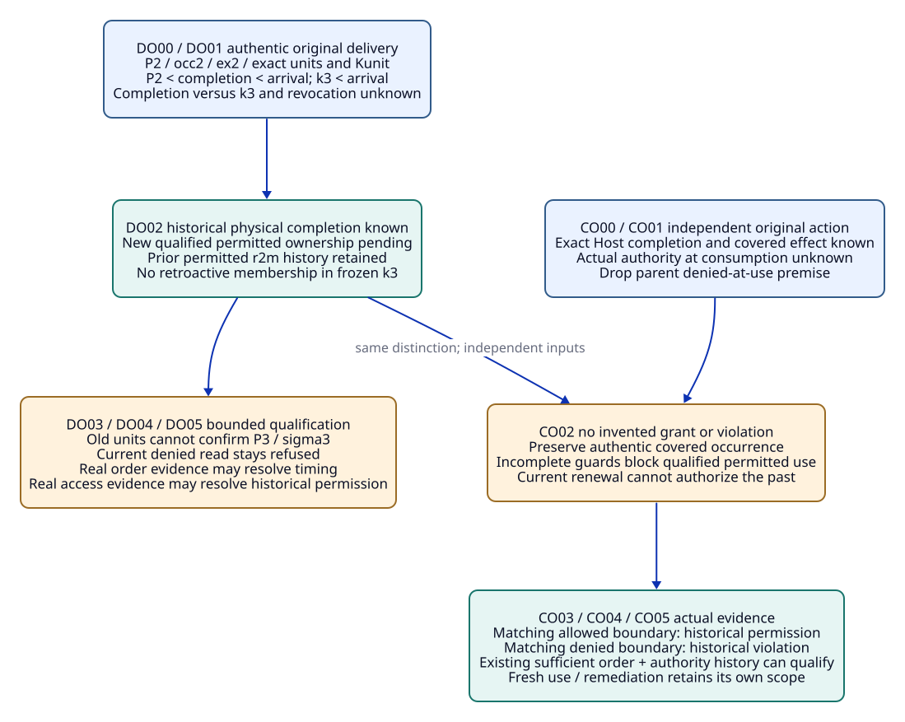 | Paper input/step gold; actual historical authority/reassessment qualification open |
| [[file:../../20-29-cases/20-gateway/20.16-unknown-order-negative-dependencies-and-defensive-engineering.org::#negative-review-recheck-packet][Negative dependencies and defensive engineering]] | [[file:90.42-negative-dependencies-and-defensive-engineering.d2][90.42-negative-dependencies-and-defensive-engineering]] | 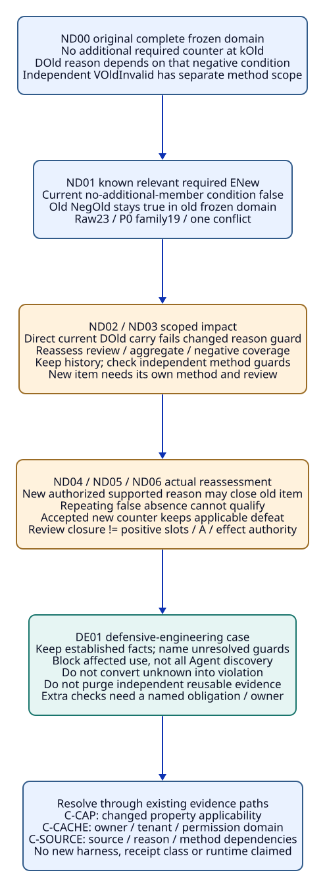 | Paper input/step gold; actual historical authority/reassessment qualification open |
| [[file:../../20-29-cases/20-gateway/20.17-sufficient-evidence-and-bounded-revalidation.org::#historical-access-sufficiency-packet][Historical access and authority sufficiency]] | [[file:90.43-historical-access-and-authority-sufficiency.d2][90.43-historical-access-and-authority-sufficiency]] | 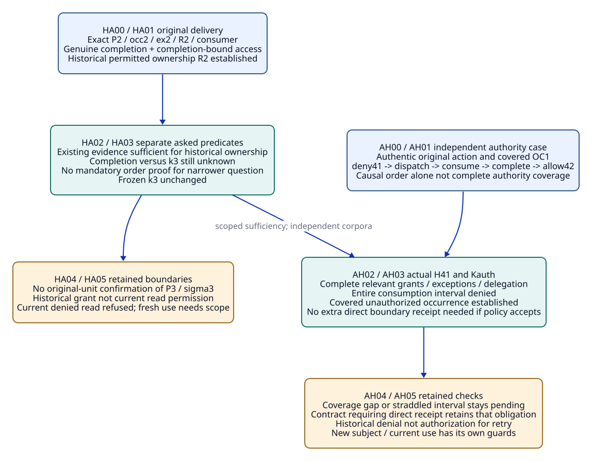 | Paper input/step gold; actual authority/method qualification open |
| [[file:../../20-29-cases/20-gateway/20.17-sufficient-evidence-and-bounded-revalidation.org::#dependent-method-requalification-packet][Dependent method and check boundaries]] | [[file:90.44-dependent-method-and-check-boundaries.d2][90.44-dependent-method-and-check-boundaries]] | 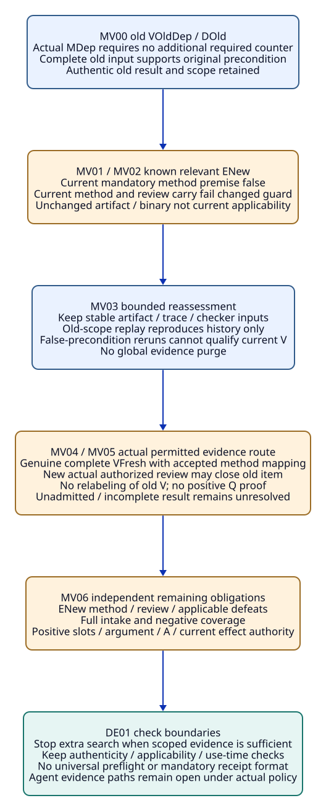 | Paper input/step gold; actual authority/method qualification open |
| [[file:../../20-29-cases/20-gateway/20.18-policy-required-checks-and-evidence-admission.org::#policy-rule-trajectory][Policy requirements and Agent inference]] | [[file:90.45-policy-requirements-and-agent-inference.d2][90.45-policy-requirements-and-agent-inference]] | 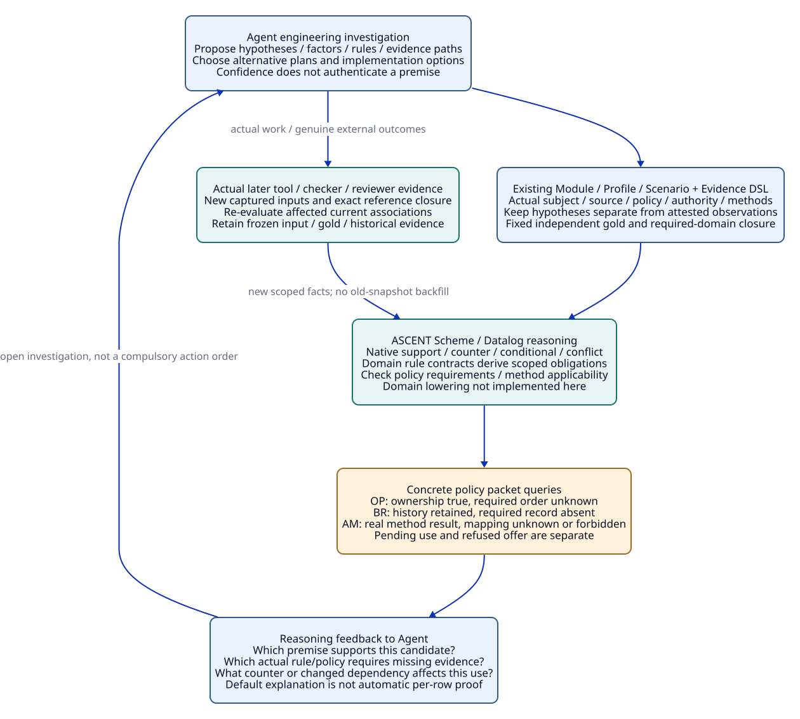 | Design contract; actual domain lowering and qualification open |
| [[file:../../20-29-cases/20-gateway/20.18-policy-required-checks-and-evidence-admission.org::#method-admission-policy-packet][Required policy and admission outcomes]] | [[file:90.46-required-policy-and-admission-outcomes.d2][90.46-required-policy-and-admission-outcomes]] | 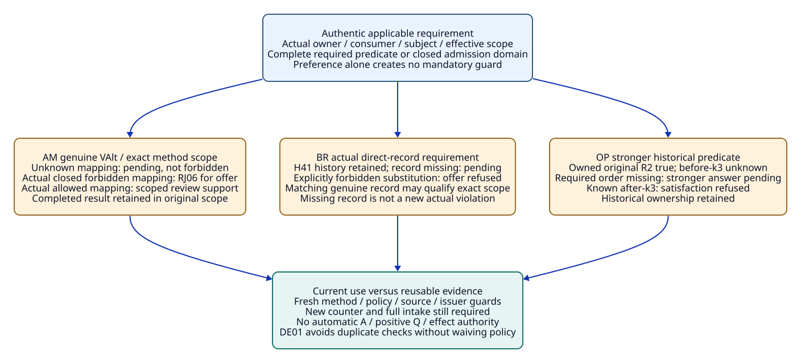 | Design contract; actual domain lowering and qualification open |
| [[file:../../10-19-design/10-architecture/10.08-engineering-library-and-rust-trajectories.org::#rust-evidence-trajectories][Shared engineering Library and Rust trajectories]] | [[file:90.47-shared-engineering-library-and-rust-trajectories.d2][90.47-shared-engineering-library-and-rust-trajectories]] | 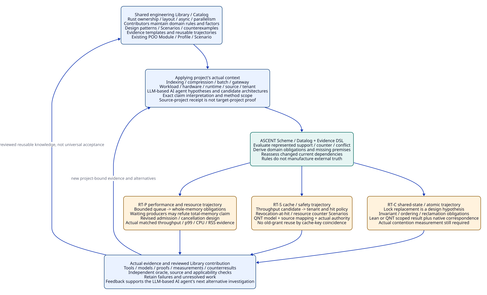 | Design contract; actual domain lowering and qualification open |
| [[file:../../10-19-design/10-architecture/10.09-rust-backpressure-memory-library-entry.org::#backpressure-obligations-evidence][Backpressure Library entry and evidence chain]] | [[file:90.48-backpressure-library-entry-and-evidence-chain.d2][90.48-backpressure-library-entry-and-evidence-chain]] | 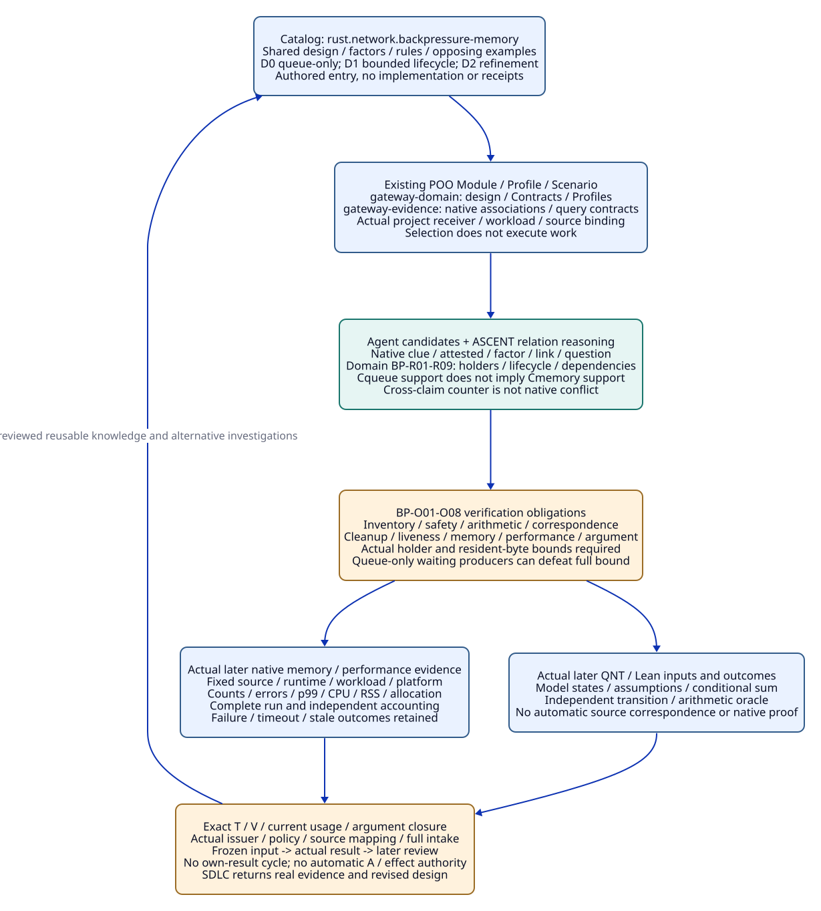 | Complete design entry; actual native/formal/method qualification open |
| [[file:../../10-19-design/10-architecture/10.09-rust-backpressure-memory-library-entry.org::#backpressure-workload-reuse][Backpressure workloads and reuse boundaries]] | [[file:90.49-backpressure-workloads-and-reuse-boundaries.d2][90.49-backpressure-workloads-and-reuse-boundaries]] | 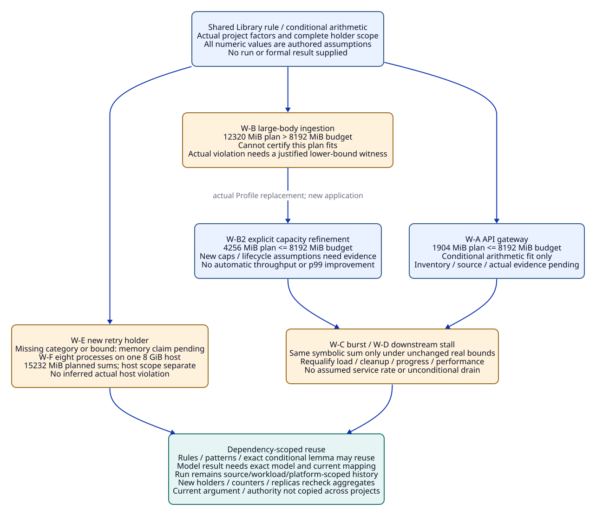 | Complete design entry; actual native/formal/method qualification open |
| [[file:../../10-19-design/10-architecture/10.10-backpressure-capacity-stall-and-retry-trajectories.org::#capacity-adjustment-packet][Capacity adjustment and dependency impact]] | [[file:90.50-capacity-adjustment-and-dependency-impact.d2][90.50-capacity-adjustment-and-dependency-impact]] | 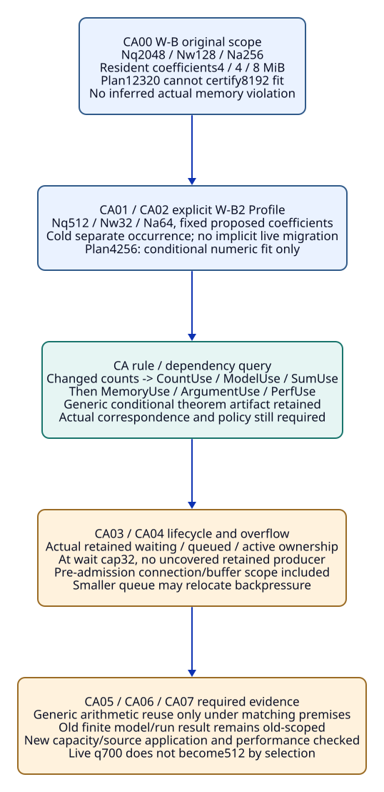 | Authored step gold; actual source/model/native/authority qualification open |
| [[file:../../10-19-design/10-architecture/10.10-backpressure-capacity-stall-and-retry-trajectories.org::#downstream-stall-packet][Downstream stall and retained lifecycle]] | [[file:90.51-downstream-stall-and-retained-lifecycle.d2][90.51-downstream-stall-and-retained-lifecycle]] | 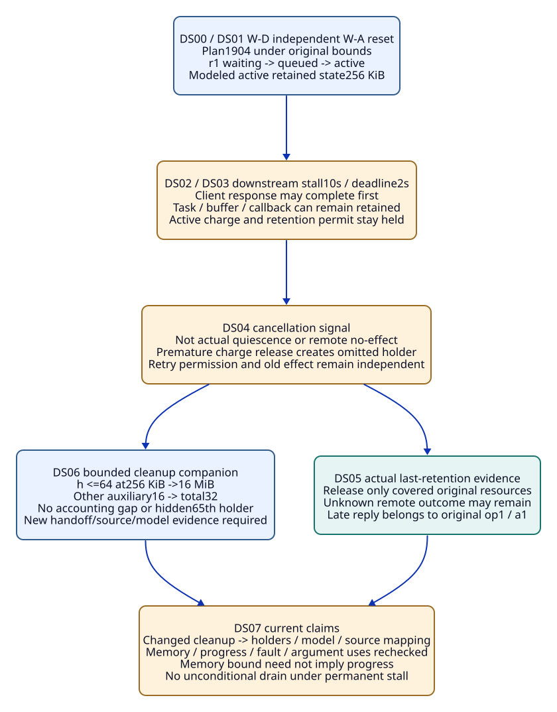 | Authored step gold; actual source/model/native/authority qualification open |
| [[file:../../10-19-design/10-architecture/10.10-backpressure-capacity-stall-and-retry-trajectories.org::#retry-holder-packet][Retry holders and budget composition]] | [[file:90.52-retry-holders-and-budget-composition.d2][90.52-retry-holders-and-budget-composition]] |  | Authored step gold; actual source/model/native/authority qualification open |
| [[file:../../10-19-design/10-architecture/10.11-live-capacity-full-cleanup-and-joint-budgets.org::#live-capacity-generation-packet][Live capacity generations and transition envelope]] | [[file:90.53-live-capacity-generations-and-transition-envelope.d2][90.53-live-capacity-generations-and-transition-envelope]] |  | Authored model/step gold; actual source/method/current-use qualification open |
| [[file:../../10-19-design/10-architecture/10.11-live-capacity-full-cleanup-and-joint-budgets.org::#full-cleanup-ownership-packet][Full cleanup ownership and progress]] | [[file:90.54-full-cleanup-ownership-and-progress.d2][90.54-full-cleanup-ownership-and-progress]] |  | Authored model/step gold; actual source/method/current-use qualification open |
| [[file:../../10-19-design/10-architecture/10.11-live-capacity-full-cleanup-and-joint-budgets.org::#joint-budget-reuse-packet][Joint budget sufficiency and reuse]] | [[file:90.55-joint-budget-sufficiency-and-reuse.d2][90.55-joint-budget-sufficiency-and-reuse]] |  | Authored model/step gold; actual source/method/current-use qualification open |
| [[file:../../00-09-project/00-documentation/00.03-scheme-package-bootstrap.org::#native-dependency-closure][Native Scheme package builds]] | [[file:90.56-scheme-package-bootstrap.d2][90.56-scheme-package-bootstrap]] |  | Native dependency/project builds, package ownership repair and independent import/metadata/ABI checks |
| [[file:../../10-19-design/10-architecture/10.118-domain-property-testing-and-evidence-trajectories.org::#pbt118-scope][Domain PBT through existing owners]] | [[file:90.100-domain-pbt-evidence-loop.d2][90.100 PBT evidence loop]] |  | Proposed generators, state properties, shrink/replay, independent oracles and ASCENT admission/reuse; no native execution |
| [[file:../../10-19-design/10-architecture/10.119-project-component-feature-and-example-boundaries.org::#organization119-scope][Project/Component/Feature classification]] | [[file:90.101-project-component-feature-boundaries.d2][90.101 Organization boundaries]] |  | Current Gateway fixture inventory versus explanatory component target; no new Project or runtime migration |
| [[file:../../10-19-design/10-architecture/10.118-domain-property-testing-and-evidence-trajectories.org::#pbt118-packet-gold][PB-B / PB-C input and gold packets]] | [[file:90.102-pbt-packet-gold-and-reuse.d2][90.102 Packet gold and reuse]] |  | Full paper inputs/step gold, semantic shrink rejection, OV01-OV07 oracle review, RG01-RG08 relation boundaries and PC01-PC08 audit; unexecuted |
| [[file:../../10-19-design/10-architecture/10.118-domain-property-testing-and-evidence-trajectories.org::#pbt118-focused-boundary-packets][PB-BS04 / CG08-counter / RG08 full boundary packets]] | [[file:90.103-pbt-shrink-notification-and-late-review.d2][90.103 Focused PBT boundary gold]] |  | Proposed failure-preserving reductions, finite wake-credit scope and new-occurrence late-counter review with frozen-view isolation; unexecuted |
| [[file:../../10-19-design/10-architecture/10.118-domain-property-testing-and-evidence-trajectories.org::#pbt118-outcome-use-packets][BS04-G07 / CG08-G05 / RG08-G10 outcome and use packets]] | [[file:90.104-pbt-prefix-outcome-wake-credit-and-use.d2][90.104 Prefix, wake and actual-use gold]] |  | Proposed prefix admission versus failed teardown, finite delivered/coalesced opportunity and selected-policy actual-use enforcement; no native execution |
| [[file:../../10-19-design/10-architecture/10.118-domain-property-testing-and-evidence-trajectories.org::#pbt118-late-event-effect-packets][PT-G08 / WO-G09 / UP-G08 late-event and effect packets]] | [[file:90.105-pbt-late-event-fence-and-executed-effect.d2][90.105 Late event, fence and executed-effect gold]] |  | Proposed closure correction/conflict, actual cancellation/delivery order and separate committed-effect/authority/enforcement verdicts; unexecuted |
| [[file:../../10-19-design/10-architecture/10.118-domain-property-testing-and-evidence-trajectories.org::#pbt118-conflict-order-audit-packets][LC-G07 / CW-G09 / EX-G06 conflict, order and historical-authority packets]] | [[file:90.106-pbt-conflict-order-and-historical-authority.d2][90.106 Conflict, order and historical-authority gold]] |  | Proposed scoped current evidence eligibility, question-dependent partial-order verdicts and recognition of actual prior authority without backdating permission; unexecuted |
| [[file:../../10-19-design/10-architecture/10.118-domain-property-testing-and-evidence-trajectories.org::#pbt118-suspension-history-packets][OC-G05 / PO-G09 / HA-G05 suspension and historical-evidence packets]] | [[file:90.107-pbt-suspension-order-and-prior-evidence.d2][90.107 Suspension, historical order and prior-evidence gold]] |  | Proposed current-use eligibility, genuine confirmation of old causal order and role-specific pending/unmet historical prerequisites; unexecuted |
| [[file:../../10-19-design/10-architecture/10.118-domain-property-testing-and-evidence-trajectories.org::#pbt118-reinstatement-history-packets][SU-G09 / HC-G11 / MP-G09 reinstatement and qualified-history packets]] | [[file:90.108-pbt-reinstatement-and-qualified-history.d2][90.108 Reinstatement and qualified history]] |  | Proposed fresh current use after reinstatement, exact historical claim applicability and recovered original acts without backdated permission; unexecuted |
| [[file:../../10-19-design/10-architecture/10.120-yuanxu-package-and-record-ownership.org::#yuanxu120-scope][Yuanxu package and native Record ownership]] | [[file:90.109-yuanxu-package-and-record-ownership.d2][90.109 Package and Record owners]] |  | Root package consolidation, explicit Module imports, native shape/context split and bounded admission gates |
| [[file:../../10-19-design/10-architecture/10.121-native-dependency-cohort-and-expression-alignment.org::#alignment121-scope][Native cohort and expression alignment]] | [[file:90.110-native-cohort-and-expression-alignment.d2][90.110 Native cohort and expression alignment]] |  | Existing native package APIs, coherent dependency sources, owner-checked orphan recovery, shared Scope closure and checked operation projection |
| [[file:../../10-19-design/10-architecture/10.122-declarative-library-models-and-functional-projection.org::#functional122-scope][Declarative Library models and functional projection]] | [[file:90.111-declarative-models-and-functional-projection.d2][90.111 Receiver-aware declarations and projection]] |  | Native slot refinement, named method/case definitions, effective mapping projection and FD01-FD05 controls |
| [[file:../../10-19-design/10-architecture/10.123-layer-declaration-and-evidence-alignment.org::#layers123-scope][Layer declaration and evidence alignment]] | [[file:90.112-layer-declaration-and-evidence-alignment.d2][90.112 Existing owners and declarative projection]] |  | Effective Library/Profile/Scenario values, finite QNT coverage, private registration projection and real ASCENT checks |
| [[file:../../10-19-design/10-architecture/10.124-aitia-review-history-and-recovery-projections.org::#aitia124-scope][Aitia review, history and recovery projections]] | [[file:90.113-aitia-review-history-and-recovery-projections.d2][90.113 Existing Aitia effect boundaries]] |  | Frozen snapshots, direct owner operations, native archive projection and actual process/independent oracle qualification |
| [[file:../../10-19-design/10-architecture/10.125-native-ascent-compiler-product-admission.org::#native125-scope][Native ASCENT compiler product admission]] | [[file:90.114-native-ascent-compiler-product-admission.d2][90.114 Native phase completion]] |  | Native declaration ownership, incomplete phase rejection, bounded repair and Git source custody |

Each D2 source starts with an ~org-target~ comment containing its repository-relative
Org path and stable ~CUSTOM_ID~. In the variant map, node MB01_H corresponds to
~CASE_ID: MB01-H~ and ~CUSTOM_ID: mb01-h~, and analogously for all 24 nodes. The
stable IDs bind views; labels remain readable summaries. An ID match does not
prove semantic equivalence, so relationship and wording review remains necessary.

* Update and verification contract
:PROPERTIES:
:CUSTOM_ID: diagram-update-workflow
:STATUS: specified
:END:

1. Identify the changed semantic claim, relationship, owner, state or case and its Org anchor.
2. Revise the Org contract and affected D2 nodes/edges together; keep uncertainty and permission separate.
3. Format/validate the D2 source and regenerate its SVG with the recorded renderer/options.
4. Check Org parsing/export, local links/anchors and exact case-node correspondence.
5. Inspect the rendered layout for readable text, edge directions, crossing/overlap and misleading status colors.
6. Record actual check scope; successful diagram rendering is documentation verification, not formal or runtime qualification.

For example, render one updated companion with the installed tool:

#+begin_src sh :eval never
 d2 fmt docs/90-99-views/90-architecture-views/90.02-agent-evidence-loop.d2
 d2 --layout dagre --theme 0 --pad 24 --timeout 30 docs/90-99-views/90-architecture-views/90.02-agent-evidence-loop.d2 docs/90-99-views/90-architecture-views/90.02-agent-evidence-loop.svg
#+end_src

The commands document rendering, not a new benchmark runner. Style-only changes
still refresh the rendered view; semantic changes also require contract review.
The present SVGs were generated locally with D2 v0.9.0. No product code, QNT model,
Lean proof, benchmark execution or operational effect is implemented by them.

* Open reasoning and evidence loop

#+CAPTION: The Agent selects questions and experiments; ASCENT supplies applicable evidence and uncertainty.

* Domain composition and ownership

#+CAPTION: Extensible domain designs consume existing mechanisms without creating a second authority.

* Reuse and invalidation

#+CAPTION: Withdraw affected current support while retaining historical artifacts and open alternatives.

* Design and qualification boundaries

#+CAPTION: Model/source/operation need their own evidence; feedback can reopen the design.

* Twenty-four variant view

#+CAPTION: Blue H and amber A identify control types. Every case is specified and unexecuted.

* Gateway SDLC and Library evolution

#+CAPTION: Lifecycle dependencies and feedback, with evidence and effect authority kept distinct.

[[file:90.07-gateway-sdlc-loop.d2][Editable D2 source]]; [[file:../../20-29-cases/20-gateway/20.01-gateway-sdlc.org::#gateway-sdlc][full Org contract]].

* Coherent admission and effect cut

#+CAPTION: Proposed currentness protocol and feedback, separate from implemented ASCENT surfaces.

[[file:90.08-gateway-admission-cut.d2][Editable D2 source]]; [[file:../../20-29-cases/20-gateway/20.03-gateway-design-audit.org::#audit-full-walk][audited Org handoffs]].

* Johnny.Decimal documentation map

#+CAPTION: The shared numbered location hierarchy, separate from domain and claim identities.

[[file:90.09-documentation-map.d2][Editable D2 source]]; [[file:../../00-09-project/00-documentation/00.01-index.org][numbering authority]].

* POO integration

#+CAPTION: Two declared design Modules, inherited Profile values and inert Scenario plans.

[[file:90.10-poo-ascent-bridge.d2][Editable D2 source]]; [[file:../../10-19-design/10-architecture/10.06-poo-ascent-integration.org::#gateway-module-organization][Org contract]].

* Registration and query

#+CAPTION: Content attestation, discovery, witness applicability and method admission.

[[file:90.11-evidence-registration-query.d2][Editable D2 source]]; [[file:../../10-19-design/10-architecture/10.06-poo-ascent-integration.org::#gateway-query-contract][Org contract]].

* Owner change and reuse

#+CAPTION: Read hints, grounded derivation reuse and checked engineering transfer.

[[file:90.12-gateway-owner-reuse.d2][Editable D2 source]]; [[file:../../10-19-design/10-architecture/10.06-poo-ascent-integration.org::#gateway-integration-changes][Org contract]].

* Claim/witness query boundaries

#+CAPTION: Proposed paper fixtures, with native relations and domain admission kept distinct.

[[file:90.13-claim-witness-queries.d2][Editable D2 source]]; [[file:../../20-29-cases/20-gateway/20.04-query-and-change-fixtures.org::#six-query-fixtures][Org contract]].

* Three independent gateway changes

#+CAPTION: Proposed paper fixtures, with native relations and domain admission kept distinct.

[[file:90.14-gateway-three-changes.d2][Editable D2 source]]; [[file:../../20-29-cases/20-gateway/20.04-query-and-change-fixtures.org::#three-change-walkthroughs][Org contract]].

* Claim/witness/TVA contract

#+CAPTION: Proposed data and finite-rule contracts; external verification/admission remains separately owned.

[[file:90.15-claim-witness-tva-contract.d2][Editable D2 source]]; [[file:../../10-19-design/10-architecture/10.07-claim-witness-reference-contracts.org::#witness-applicability-contract][Org contract]].

* Finite inference and independent oracles

#+CAPTION: Proposed data and finite-rule contracts; external verification/admission remains separately owned.

[[file:90.16-finite-admission-oracles.d2][Editable D2 source]]; [[file:../../10-19-design/10-architecture/10.07-claim-witness-reference-contracts.org::#finite-claim-witness-rules][Org contract]].

* Expanded admission controls

#+CAPTION: Proposed independent reset controls and stage-local outcomes; no runtime result.

[[file:90.17-expanded-admission-controls.d2][Editable D2 source]]; [[file:../../20-29-cases/20-gateway/20.05-expanded-admission-controls.org::#expanded-dc-controls][Org contract]].

* Admission outcome boundaries

#+CAPTION: Proposed independent reset controls and stage-local outcomes; no runtime result.

[[file:90.18-admission-outcome-boundaries.d2][Editable D2 source]]; [[file:../../20-29-cases/20-gateway/20.05-expanded-admission-controls.org::#outcome-algebra][Org contract]].

* Framework-owned oracle review

#+CAPTION: Framework ownership and case-specific review obligations; external research does not define the system.

[[file:90.19-framework-oracle-review.d2][Editable D2 source]]; [[file:../../30-39-evaluation/30-benchmarks/30.04-oracle-review-data-contracts.org::#framework-owned-evaluation][Org contract]].

* Oracle, benchmark and gap bindings

#+CAPTION: Framework ownership and case-specific review obligations; external research does not define the system.

[[file:90.20-oracle-benchmark-gap-bindings.d2][Editable D2 source]]; [[file:../../30-39-evaluation/30-benchmarks/30.04-oracle-review-data-contracts.org::#dc-mb-bindings][Org contract]].

* Packet binding to existing Module and Evidence owners

#+CAPTION: Same native owners, separate input/gold scopes and exact open/ready cuts; all gateway premises remain hypothetical.

[[file:90.21-packet-module-evidence-binding.d2][Editable D2 source]]; [[file:../../20-29-cases/20-gateway/20.06-oracle-packet-integration.org::#packet-poo-allocation][Org contract]].

* Gateway packet change reviews

#+CAPTION: Same native owners, separate input/gold scopes and exact open/ready cuts; all gateway premises remain hypothetical.

[[file:90.22-gateway-packet-three-paths.d2][Editable D2 source]]; [[file:../../20-29-cases/20-gateway/20.06-oracle-packet-integration.org::#three-packet-reviews][Org contract]].

* Eight expanded packet query contracts

#+CAPTION: Hypothetical bounded query and visibility assertions; native raw results stay distinct from domain verification and actual receipts.

[[file:90.23-expanded-packet-queries.d2][Editable D2 source]]; [[file:../../20-29-cases/20-gateway/20.07-packet-query-and-history-fixtures.org::#eight-packet-query-fixtures][Org contract]].

* Snapshot visibility and retained evidence

#+CAPTION: Hypothetical bounded query and visibility assertions; native raw results stay distinct from domain verification and actual receipts.

[[file:90.24-snapshot-visibility-and-retention.d2][Editable D2 source]]; [[file:../../20-29-cases/20-gateway/20.07-packet-query-and-history-fixtures.org::#late-intake-visibility][Org contract]].

* Twelve expanded QR controls

#+CAPTION: Proposed QR input/gold and identity boundaries through existing owners; logical domain cuts remain distinct from native raw identities.

[[file:90.25-expanded-qr-controls.d2][Editable D2 source]]; [[file:../../20-29-cases/20-gateway/20.08-qr-identity-and-reuse-controls.org::#expanded-qr-controls][Org contract]].

* QR identity and reuse boundaries

#+CAPTION: Proposed QR input/gold and identity boundaries through existing owners; logical domain cuts remain distinct from native raw identities.

[[file:90.26-qr-identity-and-reuse-boundaries.d2][Editable D2 source]]; [[file:../../20-29-cases/20-gateway/20.08-qr-identity-and-reuse-controls.org::#qr-cut-identity-dag][Org contract]].

* Exchange, replay and display trajectories

#+CAPTION: Equal native identity does not merge occurrences or justify old-snapshot reads.

#+CAPTION: Exact captures and owned shown provenance govern replay and display reuse; engineering qualification stays separate.

* Existing owners, concurrent captures and external delivery

#+CAPTION: Explicit occurrences own captured input and native exchanges; pure Profiles and selected publications do not execute work.

#+CAPTION: Current-source refresh and saved-query behavior remain separate from honest external delivery and engineering reuse.

* Expanded boundary packet inputs and gold

#+CAPTION: Known mixture, unknown coherence and authentic immutable capture have distinct judgments; late raw law output needs fresh checked use.

#+CAPTION: Actual restored scope, native refresh deltas and completed full-family delivery are independently checked.

* Selected reads, actual use and complete opposing delivery

#+CAPTION: Selected restore re-runs bindings and retains separate item/relation history; positive discovery does not remove opposing raw records.

#+CAPTION: Current permission, authentic completed full-family delivery and independent opposing-method review remain separate predicates.

* Binding confirmation, actual use and counter disposition

#+CAPTION: Native acknowledgement, exact external unit completion and actual consumption authority retain separate subjects and evidence.

#+CAPTION: Actual checker kind/completeness and reasoned authorized disposition govern review blockers without rewriting raw counter history.

* Partial delivery and actual consumption authority

* Counter item and remaining blockers

* Late delivery and outcome origin

* Expanded intake and item reuse

* Unknown order and historical authority

* Negative dependencies and defensive engineering

* Historical access and authority sufficiency

* Dependent method and check boundaries

* Policy requirements and Agent inference

* Required policy and admission outcomes

* Shared engineering Library and Rust trajectories

* Backpressure Library entry and evidence chain

* Backpressure workloads and reuse boundaries

* Capacity adjustment and dependency impact

* Downstream stall and retained lifecycle

* Retry holders and budget composition

* Live capacity generations and transition envelope

* Full cleanup ownership and progress

* Joint budget sufficiency and reuse

* Scheme package bootstrap

* Current executable Library view
:PROPERTIES:
:CUSTOM_ID: current-executable-library-view
:END:

| Semantic owner | Editable source | Rendered view | Scope |
|----------------+-----------------+---------------+-------|
| [[file:../../10-19-design/10-architecture/10.12-gateway-library-registration-and-runtime-dependencies.org::#gateway-library-organization][Gateway Library application]] | [[file:90.57-gateway-library-runtime-chain.d2][90.57]] |  | Native registration/query, independent Profiles, Tokio/Rayon factors, QNT/Lean methods and scoped reuse |
| [[file:../../10-19-design/10-architecture/10.13-real-method-results-and-agent-evidence-loop.org::#real-agent-evidence-responsibilities][Real local method evidence loop]] | [[file:90.58-real-agent-method-evidence-loop.d2][90.58]] |  | Core Ops, actual QNT/TLC and Lean, independent oracle, native clue exchange and scoped reuse |
| [[file:../../10-19-design/10-architecture/10.14-rust-performance-library-and-mechanism-cases.org::#rust-library-boundary][Rust performance Library boundary]] | [[file:90.59-rust-mechanism-library-and-application-cases.d2][90.59]] |  | Mechanism-owned knowledge, runtime specialization, application bindings and specified native case |
| [[file:../../10-19-design/10-architecture/10.15-scheme-owned-rust-mechanisms-and-development-evidence.org::#scheme-rust-mechanism-owners][Scheme-owned Rust mechanisms]] | [[file:90.60-scheme-mechanism-model-test-agent-loop.d2][90.60]] |  | Native lifecycle subjects, model mapping, existing ASCENT and Agent development feedback |
| [[file:../../10-19-design/10-architecture/10.16-tokio-broadcast-close-and-wake-library.org::#broadcast-library-entry][Broadcast Library and evidence design]] | [[file:90.61-broadcast-library-model-test-evidence.d2][90.61]] |  | Source-inspected design; new Module/model/native methods not executed |
| [[file:../../10-19-design/10-architecture/10.16-tokio-broadcast-close-and-wake-library.org::#broadcast-source-qnt-mapping][Broadcast protocol/source boundaries]] | [[file:90.62-broadcast-close-waiter-and-notify-boundaries.d2][90.62]] |  | Split closure, waiter lifetime and Notify epoch loop; bounded contract only |
| [[file:../../10-19-design/10-architecture/10.17-domain-libraries-and-atomic-specialization.org::#domain-library-organization][Engineering Library organization]] | [[file:90.63-engineering-library-hierarchy-and-atomic-selection.d2][90.63 Library hierarchy]] |  | Generic domain ownership, Rust/Tokio specialization, explicit Core selection and conditional evidence reuse |
| [[file:../../10-19-design/10-architecture/10.17-domain-libraries-and-atomic-specialization.org::#backpressure-broadcast-parent-models][Two-case parent model comparison]] | [[file:90.64-backpressure-broadcast-parent-models-and-obligations.d2][90.64 Parent models and obligations]] |  | Proposed semantic extraction, preserving POO specialization and distinct source/evidence closures |
| [[file:../../10-19-design/10-architecture/10.18-agent-authored-engineering-and-review-contracts.org::#agent-engineering-review-purpose][Agent-authored engineering and review]] | [[file:90.65-agent-engineering-explanation-and-review.d2][90.65 Engineering explanations and review]] |  | Selected Style and semantic obligations, actual evidence, explanation currentness and prospective review-cost evaluation |
| [[file:../../10-19-design/10-architecture/10.18-agent-authored-engineering-and-review-contracts.org::#expanded-ar-review-cases][Expanded AR01-AR08 review packets]] | [[file:90.66-ar-review-cases-claims-evidence-and-cost.d2][90.66 Review cases and cost]] |  | Proposed before/after code and comments, preserving POO obligations, scoped ASCENT evidence and independent gold; cost benefit remains unmeasured |
| [[file:../../10-19-design/10-architecture/10.18-agent-authored-engineering-and-review-contracts.org::#focused-ar-input-packets][Complete AR05/AR06/AR08 packets]] | [[file:90.67-focused-ar-reuse-bytes-and-opposing-evidence.d2][90.67 Reuse, bytes and opposing evidence]] |  | Complete design inputs, acyclic reference closure, independent gold and standard-assessment boundaries |
| [[file:../../10-19-design/10-architecture/10.19-standard-identities-and-aitia-review-traceability.org::#standards-and-local-numbering][Standard requirement identity]] | [[file:90.68-nasa-swe-identities-and-aitia-review.d2][90.68 NASA/SWE and Aitia]] |  | Existing Aitia standard owners, local case traceability, paragraph criteria and failure/applicability precedence |
| [[file:../../10-19-design/10-architecture/10.19-standard-identities-and-aitia-review-traceability.org::#native-aitia-review-packets][Native Aitia AR inputs and gold]] | [[file:90.69-native-aitia-ar-review-packets.d2][90.69 Native Aitia packets]] |  | Participant independence, source-byte change, paragraph closure and current-failure precedence; owner tests qualified, packet execution open |
| [[file:../../10-19-design/10-architecture/10.19-standard-identities-and-aitia-review-traceability.org::#revision-disposition-packets][A05-6 / A06-6 / A08-8 revision closure]] | [[file:90.70-revision-disposition-and-evidence-reuse.d2][90.70 Revision disposition and reuse]] |  | Complete recovery inputs/gold, inherited issue disposition, stable evidence reuse and native history-verification limits |
| [[file:../../10-19-design/10-architecture/10.19-standard-identities-and-aitia-review-traceability.org::#history-counter-policy-packets][A05-6.2 / A06-6.7 / A08-8.5 inputs and gold]] | [[file:90.71-history-counter-and-policy-boundaries.d2][90.71 History, counter and policy boundaries]] |  | Bounded inventory reconciliation, expanded counter review, controlled policy/scope changes and explicit native limits |
| [[file:../../10-19-design/10-architecture/10.19-standard-identities-and-aitia-review-traceability.org::#availability-revocation-scope-packets][HC04 / CR06 / BC06 inputs and gold]] | [[file:90.72-history-availability-revocation-and-scope-retention.d2][90.72 Availability, revocation/use and scope retention]] |  | Exact archive/unknown history boundaries, explicit receipt/use ordering and retained original obligations after limited-scope admission |
| [[file:../../10-19-design/10-architecture/10.19-standard-identities-and-aitia-review-traceability.org::#archive-race-handoff-packets][HA04 / RV02 / LS07 inputs and gold]] | [[file:90.73-archive-applicability-use-race-and-owner-handoff.d2][90.73 Archive applicability, use race and owner handoff]] |  | Exact historical trust/coverage, actual post-revocation effects and policy-grounded retained-obligation handoff |
| [[file:../../10-19-design/10-architecture/10.19-standard-identities-and-aitia-review-traceability.org::#authority-order-approval-pending-packets][AA05 / PR07 / OH07 pending input packets]] | [[file:90.74-unavailable-authority-unknown-order-and-no-fallback.d2][90.74 Authority, order and approval uncertainty]] |  | Missing archive status, compatible revocation/use histories and required approval without authorized fallback |
| [[file:../../10-19-design/10-architecture/10.20-evidence-arrival-and-scoped-review-recovery.org::#evidence-recovery-purpose][Shared evidence recovery contract]] | [[file:90.75-evidence-arrival-and-scoped-review-recovery.d2][90.75 Evidence arrival and scoped review recovery]] |  | Existing owner roles, eight finite recovery rules, actual relation semantics and preserved conflicts/history |
| [[file:../../10-19-design/10-architecture/10.21-engineering-design-audit-and-delivery-plan.org::#engineering-audit-conclusion][Current engineering audit and delivery gates]] | [[file:90.76-engineering-audit-and-next-delivery-gates.d2][90.76 Audit and delivery gates]] |  | Source/receipt findings and bounded qualification gates before further mechanism, SDLC and evaluation expansion |
| [[file:../../10-19-design/10-architecture/10.22-domain-library-delivery-and-native-admission.org::#domain-library-delivery][Domain Library delivery and native admission]] | [[file:90.77-domain-library-native-admission.d2][90.77 Native admission]] |  | Required parent Module, Rust specialization, one captured input, actual methods and remaining delivery gates |
| [[file:../../10-19-design/10-architecture/10.23-native-aitia-backpressure-content-review.org::#native-aitia-backpressure-review][Native Aitia backpressure review]] | [[file:90.78-native-aitia-backpressure-review.d2][90.78 Native review]] |  | Actual content audit, original T/V references, new A bindings and failure priority |
| [[file:../../10-19-design/10-architecture/10.23-native-aitia-backpressure-content-review.org::#source-change-history-reassessment][Real source changes and disposition]] | [[file:90.79-source-change-history-and-disposition.d2][90.79 Source and history]] |  | Native exchange completeness, late counters, workload-specific repair and receipt refusal |

| [[file:../../10-19-design/10-architecture/10.23-native-aitia-backpressure-content-review.org::#cross-intake-discovery-authority][Cross-intake discovery and authority]] | [[file:90.80-cross-intake-discovery-and-authority.d2][90.80 Discovery and authority]] |  | Fixed source mandate, native Aitia attestations, rejection retention, exact supersession and bounded reuse |
| [[file:../../10-19-design/10-architecture/10.23-native-aitia-backpressure-content-review.org::#cross-owner-history-handover][Cross-owner history and handover]] | [[file:90.81-cross-owner-history-and-handover.d2][90.81 Owner handover]] |  | Mandatory predecessor, exact inventory, root-authorized recipient, fresh receipts and retained counters |
| [[file:../../10-19-design/10-architecture/10.23-native-aitia-backpressure-content-review.org::#persistent-owner-recovery][Persistent owner recovery]] | [[file:90.82-persistent-owner-recovery.d2][90.82 Process restart]] |  | Closed cuts, independently selected heads, actual restarts, current receipts and retained counter history |
| [[file:../../10-19-design/10-architecture/10.23-native-aitia-backpressure-content-review.org::#durable-counter-intake][Durable counter intake]] | [[file:90.83-durable-counter-intake.d2][90.83 Durable intake]] |  | Complete accepted prefixes, exact confirmation, SIGKILL and partial-write pending boundaries |
| [[file:../../10-19-design/10-architecture/10.24-sysml-interoperability-and-authority-boundaries.org::#sysml-interoperability][SysML interoperability]] | [[file:90.84-sysml-interoperability.d2][90.84 Optional SysML]] |  | Optional modeling/exchange and scoped external evidence under native assurance owners |
| [[file:../../10-19-design/10-architecture/10.23-native-aitia-backpressure-content-review.org::#explicit-prefix-repair][Explicit interrupted-prefix repair]] | [[file:90.85-explicit-prefix-repair.d2][90.85 Explicit prefix repair]] |  | Exact authorized completion, retained counter prefixes, bounded retry and fresh native authority |
| [[file:../../10-19-design/10-architecture/10.25-rust-sysml-quint-lean-evidence-integration.org::#integrated-evidence-design][Integrated engineering evidence]] | [[file:90.86-integrated-engineering-evidence.d2][90.86 Integrated evidence]] |  | Shared subjects, scoped methods, correspondence and existing native review ownership |
| [[file:../../10-19-design/10-architecture/10.26-backpressure-public-contracts.org::#backpressure-public-contracts][Backpressure public contracts]] | [[file:90.87-backpressure-public-contracts.d2][90.87 Public contracts]] |  | Library publication, independent Profile and Scenario capture/use through existing native Contracts; design only |
| [[file:../../10-19-design/10-architecture/10.28-network-service-agent-design-walkthrough.org::#network-walkthrough-stages][Network Agent walkthrough]] | [[file:90.88-network-agent-workflow.d2][90.88 Network workflow]] |  | Proposed stages, document products, selected methods and counterexample/repair feedback |
| [[file:../../10-19-design/10-architecture/10.30-current-repository-engineering-case.org::#actual-case-architecture][Actual repository case]] | [[file:90.89-current-repository-case.d2][90.89 Actual case]] |  | Inspected native owners and historical evidence; planned connections are dashed |
| [[file:../../10-19-design/10-architecture/10.29-workflow-capabilities-and-minimum-completion.org::#completion-decision-map][Completion decisions]] | [[file:90.90-library-completion-decisions.d2][90.90 Decision map]] |  | Rationale and minimum completion dependencies; no executed acceptance implied |
| [[file:../../10-19-design/10-architecture/10.31-architecture-document-and-decision-contracts.org::#engineering-content-contracts][Engineering content contracts]] | [[file:90.91-engineering-content-contracts.d2][90.91 Content contracts]] |  | Architecture, Org and decision duties across Library/Profile/Scenario; proposed observer and existing evidence/review owner boundaries |
| [[file:../../10-19-design/10-architecture/10.32-case-content-contract-audit.org::#case-content-audit][Actual case content audit]] | [[file:90.92-case-content-audit.d2][90.92 Content audit]] |  | Present content, remaining model/product/decision gaps, duties and future qualification separated |
| [[file:../../10-19-design/10-architecture/10.30-current-repository-engineering-case.org::#case-design-review-selection][C1 design-review selection]] | [[file:90.93-case-design-review-selection.d2][90.93 Review selection]] |  | Profile scope/products/roles/revisions and future Scenario bindings; unresolved appointments and review gates explicit |
| [[file:../../10-19-design/10-architecture/10.33-case-actual-and-target-architecture.org::#case-actual-elements][C2 actual architecture]] | [[file:90.94-case-actual-architecture.d2][90.94 Actual architecture]] |  | Inspected element/interface dependencies and external owner boundaries; no runtime qualification |
| [[file:../../10-19-design/10-architecture/10.33-case-actual-and-target-architecture.org::#case-target-architecture][C2 target architecture]] | [[file:90.95-case-target-architecture.d2][90.95 Target architecture]] |  | Explicit target changes allocated to actual owners and requirements; dashed relationships remain proposed |
| [[file:../../10-19-design/10-architecture/10.30-current-repository-engineering-case.org::#case-decision-allocation][C3 decision bindings]] | [[file:90.96-case-decision-bindings.d2][90.96 Decision bindings]] |  | Native Library metadata requirement, architecture/assumption/duty links and reconsideration; no supersession or review disposition |
| [[file:../../10-19-design/10-architecture/10.34-case-design-review-dossier-draft.org::#case-reference-closure][C4 dossier input closure]] | [[file:90.97-case-dossier-input-closure.d2][90.97 Dossier closure]] |  | Required products, current candidates, historical integrity and missing evidence; draft output and future submission separated |
| [[file:../../10-19-design/10-architecture/10.35-content-validation-slice.org::#native-content-validation-slice][C5 validation design]] | [[file:90.98-native-content-validation-slice.d2][90.98 Native slice]] |  | One claim chain through future capture/observers and existing inference/verification owners; no execution or submission |
| [[file:../../10-19-design/10-architecture/10.87-a5-declarative-slice-joint-acceptance.org::#a5-controls][A5 complete declarative slice acceptance]] | [[file:90.99-library-contracts.d2][90.99 Library Contracts]] |  | Planned lane/file/entry/evidence closure; same-C reasoning/model/publication, negative and recovery controls, separate case-positive and research verdicts; no runtime acceptance |
| [[file:../../10-19-design/10-architecture/10.88-declarative-slice-consistency-and-order.org::#coherence-findings][A0--A5 consistency audit]] | [[file:90.99-library-contracts.d2][90.99 Library Contracts]] |  | Prior audit correspondence: Scope-before-C, actual accepted view, expected publication transition; Core/Flow ownership, ordered prerequisites and unresolved gates |
| [[file:../../10-19-design/10-architecture/10.89-i0-source-cohort-dependencies-and-load-boundaries.org::#i0-order][I0 source cohort and build/load plan]] | [[file:90.99-library-contracts.d2][90.99 Library Contracts]] |  | Prior I0 correspondence: actual nested checkouts, native API/phase boundaries, product migration and explicit source/compiled/cold/recovery controls; qualification remains open |
| [[file:../../10-19-design/10-architecture/10.90-i1-normalized-context-and-scope-handoffs.org::#i1-values][I1 normalized handoffs and isolation]] | [[file:90.99-library-contracts.d2][90.99 Library Contracts]] |  | Prior I1 correspondence: retained K1/SD/S1, actual Context provenance, consumer edges and distinct compiled/load/cold/restoration controls; no acceptance execution |
| [[file:../../10-19-design/10-architecture/10.91-i2-library-module-declarations-and-publication.org::#i2-publication][I2 declarations, construction and publication]] | [[file:90.99-library-contracts.d2][90.99 Library Contracts]] |  | Prior I2 correspondence: sole Library V1, sibling Contracts and actual parent graph, policy composition, real bindings and normalized Scope export; qualification open |
| [[file:../../10-19-design/10-architecture/10.92-i3-project-profile-scenario-and-capture.org::#i3-calls][I3 Project selection and unique capture]] | [[file:90.99-library-contracts.d2][90.99 Library Contracts]] |  | Prior I3 correspondence: declared providers, checked bindings, actual project inputs, recognized original C and separate current use; capture and acceptance unexecuted |
| [[file:../../10-19-design/10-architecture/10.93-i4-application-projection-and-accepted-inference-view.org::#i4-calls][I4 application projection and accepted view]] | [[file:90.99-library-contracts.d2][90.99 Library Contracts]] |  | Prior I4 correspondence: actual Program and complete same-C sources, exact use/check and plan/edge provenance, native final acceptance and frozen SysML handoff; unexecuted |
| [[file:../../10-19-design/10-architecture/10.94-i5-sysml-selection-materialization-and-validation.org::#i5-selection][I5 SysML candidate and validation plan]] | [[file:90.99-library-contracts.d2][90.99 Library Contracts]] |  | Prior I5 correspondence: exact accepted-view selection, names/catalog/mapping/closure, independent actual validation and candidate versus I6 publication; unexecuted |
| [[file:../../10-19-design/10-architecture/10.95-i6-joint-acceptance-and-explicit-sysml-publication.org::#i6-controls][I6 joint acceptance and explicit publication]] | [[file:90.99-library-contracts.d2][90.99 Library Contracts]] |  | Prior I6 correspondence: same-C/view/validated candidate, explicit guarded B -> O, independent cold/build/C/effect recovery, joint evidence and proposed controls; unexecuted |
| [[file:../../10-19-design/10-architecture/10.96-declarative-slice-coherence-and-current-upstream-audit.org::#slice-audit-findings][I0--I6 integrated coherence audit]] | [[file:90.99-library-contracts.d2][90.99 Library Contracts]] |  | Prior integrated audit correspondence: source/testing/recipe migration, same-C temporal joins, exact validated candidate and transition-aware explicit publication, independent recovery and open prerequisites; no acceptance |
| [[file:../../10-19-design/10-architecture/10.97-i0-dependency-load-and-testing-entry-migration.org::#i0-migration-order][I0 dependency/load/testing entry migration]] | [[file:90.99-library-contracts.d2][90.99 Library Contracts]] |  | Prior I0 migration correspondence: actual source/dev/product graph, TestingScript/Fixture/Ops/native harness, explicit recipe/cwd ownership and migrated fixture split, qualified lane exits and open gates |
| [[file:../../10-19-design/10-architecture/10.98-i1-normalized-context-and-scope-retention.org::#i1-retention-values][I1 normalized return-value retention]] | [[file:90.99-library-contracts.d2][90.99 Library Contracts]] |  | Prior I1 retention correspondence: exact K1/SD/S1 candidates, paired Context provenance, realized alias/consumer isolation, final facade/record and actual compile/load/cold/recovery gates; unexecuted |
| [[file:../../10-19-design/10-architecture/10.99-i2-effective-library-module-declarations-and-scope-publication.org::#i2-effective-publication][I2 effective declarations and normalized Scope]] | [[file:90.99-library-contracts.d2][90.99 Library Contracts]] |  | Prior I2 correspondence: neutral V1, effective Types, actual Generic/Rust/Integration and two-policy composition, real Program/catalog/mapping/method binding and checked Config/SD/S1; unexecuted |
| [[file:../../10-19-design/10-architecture/10.100-i3-project-profile-scenario-binding-and-unique-capture.org::#i3-binding-scope][I3 Project/Profile/Scenario and unique C]] | [[file:90.99-library-contracts.d2][90.99 Library Contracts]] |  | Prior I3 correspondence: normalized SD/Config selection, actual parents/policies/methods/catalog/mapping, expected acquisition, immutable C and independent current findings; unexecuted |
| [[file:../../10-19-design/10-architecture/10.101-i4-application-projection-and-accepted-ascent-view.org::#i4-unified-scope][I4 same-C projection and accepted view]] | [[file:90.99-library-contracts.d2][90.99 Library Contracts]] |  | Prior I4 correspondence: actual Program/full source and semantic coverage, declaration versus evidence, complete negatives, native adoption/frozen reception and exact SysML handoff; unexecuted |
| [[file:../../10-19-design/10-architecture/10.102-i5-sysml-selection-materialization-and-validation.org::#i5-unified-scope][I5 SysML candidate and actual validation]] | [[file:90.99-library-contracts.d2][90.99 Library Contracts]] |  | Prior I5 correspondence: same-C/view plan/catalog/mapping selection, stable names/closure, exact candidate/actual layered validation, invalidation/reuse and explicit I6 effect boundary; unexecuted |
| [[file:../../10-19-design/10-architecture/10.103-i6-joint-acceptance-and-explicit-sysml-publication.org::#i6-unified-scope][I6 joint acceptance and explicit publication]] | [[file:90.99-library-contracts.d2][90.99 Library Contracts]] |  | Prior I6 correspondence: actual same-C/view/O/validation chain, explicit protected B-to-O, cold/build/domain/effect recovery, complete product/verdict closure and current upstream dependencies; unexecuted |
| [[file:../../10-19-design/10-architecture/10.104-declarative-slice-coherence-and-implementation-gates.org::#coherence104-scope][10.97--10.103 coherence audit]] | [[file:90.99-library-contracts.d2][90.99 Library Contracts]] |  | Prior audit correspondence: conditional design coherence, stage-qualified C/view/O/validation, separate guard/recovery domains, current dependency blockers and implementation/acceptance gates; unexecuted |
| [[file:../../10-19-design/10-architecture/10.105-i0-dependencies-prelude-build-load-and-testing.org::#i0-105-scope][I0 actual source/build/load/test entries]] | [[file:90.99-library-contracts.d2][90.99 Library Contracts]] |  | Prior I0 correspondence: actual dependency/API/prelude realization, package-library-spec versus build/load, TestingScript/Fixture/cwd and moved product fixtures, non-circular qualification; unexecuted |
| [[file:../../10-19-design/10-architecture/10.106-i1-normalized-context-scope-realization-and-self-binding.org::#i1-106-scope][I1 exact returned candidates and package realization]] | [[file:90.99-library-contracts.d2][90.99 Library Contracts]] |  | Current semantic owner: K1/SD/S1 retention, source-owned direct override/config/export order, lexical self and consumer/currentness isolation with qualified compile/load/cold/restore gates; unexecuted |

| [[file:../../10-19-design/10-architecture/10.126-cold-native-dependency-budget.org::#cold126-scope][Cold native dependency budget]] | [[file:90.115-cold-native-dependency-budget.d2][90.115 Cold dependency measurements]] |  | Fresh-root failures and remaining native admission gates |
| [[file:../../10-19-design/10-architecture/10.127-machine-derived-native-build-concurrency.org::#native127-scope][Machine-derived native build concurrency]] | [[file:90.116-machine-derived-native-build-concurrency.d2][90.116 Native machine concurrency]] |  | Correct heap scope, native worker selection, cold package admission and revision boundaries |

| [[file:../../10-19-design/10-architecture/10.128-native-dependency-cohort-upgrade.org::#native128-scope][Native dependency cohort upgrade]] | [[file:90.117-native-dependency-cohort-upgrade.d2][90.117 Native dependency cohort]] |  | Native package ownership, fixed per-process limits and separate complete CI gate |

- [[file:90.118-ascent-native-library-modules.d2][90.118 ASCENT native Library modules]]
